# Мотор-редуктор 6 В (100 і 600 об/хв)

<preknowlist>
- [N20 мікромотор з редуктором](root:cat-hw-actuators/n20-motor) — принцип роботи колекторного двигуна постійного струму, поняття пускового струму, струму холостого ходу та струму блокування вала (stall current), а також вплив зубчастого редуктора на зміну крутного моменту й вихідної кутової швидкості
</preknowlist>

## Проблема неузгодженості колісного приводу та механічне руйнування шестерень

Збирання мобільного робота на диференціальному шасі здається простим: закріпити два 6 В мотор-редуктори, надіти колеса й під'єднати живлення через драйвер. Проте випадковий вибір двигунів і коліс без узгодження з масою платформи призводить до аварії під час першого ж запуску. Мотори на 600 об/хв із великими колесами рухають робота лише по гладкому столу, але зупиняються на килимі чи порозі. Натомість редуктор на 100 об/хв із замалими колесами робить платформу надповільною, нездатною виконати динамічне завдання.

Зупинка колеса перед перешкодою запускає в електромеханічному приводі руйнівні процеси. У колекторному двигуні (фізичні основи комутації викладено в статті [колекторний мікромотор із редуктором N20](root:cat-hw-actuators/n20-motor)) обертання якоря в магнітному полі генерує проти-електрорушійну силу (проти-ЕРС, @@en|back-EMF@@, від грец. *ēlektron* — бурштин та лат. *motio* — рух). Вона спрямована назустріч напрузі живлення й обмежує струм: на холостому ходу проти-ЕРС майже дорівнює напрузі джерела, утримуючи струм у межах 50–100 мА.

Коли колесо впирається в непереборну перешкоду, ротор зупиняється: кутова швидкість спадає до нуля (`ω = 0`), а проти-ЕРС повністю зникає (`E = 0`). Напруга живлення 6 В виявляється прикладеною до омічного опору обмоток якоря (`R_якоря ≈ 4 - 6 Ом`). Двигун переходить в аварійний режим заклинювання вала (@@en|stall@@, від англ. *stall* — застрягання, глушіння двигуна через надмірний опір). За законом Ома струм стрибкоподібно зростає у 8–15 разів, досягаючи значення струму блокування:

```
I_блокування = U_живлення / R_якоря
```

Струм блокування 6 В мотора сягає 1.2–1.6 А: стрибок тепловтрат (`P = I² · R`) у 60–200 разів за лічені секунди плавить лакову ізоляцію обмоток якоря та випалює вихідні транзистори H-моста драйвера.

Механічне руйнування редуктора зазвичай випереджає теплове пошкодження ізоляції. Електромагнітний крутний момент ротора прямо пропорційний струму якоря, тому заклинений двигун розвиває пікове зусилля. Зубчастий редуктор (від лат. *reducere* — відводити назад, зменшувати) знижує високу швидкість ротора (10 000–15 000 об/хв) та багаторазово масштабує цей момент пропорційно своєму передавальному числу (@@en|gear ratio@@) `i`.

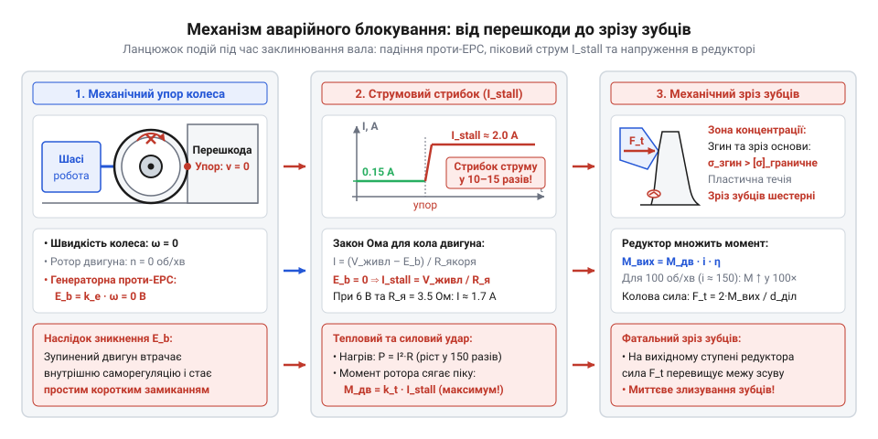
*Ланцюг переходу приводу в аварійний стан: механічна перешкода зупиняє колесо, проти-ЕРС падає до нуля, стрибок струму до значення блокування I_stall генерує піковий крутний момент ротора, що спричиняє зрізання зубів вихідного ступеня мікроредуктора.*

На кожному наступному ступені зубчастої передачі крутний момент зростає, концентруючись на вихідному ступені редуктора. У [мініатюрних циліндричних редукторах](root:hw-motion/gearbox-micro-spur) модуль зубчастого зачеплення (від лат. *modulus* — міра) становить усього `m ≈ 0.2 - 0.3 мм`, а самі шестерні виготовляють із латуні або поліацеталю. Коли вихідний вал заклинено колесом, а попередні ступені тиснуть із максимальним піковим зусиллям ротора, дотичне механічне напруження зрізу (@@en|shear stress@@, від давн.-англ. *sceran* — різати, відокремлювати) у коренях зубців шестерні перевищує границю міцності матеріалу:

```
τ_діюче > τ_граничне
```

Зубці шестерні вихідного ступеня миттєво зрізаються (явище @@en|gear stripping@@): ротор розганяється до максимальних обертів ухолосту з характерним тріском викришеного металу, а платформа назавжди втрачає рухливість.

> 🔧 **Навіщо це.**
> Режим механічного блокування вала для мобільного робота є не випадковим форс-мажором, а штатним сценарієм експлуатації: колесо неминуче застрягне в дротах, упреться в стіну чи заклинить у ворсі килима. Якщо система керування не відстежує стан двигунів, перша ж побутова перешкода незворотно зріже шестерні редуктора або спалить драйвер. Запобігання цій аварії вимагає двох кроків: інженерного розрахунку навантаження для виключення роботи на межі блокування та впровадження швидкого програмно-апаратного струмового захисту.

## Механічний розрахунок тягового зусилля, крутного моменту та швидкості диференціальної платформи

Щоб колісна платформа впевнено рухалася заданим маршрутом і не переходила в небезпечний режим заклинювання, параметри мотор-редуктора та геометрію рушія необхідно узгодити аналітично. Диференціальний колісний привод (від лат. *differentia* — різниця, відмінність) складається з двох незалежних ведучих коліс, кожне з яких обертається власним двигуном, та однієї або двох пасивних точок опори (кулькові опори чи вільно орієнтовані ролики). Здатність платформи рухатися вперед визначається балансом між тяговим зусиллям ведучих коліс та силами опору, що протидіють рухові.

Розгляньмо мобільного робота повною спорядженою масою `m`, який рухається вгору похилою поверхнею з кутом підйому `α` (від грец. *klinein* — нахиляти). Сила тяжіння `P = m · g` (де `g ≈ 9.81 м/с²` — прискорення вільного падіння) розкладається на дві взаємно перпендикулярні складові:

1. Сила нормального тиску на поверхню, яка притискає колеса до опорної площини:
   `N = m · g · cos(α)`
2. Скочувальна складова сили тяжіння, спрямована вздовж похилої площини вниз:
   `F_підйом = m · g · sin(α)`

Під час кочення колеса зазнають опору коченню (від лат. *resistere* — чинити опір), спричиненого мікродеформацією матеріалу шини та контактної поверхні. Сила опору коченню пропорційна силі нормального тиску:

```
F_кочення = f_r · N = f_r · m · g · cos(α)
```

де `f_r` — безрозмірний коефіцієнт опору коченню (@@en|rolling resistance coefficient@@). Для твердої гумової шини по гладкому ламінату чи металу `f_r ≈ 0.015 - 0.020`. На м'якому килимовому покритті з довгим ворсом колесо просідає у глибину волокон, і коефіцієнт опору зростає втричі-вчетверо: `f_r ≈ 0.05 - 0.08`.

Якщо робот повинен розганятися з лінійним прискоренням `a`, двигуни мусять подолати додаткову силу інерційного опору платформи:

```
F_інерція = m · a
```

Сумарне тягове зусилля `F_тяга`, необхідне для сталого рівномірного руху платформи вгору по схилу (`a = 0`):

```
F_тяга = F_підйом + F_кочення
       = m · g · (sin(α) + f_r · cos(α))
```

Тягове зусилля створюється двома ведучими колесами. За симетричного розподілу маси кожне колесо передає на поверхню половину потрібної сили: `F_колесо = F_тяга / 2`. Механічна передача від ротора до колеса має внутрішні втрати на тертя в зубчастих зачепленнях та втулках валів, які описуються коефіцієнтом корисної дії (ККД, @@en|mechanical efficiency@@) редуктора `η_мех` (для мініатюрних циліндричних редукторів `η_мех ≈ 0.75 - 0.85`). Також інженерний розрахунок обов'язково закладає експлуатаційний коефіцієнт запасу (@@en|safety factor@@) `k_з ≈ 1.3 - 1.5` на випадок просідання напруги батареї та локальних нерівностей шляху:

```
F_розр = (k_з · F_тяга) / (2 · η_мех)
```

Радіус ведучого колеса `R` (або діаметр `D = 2 · R`) зв'язує лінійний рух платформи з обертовим рухом вихідного вала редуктора. Якщо вал редуктора обертається з кутовою швидкістю `ω` (від лат. *angulus* — кут та *velocitas* — швидкість), вираженою через частоту обертання `n` в обертах за хвилину (об/хв):

```
ω = (2 · π · n) / 60
```

то теоретична лінійна швидкість руху платформи `v` дорівнює:

```
v = ω · R = (2 · π · n / 60) · R
```

Тягова сила на ободі колеса пов'язана з крутним моментом (від лат. *torquere* — скручувати) на вихідному валу редуктора `T_вал` співвідношенням плеча важеля:

```
F_колесо = T_вал / R
```

Звідси випливає фундаментальний інженерний компроміс колісного рушія:

```
T_вал = F_колесо · R
```

Збільшення радіуса колеса `R` пропорційно піднімає лінійну швидкість платформи (`v ∝ R`), але точно так само пропорційно зменшує тягове зусилля на контактній плямі (`F_колесо ∝ 1 / R`). Якщо подвоїти діаметр коліс без зміни мотора, робот теоретично поїде вдвічі швидше, але його тяга на ободі впаде рівно вдвічі.

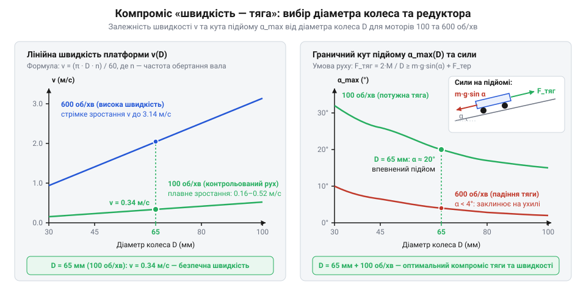
*Залежність лінійної швидкості платформи та максимального подоланого кута ухилу від діаметра ведучого колеса для мотор-редукторів на 100 об/хв та 600 об/хв при фіксованій напрузі 6 В: збільшення діаметра колеса лінійно піднімає швидкість, але пропорційно знижує тягове зусилля.*

Порівняймо поведінку двох типових мотор-редукторів постійного струму на 6 В однакового типорозміру, але з різними редукторами:
- Мотор на 100 об/хв: має високе передавальне число (`i ≈ 1:100`...`1:150`). Кутова швидкість вихідного вала помірна: `ω ≈ 10.47 рад/с`. Номінальний крутний момент становить близько `T_ном ≈ 0.35 Н·м` (350 мН·м, або 3.5 кг·см), а момент блокування перевищує 0.9–1.1 Н·м.
- Мотор на 600 об/хв: має мале передавальне число (`i ≈ 1:20`...`1:30`). Вихідний вал обертається швидко: `ω ≈ 62.83 рад/с`. Проте його номінальний крутний момент у шість разів менший: лише `T_ном ≈ 0.055 Н·м` (55 мН·м, або 0.55 кг·см), а момент блокування не перевищує 0.18–0.22 Н·м.

Проведемо повний наскрізний розрахунок для типової платформи мобільного робота.

**Вихідні дані інженерного розрахунку:**
- Повна маса платформи: `m = 0.8 кг`.
- Розрахунковий кут підйому: `α = 15°` (`sin(15°) ≈ 0.2588`, `cos(15°) ≈ 0.9659`).
- Покриття: щільний ворсистий килим із коефіцієнтом опору коченню `f_r = 0.05`.
- ККД редуктора: `η_мех = 0.80`.
- Коефіцієнт експлуатаційного запасу: `k_з = 1.4`.

Обчислення сумарного тягового зусилля рівномірного руху на підйомі:

```
F_тяга = m · g · (sin(α) + f_r · cos(α))
       = 0.8 · 9.81 · (0.2588 + 0.05 · 0.9659)    [підстановка значень параметрів системи]
       = 7.848 · (0.2588 + 0.0483)               [обчислення складових нахилу та тертя]
       = 7.848 · 0.3071                         [сумування коефіцієнтів опору]
       ≈ 2.410 Н                                [сумарне тягове зусилля платформи]
```

Розрахунок необхідного зусилля на ободі одного колеса з урахуванням запасу потужності та механічних втрат:

```
F_колесо = (k_з · F_тяга) / (2 · η_мех)
         = (1.4 · 2.410) / (2 · 0.80)            [урахування запасу 40% та розподілу на 2 колеса]
         = 3.374 / 1.60                          [ділення на подвоєний ККД]
         ≈ 2.109 Н                               [розрахункова тяга одного ведучого колеса]
```

Тепер порівняємо два стандартні варіанти коліс:
1. Компактне колесо: діаметр `D = 42 мм` (`R = 0.021 м`).
2. Велике колесо: діаметр `D = 65 мм` (`R = 0.0325 м`).

Розрахунок необхідного крутного моменту двигуна для колеса діаметром 42 мм:

```
T_потр_42 = F_колесо · R
          = 2.109 · 0.021                        [множення сили тяги на радіус колеса]
          ≈ 0.0443 Н·м                           [необхідний номінальний крутний момент вала]
```

Для колеса діаметром 42 мм потрібен крутний момент `0.0443 Н·м = 44.3 мН·м` (приблизно 0.45 кг·см).
Лінійна швидкість руху робота з таким колесом:
- Для мотора 100 об/хв: `v = 10.47 · 0.021 ≈ 0.22 м/с` (22 см/с).
- Для мотора 600 об/хв: `v = 62.83 · 0.021 ≈ 1.32 м/с` (132 см/с).

Розрахунок необхідного крутного моменту двигуна для колеса діаметром 65 мм:

```
T_потр_65 = F_колесо · R
          = 2.109 · 0.0325                       [множення тяги на збільшений радіус колеса]
          ≈ 0.0685 Н·м                           [необхідний номінальний крутний момент вала]
```

Для колеса діаметром 65 мм потрібен крутний момент `0.0685 Н·м = 68.5 мН·м` (приблизно 0.70 кг·см).
Лінійна швидкість руху робота зі збільшеним колесом:
- Для мотора 100 об/хв: `v = 10.47 · 0.0325 ≈ 0.34 м/с` (34 см/с).
- Для мотора 600 об/хв: `v = 62.83 · 0.0325 ≈ 2.04 м/с` (понад 7 км/год).

Отримані результати наочно пояснюють фізичну причину відмови приводів:
- Мотор-редуктор на 100 об/хв має номінальний момент `T_ном = 0.35 Н·м` (350 мН·м). Необхідні для руху на підйомі 44.3 мН·м (для колеса 42 мм) та 68.5 мН·м (для колеса 65 мм) завантажують двигун лише на 12–20% від його номінальної здатності. Мотор працює з високим ККД, не нагрівається і має п'ятикратний запас тяги, легко долаючи нерівності, стики та випадкові перешкоди.
- Мотор-редуктор на 600 об/хв має номінальний момент лише `T_ном = 0.055 Н·м` (55 мН·м).
  З колесом 42 мм робоча точка становить `44.3 / 55 ≈ 80%` від номіналу — мотор працює на межі тривалого нагрівання.
  З колесом 65 мм необхідний крутний момент `68.5 мН·м` перевищує паспортний номінальний момент двигуна майже на 25%. Мотор виходить із номінального швидкісного режиму: оберти стрімко падають, споживаний струм різко зростає, нагріваючи обмотки. За найменшого локального опору колесо зупиняється повністю, і двигун переходить у руйнівне заклинювання вала.

Щоб визначити абсолютну межу можливостей платформи, знайдемо граничний кут підйому `α_макс`, який робот здатний подолати при номінальному моменті моторів. Складемо рівняння граничної рівноваги, коли максимальне тягове зусилля двох коліс зрівноважує сили опору:

```
2 · (T_ном / R) · η_мех = m · g · (sin(α_макс) + f_r · cos(α_макс))
```

Введемо безрозмірний коефіцієнт тягооснащеності платформи `C`, що показує відношення тягової сили приводу до сили тяжіння:

```
C = (2 · T_ном · η_мех) / (m · g · R)
```

Для помірних кутів нахилу (`cos(α) ≈ 1`) рівняння набуває простого інженерного вигляду:

```
sin(α_макс) ≈ C - f_r
```

Звідки граничний кут підйому дорівнює:

```
α_макс ≈ arcsin(C - f_r)
```

Обчислимо граничний кут для швидкісного мотора 600 об/хв із колесом діаметром 65 мм:

```
C = (2 · 0.055 · 0.80) / (0.8 · 9.81 · 0.0325)
  = 0.088 / 0.2550                              [співвідношення тяги й сили ваги]
  ≈ 0.3451                                      [коефіцієнт тягооснащеності системи]
```

```
sin(α_макс) ≈ C - f_r
            = 0.3451 - 0.05                     [віднімання коефіцієнта опору коченню]
            = 0.2951                            [значення синуса граничного кута]
```

```
α_макс = arcsin(0.2951) ≈ 17.1°
```

Для мотора на 600 об/хв із колесами 65 мм граничний кут підйому на килимі становить лише 17 градусів без будь-якого запасу на розгін чи подолання перешкод. Реальний надійний кут експлуатації не перевищує 10 градусів.
Натомість для мотора на 100 об/хв із тими самими колесами:

```
C = (2 · 0.35 · 0.80) / 0.2550 ≈ 2.196
```

Оскільки `C - f_r = 2.196 - 0.05 = 2.146 > 1`, крутний момент редуктора повністю перекриває силу тяжіння: робот обмежений не потужністю мотора, а суто силою тертя зчеплення гуми з поверхнею (колеса почнуть буксувати) або небезпекою перекидання шасі назад через зміщення вектора реакції опори за контур колісної бази.

> 🔧 **Навіщо це.**
> Попередній розрахунок тягового зусилля та крутного моменту виключає найпоширенішу помилку конструктора — гонитву за максимальною швидкістю за рахунок надмірного діаметра коліс. Якщо платформа призначена для маневреного руху по рівних поверхнях (роботи-футболісти, швидкісні траєкторні платформи), доцільно обрати мотори на 600 об/хв, але обмежити діаметр коліс до 32–40 мм. Якщо ж робот має впевнено долати домашні килими, ухили та нести корисне навантаження (роботи-пилососи, мобільні маніпулятори), слід обирати мотори на 100 об/хв у парі з колесами 60–65 мм.

Аналітичний розрахунок забезпечує правильний вибір редуктора та діаметра коліс для штатного руху. Проте реальне середовище завжди несе непередбачувані механічні перешкоди: кабель живлення на підлозі, що намотався на вісь, глухий кут меблів чи сторонній предмет, який раптово блокує колесо. У такій ситуації навіть правильно розрахований редуктор на 100 об/хв миттєво піддається руйнівному струму блокування. Щоб уберегти шестерні та симистори драйвера від пошкодження, механічний розрахунок доповнюють схемотехнічним вимірюванням струму та алгоритмом аварійного відключення живлення.

## Компонування шасі мобільної платформи та диференціальна кінематика

Наїзд на звичайний стик підлогового покриття, поріжок чи дрібну нерівність миттєво відриває одне з коліс чотириколісного жорсткого візка в повітря. Якщо шасі не має пружної підвіски з важелями та амортизаторами, чотири жорсткі точки контакту перетворюють платформу на механічно перевизначену систему: три точки спираються на площину, а четверта — неминуче висить або спричиняє діагональне хитання. У момент відриву тягове колесо втрачає контакт із ґрунтом, мотор розкручується вхолосту, а платформа раптово звертає вбік.

Саме тому в мобільній робототехніці кінематика (від грец. κίνημα, kinema — рух) та компонування шасі (від франц. châssis — рама, основа) спираються на статично визначену триопорну схему: два незалежні ведучі колеса на спільній поперечній осі та одна допоміжна пасивна опора — кастор (від англ. @@en|caster@@ — вільно орієнтовне опорне колесо або кулькова опора). Три точки контакту за будь-якого профілю поверхні лежать в одній геометричній площині, гарантуючи постійний контакт тягових коліс із підлогою без ускладнення конструкції підвіскою.

Керування рухом у такій схемі реалізується як [диференціальний привод](root:sys-dron/wheel-differential-kinematics) (від лат. differentia — різниця, відмінність; керування просторовим рухом через узгоджену різницю лінійних швидкостей правого й лівого бортів). Платформа позбавлена поворотних цапф і кермової трапеції: кривина траєкторії формується виключно за рахунок неузгодженості швидкостей обертання або протилежного напрямку руху ведучих коліс.

Геометрію платформи визначають три параметри:
- Колія (від прасл. *kolija — колійна борозна; в інженерії — поперечна відстань між центрами плям контакту лівого і правого коліс із поверхнею, @@en|track width@@) `L`.
- Поздовжня база (від грец. βάσις, basis — основа, опора; відстань уздовж поздовжньої осі від осі ведучих коліс до точки контакту опорного кастора, @@en|wheelbase@@) `b`.
- Радіус ведучих коліс `r` (де діаметр колеса `D = 2 · r`).

Кутові швидкості обертання вихідних валів лівого `ω_L` та правого `ω_R` мотор-редукторів (у радіанах за секунду, `рад/с`) задають лінійні швидкості руху точок контакту коліс із опорною площиною:
`v_L = ω_L · r`
`v_R = ω_R · r`

За відсутності поперечного ковзання [кінематика диференціальної платформи](root:sys-dron/differential-kinematics) описує рух шасі суміщенням поступальної швидкості вперед та обертання навколо вертикальної осі. Лінійна швидкість геометричного центра ведучої осі платформи `v` дорівнює півсумі швидкостей коліс:
`v = (v_R + v_L) / 2`

Кутова швидкість розвороту платформи навколо вертикальної осі `ω` визначається різницею лінійних швидкостей коліс, поділеною на ширину колії:
`ω = (v_R - v_L) / L`

Радіус кривини траєкторії `R` — відстань від центра ведучої осі до миттєвого центру швидкостей (від англ. @@en|Instantaneous Centre of Curvature@@, ICC) — отримують як відношення лінійної швидкості до кутової:
`R = v / ω = (L / 2) · (v_R + v_L) / (v_R - v_L)`

Звідси випливають чотири кінематичні режими:
1. Прямолінійний рух (`v_L = v_R`): кутова швидкість `ω = 0`, радіус кривини `R → ∞`.
2. Поворот навколо нерухомого колеса (`v_L = 0`, `v_R > 0`): `v = v_R / 2`, `ω = v_R / L`, радіус `R = L / 2`.
3. Танковий розворот на місці (`v_R = -v_L`): поступальна швидкість `v = 0`, радіус `R = 0`, кутова швидкість `ω = 2 · v_R / L`.
4. Рух по дузі радіуса `R`: швидкості коліс задаються як `v_L = v · (1 - L / (2 · R))` та `v_R = v · (1 + L / (2 · R))`.

> 🔧 **Навіщо це.**
> У прошивці планувальник траєкторії видає пари «швидкість `v` — радіус `R`». Кінематичні формули транслюють їх у шпаруватість ШІМ для кожного мотора, запобігаючи зрізанню кутів і ривкам платформи під час повороту.

Ширина колії `L` задає компроміс між маневреністю та стабільністю ходу. Широка колія зменшує `ω = Δv / L` за однакової різниці швидкостей `Δv`, згладжуючи розкид параметрів моторів на прямій, але збільшує габарит розвороту. Вузька колія підвищує маневреність у тісних проходах, але чутливіша до асиметрії тяги двигунів.

Навіть ідеально розрахована кінематика руйнується, якщо шасі розважене неправильно. Буксування (від нім. *Büchse* — коробка, втулка; проковзування коліс із втратою сили зчеплення) настає тоді, коли крутний момент редуктора створює тягове зусилля, що перевищує межу зчеплення гумової шини з поверхнею.

За законом сухого тертя Кулона гранична тягова сила коліс без зриву в проковзування прямо пропорційна силі нормальної реакції опори:
`F_traction_max = μ · N_w`
де `μ` — коефіцієнт зчеплення шини з покриттям (`μ ≈ 0.6...0.8` для гумового протектора по сухому ламінату чи дереву), а `N_w` — сумарна нормальна сила притискання двох ведучих коліс до площини.

Сила `N_w` повністю залежить від положення центра мас платформи вздовж поздовжньої осі.

Розглянемо платформу масою `m` і загальною вагою `P = m · g` (де прискорення вільного падіння `g ≈ 9.81` м/с²). Вісь ведучих коліс розташована в початку координат `x = 0`, а пасивний опорний кастор винесено на відстань поздовжньої бази `b`. Центр мас платформи розташований на відстані `x_c` від ведучої осі в бік опорного ролика (`0 < x_c < b`), на висоті `h_c` над підлогою.

З умов статичної рівноваги вертикальних сил та моментів сил відносно осі ведучих коліс:
`N_w + N_c = m · g`
`m · g · x_c - N_c · b = 0`

Звідси нормальні реакції тягової осі `N_w` та опорного кастора `N_c` виражаються через геометрію:
`N_c = m · g · (x_c / b)`
`N_w = m · g · (1 - x_c / b)`

Ці формули визначають межі двох небезпечних конструкторських крайнощів:
1. Зміщення центра мас назад до опорного ролика (`x_c → b`):
Якщо важкий акумуляторний блок встановлено поруч із кастором, координата `x_c` сягає `0.7...0.8 · b`. На опорний ролик припадає до 80 % маси платформи, а ведучі колеса розвантажуються до 20–30 %: `N_w = 0.2...0.3 · m · g`. Гранична сила зчеплення `F_traction_max` катастрофічно зменшується. Щойно [N20 мікромотор з редуктором](root:cat-hw-actuators/n20-motor) розвиває крутний момент `M_wheel`, тягова сила перевищує поріг зчеплення: `M_wheel / r > μ · N_w`. Колеса миттєво зриваються в буксування. Робот безпорадно шліфує підлогу на місці при спробі рушити з прискоренням або подолати ухил у 15 градусів.
2. Зміщення центра мас уперед, до або за ведучу вісь (`x_c ≤ 0`):
Якщо масу винести вперед за ведучу вісь, нормальна реакція кастора падає до нуля: `N_c ≤ 0`. Платформа перетворюється на хитку гойдалку на двох колесах. Під час руху вперед зі швидкістю `v` та екстреного гальмування з уповільненням `a_brake` сила інерції `F_in = m · a_brake`, прикладена до центра мас на висоті `h_c`, створює перекидний поздовжній момент:
`M_pitch = m · a_brake · h_c`
Цей момент перекидає платформу вперед через лінію контакту ведучих коліс. Якщо кастор розташований попереду платформи й перевантажений надмірним зміщенням маси вперед, його маленьке коліщатко має підвищений опір коченню, застрягає в швах підлоги й ворсі килимів, що створює великий гальмівний опір і блокує повороти.

Золоте правило проектування шасі: на ведучі колеса має припадати 70–80 % повної маси платформи (`N_w ≈ 0.75 · m · g`), а на пасивний опорний кастор — 20–25 % (`N_c ≈ 0.25 · m · g`). Для цього центр мас платформи виносять на відстань `x_c ≈ (0.20...0.25) · b` від осі ведучих коліс. Висоту центра мас `h_c` роблять мінімальною, монтуючи редуктори та елементи живлення на нижній базовій пластині шасі.

**Розрахунок статичного розважування шасі та кінематичних швидкостей коліс:**
- Повна маса платформи з акумулятором: `m = 0.85` кг.
- Поздовжня база між віссю та кастором: `b = 0.11` м (110 мм).
- Ширина колії коліс: `L = 0.14` м (140 мм).
- Діаметр коліс: `D = 0.065` м (радіус `r = 0.0325` м).
- Зміщення центра мас від ведучої осі: `x_c = 0.0275` м (рівно 25 % від бази `b`).
- Коефіцієнт зчеплення гуми з покриттям: `μ = 0.75`.

```
N_c
= m · g · (x_c / b)                       [рівновага моментів сил відносно осі ведучих коліс]
= 0.85 · 9.81 · (0.0275 / 0.11)           [підстановка: m = 0.85 кг, b = 0.11 м, x_c = 0.0275 м]
= 2.085 Н                                 [нормальна реакція пасивного кастора (25 % загальної ваги)]

N_w
= m · g · (1 - x_c / b)                   [сумарна вертикальна рівновага сил: N_w = P - N_c]
= 0.85 · 9.81 · (1 - 0.0275 / 0.11)       [підстановка параметрів шасі]
= 6.254 Н                                 [сумарна нормальна реакція на два ведучі колеса (75 % ваги)]

F_traction_max
= μ · N_w                                 [закон сухого тертя Кулона без проковзування]
= 0.75 · 6.254                            [коефіцієнт тертя гуми об підлогу μ = 0.75]
= 4.690 Н                                 [максимальна сумарна тягова сила без зриву в буксування]

M_limit
= F_traction_max · r                      [граничний крутний момент на осі двох ведучих коліс]
= 4.690 · 0.0325                          [радіус колеса r = D / 2 = 0.065 / 2 = 0.0325 м]
= 0.1524 Н·м = 152.4 мН·м                 [по 76.2 мН·м на кожне з двох коліс платформи]
```

Розрахуємо швидкості моторів для правого повороту по дузі радіуса `R = 0.35` м зі швидкістю `v = 0.25` м/с:

```
v_L
= v · (1 + L / (2 · R))                   [зовнішнє колесо: колія L = 0.14 м, радіус R = 0.35 м]
= 0.25 · (1 + 0.14 / (2 · 0.35))
= 0.300 м/с                               [лінійна швидкість лівого колеса]

v_R
= v · (1 - L / (2 · R))                   [внутрішнє колесо дуги]
= 0.25 · (1 - 0.14 / (2 · 0.35))
= 0.200 м/с                               [лінійна швидкість правого колеса]

ω_L = v_L / r = 0.300 / 0.0325 = 9.231 рад/с ≈ 88.1 об/хв   [кутова швидкість лівого мотора]
ω_R = v_R / r = 0.200 / 0.0325 = 6.154 рад/с ≈ 58.8 об/хв   [кутова швидкість правого мотора]
```

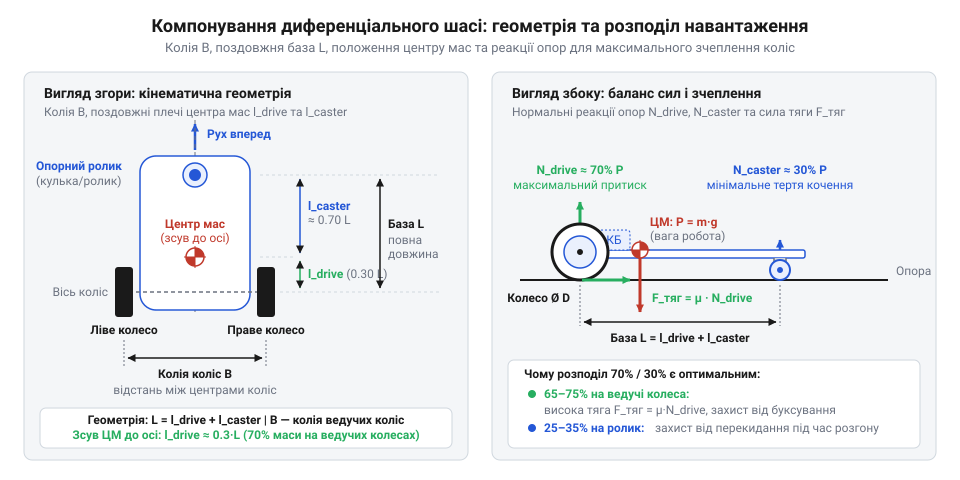
*Компонування триопорного шасі з диференціальним приводом: положення центра мас на відстані 25 % бази від тягової осі забезпечує 75 % нормального навантаження на ведучі колеса для збереження сили зчеплення та стійкості проти перекидання.*

Використання редуктора на 100 об/хв повністю задовольняє цільовий швидкісний режим (88.1 об/хв при запасі тяги), тоді як швидкісна версія на 600 об/хв на малих швидкостях вимагає низької шпаруватості ШІМ, де розкриваються особливості комутації силових ключів драйвера.

## Силова електроніка керування: підключення 6 В моторів через H-міст та організація незалежного живлення

Вихідні порти мікроконтролера оперують логічними рівнями 3.3 В або 5 В, а їхнє струмове навантаження обмежене значенням 10–20 мА. Колекторний двигун 6 В під навантаженням споживає 200–400 мА, а під час пуску з місця або зупинки вала — понад 1.2–1.5 А. Пряме підключення обмотки до виводу кристала призводить до теплового руйнування транзисторної структури порту. Крім того, для реверсу колеса необхідно змінювати полярність струму в обмотці.

Цю задачу вирішує силова схема — [H-міст](root:hw-motion/h-bridge-drivers) (від графічної подібності латинської літери H; чотири керовані ключі у вертикальних плечах із навантаженням-двигуном у горизонтальній діагоналі; @@en|H-bridge@@).

Вибір елементної бази H-моста критично визначає працездатність робота від низьковольтного живлення 6 В. Популярний у навчальних конструкціях драйвер L298N побудований на застарілих біполярних транзисторах (від лат. bi- — два та polus — полюс; напівпровідникові прилади, у яких струм формується носіями обох знаків — електронами й дірками), виконаних за схемою пар Дарлінгтона (від англ. @@en|Darlington pair@@ — складений біполярний каскад).

У режимі насичення на переході колектор-емітер біполярного транзистора Дарлінгтона виникає незмінне падіння напруги `V_CE(sat) ≈ 0.9...1.1` В. Оскільки струм двигуна обов'язково протікає крізь два послідовно ввімкнені ключі — верхній ключ (від шини живлення) та нижній ключ (до шини землі), сумарне падіння напруги на драйвері L298N сягає:
`ΔV_bridge = V_CE(sat)_high + V_CE(sat)_low ≈ 1.8...2.2` В.

При живленні від акумуляторного блока 6.0 В на клеми моторів надходить лише:
`V_motor = 6.0 - 2.0 = 4.0` В.

Двигун втрачає рівно третину (33.3 %) номінальної напруги. Оскільки кутова швидкість холостого ходу колекторного мотора прямо пропорційна напрузі на клемах, а максимальний пусковий момент залежить від неї лінійно, двигун із маркуванням 600 об/хв розвине максимум 400 об/хв, а тягова здатність платформи впаде на третину. Втрачена напруга перетворюється на тепло: при робочому струмі двох моторів по 0.6 А на мікросхемі L298N марно виділяється `P = 2.0 В · 1.2 А = 2.4` Вт тепла, що змушує встановлювати масивний алюмінієвий радіатор і прискорено висаджує акумулятор.

Сучасні драйвери — DRV8833 від Texas Instruments та TB6612FNG від Toshiba — побудовані на польових транзисторах MOSFET (від англ. @@en|metal-oxide-semiconductor field-effect transistor@@ — польовий транзистор метал-оксид-напівпровідник). Відкритий канал польового транзистора еквівалентний суто омічному резистору з наднизьким опором відкритого каналу (від англ. @@en|drain-source on-resistance@@, `R_DS(on)`).

Для інтегрального моста DRV8833 сумарний опір пари верхнього та нижнього польових ключів становить:
`R_DS(on)_total ≈ 0.36` Ом (360 мОм).
Для TB6612FNG цей опір становить:
`R_DS(on)_total ≈ 0.50` Ом (500 мОм).

При робочому струмі `0.25` А падіння напруги на ключах DRV8833 складає всього:
`ΔV_bridge = 0.25 А · 0.36 Ом = 0.09` В.
На мотор потрапляє `6.0 - 0.09 = 5.91` В (98.5 % від напруги живлення).

**Порівняльний розрахунок енергетичних втрат L298N та DRV8833 при струмі 0.6 А на мотор:**

```
ΔV_drop_L298N
= V_CE(sat)_high + V_CE(sat)_low          [сумарне падіння напруги на двох біполярних парах Дарлінгтона]
= 1.1 + 1.0                               [падіння напруги на верхньому та нижньому ключах при струмі 0.6 А]
= 2.1 В                                   [втрата напруги всередині мікросхеми L298N]

V_motor_L298N
= V_batt - ΔV_drop_L298N                  [реальна напруга, що доходить до клем двигуна]
= 6.0 - 2.1
= 3.9 В                                   [двигун отримує лише 65 % від номінальної напруги 6 В]

P_loss_L298N
= 2 · (ΔV_drop_L298N · I_motor)           [теплові втрати драйвера на два мотори при струмі по 0.6 А]
= 2 · (2.1 · 0.6)
= 2.52 Вт                                 [потужність нагріву мікросхеми, необхідний масивний радіатор]

ΔV_drop_DRV8833
= I_motor · R_DS(on)_total                [падіння напруги на відкритому опорі каналів MOSFET]
= 0.6 · 0.360                             [робочий струм 0.6 А, сумарний опір двох ключів 360 мОм]
= 0.216 В                                 [втрата напруги на польовому мості DRV8833]

V_motor_DRV8833
= V_batt - ΔV_drop_DRV8833                [реальна напруга на виводах двигуна]
= 6.0 - 0.216
= 5.784 В                                 [двигун отримує 96.4 % від номінальної напруги 6 В]

P_loss_DRV8833
= 2 · (I_motor² · R_DS(on)_total)         [теплові втрати драйвера на два мотори при струмі по 0.6 А]
= 2 · (0.6² · 0.360)
= 0.259 Вт = 259 мВт                      [тепловиділення майже вдесятеро менше, радіатор не потрібен]
```

Керування H-мостом спирається на логічні входи:
- У TB6612FNG кожен канал має роздільні входи напрямку `IN1`, `IN2` та вхід широтно-імпульсної модуляції `PWM` (ШІМ), а також загальний вивід переведення в режим сну `STBY`.
- У DRV8833 керування здійснюється подачею ШІМ безпосередньо на виводи `IN1` та `IN2`.

| Вхід `IN1` | Вхід `IN2` | Стан силових ключів моста | Режим роботи приводу | Фізичний процес в обмотці мотора |
| :--- | :--- | :--- | :--- | :--- |
| `HIGH` | `LOW` | Верхній лівий і нижній правий відкриті | Рух уперед | Прямий струм наростає від `VM` до землі |
| `LOW` | `HIGH` | Верхній правий і нижній лівий відкриті | Рух назад (реверс) | Зворотний струм протікає крізь обмотку |
| `LOW` | `LOW` | Усі чотири ключі закриті | Вільний вибіг (@@en|coast / fast decay@@) | Струм рекуперує в шину живлення через паразитні діоди; швидке згасання струму |
| `HIGH` | `HIGH` | Обидва нижні ключі відкриті | Динамічне гальмування (@@en|brake / slow decay@@) | ЕРС самоіндукції замикається накоротко через нижні ключі; активне гальмування ротора |

При ШІМ-керуванні вибір між швидким спаданням струму (@@en|fast decay@@) та повільним спаданням (@@en|slow decay@@) визначає керованість платформи на малих обертах. У режимі повільного спадання струму (подача ШІМ на один вхід при логічній одиниці на іншому в DRV8833) у паузі між імпульсами ШІМ обидва нижні MOSFET-транзистори закорочують виводи мотора. Індуктивний струм замикається через відкриті канали з низьким `R_DS(on)`, плавно підтримуючи струм обмотки без розривів. Це забезпечує лінійну характеристику зв'язку між коефіцієнтом заповнення ШІМ і моментом двигуна, виключаючи ривки та рипіння на малих швидкостях.

Поряд із правильним вибором ключів ключове інженерне завдання полягає в захисті логіки від завад. Чому мікроконтролер спонтанно перезавантажується під час старту моторів?
Колекторний двигун під навантаженням генерує деструктивні завади двох типів:
1. Просідання напруги батареї (від англ. @@en|brownout@@ — короткочасне падіння напруги живлення нижче мінімального робочого порогу мікросхеми):
Хімічні джерела струму мають власний внутрішній опір `R_int`. У момент одночасного пуску двох двигунів сумарний пусковий струм досягає `I_start ≈ 2.5...3.0` А.
Падіння напруги на внутрішньому опорі батареї:
`ΔV_batt = I_start · R_int`
При внутрішньому опорі підсілих елементів `R_int = 0.8` Ом напруга на акумуляторній шині короткочасно просідає на `ΔV = 2.4` В (з 6.0 В до 3.6 В). Лінійний LDO-стабілізатор мікроконтролера втрачає мінімально необхідний перепад напруги, напруга живлення процесора 3.3 В провалюється нижче 2.7 В, спрацьовує вбудований детектор зниження живлення (@@en|Brown-Out Reset@@, BOR), і мікроконтролер перезавантажується в момент старту.
2. Комутаційні сплески та іскріння щіток (від лат. commutatio — зміна, чергування):
Колекторний вузол є механічним перемикачем ламелей. При розриві контакту пружної щітки з ламеллю колектора струм в індуктивності якоря `L_arm` обривається за одиниці наносекунд. За законом електромагнітної індукції Фарадея виникає сплеск зворотної ЕРС:
`u_L = -L_arm · (di / dt)`
Надвисока швидкість обриву струму `di / dt` формує імпульси амплітудою від 30 до 60 В. Підвідні дроти до двигуна працюють як передавальні антени, що випромінюють широкосмугові радіозавади, збиваючи тактування генератора процесора та блокуючи шини зв'язку I2C і SPI.

Надійне функціонування платформи забезпечує чотирирівневий апаратний захист:
1. Повне розділення шин живлення: силова лінія `VMOT` (6 В) подається від акумулятора безпосередньо на виводи живлення драйвера H-моста. Шина логіки `VDD` (3.3 В або 5 В) формується окремим стабілізатором напруги. На вході стабілізатора встановлюють діод Шотткі та буферний танталовий або електролітичний конденсатор ємністю 220–470 мкФ. При просіданні напруги на акумуляторі діод блокує зворотний струм, і буферний конденсатор автономно підтримує живлення мікроконтролера впродовж мілісекунд пускового стрибка.
2. Зіркоподібна топологія заземлення (@@en|star grounding@@): силова земля моторів `PGND` та сигнальна земля мікроконтролера `DGND` трасуються абсолютно незалежними провідниками й фізично з'єднуються лише в одній точці — безпосередньо на мінусовій клемі акумулятора. Це виключає наведення імпульсних стрибків напруги на земляному полігоні мікроконтролера під час комутації амперних струмів.
3. Локальні блокувальні конденсатори біля драйвера: безпосередньо на ніжках живлення мікросхеми H-моста паралельно монтують електролітичний конденсатор ємністю 220–470 мкФ (Low-ESR) для компенсації імпульсного споживання при роботі ШІМ та керамічний конденсатор ємністю 0.1–1.0 мкФ для гасіння високочастотних складових.
4. [Триконденсаторний фільтр](root:hw-motion/motor-noise-suppression) прямо на клемах моторів: безпосередньо на контакти кожного двигуна припаюють три дискові або SMD керамічні конденсатори ємністю 0.1 мкФ (100 нФ):
- Конденсатор `C1` монтують між двома виводами живлення двигуна (придушує диференціальну заваду між обмотками).
- Конденсатор `C2` монтують між плюсовим виводом і металевим корпусом статора.
- Конденсатор `C3` монтують між мінусовим виводом і металевим корпусом статора.
Металевий корпус двигуна надійно заземлюють, а дроти живлення від драйвера до двигуна скручують у виту пару (@@en|twisted pair@@). Корпус мотора перетворюється на клітку Фарадея, замикаючи струми іскріння щіток усередині та припиняючи випромінювання електромагнітних хвиль у простір шасі.

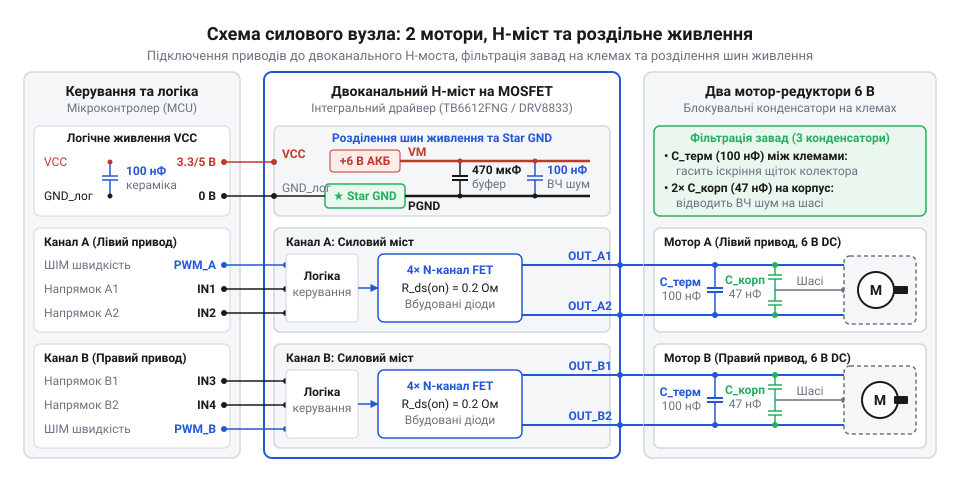
*Силова схема підключення 6 В мотор-редукторів до польового H-моста: незалежне живлення логіки, зіркоподібна точка зведення заземлення та триконденсаторне придушення комутаційних завад на клемах двигуна.*

## Схемотехніка моніторингу струму: інтеграція вимірювального шунта в нижнє плече (low-side current sensing)

Колекторні двигуни постійного струму [N20](root:cat-hw-actuators/n20-motor), підключені до [H-моста](root:hw-motion/h-bridge), обертають колеса платформи під дією широтно-імпульсної модуляції (ШІМ). Проте мікроконтролер керує ними наосліп: формує шпаруватість, але не знає механічного навантаження на валу редуктора. Коли колесо впирається в перешкоду чи застрягає, якір зупиняється, проти-ЕРС зникає, а струм обмоток стрибкоподібно зростає у 5–8 разів відносно робочого. Такий сплеск за частки секунди перегріває ламелі колектора або зрізає мікроскопічні латунні зубці шестерень редуктора під надлишковим моментом.

Для захисту механіки та ключів драйвера контролеру потрібен зворотний зв'язок за фактичним струмом. Проте [вбудований АЦП мікроконтролера](root:hw-arch/adc-microcontroller) (від грец. *ανάλογος* — пропорційний і лат. *digitus* — палець) оперує лише напругою відносно шини заземлення GND. Найнадійніший спосіб перетворити струм на пропорційну напругу — послідовне увімкнення в коло живлення вимірювального резистора (від лат. *resisto* — опираюся) відомого номіналу — шунта (від англ. @@en|shunt@@ — відгалужувати, обхідний шлях).

Топологія вимірювання струму в нижньому плечі (англ. @@en|low-side current sensing@@) передбачає встановлення шунта між спільним мінусовим виводом силового H-моста (силовою землею PGND) та системною аналоговою землею (GND). Головна перевага схеми — пряма прив'язка падіння напруги U_shunt до земляного потенціалу мікроконтролера. Це усуває потребу у високовольтних диференційних підсилювачах чи спеціалізованих мікросхемах верхнього плеча (@@en|high-side@@), дозволяючи скеровувати напругу з шунта безпосередньо на аналоговий порт.

Проте увімкнення резистора в земляний контур породжує проблему зсуву потенціалу землі силового каскаду (англ. @@en|ground bounce@@, підстрибування землі; від лат. *potentia* — сила, можливість). Коли мотором тече струм I, силова земля H-моста перевищує системний нуль на величину U_shunt = I × R_shunt. Оскільки мікроконтролер формує цифрові сигнали керування (IN1, IN2, PWM) відносно GND, напруга логічного нуля на входах моста зміщується на U_shunt. Якщо падіння напруги перевищить поріг сприйняття логічного нуля драйвера (зазвичай V_IL ≤ 0.3...0.5 В), мікросхема перестане розпізнавати низький рівень. Це спричинить збої логіки перемикання або небезпечне наскрізне відкриття транзисторних ключів.

Вибір номіналу R_shunt — інженерний компроміс між амплітудою (від лат. *amplitudo* — просторінь, величина) корисного сигналу та зсувом силової землі. За надто малого опору (0.05 Ом) при робочому струмі 0.2 А падіння напруги становитиме лише 10 мВ, що загубиться в шумах і вимагатиме підсилювача. За надмірного ж опору (1.0 Ом) при блокуванні вала зі струмом 1.0 А падіння сягне 1.0 В: зсув землі зірве логічне керування мостом, а мотор втратить понад 16% живильної напруги.

Розрахуємо номінал шунта для живлення 6 В із 10-бітним АЦП (V_ref = 3.3 В). Максимальний піковий струм перевантаження приймаємо I_max = 1.2 А (при блокуванні мотора I_stall ≈ 1.0 А), а підстрибування землі обмежуємо значенням U_max ≤ 0.264 В:

```
R_shunt
= U_max ÷ I_max                          [закон Ома для ділянки кола]
= 0.264 В ÷ 1.2 А                        [підстановка граничних значень напруги та струму]
= 0.22 Ом                                [вибір найближчого стандартного номіналу ряду E24]
```

Оцінимо роздільну здатність 10-бітного АЦП із обраним шунтом:

```
ΔV_LSB
= V_ref ÷ 2¹⁰                            [ціна молодшого значущого розряду 10-бітного АЦП]
≈ 3.223 мВ                               [поріг чутливості одного кванта при V_ref = 3.3 В]
```

При опорі R_shunt = 0.22 Ом струму 1 А відповідає падіння U = 1.0 А × 0.22 Ом = 220 мВ, що в дискретах 10-бітного АЦП становить 220 мВ ÷ 3.223 мВ ≈ 68 поділок (роздільна здатність 14.7 мА на квант). Для 12-бітного АЦП (ΔV_LSB ≈ 0.806 мВ) той самий опір дає 273 поділки на 1 А (3.66 мА на квант). Така чутливість дозволяє фіксувати струм від холостого ходу (40–60 мА, 3–4 дискрети) до робочого навантаження (150–250 мА, 10–17 дискрет) та аварійного блокування (понад 900 мА, понад 60 дискрет) без операційного підсилювача.

Тепловий розрахунок потужності розсіювання шунта за законом Джоуля-Ленца виконується для двох граничних режимів:

```
P_stall
= I_stall² × R_shunt                     [потужність розсіювання при блокуванні вала]
= (1.0 А)² × 0.22 Ом                     [підстановка максимального аварійного струму]
= 0.22 Вт                                [пікове теплове навантаження на шунт]
```

```
P_run
= I_run² × R_shunt                       [потужність розсіювання при усталеному русі]
= (0.2 А)² × 0.22 Ом                     [підстановка номінального робочого струму]
= 0.0088 Вт                              [робоче тепловиділення становить 8.8 мВт]
```

Під час номінального руху розсіювання мінімальне, проте при заклинюванні вала сягає 0.22 Вт. Резистори типорозміру 0805 із потужністю 0.125 Вт тут перегріваються, спричиняючи температурний дрейф опору чи вигорання шару. Для надійності шунт обирають у корпусі SMD 1206 (0.25 Вт), а оптимально — SMD 1210 або SMD 2010 (0.5–0.75 Вт) із металоплівковим резистивним шаром і низьким температурним коефіцієнтом опору (ТКС ≤ 50–100 ppm/°C).

Сигнал безпосередньо з виводів шунта містить інтенсивні високочастотні завади двох фізичних типів:

По-перше, комутація (від лат. *commutatio* — зміна, чергування) транзисторних ключів H-моста на частоті ШІМ (зазвичай 8–16 кГц) за наявності паразитної індуктивності обмоток мотора породжує круті фронти струму та наносекундні індуктивні викиди (голки, англ. @@en|switching spikes@@) амплітудою в кілька вольт. Потрапляння такого імпульсу на вхідний захисний діод мікроконтролера викликає тригерний ефект защіпки (англ. @@en|latch-up@@) і виводить кристал з ладу.

По-друге, механічний контакт щіток колектора (від лат. *collector* — збирач) із рухомими мідними ламелями якоря супроводжується безперервним мікродуговим іскрінням, яке генерує широкосмуговий шум у діапазоні від сотень кілогерців до десятків мегагерців. Опитування такого сигналу АЦП через ефект накладання спектрів (англ. @@en|aliasing@@) перетворює вимірювані значення на псевдовипадковий хаос.

Для придушення шумів і виділення постійної складової струму між шунтом та аналоговим входом мікроконтролера встановлюють пасивний [RC-фільтр низьких частот](root:hw-analog/rc-low-pass) (ФНЧ) першого порядку (від пізньолат. *filtrum* — повсть і лат. *condensare* — згущувати). Його частота зрізу _c має задовольняти дві вимоги:

1. Бути суттєво нижчою за робочу частоту ШІМ (_c << f_pwm), забезпечуючи згладжування пульсацій струму.
2. Забезпечувати малу постійну часу τ = R_f × C_f, щоб затримка реакції системи захисту не перевищувала кількох мілісекунд.

При роботі апаратного ШІМ мікроконтролера на типовій частоті _pwm = 8 кГц частоту зрізу ФНЧ обирають _c ≈ 150 Гц, що гарантує придушення першої гармоніки ШІМ більш ніж у 50 разів (понад 34 дБ).

Обираючи резистор R_f, враховують вхідний імпеданс (від лат. *impedio* — перешкоджаю) АЦП послідовного наближення з комутованою ємністю вибірки C_sample ≈ 8...14 пФ. Якщо опір джерела R_src перевищує паспортний ліміт (зазвичай R_src ≤ 5...10 кОм), конденсатор вибірки не встигає повністю зарядитися за час комутації, даючи відчутну похибку. Тому обирають R_f = 1.0 кОм: це на чотири порядки більше за опір шунта (не навантажує коло вимірювання), але вкладається в обмеження вхідного тракту АЦП.

Розрахуємо ємність конденсатора фільтра C_f:

```
C_f
= 1 ÷ (2 × π × R_f × f_c)                [формула частоти зрізу одноланкового RC-кола]
= 1 ÷ (2 × 3.1416 × 1000 Ом × 150 Гц)    [підстановка параметрів резистора та частоти]
= 1 ÷ 942477                             [розрахунок знаменника]
≈ 1.06 × 10⁻⁶ Ф                          [теоретична ємність конденсатора]
≈ 1.0 мкФ                                [вибір найближчого номіналу керамічного конденсатора X7R]
```

Визначимо постійну часу кола та час наростання вихідного сигналу:

```
τ
= R_f × C_f                              [постійна часу заряду RC-кола]
= 1000 Ом × 1.0 × 10⁻⁶ Ф                 [підстановка робочих номіналів]
= 0.001 с                                [теоретичний час наростання до 63.2%]
= 1.0 мс                                 [постійна часу фільтра в мілісекундах]
```

Час наростання напруги на конденсаторі до 95% становить 3 × τ = 3.0 мс. Оскільки перегрів обмоток мотора від надструму й зрізання зубців мікроредуктора тривають сотні мілісекунд, затримка фільтрації в 3 мс є цілком безпечною для механічного захисту, забезпечуючи стабільний сигнал на вході АЦП.

Топологічне розведення вимірювальних провідників має вирішальне значення. Питомий опір мідної доріжки товщиною 35 мкм і шириною 0.5 мм становить близько 0.01 Ом на кожен сантиметр довжини. Якщо підключити аналоговий вхід до земляного полігону за 3–5 см від шунта, протікання імпульсного струму 1 А створить додаткове спотворення у 30–50 мВ, що перекриє до чверті робочого діапазону.

Для усунення цієї похибки застосовують чотирипровідне підключення Кельвіна (англ. @@en|Kelvin connection@@, назване на честь британського фізика Вільяма Томсона, лорда Кельвіна). Силові лінії живлення мотора підводяться до масивних зовнішніх контактних площадок шунта широкими полігонами. Вимірювальні провідники, що йдуть до фільтра R_f і сигнальної землі АЦП, підключаються окремими тонкими доріжками безпосередньо до внутрішніх контактів корпусу резистора, де протікання сторонніх струмів виключено. Спільне заземлення організовують за принципом зірки (англ. @@en|star ground@@): земляний вивід конденсатора C_f та аналогова земля мікроконтролера з'єднуються в єдиній точці безпосередньо біля вихідного контакту шунта, запобігаючи проникненню силових контурів у чутливу аналогову частину схеми.

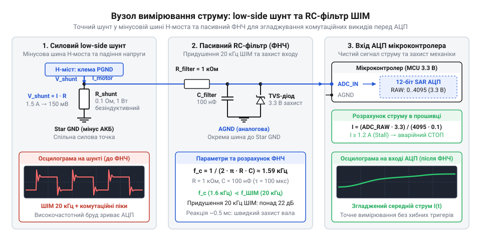
*Схема вузла вимірювання струму в нижньому плечі H-моста: резистивний шунт R_shunt увімкнено між мінусовою шиною драйвера та землею, а пасивний RC-фільтр з частотою зрізу 150 Гц очищує сигнал від імпульсних сплесків ШІМ та щіткового іскріння перед оцифруванням АЦП.*

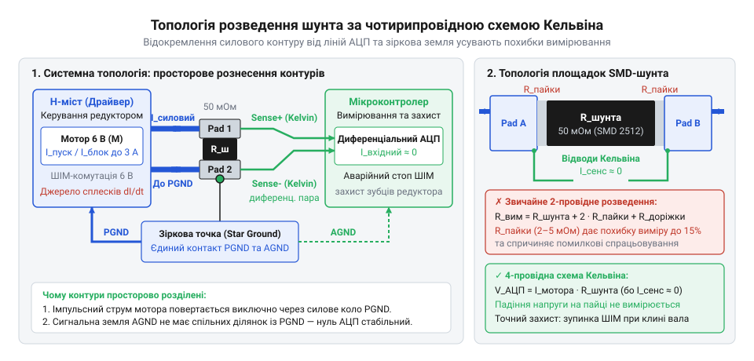
*Топологія розведення доріжок вимірювального шунта на друкованій платі за чотирипровідною схемою Кельвіна: просторове відокремлення силового контуру мотора від сигнальних ліній АЦП та зіркоподібне з'єднання земель усувають похибки від падіння напруги на спільних провідниках.*

> 🔧 **Навіщо це.**
> У мобільних робототехнічних платформах вимірювання в нижньому плечі на базі дискретного шунта й пасивного RC-фільтра — це найбільш відмовостійкий і дешевий спосіб захисту від аварій. Відмова від дорогих спеціалізованих підсилювачів струму на користь одного резистора 1206 і фільтра 0805 зберігає корисну площу плати, а правильне розведення за Кельвіном забезпечує стабільне виявлення заклинювання редуктора за лічені мілісекунди без помилкових спрацьовувань від комутаційного шуму.

## Експериментальне дослідження навантаження: порівняння струмових характеристик мотор-редукторів на 100 об/хв та 600 об/хв

Побудований вимірювальний канал на базі шунта 0.22 Ом та аналогового фільтра з постійною часу 1.0 мс дозволяє провести порівняльні натурні випробування двох конфігурацій моторів N20 при робочій напрузі 6.0 В. Обидві модифікації мають однаковий ротор з опором обмоток якоря R_w ≈ 6.3 Ом, але оснащені кардинально різними зубчастими редукторами (від лат. *reductor* — той, що відводить назад): тяговою версією на 100 об/хв із передавальним числом i ≈ 150:1 (п'ять ступенів шестерень) та швидкісною версією на 600 об/хв із i ≈ 25:1 (три ступені шестерень).

Для налаштування програмного захисту дослідимо струм споживання обох моторів у чотирьох ключових режимах платформи масою 350 г на колесах діаметром 34 мм:

1. Холостий хід без механічного навантаження (I_0).
2. Усталений горизонтальний рух твердою поверхнею (I_run).
3. Рух підйомом із кутом нахилу 15 градусів (I_climb).
4. Повне механічне блокування вихідного вала (I_stall).

**1. Холостий хід без коліс (I_0).**
У цьому режимі вал редуктора вільно обертається в повітрі, а струм витрачається на подолання внутрішніх втрат: тертя в підшипниках, опір щіткового вузла та в'язке тертя шестерень у мастилі.
Для версії на 600 об/хв із триступеневим редуктором струм холостого ходу становить I_0 = 45 мА.
Для версії на 100 об/хв редуктор містить п'ять ступенів (десять пар зубчастих зачеплень). Більша площа контакту поверхонь і підвищене гідродинамічне тертя мастила спричиняють вищі втрати: струм зростає до I_0 = 65 мА.

**2. Усталений рух горизонтальною площиною (I_run).**
На горизонтальній площині платформа масою 350 г рухається твердою поверхнею з подоланням сили тертя кочення гумових коліс.
Мотор на 100 об/хв забезпечує лінійну швидкість близько 0.16 м/с. Необхідний крутний момент становить малу частку від тягового потенціалу редуктора 150:1, тому струм на мотор зростає лише до I_run = 135 мА.
Швидкісний мотор на 600 об/хв розганяє платформу до швидкості близько 0.85 м/с. На такій швидкості різко зростають динамічні вібрації, опір нерівностей та навантаження на ротор через мале передавальне число (25:1). Щоб підтримувати рух, мотор споживає I_run = 220 мА, що на 63% вище за показник тягового приводу.

**3. Рух із подоланням підйому 15 градусів (I_climb).**
Поведінка приводів на похилій площині наочно демонструє дефіцит крутного моменту. На ухилі 15° гравітаційна складова ваги платформи та деформація гуми коліс створюють сумарний момент опору близько 15.2 мН·м (по M_climb ≈ 7.6 мН·м на валу кожного з двох коліс).

Мотор на 100 об/хв завдяки передавальному числу 150:1 має запас крутного моменту понад 100 мН·м. Момент опору 11 мН·м становить лише близько 10% від його граничної межі. Двигун долає підйом практично без падіння швидкості (вона знижується лише на 12–15%), а струм зростає до I_climb = 265 мА при помірному нагріванні обмоток.

У версії на 600 об/хв через мале передавальне число 25:1 вихідний крутний момент редуктора обмежений значенням близько 20–22 мН·м. Навантаження в 11 мН·м вимагає понад 50% граничної тяги приводу. У міру заїзду на рампу оберти ротора різко сповільнюються, проти-ЕРС падає, і мотор переходить у стан електромеханічного зриву (англ. @@en|pull-out@@ або @@en|stall@@): платформа повністю зупиняється на ухилі, а струм підскакує до I_climb = 720 мА (майже 80% від струму заклинювання), безкорисно перетворюючи енергію на інтенсивне нагрівання якоря.

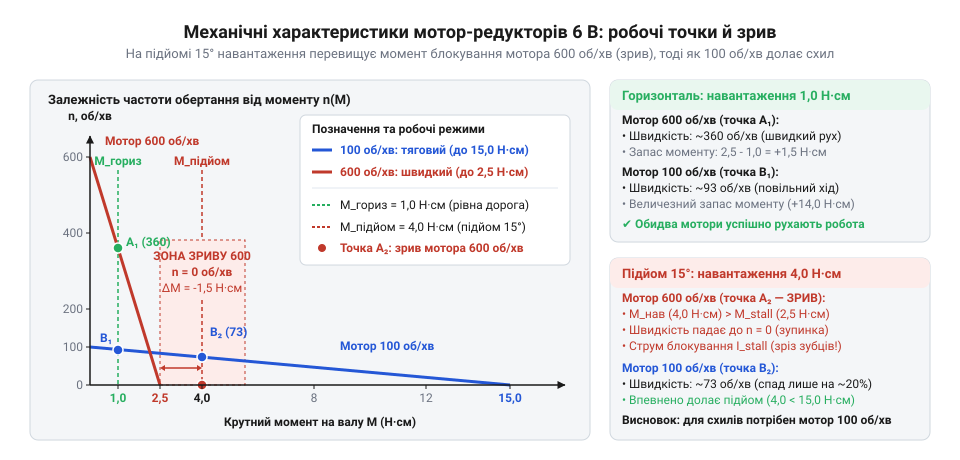
*Механічні характеристики мотор-редукторів: графіки залежності крутного моменту від частоти обертання та відповідні робочі точки на горизонтальній поверхні й підйомі 15°, що пояснюють явище зриву мотора 600 об/хв.*

**4. Повне механічне заклинювання вала (I_stall).**
При вимушеній зупинці колеса кутова швидкість ротора падає до нуля (ω = 0), а внутрішня проти-ЕРС (англ. @@en|back-EMF@@) повністю зникає (e = 0). Струм обмежується виключно сумарним омічним опором кола:

```
I_stall
= V_cc ÷ (R_w + R_shunt + R_bridge)      [закон Ома для повного кола при нульовій проти-ЕРС]
= 6.0 В ÷ (6.3 Ом + 0.22 Ом + 0.38 Ом)   [підстановка опорів обмотки, шунта та відкритих ключів моста]
= 6.0 В ÷ 6.90 Ом                        [арифметичне додавання опорів кола]
≈ 0.870 А                                [теоретичний струм заклинювання вала]
```

Натурні заміри зафіксували реальний струм повного блокування на рівні I_stall = 920 мА для мотора 600 об/хв та I_stall = 940 мА для 100 об/хв. За однакового електричного струму характер руйнівного впливу різний:
У мотора 100 об/хв редуктор передає крутний момент із коефіцієнтом 150:1 (понад 0.8–1.0 Н·м на виході). Латунні зубці модуля 0.2 не розраховані на таке зусилля і зрізаються за 200–400 мс після блокування вала.
У мотора 600 об/хв момент редуктора менший, шестерні витримують навантаження, проте обмотка якоря з тонкого мідного дроту розігрівається вище 140 °C, викликаючи оплавлення лаку та коротке замикання витків ротора.

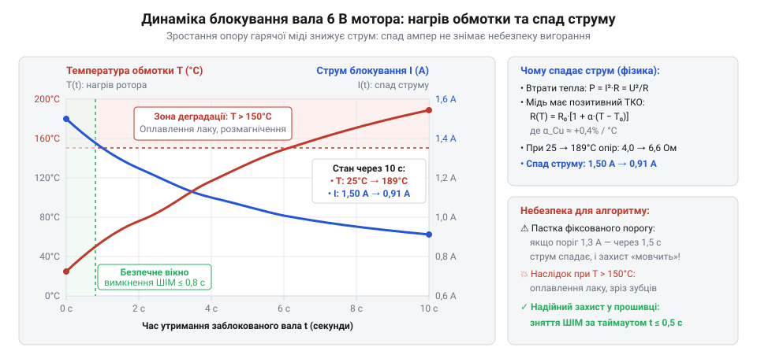
*Тепловий процес при заклинюванні вала: швидкий розігрів мідної обмотки якоря спричиняє зростання її опору та поступове спадання струму блокування в часі, що вимагає негайного знеструмлення мотора до настання термічного руйнування лакової ізоляції витків.*

Зведемо отримані експериментальні дані до порівняльної інженерної таблиці:

| Параметр дослідження | Мотор-редуктор 100 об/хв | Мотор-редуктор 600 об/хв | Фізична причина розбіжності |
| :--- | :--- | :--- | :--- |
| Передавальне число редуктора i | 150:1 (5 ступенів) | 25:1 (3 ступені) | Різниця в кінематичній схемі |
| Струм холостого ходу I_0 | 65 мА | 45 мА | Більше пар зачеплення та в'язкого тертя у 100 об/хв |
| Струм горизонтального руху I_run | 135 мА | 220 мА | Вища лінійна швидкість і динамічний опір у 600 об/хв |
| Лінійна швидкість платформи | 0.16 м/с | 0.85 м/с | Пряма пропорційність вихідній частоті обертання |
| Струм подолання ухилу 15° I_climb | 265 мА | 720 мА (зрив) | Дефіцит крутного моменту та зупинка мотора 600 об/хв |
| Струм заклинювання вала I_stall | 940 мА | 920 мА | Однаковий активний опір ротора R_w ≈ 6.3 Ом |
| Головний фактор руйнування | Зрізання зубців шестерень | Тепловий пробій обмотки якоря | Різниця в крутному моменті на вихідному валу |

**Динаміка пускового стрибка струму (inrush current).**
Аналіз осцилограм струму під час пуску показує важливий фізичний феномен: у момент подачі 100% ШІМ ротор ще не обертається (ω = 0), а внутрішня проти-ЕРС відсутня (e = k_e × ω = 0). У перші мілісекунди після комутації струм стрибком сягає пускового максимуму (англ. @@en|inrush current@@), амплітуда якого практично збігається зі струмом повного блокування вала I_inrush ≈ 900–940 мА.

Тривалість цього процесу визначається електромеханічною постійною часу приводу:
Для мотора 600 об/хв ротор швидко розганяється через малу зведену інерцію редуктора: пусковий викид триває 	_start ≈ 8–12 мс.
Для мотора 100 об/хв через масивніший редуктор і вибір зазорів у п'яти парах шестерень час розгону до стабільної проти-ЕРС становить t_start ≈ 18–25 мс.
Після завершення розгону струм експоненційно спадає до рівня горизонтального руху I_run.

Це визначає архітектуру системи програмного захисту: якщо встановити поріг спрацьовування I_threshold = 500 мА з миттєвою реакцією, мікроконтролер розцінюватиме кожен запуск як заклинювання і негайно вимикатиме ШІМ, не давши платформі зрушити з місця.

Тому алгоритм захисту повинен містити часове вікно маскування пуску (англ. @@en|blanking window@@) тривалістю 35–50 мс. Протягом цього інтервалу мікроконтролер опитує АЦП, але тимчасово блокує захисне вимикання ШІМ, дозволяючи мотору розігнатися до робочого струму. Аварійне зняття керування спрацьовує лише тоді, коли виміряний струм перевищує поріг довше за вікно маскування.

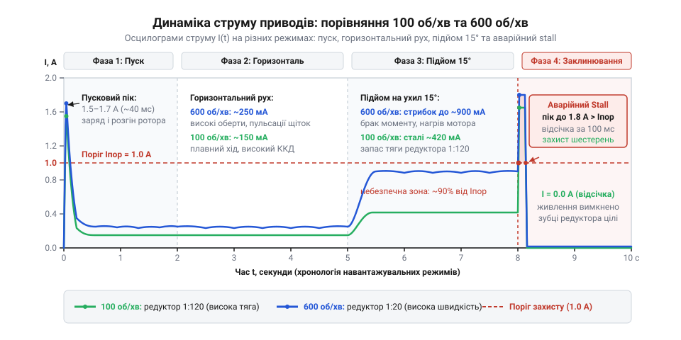
*Осцилограми струму споживання для мотор-редукторів на 100 об/хв та 600 об/хв у часі: перехідні пускові сплески inrush current, струми усталеного руху, зрив швидкісного приводу на ухилі 15° та критичне перевищення порогу при повному заклинюванні вала.*

> 🔧 **Навіщо це.**
> Експериментальне зняття струмових кривих захищає розробника від фатальної помилки вибору швидкісного мотора «із запасом», який на практиці виявляється неспроможним подолати найпростіший підйом. Кількісне порівняння пускових піків і струмів заклинювання задає точні пороги для таймерів програмного захисту, запобігаючи помилковим спрацьовуванням при старті та рятуючи редуктор від зрізання зубців при реальних аваріях.

## Алгоритм виявлення блокування (stall detection) та часова фільтрація

Колісна платформа рухається підлогою, натрапляє на непереборну перешкоду й упирається в неї. Колеса зупиняються намертво, але напруга живлення з драйвера продовжує надходити на контакти двигунів. Що відбувається в цей момент усередині приводу?

Під час нормального обертання якір колекторного двигуна постійного струму крутиться в магнітному полі статора. Відповідно до закону електромагнітної індукції, в його обмотках індукується електрорушійна сила, спрямована назустріч прикладеній напрузі живлення. Її називають проти-електрорушійною силою (лат. *vis electromotrix*; англ. @@en|back electromotive force@@, скорочено Back-EMF). Електричний баланс напруг у колі якоря описує диференціальне рівняння:

```
U = I · R_a + L_a · (dI/dt) + E_b
```

де `U` — прикладена напруга живлення (В), `I` — миттєвий струм обмотки (А), `R_a` — активний опір обмотки якоря (Ом), `L_a` — її власна індуктивність (Гн), а `E_b` — проти-ЕРС (В). Величина проти-ЕРС прямо пропорційна миттєвій кутовій швидкості ротора `ω`:

```
E_b = k_e · ω
```

де `k_e` — конструктивний коефіцієнт електромеханічного зв'язку двигуна (В·с/рад).

Коли двигун обертається без механічного навантаження, кутова швидкість якоря досягає максимуму, а проти-ЕРС `E_b` майже зрівнюється з напругою живлення `U`. Завдяки цьому струм холостого ходу крихітний. Для мікромоторів на 6 В (зокрема поширеної серії [N20 з редуктором](root:cat-hw-actuators/n20-motor)) струм холостого ходу становить лише 50–70 мА для версій із передавальним числом на 100 об/хв та 80–120 мА для швидкісних версій на 600 об/хв. Під час руху зібраної платформи по рівній горизонтальній поверхні струм тримається в межах 180–250 мА, а на підйомі крутизною 15° зростає до 350–450 мА.

Але щойно вал блокується механічним стопором, швидкість падає до нуля: `ω = 0`. Разом із нею зникає і проти-ЕРС: `E_b = 0`. Усталений струм у колі тепер стримується виключно омічним опором мідного дроту якоря `R_a`. Для типових 6-вольтових моторів цього класу активний опір становить близько 6.0 Ом. За законом Ома виникає струм повного заклинювання (англ. @@en|stall current@@):

```
I_stall = U / R_a
        = 6.0 / 6.0              [закон Ома для нерухомого ротора при E_b = 0]
        = 1.0 А                  [струм блокування вала]
```

За законом Джоуля-Ленца теплове розсіювання на обмотці сягає `P_heat = I_stall² · R_a = 6.0 Вт`. Для 12-міліметрового двигуна це веде до перегріву понад 120 °C за лічені секунди, проте ще раніше піковий момент зрізає латунні шестерні редуктора з модулем `m = 0.2–0.3 мм`.

Здавалося б, найпростіший вихід — вимикати живлення через ШІМ (англ. @@en|pulse-width modulation@@, PWM) за порогом `I_trip = 650 мА`. Але миттєве вимкнення знерухомлює платформу.

Кожен пуск із місця починається з нерухомого ротора (`ω = 0`, `E_b = 0`), тому в перші частки мілісекунди струм стрибає до `I_stall = 1.0 А`. Лише в міру розгону коліс наростає проти-ЕРС, і струм спадає до робочого. Для колісної платформи цей розгін триває 15–40 мс. Без часової витримки мікроконтролер сприйме пусковий кидок як аварію і зніме живлення — платформа смикатиметься на місці й не рушить.

Для відділення пускового імпульсу від аварійного заклинювання застосовують алгоритм двоступеневої часової фільтрації:

1. **Часове вікно маскування пуску** (англ. @@en|blanking window@@, від давньофранцузького *blanc* — чистий, порожній; пропуск сигналу). Після кожної зміни стану двигуна зі спокою на рух або при різкому реверсі запускається інтервал маскування `t_blank` тривалістю 35–50 мс. Протягом цього вікна компаратор або цифровий монітор струму повністю ігнорує перевищення порогу `I_trip`. Ротору надається гарантований час на розгін та генерацію проти-ЕРС.
2. **Інтегральний таймер підтвердження блокування** (англ. @@en|stall timeout@@). Якщо після закриття вікна маскування струм усе ще залишається вищим за поріг `I_trip`, або якщо струм підскочив уже під час усталеного руху (наприклад, платформа вперлася в плінтус чи заклинило шестерню редуктора), алгоритм не знеструмлює мотор миттєво. Запускається таймер підтвердження блокування `t_stall_timeout` на 100–150 мс.

> 🔧 **Навіщо це.**
> Інтервал підтвердження заклинювання 100–150 мс обрано на межі механічної міцності й захищеності від завад. Якщо скоротити цей час до 20–30 мс, привід постійно зупинятиметься від кожного дрібного стику покриття, килима чи подолання порога, де колесо зазнає короткочасного ударного гальмування. Якщо ж розтягнути інтервал понад 250 мс, зусилля на заблокованому вихідному валу встигне зрізати зуби проміжних ступенів редуктора, а мідний якір перегріється. 120 мс — це безпечний компроміс, який гарантує цілісність зубчастої передачі та безпомилкову роботу на нерівній трасі.

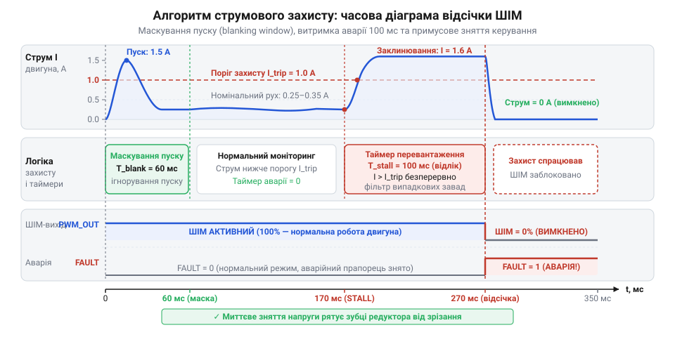
*Часова діаграма алгоритму виявлення блокування: пусковий кидок струму ігнорується протягом вікна маскування t_blank, а тривале перевищення порогу I_trip активує таймер аварії, після чого ШІМ негайно скидається в нуль і вмикається активне гальмування.*

Для безпомилкової реалізації логіки на мікроконтролері процес керування та моніторингу оформлюють у вигляді скінченного автомата (лат. *automaton* від грецького αὐτόματος — самодіючий; англ. @@en|finite-state machine@@, FSM). Автомат оперує дискретними станами, усуваючи неоднозначність переходів:

- `STATE_IDLE`: привід зупинено, коефіцієнт заповнення ШІМ дорівнює нулю. Вимірювання струму через вимірювальний шунт [нижнього плеча](root:hw-sensing/low-side-current-sensing) фіксує лише дрейф нуля АЦП. Таймери скинуто.
- `STATE_STARTUP_BLANKING`: стан активується відразу при подачі команди на рух (ШІМ > 0%). Фіксується позначка системного часу запуску. Протягом інтервалу `t_blank` (40 мс) порівняння з аварійним порогом заблоковано. Щойно час `t_blank` вичерпується, автомат безумовно переходить у стан `STATE_RUNNING`.
- `STATE_RUNNING`: штатний робочий режим. Відфільтроване значення струму `I_filt` порівнюється з аварійним порогом `I_trip`. Якщо `I_filt < I_trip`, система залишається в цьому стані. Якщо струм перевищує або дорівнює `I_trip`, зчитується системний час і виконується перехід у `STATE_OVERLOAD_CONFIRMING`.
- `STATE_OVERLOAD_CONFIRMING`: режим очікування підтвердження аварії. Якщо струм спадає нижче порогу повернення з урахуванням гістерезису (`I_trip - I_hyst`, де `I_hyst ≈ 50 мА`), це кваліфікується як тимчасове динамічне навантаження, і автомат повертається в `STATE_RUNNING`. Якщо ж перевантаження триває безперервно протягом усього вікна `t_stall_timeout` (120 мс), заклинювання вважається доведеним фактом — автомат негайно перемикається в `STATE_FAULT_STALL`.
- `STATE_FAULT_STALL`: аварійний стан. Прошивка здійснює дві апаратні дії:
  1. Миттєве обнулення коефіцієнта заповнення ШІМ таймера.
  2. Переведення ключів [H-моста](root:hw-motion/h-bridge) у режим активного реостатного гальмування (відкриття обох нижніх транзисторів і замикання виводів мотора на землю). Це дає змогу швидко погасити обертання якоря зворотним електромагнітним полем, усуваючи навантаження на зубці редуктора.
  3. Встановлення прапорця аварії приводу для інформування верхнього рівня системи. Вихід із цього стану можливий лише через явний виклик скидання помилки (`clear_fault`).

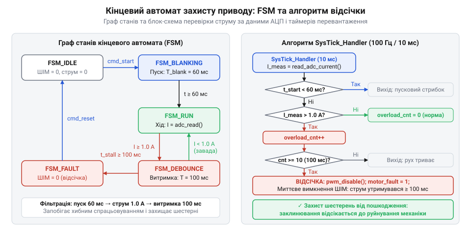
*Граф станів кінцевого автомата захисту: чітке розмежування фази пускового маскування, контролю струму навантаження та переходу в аварійне вимкнення за часовим лімітом.*

## Програмна реалізація драйвера керування та захисту на мікроконтролері мовами C та C++

Апаратне керування колекторним двигуном через H-міст вимагає двох периферійних вузлів мікроконтролера: таймера ШІМ для регулювання швидкості й модуля АЦП для моніторингу струму на шунті в нижньому плечі.

Для виключення акустичного писку та пульсацій струму таймер ШІМ налаштовують на частоту 20 кГц (вище порогу сприйняття людського вуха). Опитування АЦП та автомат захисту категорично заборонено будувати на блокуючих затримках штибу `delay()`: будь-яка пауза блокує сенсори, друге колесо та радіокоманди.

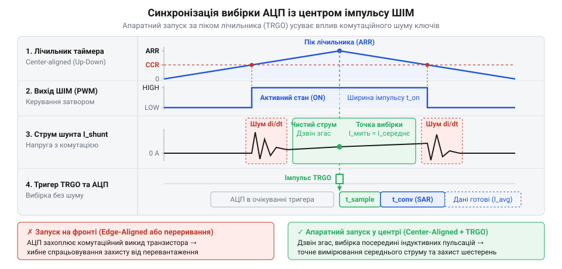
*Синхронізація запуску АЦП із серединою активного імпульсу симетричного ШІМ (center-aligned PWM): вимірювання струму у фазі стабільного стану ключів усуває комутаційні викиди й забезпечує достовірний сигнал для алгоритму захисту.*

Архітектура драйвера будується на строго неблокувальній основі: періодичний системний квант часу (англ. @@en|tick@@) з періодом 1 мс ініціює зчитування АЦП та опрацювання скінченного автомата.

> 🔧 **Навіщо це.** Неблокувальний скінченний автомат у поєднанні з пусковим маскуванням (англ. @@en|blanking@@) та гістерезисом запобігає аварійній зупинці робота від короткочасних пускових сплесків струму чи дрібних нерівностей траси, але гарантовано знеструмлює обмотки при реальному заклинюванні вала, рятуючи крихкі зубці редуктора від зрізання.

Комутація щіток колектора створює голки напруги на шунті, які не повністю зрізаються аналоговим RC-фільтром. Для придушення сплесків застосовують цифрове ковзне усереднення (англ. @@en|moving average filter@@). Буфер на `N = 8` відліків дозволяє замінити операцію ділення швидким бітовим зсувом праворуч (`>> 3`), що критично для вбудованих мікроконтролерів:

```
I_filt = (∑[i=0..7] I_raw[i]) >> 3
```


*Часова діаграма роботи скінченного автомата струмового захисту: вікно маскування пускового струму (blanking), фільтрація сплесків та відсікання ШІМ через 120 мс після підтвердження блокування вала.*

За осцилограмою верифікують роботу автомата захисту на діагностичному стенді: при механічному стопорінні колеса затримка від перевищення порогу струму до повного зняття імпульсів ШІМ на затворах H-моста становить рівно 120 мс без зависання основного циклу програми.

При проектуванні колісних роботів із диференціальним приводом виникає додаткова проблема: мотор-редуктори лівого й правого бортів навіть з однієї заводської партії мають технологічний розкид характеристик. Різниця тертя в шестернях редуктора, неоднакове прилягання щіток та допуски опору обмоток сягають 10–15%.

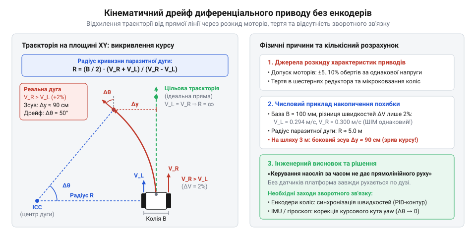
*Кінематичний дрейф колісної платформи без енкодерного зворотного зв'язку: технологічний розкид моторів спричиняє різницю кутових швидкостей і струмів, що викликає дугоподібне відхилення від прямолінійного маршруту.*

Через асиметрію внутрішнього тертя при однаковому сигналі ШІМ мотори споживають неоднаковий струм і розвивають різну кутову швидкість. Це явище спричиняє [кінематичний дрейф диференціальної платформи](root:sys-dron/differential-drive-kinematics): робот відхиляється від прямої лінії та описує дугу. З погляду безпеки це означає, що поріг струму та скінченний автомат захисту повинні бути строго індивідуальними для кожного каналу. Неприпустимо усереднювати струми обох коліс: заклинювання одного мотора на тлі легкого ходу іншого призведе до запізнілого спрацьовування та зрізання шестерень.

Нижче наведено повні виробничі реалізації драйвера керування й захисту для вбудованих систем: процедурною мовою C та об'єктно-орієнтованою мовою C++.

:::tabs
:::code proj-wheeled-differential-platform/c/filter-init.c

:::code proj-wheeled-differential-platform/cpp/motordirection.cpp
:::

## Калібрування струмового тракту, натурні випробування захисту та вибір робочих порогів

Розрахунок струмового захисту за номінальними значеннями компонентів на папері розбивається об фізичну реальність. Якщо задати поріг відключення двигунів виходячи лише з ідеального номіналу вимірювального шунта та паспортної напруги живлення, платформа поводитиметься непередбачувано: один зібраний робот вимикатиметься від найменшого підйому на ворсистий килим, а інший — зрізатиме зубці шестерень у заклиненому стані. Неузгодженість приводів спричиняє додатковий паразитичний відхід від прямолінійного курсу — кінематичний дрейф.


Причина криється у розкиді параметрів аналогового вимірювального тракту (@@en|current-sensing signal chain@@). Струмовий шунт у нижньому плечі моста має допуск 1–5%, а мідні доріжки плати додають 10–50 мОм паразитного опору. Опорна напруга вбудованого АЦП плаває на ±3–8% залежно від екземпляра кристала й температури. Крім того, операційний підсилювач має власну напругу зсуву (@@en|input offset voltage@@, англ. *offset* — зсув, відхилення), яка зміщує нульовий рівень на 10–80 мВ, що для 10-бітного АЦП становить від 3 до 25 одиниць коду за повної відсутності струму. Щоб захист працював детерміновано, необхідне фізичне калібрування тракту за двома опорними точками: нулем і масштабом (@@en|scale factor@@, лат. *scala* — драбина, мірило).

### Методика калібрування зміщення нуля та масштабу

Вимірювання зміщення нуля фіксує адитивну похибку підсилювача та АЦП. Процедура виконується автоматично під час ініціалізації мікроконтролера при вимкненому H-мості: програма усереднює `N = 128` послідовних відліків АЦП (50–100 мкс) у базову лінію `ADC_zero`. Усі подальші робочі вимірювання обчислюються як перевищення над цим нулем: `ADC_net = ADC_raw - ADC_zero` (при випадковому від'ємному значенні результат примусово обнуляють).

Калібрування масштабу знімає мультиплікативну похибку шунта, підсилення та опорної напруги. У коло живлення драйвера вмикають амперметр, навантажують мотори до усталеного струму `I_ref = 500 мА` і зчитують усереднений код АЦП `ADC_cal`.

```
ADC_span
= ADC_cal - ADC_zero                               [виділення активного діапазону відліків]

K_scale
= I_ref / ADC_span                                 [обчислення ціни поділки АЦП у мА на відлік]
```

Для виключення повільних операцій із рухомою комою на мікроконтролерах без апаратного модуля FPU коефіцієнт масштабування переводять у формат із фіксованою комою з масштабуванням на `2¹⁶` (65536):

```
K_scale_fp
= (I_ref × 65536) / ADC_span                       [масштабування ціни поділки у формат Q16]

I_measured_mA
= ((ADC_raw - ADC_zero) × K_scale_fp) >> 16        [швидке визначення струму в мікроконтролері]
```

> 🔧 **Навіщо це.**
Калібрування нуля та коефіцієнта масштабування перетворює безрозмірні сирі коди АЦП на точні фізичні міліампери незалежно від розкиду номіналів резисторів, похибки підсилювача чи просідання внутрішньої опорної напруги. Без цього поріг аварійного захисту неможливо узгодити з механічною міцністю шестерень редуктора.

### Вибір робочого струмового порогу спрацьовування

Робочий струмовий поріг `I_trip` — це компроміс між двома взаємовиключними вимогами: він має бути достатньо високим, щоб робот долав пікові експлуатаційні навантаження без хибних зупинок, але водночас гарантовано нижчим за поріг незворотного руйнування механіки.

Для платформи з моторами на 6 В (див. [N20 мікромотор з редуктором](root:cat-hw-actuators/n20-motor)) спектр струмів розпадається на чотири характерні зони:

1. **Струм холостого ходу (`I_idle`):** 40–70 мА на мотор під час вільного обертання коліс у повітрі при напрузі 6 В.
2. **Струм номінального руху (`I_nom`):** 120–180 мА під час рівномірного руху робота гладкою горизонталлю зі швидкістю 0.3–0.5 м/с.
3. **Струм подолання ухилу 15° під навантаженням (`I_slope_max`):** 380–450 мА з урахуванням маси платформи 0.5–0.7 кг.
4. **Струм повного блокування вала (`I_stall`):**

```
I_stall
= V_motor / R_wind                                 [закон Ома для нерухомого якоря двигуна]
= 6.0 / 6.0                                        [підстановка напруги живлення та опору обмотки]
= 1.0 А = 1000 мА                                  [теоретичний струм короткого замикання ротора]
```

Вирішальним фактором вибору порогу є тип встановленого редуктора:

- **Мотор 100 об/хв (передавальне число `i ≈ 100:1` або `150:1`):** Вихідний крутний момент досягає 0.9–1.2 кг·см, проте латунні мікрошестерні останніх ступенів (`m = 0.15–0.20 мм`) витримують без зминання лише 0.6–0.7 кг·см, що відповідає струму `I_gear_limit ≈ 650–700 мА`. Струм блокування 1000 мА тривалістю навіть 100 мс неминуче зріже зуби шестерень.
- **Мотор 600 об/хв (передавальне число `i ≈ 15:1` або `20:1`):** Передавальне число невелике, тому вихідний момент при струмі 1000 мА не перевищує 0.15–0.2 кг·см. Шестерні легко витримують таке механічне зусилля, а головною небезпекою стає тепловий перегрів обмоток і колектора.

Для збереження редуктора на 100 об/хв поріг струмового захисту `I_trip` обирають за правилом подвійного запасу:
- запас зверху від максимального струму підйому: `I_trip ≥ I_slope_max × 1.25` (`450 × 1.25 = 562.5 мА`);
- запас знизу від критичного струму зрізання зубців: `I_trip ≤ I_gear_limit × 0.85` (`700 × 0.85 = 595 мА`).

Компромісне значення для платформи становить `I_trip = 580 мА`.

### Натурні випробування захисту на стенді

Працездатність захисту верифікують прямим осцилографічним контролем у режимі аварійного блокування колеса на ходу. Для цього цифровий осцилограф підключають:
- Канал 1: вихід вимірювального фільтра шунта (струм двигуна, перерахований через чутливість тракту).
- Канал 2: вивід мікроконтролера, що генерує сигнал ШІМ на драйвер двигуна.

Платформу встановлюють на стенд і розганяють двигуни до 100% заповнення ШІМ. Потім ведуче колесо раптово блокують механічним упором.

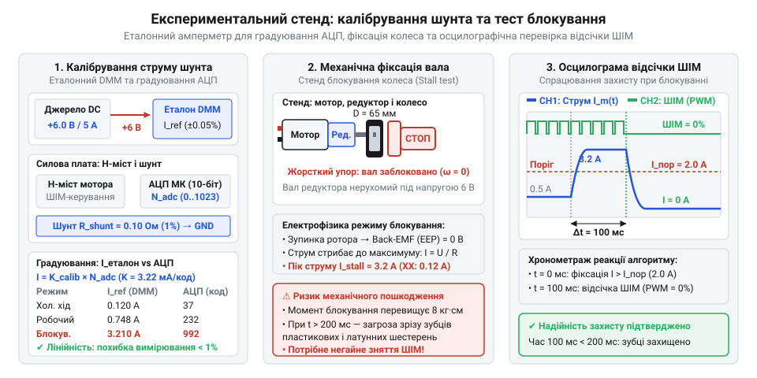
*Схема експериментального стенда з підключенням еталонного амперметра й осцилографа: механічне стопоріння колеса викликає стрибок струму та аварійне зняття ШІМ за 12 мс, що запобігає пошкодженню шестерень редуктора.*

Осцилограма процесу фіксує такі часові фази:
1. **Зупинка вала (`t = 0`):** Протиелектрорушійна сила якоря миттєво спадає до нуля, а струм наростає за експонентою до `I_trip = 580 мА` приблизно за 1.5–2.0 мс.
2. **Фільтрація комутаційного шуму та пуску (вікно глушіння, @@en|blanking window@@, англ. *blank* — глушити, маскувати):** Якщо перевищення порогу триває менше за час підтвердження аварії `t_confirm = 10 мс`, система ігнорує сплеск як іскріння щіток або пусковий стрибок.
3. **Аварійне зняття ШІМ:** Після безперервного утримання струму вище за `I_trip` протягом 10 мс мікроконтролер у перериванні таймера негайно переводить виводи керування драйвером у нуль.

```
t_response
= t_rise + t_blank + t_confirm + t_driver           [сумарний час реакції тракту захисту]
= 1.8 мс + 0.0 мс + 10.0 мс + 0.1 мс               [значення для блокування на усталеній швидкості]
≈ 11.9 мс                                          [інтервал від заклинювання до повного відключення]
```

Сумарний час від заклинювання до повного знеструмлення двигуна становить близько 12 мс. За цей час енергія ротора встигає поглинутися пружною деформацією без пластичного руйнування металу зубців. Серія з 50 блокувань на повному ходу підтверджує збереження геометрії зубчастих коліс під час огляду через оптичний мікроскоп.

Нижче наведено модуль програмної обробки калібрування та струмового захисту:

:::tabs
:::code proj-wheeled-differential-platform/c/snippet-3.c
:::code proj-wheeled-differential-platform/cpp/currentmonitor.cpp
:::

## Системні обмеження диференціальної платформи та перехід до замкнених систем

Коли колісну платформу з диференціальним приводом повністю зібрано, а струмовий захист відлагоджено, виникає очікування, що подача однакового коефіцієнта заповнення ШІМ (наприклад, 70% на лівий і правий канали) змусить робота рухатися строго прямолінійно. Проте на практиці робот уже за перші два метри дистанції відчутно відхиляється вбік на 25–40 см і змінює кутову орієнтацію на 15–30 градусів.

Це явище зветься кінематичним дрейфом курсу (@@en|heading drift@@, грец. *kinēma* — рух, англ. *drift* — знесення, відхилення). Воно є прямим наслідком розімкненого керування (@@en|open-loop control@@), де мікроконтролер надсилає керувальний вплив «наосліп», не маючи інформації про фактичну швидкість обертання коліс.

### Джерела кінематичного дрейфу

Кінематичний дрейф у розімкненому контурі спричиняється трьома фізичними чинниками:

1. **Технологічний розкид характеристик моторів:** Навіть мотори з однієї заводської партії мають відмінності в залишковому магнітному потоці постійних магнітів (розкид 3–8%), різний опір мідного дроту обмоток якоря та неоднакове притискання графітових або металевих щіток до колектора. Внутрішнє тертя в багатоступеневих зубчастих передачах редукторів також не є ідентичним. Як результат, однакова прикладена напруга створює відмінність вихідних кутових швидкостей лівого і правого коліс на 4–9%.
2. **Геометрична та фрикційна асиметрія шасі:** Литі гумові або силіконові шини через температурну усадку під час виробництва різняться за зовнішнім діаметром на 0.4–0.8 мм. На колесі діаметром 42 мм похибка в 0.5 мм дає різницю лінійних швидкостей у 1.2%:

```
v_diff
= ω · (r_right - r_left)                           [різниця лінійних швидкостей коліс через радіуси]
```

3. **Нерівномірний розподіл маси та мікроковзання (@@en|wheel slip@@):** Центр тяжіння робота рідко збігається з геометричною віссю симетрії. Колесо, на яке припадає більша частка ваги платформи, зазнає підвищеного опору коченню, тоді як розвантажене колесо схильне до мікропробуксовування відносно опорної поверхні.

У кінематиці диференціального привода кутова швидкість розвороту платформи `ω_yaw` жорстко прив'язана до різниці лінійних швидкостей коліс `v_right` і `v_left` та відстані між коліями коліс `L`:

```
ω_yaw
= (v_right - v_left) / L                           [кутова швидкість розвороту платформи]
= (0.300 - 0.285) / 0.120                          [підстановка швидкостей коліс та ширини колії]
= 0.015 / 0.120                                    [співвідношення різниці швидкості до колії]
= 0.125 рад/с ≈ 7.16 град/с                        [швидкість накопичення кутової похибки]
```

Навіть незначна різниця швидкостей у 5% за ширини колії `L = 120 мм` розвертає платформу на 7.16 градуса щосекунди. За 3 секунди прямолінійного маршу відхилення від курсу перевищує 21 градус.

### Вплив розряду джерела живлення та просідання напруги

У розімкненій системі коефіцієнт заповнення ШІМ визначає лише частку поточної напруги батареї, прикладеної до мотора: `V_motor = D · V_batt`. Проте напруга хімічних акумуляторів не є константою.

Під час розряду літій-іонного акумулятора 2S робоча напруга падає від 8.4 В у повністю зарядженому стані до 6.8 В перед відсічкою розряду. Крім того, акумулятор має внутрішній опір `R_int` (50–150 мОм), що призводить до динамічного просідання напруги (@@en|voltage droop@@, англ. *droop* — просідання):

```
V_term
= V_batt - I_total · R_int                         [падіння напруги на клемах під навантаженням]
```

Коли робот починає маневр або заїжджає на шершаву поверхню, споживання струму зростає, напруга `V_term` падає, і кутова швидкість коліс зменшується без жодної зміни програмного значення ШІМ. Той самий числовий код ШІМ, що на першій хвилині експерименту забезпечував швидкість 0.35 м/с, на п'ятнадцятій хвилині видаватиме лише 0.26 м/с.

### Температурний дрейф обмоток і шунта

Тривалий рух під навантаженням нагріває електродвигуни внаслідок виділення джоулевого тепла на опорі якоря. Мідний дріт обмоток має високий позитивний температурний коефіцієнт опору (ТКО `α_Cu ≈ +0.00393 K⁻¹` або `+0.393%/°C`):

```
R_wind[T]
= R_wind[25] · (1 + α_Cu · ΔT)                     [температурна залежність опору міді]
= R_wind[25] · (1 + 0.00393 · 40)                  [підстановка перегріву на 40 °C]
≈ R_wind[25] · 1.157                               [зростання активного опору обмотки на 15.7%]
```

При перегріві на 40 °C опір обмотки зростає майже на 16%. Згідно із законом Ома струм мотора при незмінній напрузі пропорційно падає, а разом із ним знижується й електромеханічний крутний момент.

Паралельно зазнає нагрівання й вимірювальний шунт. Якщо на платі встановлено звичайні товстоплівкові резистори з ТКС `±200..400 ppm/°C`, нагрів зміщує реальний опір шунта, що деформує калібрований коефіцієнт масштабування та зміщує поріг спрацьовування захисту `I_trip`. Щоб мінімізувати цей вплив, у прецизійних схемах застосовують металоплівкові або манганінові шунти з ТКС менше `50 ppm/°C`.

### Принципова межа струмового моніторингу

Струмовий моніторинг розв'язує задачу збереження апаратури: він захищає зубці редуктора від зрізання, запобігає згорянню транзисторів H-моста та фіксує аварійні ситуації заклинювання.

Проте струмовий захист принципово не здатний керувати рухом або оцінювати кінематичний стан робота:
1. **Струм відображає навантаження, а не рух:** Струм якоря пропорційний електромагнітному моменту (`τ = K_t · I`), а не швидкості обертання вала. На слизькому покритті (гладка плитка, лінолеум) колеса можуть безпорадно буксувати на повній швидкості при нерухомому шасі. При цьому струм залишатиметься на рівні номінального руху, і струмовий тракт вважатиме режим штатним.
2. **Неможливість одометрії:** Струмовий датчик не може повідомити, на який кут повернулося колесо і яку дистанцію подолав робот.

> 🔧 **Навіщо це.**
Чітке розмежування задач струмового захисту та контуру просторового руху береже інженера від спроб компенсувати навігаційні похибки маніпуляціями зі струмовим шунтом. Струмовий сенсор відповідає виключно за збереження силової частини, тоді як точне переміщення платформи потребує вимірювання кінематики.

### Архітектурний перехід до замкнених систем

Подолання системних обмежень диференціальної платформи вимагає замикання контуру керування (@@en|closed-loop control@@, грец. *kybernetike* — мистецтво кермування) за допомогою зворотного зв'язку за кутовим переміщенням коліс:

1. **Встановлення квадратурних енкодерів (@@en|quadrature encoder@@, лат. *quadratura* — надання квадратної форми, зсув фаз на 90°):**
   На зворотний хвостовик вала кожного двигуна (до редуктора) або безпосередньо на маточину коліс встановлюють магнітні давачі Холла з магнітним диском або оптичні дискові переривачі [Квадратурний енкодер](root:hw-sensing/quadrature). Монтаж енкодера на вал двигуна перед редуктором із передавальним числом 100:1 дає колосальну роздільну здатність: навіть диск на 12 магнітних полюсів забезпечує `12 × 100 = 1200` імпульсів на один повний оберт вихідного колеса. Це дає змогу контролювати найменші кутові відхилення швидкості.
2. **Впровадження дискретних ПІД-регуляторів швидкості:**
   Для кожного колеса в пам'яті мікроконтролера організують незалежний регулятор [ПІД-регулятор швидкості електродвигуна](root:hw-motion/pid-motor-controller), що працює з фіксованим кроком дискретизації (зазвичай `Δt = 10..20 мс`):

```
e[k]
= ω_target - ω_measured                            [похибка кутової швидкості колеса на поточному такті]

u[k]
= K_p · e[k] + K_i · ∑ e[j]·Δt + K_d · (e[k]-e[k-1])/Δt  [формування керувального сигналу ШІМ]
```

   Якщо ліве колесо потрапляє на ділянку з підвищеним тертям, його виміряна швидкість `ω_measured` падає. Інтегральна складова регулятора автоматично збільшує заповнення ШІМ на лівий мотор, підтримуючи рівність швидкостей лівого і правого бортів незалежно від розкиду параметрів двигунів, просідання напруги батареї чи нагріву обмоток.
3. **Замикання контуру орієнтації та одометрія:**
   Поєднання відліків енкодерів обох бортів у реальному часі дає змогу обчислювати поточні декартові координати робота `(x, y)` та кут рискання `θ` на основі моделі [Кінематика диференціального привода та одометрія](root:sys-dron/differential-drive-kinematics). Для компенсації неминучого ковзання шин одометрію коліс доповнюють даними мікроелектромеханічного гіроскопа (IMU), забезпечуючи високу точність утримання прямого курсу та проходження заданих поворотів.

У такій дворівневій архітектурі струмовий моніторинг залишається внутрішнім контуром безпеки (апаратним сторожем редуктора), тоді як зовнішній контур на основі енкодерів і ПІД-регуляторів забезпечує детермінований рух мобільного робота в просторі.
