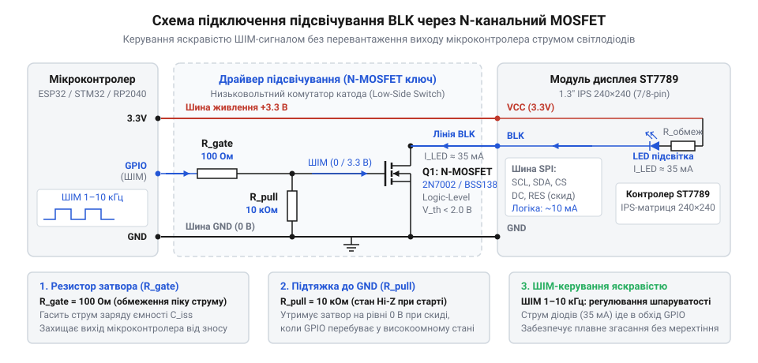
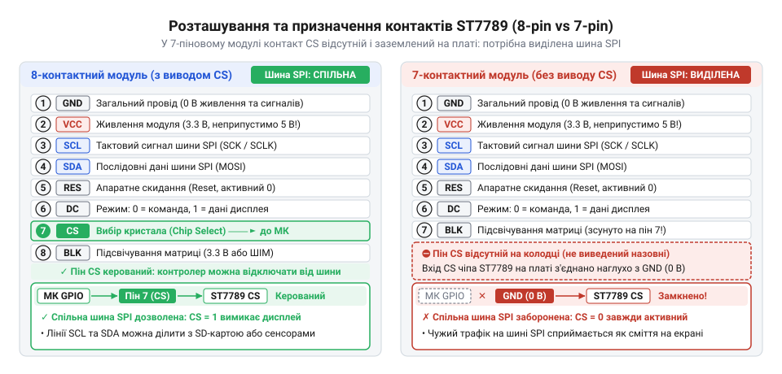
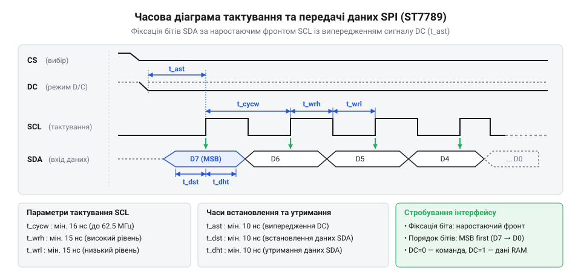
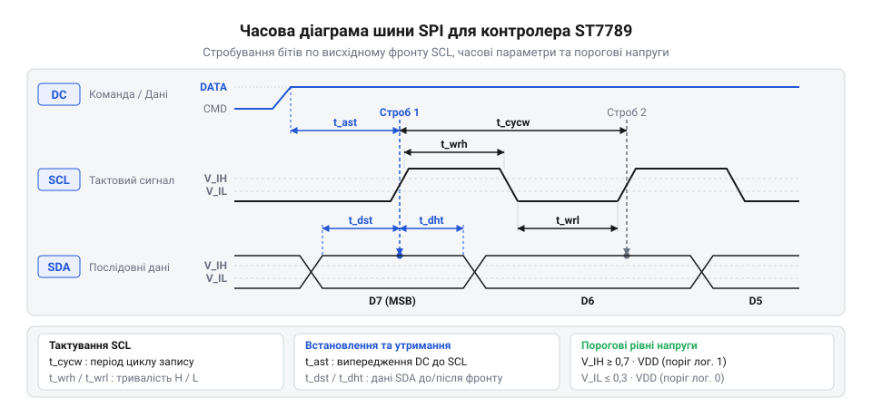
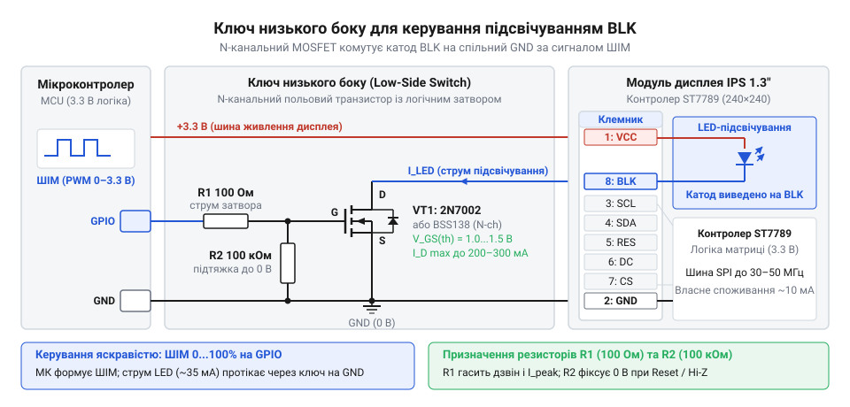
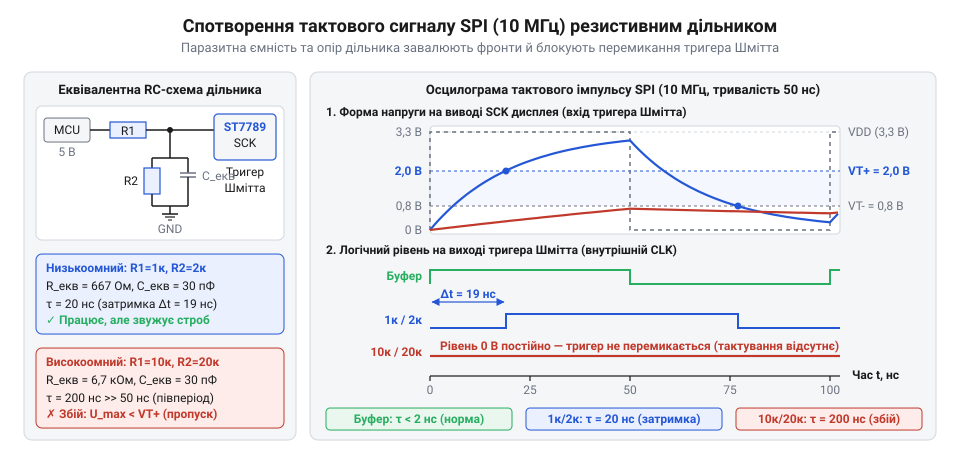
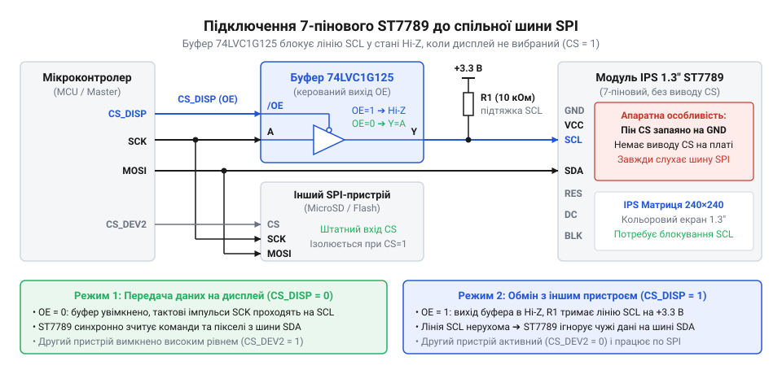

# IPS 1.3″ 240×240 (SPI, ST7789)

<preknowlist>
- [TFT 1.77″ 128×160 (SPI, ST7735S)](root:cat-hw-actuators/tft-st7735s) — базові принципи 4-провідного інтерфейсу SPI для дисплеїв (сигнали CS, DC, SCL, SDA) та розрізнення передачі команд і піксельних даних.
</preknowlist>

## Ризики прямого підключення дисплея ST7789 без узгодження рівнів

Коли дисплейний модуль IPS 1.3″ на базі контролера ST7789 підключають до мікроконтролера, найпростіший шлях — з'єднати однойменні контакти SPI звичайними дюпон-дротами та подати живлення. Якщо плата керування працює з 5-вольтовими логічними рівнями (як класичні платформи на кшталт ATmega328P або 5-вольтові цифрові модулі), таке підключення майже миттєво виводить дисплей із ладу або спричиняє непередбачувані перезавантаження всієї системи. Причина полягає у фізичній структурі кристала ST7789: його виготовлено за субмікронним КМОН-техпроцесом (англ. *complementary metal-oxide-semiconductor*, CMOS), де товщина підзатворного діелектрика польових транзисторів становить одиниці нанометрів, а допустима напруга сигнальних ліній жорстко обмежена потенціалом цифрового живлення.

Контролер ST7789 живиться від двох пов'язаних шин: напруги аналогової частини матриці `VDD` (2.4–3.3 В) та напруги цифрового інтерфейсу `VDDI` (1.65–3.3 В). Документація виробника визначає абсолютну граничну напругу для сигнальних виводів на рівні `VDDI + 0.3 В`. На вході кожного виводу кристала інтегровано структуру електростатичного захисту — пару захисних діодів (@@en|clamping diode@@, від англ. *clamp* — затискати, обмежувати): нижній діод з'єднаний із шиною `GND`, а верхній — із шиною цифрового живлення `VDDI`.

Подання 5-вольтового логічного сигналу від виводу мікроконтролера на вхід SCL, SDA, RES або DC створює пряму різницю потенціалів між вхідним сигналом і шиною живлення кристала:

```
V_diode
= V_in - VDDI            [визначення спаду напруги на верхньому захисному діоді]
= 5.0 - 3.3              [підстановка фактичних рівнів напруг]
= 1.7 В                  [пряме зміщення, що перевищує поріг кремнієвого p-n переходу 0.7 В]
```

Оскільки спад напруги 1.7 В значно перевищує поріг відкриття кремнієвого p-n переходу (0.6–0.7 В), верхній діод зміщується у прямому напрямку. Це викликає ланцюг руйнівних процесів:
- **Паразитне живлення** (@@en|parasitic powering@@, від англ. *parasitic* — паразитний та *power* — живлення). Вихідний двотактний каскад (@@en|push-pull@@, від англ. *push* — штовхати та *pull* — тягнути) мікроконтролера починає закачувати струм через мікроскопічний захисний діод безпосередньо у внутрішню шину `VDDI` дисплейного модуля. Інтегровані діоди розраховані виключно на короткочасні наносекундні сплески статики з енергією в частки мікроджоуля. Постійний струм величиною 30–60 мА розігріває діод, викликає міграцію металізації та термічний пробій кристала.
- **Неконтрольоване зростання напруги живлення**. Більшість лінійних стабілізаторів напруги з малим спадом (LDO, наприклад AMS1117 або ME6211) на платах розробки вміють лише віддавати струм у навантаження, але не здатні його поглинати. Коли струм від 5-вольтових ліній через захисні діоди надходить у шину 3.3 В, напруга на ній зростає до 4.5–4.8 В. Це спричиняє перенапругу та електричний пробій не лише контролера ST7789, а й інших чутливих мікросхем, під'єднаних до тієї самої шини 3.3 В.
- **Тиристорне замикання кристала** (@@en|latch-up@@, від англ. *latch* — засувка, фіксатор). Інжекція надлишкових носіїв заряду в кремнієву підкладку активує паразитну чотиришарову p-n-p-n структуру, властиву всім КМОН-мікросхемам. Вона спрацьовує як відкритий тиристор, утворюючи низькоомне коротке замикання між шинами `VDDI` та `GND`. Після виникнення засувки мікросхема споживає сотні міліампер і за лічені секунди розігрівається до фізичного руйнування корпусу.

Для безпечної роботи між 5-вольтовим ведучим пристроєм та дисплеєм ST7789 необхідний узгоджувач рівнів (від англ. *level shifter*). Простий пасивний дільник напруги з двох резисторів знижує амплітуду сигналу, але разом із власною вхідною ємністю виводу ST7789 (`C_in ≈ 10–15 пФ`) та паразитною ємністю друкованої плати утворює інтегрувальний RC-фільтр низьких частот:

```
t_rise
= 2.2 × R_eq × C_in      [час наростання фронту сигналу логічного рівня 10%–90%]
= 2.2 × 1200 × (15 × 10⁻¹²) [підстановка еквівалентного опору дільника 1.2 кОм та ємності 15 пФ]
≈ 39.6 × 10⁻⁹ с          [розрахунок часу наростання]
≈ 39.6 нс                [тривалість фронту сигналу]
```

Тривалість фронту близько 40 нс робить неможливою роботу шини SPI на частотах понад 8–10 МГц, оскільки прямокутні тактові імпульси перетворюються на згладжену пилкоподібну хвилю. Тому для повноцінної передачі даних застосовують активні односпрямовані буфери серії 74LVC (наприклад, [Апаратні схеми узгодження логічних рівнів](root:hw-digital/level-shifter)) або спеціалізовані мікросхеми TXU0104, здатні формувати круті фронти менше 2 нс на частотах до 100 МГц.

Друга поширена пастка прямого підключення стосується виводу підсвічування `BLK`. Кристал ST7789 під час активного оновлення зображення споживає лише 4–10 мА. Проте рідкокристалічна матриця IPS не випромінює світла сама по собі: у торці 1.3-дюймового екрана встановлено лінійку з білих світлодіодів, які для досягнення паспортної яскравості вимагають струму 40–50 мА при напрузі 3.3 В.

Більшість сучасних мікроконтролерів (STM32, ESP32, RP2040) мають суворі обмеження на навантажувальну здатність виводів GPIO:
- Для STM32 рекомендований вихідний струм одного виводу становить не більше 8–20 мА;
- Для ESP32 максимальний безпечний струм виводу обмежено 20–28 мА;
- Для RP2040 програмована навантажувальна здатність порту становить від 2 до 12 мА.

Якщо під'єднати контакт `BLK` безпосередньо до GPIO мікроконтролера, внутрішній P-канальний польовий транзистор вихідного каскаду мікроконтролера перевантажується за струмом. Напруга на виводі «просідає» нижче 2.6–2.8 В, підсвічування світить тьмяно й нестабільно, а вихідний каскад мікроконтролера перегрівається, що веде до деградації кремнію та теплового вигорання порту.

Пряме підключення виводу BLK до GPIO неприпустиме; комутацію струму світлодіодів мусить виконувати зовнішній транзисторний ключ.


*Принципова електрична схема підключення лінії підсвічування BLK через N-канальний MOSFET: струмообмежувальний резистор затвора усуває дзвін на високих частотах перемикання ШІМ, а резистор підтяжки до землі гарантує вимкнений стан світлодіодів під час скидання та завантаження мікроконтролера.*

У цій схемі лінією підсвічування керує N-канальний логічний польовий транзистор (наприклад, 2N7002, BSS138 або AO3400). Кожен елемент вузла виконує чітке завдання:
- **Транзисторний ключ**. Обирають польовий транзистор із низькою пороговою напругою затвор-витік `V_GS(th) ≤ 1.5 В`, що забезпечує його повне відкриття навіть за логічного рівня 3.3 В на виході мікроконтролера.
- **Резистор затвора R_gate (100–330 Ом)**. Вхід затвора польового транзистора має власну вхідну ємність (для 2N7002 `C_iss ≈ 20–50 пФ`). Під час кожного перемикання сигналу широтно-імпульсної модуляції (ШІМ; англ. *pulse-width modulation*, PWM) ця ємність перезаряджається. Резистор обмежує піковий динамічний струм перезаряджання, захищаючи вихід мікроконтролера, та пригнічує високочастотний індуктивний дзвін у друкованих провідниках.
- **Підтягувальний резистор R_pd (10–100 кОм)**. До завершення ініціалізації мікроконтролера або під час його скидання вивід GPIO перебуває у високоімпедансному стані (Hi-Z). Без резистора затвор залишається електрично відірваним, збирає наведені завади та частково відкриває транзистор, викликаючи хаотичні спалахи підсвічування. Резистор `R_pd` надійно розряджає затвор на землю, утримуючи транзистор закритим.
- **Частота сигналу ШІМ**. Для зміни яскравості на затвор подають ШІМ-сигнал із частотою 1–20 кГц. Частоти нижче 200 Гц створюють видиме стробоскопічне мерехтіння, тоді як діапазон від 1 до 16 кГц може викликати акустичний писк керамічних конденсаторів у колі живлення. Частоти понад 20 кГц лежать поза межами людського слуху й забезпечують плавне та безшумне регулювання яскравості.

Третя загроза прямого підключення виникає у разі побудови багатокомпонентних приладів на спільній шині SPI: модулі ST7789 часто випускаються з некерованою лінією вибору кристала, що призводить до блокування сусідніх датчиків та накопичувачів.

> 🔧 **Навіщо це.**
Аналіз електричних меж контролера ST7789 та розрахунок навантаження лінії підсвічування дають змогу обрати правильну топологію узгодження сигналів і транзисторний ключ, які захищають порти мікроконтролера від вигорання, усувають паразитне живлення та запобігають тиристорному руйнуванню кристала.

## Цоколівка та схемотехнічні відмінності 7- та 8-контактних модулів

Модулі IPS 1.3″ з роздільною здатністю 240×240 пікселів на базі контролера ST7789 випускаються у двох типових варіантах виконання: з 7-контактною або 8-контактною однорядною колодкою з кроком виводів 2.54 мм. Безпомилкове проєктування схеми вимагає знання функції кожного контакту та його електричних властивостей:

- `GND` (Ground) — опорний нульовий потенціал живлення цифрової та аналогової частин дисплея (0 В).
- `VCC` (Voltage Common Collector) — шина живлення модуля. На якісних платах встановлено стабілізатор напруги з малим спадом (LDO, наприклад мікросхема 662K або XC6206 на 3.3 В із вхідним діапазоном до 5.5–6.0 В). На таких платах вивід VCC можна живити напругою 5 В або 3.3 В. Проте у спрощених платах стабілізатор відсутній, і контакт VCC з'єднаний напряму з виводами `VDD`/`VDDI` матриці ST7789 — подання напруги понад 3.3 В на таких модулях спалює контролер. Наявність трививідного LDO-стабілізатора та згладжувальних керамічних конденсаторів завжди слід перевіряти візуально перед першим увімкненням.
- `SCL` (Serial Clock, SCK, D0) — лінія тактового сигналу шини SPI. Сигнал завжди генерується ведучим мікроконтролером. ST7789 фіксує біти даних на наростаючому фронті тактового імпульсу. Підтримуються режими SPI Mode 0 (початковий стан лінії низький, фіксація по наростаючому фронту) та Mode 3 (початковий стан високий, фіксація по наростаючому фронту).
- `SDA` (Serial Data In, MOSI, D1) — лінія послідовних даних. Служить для завантаження 8-бітних команд та 16-бітних кольорових значень пікселів (RGB565) старшим бітом уперед (MSB first). На 4-провідних дисплейних модулях цей інтерфейс є строго односпрямованим: контакт MISO відсутній, тому зчитування стану регістрів чи пам'яті кадру у зворотному напрямку апаратно не передбачено.
- `RES` (Reset, RST) — вхід апаратного скидання внутрішньої логіки контролера ST7789, активний низьким рівнем (Active LOW). Для надійного скидання вимагає утримання низького рівня щонайменше 10 мкс. Після переведення лінії у високий рівень необхідна апаратна пауза тривалістю не менше 120 мс перед надсиланням команди виходу зі сну (`SLPOUT`, `0x11`) для стабілізації внутрішньої помпи заряду рідкокристалічної матриці.
- `DC` (Data/Command, RS, A0) — вивід розрізнення типу переданих даних. Низький логічний рівень (0) на цій лінії сигналізує контролеру, що переданий по шині SDA байт є адресою команди. Високий логічний рівень (1) вказує на аргумент команди або блок піксельних даних для запису у фреймбуфер. Наявність окремого фізичного виводу DC відрізняє «4-провідний SPI» дисплеїв від 3-провідного протоколу (де замість окремої лінії DC у потік додається 9-й біт) та інтерфейсів дисплеїв на кшталт [TFT 1.77″ 128×160 (SPI, ST7735S)](root:cat-hw-actuators/tft-st7735s).
- `CS` (Chip Select, SS) — вибір кристала, активний низьким рівнем (Active LOW). За високого логічного рівня на лінії CS інтерфейс ST7789 вимикається та ігнорує будь-які імпульси тактування на SCL та біти даних на SDA.
- `BLK` (Backlight, BL, LED) — вхід керування підсвічуванням матриці, що комутує струм підсвічувальних світлодіодів.


*Порівняння цоколівки та схемотехніки 7-контактного та 8-контактного модулів: у 7-контактній версії вивід CS відсутній на роз'ємі та жорстко з'єднаний із шиною GND на платі, що тримає інтерфейс ST7789 постійно активним.*

Фундаментальна схемотехнічна відмінність між двома ревізіями плат полягає в підключенні виводу вибору кристала CS (@@en|chip select@@, від англ. *chip* — кристал та *select* — вибирати):
- **8-контактний модуль**: контакт CS виведено безпосередньо на колодку плати. Це забезпечує повний контроль над шиною SPI. Дисплей можна вільно підключати до спільної апаратної шини разом із сенсорами, мікросхемами SPI-пам'яті або картами micro-SD. Коли мікроконтролер звертається до іншого периферійного пристрою, він встановлює високий рівень (3.3 В) на контакті CS дисплея. У цьому стані вхідні кола ST7789 деактивовані, і зміна сигналів на лініях SCL та SDA не впливає на роботу екрана.
- **7-контактний модуль**: на колодці контакт CS відсутній. На зворотному боці плати провідник шлейфа дисплея, що відповідає за CS, через нульовий перемикальний SMD-резистор або друкований провідник намертво з'єднаний із шиною заземлення `GND`. Виробники роблять це задля зменшення кількості контактів і здешевлення модуля для простих пристроїв.

Жорстке заземлення CS переводить вхідний автомат ST7789 у стан **постійної некерованої активності**. Контролер дисплея безупинно відстежує стан ліній SCL та SDA.

Якщо під'єднати 7-контактний модуль на одну апаратну шину SPI з іншим пристроєм (наприклад, зчитувачем карт пам'яті):
1. Мікроконтролер активує карту пам'яті (опускає її лінію CS у нуль) і починає обмін даними, генеруючи тактові імпульси на SCL.
2. Оскільки вхід CS дисплея ST7789 заземлений, кристал сприймає кожен сторонній імпульс тактування на SCL як команду або дані для себе.
3. Довільні потоки байтів, що передаються на карту пам'яті, завантажуються у вхідний зсувний регістр ST7789.
4. Рано чи пізно послідовність байтів збігається з кодами команд ST7789: наприклад, командою вимкнення екрана `DISPOFF` (`0x28`), зміною меж адресації вікна `CASET` (`0x2A`) чи переходом у глибокий сон `SLPIN` (`0x10`).
5. У результаті екран раптово вимикається, на ньому з'являються випадкові кольорові смуги, зміщуються координати виведення зображення або зависає вхідний дешифратор команд.

Застосування 7-контактного модуля вимагає одного з чотирьох інженерних рішень:
- **Виділена апаратна шина**. Якщо мікроконтролер має кілька незалежних апаратних контролерів SPI (наприклад, шини `HSPI` та `VSPI` в ESP32 або `SPI1` та `SPI2` в STM32), 7-контактний дисплей виділяють на окрему шину без жодних сторонніх ведених пристроїв.
- **Програмна реалізація шини (bit-bang)**. Якщо доступний лише один блок SPI, дисплей підключають до довільних контактів GPIO з програмною генерацією сигналів тактування, залишаючи апаратний SPI для швидкісної периферії.
- **Апаратна модифікація модуля**. Можна випаяти нульовий резистор на зворотному боці 7-контактної плати, акуратно перерізати друковану доріжку до заземлення та припаяти тонкий емальований дріт (товщиною 0.1 мм) безпосередньо до контактної площадки CS на гнучкому шлейфі матриці.
- **Апаратне стробування тактового сигналу**. У розрив лінії SCL дисплея встановлюють логічний елемент 2-AND (наприклад, одинарний вентиль 74LVC1G08). Другий вхід елемента з'єднують із виводом GPIO мікроконтролера (псевдо-CS). Коли псевдо-CS дорівнює нулю, логічний вентиль блокує проходження тактових імпульсів до дисплея, утримуючи його лінію SCL у пасивному стані під час роботи з іншими пристроями.

Щоб забезпечити максимальну швидкість виведення графіки без тремтіння й втрати окремих пікселів, параметри тактового сигналу мікроконтролера повинні строго відповідати часовій діаграмі ST7789.


*Часова діаграма 4-провідного послідовного інтерфейсу ST7789: параметри тактування, часи встановлення й утримання сигналів даних і лінії розрізнення команд.*

Згідно з документацією ST7789, критичними є такі часові інтервали:
- `t_cycw` (Serial clock write cycle time) — мінімальний період тактового сигналу під час запису. Для інтерфейсу запису ST7789 мінімальний період становить 16 нс, що визначає теоретичну граничну тактову частоту:

```
f_max
= 1 / t_cycw             [зв'язок граничної частоти з мінімальним періодом такту]
= 1 / (16 × 10⁻⁹)        [підстановка t_cycw = 16 нс із документації ST7789]
= 62.5 × 10⁶ Гц          [обчислення максимальної частоти]
= 62.5 МГц               [теоретична верхня межа інтерфейсу]
```

У реальних пристроях через паразитну ємність провідників і обмежену крутизну фронтів вихідних каскадів мікроконтролера стабільну роботу гарантує тактова частота шини SPI на рівні 30–40 МГц (що відповідає періоду тактування `t_cycw = 25–33 нс`).
- `t_wrl` та `t_wrh` (Clock low and high pulse width) — мінімальна тривалість низького та високого рівнів тактового імпульсу SCL. Кожен із них повинен складати щонайменше 7–8 нс. Коефіцієнт заповнення тактового сигналу має перебувати в межах 40–60%.
- `t_dst` (Data setup time) — час встановлення даних. Логічний рівень на лінії SDA має встановитися щонайменше за 5 нс до появи наростаючого фронту імпульсу на SCL.
- `t_dht` (Data hold time) — час утримання даних. Стан лінії SDA повинен залишатися стабільним не менше 5 нс після наростаючого фронту SCL.
- `t_ast` (Address/DC setup time) — випередження перемикання лінії DC. Це найважливіший інтервал у 4-провідному режимі: логічний рівень на виводі DC (0 для команди, 1 для даних) повинен встановитися щонайменше за 10 нс до першого наростаючого фронту такту байта, що передається. Якщо мікроконтролер змінює стан виводу DC одночасно з наростаючим фронтом SCL або із запізненням, дешифратор ST7789 сприймає початковий біт як хибний тип інформації, що призводить до збою синхронізації всього командного потоку.
- `t_aht` (Address/DC hold time) — час утримання лінії DC після завершення передачі. Рівень DC повинен утримуватися щонайменше 10 нс після спаду останнього тактового імпульсу переданого байта.

Знання цих часових меж дозволяє точно розрахувати граничну швидкість оновлення повного кадру екрана (FPS, англ. *frames per second*). Екран 1.3″ має роздільну здатність 240×240 точок. При глибині кольору 16 біт (RGB565, два байти на піксел) інформаційний обсяг одного повного зображення складає:

```
Bits_frame
= 240 × 240 × 16         [розрахунок загальної кількості бітів для повного кадру RGB565]
= 57600 × 16             [множення кількості пікселів на глибину кольору]
= 921600 бітів           [корисне навантаження буфера кадру без урахування службових команд]
```

Якщо налаштувати контролер SPI на стабільну тактову частоту 40 МГц (`T_clk = 25 нс`), мінімальний час безперервного передавання піксельного масиву кадру становить:

```
t_transfer
= Bits_frame / f_spi     [теоретичний час передачі бітового потоку шиною SPI]
= 921600 / (40 × 10⁶)    [підстановка обсягу кадру та частоти 40 МГц]
= 0.02304 с              [час передачі даних одного кадру]
= 23.04 мс               [переведення в мілісекунди]
```

Звідси отримуємо теоретично можливу частоту зміни кадрів:

```
FPS_theor
= 1 / t_transfer         [частота оновлення екрана в кадрах на секунду]
= 1 / 0.02304            [підстановка часу кадру]
≈ 43.4 кадри/с           [максимальна теоретична швидкість за частоти 40 МГц]
```

На практиці до цього часу додаються накладні витрати на передавання команд встановлення меж вікна малювання (`CASET`, `RASET`), активацію режиму запису в пам'ять (`RAMWR`) та міжбайтові паузи при програмній побайтовій передачі. Без використання механізму прямого доступу до пам'яті (DMA) реальна частота кадрів зазвичай не перевищує 15–20 кадрів/с через простої процесорного ядра під час запису кожного байта в буфер SPI. [Передавання графічних буферів через SPI з апаратним DMA](root:sf-devices/dma-spi-display-transfer) дає змогу вивантажувати масив пікселів суцільним неперервним потоком без участі ядра процесора, наближаючи реальну частоту оновлення до граничних 40–42 кадрів/с. Детальніше часові діаграми передавання та протокольні обмеження розглядаються в окремому матеріалі [Часові діаграми та режими шини SPI](root:com-devices/spi-timing).

> 🔧 **Навіщо це.**
Чітке розрізнення цоколівки та схемотехніки 7- і 8-контактних модулів запобігає апаратним конфліктам на спільній шині SPI, а узгодження параметрів тактування та використання DMA дозволяє отримати максимальну частоту зміни кадрів без викривлення кольорів і артефактів зображення.

## Логіка ліній керування DC та RES і односпрямованість шини SPI

Послідовна шина (від лат. *omnibus* — для всіх) SPI передає інформацію суцільним потоком бітів, згрупованих у байти. Коли мікроконтролер відправляє черговий байт контролеру дисплея, апаратний приймач інтерфейсу (від англ. @@en|interface@@, з лат. *inter* — між та *facies* — вигляд) не може визначити з самого значення двійкового числа, чим воно є: командою налаштування регістрів (від пізньолат. @@en|register@@ / *registrum* — список), координатою адресації чи кольором точки. Щоб усунути цю невизначеність без ускладнення протоколу, у 4-провідному послідовному інтерфейсі ST7789 виділено окремий апаратний вивід DC (від англ. @@en|Data/Command@@ — дані/команда; на багатьох платах позначається як RS — @@en|Register Select@@).

Рівень напруги на виводі DC визначає, куди саме контролер спрямує отриманий по лінії SDA байт:
- Низький логічний рівень (DC = 0) перемикає внутрішній демультиплексор на дешифратор інструкцій. Байт інтерпретується як команда (від пізньолат. @@en|command@@ / *commandare* — наказувати) або адреса внутрішнього конфігураційного регістра.
- Високий логічний рівень (DC = 1) спрямовує байт у буфер параметрів поточної команди або безпосередньо у внутрішній графічний фреймбуфер (від англ. @@en|framebuffer@@, складене з *frame* — кадр та *buffer* — проміжне сховище) як частину 16-бітного чи 18-бітного коду кольору пікселя.

Таке апаратне розведення потоків має ключову перевагу над 3-провідним варіантом SPI, де ознака «команда чи дані» кодується додатковим дев'ятим бітом у кожній транзакції. Апаратні контролери SPI та канали прямого доступу до пам'яті (DMA) сучасних мікроконтролерів оперують стандартними словами по 8 або 16 бітів. Наявність незалежної лінії DC дозволяє один раз виставити логічну одиницю на виводі мікроконтролера й безперервно передавати мегабайтні масиви графіки через апаратний DMA на граничній частоті тактування шини без програмного розбирання слів на 9-бітні фрагменти.

Часова діаграма лінії DC жорстко прив'язана до тактового сигналу SCL. Контролер ST7789 фіксує стан лінії даних SDA на кожному висхідному фронті тактового імпульсу. Щоб виключити стан гонитви сигналів, логічний рівень на лінії DC має бути стабільним ще до приходу першого тактового імпульсу передаваного байта: час випередження адреси (tAST) становить щонайменше 10 нс, а час утримання (tAHT) після останнього спадного фронту — також не менше 10 нс. Якщо перемикати лінію DC одночасно з генерацією такту або посеред передачі байта, внутрішній автомат станів розпізнає посилку помилково, що зіб'є адресацію відеопам'яті або змінить системні налаштування матриці.

> 🔧 **Навіщо це.** Фізична лінія DC відокремлює потік піксельних даних від потоку команд керування: мікроконтролер один раз надсилає однобайтну команду запису в пам'ять, піднімає DC у високий рівень і прокачує кадри через DMA на максимальній частоті SPI без жодних накладних витрат процесорного часу на маркування байтів.

Лінія апаратного скидання RES (від англ. @@en|reset@@ — початкове встановлення) слугує для повернення всієї внутрішньої логіки та аналогових кіл ST7789 у вихідний заводський стан. Сигнал скидання є інверсним (активний нуль): контролер перебуває в режимі скидання весь час, доки на лінії утримується низький рівень (напруга біля 0 В). Під час активного скидання відключаються внутрішні помпи помножувачів напруги підкладки рідкокристалічної матриці, зупиняється внутрішній тактовий RC-генератор, очищуються регістри конфігурації, а дисплей переходить у стан сну.

Керування лінією RES вимагає дотримання двох критичних часових інтервалів:
- Тривалість імпульсу скидання (tRES) повинна бути не меншою за 10 мкс. Вхідний каскад виводу RES оснащений вбудованим фільтром короткочасних шумів. Імпульси тривалістю менше 5 мкс фільтр повністю пригнічує, сприймаючи їх як електромагнітну заваду. Сигнали в проміжку від 5 до 10 мкс викликають неповне скидання внутрішніх тригерів, тому надійна ініціалізація вимагає програмного утримання низького рівня протягом 10–50 мкс.
- Інтервал відновлення після скидання (tREST) вимагає паузи тривалістю щонайменше 120 мс після повернення лінії RES у високий рівень, перш ніж мікроконтролер надішле першу команду ініціалізації. Цей час необхідний для заряду внутрішніх ємностей аналогового тракту, стабілізації опорних джерел напруги та зчитування калібрувальних коефіцієнтів із внутрішньої пам'яті кристала. Надсилання команд конфігурації раніше за 120 мс призводить до того, що контролер ігнорує запис у регістри або запускає матрицю з дефектними таблицями гама-корекції.

Підключення виводу RES до шини живлення через звичайний інтегруючий RC-ланцюжок позбавляє систему гнучкості й часто призводить до зависань. Якщо мікроконтролер перезавантажується за сигналом сторожового таймера або через короткочасний спад напруги живлення без повного розряду конденсатора в ланцюжку скидання дисплея, контролер ST7789 не скине свій стан. Він залишиться в режимі очікування незавершеної транзакції SPI, і нова процедура ініціалізації з боку мікроконтролера не зможе відновити синхронізацію. Повноцінний програмний контроль над ніжкою RES через GPIO мікроконтролера гарантує детермінований запуск дисплея в будь-якій аварійній ситуації.

Лінія передачі даних модуля позначена маркуванням SDA, проте в контексті шини SPI вона функціонує виключно як MOSI (англ. @@en|Master Out Slave In@@ — вихід ведучого, вхід веденого). Кристал ST7789 має апаратну лінію виведення даних SDO, але виробники компактних 7- та 8-контактних плат не виводять її на зовнішній штировий роз'єм задля зменшення площі плати й кількості контактів. Інтерфейс стає суворо односпрямованим:
1. Зчитування ідентифікаційних даних виробника (команда `04h`) або регістрів діагностики стану (`09h`) неможливе: мікроконтролер фізично не має зворотного каналу й на будь-яку спробу читання SPI отримує лише нулі або одиниці залежно від внутрішньої підтяжки входу MISO.
2. Неможливо реалізувати операцію прямої модифікації пікселів поверхні (англ. @@en|read-modify-write@@) через зчитування поточного кольору з пам'яті дисплея (команда `2Eh`). Прозоре накладання тексту, альфа-змішування або малювання поверх наявного тла вимагає або виділення повного буфера кадру в оперативній пам'яті мікроконтролера, або математичного перерахунку пікселів перед їх записом на екран. Така сигнальна поведінка споріднена з іншими дисплеями на 4-провідному SPI, зокрема з модулями [TFT 1.77″ ST7735S](root:cat-hw-actuators/tft-st7735s).
3. Відсутність зворотного зв'язку унеможливлює апаратне квитування: якщо через заваду на лінії тактування SCL збився лічильник бітів у байті, мікроконтролер не дізнається про помилку, доки на екрані не з'являться графічні спотворення.

Реалізація часових параметрів ліній RES і DC та потік команд наведено нижче для типових апаратних платформ.

:::tabs
:::code api-ips-1-3-st7789-pinout/c/st7789-hw-reset.c
:::code api-ips-1-3-st7789-pinout/c/st7789-hw-reset.c
:::code api-ips-1-3-st7789-pinout/c/st7789-hw-reset.c
:::

## Електричні параметри, допустимі рівні напруг та енергоспоживання

Кристал контролера ST7789 розрахований на роботу в низьковольтних колах цифрової електроніки. Його кремнієва структура містить дві внутрішні підсистеми живлення:
- Аналогове коло живлення матриці та драйверів (VDD) із робочим діапазоном напруг від 2.4 до 3.3 В (номінально 3.3 В; гранично допустима мінімальна працездатність логіки становить 1.65 В).
- Коло інтерфейсної логіки вхідних каскадів (VDDI) із допустимим діапазоном напруги від 1.65 до 3.3 В.

На більшості плат модулів IPS 1.3″ виводи VDD та VDDI об'єднані в єдиний провідник і виведені на контакт колодки VCC. Максимальна робоча напруга на виводі VCC становить 3.3 В. Абсолютний максимум напруги живлення, за якого кристал не зазнає негайної деградації напівпровідникової структури, дорівнює 4.6 В, однак тривала робота за напруг понад 3.3 В скорочує термін служби рідкокристалічної матриці та призводить до пробою внутрішніх ключів.

Вимоги до логічних рівнів цифрових ліній SCL, SDA, DC, CS та RES визначаються поточною напругою на шині VDDI:
- Максимальна вхідна напруга логічного нуля (VIL) обмежена співвідношенням:
```
V_IL ≤ 0.3 × VDDI
```
При живленні VDDI = 3.3 В максимальна межа розпізнавання нуля становить 0.99 В. Будь-який сигнал на вході, нижчий за 0.99 В, гарантовано розпізнається контролером як нульовий рівень.
- Мінімальна вхідна напруга логічної одиниці (VIH) лежить у межах:
```
0.7 × VDDI ≤ V_IH ≤ VDDI + 0.3 В
```
При номіналі 3.3 В контролер вимагає амплітуду високого рівня не менше ніж 2.31 В, а абсолютна верхня межа напруги на будь-якому цифровому вході дорівнює 3.6 В.

Пряме підключення ліній дисплея до мікроконтролерів із 5-вольтовою логікою (наприклад, класичних плат на ATmega328P) є неприпустимим. Вхідні каскади ST7789 не толерантні до напруги 5 В: кожен вивід захищений внутрішнім діодом захисту від електростатичного розряду (ESD), катод якого з'єднаний із шиною VDDI. Коли на цифровий вхід надходить сигнал амплітудою 5 В, захисний діод відкривається у прямому напрямку, оскільки напруга на вході перевищує напругу шини живлення (3.3 В) більше ніж на падіння напруги на p-n переході. Струм, що тече через діод у шину VDDI, викликає лавинне саморозігрівання кристала, паразитичне підживлення всієї 3.3-вольтової шини до 4.5–4.8 В та провокує ефект тиристорного замикання (англ. @@en|latch-up@@), який миттєво виводить контролер дисплея з ладу.

Для безпечного спряження 5-вольтових джерел сигналів із дисплеєм застосовують схеми узгодження рівнів:

1. Резистивний подільник напруги (англ. @@en|voltage divider@@). Найпростіший спосіб зниження напруги сигналів від мікроконтролера полягає у встановленні двох резисторів на кожній сигнальній лінії: верхнього резистора R₁ = 1 кОм (послідовно з лінією) та нижнього R₂ = 2 кОм (між входом дисплея та землею).

Покроковий розрахунок вихідної напруги такого подільника:
```
V_out = V_in × (R₂ / (R₁ + R₂))           [формула коефіцієнта передачі подільника]
      = 5.0 × (2000 / (1000 + 2000))      [підстановка номіналів опорів резисторів]
      = 5.0 × (2000 / 3000)               [спрощення відношення опорів]
      ≈ 3.33 В                            [вихідний рівень високого сигналу на вході ST7789]
```
Еквівалентний вихідний опір Тевеніна для сигналу подільника:
```
R_th = (R₁ × R₂) / (R₁ + R₂)               [формула паралельного з'єднання резисторів]
     = (1000 × 2000) / (1000 + 2000)      [підстановка номіналів подільника]
     = 2000000 / 3000                     [обчислення добутку й суми]
     ≈ 667 Ом                             [еквівалентний вихідний опір джерела]
```
Паразитна ємність (від лат. *capacitas* — місткість) монтажної доріжки друкованої плати та вхідного виводу кристала дисплея становить приблизно C_load ≈ 25 пФ. Вона утворює з опором подільника фільтр низьких частот із тривалістю наростання фронту:
```
t_r = 2.2 × R_th × C_load                  [час наростання сигналу від 10% до 90%]
    = 2.2 × 667 × (25 × 10⁻¹²)             [підстановка опору Тевеніна та ємності навантаження]
    = 2.2 × 1.6675 × 10⁻⁸                  [проміжне множення компонентів часу]
    ≈ 36.7 × 10⁻⁹ с                        [тривалість перехідного процесу наростання]
    ≈ 36.7 нс                              [час формування висхідного фронту імпульсу]
```
За частоти тактування SPI 10 МГц тривалість половини періоду такту становить лише 50 нс. Час наростання 36.7 нс забирає понад 70% доступного півперіоду, перетворюючи прямокутні імпульси на закруглені трикутні коливання. Це призводить до фазового дрижання й втрати даних, тому резистивні подільники придатні лише для низьких частот шини (не вище 4–8 МГц).

2. Швидкісні цифрові буфери (від англ. @@en|buffer@@ — пом'якшувач поштовхів). Оптимальним розв'язком для повношвидкісного обміну є використання мікросхем неінвертуючих буферів сімейства LVC (наприклад, 74LVC245 або 74LVC125; див. [перетворювачі рівнів](root:hw-digital/level-shifter)). Вони живляться від напруги 3.3 В, проте мають входи, толерантні до 5 В. Затримка поширення сигналу в таких буферах не перевищує 4 нс, а потужні вихідні каскади забезпечують круті фронти менше 2 нс на ємнісному навантаженні, що дає змогу працювати на максимальних частотах тактування ST7789 (до 40–60 МГц).

3. Двонаправлені польові перетворювачі на транзисторах BSS138 з підтяжками 10 кОм непридатні для шини SPI цього дисплея. Вони спроєктовані для повільних відкритих колекторів шини I2C (до 400 кГц). На частотах у десятки мегагерців підтягувальний резистор 10 кОм просто не встигає заряджати ємність лінії за час тактового імпульсу (постійна часу заряду τ = R × C перевищує 250 нс), через що високий рівень сигналу не досягає порогу VIH.

> 🔧 **Навіщо це.** Встановлення активного 3.3-вольтового буфера захищає вхідні каскади ST7789 від деструктивного струму 5-вольтових сигналів мікроконтролера та забезпечує передачу даних на повній частоті шини SPI без спотворення фронтів тактування.

Енергетичний баланс модуля дисплея складається зі споживання власне логіки контролера та струму підсвічування рідкокристалічної панелі:

| Режим роботи модуля | Струм логіки (VCC = 3.3 В) | Струм підсвічування (BLK) | Сумарна споживана потужність |
| :--- | :--- | :--- | :--- |
| Активне оновлення кадру (SPI 40 МГц) | 8.0–15.0 мА | 20.0–40.0 мА | 92.4–181.5 мВт |
| Статичне зображення (без обміну по SPI) | 3.0–5.0 мА | 20.0–40.0 мА | 75.9–148.5 мВт |
| Режим сну (Sleep Mode, команда `10h`) | 0.008–0.015 мА | 0.0 мА (вимкнено) | 0.026–0.050 мВт |

Струм логіки ST7789 у динамічному режимі залежить від частоти шини SPI та інтенсивності перемикання рідкокристалічних комірок: під час швидкої зміни контрастних зображень він досягає 15 мА через динамічні втрати на перезаряд внутрішніх ємностей драйверів колонок. У статичному стані контролер споживає лише 3–5 мА на регенерацію заряду матриці. У глибокому режимі сну (від англ. @@en|sleep mode@@), який активується командою `SLPIN` (`10h`), відключаються внутрішні осцилятори й помножувачі, а струм споживання падає нижче 20 мкА (типово 8–15 мкА). На відміну від матриць із власним випромінюванням, як-от [OLED-дисплей 0.96″ SSD1306](root:cat-hw-actuators/oled-ssd1306), енергоспоживання самої РК-панелі практично не залежить від яскравості виведеної картинки.

Головним споживачем енергії в модулі є світлодіодне підсвічування: струм лінійки світлодіодів становить від 20 до 40 мА, що забирає від 70 до 85% усього енергетичного бюджету дисплея. Для побудови енергоефективних автономних приладів керування виводом BLK обов'язково поєднують із програмним переводом ST7789 у режим сну: повне знеструмлення світлодіодів ключем і відправка команди `SLPIN` скорочують струм споживання вузла дисплея з 45 мА до лічених мікроамперів.

Для забезпечення стабільної роботи помножувачів напруги матриці лінію VCC модуля необхідно шунтувати керамічним блокувальним конденсатором ємністю 100 нФ із діелектриком X7R, розташованим якомога ближче до контактів колодки живлення, а також паралельним електролітичним або танталовим конденсатором ємністю 10 мкФ для компенсації просідань напруги під час різкого ввімкнення підсвічування.

## Часові діаграми та параметри шини SPI

Матриця (від лат. @@la|matrix@@ — джерело, основа) дисплея роздільністю 240×240 у шістнадцятибітному колірному форматі RGB565 налічує 57 600 пікселів. Оскільки кожен піксель кодується двома байтами (16 бітів), повне оновлення одного кадру вимагає передачі 115 200 байтів або 921 600 бітів інформації без урахування службових команд позиціювання вікна. Для отримання плавної анімації з частотою 30–60 кадрів на секунду (@@en|frames per second@@, fps; від лат. @@la|frequens@@ — частий) корисна пропускна здатність інтерфейсу (від лат. @@la|inter@@ — між та @@la|facies@@ — обличчя, вигляд) повинна становити від 27.6 до 55.3 Мбіт/с.

На таких швидкостях синхронний (від грец. @@el|syn@@ — разом та @@el|chronos@@ — час) послідовний інтерфейс SPI (@@en|Serial Peripheral Interface@@; від лат. @@la|series@@ — ряд та грец. @@el|periphereia@@ — коло, околиця) переходить у категорію високочастотних кіл, де найменше нехтування часовими параметрами перетворює зображення на смуги спотворень і сміття.

За технічною специфікацією виробника контролера ST7789 мінімальний період тактування запису позначається як `t_cycw` (@@en|write cycle time@@) і становить 16 нс:

```
f_max
= 1 / t_cycw                [визначення частоти періодичного коливання]
= 1 / (16 · 10⁻⁹ с)         [підстановка мінімального періоду запису ST7789]
= 62.5 · 10⁶ Гц = 62.5 МГц  [максимальна теоретична частота шини за специфікацією]
```

Цей розрахунок дає теоретичну межу швидкості передачі даних 62.5 Мбіт/с. Проте надійне зчитування кожного окремого біта апаратним тригером контролера вимагає витримки симетрії тактового імпульсу:
- Мінімальна тривалість низького рівня тактового сигналу `t_wrl` (@@en|SCL pulse width low@@) становить не менше 7 нс.
- Мінімальна тривалість високого рівня тактового сигналу `t_wrh` (@@en|SCL pulse width high@@) становить не менше 7 нс.

Якщо апаратний дільник частоти мікроконтролера формує асиметричний меандр (наприклад, через непарний коефіцієнт ділення), де імпульс триває 5 нс, а пауза — 11 нс, внутрішня логіка ST7789 не встигне надійно зафіксувати стан лінії, навіть якщо сумарний період `t_cycw = 16 нс` формально витримано. Коефіцієнт заповнення (@@en|duty cycle@@; відношення тривалості імпульсу до періоду) сигналу SCL має бути максимально наближеним до 50%.

Для лінії даних SDA критичними є два часові пороги відносно наростаючого фронту тактового сигналу SCL:
- Час встановлення даних `t_dst` (@@en|data setup time@@): стабільний логічний рівень на лінії SDA повинен з'явитися і зафіксуватися щонайменше за 5 нс до приходу наростаючого фронту тактування (`t_dst ≥ 5 нс`).
- Час утримання даних `t_dht` (@@en|data hold time@@): передавач зобов'язаний утримувати виставлений рівень незмінним щонайменше 5 нс після наростаючого фронту (`t_dht ≥ 5 нс`).

Інтервал `t_dst` потрібен вхідному каскаду ST7789 для завершення перезаряджання внутрішніх ємностей польових транзисторів до порогової напруги спрацьовування, а інтервал `t_dht` гарантує, що стан надійно замкнеться у внутрішньому тригері до того, як передавач почне формувати наступний біт. Зміна сигналу на лінії SDA всередині 10-наносекундного вікна стробування викликає стан метастабільності приймача і непередбачуване зчитування біта.

Крім ліній синхронізації та даних, 4-провідний інтерфейс використовує лінію вибору команди або даних DC (@@en|Data/Command@@): логічний нуль спрямовує байт у командний дешифратор, а логічна одиниця записує байт у графічну пам'ять GRAM (@@en|Graphic RAM@@).

Часова діаграма встановлює строгі рамки синхронізації лінії DC:
- Час випередження адреси `t_ast` (@@en|address setup time@@): сигнал DC повинен набути стійкого значення щонайменше за 10 нс до приходу наростаючого фронту першого тактового імпульсу нового байта (`t_ast ≥ 10 нс`).
- Час утримання адреси `t_aht` (@@en|address hold time@@): стан лінії DC повинен залишатися стабільним щонайменше 10 нс після спадного фронту останнього тактового імпульсу байта (`t_aht ≥ 10 нс`).

Якщо керуюча програма перемикає вивід DC одночасно із запуском передавача SPI або із запізненням через черги передачі контролера прямого доступу до пам'яті (DMA), перший біт нового байта контролер сприйме в контексті попереднього стану. У результаті байти параметрів запишуться як нові команди розгортки, або координати вікна інтерпретуються як піксельні дані. Аналогічна логіка 4-провідного керування застосовується в дисплеях [TFT 1.77″ 128×160 (SPI, ST7735S)](root:cat-hw-actuators/tft-st7735s), проте на вищих частотах ST7789 запізнення перемикання DC на одиниці наносекунд миттєво руйнує кадрову синхронізацію.

За наявності апаратної лінії вибору кристала CS (@@en|Chip Select@@) сигнал низького рівня повинен випереджати перший імпульс SCL щонайменше на час встановлення `t_css ≥ 10 нс` і утримуватися після завершення передачі щонайменше на час `t_csh ≥ 40 нс`.


*Часова діаграма взаємного розміщення сигналів SCL, SDA та DC шини SPI з графічним позначенням інтервалів t_cycw, t_wrl, t_wrh, t_dst, t_dht, t_ast та порогових рівнів напруги: дотримання часових вікон стробування унеможливлює метастабільність і збої прийому байтів.*

Вхідна логіка ST7789 фіксує біти суворо на наростаючому фронті (@@en|rising edge@@) сигналу SCL. З огляду на це для роботи з дисплеєм придатні два стандартні режими шини відповідно до [протоколу SPI](root:com-devices/spi-bus):
- **SPI Mode 0 (`CPOL = 0`, `CPHA = 0`)**: полярність (від лат. @@la|polus@@ — вісь) `CPOL = 0` означає, що в стані спокою лінія SCL перебуває в логічному нулі. Фаза (від грец. @@el|phasis@@ — поява, вигляд) `CPHA = 0` визначає стробування на першому (наростаючому, 0 → 1) фронті тактового сигналу. Передавач виставляє біт заздалегідь, а ST7789 фіксує його за наростаючим перепадом напруги.
- **SPI Mode 3 (`CPOL = 1`, `CPHA = 1`)**: полярність `CPOL = 1` утримує лінію SCL у стані спокою на високому рівні (1). Фаза `CPHA = 1` налаштовує вибірку даних на другому фронті півперіоду. Перший фронт є спадним (1 → 0), на ньому передавач оновлює значення біта, а другий фронт є наростаючим (0 → 1), на якому ST7789 надійно стробує лінію SDA.

Режими SPI Mode 1 (`CPOL = 0`, `CPHA = 1`) та SPI Mode 2 (`CPOL = 1`, `CPHA = 0`) є неприпустимими: у них вибірка даних відбувається на спадному фронті тактового сигналу (1 → 0), що суперечить апаратурі контролера і призводить до зчитування стану лінії в моменти комутації бітів.

Паспортне значення частоти 62.5 МГц гарантується виробником кристала Sitronix виключно за умови безпосереднього монтажу контролера на скло матриці з паразитною ємністю навантаження не більше 15–30 пФ. У реальних інженерних конструкціях фізичний тракт зв'язку радикально відрізняється від лабораторного стенда:
- Гнучкі макетні дроти довжиною 15–20 см мають власну погонну індуктивність близько 100–200 нГн та взаємну паразитну (від грец. @@el|parasitos@@ — нахлібник, співтрапезник) ємність 15–30 пФ між сусідніми жилами.
- Безпайкова макетна плата вносить додаткові 2–5 пФ ємності між суміжними контактними шинами.
- Вихідний буфер порту введення-виведення (GPIO) мікроконтролера має власний динамічний опір відкритого каналу `R_out ≈ 20–40 Ом`.

Ці параметри утворюють інтегрувальний RC-ланцюг з постійною часу `τ = R_out · C_par`. Час наростання фронту сигналу `t_r` (від 10% до 90% амплітуди напруги) розраховується через постійну часу:

```
t_r
≈ 2.2 · τ                      [час наростання експоненційного сигналу від 0.1 до 0.9]
= 2.2 · (30 Ом · 40 · 10⁻¹² Ф) [підстановка опору порту 30 Ом та ємності лінії 40 пФ]
≈ 2.64 · 10⁻⁹ с = 2.64 нс      [час підйому напруги на короткій доріжці]
```

Якщо дисплей підключено шлейфом із кількох дротів без перекладання лініями заземлення, сумарна ємність тракту досягає 80–120 пФ, внаслідок чого час наростання фронту перевищує 6–8 нс. При граничній тактовій частоті 62.5 МГц тривалість усього півперіоду становить лише 8 нс (`16 нс / 2`). Сигнал не встигає досягти мінімального рівня розпізнавання логічної одиниці `V_IH = 0.7 · VCC ≈ 2.31 В` — замість прямокутних імпульсів на шині утворюється згладжена пилкоподібна крива зменшеної амплітуди.

Одночасно виникає фазовий розбіг (@@en|clock skew@@) між лініями SCL та SDA через нерівність ємнісних навантажень. Фронт тактування зміщується за межі стабільного інтервалу даних, що руйнує часові запаси `t_dst` і `t_dht`.

Порушення часових інтервалів на граничних частотах проявляється такими апаратними збоями:
1. **Хаотичний піксельний шум («сніг»)**: поодинокі бітові помилки в потоці піксельних даних спотворюють значення кольорів, створюючи мерехтливі крапки на зображенні.
2. **Вертикальні кольорові смуги**: втрата бітів старшого байта в палітрі RGB565 руйнує колірний градієнт по всій довжині рядка сканування.
3. **Зсув координат зображення**: поодинокий збій під час передачі команд адресації колонок (CASET) або рядків (RASET) зміщує початок фреймбуфера, розриваючи кадр по діагоналі.
4. **Повне зависання дисплея**: пошкоджений бітовий потік розпізнається дешифратором як команда переходу в сплячий режим або апаратного скидання внутрішніх регістрів.

Практичні правила вибору тактової частоти SPI для ST7789:
- **15–20 МГц**: максимально допустима частота під час макетування на безпайкових платах та з'єднання гнучкими провідниками довжиною понад 10 см.
- **30–40 МГц**: надійний робочий діапазон для друкованих плат із довжиною доріжок до 5–8 см без додаткового узгодження хвильового опору.
- **50–60 МГц**: досяжні виключно на багатошарових друкованих платах із суцільним полігоном заземлення безпосередньо під сигнальними трасами, з однаковою геометрією доріжок SCL/SDA та встановленням послідовних демпфуючих резисторів 22–33 Ом біля виходів мікроконтролера для придушення високочастотного відбиття сигналу.

> 🔧 **Навіщо це.**
> Запас за часом встановлення й утримання сигналів гарантує безвідмовну роботу приладу при температурних коливаннях від -40 °C до +85 °C. При нагріванні опір каналів кремнієвих транзисторів зростає, а затримки розповсюдження збільшуються на 20–30%. Якщо система налаштована на межі даташиту за кімнатної температури, на морозі або в закритому корпусі вона неминуче почне втрачати байти.

Приклад ініціалізації шини SPI в режимі Mode 0 на стабільній робочій частоті та функція передачі команд із забезпеченням часового випередження для виводу DC:

:::tabs
:::code api-ips-1-3-st7789-pinout/c/st7789-spi-init.c
```stm32-hal
#include "stm32f4xx_hal.h"

extern SPI_HandleTypeDef hspi1;

#define ST7789_DC_PORT  GPIOB
#define ST7789_DC_PIN   GPIO_PIN_1
#define ST7789_CS_PORT  GPIOB
#define ST7789_CS_PIN   GPIO_PIN_2

// Конфігурація апаратного інтерфейсу SPI1 у режимі Master Mode 0
void ST7789_SPI_Init(void)
{
    hspi1.Instance = SPI1;
    hspi1.Init.Mode = SPI_MODE_MASTER;
    hspi1.Init.Direction = SPI_DIRECTION_2LINES;
    hspi1.Init.DataSize = SPI_DATASIZE_8BIT;
    // SPI Mode 0: низький стан спокою, фіксація по 1-му (наростаючому) фронту
    hspi1.Init.CLKPolarity = SPI_POLARITY_LOW;
    hspi1.Init.CLKPhase = SPI_PHASE_1EDGE;
    hspi1.Init.NSS = SPI_NSS_SOFT;
    // При частоті шини APB2 84 МГц подільник 2 забезпечує тактову частоту f_SCK = 42 МГц
    hspi1.Init.BaudRatePrescaler = SPI_BAUDRATEPRESCALER_2;
    hspi1.Init.FirstBit = SPI_FIRSTBIT_MSB;
    HAL_SPI_Init(&hspi1);
}

// Запис командного байта з дотриманням часового випередження t_ast
void ST7789_Write_Command(uint8_t cmd)
{
    HAL_GPIO_WritePin(ST7789_CS_PORT, ST7789_CS_PIN, GPIO_PIN_RESET);
    // Встановлення DC у 0 до подачі першого тактового імпульсу
    HAL_GPIO_WritePin(ST7789_DC_PORT, ST7789_DC_PIN, GPIO_PIN_RESET);

    HAL_SPI_Transmit(&hspi1, &cmd, 1, HAL_MAX_DELAY);

    HAL_GPIO_WritePin(ST7789_CS_PORT, ST7789_CS_PIN, GPIO_PIN_SET);
}

// Запис масиву байтів даних
void ST7789_Write_Data(uint8_t *data, uint16_t size)
{
    HAL_GPIO_WritePin(ST7789_CS_PORT, ST7789_CS_PIN, GPIO_PIN_RESET);
    // Встановлення DC в 1 для спрямування потоку в пам'ять GRAM
    HAL_GPIO_WritePin(ST7789_DC_PORT, ST7789_DC_PIN, GPIO_PIN_SET);

    HAL_SPI_Transmit(&hspi1, data, size, HAL_MAX_DELAY);

    HAL_GPIO_WritePin(ST7789_CS_PORT, ST7789_CS_PIN, GPIO_PIN_SET);
}
```
:::

## Керування лінією підсвічування BLK та схемотехніка транзисторного ключа

Рідкокристалічна матриця IPS сама по собі не генерує світловий потік. Її комірки працюють як керовані поляризаційні затвори, що перерозподіляють випромінювання світлодіодної панелі тильного підсвічування (@@en|Backlight@@, BLK). У модулях дисплеїв 1.3″ встановлено планку з 2 або 3 паралельно увімкнених білих світлодіодів (LED; від англ. @@en|Light Emitting Diode@@ та грец. @@el|hodos@@ — шлях).

Для забезпечення комфортної яскравості зображення на рівні 300–400 кд/м² крізь світлодіоди необхідно пропускати струм від 30 до 60 мА при робочій напрузі живлення 3.3 В. Пряме падіння напруги на кристалі білого світлодіода `V_LED` становить 2.8–3.0 В. Якщо на платі встановлено внутрішній струмообмежувальний резистор `R_lim = 10 Ом`:

```
I_BLK
= (V_CC - V_LED) / R_lim     [закон Ома для кола зі світлодіодним навантаженням]
= (3.3 В - 2.8 В) / 10 Ом    [підстановка напруги живлення та прямого спаду LED]
= 0.5 В / 10 Ом = 50 мА      [струм підсвічування типового модуля]
```

Вихідні каскади виводів загального призначення (GPIO) типових мікроконтролерів (ESP32, STM32, RP2040, nRF52) проєктуються для передачі цифрових сигналів, а не для живлення силових навантажень. Максимальний гарантований струм одного виводу становить лише 10–20 мА (а для малопотужних серій STM32L або nRF52 — лише 4–8 мА у стандартному режимі драйвера).

Спроба під'єднати лінію BLK безпосередньо до виводу мікроконтролера спричиняє комплексні руйнівні наслідки:
1. **Просідання вихідної напруги**: вихідний польовий каскад GPIO має внутрішній опір каналу `R_on ≈ 20–40 Ом`. При протіканні струму 50 мА на цьому опорі падає до 1.0–1.5 В. Напруга на лінії BLK зменшується до 2.3–2.5 В, світлодіоди світять тьмяно, а зміна навантаження на сусідніх портах викликає помітні коливання яскравості екрана.
2. **Локальний перегрів напівпровідникового кристала**: на транзисторі вихідного буфера GPIO розсіюється теплова потужність `P = I² · R_on = (0.05 А)² · 30 Ом = 75 мВт`. На площі в кілька квадратних мікрометрів кремнію це викликає локальний перегрів структури понад 120 °C.
3. **Електроміграція та пробій**: тривале протікання надмірного струму викликає спрямований перенос атомів металізації контактів (@@en|electromigration@@; від лат. @@la|migratio@@ — переселення), деградацію p-n переходу і незворотний тепловий пробій, що виводить з ладу або відповідний порт, або весь кристал мікроконтролера.

На платах модулів лінія BLK найчастіше реалізована двома шляхами:
- Підтяжка через SMD-резистор опором 10 кОм безпосередньо до шини живлення VCC. За такого виконання модуль світиться на повну потужність за замовчуванням, навіть якщо контакт BLK висить у повітрі.
- Пряме з'єднання з анодною або катодною групою підсвічування через баластний резистор низького номіналу без вбудованих транзисторів.

Оскільки схеми китайських модулів різняться залежно від виробника і партії, єдиним надійним інженерним стандартом є керування через зовнішній ключ низького боку (@@en|low-side switch@@) згідно зі схемотехнікою [транзисторних ключів на польових транзисторах](root:hw-components/mosfet-switch-driver).

Ключ низького боку вмикається в розрив між від'ємним виводом навантаження (катодами світлодіодів або контактом BLK) та загальною шиною заземлення (GND). Витік (@@en|Source@@) N-канального польового транзистора (N-MOSFET) підключається до землі, а стік (@@en|Drain@@) — до навантаження. Така топологія дозволяє відкривати транзистор напругою 3.3 В безпосередньо від логічного виходу мікроконтролера відносно загальної землі, не потребуючи додаткових каскадів зсуву рівня, які були б необхідні для комутації плюсової лінії живлення (@@en|high-side switch@@).

Оптимальним вибором для комутації підсвічування є польовий транзистор (від англ. @@en|transfer@@ — переносити та @@en|resistor@@ — опір) із логічним рівнем керування (наприклад, IRLML2502, 2N7002 або BSS138). Транзистор повинен мати порогову напругу відкривання затвора `V_GS(th) ≤ 1.2–1.8 В`, щоб повністю відкриватися при напрузі 3.3 В, і низький опір відкритого каналу `R_DS(on) ≤ 0.1–0.5 Ом`. При струмі 50 мА на такому опорі виділяється менше 1.25 мВт тепла, і транзистор залишається повністю холодним.

Схема керування затвором вимагає встановлення двох резисторів із чітко розрахованими функціями:
- **Струмообмежувальний резистор затвора `R_gate = 100 Ом`**: встановлюється послідовно між виводом GPIO та затвором (@@en|Gate@@). Вхідний каскад MOSFET не споживає постійного струму, але має внутрішню ємність затвора `C_iss ≈ 50–150 пФ`. У момент перемикання розряджений конденсатор затвора створює струмовий сплеск:

```
I_gate_peak
= V_GPIO / R_gate           [закон Ома для початкового моменту комутації]
= 3.3 В / 100 Ом = 33 мА    [обмеження імпульсного струму до безпечної межі]
```

Без резистора `R_gate` короткочасний струм перезаряджання ємності затвора перевищує 100 мА, поступово руйнуючи вихідні комірки мікроконтролера. Крім того, резистор демпфує паразитно виникаючий LC-контур, утворений індуктивністю провідника та ємністю затвора, усуваючи високочастотний дзвін.
- **Стягувальний резистор `R_pd = 100 кОм`**: вмикається паралельно між затвором транзистора та шиною GND. Під час апаратного скидання мікроконтролера або виконання завантажувача (@@en|bootloader@@) виводи GPIO перебувають у високоімпедансному стані (Hi-Z). Опір ізоляції затвора становить понад 10¹² Ом, тому він легко накопичує електростатичні заряди та паразитні наводки від сусідніх сигнальних трас, через що транзистор довільно відкривається або зависає в лінійному режимі з високим виділенням тепла. Резистор 100 кОм забезпечує постійне стікання заряду на землю, утримуючи ключ надійно закритим до моменту запуску програми.

Як альтернативу можна використати біполярний NPN-транзистор (наприклад, 2N3904 або BC847) з резистором у колі бази `R_base = 1.0–2.2 кОм` для забезпечення насиченого режиму (`I_base ≥ I_collector / 10`) та підтяжкою до землі 100 кОм. Проте біполярний транзистор має падіння напруги насичення `V_CE(sat) ≈ 0.1–0.2 В` і постійно споживає керуючий струм бази 1–3 мА, тому MOSFET залишається більш енергоефективним рішенням.


*Принципова схема ключа низького боку на польовому N-канальному транзисторі (2N7002/BSS138) з підключенням до виводу GPIO, резисторами затвора 100 Ом і підтяжки 100 кОм та клемником дисплея: комутація мінусової шини навантаження дозволяє відкривати ключ логічним рівнем 3.3 В безпосередньо від мікроконтролера без додаткових каскадів зсуву рівня.*

Для регулювання яскравості підсвічування застосовують метод [широтно-імпульсної модуляції](root:hw-analog/pwm) (ШІМ; @@en|Pulse-Width Modulation@@, PWM; від лат. @@la|modulatio@@ — мірність, розміреність). Замість зниження напруги живлення, яке зміщує спектр випромінювання білих світлодіодів у брудні жовто-зелені відтінки, ШІМ живить світлодіоди номінальним імпульсним струмом, але циклічно змінює частку часу увімкненого стану (коефіцієнт заповнення або шпаруватість).

Частота ШІМ має вирішальне значення для безпеки зору та акустичного комфорту:
- **Частота нижче 1 кГц є неприпустимою**: критична частота злиття миготінь людського ока для нерухомого погляду становить близько 60 Гц. Проте при швидкому русі очей (сакади) або струшуванні приладу низькочастотний ШІМ створює виражений стробоскопічний ефект (@@en|phantom array effect@@) — рухомий контрастний об'єкт розпадається на дискретну низку спалахів, що швидко викликає стомлення зорового апарату, різь в очах та головний біль. Частота від 1 кГц повністю усуває цей дефект.
- **Діапазон 1–10 кГц викликає паразитний акустичний писк**: керамічні багатошарові конденсатори (MLCC; від англ. @@en|Multi-Layer Ceramic Capacitor@@ на базі титанату барію BaTiO₃), встановлені на платі модуля для фільтрації напруги живлення, зазнають механічної деформації під дією змінної електричної напруги через [п'єзоелектричний ефект керамічних конденсаторів](root:hw-components/ceramic-capacitor-acoustics) (від грец. @@el|piezein@@ — тиснути, стискати). Стрибки струму споживання підсвічування призводять до виникнення мікроколивань керамічного тіла конденсаторів. Оскільки діапазон 2–6 кГц відповідає зоні максимальної чутливості людського слуху, модуль починає видавати дратівливий високочастотний свист.
- **Оптимальна частота становить 15–25 кГц**: перенесення частоти ШІМ за позначку 16–20 кГц виводить акустичні хвилі п'єзоефекту за межі чутного спектра більшості людей, забезпечуючи безшумну роботу дисплея. Водночас ця частота не створює значних динамічних втрат на комутацію ємності затвора транзистора.

> 🔧 **Навіщо це.**
> Застосування транзисторного ключа низького боку розв'язує задачу апаратної безпеки мікроконтролера та довговічності виробу. Відокремлення силового контуру струму підсвічування (50 мА) від цифрового ядра МК запобігає падінню напруги живлення логіки під час вмикання екрана та повністю виключає теплову деградацію вихідних буферів процесора в серійних пристроях.

Приклад реалізації безшумного апаратного керування яскравістю на частоті 20 кГц:

:::tabs
:::code api-ips-1-3-st7789-pinout/c/st7789-backlight-init.c
```stm32-hal
#include "stm32f4xx_hal.h"

extern TIM_HandleTypeDef htim3;

#define BLK_TIM_CHANNEL TIM_CHANNEL_1

// Ініціалізація апаратного ШІМ на таймері TIM3 (частота 20 кГц)
// За тактової частоти шини таймера 84 МГц:
// Prescaler = 0, AutoReloadRegister (ARR) = (84 000 000 / 20 000) - 1 = 4199
void ST7789_Backlight_Init(void)
{
    HAL_TIM_PWM_Start(&htim3, BLK_TIM_CHANNEL);
    // Початково яскравість дорівнює нулю
    __HAL_TIM_SET_COMPARE(&htim3, BLK_TIM_CHANNEL, 0);
}

// Зміна яскравості підсвічування шляхом зміни тривалості імпульсу
void ST7789_Set_Brightness(uint8_t percent)
{
    if (percent > 100) {
        percent = 100;
    }

    uint32_t max_reload = __HAL_TIM_GET_AUTORELOAD(&htim3);
    uint32_t compare_val = (percent * max_reload) / 100;

    // Запис нового значення порогу в регістр порівняння каналу
    __HAL_TIM_SET_COMPARE(&htim3, BLK_TIM_CHANNEL, compare_val);
}
```
:::

## Зведена матриця підключення контактів та чеклист апаратної діагностики

Перехід від схемотехнічного проєктування до монтажу модуля 1.3″ IPS ST7789 на макетній або друкованій платі зіштовхує інженера з двома фізичними бар'єрами: несумісністю амплітуд сигналів між різними родинами мікроконтролерів і схемотехнічними обмеженнями спрощених 7-контактних ревізій. Помилка у виборі напруги зміщення або нехтування паразитними параметрами ліній зв'язку не видає програмних попереджень компілятора — вона проявляється апаратно: пробоєм кремнієвої структури, білим екраном або повним блокуванням суміжних пристроїв на цифровій шині. Систематизований аналіз сигнальних інтерфейсів та сувора послідовність діагностики дають змогу гарантувати запуск модуля з першого вмикання живлення.

### Електричні вимоги та топологія узгодження рівнів

Контролер ST7789 розрахований на живлення цифрової логіки напругою `3.3 В` з гранично допустимим абсолютним максимумом `3.6 В` на будь-якому сигнальному вході. Пряме підключення до платформ із напругою логіки `3.3 В` (ESP32, STM32, RP2040) не створює проблем: вихідні рівні мікроконтролерів ідеально потрапляють у діапазон вхідних порогів контролера дисплея. Високий логічний рівень передавача надійно розпізнається внутрішніми тригерами матриці, а низький рівень не перевищує допустимого порогу завадостійкості.

Підключення модуля до 5-вольтових платформ родини AVR (наприклад, ATmega328P на платах Arduino Uno чи Nano) вимагає обов'язкового пониження амплітуди кожного цифрового сигналу. Пряме подавання напруги `5 В` на лінії `SCL`, `SDA`, `RES`, `DC` або `CS` відкриває внутрішні діоди захисту від електростатичного розряду (ESD), увімкнені між вхідним виводом і внутрішньою шиною живлення кристала. Виникає ефект тиристорного замикання (@@en|latch-up@@), який супроводжується лавиноподібним зростанням струму через підкладку мікросхеми, локальним перегріванням і незворотним тепловим руйнуванням вхідних каскадів ST7789.

Для зниження напруги застосовують [узгоджувач логічних рівнів](root:hw-digital/level-shifter), побудований на резистивних дільниках або активних неінвертуючих мікросхемах-буферах (англ. *buffer* від старофр. *buffe* — пом'якшувач поштовху).

Резистивний дільник напруги — найпростіший шлях узгодження, де кожна односпрямована лінія оснащується двома резисторами: верхнім `R1` між виводом мікроконтролера і входом дисплея, та нижнім `R2` між входом дисплея і спільною шиною `GND`. Розрахунок номіналів підпорядковується закону Ома:

V_out = V_in × (R2 / (R1 + R2))               [розрахунок вихідної напруги дільника]
      = 5.0 × (2000 / (1000 + 2000))          [номінали R1 = 1.0 кОм, R2 = 2.0 кОм]
      = 5.0 × (2000 / 3000)
      ≈ 3.33 В                                [безпечний рівень для логіки 3.3 В]

Головне апаратне обмеження резистивного дільника — паразитна ємність (грец. *parasitos* — нахлібник, небажаний супутник). Вхідна ємність виводу контролера дисплея разом із ємністю доріжок плати та монтажних провідників утворює паразитне навантаження `C_п ≈ 20...30 пФ`. Разом із еквівалентним вихідним опором дільника `R_екв` ця ємність створює інтегрувальну RC-ланку, яка спотворює прямокутні імпульси тактування:

R_екв = (R1 × R2) / (R1 + R2)                 [еквівалентний опір за теоремою Тевеніна]
      = (1000 × 2000) / (1000 + 2000)
      ≈ 667 Ом

τ     = R_екв × C_п                           [стала часу перехідного процесу]
      = 667 × 25 × 10⁻¹²
      ≈ 16.7 нс

t_r   ≈ 2.2 × τ                               [час наростання фронту сигналу 10%–90%]
      = 2.2 × 16.7 × 10⁻⁹
      ≈ 36.7 нс

Оскільки для коректного зчитування даних тривалість напівперіоду сигналу тактування `SCL` повинна перевищувати час наростання фронту `t_r`, гранична частота надійного обміну шини SPI з дільником `1 кОм / 2 кОм` обмежена величиною близько `10...12 МГц`. Якщо ж помилково встановити високоомні резистори (наприклад, `10 кОм` і `20 кОм`), стала часу `τ` зросте вдесятеро, перетворивши прямокутні імпульси на пологі пилкоподібні хвилі, за яких обмін даними руйнується вже на частоті `1 МГц`.


*Графік спотворення прямокутного тактового імпульсу SPI частотою 10 МГц при проходженні через резистивний дільник з різною еквівалентною ємністю та опором: завал фронтів і затримка перемикання тригера Шмітта обмежують граничну частоту надійного обміну.*

Для роботи на повній швидкодії апаратного SPI (до `30...50 МГц`) замість резисторів встановлюють активні швидкодіючі буфери з живленням `3.3 В` та входами, толерантними до напруги `5 В` (наприклад, мікросхеми 74LVC245 або 74HC4050). Вони забезпечують круті фронти наростання менше ніж `2 нс` за низького вихідного опору. Двосторонні перетворювачі рівнів на базі польових транзисторів із підтягувальними резисторами, поширені в шинах I2C, для дисплеїв ST7789 непридатні: струму підтяжки через резистор `4.7 кОм` недостатньо для перезаряджання ємності шини на тактових частотах понад `2 МГц`.

Живлення виводу `VCC` також вимагає уваги до версії модуля. Більшість фабричних плат мають розпаяний лінійний стабілізатор (наприклад, 662K на `3.3 В`), що дозволяє подавати на `VCC` напругу `5 В` або `3.3 В`. Проте якщо на зворотному боці плати стабілізатор відсутній, подавання напруги `5 В` на `VCC` призводить до миттєвого вигорання контролера. Найбезпечнішим інженерним правилом є живлення `VCC` від перевіреної лінії `3.3 В`, здатної віддати струм не менше ніж `70 мА` з урахуванням пікового споживання підсвічування.

### Зведена матриця підключення контактів

Нижче наведено апаратну конфігурацію ліній модуля 1.3″ IPS ST7789 для чотирьох типових архітектур мікроконтролерів. Підключення ліній SPI прив'язане до стандартних апаратних блоків передавання даних, що забезпечують максимальну швидкість оновлення кадру.

| Вивід модуля | Функціональне призначення | ESP32 (3.3 В) | STM32F103 (3.3 В) | RP2040 (3.3 В) | AVR ATmega328P (5 В) | Специфіка монтажу та часові обмеження |
| :--- | :--- | :--- | :--- | :--- | :--- | :--- |
| `GND` | Спільний потенціал схеми | `GND` | `GND` | `GND` (вивід 38) | `GND` | З'єднувати провідником найменшої довжини; основа завадостійкості |
| `VCC` | Живлення матриці та логіки | `3V3` | `3.3V` | `3V3(OUT)` (вивід 36) | `3V3` (або `5V` за наявності LDO) | Струм до 70 мА; шунтувати керамічним конденсатором `0.1 мкФ` біля модуля |
| `SCL` | Тактовий сигнал шини SPI | `GPIO18` (VSPI SCK) | `PA5` (SPI1_SCK) | `GP18` (SPI0_SCK) | `D13` (через буфер або дільник 1к/2к) | Критичний до паразитних ємностей; імпульси тривалістю від `15 нс` |
| `SDA` | Послідовні дані (MOSI) | `GPIO23` (VSPI MOSI) | `PA7` (SPI1_MOSI) | `GP19` (SPI0_TX) | `D11` (через буфер або дільник 1к/2к) | Односпрямована передача даних у контролер; лінія MISO не потрібна |
| `RES` | Апаратне скидання (Reset) | `GPIO4` | `PB0` | `GP20` | `D8` (через дільник 1к/2к) | Активний рівень — логічний 0; у робочому стані підтягнутий до `3.3 В` |
| `DC` | Вибір: 0 — команда, 1 — дані | `GPIO2` | `PB1` | `GP21` | `D9` (через дільник 1к/2к) | Будь-який GPIO; перемикання перед транзакцією байта |
| `CS` | Вибір кристала (Chip Select) | `GPIO5` (VSPI CS) | `PA4` (SPI1_NSS) | `GP17` (SPI0_CSn) | `D10` (через дільник 1к/2к) | Присутній на 8-пінових платах; на 7-пінових жорстко заземлений |
| `BLK` | Керування підсвічуванням | `GPIO15` (ШІМ) | `PA1` (TIM2_CH2 ШІМ) | `GP22` (PWM) | `D6` (ШІМ через базовий резистор 1 кОм) | Вхід керування NPN або N-FET ключем; `3.3 В` — увімкнено, `0 В` — вимкнено |

На 7-контактних платах вивід `CS` фізично відсутній на контактній гребінці — його підключено до полігону `GND` безпосередньо внутрішньою доріжкою плати. Відповідно, вивід мікроконтролера, зарезервований під `CS`, залишається непідключеним, а програмна бібліотека конфігурується значенням `-1` (CS не використовується).

> 🔧 **Навіщо це.**
> Зведена матриця запобігає апаратним помилкам комутації ще до подачі напруги на дослідний стенд. Вона жорстко розмежовує безпечні лінії `3.3 В` і небезпечні для плати потенціали `5 В`, усуваючи ризик пробою оксидного шару затворів кремнієвого кристала ST7789 та заощаджуючи час на пошук помилково призначених портів вводу-виводу.

### Покроковий чеклист апаратної діагностики

Коли зібрана схема не відображає зображення або поводиться нестабільно, хаотична заміна виводів у коді рідко дає результат. Необхідно дотримуватися суворого інженерного алгоритму діагностики (грец. *diagnostikos* — здатний розпізнавати причину), перевіряючи ланцюги від рівня живлення до логічних станів шини:

1. **Крок 1. Перевірка шини живлення мультиметром безпосередньо на роз'ємі дисплея:**
   - Виміряйте напругу між контактами `VCC` та `GND` модуля під навантаженням. Вона повинна перебувати в межах `3.1...3.45 В`.
   - Напруга нижче `2.8 В` свідчить про перевантаження стабілізатора мікроконтролера або надмірне падіння напруги на тонких макетних дротах.
   - Перевірте струм споживання: за увімкненого підсвічування струм модуля становить `35...55 мА`. Струм близько `0 мА` вказує на обрив лінії живлення, а понад `150 мА` — на коротке замикання або тепловий пробій кристала.

2. **Крок 2. Контроль постійного рівня на лінії апаратного скидання `RES`:**
   - Після завершення процедури стартової ініціалізації мікроконтролера на виводі `RES` дисплея повинен бути стійкий високий потенціал `3.3 В`.
   - Якщо на виводі утримується напруга `0 В`, контролер ST7789 перебуває в стані безперервного апаратного перезавантаження й ігнорує всі команди шини SPI. Причина — невірне призначення виводу в коді, зависання мікроконтролера в процедурі скидання або залипання кнопки Reset.

3. **Крок 3. Верифікація активності сигналів тактування та даних (`SCL`, `SDA`):**
   - За допомогою осцилографа або логічного аналізатора переконайтеся у наявності пачок імпульсів під час ініціалізації дисплея.
   - Якщо вимірювальних приладів немає, перевірте напругу мультиметром у режимі постійного струму: під час передачі великих масивів графічних даних напруга на лініях `SCL` та `SDA` повинна коливатися в межах `1.2...2.2 В` (усереднений логічний рівень меандру). Постійний нуль або постійна напруга `3.3 В` вказують на обрив лінії або відсутність запуску апаратного модуля SPI мікроконтролера.
   - Переконайтеся, що лінії `SCL` та `SDA` не переплутані місцями: лінія тактування підключається виключно до виводу `SCK`, а лінія даних — до виводу `MOSI` мікроконтролера.

4. **Крок 4. Аналіз лінії вибору кристала `CS` та цілісності шини:**
   - Для 8-пінових модулів перевірте, щоб перед відправленням байтів за ініціативи мікроконтролера рівень `CS` опускався до `0 В`, а після завершення транзакції повертався до `3.3 В`.
   - Для 7-пінових модулів мультиметром у режимі вимірювання опору переконайтеся, що контакт `CS` на самому шлейфі дійсно надійно з'єднаний із шиною `GND` (опір менше `1 Ом`).

5. **Крок 5. Перевірка кола підсвічування `BLK`:**
   - Виміряйте напругу на виводі `BLK`. Якщо на платі встановлено ключ на базі NPN-біполярного або N-канального польового транзистора, для світіння світлодіодів на `BLK` має подаватися напруга від `1.8 В` до `3.3 В`.
   - Якщо лінія не підключена, а дисплей залишається темним, тимчасово під'єднайте `BLK` через резистор `1 кОм` безпосередньо до лінії `3.3 В` живлення.

### Типові симптоми відмов та способи їх усунення

Практичний монтаж часто зіштовхується з чотирма класичними апаратними відмовами. Розуміння фізичної природи кожної з них скорочує пошук дефекту до кількох цілеспрямованих дій.

#### Суцільний білий екран

Суцільне біле свічення екрана — найпоширеніший симптом першого запуску. Фізично він пояснюється конструкцією рідкокристалічної панелі: світлодіодне підсвічування працює у штатному режимі й випромінює світловий потік крізь поляризатори, проте рідкі кристали матриці не переведені в режим керування світлопропусканням. Панелі IPS за своєю структурою є нормально чорними (@@en|normally black@@): за повної відсутності живлення логіки кристали блокують проходження світла. Але коли живлення подано, а контролер ST7789 не пройшов коректну процедуру ініціалізації — або його регістри утримуються в стані за замовчуванням зі скинутою інверсією та незапущеною схемою накачування заряду — піксельні комірки залишаються повністю відкритими для світла.

Основні причини та локалізація:
- **Заблокований сигнал `RES`:** Якщо лінія скидання з'єднана з хибним виводом мікроконтролера або залишилася підтягнутою до землі, ST7789 апаратно вимкнений. Рішення: перевірте напругу на `RES` (повинно бути `3.3 В`) або підключіть `RES` через резистор `10 кОм` до лінії `3.3 В`, а в коді налаштуйте програмне скидання.
- **Обрив тактування або переплутані `SCL`/`SDA`:** Якщо імпульси тактування не доходять до внутрішнього зсувного регістра контролера, дисплей не здатний отримати обов'язкові стартові команди виходу зі сну (`0x11` SLPOUT) та ввімкнення розгортки (`0x29` DISPON). Поміняйте місцями дроти `SCL` та `SDA`.
- **Некоректний фазовий режим шини SPI:** ST7789 підтримує режими SPI Mode 0 (полярність тактового сигналу `CPOL = 0`, фаза `CPHA = 0`) та Mode 3 (`CPOL = 1`, `CPHA = 1`). Якщо мікроконтролер налаштовано на Mode 1 або Mode 2, зчитування бітів зсувається на пів такту, перетворюючи байти ініціалізації на псевдовипадковий шум.

#### Суцільний чорний екран

Повна темрява екрана вказує на відсутність оптичного випромінювання від блоку підсвічування або повне знеструмлення схеми.

Для розмежування поломки логіки та поломки підсвічування застосовують метод «ліхтарика»: спрямуйте яскравий промінь світла (наприклад, від ліхтарика смартфона) на захисне скло матриці під гострим кутом близько 45°. Якщо контролер ST7789 ініціалізований і формує зображення, на матриці під відбитим світлом будуть слабо, але чітко помітні контури виведеного тексту або графіки. Це однозначно вказує на працездатність шини SPI та логіки контролера й локалізує несправність виключно у вузлі підсвічування.

Основні причини та локалізація:
- **Вивід `BLK` висить у повітрі:** На багатьох ревізіях модулів базовий вивід транзистора підсвічування не має внутрішнього підтягувального резистора до шини `VCC`. Якщо контакт `BLK` не підключений до мікроконтролера, транзисторний ключ залишається закритим, і світлодіоди підсвічування знеструмлені. Подайте на `BLK` напругу `3.3 В`.
- **Обрив живлення `VCC` або спільної шини `GND`:** Перевірте пайку штирьового роз'єму на модулі. При втраті контакту `GND` логіка дисплея намагається живитися через внутрішні захисні діоди сигнальних ліній, що викликає просідання сигналів SPI до нуля і повне вимкнення екрана.
- **Пробій або зворотна полярність ключа підсвічування:** Якщо модуль зібрано на дискретному транзисторі самостійно, переконайтеся у правильності цоколівки емітера/колектора (або витоку/стоку) та наявності резистора обмеження базового струму.

#### Випадкові піксельні артефакти, сніг та зсув ліній

Поява кольорових крапок, хаотичного шуму, миготіння окремих блоків або зсуву рядків зображення (лат. *artefactum* — штучно створене, стороннє явище) свідчить про порушення цілісності цифрових сигналів. ST7789 здатен стабільно приймати дані на частотах до `60 МГц` за умови монтажу на друкованій платі з узгодженим хвильовим опором. Проте з'єднання довгими монтажними проводами довжиною `15...20 см` на безпайкових макетних платах (@@en|breadboard@@) створює значну розподілену індуктивність провідників (`L ≈ 1 нГн/мм`) та паразитну ємність контакторів (`C ≈ 2...5 пФ` на контакт).

У результаті на крутих фронтах імпульсів виникає хвильовий дзвін (@@en|ringing@@) — паразинтні згасаючі коливання, амплітуда яких перевищує напругу живлення і падає нижче нуля. Тригери Шмітта на вході ST7789 сприймають ці коливання як додаткові паразитні тактові імпульси. У зсувному регістрі контролера відбувається десинхронізація (грец. *des-* — поділ + *syn-* — разом + *chronos* — час): байти зсуваються на 1–2 біти, значення кольорів пікселів спотворюються, а маркери віконної адресації зміщуються по екрану.

Основні причини та локалізація:
- **Перевищення критичної швидкості SPI:** Для макетних плат із гнучкими проводами максимальною надійною частотою є `15...20 МГц`. Знизьте тактову частоту шини SPI в коді ініціалізації до `10 МГц`. Якщо артефакти повністю зникли — проблема суто в паразитної індуктивності та хвильовому відбитті.
- **Високоомний дільник напруги:** Застосування резисторів номіналом понад `4.7 кОм` на 5-вольтових системах завалює фронти тактування, викликаючи фазовий зсув між лінією `SCL` та моментом фіксації біта на лінії `SDA`. Зменшіть номінали до `1 кОм / 2 кОм` або встановіть активний буфер 74LVC245.
- **Підстрибування потенціалу землі (@@en|ground bounce@@):** Якщо зворотний струм сигналу повертається до мікроконтролера через довгий тонкий земляний дріт, різкі перемикання одночасно кількох ліній викликають імпульсні стрибки потенціалу на виводі `GND` дисплея відносно мікроконтролера. Рішення: скрутіть сигнальні дроти `SCL` та `SDA` у виту пару з окремими земляними провідниками або зведіть заземлення в єдину спільну точку типу «зірка».

#### Зависання шини SPI та блокування суміжних пристроїв на 7-пінових модулях

Найпідступніша апаратна проблема виникає при спробі використати 7-контактний модуль ST7789 на спільній шині SPI разом з іншими веденими пристроями — наприклад, MicroSD-картою, флеш-пам'яттю W25Qxx чи цифровими сенсорами.

На класичній шині SPI ведений пристрій утримує свої сигнальні виводи у високоімпедансному стані (Hi-Z) і повністю ігнорує сигнал тактування, поки лінія `CS` перебуває у стані логічної одиниці `3.3 В`. Проте на 7-пінових модулях лінія вибору кристала жорстко з'єднана з `GND` на самому текстоліті модуля. Відповідно, внутрішній інтерфейсний вузол ST7789 **активний постійно**.

Механізм конфлікту розгортається наступним чином:
1. Мікроконтролер встановлює високий рівень на лінії `CS` стороннього пристрою (наприклад, SD-карти), активуючи її, та починає обмін даними.
2. Контролер ST7789 не знає про існування інших компонентів і безперервно фіксує кожен імпульс `SCL` та кожен біт `SDA`, призначений сторонній мікросхемі.
3. Доки лінія `DC` випадково утримується в нулі або перемикається, ST7789 розпізнає випадкові комбінації бітів як команди: він скидає координати вікна заповнення, змінює орієнтацію екрана або входить у тестові інженерні режими.
4. Якщо сторонній пристрій повинен передавати дані у відповідь мікроконтролеру через лінію MISO, 7-піновий ST7789 не блокує саму лінію MISO (вона на ньому відсутня), проте його власний внутрішній синтаксичний аналізатор команд фатально десинхронізується, що викликає повне зависання оновлення зображення на дисплеї.

Апаратні методи розв'язання конфлікту заземленого `CS`:
- **Розділення на незалежні апаратні шини:** Найбільш надійний інженерний підхід. Підключіть дисплей до окремого порту SPI (наприклад, SPI2 на STM32 або HSPI на ESP32), залишивши головну шину для карт пам'яті та датчиків. Поділ описано в розділі [розділення шини SPI](root:com-devices/spi-multimaster).
- **Зовнішній тристабільний буфер:** Якщо другий апаратний модуль SPI відсутній, у розрив ліній `SCL` та `SDA` перед дисплеєм встановлюють одинарний або подвійний цифровий буфер із керуванням виходом (наприклад, [74LVC1G125](root:cat-hw-parts/logic-buffer-74lvc1g125)). Вхід дозволу виходу `OE` (активний нуль) підключають до вільного GPIO мікроконтролера, який тепер виконує роль зовнішнього сигналу `CS`. Коли мікроконтролер спілкується з іншими веденими, він підтягує `OE` буфера до `3.3 В`, ізолюючи входи `SCL` та `SDA` дисплея від загальної шини.


*Принципова схема підключення 7-пінового модуля ST7789 до спільної шини SPI через буфер 74LVC1G125 з керованим виводом дозволу виходу OE, що виконує роль зовнішнього CS: ізоляція ліній SCL та SDA усуває конфлікти на спільній шині.*

- **Хірургічне доопрацювання друкованої плати:** Скальпелем під мікроскопом перерізають доріжку між контактом CS шлейфа матриці та земляним полігоном плати, після чого припаюють тонкий емальований провідник безпосередньо до майданчика CS, виводячи повноцінну восьму лінію керування на макет.

Порівняння архітектурних особливостей організації шини SPI та альтернативних інтерфейсів розглядається у матеріалах про [TFT 1.77″ 128×160 (SPI, ST7735S)](root:cat-hw-actuators/tft-st7735s) та [OLED-дисплей 0.96″ SSD1306 (I2C, 128×64)](root:cat-hw-actuators/oled-ssd1306).
