# IPS 1.3″ 240×240 (SPI, ST7789)

<preknowlist>
- [TFT 1.77″ 128×160 (SPI, ST7735S)](root:cat-hw-actuators/tft-st7735s) — базові принципи 4-дротового інтерфейсу SPI для дисплеїв (призначення ліній CS, D/C, RES) та концепція віконної адресації пам'яті кадру.
</preknowlist>

## Апаратні бар'єри повноколірного екрана: пам'ять, шина та наївний підхід

Підключення мініатюрного кольорового екрана до мікроконтролера зазвичай починається з інтуїтивної спроби застосувати ту саму модель керування, що й для простих дисплеїв на кшталт [OLED 0.96″ SSD1306](root:cat-hw-actuators/oled-ssd1306) або [TFT 1.77″ ST7735S](root:cat-hw-actuators/tft-st7735s). На екранах із невеликою роздільною здатністю розробник виділяє в оперативній пам'яті суцільний масив — буфер кадру (англ. @@en|framebuffer@@, від frame — кадр та buffer — проміжне сховище). Процесор малює лінії, геометричні фігури та символи безпосередньо в цьому масиві, після чого одним циклом передає всі байти шиною на екран. Однак спроба перенести цю наївну схему на кольорову IPS-матрицю розміром 240×240 точок контролера ST7789 миттєво впирається в жорсткі фізичні обмеження мікроконтролера.

Перший бар'єр — дефіцит оперативної пам'яті (RAM, від англ. @@en|Random Access Memory@@ — пам'ять із довільним доступом). На монохромному екрані кожен піксель (від англ. @@en|pixel@@, скорочення від @@en|picture element@@ — елемент зображення) кодується лише одним бітом: увімкнено або вимкнено. Кольорова IPS-панель потребує передачі насичених відтінків, для чого використовують 16-бітний формат [RGB565](root:sf-visual/rgb565-color-format) (5 бітів червоного, 6 бітів зеленого та 5 бітів синього кольору). Тобто кожен піксель займає рівно 2 байти.

Розрахуємо обсяг пам'яті, необхідний для збереження лише одного кадру зображення:

```
M_frame
= 240 × 240 × 2 байта         [роздільна здатність матриці на глибину кольору]
= 57 600 × 2 байта            [загальна кількість пікселів у кадрі]
= 115 200 байтів              [добуток кількості пікселів на розмір точки]
= 112.5 КіБ                   [ділення на 1024]
```

Для збереження одного кадру мікроконтролер мусить виділити 112.5 КіБ неперервної статичної пам'яті (SRAM). Для масових мікроконтролерів це непідйомна вимога. Наприклад, популярний чип STM32F103C8T6 має всього 20 КіБ оперативної пам'яті, а класичний ATmega328P — лише 2 КіБ. Навіть на потужніших платформах на кшталт RP2040 (264 КіБ SRAM) або ESP32 (520 КіБ SRAM) резервування 115 КіБ під один дисплей створює гострий дефіцит пам'яті, блокуючи роботу мережевих стеків Wi-Fi/Bluetooth, аудіобуферів та алгоритмів обробки даних.

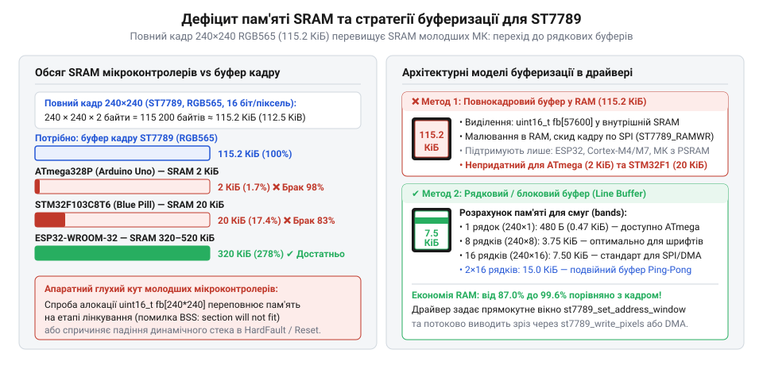
*Порівняння обсягу оперативної пам'яті типових мікроконтролерів із розміром повнокадрового буфера 240×240 RGB565 (115.2 КіБ), що демонструє неможливість алокації кадру на молодших чипах.*

Другий бар'єр — пропускна здатність шини та блокування процесора. Припустімо, що мікроконтролер має достатньо пам'яті для розміщення кадру. Тепер цей масив із 115 200 байтів необхідно передати через [послідовну шину SPI](root:com-devices/spi-bus) (англ. @@en|Serial Peripheral Interface@@). Загальний обсяг даних одного кадру в бітах становить:

```
N_bits
= 115 200 × 8 бітів           [переведення байтів кадру в біти]
= 921 600 бітів               [повний обсяг бітів на один кадр]
```

Якщо периферійний модуль SPI мікроконтролера тактується базовою частотою 8 МГц, мінімальний фізичний час передавання становить:

```
t_tx
= 921 600 бітів ÷ 8 000 000 біт/с    [передавання корисних бітів на частоті 8 МГц]
= 0.1152 с                           [фізична тривалість пересилання бітів]
= 115.2 мс                           [переведення в мілісекунди]
```

Звідси гранична теоретична частота оновлення дисплея за ідеальної неперервної передачі:

```
FPS_ideal
= 1 ÷ 0.1152 с                       [обернена величина до тривалості передачі кадру]
≈ 8.68 кадр/с                        [теоретичний максимум частоти оновлення]
```

У наївній програмі байти надсилаються в блокувальних циклах: процесор бере один байт або піксель, записує в регістр передавача і в порожньому циклі (англ. @@en|busy-wait@@) опитує прапорець завершення транзакції. Кожен виклик функції, накладні витрати циклу та перевірки стану додають затримку в 1–2 мкс на байт. Сумарно ці накладні паузи додають ще понад 200 мс очікування на кадр. Реальний час виведення зростає до 350–400 мс, а швидкість оновлення падає до катастрофічних 2–3 @@en|FPS@@ (від англ. @@en|frames per second@@ — кадрів на секунду). Весь цей час процесорне ядро стовідсотково зайняте безглуздим очікуванням шини, не встигаючи опитувати датчики чи обробляти переривання.

Цю суперечність розв'язує внутрішня будова контролера ST7789. Він не є «сліпим» перетворювачем сигналів — чип має власну інтегровану графічну пам'ять (GRAM, від англ. @@en|Graphic RAM@@) обсягом 240×320 точок із 18-бітним кольором. Контролер автономно живить матрицю та генерує розгортку безпосередньо зі своєї пам'яті GRAM. Мікроконтролеру не потрібно постійно оновлювати весь екран і зберігати його копію у своїй пам'яті. Достатньо визначити координати прямокутного вікна оновлення та надіслати лише змінені пікселі.

Щоб графічний інтерфейс працював плавно на частотах 30–60 FPS без перевантаження процесора та вичерпання пам'яті, низькорівневий драйвер вирішує чіткий комплекс задач:
1. Відокремлює логіку протоколу дисплея від апаратних викликів конкретного мікроконтролера.
2. Реалізує строге мультиплексування команд і даних через керування керуючими лініями шини.
3. Виконує коректну апаратну ініціалізацію та прив'язку системи координат екрана 240×240 до матриці 240×320 пам'яті GRAM.
4. Забезпечує потокове віконне виведення порціями (рядками або плитками) розміром у кілька кілобайтів.
5. Передає масиви пікселів через [контролер прямого доступу до пам'яті](root:hw-arch/dma) (DMA) у фоновому режимі.

> 🔧 **Навіщо це.**
> Потокова віконна передача з невеликим буфером рядків (наприклад, 240×10 пікселів = 4.8 КБ) усуває потребу у виділенні 115.2 КБ оперативної пам'яті, дозволяючи виводити високошвидкісну анімацію та графіку навіть на мікроконтролерах із 16–32 КіБ RAM.

## Апаратно-незалежний шар (HAL): проєктування структури дескриптора

Пряме використання функцій периферії мікроконтролера всередині коду драйвера (наприклад, `HAL_GPIO_WritePin` для STM32, `gpio_set_level` для ESP-IDF або `gpio_put` для RP2040) робить графічний стек монолітним і жорстко прив'язаним до одного кристала. Зміна мікроконтролера в наступній ревізії пристрою або перенесення ліній на інші ніжки змушує переписувати весь код драйвера чи засмічувати його сотнями директив умовної компіляції `#ifdef`. Крім того, монолітний код неможливо протестувати на персональному комп'ютері за допомогою програмних макетів.

Розв'язком є побудова апаратно-незалежного шару (HAL, від англ. @@en|Hardware Abstraction Layer@@ — шар абстракції обладнання). Драйвер ST7789 не повинен знати, до якого саме порту мікроконтролера підключено екран і які регістри керують апаратним SPI. Драйвер оперує абстрактним дескриптором (від лат. @@en|descriptor@@ — той, що описує), який містить покажчики на функції зворотного виклику для базових фізичних дій.

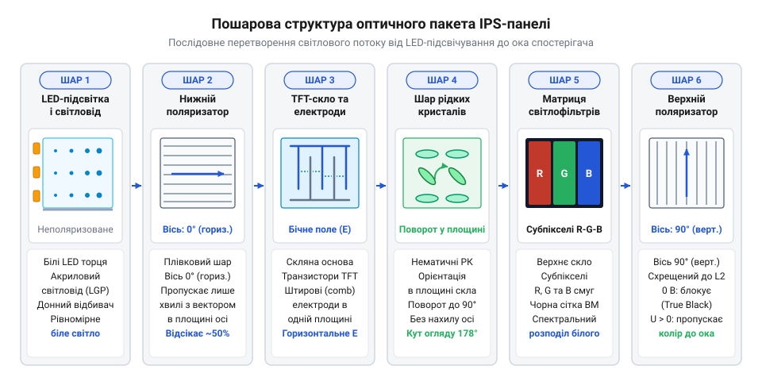
*Структурна схема взаємодії графічного рушія, драйвера ST7789 та апаратно-незалежного шару (HAL) через дескриптор st7789_t із покажчиками на системні драйвери SPI і GPIO, що забезпечує переносність коду між різними мікроконтролерами.*

Для повноцінного керування ST7789 через 4-дротовий інтерфейс потрібні такі апаратні примітиви:
- Керування вибором мікросхеми CS (англ. @@en|Chip Select@@): низький рівень активує обмін із чипом, високий переводить інтерфейс у стан очікування.
- Керування лінією вибору режиму D/C (англ. @@en|Data/Command@@): низький рівень задає передачу команди, високий — передачу параметрів або графічних даних.
- Апаратне скидання RST (англ. @@en|Reset@@): імпульс низького рівня повертає внутрішній автомат станів ST7789 у початковий стан.
- Керування яскравістю підсвічування BLK (англ. @@en|Backlight@@): логічний рівень або сигнал широтно-імпульсної модуляції (ШІМ).
- Блокувальне надсилання масиву байтів шиною SPI.
- Мілісекундна затримка для витримки часових інтервалів під час запуску та виходу з режиму сну.

Критично важливою вимогою до універсального дескриптора є наявність покажчика на контекст користувача `user_data` (від лат. @@en|contextus@@ — тісний зв'язок, сплетіння). Без нього функції зворотного виклику змушені були б звертатися до глобальних змінних. Покажчик `user_data` дозволяє передавати дескриптор апаратного інтерфейсу (наприклад, покажчик на структуру `SPI_HandleTypeDef` в STM32 або дескриптор пристрою `spi_device_handle_t` в ESP-IDF), що дає змогу одночасно керувати кількома незалежними дисплеями на одній платі.

Визначення структури дескриптора мовою C:

:::code api-st7789-c-driver/c/st7789.c

Для демонстрації портативності розглянемо прив'язку дескриптора `st7789_t` до трьох різних апаратних платформ:

:::tabs
:::code api-st7789-c-driver/c/stm32-spi-write.c
```esp32
/* Прив'язка HAL ST7789 до платформи ESP32 на базі ESP-IDF */
#include "driver/spi_master.h"
#include "driver/gpio.h"
#include "freertos/FreeRTOS.h"
#include "freertos/task.h"

typedef struct {
    spi_device_handle_t spi_dev;
    gpio_num_t          cs_pin;
    gpio_num_t          dc_pin;
    gpio_num_t          rst_pin;
    gpio_num_t          blk_pin;
} esp32_display_ctx_t;

static void esp32_spi_write(const uint8_t *data, size_t len, void *user_data) {
    esp32_display_ctx_t *ctx = (esp32_display_ctx_t *)user_data;
    spi_transaction_t t = {
        .length    = len * 8,
        .tx_buffer = data,
    };
    spi_device_polling_transmit(ctx->spi_dev, &t);
}

static void esp32_set_cs(uint8_t level, void *user_data) {
    esp32_display_ctx_t *ctx = (esp32_display_ctx_t *)user_data;
    gpio_set_level(ctx->cs_pin, level);
}

static void esp32_set_dc(uint8_t level, void *user_data) {
    esp32_display_ctx_t *ctx = (esp32_display_ctx_t *)user_data;
    gpio_set_level(ctx->dc_pin, level);
}

static void esp32_set_rst(uint8_t level, void *user_data) {
    esp32_display_ctx_t *ctx = (esp32_display_ctx_t *)user_data;
    gpio_set_level(ctx->rst_pin, level);
}

static void esp32_set_blk(uint8_t level, void *user_data) {
    esp32_display_ctx_t *ctx = (esp32_display_ctx_t *)user_data;
    gpio_set_level(ctx->blk_pin, level);
}

static void esp32_delay_ms(uint32_t ms) {
    vTaskDelay(pdMS_TO_TICKS(ms));
}

void st7789_bind_esp32(st7789_t *dev, esp32_display_ctx_t *ctx) {
    dev->spi_write = esp32_spi_write;
    dev->set_cs    = esp32_set_cs;
    dev->set_dc    = esp32_set_dc;
    dev->set_rst   = esp32_set_rst;
    dev->set_blk   = esp32_set_blk;
    dev->delay_ms  = esp32_delay_ms;
    dev->user_data = ctx;
}
```
```rp2040
/* Прив'язка HAL ST7789 до платформи RP2040 на базі Pico SDK */
#include "pico/stdlib.h"
#include "hardware/spi.h"

typedef struct {
    spi_inst_t *spi_inst;
    uint        cs_pin;
    uint        dc_pin;
    uint        rst_pin;
    uint        blk_pin;
} rp2040_display_ctx_t;

static void rp2040_spi_write(const uint8_t *data, size_t len, void *user_data) {
    rp2040_display_ctx_t *ctx = (rp2040_display_ctx_t *)user_data;
    spi_write_blocking(ctx->spi_inst, data, len);
}

static void rp2040_set_cs(uint8_t level, void *user_data) {
    rp2040_display_ctx_t *ctx = (rp2040_display_ctx_t *)user_data;
    gpio_put(ctx->cs_pin, level);
}

static void rp2040_set_dc(uint8_t level, void *user_data) {
    rp2040_display_ctx_t *ctx = (rp2040_display_ctx_t *)user_data;
    gpio_put(ctx->dc_pin, level);
}

static void rp2040_set_rst(uint8_t level, void *user_data) {
    rp2040_display_ctx_t *ctx = (rp2040_display_ctx_t *)user_data;
    gpio_put(ctx->rst_pin, level);
}

static void rp2040_set_blk(uint8_t level, void *user_data) {
    rp2040_display_ctx_t *ctx = (rp2040_display_ctx_t *)user_data;
    gpio_put(ctx->blk_pin, level);
}

static void rp2040_delay_ms(uint32_t ms) {
    sleep_ms(ms);
}

void st7789_bind_rp2040(st7789_t *dev, rp2040_display_ctx_t *ctx) {
    dev->spi_write = rp2040_spi_write;
    dev->set_cs    = rp2040_set_cs;
    dev->set_dc    = rp2040_set_dc;
    dev->set_rst   = rp2040_set_rst;
    dev->set_blk   = rp2040_set_blk;
    dev->delay_ms  = rp2040_delay_ms;
    dev->user_data = ctx;
}
```
:::

> 🔧 **Навіщо це.**
> Архітектура з покажчиками зворотного виклику та контекстом `user_data` дозволяє підтримувати кілька незалежних екранів на одній системі та портувати графічний стек між будь-якими мікроконтролерами за лічені хвилини без зміни жодного рядка коду самого драйвера.

## 4-дротовий SPI: стробування транзакцій та примітиви передачі команд і даних

Шина SPI є синхронним послідовним інтерфейсом, у якому дані передаються біт за бітом за тактовими імпульсами лінії SCLK (англ. @@en|Serial Clock@@). У стандартному 4-дротовому режимі підключення дисплея використовуються лінії:
- SCLK — тактування шини;
- MOSI (SDA) — лінія передачі даних від мікроконтролера до дисплея;
- CS — вибір чипа (активний низький рівень);
- D/C — вибір типу інформації (дані або команда).

Лінія зворотної передачі MISO в типових модулях ST7789 не розпаяна або вимкнена апаратно, тому зв'язок є строго односпрямованим.

Потік байтів на лінії MOSI не містить адресних заголовків чи маркерів початку й кінця пакета, як у шині I2C або мережевих протоколах. Контролер ST7789 не має способу визначити за самими бітами, чи є отримане значення `0x2C` інструкцією початку запису в пам'ять (RAMWR), чи це колірна компонента пікселя зображення. Для розв'язання цієї проблеми контролер використовує окремий апаратний сигнал на лінії D/C (від англ. @@en|Data/Command@@, або RS — @@en|Register Select@@).

Коли на лінії D/C встановлено низький логічний рівень (`0`), внутрішній дешифратор ST7789 спрямовує байт у регістр інструкцій. Коли на лінії D/C встановлено високий логічний рівень (`1`), байти спрямовуються в буфер аргументів поточної команди або безпосередньо записуються в пам'ять кадру GRAM.

Лінія CS (від англ. @@en|Chip Select@@ — вибір кристала) формує апаратний строб (від грец. @@en|strobos@@ — вихор, швидкий рух), який обрамляє кожну сесію обміну. Переведення лінії CS у низький рівень скидає внутрішній бітовий лічильник SPI-інтерфейсу ST7789, готуючи його до приймання першого біта байта. Якщо лінія CS лишається низькою, контролер продовжує приймати наступні байти. Підняття лінії CS у високий рівень завершує транзакцію та ігнорує будь-які паразитні імпульси на лініях SCLK і MOSI.

Контролер ST7789 офіційно підтримує два режими шини SPI: Mode 0 та Mode 3. Вибір режиму визначається полярністю (від лат. @@en|polus@@ — вісь) сигналу тактування CPOL (англ. @@en|Clock Polarity@@) та фазою (від грец. @@en|phasis@@ — вигляд) вибірки CPHA (англ. @@en|Clock Phase@@):
- Mode 0: `CPOL = 0` (у стані спокою на лінії SCLK низький рівень), `CPHA = 0` (вибірка даних відбувається за першим, наростаючим фронтом імпульсу).
- Mode 3: `CPOL = 1` (у стані спокою на лінії SCLK високий рівень), `CPHA = 1` (вибірка даних відбувається за другим, наростаючим фронтом імпульсу).

В обох режимах зчитування стану лінії MOSI всередині ST7789 відбувається строго за наростаючим фронтом (від низького до високого рівня) тактового сигналу SCLK. Завдяки цьому дисплей стабільно функціонує на спільній шині з іншими периферійними пристроями незалежно від того, яку полярність у спокої вони вимагають.

Найпідступніша апаратна пастка під час керування лінією D/C криється в часових вимогах перемикання станів (англ. @@en|race condition@@ — стан гонитви сигналів).

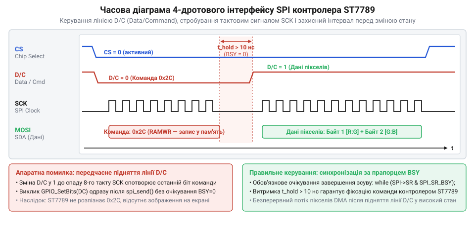
*Часова діаграма передачі команди та даних по 4-дротовому SPI: лінія D/C утримується на низькому рівні впродовж усіх восьми тактів SCLK передачі команди, а перемикання на високий рівень для даних дозволене лише після завершення передачі останнього біта.*

Як видно з часової діаграми, лінія D/C зобов'язана зберігати стабільний низький рівень протягом усіх восьми тактів SCLK, поки передається байт команди. Перемикання лінії D/C у високий рівень для подальшого надсилання параметрів дозволено лише після того, як останній біт команди зафіксовано наростаючим фронтом восьмого такту SCLK.

У більшості сучасних мікроконтролерів модуль SPI обладнано внутрішнім апаратним буфером [FIFO](root:com-devices/spi-bus) (англ. @@en|First In, First Out@@ — першим прийшов, першим пішов). Коли функція запису надсилає байт, він завантажується в буфер FIFO, і функція миттєво повертає керування процесору, тоді як апаратний зсувний регістр лише починає виштовхувати біти в лінію MOSI. Якщо після виклику відправки команди програма негайно перемикає лінію D/C у високий стан (наприклад, викликом `set_dc(1)`), лінія D/C змінює рівень просто посеред передачі 2-го чи 3-го біта команди! Контролер ST7789 фіксує зміну рівня, дешифратор команд скидається, і байт команди сприймається як пошкоджені дані. Екран перестає реагувати на команди або відображає хаотичні колірні шуми.

Саме тому функція передачі шиною SPI або низькорівневі примітиви драйвера зобов'язані перевіряти апаратний прапорець завершення трансляції (наприклад, прапорець зайнятості шини `BSY` або завершення передачі `TC`) перед будь-якою зміною стану ліній D/C чи CS.

На базі структури `st7789_t` реалізуємо базові примітиви обміну: відправку однієї команди `st7789_write_cmd`, відправку масиву даних `st7789_write_data` та допоміжну функцію відправки одного байта даних `st7789_write_data_byte`.

:::code api-st7789-c-driver/c/st7789-write-cmd.c

Деактивація лінії CS після відправки команди та повторна активація перед передачею даних є надійним способом гарантувати, що внутрішній автомат станів ST7789 чітко розмежує фазу дешифрування інструкції та фазу накопичення аргументів. Для пакетних операцій (наприклад, передачі неперервного потоку пікселів) лінію CS утримують на низькому рівні впродовж усього блоку, усуваючи накладні витрати на зайве смикання ліній введення-виведення.

> 🔧 **Навіщо це.**
> Суворий контроль завершення передачі останнього біта перед перемиканням лінії D/C рятує від прихованих збоїв ініціалізації, які проявляються лише при увімкненні оптимізації компілятора `-O2`/`-O3` або на високих тактових частотах процесора.

## Апаратне скидання та послідовність ініціалізації: вихід зі сну і конфігурація матриці

Після подачі напруги живлення рідкокристалічний дисплейний модуль не готовий приймати зображення: підсвічування може світитися, але саме скло лишається повністю темним або вкритим хаотичними кольоровими смугами. У кремнієвому кристалі контролера ST7789 логіка керування розділена на два домени: низьковольтний цифровий домен живлення логіки VDDI (від 1.65 до 3.3 В) та аналоговий домен VDD (від 2.4 до 3.3 В). Одразу після увімкнення внутрішні генератори перебувають у зупиненому стані, а сам контролер автоматично переходить у режим апаратного сну (@@en|Sleep In@@). У цьому стані вимкнено внутрішні помпи заряду (від фр. *pompe* — насос; спеціальні перетворювачі напруги на комутованих конденсаторах), які формують високі напруги зміщення для затворів тонкоплівкових польових транзисторів: позитивну напругу відкривання затворів VGH (близько +13 В) та негативну напругу закривання VGL (близько −10 В). Виходи керування матрицею відключені від панелі або замкнені на землю, а внутрішні конфігураційні регістри містять невизначені або скинуті значення. Щоб запустити екран, мікроконтролер має виконати чітко регламентовану послідовність апаратних і програмних кроків.

Першим кроком є формування апаратного імпульсу скидання через виділену лінію RES (від англ. @@en|reset@@ — скидання в початковий стан, повернення до вихідної точки). Цей сигнал є інверсним (активний низький рівень). Коли на лінію RES подається логічний нуль, уся цифрова логіка контролера ST7789 примусово перезавантажується, скидаючи кінцевий автомат інтерфейсу та зчитуючи калібрувальні константи з одноразово програмованої пам'яті (OTP ROM). Часові вимоги специфікації ST7789 вимагають, щоб тривалість імпульсу низького рівня становила щонайменше 10 мкс (t_RES ≥ 10 мкс). На практиці мікроконтролер утримує рівень нуля протягом 10–20 мс: це гарантує надійний розряд усіх паразитних ємностей та фільтрувальних конденсаторів у колах живлення плати модуля. Після повернення лінії RES у високий рівень контролер потребує паузи не менше 5 мс перед початком передачі команд по шині SPI. Якщо ж апаратне скидання відбулося під час виходу з режиму сну, час відновлення аналогових кіл сягає 120 мс. Програмною альтернативою є відправка команди програмного перезапуску SWRESET (`0x01`), яка також вимагає паузи щонайменше 120 мс на стабілізацію внутрішніх генераторів перед відправкою наступних команд.

> 🔧 **Навіщо це.**
> Дотримання часових затримок після імпульсу скидання та команди виходу зі сну є критичним для фізичного збереження працездатності перетворювачів напруги. Якщо надіслати конфігураційні байти без очікування 120 мс, внутрішні помпи заряду спробують запуститися під нестабільним навантаженням. У результаті напруги VGH та VGL не досягнуть номінальних значень, матриця залишиться темною, а внутрішній контролер інтерфейсу може заблокуватися у стані невизначеності (@@en|latch-up@@), з якого його виведе лише повне знеструмлення схеми.

Коли логіка стабілізувалася, починається послідовність налаштування внутрішніх регістрів (від лат. *registrum* — список, перелік). Вона складається з п'яти обов'язкових етапів:

1. **Вихід із режиму сну: SLPOUT (`0x11`).** Контролер запускає внутрішній RC-генератор тактової частоти та вмикає DC-DC перетворювачі живлення матриці. Команда не приймає параметрів. Одразу після її передачі драйвер зобов'язаний витримати затримку тривалістю не менше 120 мс, протягом якої напруги на зовнішніх конденсаторах помпи заряду досягають робочих рівнів. До завершення цієї паузи заборонено відправляти команди ввімкнення розгортки або запису пам'яті.
2. **Формат колірних даних: COLMOD (`0x3A`).** Регістр вибору формату пікселів (від англ. @@en|color mode@@) задає кількість бітів, що кодують колір однієї точки, переданої по шині SPI. Для дисплеїв із контролером ST7789 стандартним є 16-бітний режим RGB565 (5 бітів червоного, 6 бітів зеленого, 5 бітів синього). Команда приймає один байт параметра: значення `0x55` (двійкове `0b01010101`). Старші чотири біти `0101b` призначають 16-бітний формат для RGB-інтерфейсу, а молодші чотири біти `0101b` встановлюють 16-бітну глибину для послідовного мікроконтролерного інтерфейсу.
3. **Керування доступом до пам'яті: MADCTL (`0x36`).** Регістр керування доступом (від англ. @@en|memory data access control@@) визначає порядок обходу рядків і стовпчиків кадрового буфера під час запису пікселів, а також порядок розташування кольорових субпікселів. Біт 7 (MY, @@en|Row Address Order@@) задає напрямок перебору рядків (0 — згори вниз, 1 — знизу вгору). Біт 6 (MX, @@en|Column Address Order@@) задає напрямок перебору колонок (0 — зліва направо, 1 — справа наліво). Біт 5 (MV, @@en|Row/Column Exchange@@) міняє місцями осі X та Y, що відповідає транспонуванню матриці для ландшафтної орієнтації. Біт 3 (RGB/BGR) визначає порядок слідування колірних фільтрів: значення `0` призначає стандартний порядок червоний-зелений-синій (RGB), а значення `1` перемикає контролер у синій-зелений-червоний (BGR). Якщо цей біт виставлено невірно, червоні об'єкти на екрані стануть синіми, а сині — червоними.
4. **Увімкнення інверсії кольору: INVON (`0x21`).** Фізична будова IPS-панелей ([In-Plane Switching](root:hw-motion/lcd-ips-technology)) відрізняється від класичних TN-матриць, які використовуються в [дисплеях на базі ST7735S](root:cat-hw-actuators/tft-st7735s). Рідкі кристали в IPS за відсутності електричного поля орієнтовані паралельно площині підкладки й не змінюють поляризацію світла: екран є «типово чорним» (@@en|normally black@@). Контролер ST7789 за замовчуванням сконфігурований під «типово білі» панелі (@@en|normally white@@), де світло проходить крізь вимкнений піксель. Якщо на IPS-панель подати нескоригований сигнал, кольори виявляться інвертованими (чорний стане білим, а білий — чорним). Команда `0x21` (інверсія, від лат. *inversio* — перевертання) активує апаратну інверсію полярності сигналів на виходах джерел напруги, повертаючи правильне відтворення палітри кольорів.
5. **Активація розгортки екрана: DISPON (`0x29`).** Команда вмикає вихідні буфери драйверів рядків та колонок. Контролер починає циклічно сканувати матрицю з внутрішньою кадровою частотою близько 60 Гц. Для завершення першого циклу розгортки перед початком відправки графічних кадрів доцільно додати коротку затримку у 20 мс.

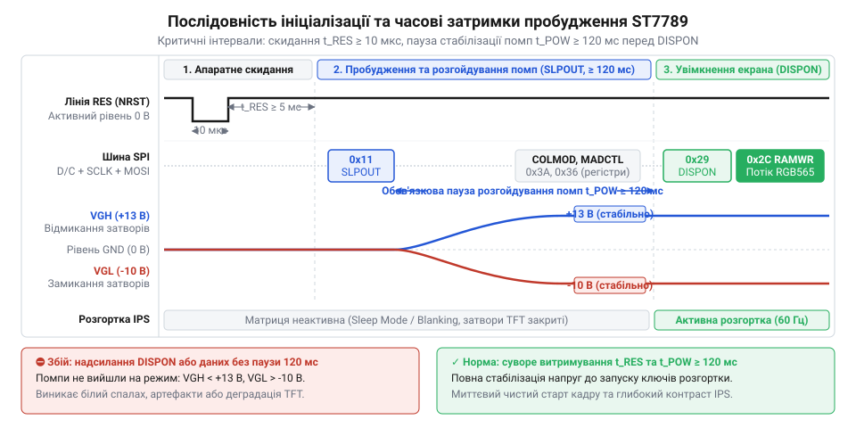
*Часова діаграма послідовності запуску та ініціалізації ST7789: дотримання тривалості імпульсу скидання лінії RES, обов'язкової паузи 120 мс для виходу помп заряду на номінальні напруги VGH і VGL після команди SLPOUT та затримки після DISPON запобігає апаратним блокуванням контролера й гарантує стабільний старт розгортки матриці.*

Нижче наведено модульну C-реалізацію функції `st7789_init`. Драйвер використовує структуру апаратного абстрагування, що дозволяє виконувати код на будь-якому мікроконтролері з підтримкою викликів передачі байтів по SPI та маніпуляції лініями GPIO:

:::code api-st7789-c-driver/c/st7789-write-cmd.c

У результаті виконання `st7789_init` контролер переходить у робочий стан з активованою кадровою розгорткою. Екран готовий приймати пікселі, проте будь-який вивід графіки вимагає точного позиціонування всередині фізичної пам'яті контролера.

## Віконна адресація пам'яті: апаратні зміщення для матриці 240×240 та функція st7789_set_address_window

Контролер ST7789 проектувався як універсальний кристал для широкого спектра дисплейних панелей. Його внутрішній кадровий буфер (@@en|framebuffer@@; від нім. *Rahmen* — рамка та англ. *buffer* — буфер, проміжне сховище) має фізичний розмір 240 колонок на 320 рядків (240×320 точок), що сумарно становить 76 800 вісімнадцятибітних комірок пам'яті GRAM (@@en|Graphic RAM@@). Проте популярні квадратні IPS-модулі з діагоналлю 1.3″ мають фізичну матрицю роздільною здатністю лише 240×240 точок. Виробник скляної панелі розпаює на шлейфі до виходів кристала рівно 240 ліній вибору рядків і 240 ліній джерел напруги колонок. Решта 80 рядків пам'яті контролера (320 − 240 = 80) залишаються фізично не з'єднаними з жодним рідкокристалічним елементом на склі.

Якщо програма спробує вивести зображення за логічними координатами без врахування внутрішньої структури кристала, виникне зміщення (від англ. @@en|offset@@): частина графіки вийде за межі скла, або весь кадр опиниться в «сліпій» зоні непідключених рядків.

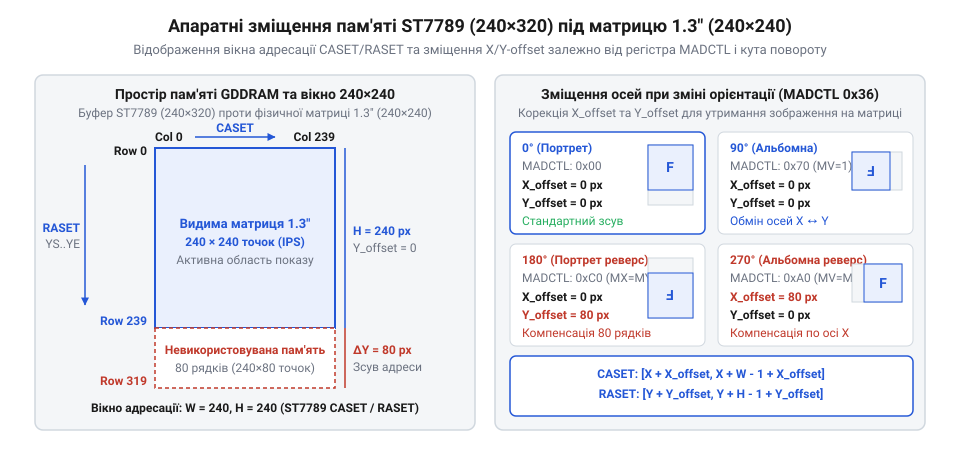
*Схема відповідності внутрішньої пам'яті контролера ST7789 (240×320 точок) та фізичної матриці екрана 1.3″ (240×240 точок): апаратні зміщення X та Y для чотирьох кутів повороту компенсують непідключену область пам'яті, утримуючи вікно адресації в межах видимого скла.*

Передача кожного пікселя окремою командою разом із координатами X та Y перевантажила б послідовну шину SPI службовими даними у 3–4 рази. Замість цього ST7789 використовує концепцію прямокутного вікна адресації. Драйвер спочатку вказує контролеру межі прямокутника, у який буде здійснюватися запис, а потім відправляє безперервний потік колірних байтів.

Межі вікна встановлюються двома регістрами:

- **CASET (`0x2A`): встановлення діапазону колонок (@@en|Column Address Set@@).** Команда приймає 4 байти параметрів: початкову колонку `XS` (два байти: старший і молодший) та кінцеву колонку `XE` (два байти: старший і молодший). Усі значення передаються у форматі з прямим порядком байтів (@@en|Big-Endian@@, старший байт першим).
- **RASET (`0x2B`): встановлення діапазону рядків (@@en|Row Address Set@@).** Команда аналогічно приймає 4 байти: початковий рядок `YS` та кінцевий рядок `YE` у форматі Big-Endian.
- **RAMWR (`0x2C`): запис у пам'ять (@@en|Memory Write@@).** Команда перемикає логіку контролера в режим потокового наповнення пам'яті кадру.

Коли команду `RAMWR` прийнято, внутрішній лічильник адрес контролера автоматично встановлюється в позицію `(XS, YS)`. З кожним записаним шістнадцятибітним словом кольору лічильник колонок самостійно інкрементується на одиницю: `XS → XS+1 → ... → XE`. Як тільки колонка досягає межі `XE`, лічильник повертається на початок рядка `XS`, а лічильник рядків збільшується на одиницю: `YS → YS+1 → ... → YE`. Після заповнення всього вікна вказівник знову циклічно переходить на початковий піксель `(XS, YS)`.

> 🔧 **Навіщо це.**
> Прямокутне віконне адресування звільняє шину SPI від надлишкового трафіку. Якщо системі потрібно оновити невеликий текстовий лічильник розміром 40×20 точок, драйвер обмежує вікно діапазоном у 800 пікселів (1 600 байтів передачі даних). За повної кадрової перемальовки довелося б прокачувати всі 240×240 точок (115 200 байтів). На тактовій частоті SPI у 40 МГц оновлення повного кадру займає близько 23 мс (що обмежує швидкість на рівні 43 кадрів на секунду), тоді як локальне вікно оновлюється за 0.32 мс, дозволяючи процесору паралельно опитувати датчики та обробляти бездротові протоколи.

Апаратні зміщення пам'яті виникають через взаємодію фізичного монтажу кристала з бітами регістра MADCTL (`0x36`). У типових 1.3″ модулях фізична матриця 240×240 підключена до рядків пам'яті 0..239, тоді як рядки 240..319 залишаються порожніми.

Коли дисплей перебуває в базовій портретній орієнтації (кут 0°):
- Осі пам'яті та екрана збігаються.
- Колонкам від 0 до 239 відповідають фізичні адреси 0..239 (`offset_x = 0`).
- Рядкам від 0 до 239 відповідають фізичні адреси 0..239 (`offset_y = 0`).

Коли в регістрі MADCTL активується біт MY (поворот на 180°):
- Контролер інвертує напрямок лічильника рядків: рядок 0 пам'яті апаратно відображається внизу, а рядок 319 — угорі.
- Фізично підключені до скла лінії матриці тепер розташовані за адресами від 80 до 319. Якщо записати піксель за адресою 0..79, він потрапить у порожні комірки пам'яті й на екрані не з'явиться.
- Щоб компенсувати цей розрив, до кожного рядка Y необхідно програмно додавати зміщення 80:

```
row_hw = y + 80
```

Коли активується біт MV (обмін осей колонок і рядків для орієнтацій 90° та 270°):
- Вісь рядків кадрової пам'яті (розміром 320 комірок) стає горизонтальною віссю X дисплея.
- У режимі 270° (поєднання інверсії рядків MY та обміну осей MV) зміщення 80 точок переходить на горизонтальну вісь:

```
col_hw = x + 80
row_hw = y + 0
```

Універсальна залежність параметрів для чотирьох кутів повороту зведена в таблицю:

| Кут повороту | MADCTL конфігурація | Роздільна здатність | X-зміщення (`offset_x`) | Y-зміщення (`offset_y`) |
| :--- | :--- | :--- | :--- | :--- |
| **0°** | `ST7789_MADCTL_RGB` (`0x00`) | 240 × 240 | 0 | 0 |
| **90°** | `MADCTL_MX \| MADCTL_MV` (`0x60`) | 240 × 240 | 0 | 0 |
| **180°** | `MADCTL_MY \| MADCTL_MX` (`0xC0`) | 240 × 240 | 0 | 80 |
| **270°** | `MADCTL_MY \| MADCTL_MV` (`0xA0`) | 240 × 240 | 80 | 0 |

*Примітка: окремі ревізії модулів 1.3″ сторонніх виробників мають альтернативну розводку шлейфа, де матриця підключена до рядків 80..319 у нульовій орієнтації. У такому разі зміщення за віссю Y становить 80 для 0°, а для 180° дорівнює 0. Ця різниця легко усувається налаштуванням початкових полів `offset_x` та `offset_y` у структурі драйвера без зміни логіки розрахунків.*

Нижче наведено практичну реалізацію функції встановлення адресної області `st7789_set_address_window` та функції вибору орієнтації `st7789_set_rotation`:

:::code api-st7789-c-driver/c/st7789-set-rotation.c

Функція `st7789_set_address_window` готує контролер до прийому графіки: наступні байти, передані по SPI з високим рівнем лінії D/C, автоматично записуються в комірки пам'яті визначеного прямокутника, заповнюючи пікселі рядок за рядком точно у видимих межах екрана.

## Формат кольору RGB565, узгодження порядку байтів і блоковий вивід

Кольоровий IPS-дисплей із роздільною здатністю 240×240 пікселів (англ. @@en|pixel@@, скорочення від @@en|picture element@@ — елемент зображення) будує зображення з окремих точок. Кожна точка формується трьома оптичними комірками: червоною (Red), зеленою (Green) та синьою (Blue). У класичному повноколірному представленні TrueColor (RGB888) кожен колірний канал вимагає одного байта (8 бітів), тобто 3 байти на один піксель. Для повної матриці 240×240 такий обсяг становить:

```
V_rgb888
= 240 × 240 × 3           [розрахунок обсягу кадру при 3 байтах на піксель]
= 57 600 × 3              [множення загальної кількості точок на розмір пікселя]
= 172 800 байтів          [168.75 кілобайта]
```

Передача 172 КБ даних через послідовну шину SPI для кожного оновлення екрана створює надлишковий трафік і вимагає значного обсягу пам'яті. Контролер ST7789 підтримує компактніший 16-бітний режим кодування кольору RGB565, у якому один піксель описується двома байтами. Обсяг відеоданих кадру скорочується рівно на третину порівняно з RGB888:

```
V_rgb565
= 240 × 240 × 2           [розрахунок обсягу кадру при 2 байтах на піксель]
= 57 600 × 2              [множення кількості точок на 2 байти]
= 115 200 байтів          [112.5 кілобайта]
```

Подібно до контролера ST7735S (див. `root:cat-hw-actuators/tft-st7735s`), де також використовується формат RGB565, контролер ST7789 зберігає пікселі у внутрішній оперативній пам'яті кадру (GRAM) саме у 18-бітному форматі.

У 16-бітному слові біти розподіляються між колірними каналами нерівномірно: 5 бітів відведено червоному каналу (R), 6 бітів — зеленому (G), і 5 бітів — синьому (B). Зелений канал отримує додатковий біт через фізіологічну властивість людського зору: сітківка ока має найвищу концентрацію фоторецепторів, чутливих до зеленої ділянки спектра. Додаткова розрядність зеленого каналу (64 рівні яскравості замість 32) усуває помітну східчастість градієнтів освітленості.

Для пакування трьох стандартних 8-бітних компонентів кольору (значення 0..255) у 16-бітне число `uint16_t` відкидають молодші шумові розряди: у червоному каналі залишають 5 старших бітів, у зеленому — 6, а в синьому — 5. Програмне складання кольору виконується бітовими масками та зсувами:

```c
static inline uint16_t st7789_rgb565(uint8_t r, uint8_t g, uint8_t b)
{
    return (uint16_t)(((r & 0xF8) << 8) | ((g & 0xFC) << 3) | (b >> 3));
}
```

У 32-бітних мікроконтролерах на базі архітектур ARM Cortex-M та RISC-V дані в оперативній пам'яті розміщуються за схемою Little-Endian (англ. @@en|little-endian@@ — молодшим кінцем уперед, від староанглійського @@en|end@@ — край, кінець; докладніше див. `root:hw-arch/endianness`). Під час збереження 16-бітного значення `uint16_t` молодший байт (біти 0..7) записується за меншою адресою в пам'яті, а старший байт (біти 8..15) — за наступною адресою.

Контролер ST7789 під час прийому пікселів через команду запису у пам'ять кадру `RAMWR` (код `0x2C`) очікує передачу у форматі Big-Endian (англ. @@en|big-endian@@ — старшим кінцем уперед): першим по послідовній шині SPI повинен надходити старший байт із червоними та старшими зеленими бітами, а другим — молодший байт із молодшими зеленими та синіми бітами.

Якщо передати масив `uint16_t` напряму в 8-бітний канал передачі SPI, мікроконтролер вичитуватиме байти з оперативної пам'яті в порядку Little-Endian. Першим у лінію MOSI надійде молодший байт, а другим — старший. Це призводить до повної інверсії колірних каналів:

```
Колір: Чистий червоний (R=255, G=0, B=0)
Значення RGB565: 0xF800 (двійкове: 11111000 00000000)
У пам'яті Little-Endian:
  байт 0 (менша адреса): 0x00 (молодший байт)
  байт 1 (більша адреса): 0xF8 (старший байт)
Отримано контролером ST7789 через SPI: 0x00, потім 0xF8
Інтерпретація контролером: 0x00F8 (R=0, G=7, B=24 — темний синьо-зелений колір замість червоного)
```

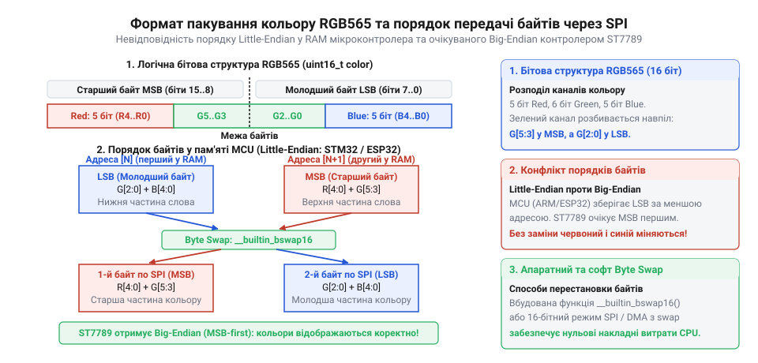
*Схема бітового пакування компонентів кольору у формат RGB565 та зіставлення порядку Little-Endian у пам'яті мікроконтролера з порядком Big-Endian шини передачі ST7789.*

Для усунення колірного спотворення 16-бітне число розвертають (міняють місцями старший і молодший байти) перед надсиланням у SPI. Для цього застосовують три підходи:
1. Вбудована інструкція процесора. Компілятори GCC та Clang підтримують функцію `__builtin_bswap16()`. На архітектурі ARM Cortex-M ця конструкція перетворюється на одну апаратну інструкцію `REV16`, що виконує перестановку байтів за один такт.
2. Програмний розворот бітовими зсувами: `((val >> 8) | (val << 8))` для процесорів без апаратної підтримки байтових реверсів.
3. 16-бітний режим шини SPI. Якщо апаратний модуль SPI підтримує передачу 16-бітними словами, він самостійно передає старший біт першим (MSB First). Однак при чергуванні 8-бітних команд ініціалізації та 16-бітних даних пікселів постійне перемикання розрядності SPI потребує зупинки периферії та скидання конфігураційних регістрів, що знижує загальний темп виведення.

> 🔧 **Навіщо це.**
> Побайтова конверсія порядку перед відправкою дає змогу тримати апаратний блок SPI у стабільному 8-бітному режимі. Завдяки процесорній інструкції `REV16` або попередній конверсії статичних графічних ресурсів під час компіляції програма уникає накладних витрат під час виведення кадрів.

Після конфігурації меж прямокутної області функцією `st7789_set_address_window` контролер фіксує внутрішні межі запису. Лінія вибору кристала CS (англ. @@en|Chip Select@@) переводиться в активний нульовий стан, лінія D/C (англ. @@en|Data/Command@@) перемикається у високий рівень для передачі даних, після чого потік пікселів передається блоками.

Драйвер містить дві функції для роботи з прямокутними областями:
- `st7789_write_pixels`: потокова відправка масиву довільних пікселів, де колірні байти вже розвернуто у формат Big-Endian.
- `st7789_fill_color`: швидке заливання прямокутної ділянки однорідним кольором (очищення екрана, малювання прямокутників та фонів).

Під час суцільного заливання виклик передачі SPI по одній точці створює великі накладні витрати на перевірку прапорців стану периферії. Оптимальний підхід полягає у виділенні невеликого проміжного масиву (наприклад, на 64 пікселі), його заповненні попередньо підготовленим у Big-Endian значенням кольору та циклічній пакетній передачі через шину SPI.

:::code api-st7789-c-driver/c/st7789-rgb565.c

Якщо прямокутник виходить за межі фізичної роздільної здатності дисплея (координати більші за 239), внутрішній лічильник стовпчиків і рядків контролера ST7789 переповнюється. Пікселі починають записуватися з протилежного краю матриці, накладаючись на вже виведені графічні елементи. Тому функція встановлення координат адресації повинна містити перевірку та обрізання координат по межах `width - 1` та `height - 1`.

## Асинхронний потік через DMA та рядкова подвійна буферизація

Синхронне блокувальне виведення графіки змушує центральний процесор постійно опитувати прапорці апаратного стану інтерфейсу SPI (режим опитування, англ. @@en|polling@@). Під час виконання функцій передачі даних ядро мікроконтролера витрачає мільйони тактів на очікування моменту, коли черговий байт звільнить вихідний зсувний регістр передавача.

Розрахуємо час передачі даних для оновлення повної матриці 240×240 пікселів у форматі RGB565 за типової тактової частоти шини SPI 40 МГц:

```
T_frame
= (240 × 240 × 16) ÷ 40 000 000   [розрахунок часу передачі 921 600 бітів на частоті 40 МГц]
= 921 600 ÷ 40 000 000           [ділення загального обсягу бітів на бітрейт шини]
≈ 0.02304 с                      [23.04 мілісекунди на передачу одного кадру]
```

Якщо система оновлює екран із частотою 40 кадрів на секунду (fps), процесор виявляється заблокованим майже весь робочий час:

```
T_cpu_busy
= 40 × 0.02304 с                 [множення цільової частоти кадрів на тривалість передачі кадру]
≈ 0.9216 с                       [92.16% процесорного часу витрачено на очікування SPI]
```

За такого навантаження мікроконтролер не здатний своєчасно реагувати на переривання від датчиків, обробляти пакети бездротового зв'язку чи розраховувати складну анімацію.

Повнорозмірний буфер кадру (англ. @@en|framebuffer@@, від старофранцузького @@en|buffe@@ — удар) для матриці 240×240 точок у кодуванні RGB565 вимагає 115 200 байтів оперативної пам'яті SRAM. Більшість мікроконтролерів класів Cortex-M0+/M3/M4 мають від 20 до 64 КБ загальної пам'яті SRAM, тому виділити цілісний кадровий буфер у них неможливо.

Розв'язанням є поєднання контролера прямого доступу до пам'яті (DMA, англ. @@en|Direct Memory Access@@; докладніше див. `root:hw-arch/dma`) та конвеєра подвійної буферизації рядків (англ. @@en|ping-pong buffering@@). Контролер DMA є апаратним блоком мікроконтролера, який самостійно вичитує байти з пам'яті SRAM і пересилає їх у вихідний регістр SPI без залучення процесора.

Для економії оперативної пам'яті екран розбивають на смуги (слайси) висотою, наприклад, 16 рядків. Смуга шириною 240 точок містить 3 840 пікселів і потребує 7 680 байтів пам'яті:

```
V_slice
= 240 × 16 × 2           [розрахунок обсягу пам'яті на блок із 16 рядків]
= 7 680 байтів           [7.5 кілобайта]
```

Для конвеєрного виведення виділяють два однакових буфери — буфер A і буфер B (сумарно 15 360 байтів, або 15 КБ), що легко розміщується у пам'яті мікроконтролера. Обробка відбувається за такою послідовністю:
1. Процесор малює графічні елементи першої смуги кадру в буфер A.
2. Процесор ініціалізує асинхронну передачу буфера A через канал DMA в дисплей і негайно продовжує виконання основної програми.
3. Поки контролер DMA передає вміст буфера A через шину SPI, процесор рендерить графіку другої смуги кадру в буфер B.
4. Після завершення надсилання буфера A контролер DMA генерує апаратне переривання завершення передачі (лат. @@en|interruptio@@ — зупинка, переривання).
5. Обробник переривання викликає зворотний виклик завершення (англ. @@en|completion callback@@). Буфери міняються ролями: DMA починає виводити щойно заповнений буфер B, а процесор заповнює вже звільнений буфер A даними третьої смуги.

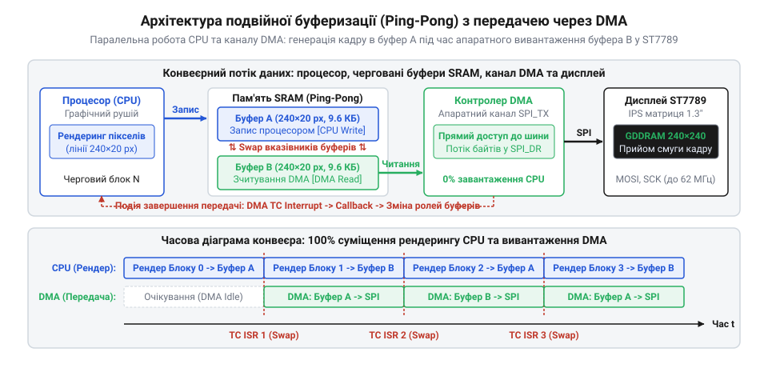
*Конвеєрна робота процесора та контролера DMA в архітектурі подвійної буферизації з перемиканням буферів за перериванням завершення передачі.*

> 🔧 **Навіщо це.**
> Подвійна рядкова буферизація забезпечує високу частоту оновлення екрана без мерехтіння на мікроконтролерах із малим обсягом пам'яті SRAM, вивільняючи понад 90% процесорного часу для основних обчислень.

Функція `st7789_write_stream_dma` запускає передачу блоку даних у фоновому режимі. Вона приймає адресу буфера, довжину в байтах, покажчик на функцію зворотного виклику та контекст користувача `user_data`. Перед стартом лінія D/C переводиться у стан даних. Лінія CS залишається активною (рівень 0) протягом передачі всієї серії смуг одного кадру, щоб уникнути скидання внутрішнього лічильника адреси ST7789.

:::code api-st7789-c-driver/c/st7789-dma-internal-callback.c

Нижче наведено приклад організації конвеєра пінг-понг для оновлення кадру смугами:

:::code api-st7789-c-driver/c/on-slice-dma-complete.c

Під час практичної реалізації DMA-конвеєра необхідно враховувати особливості архітектури мікроконтролера:
1. Узгодженість кешу даних (D-Cache). На процесорах ARM Cortex-M7 (наприклад, STM32H7; докладніше див. `root:hw-arch/cache-coherency-mcu`) увімкнений кеш даних створює розсинхронізацію: процесор оновлює дані в кеші, а DMA зчитує застарілий вміст із фізичної пам'яті SRAM. Перед викликом `st7789_write_stream_dma` необхідно скидати кеш відповідного масиву функцією `SCB_CleanDCache_by_Addr()` або розташовувати буфери у некешованій області пам'яті, налаштованій через блок захисту пам'яті (MPU).
2. Вирівнювання адрес у пам'яті. Більшість контролерів DMA вимагають вирівнювання буферів за межею 4 або 32 байтів за допомогою специфікатора `__attribute__((aligned(4)))`, інакше виникає апаратна помилка шини (Bus Fault).
3. Стан лінії CS між смугами. Якщо деактивувати лінію CS між смугами кадру, контролер ST7789 скидає внутрішній покажчик координат і вимагає повторної передачі команди `RAMWR`. Для досягнення максимальної швидкодії лінію CS утримують у низькому стані протягом передачі всіх смуг кадру.

## Розрахунок пропускної здатності шини SPI та ШІМ-керування підсвічуванням

У портативних автономних пристроях дисплейний модуль підпорядковується двом взаємовиключним фізичним обмеженням: необхідності швидко передавати масиви пікселів через послідовний дріт без спотворення форми імпульсів та жорсткому енергетичному бюджету вузла підсвічування. Матриця IPS (англ. @@en|In-Plane Switching@@; лат. planum — площина) не випромінює світло самостійно, а функціонує як керований оптичний затвор для підсвічування на білих світлодіодах. Якщо подати на світлодіодну лінійку постійне максимальне живлення, вона споживає від 40 до 80 мА струму, що становить понад 80% енергії всього приладу. Це виснажує батарею за лічені години та засліплює очі в умовах низької освітленості.

Паралельно виникає проблема вибору тактової частоти послідовної шини SPI (англ. @@en|Serial Peripheral Interface@@). Якщо встановити граничну паспортну частоту контролера (до 62.5 МГц), з'єднувальні дроти та контактні доріжки через власну паразитну ємність (англ. @@en|parasitic capacitance@@; грец. παράσιτος — нахлібник; лат. capacitas — місткість) завалюють круті фронти прямокутних імпульсів. Сигнал деградує до згладженої пилкоподібної кривої, тактові біти зливаються, а на екрані з'являються кольоровий шум і випадання пікселів. Якщо ж із пересторогою знизити частоту до безпечних 8 МГц, побітова передача сповільнюється настільки, що оновлення графічного інтерфейсу перетворюється на покадрове слайд-шоу. Стійка робота вимагає точного розрахунку часових інтервалів передачі кадру та енергоефективного керування підсвічуванням.

### Теоретична пропускна здатність SPI та розрахунок частоти кадрів

Кадр дисплея з роздільною здатністю 240×240 пікселів (англ. pixel, скорочення від picture element — елемент зображення) у форматі RGB565 має фіксовану інформаційну місткість. Кожен піксель вимагає 16 бітів (2 байти: 5 бітів червоного, 6 бітів зеленого, 5 бітів синього). Для заповнення всієї площі екрана мікроконтролер мусить передати строго визначену кількість бітів:

```text
N_pixels = 240 × 240
         = 57 600 пікселів                    [загальна кількість пікселів матриці]
N_frame  = 57 600 × 16
         = 921 600 біт                        [інформаційний обсяг одного повного кадру]
```

Вільний від службових полів обсяг корисного навантаження становить 115 200 байтів (112.5 КіБ). Протокольні витрати на встановлення меж вікна адресації перед передачею пікселів складаються з команди вибору діапазону стовпчиків CASET (5 байтів), команди вибору діапазону рядків RASET (5 байтів) і команди початку запису у відеопам'ять RAMWR (1 байт). Сумарно це 11 байтів (88 бітів). На тлі майже мільйона бітів растрових даних службове навантаження становить менше 0.01%, тому в інженерних розрахунках пропускної здатності ним можна знехтувати.

Теоретичний час передачі одного кадру `t_frame` та гранична кадрова частота (англ. @@en|Frames Per Second@@, FPS; від лат. frequens — частий) прямо визначаються тактовою частотою шини `f_clk`:

```text
t_frame = N_frame / f_clk                     [теоретичний час передачі масиву пікселів кадру]
FPS     = 1 / t_frame = f_clk / N_frame       [теоретична частота оновлення кадрів]
```

Розрахуємо тривалість передачі кадру для типових тактових частот шини SPI:

**Приклад 1. Частота 8 МГц (типовий безпечний режим для з'єднання довгими дротами на макетній платі):**
```text
t_frame = 921 600 / 8 000 000
        = 0.1152 c                            [час заповнення кадру становить 115.2 мс]
FPS     = 8 000 000 / 921 600
        ≈ 8.68 Гц                             [гранична частота зміни кадрів]
```
*Висновок:* При 8.68 FPS динамічні анімації, прокручування списків та швидкі візуальні зміни виглядають переривчастими, а інтерфейс відчувається інертним.

**Приклад 2. Частота 32 МГц (оптимальний робочий режим для якісно розведеної друкованої плати):**
```text
t_frame = 921 600 / 32 000 000
        = 0.0288 c                            [час передачі кадру 28.8 мс]
FPS     = 32 000 000 / 921 600
        ≈ 34.72 Гц                            [гранична частота зміни кадрів]
```
*Висновок:* Значення 34.7 FPS перевищує поріг безперервного сприйняття руху (24 Гц), створюючи плавний візуальний потік без затримок.

**Приклад 3. Гранична тактова частота ST7789 (62.5 МГц, мінімальний період такту за специфікацією `t_SCK = 16 нс`):**
```text
t_frame = 921 600 / 62 500 000
        = 0.0147456 c                         [час передачі кадру 14.75 мс]
FPS     = 62 500 000 / 921 600
        ≈ 67.82 Гц                            [максимальна теоретична частота без урахування пауз]
```

На практиці максимальна робоча частота обмежується фізикою лінії. Сумарна ємність навантаження `C_load` (зазвичай 20–50 пФ для макетних дротів) разом із внутрішнім вихідним опором виводу мікроконтролера `R_out` утворює інтегруючий RC-ланцюг. Час наростання фронту оцінюється співвідношенням `t_r ≈ 2.2 · R_out · C_load`. Коли тривалість фронту наближається до тривалості півперіоду тактового сигналу, прямокутні імпульси перетворюються на занижені трикутники, внаслідок чого приймальний тригер контролера дисплея фіксує помилкові стани. Забезпечення тактових частот понад 30–40 МГц вимагає дотримання правил [цілісності сигналів SPI](root:com-devices/spi-signal-integrity), коротких трас на платі (до 5–10 см) та суцільного земляного полігону.

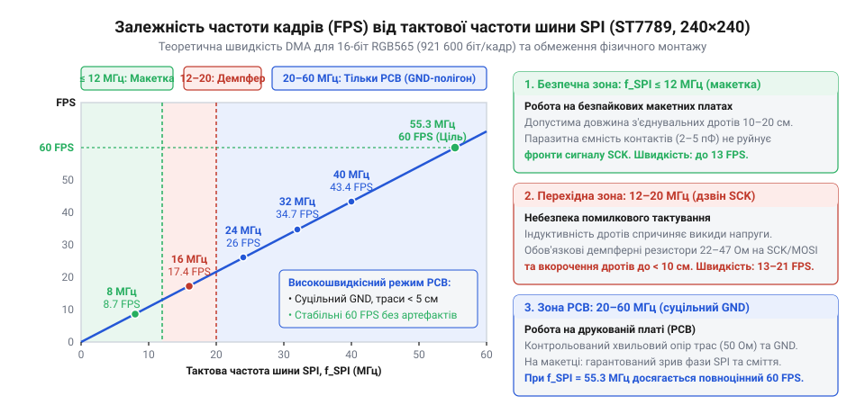
*Графік залежності частоти зміни кадрів (FPS) від тактової частоти шини SPI для матриці 240×240 пікселів RGB565: на макетній платі через паразитну ємність дротів безпечна межа становить близько 8–10 МГц (до 10 FPS), тоді як досягнення плавного оновлення понад 30 FPS вимагає тактування від 32 МГц та якісного трасування друкованої плати.*

Крім того, повне оновлення екрана потрібне не завжди. Якщо в застосунку змінюється лише окремий елемент (наприклад, текстове поле або піктограма розміром 60×60 пікселів), обсяг переданих даних кардинально зменшується:

```text
N_partial = 60 × 60 × 16
          = 57 600 біт                        [обсяг даних для прямокутної області 60×60 пікселів]
t_partial = 57 600 / 32 000 000
          = 0.0018 c                          [час передачі становить 1.8 мс]
```

Часткова адресація дає змогу виводити локальну графіку з темпом понад 500 оновлень на секунду навіть на помірній частоті тактування.

### Керування підсвічуванням: фізика світлодіодів і ШІМ

Спроба регулювати яскравість світлодіодів підсвічування лінійним зниженням напруги (через цифро-аналоговий перетворювач або регульований стабілізатор) призводить до двох фізичних проблем. По-перше, білі світлодіоди на основі кристалів InGaN мають круту вольт-амперну характеристику з пороговою напругою близько 2.8–3.0 В. При падінні напруги на частки вольта нижче порогу струм експоненційно спадає, спричиняючи різке неконтрольоване згасання. По-друге, білий колір формується сумішшю синього випромінювання кристала та жовтого свічення люмінофора. Зміна величини прямого струму порушує спектральний баланс: підсвічування набуває паразитного холодного синього або брудного жовтого відтінку.

Тому яскравість регулюють за допомогою широтно-імпульсної модуляції (англ. @@en|Pulse-Width Modulation@@, PWM; лат. modulatio — розміреність, узгодженість). Лінія катода підсвічування комутується транзисторним ключем (польовим MOSFET або біполярним транзистором). Світлодіоди або повністю відкриті й працюють у своїй розрахунковій точці номінального струму зі стабільним спектром, або повністю закриті. Середня яскравість пропорційна коефіцієнту заповнення (англ. @@en|duty cycle@@):

```text
D = t_on / T                                  [відношення часу ввімкненого стану до повного періоду]
```

Вибір базової частоти ШІМ є компромісом між психофізіологією зору та паразитними ефектами електричного кола:
1. **Частоти нижче 200 Гц:** виникає помітне стробоскопічне миготіння. Під час швидких рухів очей уздовж дисплея об'єкти розпадаються на дискретні смуги (ефект «фантомного масиву»), викликаючи швидку втому зору.
2. **Діапазон від 1 кГц до 10 кГц:** імпульсні стрибки струму змушують керамічні блокувальні конденсатори (MLCC) на платі механічно стискатися через зворотний п'єзоелектричний ефект. Конденсатори починають діяти як мініатюрні динаміки, генеруючи чутний акустичний писк.
3. **Діапазон від 20 кГц до 50 кГц:** частота перебуває вище верхнього порогу чутності людини (20 кГц), тому дисплейний модуль працює безшумно. Водночас транзистори легко комутують такі імпульси без відчутних динамічних втрат на перемикання.

### Нелінійність людського зору та гамма-корекція

Людське око сприймає інтенсивність світла нелінійно. За законами Вебера — Фехнера та Стівенса реакція сітківки має логарифмічний характер. У темряві зіниця розширюється, а чутливість рецепторів зростає: зміна шпаруватості ШІМ від 0% до 5% сприймається оком як різкий стрибок яскравості від повної темряви до відчутного свічення. Натомість у діапазоні від 50% до 100% потужності зір насичується, і подвоєння фізичного випромінювання виглядає як незначне освітлення на 15–20%.

Якщо регулювати ШІМ лінійно за значеннями лічильника від 0 до 255, плавності не буде: перші 20 кроків створюватимуть враження половини максимальної яскравості, а діапазон від 128 до 255 виглядатиме майже незмінним. Для рівномірної шкали необхідна корекція за принципами [нелінійного ШІМ-регулювання яскравості](root:hw-motion/perceptual-pwm-dimming):

```text
D = L^γ                                       [степенева залежність із показником гамма]
```

де `L ∈ [0, 1]` — бажаний користувацький рівень яскравості, а `γ` — коефіцієнт гамма-корекції (типово `γ ≈ 2.2`).

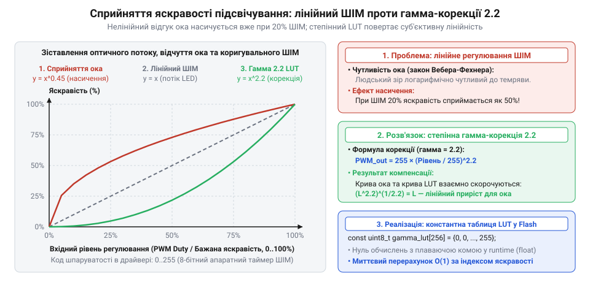
*Графік зіставлення лінійного коефіцієнта заповнення ШІМ, логарифмічного відгуку людського ока та кривої гамма-корекції з показником 2.2: через високу чутливість зору в темряві лінійне керування спричиняє різкий стрибок яскравості на початкових кроках, тоді як попередня гамма-корекція компенсує нелінійність сприйняття й забезпечує суб'єктивно рівномірне наростання свічення.*

Обчислення дробової степені `powf()` у реальному часі на мікроконтролері без апаратного модуля FPU створює зайве навантаження на процесор. Оптимальним розв'язком є попередньо обчислена таблиця пошуку (англ. @@en|Lookup Table@@, LUT) на 256 елементів у постійній пам'яті програм (Flash/ROM):

```text
LUT[i] = round(255 × (i / 255)^2.2)           [розрахунок апаратного коефіцієнта для кроку i]
```

Таблиця займає рівно 256 байтів у пам'яті програм і забезпечує вибір значення за константний час `O(1)`.

> 🔧 **Навіщо це.**
> У бездротових датчиках, смарт-годинниках та приладах з живленням від акумулятора підсвічування споживає до 80% енергії. Гамма-корегований ШІМ дає змогу зменшити фізичну потужність у кілька разів без суб'єктивної втрати яскравості для оператора. Частота комутації понад 20 кГц усуває паразитичний акустичний свист керамічних конденсаторів, а розрахунок лімітів тактування SPI гарантує максимальну частоту кадрів без артефактів сигналу.

Нижче наведено програмну реалізацію модуля керування яскравістю підсвічування з гамма-таблицею та викликом апаратного таймера.

:::tabs
:::code api-st7789-c-driver/c/st7789-backlight-init.c
:::code api-st7789-c-driver/cpp/st7789backlight.cpp
:::

## Стійкість до збоїв: стробування CS, відсікання координат і відновлення стану

В ідеальних лабораторних умовах на коротких з'єднаннях драйвер демонструє стабільну роботу. Проте в реальних виробах — промислових терміналах, автомобільній електроніці чи приладах з імпульсними перетворювачами напруги — виникають електромагнітні завади (англ. @@en|Electromagnetic Interference@@, EMI). Комутація реле, робота крокових двигунів та високочастотні пульсації DC-DC перетворювачів наводять імпульсні сплески на лінії передачі даних.

Шина SPI є простим синхронним потоком без апаратного контролю парності чи маркерів початку та кінця кадру. Контролер ST7789 приймає послідовність бітів за фронтами сигналу тактування SCLK у внутрішній 3-розрядний лічильник, який збирає кожні 8 бітів у байт. Якщо імпульсна завада додасть на лінію SCLK один хибний такт, внутрішній лічильник контролера незворотно зміщується на 1 біт. Від цього моменту кожен наступний байт декодується хибно: старший біт стає молодшим бітом попереднього байта. У 16-бітному форматі RGB565 контролер зшиває молодші 7 бітів першого байта зі старшим бітом наступного, спотворюючи палітру. Команди адресації вікна отримують невідомі коди опкодів і відкидаються, а замість графіки екран вкривається діагональними психоделічними смугами або кольоровим снігом.

### Апаратна ресинхронізація через стробування CS

У схемотехніці дисплейних модулів розповсюджена помилка — постійне підключення виводу вибору кристала (англ. @@en|Chip Select@@, CS; лат. selectio — відбір) до шини землі GND заради економії виводів мікроконтролера. Якщо лінія CS постійно перебуває в активному низькому рівні, внутрішній послідовний десеріалізатор ST7789 ніколи не повертається у вихідний стан. Поодинокий збій бітового лічильника робить екран нечитним до повного знеструмлення схеми.

Апаратна логіка контролера ST7789 проектувалася з розрахунком на примусове скидання інтерфейсу:
- Перехід лінії CS у високий рівень (`LOW → HIGH`) апаратно обнуляє внутрішній бітовий лічильник і скидає зсувний регістр вхідних даних, відкидаючи неповний прийнятий байт.
- Перехід лінії CS у низький рівень (`HIGH → LOW`) готує логіку до прийому строго нульового (старшого) біта наступного байта за першим же фронтом SCLK.

Тому фундаментальним правилом надійного драйвера є стробування (англ. @@en|strobing@@; від грец. στρόβος — вихор, круговий рух) лінії CS: підняття CS у високий рівень між логічними транзакціями. Лінію CS обов'язково піднімають після відправлення блоку команд конфігурації, після встановлення координат вікна CASET/RASET та після завершення кожного кадру або блоку передачі DMA. Якщо електромагнітна завада збила синхронізацію під час малювання рядка, стробування CS у кінці рядка локалізує похибку кількома пікселями, а наступний рядок малюється без спотворень. Цей принцип ресинхронізації аналогічний поведінці спорідненого контролера [ST7735S](root:cat-hw-actuators/tft-st7735s).

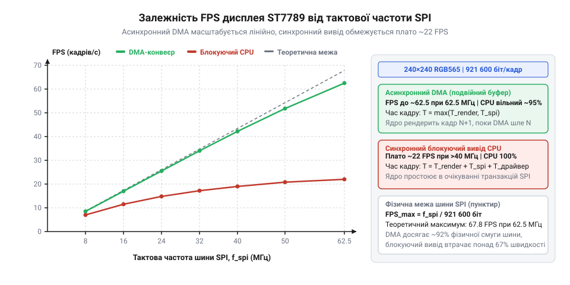
*Часова діаграма передачі даних через SPI: хибний сплеск на тактовій лінії SCLK збиває внутрішній лічильник бітів контролера й розсинхронізовує межі байтів, тоді як перехід лінії CS у високий рівень примусово обнуляє десеріалізатор і повністю відновлює побайтове вирівнювання потоку.*

### Відсікання координат (clipping) та захист пам'яті

Кристал контролера ST7789 має внутрішню відеопам'ять (GRAM) розміром 240×320 точок. Фізична матриця формату 1.3″ відображає вікно 240×240 точок із апаратним зміщенням рядків. Якщо графічний застосунок спробує вивести спрайт із виходом за межі видимого екрана, виникають три критичні відмови:
1. **Вихід за межі 240 точок:** якщо передати координату `x = 220` для спрайта шириною 40 пікселів, кінцева координата складе `x_end = 259`. Контролер записує байти в невикористовувані або приховані комірки відеопам'яті, що призводить до циклічного завертання рядків на початок дисплея або спотворення сусідніх областей.
2. **Переповнення від'ємних координат:** якщо рухомий об'єкт частково виходить за лівий край екрана (`x = -15`), а функція драйвера приймає беззнакові типи `uint16_t`, від'ємне число в результаті переповнення перетворюється на `65521`. Спроба передати `65521` у команду CASET порушує внутрішній адресний генератор контролера, блокуючи запис у пам'ять.
3. **Невідповідність розміру буфера:** площа вікна визначає очікувану контролером кількість байтів: `N_bytes = (x_end - x_start + 1) × (y_end - y_start + 1) × 2`. Якщо надіслати менше байтів, контролер залишиться в стані очікування даних і сприйме наступні команди як кольори пікселів. Якщо надіслати більше байтів, залишок виллється за межі вікна у сусідні рядки.

Для захисту від цих відмов на рівні драйвера застосовують програмне відсікання (англ. @@en|clipping@@; від давньосканд. klippa — відтинати). Прямокутник виводу перетинається з фізичним вікном `[0, 0, 239, 239]`. Якщо прямокутник лежить повністю за межами екрана, функція негайно повертає нуль без відкриття шинних транзакцій. Якщо прямокутник перетинає межу, драйвер коригує кінцеві координати та обчислює зміщення початкового покажчика у вихідному масиві спрайта, зберігаючи крок рядка (крок зміщення, англ. @@en|stride@@).

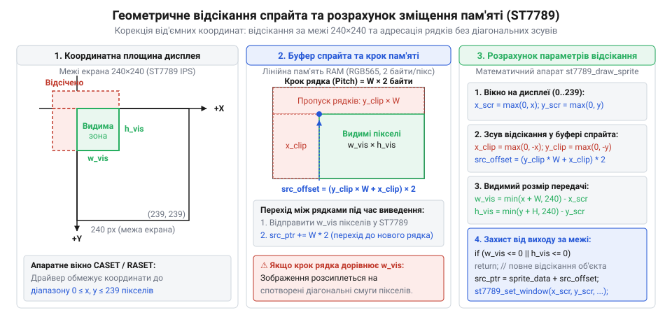
*Геометрична схема відсікання прямокутника графічного об'єкта границями видимого екрана 240×240: програмний розрахунок перетину з фізичним вікном та зміщення початкового покажчика у масиві спрайта запобігають адресному переповненню контролера й спотворенню відеопам'яті.*

### Контроль тайм-аутів передачі DMA

Асинхронна передача через прямий доступ до пам'яті (англ. @@en|Direct Memory Access@@, DMA) розвантажує ядро процесора, але несе ризик зависання. Якщо через конфлікт арбітражу шин чи збій тактування периферійний модуль SPI пропустить переривання про завершення передачі (англ. @@en|Transfer Complete Interrupt@@), блокувальне очікування прапорця `while(driver->dma_busy);` перетворюється на вічний глухий кут (англ. @@en|deadlock@@), зупиняючи всю операційну систему або суперцикл пристрою.

Правильна організація [підсистеми DMA мікроконтролера](root:hw-arch/dma-controller) вимагає суворого контролю максимального часу очікування — тайм-ауту (англ. @@en|timeout@@; від time out — час вийшов). Максимальний час передачі розраховується з обсягу буфера та частоти шини з додаванням запасу на арбітраж:

```text
t_timeout = (N_bytes × 8 / f_SPI) × 2 + 10 мс  [формула розрахунку максимального інтервалу]
```

Якщо апаратний лічильник мілісекунд перевищує розрахований тайм-аут, драйвер примусово зупиняє канал DMA, піднімає лінію CS для апаратного скидання бітового лічильника ST7789, очищує прапор зайнятості та повертає код помилки `ST7789_ERR_TIMEOUT`.

### Швидкий програмний перезапуск без знеструмлення

У разі сильного електростатичного розряду (англ. @@en|Electrostatic Discharge@@, ESD) контролер дисплея може втратити вміст конфігураційних регістрів, залишаючись під напругою живлення. Щоб відновити роботу без встановлення зовнішнього силового транзистора в колі живлення VDD, драйвер реалізує алгоритм швидкого програмного перезапуску:

1. **Аварійне скидання шини:** примусово скасовується активна транзакція DMA, а лінія CS переводиться у високий рівень.
2. **Апаратний імпульс скидання:** вивід `RES` переводиться в низький рівень щонайменше на 10–20 мкс (за документацією ST7789 мінімум 10 мкс), після чого повертається у високий рівень. Якщо вивід `RES` апаратно підтягнутий до живлення і не заведений на мікроконтролер, надсилається команда програмного перезапуску `SWRESET` (0x01).
3. **Технологічна пауза 120 мс:** контролер зчитує з внутрішньої пам'яті OTP (одноразово програмованої) заводські калібрувальні коефіцієнти для напруг VCOM та гамма-корекції. Надсилання будь-яких команд до закінчення 120 мс призводить до апаратного блокування чіпа.
4. **Пробудження з режиму сну:** надсилається команда `SLPOUT` (0x11) з наступною обов'язковою паузою 120 мс для виходу внутрішніх генераторів і помпи заряду на стабільний режим генерації напруги зсуву рідких кристалів.
5. **Відновлення конфігурації:**
   - Запис регістру `COLMOD` (0x3A) значенням `0x55` (16 бітів на піксель, RGB565).
   - Запис регістру напрямку пам'яті `MADCTL` (0x36) для відновлення початкової орієнтації екрана.
   - Увімкнення інверсії дисплея `INVON` (0x21). Для технології IPS інверсія є обов'язковою: без команди INVON зображення відображається у негативі (чорний колір стає білим).
   - Увімкнення нормального режиму `NORON` (0x13) та активація матриці `DISPON` (0x29).
6. **Очищення відеопам'яті:** повне заливання чорним кольором (`0x0000`) стирає залишковий шум із пам'яті.

Повний цикл відновлення триває близько 250 мс. Для користувача це виглядає як непомітне чвертьсекундне мерехтіння замість «завислого» пристрою, який вимагав би від'єднання акумулятора.

> 🔧 **Навіщо це.**
> Електростатичний розряд від дотику пальця людини до захисного скла чи наведення від силових кабелів здатні збити лічильник бітів SPI або стерти конфігураційні регістри матриці. Стробування CS у поєднанні з відсіканням координат та неблокувальним перезапуском гарантує, що пристрій самостійно відновить нормальне зображення без зависань і втручання користувача.

Нижче наведено код модулів відсікання координат, контролю тайм-ауту DMA та алгоритму відновлення стану дисплея.

:::tabs
:::code api-st7789-c-driver/c/st7789-clip-rect.c
:::code api-st7789-c-driver/cpp/rect.cpp
:::
