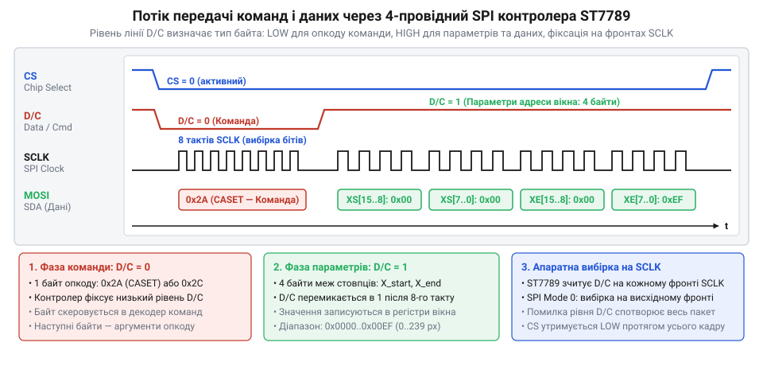
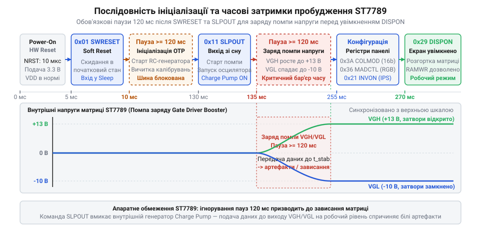
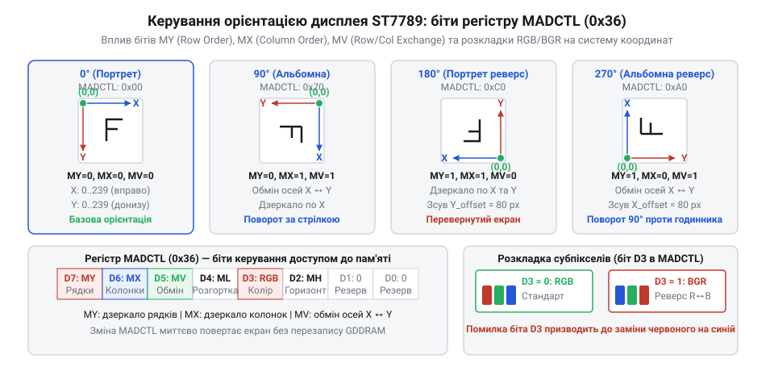
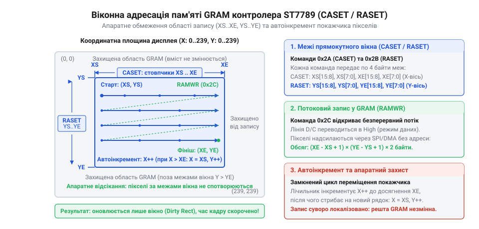
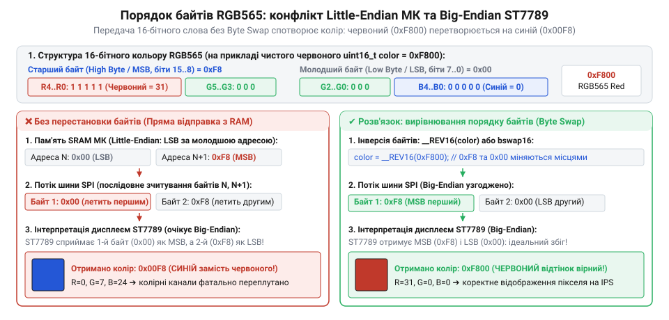
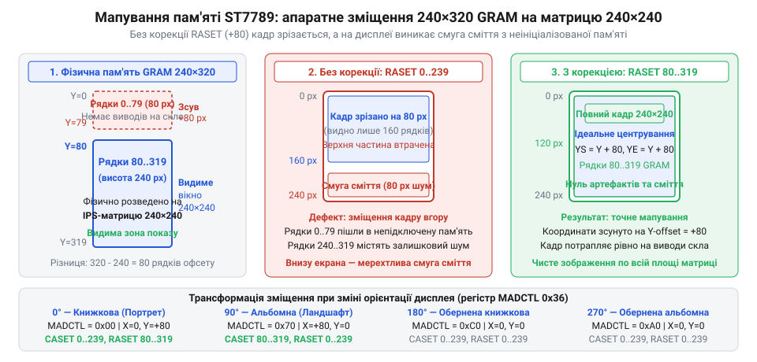

# IPS 1.3″ 240×240 (SPI, ST7789)

<preknowlist>
- [TFT 1.77″ 128×160 (SPI, ST7735S)](root:cat-hw-actuators/tft-st7735s) — базові принципи передачі даних графічного дисплея через 4-провідний SPI (лінії CS, SCLK, MOSI), концепція вбудованої відеопам'яті (GRAM) та кодування кольору моделі RGB.
</preknowlist>

## Відокремлення команд від даних на шині SPI

Мікроконтролер передає графічну інформацію на дисплей у вигляді суцільного потоку байтів через послідовні лінії зв'язку. Проте для приймача кожен байт — це лише вісім двійкових розрядів, послідовність нулів та одиниць. Коли контролер екрана зчитує з лінії значення `0x29`, він не може визначити із самого двійкового числа, чи це наказ увімкнути показ, чи це молодший байт колірного відтінку пікселя у фоновому малюнку. Якщо змішати службові інструкції та графічні байти в єдиний потік без зовнішнього розмежування, будь-яка завада на лінії або втрачений такт спричинить фатальну розсинхронізацію: сотні кілобайтів графіки інтерпретуватимуться як випадкові налаштування регістрів, спотворюючи палітру або повністю блокуючи роботу пристрою.

Для усунення цієї невизначеності контролер ST7789 використовує чотирипровідний інтерфейс [шини SPI](root:com-devices/spi-bus) (англ. @@en|Serial Peripheral Interface@@, від лат. *inter* — між та *facies* — обличчя) з апаратною лінією D/C (англ. @@en|Data/Command@@ — дані/команда). На відміну від молодших дисплейних чипів, як-от [ST7735S](root:cat-hw-actuators/tft-st7735s), контролер ST7789 розрахований на значно вищі тактові частоти (до 62.5 МГц на запис), проте фундаментальний принцип поділу фаз інтерфейсу залишається незмінним.

Фізичне з'єднання містить чотири сигнальні лінії:
- `CS` (англ. @@en|Chip Select@@ — вибір мікросхеми, активний логічний нуль);
- `SCLK` (англ. @@en|Serial Clock@@, від лат. *tactus* — дотик, відчуття ритму — тактовий сигнал);
- `MOSI` або `SDA` (англ. @@en|Master Out Slave In@@ — послідовна передача даних від мікроконтролера);
- `D/C` або `DCX` — лінія вибору типу інформації.

Апаратна логіка контролера інтерпретує стан лінії `D/C` безпосередньо в момент тактування кожного байта:
1. **Низький рівень (`D/C = 0`).** Байт на лінії `MOSI` сприймається як команда (лат. *commandare* — доручати, наказувати) — код операції, що адресує внутрішній регістр (лат. *registrum* — список, перелік) ST7789.
2. **Високий рівень (`D/C = 1`).** Байти на лінії `MOSI` сприймаються як дані (лат. *datum* — дане, факт) — параметри попередньо викликаної команди або масив пікселів для запису у відеопам'ять.


*Часова діаграма шини SPI (CS, SCLK, MOSI) разом із лінією D/C: контролер фіксує код операції при низькому рівні D/C та байти параметрів чи відеоданих при високому рівні D/C на фронтах тактового сигналу SCLK, що виключає неоднозначність інтерпретації потоку.*

Для надійного обміну мікроконтролер має дотримуватися параметрів шини SPI:
- **Полярність і фаза сигналу:** ST7789 підтримує режим 0 (Mode 0: полярність CPOL = 0, фаза CPHA = 0) та режим 3 (Mode 3: CPOL = 1, CPHA = 1). В обох випадках фіксація бітів на лінії `MOSI` відбувається на наростаючому фронті тактового сигналу `SCLK`.
- **Порядок передачі:** старший біт уперед (англ. @@en|MSB first@@, від D7 до D0).
- **Часовий інтервал D/C:** стан лінії `D/C` встановлюється до початку передачі першого біта байта і залишається незмінним щонайменше до завершення восьмого такту `SCLK`.
- **Керування лінією CS:** рівень `CS` опускається в нуль перед надсиланням транзакції. Лінія може залишатися низькою між командою та її параметрами або перемикатися для кожного байта.

> 🔧 **Навіщо це.**
> Виділення окремої фізичної лінії `D/C` повністю позбавляє протокол накладних витрат: передача відеопотоку не потребує службових маркерів чи екранування байтів усередині кадру, завдяки чому вся пропускна здатність шини SPI віддається корисним даним пікселів. Ба більше, якщо завада спотворить значення окремого пікселя, наступне переведення лінії `D/C` у нуль негайно повертає внутрішній скінченний автомат чипа у стан очікування нової команди, усуваючи накопичення збоїв.

Реалізація базових операцій надсилання команди та даних на низькому рівні полягає у послідовному перемиканні рівня лінії `D/C` перед викликом передачі по шині SPI.

:::tabs
:::code api-st7789-command-set/c/st7789-write-command.c
:::code api-st7789-command-set/c/st7789-write-command.c
:::

## Життєвий цикл запуску матриці: SWRESET, SLPOUT і DISPON

Після подачі напруги живлення на виводи логіки дисплейний модуль не показує зображення й залишається цілком темним або сліпучо-білим. Спроба негайно передати координати вікна чи записати масив пікселів у відеопам'ять закінчується невдачею — дисплей не реагує на потік даних. Така поведінка обумовлена фізичною будовою модуля: мікросхема ST7789 поєднує низьковольтну цифрову частину логіки (1.65–3.3 В) та високовольтні аналогові формувачі.

Рідкокристалічні комірки IPS-панелі не світяться самі по собі; вони поляризують світловий потік під дією змінного електричного поля. Щоб швидко переорієнтовувати рідкі кристали (грец. *krystallos* — лід, гірський кришталь), драйверам потрібні постійні напруги значно вищі за напругу живлення схеми: позитивна напруга відкривання затворів тонкоплівкових транзисторів VGH (до +15 В) та негативна напруга закривання VGL (до -10 В). Ці потенціали виробляються внутрішніми [помпами помноження напруги](root:hw-power/charge-pump-conv) (англ. @@en|charge pump@@). Щоб уникнути некерованих імпульсних струмів під час увімкнення джерела живлення, контролер за замовчуванням стартує у стані глибокого сну: генератор тактових імпульсів зупинено, помпи вимкнено, а виходи на матрицю від'єднано.

Якщо прошивка спробує одразу подати команду ввімкнення показу без дотримання внутрішніх часових інтервалів, помпи напруги не встигнуть зарядити стабілізуючі ємності. Недостатній рівень напруг призведе до апаратного блокування аналогової частини або спотворення рівнів зміщення, через що матриця зависне в неробочому стані до повного вимкнення живлення.

Пробудження матриці вимагає строгого порядку операцій із чітко розрахованими затримками:
1. **Скидання стану (SWRESET).** Команда програмного перезапуску (англ. @@en|Software Reset@@) із кодом `0x01` повертає всі регістри контролера до заводських значень за замовчуванням, зчитуючи калібрувальні таблиці з внутрішньої пам'яті. Зміст кадрової пам'яті GRAM при цьому зберігається.
   - *Вимога до часу:* після відправки `SWRESET` мікроконтролер зобов'язаний зачекати щонайменше 120 мс. Протягом перших 5 мс внутрішня логіка не сприймає жодних сигналів шини SPI, а решта часу потрібна для безпечного зняття залишкових зарядів і перезавантаження цифрового ядра.
2. **Виведення зі сну (SLPOUT).** Команда виходу зі сну (англ. @@en|Sleep Out@@) із кодом `0x11` вмикає внутрішній тактовий генератор і запускає каскади помп напруги.
   - *Вимога до часу:* після `SLPOUT` обов'язкова пауза становить не менше 120 мс. За цей інтервал напруги VGH та VGL плавно наростають до номінальних величин. Відправка наступних команд до завершення цієї стабілізації заборонена специфікацією чипа.
3. **Проміжна конфігурація параметрів показу.** Під час паузи після виходу зі сну дисплей все ще не виводить зображення на скло (перебуває в режимі Display Off). Саме в цей проміжок безпечно налаштувати формат колірних даних (команда COLMOD), орієнтацію осей (команда MADCTL) та ввімкнути інверсію кольорів (команда INVON), уникаючи візуального мерехтіння чи показу неочищеного сміття з пам'яті.
4. **Активація виводу (DISPON).** Команда увімкнення показу (англ. @@en|Display On@@) із кодом `0x29` підключає стабілізовані виходи аналогових драйверів рядків і стовпчиків до рідкокристалічної матриці (лат. *matrix* — джерело, першооснова). Дисплей починає регулярне циклічне сканування кадру.


*Діаграма часових переходів стану ST7789: послідовність подачі живлення, програмного скидання SWRESET, обов'язкової паузи 120 мс, виходу зі сну SLPOUT, паузи 120 мс на стабілізацію помп напруги та активації показу DISPON унеможливлює зависання аналогової частини.*

> 🔧 **Навіщо це.**
> Скорочення або пропуск затримок у 120 мс після команд `SWRESET` та `SLPOUT` — найпоширеніша причина випадкових збоїв при старті пристрою. На макетному столі за кімнатної температури дисплей може здаватися робочим і без затримок завдяки залишковому заряду конденсаторів, проте в реальних умовах — за низьких температур або повільного наростання напруги живлення — помпи не встигають вийти на робочий режим, блокуючи ініціалізацію екрана.

Якщо апаратний модуль має вивід апаратного скидання `RESX` (англ. @@en|Reset@@), перед надсиланням `SWRESET` рекомендується сформувати фізичний імпульс низького рівня тривалістю не менше 10 мкс, після чого витримати паузу 10 мс. Проте навіть за відсутності фізичного виводу скидання програмний виклик `SWRESET` гарантує надійний перехід у початковий стан.

:::tabs
:::code api-st7789-command-set/c/st7789-init-wakeup.c
:::code api-st7789-command-set/c/st7789-init-wakeup.c
:::

## Конфігурація глибини кольору та оптичної полярності IPS-матриці (COLMOD, INVON/INVOFF)

Коли дисплей виведено зі стану сну й увімкнено його внутрішні генератори, спроба передати перший масив пікселів у відеопам'ять часто закінчується несподіваним візуальним збоєм. Замість тестового зображення екран заповнюється хаотичною зернистою сіткою різнокольорових цяток або показує контури графіки в повному колірному негативі: глибокий чорний фон залитий сліпучим білим світлом, а колірні канали перевернуті. Обидва дефекти виникають через невідповідність між тим, як контролер очікує інтерпретувати електричні сигнали шини, і тим, як мікроконтролер пакує дані в пам'яті.

Перша складова збою криється в узгодженні потоку байтів шини SPI з внутрішньою пам'яттю графічного буфера — @@en|GRAM@@ (від англ. *Graphic Random Access Memory* — графічна пам'ять із довільним доступом, від лат. *accessus* — підхід). Контролер ST7789 підтримує три апаратні формати кодування точки — пікселя (англ. @@en|pixel@@, скорочення від *picture element* — елемент зображення, від лат. *elementum* — першооснова):
- 12 бітів на піксель (по 4 біти на червоний, зелений і синій канали — разом 4096 кольорів);
- 16 бітів на піксель (формат [RGB565](root:sf-visual/rgb565-color-format): 5 бітів червоного, 6 бітів зеленого і 5 бітів синього — 65 536 кольорів);
- 18 бітів на піксель (формат RGB666: по 6 бітів на канал — 262 144 кольори).

За замовчуванням після апаратного перезапуску внутрішній логічний автомат контролера налаштовано на 18-бітну глибину кольору. При передачі даних через послідовну шину SPI 18-бітний колір вимагає рівно трьох окремих байтів на кожен піксель: перший байт містить 6 бітів червоного каналу, другий — зеленого, третій — синього, причому два біти кожного байта залишаються невикористаними.

Мікроконтролери оперують словами, кратними степеням двійки. Формувати три байти на точку неекономічно, тому буфер кадру в пам'яті мікроконтролера майже завжди компонують у 16-бітному форматі RGB565 — по два байти на піксель. Якщо мікроконтролер надсилає двобайтові пікселі, а контролер очікує три байти на точку, виникає безперервний фазовий зсув потоку:
- перші два байти першого пікселя контролер сприймає як червону та зелену складові точки 1;
- перший байт другого пікселя стає синьою складовою точки 1;
- другий байт другого пікселя стає червоною складовою точки 2.

Кожен наступний піксель зміщує інтерпретацію байтів на один крок відносно очікуваного положення, через що прямокутна сітка розпадається на кольоровий шум і діагональні смуги.

Щоб узгодити розрядність, контролеру явно вказують очікувану структуру потоку командою `COLMOD` (код `0x3A`, @@en|Interface Pixel Format@@ — формат пікселів інтерфейсу). Команда приймає один байт параметра, у якому молодша тетрада (біти [2:0]) задає глибину кольору для послідовного інтерфейсу:
- `0b011` (`0x03`) — 12 бітів на піксель;
- `0b101` (`0x05`) — 16 бітів на піксель (RGB565);
- `0b110` (`0x06`) — 18 бітів на піксель.

Старша тетрада (біти [6:4]) дублює цю конфігурацію для паралельного інтерфейсу RGB. Передача байта `0x55` жорстко перемикає ST7789 у 16-бітний режим для обох трактів. Після цього контролер очікує рівно два байти на кожну адресу точки в пам'яті.

**Обчислення трафіку шини SPI для одного повного кадру 240×240 пікселів:**
```
Кількість пікселів кадру
= 240 × 240
= 57600 пікселів

Обсяг кадру при 18-бітному кодуванні (3 байти на піксель)
= 57600 × 3
= 172800 байтів

Обсяг кадру при 16-бітному кодуванні (2 байти на піксель)
= 57600 × 2
= 115200 байтів

Різниця трафіку
= 172800 - 115200
= 57600 байтів економії на кадр (33.3 %)
```

Зменшення обсягу даних на третину критично важливе для швидкодії: на тактовій частоті SPI 40 МГц тривалість передачі одного кадру скорочується з 34.6 мс до 23.0 мс, що дозволяє досягти теоретичної частоти оновлення понад 43 кадри на секунду замість 28.

Коли байтовий потік вирівняно, зображення набуває чіткості, але виявляє другу ваду: усі кольори перевернуті у фотографічний негатив. Чорний колір світиться білим, чистий червоний перетворюється на блакитний, а зелений стає пурпуровим.

Причина полягає у фундаментальній фізичній відмінності рідкокристалічних матриць [IPS](root:hw-motion/ips-matrix-technology) (англ. @@en|In-Plane Switching@@ — перемикання в одній площині, від лат. *planum* — площина) від класичних панелей TN (англ. @@en|Twisted Nematic@@ — скручений нематик, від грец. *nēma* — нитка), що застосовуються, наприклад, у модулях [TFT 1.77″ 128×160 (SPI, ST7735S)](root:cat-hw-actuators/tft-st7735s).

У структурі TN рідкі кристали за відсутності електричного поля скручені спіраллю й повертають площину поляризації світла на 90°. Світло від підсвічування вільно проходить крізь вихідний поляризатор: піксель світиться білим. Це оптична схема «нормально білий» (@@en|normally white@@). Щоб закрити піксель і отримати чорний колір, драйвер подає максимальну напругу, яка вирівнює кристали вздовж поля й блокує світловий потік.

В IPS-панелях електроди розташовані в одній площині на нижній скляній підкладці. За відсутності напруги молекули кристалів лежать паралельно електродам і не змінюють поляризацію світла. Оскільки зовнішні поляризаційні плівки розміщені взаємно перпендикулярно, світло підсвічування повністю поглинається: піксель є непрозорим. Це схема «нормально чорний» (@@en|normally black@@). Щоб піксель почав світитися, до нього слід прикласти напругу, яка повертає кристали горизонтально в площині підкладки.

Контролер ST7789 є універсальною мікросхемою, що проєктувалася з базовою логікою під нормально білі панелі TN. За замовчуванням після скидання в ньому діє режим без інверсії — `INVOFF` (код `0x20`, @@en|Display Inversion Off@@ — вимкнення інверсії дисплея, від лат. *inversio* — перевертання). За цієї логіки нульовий колірний код пікселя `0x0000` відповідає нульовій напрузі на комірці. На TN-панелі це дає темне поле за рахунок оптичної компенсації, але на IPS-матриці нульова напруга залишає піксель абсолютно чорним, а максимальний код викликає повне відкриття світла. Коли логіка формування рівнів напруги не збігається з фізикою рідких кристалів, увесь динамічний діапазон яскравості інвертується.

Виправлення інверсії програмним шляхом вимагало б від мікроконтролера побітового заперечення кожного пікселя перед відправленням:
`pixel = ~pixel`
Для екрана 240×240 точок це означає 115 200 додаткових операцій заперечення на кожен кадр, що марнує обчислювальні ресурси процесора.

Контролер ST7789 містить вбудований апаратний інвертор колірного тракту, що активується командою `INVON` (код `0x21`, @@en|Display Inversion On@@ — увімкнення інверсії дисплея). Ця команда перемикає вихідну логіку цифро-аналогового перетворювача: порозрядне заперечення бітів відбувається апаратно під час формування аналогових напруг на виводах драйверів стовпчиків без залучення процесора мікроконтролера. Після надсилання команди `INVON` кольоропередача стає правильною: глибокий чорний колір, насичені первинні тони та плавні півтони.

> 🔧 **Навіщо це.**
Явне задання 16-бітного формату командою `COLMOD (0x3A)` з параметром `0x55` та активація апаратної інверсії `INVON (0x21)` позбавляють мікроконтролер необхідності попіксельного перерахунку палітри. Контролер апаратно синхронізує прийом байтів шини SPI та оптичну полярність IPS-матриці, заощаджуючи третину пропускної здатності шини та звільняючи обчислювальні такти процесора для розрахунку графіки.

Для взаємодії з контролером мікроконтролер перемикає лінію вибору типу передачі D/C (англ. @@en|Data/Command@@, від лат. *datum* — дане і лат. *mandatum* — наказ): низький рівень логічного нуля відповідає надсиланню байта команди, високий рівень логічної одиниці — надсиланню байта параметрів або графічних даних.

:::tabs
```c Generic C
#include <stdint.h>
#include <stdbool.h>

/* Прототипи низькорівневого апаратного інтерфейсу платформи */
extern void spi_write_byte(uint8_t data);
extern void gpio_set_dc(bool level);
extern void gpio_set_cs(bool level);

/* Коди команд конфігурації кольору ST7789 */
#define ST7789_CMD_COLMOD 0x3A
#define ST7789_CMD_INVOFF 0x20
#define ST7789_CMD_INVON  0x21

#define ST7789_COLOR_16BIT 0x55

void st7789_send_command(uint8_t cmd)
{
    gpio_set_dc(false); /* Рівень 0: передача команди */
    gpio_set_cs(false); /* Активація вибору мікросхеми */
    spi_write_byte(cmd);
    gpio_set_cs(true);  /* Деактивація вибору мікросхеми */
}

void st7789_send_data(uint8_t data)
{
    gpio_set_dc(true);  /* Рівень 1: передача даних */
    gpio_set_cs(false);
    spi_write_byte(data);
    gpio_set_cs(true);
}

void st7789_configure_color_and_inversion(bool ips_mode)
{
    /* Встановлення 16-бітного формату пікселя RGB565 */
    st7789_send_command(ST7789_CMD_COLMOD);
    st7789_send_data(ST7789_COLOR_16BIT);

    /* Вибір оптичної полярності: IPS вимагає активної інверсії */
    if (ips_mode) {
        st7789_send_command(ST7789_CMD_INVON);
    } else {
        st7789_send_command(ST7789_CMD_INVOFF);
    }
}
```
```cpp Arduino
#include <Arduino.h>
#include <SPI.h>

class ST7789Basic {
private:
    uint8_t pin_cs;
    uint8_t pin_dc;

    static constexpr uint8_t CMD_COLMOD = 0x3A;
    static constexpr uint8_t CMD_INVOFF = 0x20;
    static constexpr uint8_t CMD_INVON  = 0x21;
    static constexpr uint8_t COLOR_16BIT = 0x55;

public:
    ST7789Basic(uint8_t cs, uint8_t dc) : pin_cs(cs), pin_dc(dc) {}

    void sendCommand(uint8_t cmd) {
        digitalWrite(pin_dc, LOW);  // Рівень 0: лінія D/C у режимі команди
        digitalWrite(pin_cs, LOW);
        SPI.transfer(cmd);
        digitalWrite(pin_cs, HIGH);
    }

    void sendData(uint8_t data) {
        digitalWrite(pin_dc, HIGH); // Рівень 1: лінія D/C у режимі даних
        digitalWrite(pin_cs, LOW);
        SPI.transfer(data);
        digitalWrite(pin_cs, HIGH);
    }

    void configureColorAndInversion(bool ipsMode) {
        // Синхронізація 16-бітного формату RGB565 (2 байти на точку)
        sendCommand(CMD_COLMOD);
        sendData(COLOR_16BIT);

        // Увімкнення апаратної інверсії для normally black IPS-матриці
        if (ipsMode) {
            sendCommand(CMD_INVON);
        } else {
            sendCommand(CMD_INVOFF);
        }
    }
};
```
:::

## Геометрія розгортки, орієнтація та черговість колірних каналів (MADCTL)

Після вирівнювання полярності кольорів виникає інша просторова перешкода: зображення виявляється зорієнтованим неправильно відносно корпусу приладу. Написи відображаються дзеркально зліва направо, інтерфейс перевернутий догори дриґом, або екран змонтовано горизонтально, тоді як виведення розгортається вертикально. Крім того, на окремих модулях червоні графічні елементи відображаються яскраво-синіми, а сині — червоними.

Перша складова проблеми пов'язана з фізичним монтажем: матрицю можна закріпити в приладі будь-якою з чотирьох сторін догори залежно від розташування шлейфа й форми корпусу. Якщо розв'язувати задачу зміни орієнтації (лат. *oriens* — схід, первинно — орієнтування на схід сонця) програмно на мікроконтролері, доведеться перераховувати координати кожної точки:
`x_transposed = y`
`y_transposed = width - 1 - x`

Такий перерахунок вимагає зберігати весь буфер кадру в оперативній пам'яті (RAM) мікроконтролера для матричного транспонування (лат. *transpositio* — перестановка). Для дисплея 240×240 точок у 16-бітному форматі розмір кадру становить:
```
Обсяг буфера кадру
= 240 × 240 × 2
= 115200 байтів (112.5 КБ)
```

Більшість мікроконтролерів загального призначення не мають 112 КБ вільної оперативної пам'яті під графічний буфер, тому програмне обертання кадру виявляється технічно неможливим.

Друга складова проблеми — переплутані колірні канали — зумовлена топологією самої матриці. Кожен піксель дисплея апаратно складається з трьох видовжених субпікселів рідких кристалів із червоним, зеленим і синім світлофільтрами. Виробники панелей застосовують два варіанти фізичного чергування світлофільтрів: RGB або BGR. Якщо контролер надсилає перші 5 бітів 16-бітного слова на крайній субпіксель панелі BGR, замість червоного кольору засвічується синій світлофільтр.

Контролер ST7789 містить спеціалізований апаратний блок адресації відеопам'яті, який усуває потребу в програмному обчисленні координат або перестановці байтів. Роботою блока керує регістр `MADCTL` (код `0x36`, @@en|Memory Data Access Control@@ — керування доступом до даних пам'яті, від лат. *memoria* — пам'ять і лат. *registrum* — перелік).

Команда `MADCTL` приймає один байт конфігурації, біти якого безпосередньо керують лічильниками адресації пам'яті GRAM і вихідним демультиплексором субпікселів:
- біт 7 — `MY` (@@en|Row Address Order@@ — порядок адрес рядків): значення `0` зберігає приріст адрес рядків згори донизу (від 0 до 239), значення `1` змінює напрямок приросту знизу догори, виконуючи вертикальне дзеркалювання кадру;
- біт 6 — `MX` (@@en|Column Address Order@@ — порядок адрес стовпчиків): значення `0` спрямовує запис стовпчиків зліва направо (від 0 до 239), значення `1` спрямовує приріст справа наліво, виконуючи горизонтальне дзеркалювання;
- біт 5 — `MV` (@@en|Row / Column Exchange@@ — обмін рядків і стовпчиків): значення `0` зберігає стандартну координатну площину (горизонтальні рядки Y, вертикальні стовпчики X), значення `1` міняє координатні осі місцями. При `MV = 1` послідовний потік даних заповнює екран стовпчик за стовпчиком замість рядків, що апаратно перемикає екран між книжковою та альбомною орієнтаціями;
- біт 4 — `ML` (@@en|Vertical Refresh Order@@ — порядок вертикального оновлення матриці): керує напрямком сканування фізичного скла рідкокристалічної панелі (значення `0` — згори донизу, значення `1` — знизу догори); цей біт залишають рівним `0`, щоб запобігти мерехтінню;
- біт 3 — `BGR` (@@en|RGB-BGR Order@@ — черговість колірних каналів): значення `0` призначає перші біти колірного слова на червоний субпіксель (порядок RGB), значення `1` перемикає комутацію на синій субпіксель (порядок BGR);
- біт 2 — `MH` (@@en|Horizontal Refresh Order@@ — порядок горизонтального оновлення матриці): задає напрямок горизонтальної розгортки рідких кристалів; залишається рівним `0`;
- біти 1 та 0 — зарезервовані виробником і завжди мають значення `0`.


*Схема орієнтації системи координат та порядку субпікселів у регістрі MADCTL: комбінація бітів MY, MX і MV змінює початкову точку відліку та напрямок приросту осей, а біт BGR узгоджує черговість колірних компонентів із топологією рідкокристалічної матриці.*

Комбінація трьох бітів `MY`, `MX` і `MV` формує чотири базові кути повороту зображення на екрані:

1. **Орієнтація 0° (книжкова, контакти шлейфа знизу):**
   Початок координат (0, 0) розташований у лівому верхньому куті. Адреси стовпчиків приростають зліва направо, рядків — згори донизу.
   `MY = 0`, `MX = 0`, `MV = 0`.
   Базовий байт конфігурації дорівнює `0x00`.

2. **Орієнтація 90° (альбомна, поворот на 90° за годинниковою стрілкою):**
   Осі рядків і стовпчиків міняються місцями (`MV = 1`), приріст уздовж нової осі X прямує згори донизу, а уздовж нової осі Y — справа наліво (`MX = 1`, `MY = 0`).
   Базовий байт конфігурації: `0b01100000 = 0x60`.

3. **Орієнтація 180° (перевернута книжкова, контакти шлейфа зверху):**
   Осі X та Y залишаються на своїх місцях (`MV = 0`), але напрямок приросту обох осей інвертовано (`MY = 1`, `MX = 1`).
   Базовий байт конфігурації: `0b11000000 = 0xC0`.

4. **Орієнтація 270° (альбомна, поворот на 270° за годинниковою стрілкою):**
   Осі рядків і стовпчиків міняються місцями (`MV = 1`), приріст уздовж нової осі X прямує знизу догори (`MY = 1`, `MX = 0`).
   Базовий байт конфігурації: `0b10100000 = 0xA0`.

Якщо модуль вимагає колірного порядку BGR, до відповідного байта додається маска біта 3 (`0x08`): значення стають відповідно `0x08`, `0x68`, `0xC8`, `0xA8`.

> 🔧 **Навіщо це.**
Запис одного байта в регістр `MADCTL (0x36)` миттєво повертає координатну сітку графічного виводу під конструктивне положення екрана в корпусі приладу й виправляє порядок субпікселів матриці. Це виключає потребу в буфері кадру в пам'яті мікроконтролера й усуває витрати процесорного часу на транспонування масивів точок.

:::tabs
```c Generic C
#include <stdint.h>
#include <stdbool.h>

extern void st7789_send_command(uint8_t cmd);
extern void st7789_send_data(uint8_t data);

#define ST7789_CMD_MADCTL 0x36

/* Маски бітів конфігурації розгортки MADCTL */
#define ST7789_MADCTL_MY  0x80 /* Дзеркалювання по вертикалі (рядок) */
#define ST7789_MADCTL_MX  0x40 /* Дзеркалювання по горизонталі (стовпчик) */
#define ST7789_MADCTL_MV  0x20 /* Обмін осей X та Y */
#define ST7789_MADCTL_ML  0x10 /* Напрямок вертикального оновлення */
#define ST7789_MADCTL_BGR 0x08 /* Порядок субпікселів BGR замість RGB */
#define ST7789_MADCTL_MH  0x04 /* Напрямок горизонтального оновлення */

void st7789_set_rotation(uint8_t rotation_mode, bool bgr_order)
{
    uint8_t madctl_val = 0;

    switch (rotation_mode % 4) {
    case 0:
        /* 0 градусів: стандартна книжкова орієнтація */
        madctl_val = 0x00;
        break;
    case 1:
        /* 90 градусів: альбомна орієнтація за годинниковою стрілкою */
        madctl_val = ST7789_MADCTL_MX | ST7789_MADCTL_MV;
        break;
    case 2:
        /* 180 градусів: перевернута книжкова орієнтація */
        madctl_val = ST7789_MADCTL_MY | ST7789_MADCTL_MX;
        break;
    case 3:
        /* 270 градусів: альбомна орієнтація проти годинникової стрілки */
        madctl_val = ST7789_MADCTL_MY | ST7789_MADCTL_MV;
        break;
    }

    if (bgr_order) {
        madctl_val |= ST7789_MADCTL_BGR;
    }

    st7789_send_command(ST7789_CMD_MADCTL);
    st7789_send_data(madctl_val);
}
```
```cpp Arduino
#include <Arduino.h>
#include <SPI.h>

class ST7789Orientation {
private:
    uint8_t pin_cs;
    uint8_t pin_dc;

    static constexpr uint8_t CMD_MADCTL = 0x36;
    static constexpr uint8_t MADCTL_MY  = 0x80;
    static constexpr uint8_t MADCTL_MX  = 0x40;
    static constexpr uint8_t MADCTL_MV  = 0x20;
    static constexpr uint8_t MADCTL_BGR = 0x08;

    void sendCommand(uint8_t cmd) {
        digitalWrite(pin_dc, LOW);
        digitalWrite(pin_cs, LOW);
        SPI.transfer(cmd);
        digitalWrite(pin_cs, HIGH);
    }

    void sendData(uint8_t data) {
        digitalWrite(pin_dc, HIGH);
        digitalWrite(pin_cs, LOW);
        SPI.transfer(data);
        digitalWrite(pin_cs, HIGH);
    }

public:
    ST7789Orientation(uint8_t cs, uint8_t dc) : pin_cs(cs), pin_dc(dc) {}

    void setRotation(uint8_t mode, bool bgrOrder = false) {
        uint8_t val = 0;

        switch (mode % 4) {
            case 0: // Книжкова орієнтація (0°)
                val = 0x00;
                break;
            case 1: // Альбомна орієнтація (90°)
                val = MADCTL_MX | MADCTL_MV;
                break;
            case 2: // Перевернута книжкова (180°)
                val = MADCTL_MY | MADCTL_MX;
                break;
            case 3: // Альбомна орієнтація (270°)
                val = MADCTL_MY | MADCTL_MV;
                break;
        }

        if (bgrOrder) {
            val |= MADCTL_BGR;
        }

        sendCommand(CMD_MADCTL);
        sendData(val);
    }
};
```
:::

## Координатна адресація активної області екрана: команди CASET і RASET

Коли мікроконтролер керує графічним дисплеєм, типовим завданням є оновлення невеликої інформаційної зони: покажчика годинника, значення температури чи піктограми заряду акумулятора. Припустімо, на екрані з роздільною здатністю 240×240 пікселів потрібно щосекунди оновлювати цифровий лічильник розміром 40×24 точки. Якби контролер дисплея вимагав передавання кадру завжди від початкової нульової адреси (0, 0) до кінця, мікроконтролер мусив би щоразу надсилати всі 57 600 пікселів матриці.

У 16-бітному форматі кольору кожен піксель займає 2 байти. Повний кадр потребує передачі 115 200 байтів даних. За стандартної тактової частоти шини SPI у 16 МГц передавання повного масиву забирає суттєвий проміжок часу:

```
T_кадру
= (115200 × 8) ÷ 16000000   [бітний обсяг кадру поділено на тактову частоту шини]
= 921600 ÷ 16000000
= 0.0576 с = 57.6 мс        [мінімальний час передачі даних по шині]
```

Тривалість передавання у майже 58 мс обмежує максимальну частоту оновлення позначкою близько 17 кадрів на секунду, до того ж процесорне ядро або контролер прямого доступу до пам'яті повністю завантажені безперервним пересиланням незмінних фонових пікселів. На противагу цьому, прямокутна область 40×24 містить лише 960 пікселів (1920 байтів), які за тієї ж швидкості шини передаються менш ніж за 1 мілісекунду.

Для вибіркового оновлення довільної зони контролер ST7789 має апаратний блок генерації адрес у вбудованій відеопам'яті (GRAM, @@en|Graphic RAM@@, з англ. графічна оперативна пам'ять). Цей блок дозволяє зафіксувати активне прямокутне вікно за допомогою двох команд вибору меж:

* `CASET` (@@en|Column Address Set@@, з англ. встановлення адреси стовпчиків, код `0x2A`): задає початкову та кінцеву межі за горизонталлю (стовпчики X).
* `RASET` (@@en|Row Address Set@@, з англ. встановлення адреси рядків, код `0x2B`): задає початкову та кінцеву межі за вертикаллю (рядки Y).

Кожна з цих команд приймає рівно по чотири байти параметрів, що кодують два 16-бітні цілі числа без знака у форматі зі старшим байтом уперед (MSB first):

```
CASET (0x2A): [XS_H, XS_L, XE_H, XE_L] -> діапазон стовпчиків XS..XE
RASET (0x2B): [YS_H, YS_L, YE_H, YE_L] -> діапазон рядків      YS..YE
```

Де `XS` (Column Start) — ліва координата, `XE` (Column End) — права координата, `YS` (Row Start) — верхня координата, а `YE` (Row End) — нижня координата вікна. До параметрів висувається строга апаратна вимога: початкове значення не може перевищувати кінцеве (`XS ≤ XE` та `YS ≤ YE`). Якщо передати інвертований діапазон, логіка дешифратора адрес переходить у невизначений стан, і запис пікселів або ігнорується, або пошкоджує сусідні комірки пам'яті.

Після надсилання команд `CASET` і `RASET` внутрішній лічильник контролера встановлює поточний покажчик адреси у положення `(XS, YS)`. Ці чотири координати створюють замкнений прямокутний контур. Усі наступні байти кольору записуватимуться виключно у комірки GRAM всередині цього прямокутника.


*Координатна сітка відеопам'яті GRAM із виділеним вікном адресації: пари координат XS..XE (команда CASET) та YS..YE (команда RASET) обмежують область оновлення, всередині якої апаратний покажчик автоматично сканує рядки, захищаючи решту екрана від переписування.*

Під час надсилання пікселів внутрішній лічильник автоматично переміщується зліва направо: `XS, XS + 1, XS + 2, ... XE`. Щойно лічильник стовпчиків досягає межі `XE`, наступний вхідний піксель повертає координату X назад на `XS`, а лічильник рядків автоматично інкрементується: `YS + 1`. Коли заповнюється остання точка останнього рядка `(XE, YE)`, апаратний покажчик знову повертається на початок вікна `(XS, YS)`. Жодна комірка пам'яті поза межами вікна `[XS..XE, YS..YE]` не зазнає змін, що дозволяє зберігати фонове зображення недоторканим.

> 🔧 **Навіщо це.**
> Апаратне віконне кадрування (@@en|window addressing@@) лежить в основі механізму часткового перемальовування («брудних прямокутників», @@en|dirty rectangles@@, з англ. змінені ділянки кадру). Замість пересилання сотень кілобайтів статичного фону мікроконтролер оновлює лише змінені елементи інтерфейсу, скорочуючи навантаження на шину SPI на 90–98% та усуваючи видимі затримки анімації.

Нижче наведено функцію налаштування координатного вікна, яка транслює 16-бітні межі у послідовність байтів шини SPI.

:::tabs
:::code api-st7789-command-set/c/st7789-set-window.c
:::code api-st7789-command-set/cpp/st7789-display.cpp
:::

## Потоковий запис пікселів у відеопам'ять (RAMWR) та серіалізація кольору RGB565

Коли прямокутні координатні межі вікна зафіксовані командами `CASET` та `RASET`, постає завдання передати кольори пікселів. Якби протокол вимагав передавати індивідуальні координати для кожної окремої точки, накладні витрати шини були б катастрофічними:

* Команда `CASET` із параметрами: 1 байт команди + 4 байти координат = 5 байтів.
* Команда `RASET` із параметрами: 1 байт команди + 4 байти координат = 5 байтів.
* Дані самого 16-бітного пікселя: 2 байти.

Разом на один піксель припадало б 10 байтів службової інформації замість корисних 2 байтів. Накладні витрати склали б 500%, що звело б нанівець усю швидкість інтерфейсу SPI.

Для усунення цієї проблеми контролер ST7789 реалізує режим потокового запису (з англ. @@en|streaming@@, неперервне передавання без адресного навантаження), який активується командою `RAMWR` (@@en|Memory Write@@, з англ. запис у пам'ять, шістнадцятковий код `0x2C`).

Робота в потоковому режимі організована за чітким протоколом лінії вибору режиму D/C (Data/Command):

1. Мікроконтролер переводить лінію D/C у низький рівень (LOW) і надсилає код команди `0x2C`.
2. Після завершення передачі байта команди лінія D/C переводиться у високий рівень (HIGH), переводячи контролер у режим прийому відеоданих.
3. Мікроконтролер передає безперервний потік байтів пікселів без жодних додаткових команд чи пауз.

Отримуючи кожні два байти, контролер ST7789 формує 16-бітне значення пікселя, записує його за поточною адресою внутрішнього лічильника і пересуває покажчик на наступну позицію у межах відкритого вікна. Для вікна шириною `W = XE - XS + 1` та висотою `H = YE - YS + 1` загальна кількість точок становить `N = W × H`, а кількість байтів даних у потоці дорівнює рівно `2 × N`.

Для кодування кольору в ST7789 найчастіше використовується 16-бітний формат @@en|RGB565@@ (подібно до іншого поширеного контролера TFT 1.77″ 128×160 (SPI, ST7735S) — root:cat-hw-actuators/tft-st7735s). У цьому форматі два байти розподіляються між трьома оптичними каналами:

* Червоний (Red): старші 5 бітів `[15:11]` (діапазон значень 0..31).
* Зелений (Green): середні 6 бітів `[10:5]` (діапазон значень 0..63).
* Синій (Blue): молодші 5 бітів `[4:0]` (діапазон значень 0..31).

Обчислення 16-бітного значення кольору за компонентами `R`, `G`, `B` виконується побітовими зсувами:

```
колір_RGB565
= (R << 11) | (G << 5) | B      [побітове пакування компонентів у 16-бітне слово]
= (31 << 11) | (0 << 5) | 0     [приклад: максимальний насичений червоний колір]
= 0xF800                        [шістнадцяткове представлення: старший байт 0xF8, молодший 0x00]
```

Головна пастка під час надсилання кольору полягає у несумісності порядку байтів (@@en|endianness@@, з англ. end — край, черговість слідування байтів у слові). Переважна більшість мікроконтролерів (родини ARM Cortex-M, ESP32 на ядрах Xtensa чи RISC-V, а також восьмибітні мікроконтролери AVR) мають архітектуру Little-Endian. У пам'яті такого мікроконтролера 16-бітне число зберігається молодшим байтом за молодшою адресою:

```
Адреса N:     0x00   [молодший байт, LSB]
Адреса N + 1: 0xF8   [старший байт, MSB]
```

Якщо передати вказівник на це 16-бітне число стандартній підпрограмі надсилання буфера SPI, апаратний інтерфейс прочитає пам'ять послідовно і першим видасть на лінію MOSI молодший байт `0x00`, а другим — старший `0xF8`.

Контролер ST7789 очікує формат Big-Endian (старший байт першим, @@en|network byte order@@). Отримавши байт `0x00` як старший, а `0xF8` як молодший, вбудований дешифратор контролера розбере біти зовсім інакше:

```
Отримане 16-бітне слово: 0x00F8 (двійкове: 00000 000111 11000)
Червоний канал [15:11] = 00000  -> 0 (відсутній)
Зелений канал  [10:5]  = 000111 -> 7 (слабке світіння)
Синій канал    [4:0]   = 11000  -> 24 (яскраве світіння)
```

Замість очікуваного яскраво-червоного кольору піксель на екрані засвітиться блідим зеленувато-блакитним. Щоб уникнути цього спотворення, мікроконтролер повинен явно розбивати кожне 16-бітне значення кольору на байти перед надсиланням:

```
байт_старший = (uint8_t)(колір >> 8);
байт_молодший = (uint8_t)(колір & 0xFF);
```


*Схема розташування байтів 16-бітного кольору в пам'яті Little-Endian та Big-Endian: пряме надсилання слів із пам'яті мікроконтролера переставляє місцями канали кольору й призводить до спотворення відтінку, вимагаючи попередньої серіалізації старшим байтом уперед.*``

> 🔧 **Навіщо це.**
> Потоковий запис через `RAMWR` усуває адресний оверхед і дозволяє на повну потужність задіяти модуль прямого доступу до пам'яті (DMA). Якщо буфер кадру попередньо серіалізовано у форматі Big-Endian, DMA вивантажує десятки кілобайтів у контролер у фоновому режимі без участі процесора, забезпечуючи плавну зміну кадрів на швидкості до 60 Гц.

Нижче наведено реалізацію заливки прямокутної області суцільним кольором та вивантаження готового масиву пікселів.

:::tabs
:::code api-st7789-command-set/c/st7789-fill-rect.c
:::code api-st7789-command-set/cpp/st7789-raster.cpp
:::

## Пастка апаратного зсуву координат матриці 240×240 у буфері 240×320 GRAM

Після реалізації функцій адресації та потокового запису розробник намагається вивести тестовий кадр розміром 240×240 пікселів: встановлює межі вікна `XS = 0, XE = 239, YS = 0, YE = 239` і заповнює його зображенням. Проте на склі 1.3-дюймового модуля з'являється несподіваний дефект:

1. Зображення виявляється зсунутим уздовж однієї з осей на 80 пікселів.
2. Нижня або бічна частина кадру (рівно 80 точок) зрізається за фізичний край скла.
3. Уздовж протилежного краю дисплея відображається смуга завширшки 80 пікселів, заповнена хаотичним різнокольоровим шумом («снігом» із випадкових бітів).

Причина криється у невідповідності геометрії кремнієвого кристала та фізичного скла. Контролер ST7789 розроблено як універсальну мікросхему для дисплеїв стандарту QVGA з максимальною роздільною здатністю 240×320 пікселів. Його внутрішній масив відеопам'яті фізично містить 240 стовпчиків і 320 рядків (загалом 76 800 18-бітних комірок).

Модуль 1.3″ має квадратну скляну підкладку з роздільною здатністю 240×240 точок. Виробник модулів бере стандартний чип ST7789 (240×320) і підключає до нього менше скло. Різниця становить:

```
Δ_рядків
= 320 - 240      [максимальна місткість кристала мінус фізичні рядки скла]
= 80 рядків      [непід'єднані апаратні виходи драйвера]
```

Фізичні електроди рядків скла під'єднані до виводів кристала не з нульового рядка, а зі зміщенням: виводи рядків з 0 по 79 залишаються фізично не розпаяними на склі, або ж електроди скла підключені до діапазону рядків 80..319.

Коли програма записує дані у діапазон рядків `0..239` пам'яті GRAM, перші 80 рядків потрапляють у комірки пам'яті, які не мають електричного зв'язку з рідкими кристалами. Натомість фізичне скло зчитує рядки з 80 по 319. Оскільки пам'ять за адресами 240..319 містить випадкові значення, що лишилися після подачі живлення, на склі з'являється характерна смуга цифрового сміття.


*Порівняльна схема відеопам'яті ST7789 (240×320) і фізичного скла 240×240: без програмного зміщення на 80 рядків частина кадру записується в непід'єднану пам'ять, а на склі виводиться випадкове сміття; введення апаратного зміщення вирівнює вікно точно за межами видимого екрана.*

Проблема суттєво ускладнюється при зміні орієнтації екрана через регістр керування доступом до пам'яті `MADCTL` (код `0x36`). Цей регістр керує трьома критичними бітами напрямку сканування:

* Біт `MV` (Row/Column Exchange): обмін осей X та Y.
* Біт `MX` (Column Address Order): дзеркальне відображення стовпчиків за горизонталлю.
* Біт `MY` (Row Address Order): дзеркальне відображення рядків за вертикаллю.

Коли екран перебуває у портретній орієнтації (`MV = 0`), непід'єднані 80 ліній лежать уздовж осі Y. Але варто увімкнути ландшафтну орієнтацію (`MV = 1`), як ролі апаратних драйверів рядків і стовпчиків міняються місцями: зміщення у 80 пікселів раптово «перестрибує» з вертикальної осі Y на горизонтальну вісь X! Залежно від напрямків відліку `MX` та `MY`, зміщення додається або до початку осі (значення 80), або залишається нульовим.

Для типового модуля 1.3″ IPS 240×240 залежність зміщення від кута повороту описується таблицею:

| Орієнтація екрана | Кут повороту | Значення MADCTL | Зсув стовпчиків (X_offset) | Зсув рядків (Y_offset) |
| :--- | :--- | :--- | :--- | :--- |
| Портретна (Default) | 0° | `0x00` (або `0x08` для BGR) | 0 | 80 (або 0 для деяких ревізій) |
| Ландшафтна | 90° | `0x60` (або `0x68` для BGR) | 80 (або 0) | 0 |
| Портретна перевернута | 180° | `0xC0` (або `0xC8` для BGR) | 0 | 0 (або 80) |
| Ландшафтна перевернута | 270° | `0xA0` (або `0xA8` для BGR) | 0 | 0 |

*(Примітка: залежно від фабрики розведення гнучкого шлейфа FPC, нульовий фізичний рядок скла може бути прив'язаний або до рядка 0, або до рядка 80 кристала. Якщо при нульовому зміщенні виникає смуга сміття, значення зсуву 80 та 0 просто міняються місцями).*

Єдиним надійним розв'язком є додавання апаратного офсету безпосередньо у низькорівневу функцію адресації вікна `st7789_set_window`. Логічна система координат програми завжди залишається правильною: `x ∈ [0..239]`, `y ∈ [0..239]`. Драйвер самостійно перераховує координати перед відправкою команд `CASET` і `RASET`:

```
XS_апаратне = x_початкове + X_offset
XE_апаратне = x_кінцеве   + X_offset
YS_апаратне = y_початкове + Y_offset
YE_апаратне = y_кінцеве   + Y_offset
```

> 🔧 **Навіщо це.**
> Ізоляція геометричного зсуву всередині драйвера дозволяє всій високорівневій графіці — виводу шрифтів, ліній, віджетів і зображень — працювати в ідеальному логічному просторі 240×240 точок. Програміст не мусить вручну пам'ятати про 80 втрачених ліній при кожній зміні положення пристрою в просторі.

Нижче наведено код керування орієнтацією з автоматичним перерахунком офсетів для модуля 240×240.

:::tabs
:::code api-st7789-command-set/c/st7789-set-rotation.c
:::code api-st7789-command-set/cpp/st7789-geometry.cpp
:::

## Зведена архітектура драйвера: послідовність ініціалізації та довідник команд

Знання призначення окремих команд не гарантує стабільної роботи пристрою, якщо порушено загальний порядок їх подачі та часові вимоги. Контролер ST7789 є складною змішаною системою: він містить цифровий контролер шини, аналогові помпи заряду (@@en|charge pump@@, внутрішні помпові помножувачі напруги для формування рівнів VGH і VGL), схеми регулювання гами та матрицю статичної пам'яті.

Порушення правил запуску спричиняє три характерні збої:

1. **Спалах білого шуму під час старту:** якщо команда ввімкнення генератора показу `DISPON` подається до того, як відеопам'ять очищена чорним кольором, екран на долі секунди виводить випадковий стан бітів SRAM після подачі живлення.
2. **Втрата зв'язку та зависання:** надсилання команд відразу після подачі живлення без витримування пауз на розрядження ємностей призводить до того, що цифрова логіка ігнорує перші транзакції SPI.
3. **Негативні (інвертовані) кольори:** дисплеї IPS відрізняються від застарілих TN-матриць тим, що за відсутності електричного поля їхні рідкі кристали не пропускають світло (режим @@en|normally black@@, з англ. нормально чорний). Якщо в послідовності запуску пропущено команду інверсії `INVON`, білий колір відображатиметься чорним, а червоний — ціановим.

Канонічна послідовність запуску драйвера ST7789 будується за суворим конвеєром:

```
Апаратне скидання (RESX)
   │  пауза ≥ 10 мс
   ▼
Програмне скидання (SWRESET: 0x01)
   │  пауза ≥ 120 мс (завантаження заводських калібрувань OTP)
   ▼
Вихід зі сну (SLPOUT: 0x11)
   │  пауза ≥ 120 мс (стабілізація помпи заряду та напруг VGH/VGL)
   ▼
Налаштування формату пікселів (COLMOD: 0x3A, 0x55 -> 16 біт RGB565)
   ▼
Налаштування орієнтації (MADCTL: 0x36)
   ▼
Увімкнення інверсії для IPS (INVON: 0x21)
   ▼
Повне очищення відеопам'яті чорним кольором (CASET + RASET + RAMWR: 0x0000)
   ▼
Увімкнення розгортки та показу (DISPON: 0x29)
   │  пауза ≥ 20 мс
   ▼
Увімкнення підсвічування дисплея (лінія BLK / LED)
```

Нижче наведено зведену довідкову таблицю команд щоденного керування ST7789.

| Команда | Код HEX | Кількість байтів | Обов'язкова затримка | Функціональне призначення та деталі поведінки |
| :--- | :--- | :--- | :--- | :--- |
| **SWRESET** | `0x01` | 0 | 120 мс | Програмне скидання (@@en|Software Reset@@, з англ. скидання програми). Скидає конфігураційні регістри до заводських значень і перезавантажує калібрувальні константи з пам'яті OTP. Протягом 120 мс після команди надсилання будь-яких інших команд заборонено. |
| **SLPOUT** | `0x11` | 0 | 120 мс | Вихід зі сплячого режиму (@@en|Sleep Out@@, з англ. пробудження). Запускає внутрішній тактовий генератор і DC-DC перетворювачі живлення. Вимагає 120 мс на стабілізацію аналогових рівнів VGH/VGL. |
| **INVOFF** | `0x20` | 0 | 0 | Вимкнення інверсії показу. За замовчуванням активне для звичайних TN-матриць. |
| **INVON** | `0x21` | 0 | 0 | Увімкнення інверсії показу (@@en|Display Inversion On@@, з англ. інверсія кольору). **Обов'язкова команда для матриць IPS 1.3″**, оскільки кристали IPS вимагають зворотного керування полярністю для отримання правильних кольорів. |
| **DISPOFF** | `0x28` | 0 | 0 | Вимкнення показу (@@en|Display Off@@, з англ. вимкнення екрана). Зупиняє генерацію вихідних сигналів на електроди скла. Зміст пам'яті GRAM зберігається, екран стає білим або чорним залежно від типу рідких кристалів. |
| **DISPON** | `0x29` | 0 | 20 мс | Увімкнення показу (@@en|Display On@@, з англ. увімкнення екрана). Запускає вихідні каскади джерела й затворів для відображення змісту пам'яті GRAM на склі. |
| **CASET** | `0x2A` | 4 | 0 | Вибір діапазону стовпчиків (@@en|Column Address Set@@). Приймає `[XS_H, XS_L, XE_H, XE_L]`. Задає горизонтальні координатні межі вікна адресації пам'яті GRAM. |
| **RASET** | `0x2B` | 4 | 0 | Вибір діапазону рядків (@@en|Row Address Set@@). Приймає `[YS_H, YS_L, YE_H, YE_L]`. Задає вертикальні координатні межі вікна адресації пам'яті GRAM. |
| **RAMWR** | `0x2C` | Змінна | 0 | Запис у пам'ять (@@en|Memory Write@@). Переводить контролер у режим прийому безперервного потоку байтів пікселів для заповнення поточного вікна адресації. |
| **MADCTL** | `0x36` | 1 | 0 | Контроль доступу до пам'яті (@@en|Memory Data Access Control@@). Байт конфігурації напрямку розгортки: біти `MY` (дзеркало Y), `MX` (дзеркало X), `MV` (обмін X/Y), `ML` (вертикальний порядок оновлення), `BGR` (черговість кольорів). |
| **COLMOD** | `0x3A` | 1 | 0 | Формат кольору інтерфейсу (@@en|Interface Pixel Format@@). Задає розрядність пікселя: значення `0x55` вмикає 16-бітний режим (RGB565, 65 тис. кольорів), `0x66` — 18-бітний режим (RGB666, 262 тис. кольорів). |

> 🔧 **Навіщо це.**
> Дотримання повної архітектури ініціалізації виключає візуальний бруд під час увімкнення пристрою. Попереднє очищення буфера пам'яті при вимкненому показі гарантує, що користувач побачить готовий, контрастний інтерфейс без спалахів артефактів і перехідних шумів, а для подальшого швидкісного виведення кадрів без блокування ядра процесора налаштовують [прямий доступ до пам'яті (DMA) на шині SPI](root:hw-arch/spi-dma-transfer). Щоб уникнути появи горизонтальних розривів зображення під час швидкісного виведення динамічної графіки, оновлення пам'яті узгоджують із кадровим скануванням через [синхронізацію розгортки дисплеїв за допомогою лінії TE](root:hw-motion/display-tearing-effect).

Нижче наведено повний базовий модуль ініціалізації драйвера дисплея ST7789.

:::tabs
:::code api-st7789-command-set/c/st7789-write-cmd.c
:::code api-st7789-command-set/cpp/st7789-driver.cpp
:::
