# IPS 1.3″ 240×240 (SPI, ST7789)

<preknowlist>
- [Символьний дисплей LCD 1602A](root:cat-hw-actuators/lcd-1602) — принцип оптичної поляризації рідких кристалів та вимога живлення змінною напругою для захисту комірок від хімічного розкладу
- [TFT 1.77″ 128×160 (SPI, ST7735S)](root:cat-hw-actuators/tft-st7735s) — принципи побудови активної матриці рідкокристалічних TFT-пікселів та послідовна передача піксельних даних по шині SPI
</preknowlist>

## Чому рідкокристалічну матрицю неможливо під'єднати напряму до процесора

Кольоровий рідкокристалічний дисплей (від англ. @@en|display@@ — показувати, від латинського *displicare* — розгортати) здається простим набором світлових клапанів під керуванням мікроконтролера. Проте під'єднати матрицю (від латинського *matrix* — першоджерело, основа) таких комірок безпосередньо до виводів процесора неможливо через три фізичні та схемотехнічні перешкоди.

Перша перешкода криється в природі рідких кристалів. Рідкокристалічна комірка працює як оптичний конденсатор: електричне поле між її обкладинками розвертає видовжені органічні молекули та змінює поляризацію світла. Якщо прикласти постійну напругу, у товщі кристала розпочинається незворотний електроліз (від грецьких ἤλεκτρον — янтар та λύσις — розчинення): іони мігрують до електродів, поляризаційні шари руйнуються, і комірка втрачає прозорість за лічені хвилини. Щоб запобігти розпаду матеріалу, рідкі кристали потребують виключно знакозмінного живлення (AC, від англ. @@en|alternating current@@): полярність напруги на кожній точці безупинно змінюють щонайменше 60 разів на секунду, утримуючи середню напругу строго нульовою. Ця вимога спільна для всіх рідкокристалічних пристроїв, починаючи від найпростіших [символьних дисплеїв](root:cat-hw-actuators/lcd-1602).

Друга перешкода — катастрофічний дефіцит фізичних ліній зв'язку. Точки екрана — пікселі (від англ. @@en|pixel@@, скорочення від *picture element* — елемент зображення) — об'єднують у координатну сітку рядків і стовпців. Кожен кольоровий піксель містить три субпікселі (від латинського префікса *sub-* — під- та англійського *pixel*): червоний, зелений і синій. В активних матрицях на [тонкоплівкових польових транзисторах](root:cat-hw-actuators/tft-st7735s) кожен субпіксель керується власним транзистором: затвор з'єднано з шиною вибору рядка, витік — із шиною даних стовпця.

Для матриці роздільністю 240×240 спроба вивести всі шини назовні вимагає майже тисячі ліній:

**Розрахунок кількості фізичних ліній зв'язку для прямого керування матрицею 240×240:**
```text
N_lines = N_rows + N_cols × 3
        = 240 + 240 × 3                  [три субпікселі R, G, B на кожен стовпець]
        = 240 + 720                      [сумарна кількість стовпців]
        = 960                            [сумарна кількість контактних ліній]
```

Жоден типовий мікроконтролер не має 960 виводів загального призначення (GPIO). До того ж розвести майже тисячу сигнальних провідників на платі неможливо через брак площі та взаємні ємнісні наведення.

Третя перешкода — обчислювальний параліч процесорного ядра. Оновлення матриці відбувається построково: активується один горизонтальний рядок, і на всі 720 вертикальних стовпців одночасно подаються точні аналогові напруги яскравості субпікселів. При кадровій частоті 60 Гц тривалість кадру становить `1 ÷ 60 ≈ 16.67` мс, тож на вибірку одного рядка залишається лише `16.67 мс ÷ 240 ≈ 69.4` мкс. За цей час процесор мусив би виставити сотні напруг, зачекати перезаряджання ємностей комірок, закрити транзистори поточного рядка й відкрити наступний.

Сумарний потік аналогових відліків для підтримки такої розгортки:

**Розрахунок частоти формування аналогових відліків при частоті кадрової розгортки 60 Гц:**
```text
F_sample = N_rows × N_cols × 3 × F_refresh
         = 240 × 240 × 3 × 60            [підстановка параметрів матриці 240×240 та частоти 60 Гц]
         = 10 368 000                    [відліків на секунду (10.37 Мвиб/с)]
```

Понад 10 мільйонів відліків щосекунди вимагають абсолютної часової детермінованості. Якби ядро процесора генерувало цей потік самостійно, воно було б на 100% скуте циклом розгортки без змоги виконувати прикладний код, опитувати датчики чи обслуговувати зв'язок. Будь-яке апаратне переривання порушило б нульовий баланс напруги або спричинило мерехтіння дисплея.

Вихід із цього глухого кута забезпечує спеціалізована мікросхема — контролер-драйвер дисплея (@@en|display controller-driver@@; контролер — від англ. @@en|controller@@, від старофранцузького *contrerole* — перевірочний список; драйвер — від англ. @@en|driver@@, від *to drive* — керувати, приводити в дію). Кристал монтують безпосередньо біля скляної панелі як автономний кремнієвий міст між мікроконтролером і матрицею. До процесора він звернений компактним цифровим інтерфейсом (SPI або паралельною шиною), скорочуючи зв'язок до кількох ліній. До матриці мікросхема під'єднується сотнями інтегрованих комутаторів рядків і цифро-аналогових перетворювачів стовпців. Вона бере всю рутину на себе: комутує рядки, змінює полярність для захисту кристалів і підтримує автономну розгортку на частоті 60 Гц.

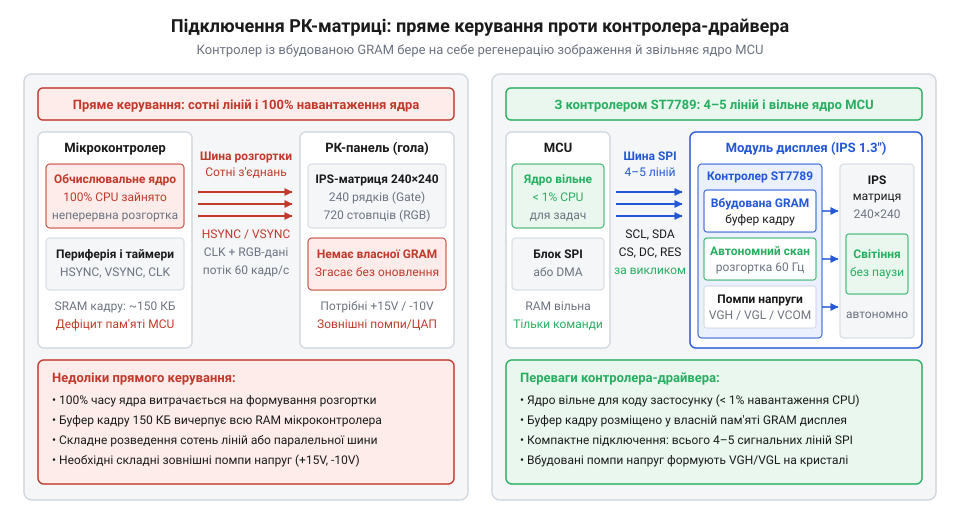
*Порівняння архітектури прямого підключення матриці та схеми зі спеціалізованим контролером-драйвером: автономний кристал скорочує число ліній шини з сотень до кількох дротів і повністю знімає з мікроконтролера навантаження генерації розгортки.*

> 🔧 **Навіщо це.**
> Розуміння контролера-драйвера як автономного кремнієвого моста рятує розробника від спроби під'єднати графічну РК-панель напряму до виводів мікроконтролера чи звичайного таймера. Усвідомлення наявності майже тисячі внутрішніх ліній і мікросекундних часових обмежень показує, що екранний модуль є складним активним вузлом, і дозволяє зосередитися на проектуванні надійної цифрової шини замість безнадійного трасування сотень аналогових кіл.

## Розділення тактових доменів через вбудований кадровий буфер

Навіть якщо кремнієвий міст містить усі необхідні комутатори рядків і перетворювачі для стовпців, постає нова фундаментальна проблема — невідповідність темпів обміну даними. Фізична рідкокристалічна матриця живе за суворим, неперервним часовим розкладом: якщо розгортка зупиниться бодай на мілісекунду, заряди з ємностей субпікселів стечуть через струми витоку, і зображення миттєво згасне або спотвориться. Натомість зовнішній мікроконтролер (хост, від англ. @@en|host@@ — господар, приймаюча сторона) працює нерівномірно: він формує графіку фрагментами, витрачає час на математичні розрахунки, зупиняється на обробку переривань від зовнішньої периферії і взагалі не надсилає даних годинами, якщо екран відображає статичний текст чи інтерфейс приладу.

Для узгодження двох настільки різних режимів роботи всередину кристала контролера-драйвера інтегрують локальну пам'ять кадру — графічну пам'ять з довільним доступом (GRAM, від англ. @@en|Graphic Random Access Memory@@; буфер кадру, @@en|frame buffer@@). Цей масив пам'яті будується на основі статичних комірок (SRAM, від англ. @@en|Static Random Access Memory@@; статичний — від грецького στατικός — нерухомий, здатний зберігати стан без динамічної регенерації, доки подано живлення). Ємність масиву точно відповідає фізичній роздільній здатності матриці з урахуванням розрядності представлення кольору кожного пікселя.

**Розрахунок ємності буфера кадру GRAM для матриці 240×240 пікселів при глибині кольору 16 біт (RGB565):**
```text
C_bits = W × H × BPP
       = 240 × 240 × 16                  [підстановка ширини, висоти та бітів на піксель]
       = 57 600 × 16                     [загальна кількість пікселів]
       = 921 600                         [біт пам'яті]

C_bytes = C_bits ÷ 8
        = 921 600 ÷ 8                    [переведення бітів у байти]
        = 115 200                        [байтів (112.5 КіБ)]
```

Понад 115 кілобайтів статичної пам'яті розміщено безпосередньо на кристалі поруч із логікою керування та високовольтними каскадами.

Наявність кадрового буфера GRAM фізично розділяє кристал на два незалежні тактові домени (домен — від французького *domaine*, від латинського *dominium* — володіння; частина схеми, що працює від власного джерела тактових імпульсів):

1. **Тактовий домен хоста** (@@en|host domain@@). Ця частина мікросхеми підпорядкована зовнішньому мікроконтролеру. Вона тактується виключно сигналами зовнішньої шини (наприклад, лінією тактування послідовного інтерфейсу `SCLK` або стробом запису `WR` паралельної шини). Домен хоста повністю асинхронний відносно екрана: мікроконтролер надсилає координати та значення кольорів пікселів на будь-якій доступній йому швидкості (від одиниць кілогерців до десятків мегагерців) і лише тоді, коли в пам'яті потрібно оновити зображення.
2. **Тактовий домен панелі** (@@en|panel domain@@). Ця внутрішня система керується власним інтегрованим RC-генератором кристала та спеціалізованим апаратним блоком — таймінг-контролером (TCON, від англ. @@en|timing controller@@; таймінг від давньоанглійського *tīma* — час). Блок TCON працює безупинно й повністю автономно: за власним суворим циклічним розкладом на частоті 60 Гц він генерує імпульси вибору рядків, зчитує з масиву GRAM поточний рядок пікселів і передає його на цифрово-аналогові перетворювачі драйверів стовпців.

Аби домен хоста та домен панелі могли одночасно звертатися до кадрового буфера без взаємних блокувань, масив GRAM організовано за принципом [двопортової статичної пам'яті](root:hw-components/dual-port-sram-architecture) (@@en|dual-port@@). Внутрішня шина зчитування блоку TCON та зовнішня шина запису інтерфейсу хоста розділені апаратним арбітром. Це дозволяє процесору записувати новий графічний елемент у довільну ділянку пам'яті саме тоді, коли TCON сканує зовсім інший рядок, виключаючи зупинку розгортки.


*Функціональна блок-схема внутрішньої структури кристала контролера-драйвера: інтерфейс хоста з дешифратором команд і лічильником адреси записує пікселі в пам'ять GRAM, а апаратний таймінг-контролер (TCON) автономно зчитує буфер для керування комутаторами рядків і ЦАП стовпців.*

Розділення тактових доменів кардинально змінює баланс обчислювальних ресурсів у системі. При безперервному оновленні матриці 240×240 пікселів у форматі RGB565 на частоті 60 Гц внутрішній таймінг-контролер зчитує з пам'яті такий потік даних:

**Розрахунок внутрішньої смуги зчитування пам'яті GRAM блоком TCON:**
```text
BW_internal = C_bytes × F_refresh
            = 115 200 × 60               [обсяг байтів кадру на частоту оновлення]
            = 6 912 000                  [байт/с (6.91 МБ/с або 55.3 Мбіт/с)]
```

Якби екранний модуль не мав власної пам'яті GRAM, мікроконтролер мусив би безперервно викачувати по зовнішній шині понад 55 мегабіт щосекунди, витрачаючи на це майже всю пропускну здатність шини та енергію живлення. Завдяки наявності GRAM ситуація змінюється: якщо зображення на екрані статичне, трафік по зовнішній шині падає до нуля. Мікроконтролер може повністю відключити інтерфейс і перейти в режим глибокого сну (@@en|deep sleep@@) зі споживанням у кілька мікроамперів. Водночас блок TCON продовжує неперервно живити матрицю з пам'яті кадру, зберігаючи на екрані яскраве, чітке й стабільне зображення без жодного натяку на мерехтіння.

> 🔧 **Навіщо це.**
> Архітектурне розділення тактових доменів через буфер GRAM дозволяє застосовувати дешеві й енергоефективні мікроконтролери з мінімальною тактовою частотою для керування кольоровими графічними екранами високої роздільної здатності. Інженеру не потрібно закладати в проект дорогі процесори з вбудованим апаратним РК-контролером і зовнішніми мікросхемами оперативної пам'яті: обчислювальні ресурси хоста витрачаються лише на малювання змінених пікселів у моменти реального оновлення кадру.

## Генерація високовольтних напруг та комутація рядків

Щоб на екрані з'явилося зображення, кожна рідкокристалічна комірка має зарядитися до потрібного електричного потенціалу. У дисплеях з активною матрицею (@@en|active matrix@@) цим процесом керують мікроскопічні тонкоплівкові польові транзистори (@@en|thin-film transistor@@, TFT, від лат. @@la|trans@@ — крізь та @@la|resistere@@ — чинити опір), нанесені безпосередньо на скло панелі біля кожного субпікселя. Логічний блок контролера оперує звичною низькою напругою 1.8 В або 3.3 В. Проте якщо спробувати подати 3.3 В на затвор транзистора на склі, екран залишиться абсолютно темним або вкриється випадковими блідими смугами.

Причина криється у фізиці напівпровідникових шарів на скляній підкладці. На відміну від кристалічного кремнію, з якого виготовляють процесори, [транзистори на склі](root:hw-motion/tft-matrix-physics) формують з аморфного кремнію (a-Si) або оксидних напівпровідників. Аморфна структура має хаотичне розташування атомів, тому рухливість носіїв заряду (@@en|carrier mobility@@, від лат. @@la|mobilis@@ — рухомий) у ній у сотні разів нижча, ніж у монокристалі. Канал такого транзистора має високий власний опір і відкривається вкрай мляво. При кадровій частоті 60 Гц вікно вибору одного рядка триває лише близько 70 мкс. За цей короткий час через канал транзистора необхідно повністю зарядити ємність рідкокристалічної комірки `C_lc` та паралельний конденсатор збереження заряду `C_st`. За низької напруги на затворі транзистор не встигає пропустити потрібний струм. Щоб швидко й надійно відкрити канал аморфного TFT, на його затвор прикладають високий позитивний потенціал відкриття `VGH` (@@en|Gate High Voltage@@) від +10 В до +15 В.

Ще суворіша вимога діє, коли рядок не активний. Протягом решти 99.6% часу кадру затвори транзисторів мусять бути зачинені настільки герметично, щоб накопичений у комірках заряд не розсіявся через струми витоку. Якби затвори залишалися під потенціалом звичайної логічної землі (0 В), підпороговий витік крізь сотні вимкнених транзисторів одного стовпця спотворив би напругу на пікселі, спричинивши згасання яскравості та паразитне взаємне засвічування сусідніх областей (@@en|crosstalk@@). Тому для надійного замикання каналу та компенсації температурного дрейфу порогової напруги використовують глибокий від'ємний потенціал замикання затворів `VGL` (@@en|Gate Low Voltage@@) величиною від -7 В до -10 В.

### Помпи заряду та накопичувальні конденсатори

Мікроконтролерні плати та портативні пристрої не мають окремих зовнішніх джерел напруги +15 В і -10 В — система зазвичай живиться від єдиної шини 3.3 В (аналогове живлення `VCI` та цифрове `IOVCC`). Встановлювати на компактний дисплейний модуль громіздкі індуктивні перетворювачі означало б збільшити габарити плати та створити електромагнітні завади для чутливих аналогових кіл.

Тому контролер-драйвер містить на кристалі автономні каскадні помпи помноження напруги (@@en|charge pump@@, від лат. @@la|plumbum@@ через фр. @@fr|pompe@@ та англ. @@en|pump@@). Помпа помноження працює за принципом комутованих ємностей. Вбудований тактовий генератор формує протифазні імпульси частотою в кількасот кілогерців, які керують польовими ключами мікросхеми:

1. **Фаза заряду:** Зовнішній накопичувальний конденсатор перенесення заряду (@@en|flying capacitor@@) підключається паралельно до вхідної напруги `VCI` і заряджається до її рівня.
2. **Фаза накачування:** Ключі від'єднують нижню обкладку конденсатора від землі та підтягують її до потенціалу попереднього ступеня, піднімаючи потенціал верхньої обкладки відносно землі на додаткову величину `VCI`.

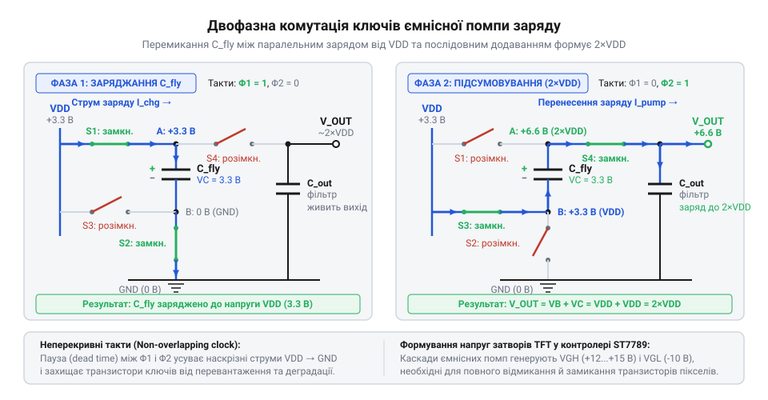
*Двофазна комутація ключів ємнісної помпи заряду: у першій фазі накопичувальний конденсатор заряджається від шини живлення, у другій — перемикається послідовно для подвоєння вихідного потенціалу.*

Послідовне об'єднання таких комірок формує багатокаскадний помножувач:

```
V_pump[1] = 2 · VCI - V_drop              [подвоєння вхідної напруги на першому ступені]
V_pump[2] = 3 · VCI - 2 · V_drop          [потрійне помноження на другому ступені]
VGH       = (N + 1) · VCI - ∑ V_loss      [вихідна напруга відкриття після N каскадів]
```

Для генерації від'ємної напруги `VGL` конденсатор перемикають інверсно: під час фази розряду його додатну обкладку приєднують до системної землі, завдяки чому на від'ємній обкладці формується потенціал нижче нуля (`-VCI`, `-2 · VCI`), що після згладжування дає стабільні -7...-10 В.

Внутрішні конденсатори на кремнієвому кристалі мають мікроскопічну площу і здатні забезпечити ємність лише в десятки пікофарадів, чого недостатньо для живлення ліній затворів без катастрофічної просадки напруги. Саме тому мікросхема виводить лінії помп на зовнішні виводи, до яких підключають дискретні керамічні конденсатори ємністю 1–2.2 мкФ.

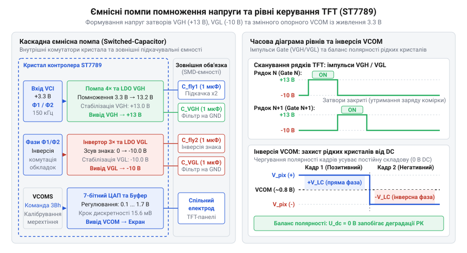
*Схема каскадних ємнісних помп помноження напруги із зовнішніми накопичувальними конденсаторами та часова діаграма рівнів VGH, VGL і VCOM.*

### Зміщувачі рівнів та комутація рядків

Внутрішній цифровий таймінг-контролер мікросхеми оперує логічними сигналами амплітудою 0...3.3 В, які виходять зі зсувного регістра адресації. Безпосередньо подати такий сигнал на лінію рядка неможливо. Тому перед вихідними каскадами стоять високовольтні зміщувачі рівнів (@@en|level shifters@@, від лат. @@la|levamen@@ — рівень). Вони перетворюють слабкий логічний імпульс у високовольтний перепад з розмахом (@@en|peak-to-peak@@) до 25 В — від -10 В до +15 В.

Вихідні драйвери рядків (@@en|gate drivers@@) являють собою потужні двотактні комплементарні ключі. У будь-який момент часу:
- Рівно один вибраний рядок підключається до шини високої напруги `VGH`, відкриваючи всі TFT-транзистори цієї горизонталі.
- Решта рядків матриці залишаються жорстко підтягнутими до шини `VGL`, що гарантує надійне утримання раніше записаного заряду в їхніх пікселях.

Опорною точкою для заряду всіх комірок слугує спільний електрод матриці — суцільний прозорий шар оксиду індію й олова (ITO), нанесений на протилежне фронтальне скло екрана. Контролер містить спеціальне стабілізоване джерело опорної напруги спільного електрода `VCOM` (@@en|Common Voltage@@). Потенціал `VCOM` утримує середню точку між додатними та від'ємними амплітудами напруг на пікселях, усуваючи паразитні постійні зміщення.

> 🔧 **Навіщо це.**
> Конденсатори обв'язки ємнісних помп працюють під постійною напругою, близькою до граничної: на лінії `VGH` діє до +15 В, а на `VGL` — до -10 В. Багатошарові керамічні конденсатори (MLCC) типу X5R або X7R мають виражений ефект падіння ефективної ємності під дією постійної поляризації (@@en|DC bias effect@@). Якщо для лінії `VGH` (+15 В) застосувати конденсатор із номіналом 16 В, його реальна ємність упаде на 60–80%. Помпа почне втрачати заряд під навантаженням: виникнуть горизонтальні смуги під час швидкого оновлення кадрів, блідість зображення або навіть тепловий пробій вихідних ключів через лавинне наростання внутрішнього опору. Для надійного функціонування конденсатори на лініях помп заряду обирають із номінальною робочою напругою щонайменше 25 В для `VGH` та 16 В для `VGL`.

## Драйвери стовпців, гамма-корекція та інверсія полярності

Коли високовольтний імпульс `VGH` відкрив затвори транзисторів вибраного рядка, через їхні канали на конденсатори рідкокристалічних комірок потрібно передати точні заряди, що відповідають яскравості кожного кольорового субпікселя — червоного, зеленого та синього. Здавалося б, найпростіший шлях — взяти цифровий код яскравості (наприклад, 8-бітне число від 0 до 255) і звичайним лінійним цифро-аналоговим перетворювачем перевести його в пропорційну напругу від 0 до 5 В. Проте за такої спроби картинка на екрані стане практично нерозбірливою: темні півтони злиються в суцільну чорноту, яскраві ділянки перетворяться на випалені білі плями, а плавні колірні переходи розпадуться на грубі сходинки.

Цей дефект зумовлений тим, що рідкі кристали реагують на напругу вкрай нелінійно. Світлопропускання РК-комірки описується так званою S-подібною характеристикою (вольт-контрастною кривою):
1. **Зона нечутливості:** За напруг, нижчих за порогове значення `V_th` (приблизно 1.0–1.5 В), пружні сили зчеплення молекул рідкого кристала з орієнтувальним полімерним шаром перевищують дію електричного поля. Молекули взагалі не повертаються, і оптичний стан комірки не змінюється.
2. **Зона високої чутливості:** За невеликого перевищення `V_th` починається лавиноподібний розворот молекул. На цьому крутому проміжку зміна напруги всього на 0.1 В спричиняє стрибок пропускання світла на 30–40%.
3. **Зона насичення:** За напруги, вищої за напругу насичення `V_sat` (понад 3.5–4.5 В), майже всі рідкокристалічні молекули вже вишикувалися вздовж ліній поля. Подальше зростання напруги не дає оптичного ефекту.

До цієї фізичної нелінійності додається нелінійність людського зору: око сприймає яскравість не лінійно, а за логарифмічним або степеневим законом із показником гамма (@@en|gamma@@, від грец. @@grc|γάмма@@ — третя літера грецької абетки, що традиційно позначає степінь нелінійної передатної функції) γ ≈ 2.2. Щоб око сприймало зростання цифрового коду як рівномірне наростання яскравості, аналогова напруга на пікселі має заздалегідь компенсувати S-подібний прогин рідких кристалів.

### Програмована гамма-драбина та ЦАП стовпців

Апаратний розрахунок нелінійних функцій для мільйонів пікселів на секунду перевантажив би кремнієвий кристал складними цифровими обчислювачами. Замість цього контролер-драйвер містить компактний і швидкий [блок апаратної гамма-корекції](root:hw-motion/gamma-correction-lcd) на основі прецизійної резистивної драбини (@@en|resistor string DAC@@, дільник опорних напруг).

Дільник складається з послідовного ланцюжка інтегрованих полікремнієвих резисторів, увімкнених між верхнім і нижнім рівнями аналогового живлення. У ключових точках зламу кривої розміщено програмовані відводи (типово від 8 до 16 опорних рівнів, наприклад `V0`, `V1`, `V8`, `V20`, `V43`, `V55`, `V62`, `V63`). Конфігураційні регістри контролера дають змогу гнучко зміщувати ці опорні точки за допомогою внутрішніх цифрових підстроювачів. Це дозволяє адаптувати одну й ту саму мікросхему під фізичні властивості рідкокристалічних сумішей різних виробників скла (товщину зазору комірки, орієнтацію молекул і хімічний склад).

Між запрограмованими опорними точками внутрішня резистивна сітка пасивно ділить напругу на 64 (при 6 бітах на колір) або 256 (при 8 бітах на колір) дискретних, нерівномірно розташованих потенціалів.

Вихідна частина драйверів стовпців (@@en|source drivers@@) містить паралельні цифрово-аналогові перетворювачі для кожної вертикальної лінії матриці. Якщо роздільна здатність екрана становить 240 пікселів за горизонталлю, то кристал містить:

```
N_columns = 240 · 3 = 720 виходів ЦАП  [окремий канал на кожен субпіксель R, G, B]
```

Під час циклу вибору одного рядка відбувається синхронний процес:
1. Цифрові коди кольорів для всіх 720 субпікселів паралельно фіксуються у внутрішніх регістрах-засувках (@@en|line latches@@).
2. Багатоканальні аналогові селектори комутують відповідний відвід гамма-драбини на вхід буферного підсилювача кожного стовпця.
3. Вбудовані операційні підсилювачі з малим вихідним опором заряджають довгі лінії стовпців на скляній панелі, передаючи точний потенціал на електроди субпікселів крізь відкриті транзистори активного рядка.

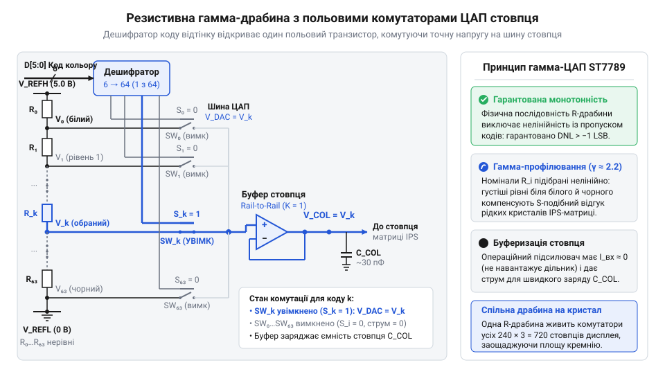
*Принципова схема резистивної драбини гамма-дільника: полікремнієвий подільник напруги з польовими аналоговими селекторами формує нелінійні опорні рівні для компенсації S-подібної характеристики рідких кристалів.*

### Інверсія полярності та хімічний захист комірок

Рідкокристалічна суміш — це органічний діелектрик, у якому завжди присутня невелика кількість залишкових йонів. Якщо до комірки тривалий час прикладати постійну напругу одного знака, виникає явище електрофорезу: позитивні та негативні йони починають дрейфувати до протилежних електродів. На межі рідкого кристала з орієнтувальним шаром розпочинаються незворотні електрохімічні реакції розкладу (електроліз), а накопичений просторовий заряд створює внутрішнє залишкове поле. У результаті комірка необоротно втрачає рухливість молекул: на екрані з'являється незмивне залишкове зображення (@@en|image retention@@, вигоряння), а згодом — темні плями деградації. Як і в найпростіших дисплеях (наприклад, [Символьний дисплей LCD 1602A](root:cat-hw-actuators/lcd-1602)), рідкі кристали активної матриці вимагають строго змінного струму:

```
∫ V_LC(t) dt = 0    [інтегральний постійний струм за період має дорівнювати нулю]
```

Оскільки оптичний поворот молекул залежить лише від величини модуля електричного поля `|V_pixel - VCOM|`, знак напруги на кут орієнтації не впливає: як додатна різниця +3 В, так і від'ємна -3 В створюють абсолютно однакове оптичне пропускання світла.

Контролер реалізує цю вимогу апаратною інверсією полярності (@@en|polarity inversion@@, від лат. @@la|inversio@@ — перевертання). Гамма-генератор створює два симетричні набори напруг: додатний напівцикл вище рівня `VCOM` та від'ємний напівцикл нижче рівня `VCOM`. Мікросхема періодично змінює знак прикладеної різниці потенціалів:
- **Покадрова інверсія (@@en|frame inversion@@):** Протягом одного кадру всі пікселі екрана заряджаються потенціалом, вищим за `VCOM`, а протягом наступного — симетричним потенціалом, нижчим за `VCOM`. Цей спосіб є схемотехнічно найпростішим, але створює помітне для ока мерехтіння на половинній частоті кадрів (30 Гц при 60 кадрах на секунду) через неминучу технологічну асиметрію півхвиль та різке перезаряджання спільного електрода.
- **Построкова інверсія (@@en|line inversion@@):** Сусідні рядки в межах одного кадру живляться протилежними полярностями (парні рядки додатні, непарні — від'ємні). У наступному кадрі всі полярності дзеркально змінюються. Протифазні заряди сусідніх горизонталей компенсують паразитні коливання на спільному електроді, усуваючи мерехтіння зображення.
- **Точкова інверсія (@@en|dot inversion@@):** Кожен сусідній субпіксель як у рядку, так і в стовпці має знак, протилежний сусідові (шаховий порядок). Це забезпечує максимальну чіткість і стабільність зображення без перехресних тіней (@@en|shadowing@@), хоча й вимагає максимальної динамічної потужності від вихідних каскадів драйверів стовпців через часте перезаряджання ємностей ліній.

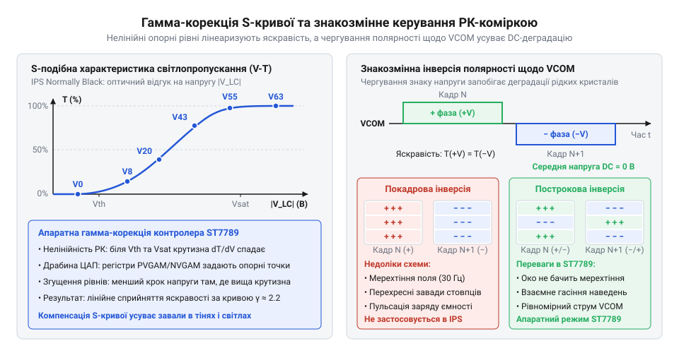
*Нелінійна S-подібна характеристика світлопропускання РК-комірки з опорними точками гамма-дільника та часові діаграми покадрової й построкової інверсії полярності відносно VCOM.*

> 🔧 **Навіщо це.**
> Якщо щойно зібраний екран помітно мерехтить або залишає блідий "привид" статичного тексту після кількох хвилин роботи, причина майже ніколи не криється в бракованому склі чи дефекті шлейфа. Найчастіше це наслідок розбалансування потенціалу `VCOM` або зсуву симетрії позитивної та негативної гілок гамма-корекції в регістрах контролера. Навіть мізерний постійний перекіс у 20–30 мВ спричиняє миттєвий дрейф вільних йонів у рідкому кристалі та появу низькочастотної пульсації 30 Гц. Програмне коригування значення регістра зміщення `VCOM` (калібрування за мінімумом оптичного мерехтіння) усуває постійну складову та гарантує багаторічний ресурс панелі без деградації контрасту.

## Інтерфейсна група виводів та протоколи обміну: послідовні й паралельні шини

Мікроконтролер та інтегральний контролер-драйвер функціонують у різних часових доменах: ядро хоста генерує графіку асинхронно, а дисплейний чип безперервно зчитує статичну пам'ять кадру (GRAM, від англ. @@en|Graphic Random Access Memory@@ — графічна пам'ять із довільним доступом) для розгортки на матриці. Зв'язок між ними забезпечує інтерфейсна група виводів (від англ. @@en|interface@@ — поверхня розділу, спільна межа).

Вимоги до зв'язку суперечливі: передача динамічного зображення потребує значної пропускної здатності, проте мікроконтролери обмежені кількістю ліній введення-виведення. Щоб забезпечити схемотехнічну гнучкість, кристал контролера-драйвера містить мультипротокольний інтерфейсний блок (протокол — від грец. πρωτόколлон, @@grc|protokollon@@ — перший аркуш документа із засвідченням порядку), що підтримує послідовні та паралельні шини.

Активний протокол обирається апаратним конфігуруванням виводів вибору режиму `IM[3:0]` або `IM[2:0]` (від англ. @@en|Interface Mode@@ — режим інтерфейсу). Внутрішня логіка зчитує їхній стан одноразово під час апаратного скидання (перехід сигналу `RESX` із низького рівня у високий). Виводи `IM` підтягуються на платі дисплейного модуля жорстко до шини цифрового живлення `IOVCC` або землі `GND`, підключаючи потрібні внутрішні трансивери:
- 4-дротовий або 3-дротовий послідовний інтерфейс SPI;
- 8-бітний або 16-бітний паралельний системний інтерфейс типу 8080 чи 6800.

Оскільки рівні на `IM` зафіксовані розведенням друкованої плати або шлейфа, змінити протокол програмно неможливо — це фундаментальне схемотехнічне рішення під час проєктування пристрою.

Інтерфейсна група мікросхеми містить такі функціональні лінії:
- **Вибір кристала (`CS`, від англ. @@en|Chip Select@@):** активний рівень — низький (`0`). За `CS = 1` трансивери переходять у стан високого імпедансу (Hi-Z), дозволяючи іншим пристроям працювати на спільній шині. У послідовних режимах перехід `CS` в одиницю скидає бітовий лічильник десеріалізатора, відновлюючи синхронізацію при завадах на тактовій лінії.
- **Тактування та стробування (строб — від грец. στρόβος, @@grc|strobos@@ — швидкий рух, імпульс):**
  - У послідовному режимі лінія `SCL` (від англ. @@en|Serial Clock@@ — послідовний тактовий сигнал) фіксує дані на шині за фронтом імпульсу (режими SPI Mode 0 або Mode 3).
  - В інтерфейсі 8080 діють два роздільні строби низького рівня: `WR` (запис даних у контролер за зростаючим фронтом) та `RD` (читання регістрів чи пам'яті контролера хостом).
  - В інтерфейсі 6800 застосовуються строб дозволу `E` (від англ. @@en|Enable@@) та лінія вибору напрямку `R/W`.
- **Шина даних:** лінія `SDA` (або роздільні `SDI`/`SDO`) у послідовному режимі; двонапрямлені паралельні шини розрядністю 8 бітів (`D[7:0]`) або 16 бітів (`D[15:0]`).
- **Селектор «команда/дані» (`DC` або `RS`, від англ. @@en|Data/Command@@ або @@en|Register Select@@, регістр — від лат. @@la|registrum@@ — список):**
  Апаратно розділяє призначення байтів на шині без програмних заголовків:
  - `DC = 0` (низький рівень): байт на шині скеровується до дешифратора команд або задає адресу регістра;
  - `DC = 1` (високий рівень): байт інтерпретується як параметр конфігурації або передається в конвеєр пам'яті GRAM.

> 🔧 **Навіщо це.** Лінія вибору «команда/дані» (`DC`/`RS`) апаратно відокремлює потік інструкцій від масивів графічних даних без передачі службових байтів заголовків, зводячи накладні витрати на канальному рівні до абсолютного нуля під час потокового запису пікселів.

У послідовній конфігурації передача ознаки `DC` визначає фізичну реалізацію шини SPI:

| Режим SPI | Лінії зв'язку | Механізм передачі «команда/дані» | Схемотехнічні особливості |
| :--- | :--- | :--- | :--- |
| **4-дротовий (4-wire SPI)** | `CS`, `SCL`, `SDA`, `DC` | Окрема апаратна лінія `DC` (стандартні 8-бітні байти) | Повна сумісність з апаратними блоками SPI мікроконтролерів; найпоширеніший вибір. |
| **3-дротовий (3-wire SPI)** | `CS`, `SCL`, `SDA` | Перший біт 9-бітної посилки (`0` — команда, `1` — дані) | Економить один вивід хоста, але вимагає апаратної підтримки 9-бітних слів або повільної програмної емуляції. |

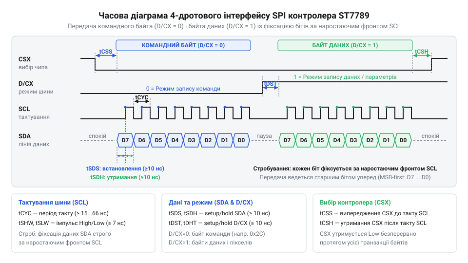
*Часова діаграма передачі по 4-дротовій шині SPI: взаємне розташування ліній CS, DC, тактування SCL та даних SDA під час запису команд і пікселів.*

Коли пропускної здатності послідовного потоку недостатньо, застосовують підключення до [паралельних системних шин Intel 8080](root:hw-arch/bus-intel-8080-m6800). Хост виставляє дані на лінії `D[7:0]` або `D[15:0]`, задає рівень `DC` і генерує короткий низькорівневий імпульс `WR`. За його зростаючим фронтом контролер фіксує всі розряди за один такт.

Розрядність шини визначає кількість тактів на один піксель у стандартному кодуванні RGB565 (16 бітів на піксель):
- 8-бітна паралельна шина потребує двох послідовних стробів `WR` (старший і молодший байти);
- 16-бітна шина (`D[15:0]`) передає піксель за один строб `WR`, подвоюючи пропускну здатність.

Вибір інтерфейсу є компромісом між числом зайнятих виводів мікроконтролера та швидкістю оновлення кадру. Якщо для текстового екрана [символьного дисплея LCD 1602A](root:cat-hw-actuators/lcd-1602) чи компактного модуля [TFT 1.77″ 128×160 (SPI, ST7735S)](root:cat-hw-actuators/tft-st7735s) шина SPI є стандартною завдяки мінімуму провідників, то для матриці 240×240 пікселів пропускна здатність стає лімітуючим фактором.

**Обчислення тривалості передачі кадру для дисплея 240×240 пікселів із глибиною кольору 16 біт (RGB565)**
Повний інформаційний обсяг одного нестисненого кадру становить:
`240 × 240 × 16 = 921 600 біт` (або `115 200` байтів).

Для 4-дротової шини SPI на граничній стабільній частоті тактування `f_SCL = 40 МГц` теоретичний час передачі лише піксельних даних кадру дорівнює:
```
T_SPI
= (240 × 240 × 16) ÷ 40 000 000    [час = число бітів кадру ÷ тактова частота]
= 921 600 ÷ 40 000 000             [розрахунок для тактової частоти 40 МГц]
= 0.02304 с = 23.04 мс             [тривалість передачі піксельного масиву]
```
Звідси максимальна розрахункова частота зміни кадрів (FPS, від англ. @@en|Frames Per Second@@ — кадрів на секунду) без урахування службових команд становить:
```
FPS_SPI
= 1 ÷ 0.02304                      [гранична частота оновлення = 1 ÷ T]
≈ 43.4 кадри/с
```

Для 8-бітної паралельної шини типу 8080 із періодом стробу запису `t_WC = 100 нс` (тактова частота стробування 10 МГц, що легко досягається апаратними контролерами зовнішньої пам'яті):
```
T_PAR8
= (240 × 240 × 2) × 100 × 10⁻⁹     [час = число байтів × період стробу]
= 115 200 × 100 × 10⁻⁹             [розрахунок для періоду стробу 100 нс]
= 0.01152 с = 11.52 мс             [тривалість передачі піксельного масиву]
```
Гранична частота кадрів для 8-бітної шини:
```
FPS_PAR8
= 1 ÷ 0.01152                      [гранична частота оновлення = 1 ÷ T]
≈ 86.8 кадрів/с
```

Шина SPI потребує 4–5 виводів мікроконтролера, проте частота 40 МГц вимагає акуратного трасування ліній для запобігання відбиттям сигналу, а реальна частота оновлення обмежена приблизно 43 кадрами/с. Паралельна 8-бітна шина вимагає 12–14 ліній, але забезпечує вдвічі більшу пропускну здатність на частоті 10 МГц, зменшуючи електромагнітні завади й гарантуючи запас швидкодії для динамічної графіки.

## Координатна адресація та віконний доступ до пам'яті кадру

Графічний масив дисплея — це двовимірна площина, а послідовна шина передає одновимірний потік байтів. Пам'ять кадру GRAM фізично організована як матриця комірок, де кожному фізичному пікселю (від англ. @@en|pixel@@, скорочення від @@en|picture element@@ — елемент зображення) відповідає власна адреса (від франц. @@fr|adresse@@, від лат. @@la|directus@@ — прямий, спрямований).

Передача координат `(X, Y)` для кожного окремого пікселя звела б нанівець пропускну здатність. Щоб передати 16-бітний колір (2 байти), хост мусив би надіслати команду встановлення координати X (2 байти адреси), команду координати Y (2 байти адреси) і лише потім сам піксель. Корисне навантаження становило б лише 25% трафіку, а 75% припадало б на службові байти. Час відмальовування кадру по шині SPI зріс би з 23 мс до майже 92 мс, унеможливлюючи плавну графіку.

Щоб усунути це вузьке місце, в архітектурі контролерів застосовано апаратну координатну адресацію та концепцію віконного доступу. Замість покажчика на одиничний піксель хост один раз задає межі прямокутного вікна через внутрішні регістри:
- `Column Address Set` (CASET, код команди `0x2A`): горизонтальні межі вікна — початковий стовпець `XS` (від англ. @@en|Column Start@@) і кінцевий `XE` (від англ. @@en|Column End@@);
- `Row Address Set` (RASET, код команди `0x2B`): вертикальні межі вікна — початковий рядок `YS` (від англ. @@en|Row Start@@) і кінцевий `YE` (від англ. @@en|Row End@@);
- `Memory Write` (RAMWR, код команди `0x2C`, від англ. @@en|Memory Write@@ — запис у пам'ять): переводить контролер у режим прийому піксельних даних для заповнення визначеного вікна.

Апаратний блок адресації містить лічильники координат `X_ptr` та `Y_ptr`. За командою `RAMWR` вони автоматично ініціалізуються координатами верхнього лівого кута заданого прямокутника: `X_ptr = XS`, `Y_ptr = YS`. Далі хост передає суцільний масив пікселів із рівнем `DC = 1`. Апаратний автомат виконує автоінкремент (від лат. @@la|incrementum@@ — збільшення, нарощування):
1. Отриманий піксель записується в комірку GRAM за адресою `(X_ptr, Y_ptr)`.
2. Лічильник стовпців зростає: `X_ptr = X_ptr + 1`.
3. Коли `X_ptr` досягає значення `XE`, наступний вхідний піксель скидає покажчик стовпців назад на `XS`, а покажчик рядків збільшує на одиницю: `X_ptr = XS`, `Y_ptr = Y_ptr + 1`.
4. Після запису останнього пікселя вікна у точці `(XE, YE)` адресний лічильник автоматично повертається у вихідну точку `(XS, YS)`.

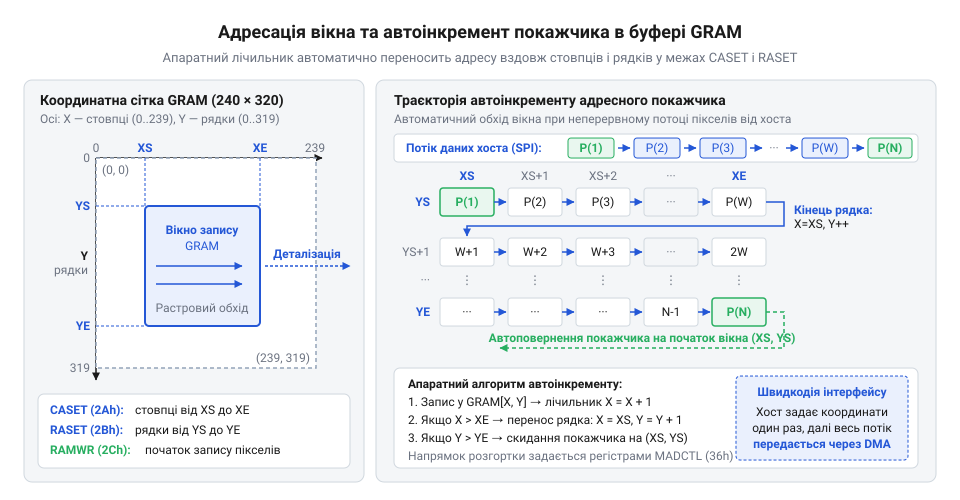
*Автоматичний інкремент адресного покажчика всередині визначеного вікна GRAM: дані пікселів заповнюють виділену область рядок за рядком без необхідності передавати координати кожної окремої точки.*

Прямокутник `[XS..XE] × [YS..YE]` на схемі задає активне вікно пам'яті кадру. Процесор налаштовує його один раз, після чого шина працює зі 100% корисним навантаженням, передаючи виключно колірні байти.

Напрямок обходу осей координат і порядок колірних каналів контролюються конфігураційним регістром напрямку доступу — `Memory Data Access Control` (MADCTL, код команди `0x36`). Зміна орієнтації дисплея (від лат. @@la|oriens@@ — схід, висхідний напрямок) або дзеркалювання зображення програмним шляхом вимагали б буфера кадру в ОЗП хоста й ресурсомісткого транспонування матриць. Регістр `MADCTL` перекладає це завдання на апаратну логіку контролера за допомогою бітових прапорців:
- **`MY` (від англ. @@en|Row Address Order@@ — порядок адрес рядків, біт 7):** реверс адресації рядків (`0`: зверху вниз `0 → Height-1`; `1`: знизу вгору `Height-1 → 0`, вертикальне дзеркалювання);
- **`MX` (від англ. @@en|Column Address Order@@ — порядок адрес стовпців, біт 6):** реверс адресації стовпців (`0`: зліва направо `0 → Width-1`; `1`: справа наліво `Width-1 → 0`, горизонтальне дзеркалювання);
- **`MV` (від англ. @@en|Row/Column Exchange@@ — обмін рядків і стовпців, біт 5):** взаємна заміна осей X та Y (при `MV = 1` первинний автоінкремент іде вздовж стовпчиків, забезпечуючи апаратний поворот на 90° або 270°);
- **`ML` (від англ. @@en|Scan Direction@@ — напрямок сканування, біт 4):** фізичний напрямок оновлення РК-панелі вихідними драйверами затворів (зверху вниз чи знизу вгору);
- **`RGB`/`BGR` (від англ. @@en|Color Selector@@ — вибір порядку кольорів, біт 3):** комутація ліній до ЦАП драйверів стовпців для узгодження порядку кольорів із фізичною топологією світлофільтрів субпікселів.

Комбінація бітів `MY`, `MX` і `MV` задає чотири базові апаратні орієнтації дисплея:

| Орієнтація | Кут повороту | `MY` | `MX` | `MV` | Обхід стовпців | Обхід рядків |
| :--- | :---: | :---: | :---: | :---: | :--- | :--- |
| Портретна | 0° | 0 | 0 | 0 | Зліва направо (`0 → Width-1`) | Зверху вниз (`0 → Height-1`) |
| Альбомна | 90° | 0 | 1 | 1 | Зверху вниз (`Height-1 → 0`) | Справа наліво (`0 → Width-1`) |
| Портретна перевернута | 180° | 1 | 1 | 0 | Справа наліво (`Width-1 → 0`) | Знизу вгору (`Height-1 → 0`) |
| Альбомна перевернута | 270° | 1 | 0 | 1 | Знизу вгору (`0 → Height-1`) | Зліва направо (`Width-1 → 0`) |

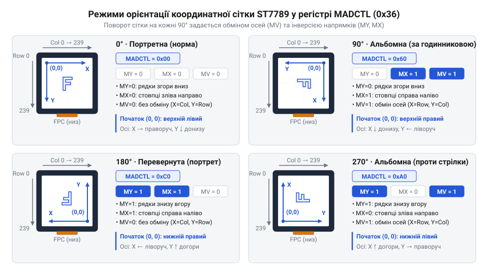
*Чотири базові просторові орієнтації дисплея: перемикання бітів MY, MX та MV змінює початкову точку відліку координат і напрямки автоінкременту без потреби програмного транспонування кадру на боці мікроконтролера.*

> 🔧 **Навіщо це.** Віконний доступ дає змогу оновлювати лише ту ділянку кадру, де відбулися зміни (концепція «брудних прямокутників», від англ. @@en|dirty rectangles@@), мінімізуючи навантаження на шину та вивільняючи процесор для інших задач реального часу.

У типовому інтерфейсі користувача більша частина екрана лишається статичною (тло, рамки, піктограми), а змінюються лише окремі віджети — відсоток заряду, лічильник чи графік. Замість перемальовування всього екрана 240×240 пікселів (115 200 байтів у RGB565) достатньо передати змінене вікно 32×16 пікселів (`XS = 100, XE = 131; YS = 50, YE = 65`), що потребує лише `32 × 16 × 2 = 1 024 байти`.

Відносне скорочення трафіку шини становить:
```
ΔV
= (1 - 1 024 ÷ 115 200) × 100%      [відносне скорочення обсягу передачі]
= (1 - 0.00889) × 100%              [частка трафіку вікна від повного кадру]
≈ 99.11%                            [економія пропускної здатності шини]
```
Час передачі по SPI скорочується з 23 мс до приблизно 0.2 мс.

Програмна реалізація віконної адресації на мові C є простою та спирається на базові функції надсилання команд і даних:

:::code comp-display-driver-controller/c/display-set-address-window.c

Після виконання функції `display_set_address_window` контролер утримує відкритим вхідний конвеєр `RAMWR`: усі наступні байти сприймаються як пікселі, допоки лінія `DC` не перейде в низький рівень для прийому нової команди.

## Схемотехніка ввімкнення, узгодження рівнів та апаратна синхронізація

Контролер-драйвер дисплея поєднує на кристалі цифрову логіку (пам'ять кадру, інтерфейсні регістри, дешифратори команд) та аналогові блоки (багатоканальні цифро-аналогові перетворювачі, джерела гамма-корекції, операційні підсилювачі та імпульсні помпи заряду). Спроба живити мікросхему від нерозв'язаного спільного джерела або під'єднати сигнальні лінії без узгодження рівнів призводить до електричного вигоряння кристала чи появи візуального шуму на матриці.

### Розділення шин живлення: цифрова та аналогова частини

Для надійної роботи передбачено дві незалежні шини живлення:

1. **Цифрове живлення інтерфейсу та логіки (`IOVCC`, або `VDDI`)**: живить буфери шини, процесор команд, керуючі регістри та лічильники пам'яті (1.65–3.3 В). Напруга має відповідати амплітуді сигналів керівного мікроконтролера.
2. **Аналогове живлення ядра та помп заряду (`VCI`, або `VDD`)**: забезпечує опорні джерела, буфери стовпців, гамма-підсилювачі та первинні ступені помножувачів затворів (2.5–3.3 В).

Розділення шин обумовлене комутацією цифрових вентилів: наносекундні перемикання створюють кидки струму зі швидкістю `di / dt` у сотні міліампер на наносекунду. Паразитна індуктивність провідників перетворює їх на високочастотні імпульсні завади. Якщо аналогові вузли під'єднані до тієї ж нерозв'язаної шини, завади проникають у дільники гамма-корекції. Оскільки світлопропускання рідкокристалічної комірки залежить від прикладеної напруги, коливання опори спричиняють горизонтальні смуги, мерехтіння рядків та спотворення півтонів.

Нижня межа `VCI` (2.5 В) обумовлена роботою помножувачів. Для формування напруг відкривання (+10...+18 В) та замикання (-6...-12 В) затворів матриці діодно-конденсаторні східці потребують достатнього потенціалу. Якщо `VCI` падає нижче 2.5 В, ключі не насичуються, помпи втрачають ККД, а вихідні рівні просідають під навантаженням, спричиняючи втрату контрасту чи згасання зображення.

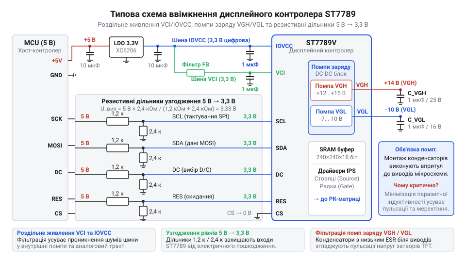
*Схема типового ввімкнення контролера-драйвера: цифрове коло IOVCC живить інтерфейс, аналогове коло VCI забезпечує помпи помноження, а вхідні лінії захищено узгодженням логічних рівнів.*

> 🔧 **Навіщо це.** Розділення шин IOVCC і VCI дозволяє живити цифрову логіку дисплея від низьковольтного ядра процесора (наприклад, 1.8 В), тоді як аналогова частина працює від 3.3 В. Це усуває потребу в зовнішніх перетворювачах рівнів і водночас ізолює прецизійний тракт формування зображення від цифрового шуму.

### Пастка логічних рівнів і руйнування діодів захисту

Типова помилка проєктування — пряме підключення 5-вольтового мікроконтролера до дисплейного контролера з логікою 3.3 В або 1.8 В. На відміну від модулів [Символьний дисплей LCD 1602A](root:cat-hw-actuators/lcd-1602), сучасні графічні контролери виготовляють за субмікронними CMOS-техпроцесами з ультратонким оксидом затвора, вразливим до перенапруги.

Для захисту від електростатичного розряду (від грец. ἤлектроν — «бурштин» та лат. staticus — «нерухомий») кожен сигнальний вхід має пару обмежувальних діодів (діод — від грец. δίς — «двічі» та ὁδός — «шлях»): нижній під'єднано анодом до `GND`, а верхній катодом — до шини `IOVCC`.

Подача сигналу 5 В при напрузі `IOVCC = 3.3 В` викликає ланцюгову аварійну реакцію:

1. **Пряме зміщення діода**: вхідна напруга перевищує `IOVCC` на величину спаду p-n переходу (0.6–0.7 В), відмикаючи верхній діод.
2. **Паразитне фантомне живлення**: крізь відкритий діод струм тече в шину `IOVCC`. Якщо стабілізатор 3.3 В на платі не поглинає зворотний струм, напруга на `IOVCC` зростає до 4.3–4.5 В, живлячи інші вузли плати крізь сигнальну доріжку.
3. **Пробій підзатворного діелектрика**: перевищення граничної напруги (типово 3.6–4.0 В) спричиняє незворотний тунельний пробій оксиду кремнію в затворах польових транзисторів.
4. **Тиристорне замикання (@@en|latch-up@@, від грец. θύра — «двері»)**: надлишковий струм інжекції носіїв через захисний діод відмикає паразитні біполярні p-n-p та n-p-n транзистори між підкладкою та кишенями CMOS-структури. Вони утворюють замкнений чотиришаровий p-n-p-n ланцюг із позитивним зворотним зв'язком — паразитний тиристор. Перейшовши в насичення, він створює низькоомне замикання між `IOVCC` та `GND`. Цей стан не зникає після зняття вхідного сигналу і припиняється лише після повного знеструмлення. За цей час струм у сотні міліампер розплавляє алюмінієву металізацію кристала. Повний механізм явища розглядає окрема стаття про [захисні діоди та тиристорне замикання](root:hw-components/esd-protection-clamping).

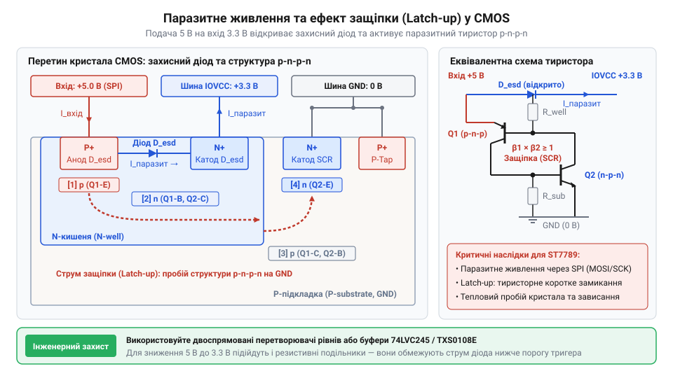
*Схематичний перетин підкладки CMOS-мікросхеми: подача напруги 5 В на сигнальний вхід відмикає захисний діод до шини IOVCC та ініціює тиристорне замикання (latch-up), що призводить до теплового руйнування кристала.*

Для захисту односпрямованих ліній (`SCK`, `MOSI`, `CS`, `DC`, `RESET`) використовують резистивні дільники (1 кОм у верхньому плечі та 2 кОм у нижньому, що дає 3.33 В) або перетворювачі рівнів. На високих тактових частотах шини перевагу надають активним буферам: паразитна ємність монтажу з резисторами дільника затягує фронти й обмежує швидкість обміну.

### Конденсаторний обв'яз вбудованих помп заряду

Для керування оптичним станом пікселів матриці напруги 3.3 В недостатньо. Кожен елемент комутується власним тонкоплівковим транзистором (TFT), затвор якого вимагає значної різниці потенціалів:
- високої додатної напруги відкривання `VGH` (+10...+18 В) для швидкого заряджання ємності пікселя;
- від'ємної напруги замикання `VGL` (-6...-12 В) для усунення підпорогового витоку заряду комірки під час збереження кадру;
- стабілізованої напруги спільного електрода `VCOM`, відносно якої змінюється полярність заряду рідкого кристала для запобігання деградації суміші.

Ці напруги формують вбудовані помпи заряду зі зовнішнім обв'язком двох груп:
- **Перемикальні «літаючі» конденсатори (@@en|flying capacitor@@)**: періодично під'єднуються внутрішніми ключами паралельно до джерела живлення для накопичення заряду, а наступної фази комутуються послідовно з попереднім ступенем, піднімаючи потенціал уперед;
- **Накопичувальні фільтрувальні конденсатори**: під'єднуються між виходами помножувача (`VGH`, `VGL`, `VCOM`) та землею для згладжування пульсацій і живлення вихідних комутаторів.

Вибір типу діелектрика (від грец. διά — «крізь» та ἤлектроν — «бурштин») має вирішальне значення. Використовують виключно багатошарові керамічні конденсатори (від лат. condensare — «згущувати») класів **X5R** або **X7R**. Дешеві діелектрики класів **Y5V** чи **Z5U** неприпустимі через ефект зміщення постійною напругою (@@en|DC bias effect@@): під робочою напругою титанат барію зазнає насичення поляризації, через що його ємність падає на 70–85% (1 мкФ перетворюється на 0.15–0.2 мкФ). У результаті помпа втрачає здатність передавати заряд, вихідні рівні `VGH` та `VGL` просідають під навантаженням, а дисплей втрачає контраст. Діелектрики X7R/X5R зберігають стабільну ємність і мають низький еквівалентний послідовний опір (@@en|equivalent series resistance@@, ESR), що усуває втрати потужності на частотах комутації помп (100–500 кГц).

Розрахунок амплітуди пульсацій на накопичувальному конденсаторі визначається базовим співвідношенням струму навантаження та частоти комутації:

```
ΔV_ripple
= I_load × T_sw / C_out
= I_load / (f_sw × C_out)    [зв'язок періоду й частоти комутації T_sw = 1 / f_sw]
```

З формули видно, що амплітуда пульсацій обернено пропорційна ємності `C_out` та частоті комутації `f_sw`. Якщо через падіння ємності діелектрика Y5V під напругою значення `C_out` зменшиться в кілька разів, амплітуда пульсацій зросте у кілька разів. Якщо пульсації перевищують безпечні межі, це спричиняє візуальне тремтіння яскравості матриці та артефакти на зображенні.

Під час комутації літаючих конденсаторів імпульсні струми з крутизною `di / dt` протікають крізь виводи кристала. Паразитна індуктивність (від лат. inductio — «наведення») друкованої доріжки `L_trace` викликає викиди напруги:

```
V_spike = L_trace × (di / dt)
```

Навіть коротка доріжка завдовжки 5–10 мм має власну індуктивність у кілька наногенрі, що при наносекундних фронтах викликає сплески амплітудою до 1–2 В, здатні пошкодити кристал. Тому всі літаючі та накопичувальні конденсатори розташовують упритул до виводів мікросхеми, мінімізуючи площу струмових контурів, а заземлення виконують короткими широкими доріжками безпосередньо до суцільного полігону землі.

### Артефакт розриву кадру та апаратна синхронізація через вивід TE

Під час оновлення динамічної графіки (рух об'єктів або анімація інтерфейсу) на екрані може виникати візуальний артефакт (від лат. arte — «майстерно» та factum — «зроблене») — розрив кадру (@@en|tearing@@), коли зображення розсікається горизонтальною лінією на дві зміщені частини.

Фізична природа дефекту полягає в асинхронності двох паралельних процесів:
1. **Зчитування кадру таймінг-контролером**: внутрішній автомат автономно зчитує пам'ять кадру рядок за рядком зверху вниз із частотою оновлення панелі (типово 60 Гц, тобто 16.7 мс на кадр) і передає дані на драйвери стовпців.
2. **Запис нового кадру хостом**: мікроконтролер паралельно записує масив пікселів нового кадру в ту саму пам'ять по шині інтерфейсу.

Якщо покажчик запису процесора в пам'ять перетинає покажчик зчитування таймінг-контролера всередині циклу оновлення, верхня частина екрана відображає новий кадр, а нижня — залишки попереднього. Межа розриву проходить по рядку, де відбувся перетин покажчиків.

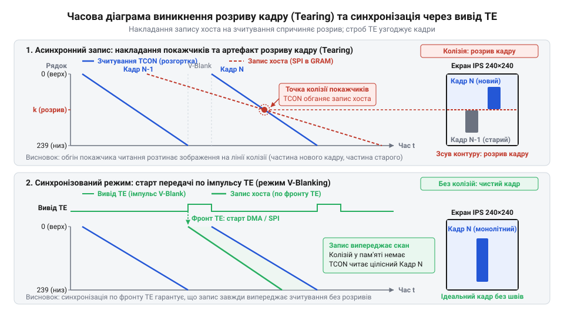
*Виникнення розриву зображення через асинхронний запис у пам'ять кадру та усунення дефекту за допомогою апаратної синхронізації по імпульсах на виводі TE.*

Для усунення цього артефакту контролер має апаратний вихід синхронізації `TE` (@@en|Tearing Effect@@) з двома режимами:
- **Режим 1 (кадровий гасячий імпульс, V-blanking)**: на виводі `TE` формується активний рівень лише під час зворотного ходу кадрової розгортки — коли автомат завершив останній нижній рядок матриці й переходить до верхнього (інтервал вертикального зворотного ходу).
- **Режим 2 (кадровий та рядковий імпульси, V-blanking + H-blanking)**: окрім кадрового, транслює короткі мітки під час кожного міжрядкового переходу.

Апаратна реалізація полягає у підключенні лінії `TE` до зовнішнього переривання мікроконтролера:
1. Процесор готує кадр у власному ОЗП, не починаючи передачу по шині.
2. Очікує фронту кадрового імпульсу на виводі `TE`.
3. За сигналом запускає високошвидкісне пересилання через DMA.
4. Якщо швидкість шини достатня для завершення запису без зіткнення покажчиків, розрив повністю усувається без потреби в подвійному буфері кадру в мікроконтролері. На відміну від простих матриць [модуль TFT 1.77″ 128×160](root:cat-hw-actuators/tft-st7735s), де лінію TE часто не виводять для економії виводів, у повноколірних динамічних дисплеях цей сигнал є ключовим для плавної графіки.

## Конструкція та монтаж кристала: технології Chip-on-Glass і Chip-on-Film

На відміну від мікроконтролерів чи мікросхем пам'яті з майже квадратними кристалами (співвідношення сторін 1:1–1:1.5), кристал інтегрального контролера-драйвера дисплея є довгим і вузьким бруском зі співвідношенням сторін 1:8–1:15 (наприклад, довжина 15–20 мм за ширини 1.0–1.5 мм і товщини 0.2–0.3 мм).

Така геометрія диктується кількістю виводів. Для кольорової матриці 240×240 контролер формує 240 сигналів рядків і 720 сигналів стовпців (240 × 3 субпікселі RGB) — загалом майже 1000 аналогових каналів. Усі вони під'єднуються до прозорих доріжок з оксиду індію й олова (@@en|indium tin oxide@@, ITO) на склі. Квадратний кристал вимагав би широких рамок дисплея для розведення такої кількості провідників. Видовжена форма дозволяє розмістити контакти в один чи два ряди вздовж краю активного поля екрана з мікроскопічним кроком 15–30 мкм.

### Технології монтажу: Chip-on-Glass (COG) проти Chip-on-Film (COF)

Для з'єднання кристала з матрицею дисплея застосовують дві технології:

1. **Монтаж безпосередньо на скло (@@en|Chip-on-Glass@@, COG)**: перевернений кристал (flip-chip) монтується активним боком донизу на край скляної підкладки рідкокристалічної панелі.
2. **Монтаж на гнучкий шлейф (@@en|Chip-on-Film@@, COF)**: кристал фіксується на гнучкій поліімідній плівці (поліімід — від грец. πολύ — «багато» та амід), яку з'єднують зі склом дисплея.

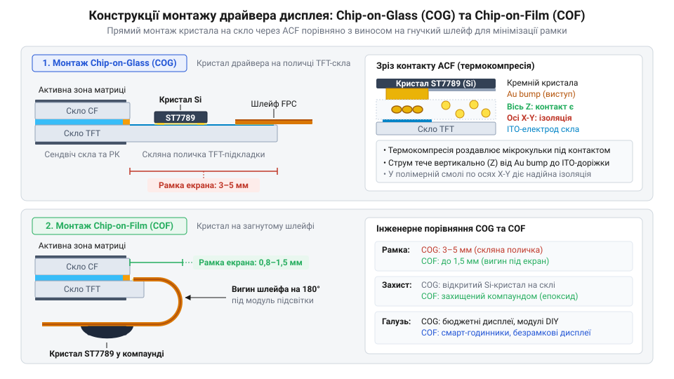
*Конструктивне компонування кристала контролера: безпосередній монтаж на скляну підкладку (COG) через анізотропну плівку ACF та винесення кристала на гнучкий поліімідний шлейф (COF).*

У технології **COG** електричний контакт між золотими виступами кристала та доріжками ITO забезпечує **анізотропна струмопровідна плівка** (@@en|Anisotropic Conductive Film@@, ACF; від грец. ἄνισος — «нерівний» та τρόπος — «напрямок»). Плівка складається з термореактивного клею та розподілених у ньому струмопровідних кульок діаметром 3–5 мкм (полімерні чи скляні сфери з покриттям із нікелю та золота):
- Під час термокомпресії (тиск 2–4 МПа, температура 180–210 °C) кульки затискаються між контактними майданчиками кристала та скла, пробивають шар клею й утворюють провідний контакт уздовж вертикальної осі Z із перехідним опором менше 1–2 Ом.
- У горизонтальній площині X-Y кульки залишаються розділеними полімерною матрицею. Завдяки їхній низькій об'ємній концентрації виключається замикання між сусідніми лініями навіть за кроку контактів 15–20 мкм. Детальніше процес розглядає стаття про [анізотропні струмопровідні плівки ACF](root:hw-pcb/anisotropic-conductive-film).

Монтаж COG вирізняється низькою собівартістю та відсутністю додаткового носія, але вимагає поля скла на краю панелі, що обмежує мінімальну ширину рамки екрана.

У технології **COF** кристал закріплено на поліімідному шлейфі з мідними доріжками. Оскільки шлейф можна загнути на 180° за задню стінку модуля, це дозволяє усунути рамку на склі та ізолювати кристал від механічних вигинів скляної пластини.

> 🔧 **Навіщо це.** Тип монтажу визначає вимоги до конструкції приладу. Модулі з COG потребують жорсткого шасі: будь-який перекіс корпусу чи вигин скла розламує кремнієвий кристал. Модулі з COF уможливлюють ультратонкі рамки та виносять механічні напруження на гнучкий шлейф.

### Механічна вразливість і захист відкритого кремнію

Монокристалічний кремній є крихким матеріалом: за кімнатної температури він не зазнає пластичної деформації й руйнується крихким сколом.

У модулях COG видовжений кристал жорстко приклеєний до скла, яке за навантажень помітно вигинається. Якщо модуль встановлюється з перекосом площини, затягування гвинтів або удари спричиняють деформацію скла за плавною дугою. Жорсткий кремнієвий брусок не здатний повторити цей вигин: у зоні контакту виникають напруження зсуву й розтягу, що призводять до розтріскування кристала поперек довгої осі. Тріщина миттєво перерізає внутрішні провідники металізації. На екрані це проявляється суцільною смугою, випаданням сегментів зображення або втратою зв'язку по шині.

Крім вигину, небезпеку становить точковий тиск на незахищені краї кремнію. Для захисту кристала його периметр і стик зі склом заливають герметизувальним компаундом (@@en|underfill@@ та @@en|edge sealing@@), який:
1. Ізолює шар ACF від проникнення вологи та електрохімічної корозії доріжок ITO.
2. Знижує концентрацію механічних напружень на краях кристала.
3. Захищає дзеркальну поверхню кремнію від подряпин і статичного розряду під час складання.

### Відведення тепла та тепловий опір монтажу

Інтегральний дисплейний контролер розсіює потужність, яка складається з трьох компонентів:

```
P_total = P_logic + P_analog + P_pumps
```

- `P_logic`: динамічні втрати перемикання логіки та пам'яті кадру, пропорційні тактовій частоті шини й частоті кадрів;
- `P_analog`: статична потужність внутрішніх лінійних стабілізаторів ядра, джерел опорних напруг та операційних підсилювачів гамма-корекції;
- `P_pumps`: активні втрати на опір ключів і конденсаторів у помпах високої напруги.

За динамічного оновлення зображення з частотою кадрів 70–100 Гц потужність розсіювання сягає 20–50 мВт, зосереджуючись на об'ємі всього в кілька кубічних міліметрів.

Головне теплове обмеження технології COG — низька теплопровідність скла: близько 0.8–1.2 Вт/(м·К) проти ~400 Вт/(м·К) у міді. Скло діє як теплоізолятор. Оскільки кристал межує лише зі склом і повітряним прошарком, тепловий опір «перехід–середовище» (`θ_ja`) у конструкції COG є дуже високим.

Локальний перегрів кристала викликає:
- **Температурний дрейф опорних напруг**: з нагріванням змінюються коефіцієнти дільників гамма-корекції та стабільність `VCOM`, погіршуючи контраст і спричиняючи залишкове зображення.
- **Зростання підпорогових витоків**: тепло передається на прилеглі TFT-транзистори матриці, прискорюючи витік заряду з рідкокристалічних комірок між циклами оновлення.
- **Термічну втому клейового шару ACF**: через різницю коефіцієнтів теплового розширення кремнію (2.6·10⁻⁶ К⁻¹), скла (8.5·10⁻⁶ К⁻¹) та епоксиду плівки (>30·10⁻⁶ К⁻¹) циклічне нагрівання руйнує контакт кульок із площадками, що викликає випадання окремих рядків або стовпців.

У конструкціях COF тепловий режим значно кращий, оскільки мідні полігони шлейфа відводять тепло на системну плату чи шасі. У приладах із модулями COG не можна розташовувати потужні тепловидільні компоненти (процесори, силові дроселі, контролери заряду) безпосередньо під склом навпроти кристала контролера.

## Пропускна здатність шини, розрив кадру та апаратна синхронізація через лінію TE

Коли мікроконтролер надсилає зображення на графічний дисплей, одночасно відбуваються два незалежні асинхронні процеси. З одного боку, зовнішній процесор записує байти пікселів у вбудовану графічну статичну пам'ять кадру (@@en|Graphic RAM@@, GRAM) через послідовну або паралельну шину. З іншого боку, внутрішній контролер таймінгів розгортки (@@en|timing controller@@, TCON; від лат. *temporalis* — часовий) автономно й безперервно зчитує цю саму пам'ять рядок за рядком, щоб формувати аналогові рівні напруг на електродах стовпців і послідовно відкривати затвори тонкоплівкових транзисторів матриці.

Швидкість, із якою TCON оновлює фізичні рідкокристалічні комірки, визначається внутрішнім генератором розгортки. Стандартна кадрова частота становить 60 Гц, що відповідає періоду оновлення кадру приблизно 16.67 мілісекунди. Якщо за цей фіксований час зовнішній мікроконтролер не встигає передати всі пікселі нового кадру або починає запис у довільний момент, на екрані виникають грубі візуальні дефекти.

### Часовий баланс та межі частоти кадрів

Час завантаження нового зображення в пам'ять контролера залежить від геометричної роздільної здатності матриці, обраної глибини кольору та фізичної пропускної здатності інтерфейсної шини. Інформаційний обсяг одного повного кадру розраховується як добуток кількості пікселів на кількість бітів на піксель (@@en|bits per pixel@@, bpp):

```
V_frame = W × H × bpp                           [інформаційний обсяг кадру, біт]
T_transfer = V_frame ÷ (N_lanes × f_sclk)        [теоретичний мінімальний час передачі, с]
FPS_max = 1 ÷ T_transfer = (N_lanes × f_sclk) ÷ V_frame [гранична кадрова частота, Гц]
```

Для кольорового екрана з роздільною здатністю 240×240 точок за стандартного 16-бітного формату представлення кольору (RGB565, 2 байти на точку) повний обсяг одного кадру становить:

```
V_frame = 240 × 240 × 16 = 921 600 біт = 115 200 байтів (112.5 КБ)
```

Час завантаження такого кадру по послідовній однопровідній шині SPI кардинально залежить від тактової частоти інтерфейсу:

```
Тактова частота шини f_sclk = 10 МГц:
T_transfer = 921 600 ÷ 10 000 000 = 0.09216 с (92.16 мс)
FPS_max = 1 ÷ 0.09216 ≈ 10.85 Гц

Тактова частота шини f_sclk = 40 МГц:
T_transfer = 921 600 ÷ 40 000 000 = 0.02304 с (23.04 мс)
FPS_max = 1 ÷ 0.02304 ≈ 43.40 Гц

Тактова частота шини f_sclk = 80 МГц:
T_transfer = 921 600 ÷ 80 000 000 = 0.01152 с (11.52 мс)
FPS_max = 1 ÷ 0.01152 ≈ 86.80 Гц

Паралельна 8-бітна шина з тактом запису 50 нс (еквівалент 20 МГц):
T_transfer = 115 200 × 50 × 10⁻⁹ = 0.00576 с (5.76 мс)
FPS_max = 1 ÷ 0.00576 ≈ 173.61 Гц
```

При тактовій частоті SPI 10 МГц на передачу кадру витрачається понад 92 мс, що майже вшестеро довше за 16.67 мс внутрішньої розгортки матриці. При частоті 40 МГц передача триває 23 мс, що все одно перевищує період розгортки. Лише на частотах від 60–80 МГц або при переході на паралельний інтерфейс час передачі стає меншим за кадровий період панелі.

### Фізичний механізм розриву кадру

Вбудована графічна пам'ять контролера-драйвера виготовляється як однопортовий або псевдодвопортовий масив статичної пам'яті (SRAM), розрахований рівно на один кадр. Класична апаратна подвійна буферизація (коли один буфер відображається, а в другий записуються нові дані) у кристалах масових дисплеїв відсутня, оскільки подвоєння обсягу пам'яті подвоїло б площу кремнієвого кристала та вартість компонента.

Через це запис зовнішнім процесором і зчитування внутрішнім TCON здійснюються в один і той самий масив комірок пам'яті. TCON послідовно проходить адреси рядків згори донизу зі сталою швидкістю. Вказівник запису зовнішнього процесора також рухається згори донизу.

Якщо ці два процеси не синхронізовані в часі, неминуче настає момент, коли один покажчик перетинає інший:
1. **Зчитування обганяє повільний запис** (T_transfer > T_refresh): процесор почав записувати новий кадр з першого рядка. TCON рухається швидше за шину SPI, наздоганяє покажчик запису і перетинає його. У результаті нижня частина екрана відображає дані попереднього кадру, а верхня — нового. Якщо об'єкт на екрані швидко рухався горизонтально, на межі зустрічі покажчиків контур об'єкта виявляється зламаним: верхня частина вже змістилася, а нижня лишилася на старій позиції.
2. **Швидкий запис обганяє зчитування** (T_transfer < T_refresh): процесор пише дуже швидко (через паралельну шину або високошвидкісний SPI), але починає запис, коли TCON уже знаходиться посередині екрана. Покажчик запису миттєво обганяє зчитування, перезаписуючи пам'ять просто перед скануючим променем або за ним, що знову створює горизонтальний злам зображення.

Цей артефакт (від лат. *arte factum* — зроблене штучно) у комп'ютерній графіці та електроніці називають розривом кадру (@@en|tearing@@, від англ. *tear* — розривати).

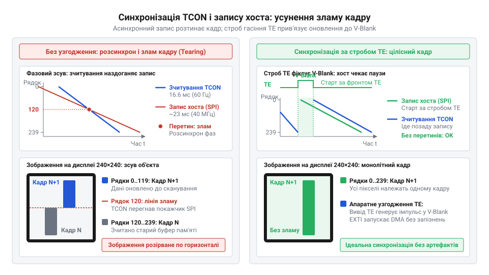
*Фазовий розсинхрон між зчитуванням TCON і записом хоста, усунення зламу кадру завдяки стробу вертикального гасіння.*

### Апаратна синхронізація за лінією TE

Для подолання розриву кадру без подвоєння пам'яті контролери-драйвери мають виділений вихідний вивід апаратної синхронізації — лінію @@en|Tearing Effect@@ (TE). Сигнал TE формується внутрішньою логікою TCON і сповіщає мікроконтролер про точне просторове положення розгортки матриці.

Контролер підтримує два режими генерації стробу (від грец. στρόβος — швидкий обертовий рух) по лінії TE, які обираються конфігураційною командою:
- **Режим 1 (лише кадрове гасіння, V-sync)**: лінія TE переходить в активний логічний стан виключно під час інтервалу вертикального гасіння (@@en|Vertical Blanking Interval@@, V-Blank). Це короткий проміжок часу після сканування останнього рядка матриці, коли TCON повертає внутрішній лічильник на нульовий рядок перед стартом наступного кадру.
- **Режим 2 (кадрове та рядкове гасіння, V-sync + H-sync)**: окрім широкого імпульсу вертикального гасіння, вивід видає короткі строби під час кожного горизонтального гасіння між сусідніми рядками (@@en|Horizontal Blanking Interval@@, H-Blank).

> 🔧 **Навіщо це.**
> Лінія TE перетворює асинхронний хаотичний запис у детермінований процес із гарантованим «безпечним вікном» передачі. Без підключення лінії TE неможливо побудувати плавні стрілочні прилади, динамічні графіки осцилографів, швидку прокрутку тексту чи анімацію інтерфейсу: рухомі елементи неминуче дрижатимуть і розриватимуться на частини.

### Організація «безпечного вікна» запису

Правило усунення розриву формулюється так: **покажчик запису процесора в пам'ять GRAM ніколи не повинен перетинати покажчик зчитування TCON на видимій частині матриці**.

Стратегія залежить від співвідношення швидкостей:
1. **Запис швидший за кадрову розгортку** (T_transfer < 16.67 мс):
   Мікроконтролер налаштовує вхідний пін переривання на наростаючий фронт сигналу TE. Отримавши апаратне переривання про початок V-Blank, контролер негайно запускає передачу повного кадру через [прямий доступ до пам'яті (DMA)](root:hw-arch/dma-display-streaming). Оскільки запис рухається швидше за зчитування, він від самого початку випереджає TCON і встигає повністю заповнити пам'ять до того, як TCON дійде до кінця кадру. Жодного перетину не відбувається, зображення виводиться кришталево чисто.
2. **Запис повільніший за розгортку** (T_transfer > 16.67 мс):
   Передати повний екран за один кадровий інтервал фізично неможливо. Щоб уникнути видимого розриву динамічних елементів, застосовують оновлення часткової області (обмеженого прямокутного вікна адресації). Оскільки площа вікна мала, час передачі його пікселів стає меншим за час проходження TCON через відповідні рядки. Процесор очікує стробу TE і надсилає оновлення саме тоді, коли TCON знаходиться поза зоною редагованого вікна.

Нижче наведено приклад реалізації синхронізації за лінією TE для мікроконтролера з апаратним перериванням та передачею кадру по шині SPI через канал DMA:

:::tabs
@tab C (HAL / Регістри)
:::code comp-display-driver-controller/c/snippet-2.c
@tab C++ (Подійна модель)
:::code comp-display-driver-controller/cpp/displaysyncengine.cpp
:::

Використання подібного підходу повністю розв'язує задачу плавного рендерингу: процесор формує графічні примітиви у власному проміжному буфері, а вивантаження в GRAM контролера-драйвера стартує строго синхронно з внутрішнім циклом TCON.

## Апаратні збої: тиристорний ефект, перехідні процеси помп заряду та завади шини

Інтегральні контролери-драйвери поєднують на одному кристалі цифрову логіку, швидкісні інтерфейси та помпи помноження напруги. Таке сусідство робить мікросхему вкрай чутливою до порушень живлення, паразитного наведення та таймінгів ініціалізації.

### Порушення послідовності подачі живлення та тиристорне замикання

Контролер живиться двома роздільними лініями:
- `V_DDIO` (або `V_DDI`, 1.65–3.3 В) — живлення логічного інтерфейсу вводу-виводу (приймачі шин SPI або 8080);
- `V_DD` (або `V_CI`, 2.5–3.3 В) — аналогове живлення ядра, помп помноження та дільників ЦАП.

Кожен цифровий вхід має захисні ESD-діоди (@@en|Electrostatic Discharge@@): нижній з'єднаний зі спільною землею, верхній — із внутрішньою шиною живлення.

Якщо напруга живлення надходить спершу на мікроконтролер, його цифрові виходи встановлюються в одиницю (3.3 В) до появи напруги на виводі `V_DD` дисплея (`V_DD` = 0 В). Виникає фантомне паразитне живлення: струм ліній шини через верхні ESD-діоди починає живити знеструмлену шину кристала.

У структурі КМОН між областями транзисторів існують паразитні чотиришарові p-n-p-n-структури, еквівалентні схемі тиристора (від грец. θύра — двері та англ. *resistor* — опір). Фізику цього явища розкрито у статті [Тиристорне замикання в КМОН-структурах](root:hw-digital/latch-up-cmos).

Струм фантомного живлення зміщує переходи підкладки й відмикає паразитний тиристор. Коли на `V_DD` нарешті подається напруга від основного джерела, відкрита структура закорочує шину живлення на землю. Опір падає майже до нуля, струм стрибає до одиниць ампер, кристал розігрівається понад 300 °C і вигорає за частки секунди.

> 🔧 **Навіщо це.**
> Розуміння послідовності подачі напруг (@@en|power sequencing@@) дозволяє запобігти безповоротному руйнуванню кристала ще на етапі проектування схеми.

Щоб запобігти тиристорному замиканню (@@en|latch-up@@, від англ. *latch* — засувка, фіксатор):
- Напругу `V_DD` подають одночасно з `V_DDIO` або з випередженням щодо цифрового інтерфейсу.
- Сигнальні лінії мікроконтролера (`SCLK`, `MOSI`, `CS`, `RESET`) до повної стабілізації живлення дисплея утримують у нульовому логічному рівні або у стані високого імпедансу (High-Z).
- У сигнальні лінії встановлюють послідовні резистори 100–330 Ом, які обмежують струм через захисні ESD-діоди до безпечних одиниць міліампер.

### Перехідні процеси помп помноження та обов'язкові часові затримки

Після подачі напруги контролер потребує чітко визначених пауз для перехідних процесів:

1. **Апаратне скидання (сигнал `RESET`)**:
   Лінію утримують у низькому рівні не менше 10–20 мкс. Після відпускання лінії внутрішній блок скидання за живленням (@@en|Power-On Reset@@, POR) вимагає паузи 5–10 мс: за цей час стабілізується генератор тактової частоти й зчитуються калібрувальні константи з пам'яті OTP/MTP ROM. Надсилання команд раніше залишає регістри у невизначеному стані.

2. **Вихід з режиму сну (команда `SLPOUT`, код 0x11)**:
   Після скидання контролер перебуває в режимі сну, а помпи заряду знеструмлені. Їхню будову викладено у статті [Помпи помноження напруги на перемиканих конденсаторах](root:hw-power/charge-pump-circuit). Помпи формують високовольтні напруги затворів TFT-транзисторів:
   - `V_GH` (відкривання затворів): від +12 до +15 В;
   - `V_GL` (замикання затворів): від -7 до -10 В.

   Накопичення заряду конденсаторами й стабілізація напруг вимагає 100–120 мс.

Якщо надіслати команду увімкнення показу (`DISPON`, код 0x29) без витримування паузи 120 мс:
- польові транзистори матриці не встигають повністю відкриватися й закриватися через занижену амплітуду на затворах;
- рідкокристалічні комірки отримують спотворену постійну напругу без полярної інверсії;
- екран дає сліпучо-білий спалах (для нормально-чорних IPS-панелей) або мерехтить;
- тривала робота викликає електроліз рідких кристалів і деградацію матриці (@@en|image sticking@@ — залипання контурів зображення).

Коректна послідовність апаратного запуску в коді:

:::code comp-display-driver-controller/c/snippet-4.c

### Пульсації аналогового живлення від підсвічування

Підсвічування споживає 30–120 мА струму, що в десятки разів більше за споживання логіки. Регулювання яскравості за допомогою ШІМ створює імпульси струму з крутими фронтами, які викликають динамічне падіння напруги на опорі та індуктивності провідників:

```
ΔV = I × R_trace + L_trace × (dI ÷ dt)   [динамічна просадка напруги на провіднику]
```

Якщо підсвічування живиться від спільної доріжки з виводом `V_DD` без фільтрації, кожен фронт увімкнення світлодіодів спричиняє просадку `V_DD` на 200–400 мВ. Помпи заряду мультиплікують це падіння у стрибки `V_GH` та `V_GL` розмахом 1.5–2 В, а дільники гамма-корекції внутрішнього ЦАП зміщують опорні напруги. На зображенні виникають біжучі горизонтальні смуги, плавання контрастності або мерехтіння на частоті ШІМ.

Заходи розв'язки:
- Роздільне трасування шин живлення дисплея і підсвічування «зіркою» від виходу стабілізатора.
- Керамічний блокувальний конденсатор 1–4.7 мкФ (X5R або X7R з низьким ESR) впритул до виводу `V_DD`.
- Живлення підсвічування через феритовий фільтр (@@en|ferrite bead@@) або дросель для пригнічення високочастотних струмових завад.

### Завади інтерфейсної шини та плаваючий вивід скидання

На високих тактових частотах SPI (30–60 МГц) із крутими логічними фронтами (1–3 нс) нетермінований шлейф дисплея понад 5–10 см поводиться як довга лінія. Хвиля сигналу відбивається від високого вхідного опору польових транзисторів приймача, утворюючи [паразитні коливання — «дзвін»](root:com-medium/termination) (@@en|ringing@@).

Вершини цих коливань сприймаються вхідним тригером як хибні додаткові тактові імпульси шини `SCLK`. Це зміщує байтову межу (байт інтерпретується як 7 або 9 бітів) і повністю руйнує синхронізацію: байти кольорів трактуються як коди команд, координати вікна пам'яті спотворюються, екран вкривається хаотичним «снігом» або контролер намертво зависає.

Для придушення відбиттів на лініях `SCLK`, `MOSI` та `CS` біля виходів мікроконтролера встановлюють демпфувальні (від нім. *dämpfen* — приглушувати) резистори 22–47 Ом. Вони узгоджують вихідний імпеданс передавача з хвильовим опором лінії та гасять відбиту хвилю.

Інша поширена помилка — плаваючий вивід `RESET`. Довгий провідник без підтяжки перетворюється на антену, чутливу до електромагнітних завад від реле чи двигунів. Імпульсна наводка здатна викликати раптове апаратне скидання чипа посеред роботи. Лінію `RESET` обов'язково підтягують до `V_DDIO` резистором 4.7–10 кОм і шунтують конденсатором 100 нФ на спільну землю.

Нижче зведено типові симптоми апаратних збоїв та способи їх усунення:

| Візуальний або апаратний симптом | Фізична першопричина збою | Інженерний спосіб вирішення |
| :--- | :--- | :--- |
| Контролер надмірно гріється (>80 °C), споживання зростає до сотень міліампер | Тиристорне замикання (latch-up) через подачу сигналів інтерфейсу до появи живлення `V_DD` | Забезпечити підйом `V_DD` раніше за сигнали; перевести виводи МК у High-Z під час старту; додати захисні резистори 100 Ом у сигнальні лінії |
| Після скидання контролер зависає, команди ігноруються | Порушення таймінгу POR: команди надсилаються раніше ніж через 10 мс після відпускання лінії `RESET` | Додати програмну затримку `delay_ms(10)` негайно після повернення лінії `RESET` у високий стан |
| Сліпучо-білий спалах або сильне мерехтіння під час ініціалізації | Команда `DISPON` подана без витримування паузи після виходу зі сну `SLPOUT`; помпи заряду не стабілізували напруги `V_GH`/`V_GL` | Додати блокуючу затримку щонайменше `delay_ms(120)` суворо між командами `SLPOUT` та `DISPON` |
| Горизонтальні темні смуги, плавання контрасту чи мерехтіння у такт підсвічуванню | Пульсації напруги на лінії `V_DD` через спільний опір із потужними світлодіодами при ШІМ-регулюванні | Розділити трасування шин живлення «зіркою»; встановити конденсатор 4.7 мкФ біля `V_DD`; додати феритовий фільтр у коло підсвічування |
| Хаотичний кольоровий шум («сніг») або зависання оновлення кадрів | Зсув бітової синхронізації SPI через хвильові відбиття («дзвін») на нетермінованому шлейфі | Встановити послідовні узгоджувальні резистори 22–47 Ом на лініях `SCLK` та `MOSI` біля виходів МК; скоротити шлейф |
| Раптове скидання зображення у початковий стан під час роботи системи | Електромагнітна наводка на високоомний плаваючий вивід апаратного скидання `RESET` | Підтягнути пін `RESET` до `V_DDIO` резистором 10 кОм і додати фільтруючий конденсатор 100 нФ на спільну землю |

## Критерії інженерного вибору контролера-драйвера під вимоги проекту

Контролер-драйвер рідко обирають окремо від рідкокристалічної панелі: кристал зазвичай змонтовано безпосередньо на склі за технологією COG (@@en|Chip-on-Glass@@, кристал на склі) або на поліімідному шлейфі COF (@@en|Chip-on-Film@@, кристал на плівці). Проте саме архітектура, інтерфейс та енергетичні характеристики інтегрованої мікросхеми визначають, чи впорається дисплейний вузол із завданнями пристрою.

Інженерний вибір спирається на аналіз шести параметричних критеріїв.

### 1. Геометрична роздільна здатність і співвідношення з обсягом GRAM

Головний критерій — кількість вихідних каналів драйверів стовпців (@@en|source drivers@@) та рядків (@@en|gate drivers@@), інтегрованих у кристал. Кожен піксель повноколірного екрана формується трьома субпікселями (RGB), тому фізична кількість аналогових виходів стовпчикових драйверів становить рівно 3 × W.

Якщо фізична матриця має меншу роздільність, ніж максимальні можливості кристала (наприклад, панель 240×240 за апаратного буфера 240×320), виникає апаратне зміщення адреси (@@en|RAM address offset@@). Невикористані виходи рядкових комутаторів залишаються вільними на склі, а видима область зміщується відносно нульового рядка пам'яті GRAM (наприклад, починається з 32-го чи 80-го рядка). Розробник має враховувати це зміщення в драйвері під час налаштування вікна адресації (команди `CASET` та `RASET`), інакше зображення зсунеться за межі видимої області.

Обсяг вбудованої пам'яті кадру розраховується за максимальною геометрією кристала:

```
V_GRAM = W_max × H_max × bpp_max   [повний апаратний обсяг буфера, біт]
```

Для матриці 240×320 за глибини кольору 18 біт обсяг пам'яті становить:
```
V_GRAM = 240 × 320 × 18 = 1 382 400 біт = 172 800 байтів (168.75 КБ)
```

Якщо мікроконтролеру бракує власної оперативної пам'яті для зберігання повного кадру, інтегрована GRAM у контролері-драйвері критично необхідна: хост надсилає дані частинами без необхідності постійної регенерації зображення. На відміну від символьних дисплеїв, таких як [Символьний дисплей LCD 1602A](root:cat-hw-actuators/lcd-1602), де зберігаються лише коди символів, графічний контролер керує кожним окремим фізичним пікселем.

### 2. Глибина кольору (bpp) та ефективність пакування

Контролери-драйвери підтримують кілька форматів кольорового кодування:
- **12 біт на піксель (RGB444, 4096 кольорів)**: пара пікселів пакується у 3 байти (1.5 байта/піксель). Зменшує трафік на повільних шинах, проте вимагає від процесора побітових зсувів для пакування слів перед передачею.
- **16 біт на піксель (RGB565, 65 536 кольорів)**: галузевий стандарт для вбудованої графіки. Піксель займає рівно 2 байти, що вирівнюється за межами 16-бітних слів і дає змогу вивантажувати масиви напряму з пам'яті хоста через DMA без проміжної обробки. Забезпечує плавні градієнти на діагоналях від 1 до 3.5 дюйма.
- **18 біт на піксель (RGB666, 262 144 кольори)**: використовує всі 6 бітів внутрішнього ЦАП для кожного каналу. На послідовній шині SPI передача потребує 3 байти на піксель (по 6 значущих бітів на байт, молодші 2 біти скидаються). Трафік зростає на 50% порівняно з RGB565, знижуючи швидкість оновлення екрана при майже непомітній для ока різниці на малих діагоналях.

### 3. Тип хост-інтерфейсу та доступні виводи мікроконтролера

Вибір шини визначає баланс між швидкістю передачі та кількістю зайнятих ліній мікроконтролера:

| Тип інтерфейсу | Сигнальні лінії | Витрата виводів МК | Гранична швидкість передачі | Сфера практичного застосування |
| :--- | :--- | :--- | :--- | :--- |
| 3-лінійний послідовний SPI | SCLK, SDA (9-бітний протокол), CS | 3 лінії (+ RESET) | До 5–10 Мбайт/с | Пристрої з дефіцитом виводів МК за наявності апаратної підтримки 9-бітного SPI |
| 4-лінійний послідовний SPI | SCLK, MOSI, D/C, CS | 4 лінії (+ RESET, + TE) | До 5–10 Мбайт/с | Універсальний стандарт для малопотужних систем і модулів [TFT 1.77″ 128×160 (SPI)](root:cat-hw-actuators/tft-st7735s) |
| Квадро-послідовний SPI (Quad-SPI) | SCLK, IO_0...IO_3, CS | 6 ліній (+ RESET, + TE) | До 20–40 Мбайт/с | Швидкісні графічні панелі, плавна анімація до 60 FPS |
| Паралельний Intel 8080-8bit | D_0...D_7, WR, RD, RS, CS | 12 ліній (+ RESET) | До 15–25 Мбайт/с | Інтерфейси користувача середньої складності на мікроконтролерах із паралельним портом |
| Паралельний Intel 8080-16bit | D_0...D_15, WR, RD, RS, CS | 20 ліній (+ RESET, + TE) | До 30–60 Мбайт/с | Панелі приладів, медобладнання, робота через апаратні контролери FMC/FSMC |

Для мікроконтролерів у компактних корпусах (QFN-32, TSSOP-28) виділення 12–20 виводів під паралельну шину неможливе — застосовують 4-провідний SPI. Якщо ж потрібна плавна анімація 60 кадрів/с на роздільності від 320×480, звичайний SPI не забезпечує необхідної смуги пропускання, тому переходять на Quad-SPI або паралельний інтерфейс.

### 4. Наявність та виведення лінії Tearing Effect (TE)

Для пристроїв зі статичним вмістом (вимірювальні прилади, термостати) сигнал TE необов'язковий: розрив кадру на нерухомому зображенні непомітний, що заощаджує одну лінію вводу-виводу процесора.

Для динамічної графіки (стрілочні шкали, віртуальні осцилографи, прокручування списків чи відео) наявність сигналу TE на роз'ємі модуля є обов'язковою інженерною вимогою. Дисплейні модулі без виведеного контакту TE для таких завдань непридатні.

### 5. Енергоспоживання та режими енергозбереження

В автономних пристроях контролер-драйвер підтримує кілька режимів керування живленням:
- **Черговий режим (@@en|Sleep Mode@@)**: помпи помноження напруги та внутрішній генератор вимикаються, струм споживання падає до 5–15 мкА. Дані в пам'яті GRAM зберігаються повністю, що дозволяє миттєво відновити картинку після пробудження без повторної передачі по шині.
- **Режим часткового відображення (@@en|Partial Mode@@)**: контролер оновлює лише виділену горизонтальну смугу (наприклад, рядок годинника), а решту екрана знеструмлює. Зниження частоти помп накачування зменшує споживання на 60–80%.
- **Економічний режим кольорів (@@en|Idle Mode@@)**: розрядність кожного субпікселя знижується до 1 біта (разом 8 базових кольорів). Резистивні ЦАП вимикаються, а напруги подаються напряму з опорних шин, що мінімізує струм аналогової частини.

> 🔧 **Навіщо це.**
> Поєднання режимів Partial Mode та Idle Mode дає змогу реалізувати постійно активний екран очікування (@@en|Always-On Display@@) у смарт-годинниках та носимій електроніці без швидкого вичерпання заряду батареї.

### 6. Діапазон напруг логічного інтерфейсу V_DDIO

Сучасні високопродуктивні мікроконтролери та процесори працюють із напругою логічних виводів 1.8 В або 1.2 В для мінімізації власного енергоспоживання.

Якщо контролер підтримує діапазон напруг інтерфейсу V_DDIO = 1.65...3.3 В, його підключають до 1.8-вольтового процесора напряму (аналогове живлення V_DD подають окремо, 2.8–3.3 В). Фіксована напруга 3.3 В змушує встановлювати зовнішні перетворювачі рівнів, що підвищує собівартість, ускладнює трасування плати та спотворює фронти сигналів на високих тактових частотах.

### Алгоритм інженерного вибору контролера

Вибір оптимального компонента під технічне завдання виконують за покроковим алгоритмом:

1. **Визначення геометричної роздільної здатності**: обирають мікросхему з кількістю каналів, не меншою за роздільність матриці. За невідповідності розмірів враховують апаратне зміщення адреси (offset) у програмному драйвері.
2. **Оцінка динаміки графіки та бюджету шини**: для високої частоти оновлення (понад 30–60 FPS) розраховують потік даних. Якщо пропускної здатності SPI недостатньо, обирають мікросхему з підтримкою Quad-SPI або 8/16-бітної шини 8080.
3. **Вимоги до плавності анімації (сигнал TE)**: для відображення динамічних процесів обирають модуль із фізично виведеним контактом TE.
4. **Узгодження напруг інтерфейсу**: порівнюють напругу логіки процесора з діапазоном V_DDIO контролера, віддаючи перевагу прямій сумісності без перетворювачів рівнів.
5. **Аналіз автономності**: для пристроїв із батарейним живленням перевіряють підтримку чергового режиму зі збереженням пам'яті GRAM та режимів Partial/Idle Mode.

Дотримання цієї послідовності забезпечує баланс між швидкодією, якістю зображення, енергоспоживанням та собівартістю вузла.
