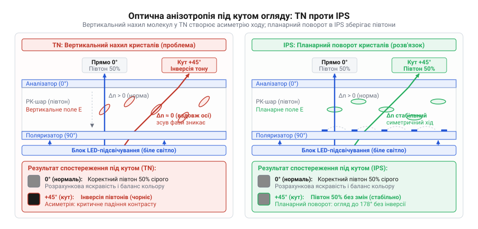
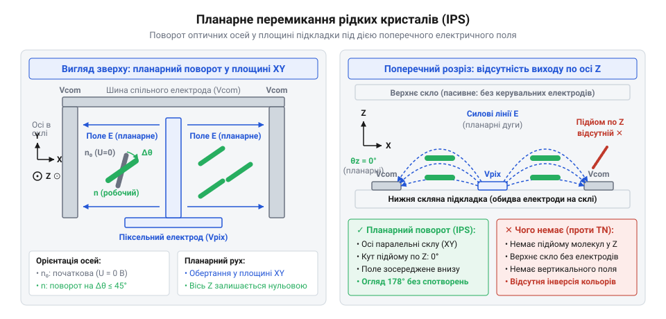
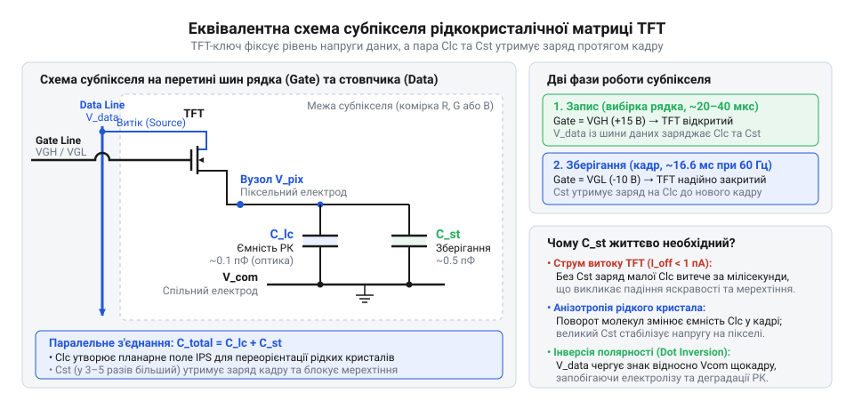
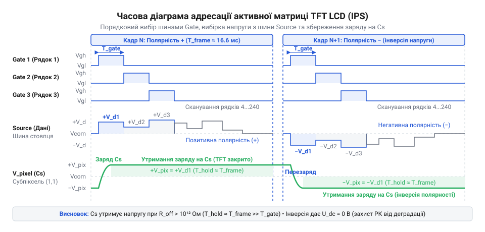
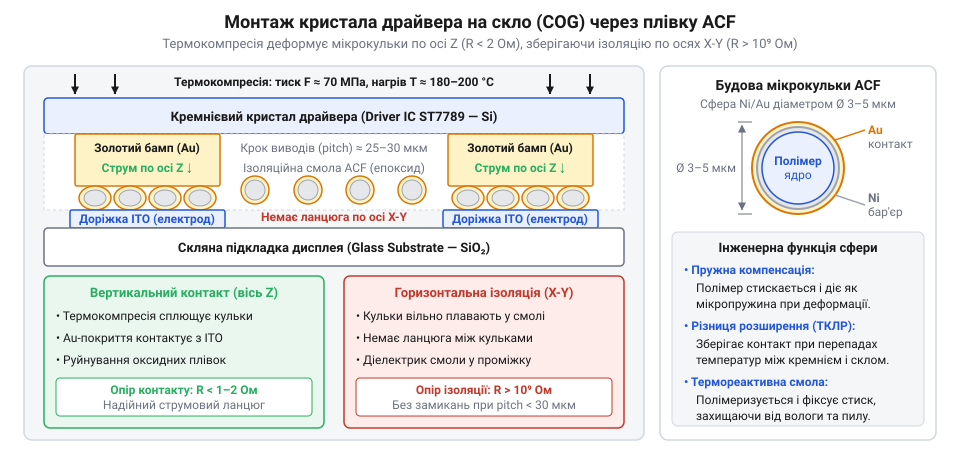
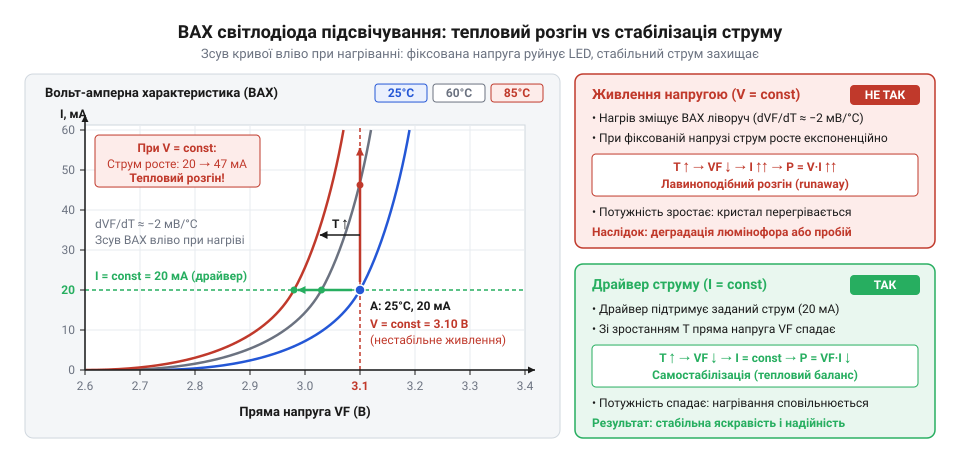
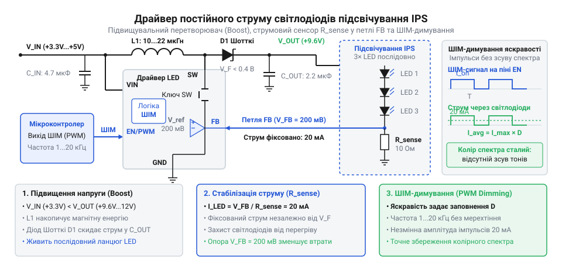
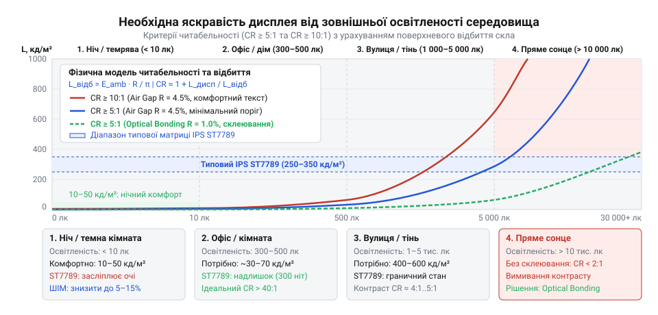
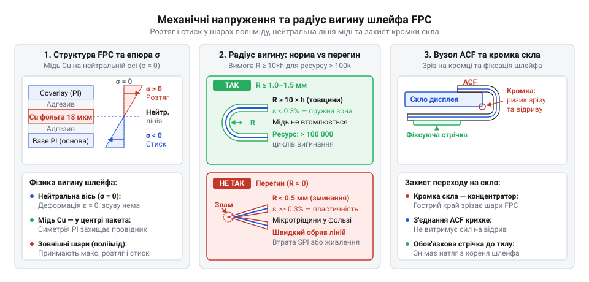
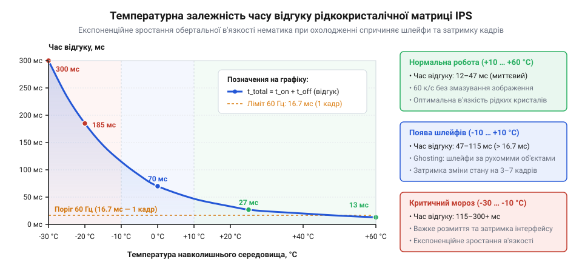

# IPS 1.3″ 240×240 (SPI, ST7789)

## Кутова деградація зображення у класичних рідкокристалічних матрицях

Уявіть типовий інженерний сценарій: ви проєктуєте портативний вимірювальний прилад або панель керування промисловим верстатом. На макеті все виглядає бездоганно — яскраві графіки, чіткі числові показники та кольорові індикатори стану. Але варто оператору відійти на пів метра вбік або поглянути на екран згори, як інтерфейс руйнується: світлі написи тонуть у сірому тумані, контрастність стрімко падає, а насичені кольори вицвітають. При ще більшому куті настає повна інверсія півтонів — світло-сірі графічні елементи стають темнішими за чорне тло, перетворюючи важливу інформацію на нечитабельну мішанину плям.

Така поведінка добре знайома кожному, хто працював із простими [символьних дисплеях](root:cat-hw-actuators/lcd-1602) або бюджетними графічними екранами на базі технології скручених нематиків (@@en|Twisted Nematic@@, скорочено TN). Причина цієї вади криється не в дефекті виготовлення, а в самій фізиці взаємодії світла з рідкими кристалами.

Рідкі кристали нематичного типу складаються з видовжених паличкоподібних молекул. Цим молекулам притаманна оптична анізотропія (від грецьких @@el|an-@@ — заперечення, @@el|isos@@ — однаковий та @@el|tropos@@ — напрямок) — властивість, через яку швидкість поширення світла вздовж довгої осі молекули відрізняється від швидкості впоперек неї. Це явище зветься [подвійним променезаломленням](root:ph-waves/birefringence) (@@en|birefringence@@). Коли лінійно поляризована світлова хвиля входить у такий шар, вона розкладається на два взаємно перпендикулярні промені, між якими виникає різниця фаз, пропорційна оптичній довжині шляху:

```text
ΔΦ = (2 · π · d · Δn) / λ
де:
ΔΦ — фазовий зсув між ортогональними хвилями
d  — геометрична товщина рідкокристалічного шару
Δn — оптична анізотропія (різниця показників заломлення ne - no)
λ  — довжина хвилі світла у вакуумі
```

У класичній рідкокристалічній комірці керуючі прозорі електроди розташовані на протилежних пластинах — один знизу, другий згори. Коли на них подається напруга, всередині виникає суто вертикальне електричне поле, лінії напруженості якого спрямовані перпендикулярно до площини екрана. Під дією цього поля молекули рідкого кристала повертаються навколо своєї осі й піднімаються сторчма — нахиляються у вертикальній площині назустріч оку спостерігача.

> 🔧 **Навіщо це.**
> Розуміння геометричної природи оптичної анізотропії дозволяє розробникові пристрою точно передбачити, де матриця втратить читабельність: прилади нахилу, медичні монітори та настінні пультогляди вимагають стабільного фазового зсуву за будь-якого вектора зору.

Коли спостерігач дивиться на такий екран строго по нормалі (під кутом 90 градусів до поверхні скла), світловий промінь проходить вздовж нахилених молекул симетрично. Проте варто змінити кут огляду, як виникає просторова асиметрія. Поглянувши з одного боку, спостерігач дивиться майже вздовж довгих осей молекул, де ефективна анізотропія `Δn` прямує до нуля. Поглянувши з протилежного боку, промінь перетинає молекули впоперек, де анізотропія є максимальною. Оптична довжина шляху змінюється для кожного напрямку, спричиняючи хаотичну модуляцію поляризації світла. Верхній поляризаційний фільтр, який має відсікати або пропускати хвилю строго за її поляризацією, більше не може виконати своє завдання: у темних зонах світло починає пробиватися крізь фільтр, а у світлих — частково гаситися.


*Порівняння ходу світлових променів крізь вертикально та планарно орієнтовану рідкокристалічну комірку: нахил молекул у вертикальному полі викликає оптичну асиметрію та інверсію тонів під кутом, тоді як планарний поворот зберігає стабільний фазовий зсув.*

Поки молекули нахиляються у вертикальній площині, подолати цю кутову деградацію неможливо: будь-які оптичні компенсаційні плівки лише зсувають зону комфортного перегляду в один бік ціною погіршення іншого. Щоб кут зору не спотворював зображення, потрібно змінити саму геометрію керування: утримати молекули рідких кристалів суто в одній площині, паралельній склу, за будь-якого рівня напруги.

## Принцип планарного перемикання рідких кристалів

Інженерна відповідь на проблему кутових спотворень полягає у зміні напрямку електричного поля: замість вертикального поля між двома протилежними скляними пластинами формується горизонтальне поле, що діє всередині площини рідкокристалічного шару. Цей принцип дістав назву планарного перемикання рідких кристалів (@@en|In-Plane Switching@@, або IPS; від латинського @@la|planum@@ — площина).

Щоб змусити електричні силові лінії лягти паралельно поверхні екрана, обидва керуючі електроди — піксельний і спільний — перенесли на одну й ту саму нижню скляну підкладку. Їх виготовляють із прозорого струмопровідного матеріалу на основі оксиду індію й олова (@@en|Indium Tin Oxide@@, ITO) у формі зустрічних гребінчастих смуг. Зубці піксельного електрода чергуються із зубцями спільного електрода на фіксованій відстані у кілька мікрометрів. Верхнє скло в такій структурі більше не несе жодних електродів і слугує виключно механічною опорою та основою для пасивних оптичних шарів.


*Планарне електричне поле між гребінчастими електродами розвертає молекули рідкого кристала паралельно склу без виходу у вертикальну вісь, гарантуючи незмінність оптичної товщини шару під довільними кутами зору.*

Керування світлом відбувається завдяки двом станам орієнтації кристалічного домену:

1. **Знеструмлений стан (напруга між електродами відсутня):**
   Молекули рідкого кристала вирівняні в одному напрямку вздовж поверхні підкладки за допомогою мікрорельєфу поліімідного орієнтуючого шару. Цей напрямок збігається з віссю пропускання нижнього поляризаційного фільтра. Усі довгі осі молекул лежать строго паралельно площині скла.
2. **Активований стан (між електродами прикладено напругу):**
   Між сусідніми смугами гребінки виникає поздовжнє електричне поле. Молекули рідкого кристала мають [діелектричну анізотропію](root:ph-electromagnetism/liquid-crystal-dielectric-anisotropy) (відмінність діелектричної проникності вздовж і впоперек молекули). Під дією електростатичного моменту молекули починають повертатися в площині підкладки, намагаючись узгодити свої осі з напрямком силових ліній поля. Максимальний поворот досягає кута близько 45 градусів відносно початкового стану.

Ключова фізична відмінність полягає в тому, що під час повороту молекули не піднімаються кінцями вгору і не змінюють свого кута нахилу до скла. Вони обертаються подібно до стрілок компаса — виключно в площині підкладки.

> 🔧 **Навіщо це.**
> Планарний поворот молекул позбавляє матрицю геометричної асиметрії: промінь світла під кутом 10°, 45° чи 85° пронизує шар кристалів однакового ефективного перерізу, що забезпечує стабільні кути огляду до 178° у горизонтальній та вертикальній площинах.

Якщо оператор дивиться на екран під кутом, промінь світла зустрічає ту саму орієнтацію молекул, що й спостерігач по нормалі. Ефективне подвійне променезаломлення шару залишається практично незмінним для всіх азимутальних кутів. Це повністю усуває явище інверсії тонів: навіть під екстремальними кутами контрастність залишається високою, а кольорові координати не зміщуються.

Однак планарна геометрія має свою інженерну плату. Оскільки обидва електроди розташовані на одній пластині, частина площі субпікселя затінюється самими струмопровідними доріжками або зонами над електродами, де поле є неоднорідним. Корисна частка площі комірки, яка модулює світло (коефіцієнт прозорості, або апертура), тут дещо нижча, ніж у вертикальних структурах. Це вимагає потужнішого джерела світла позаду матриці.

## Оптичний сендвіч панелі: від підсвічування до ока

Рідкокристалічний шар сам по собі не генерує фотонів: він працює виключно як просторово керований затвор, який дозовано пропускає зовнішній світловий потік. Щоб перетворити планарний поворот молекул на чітке кольорове зображення, навколо рідкокристалічної комірки зібрано складну оптико-механічну систему — так званий оптичний сендвіч панелі.


*Пошарова структура оптичного сендвіча трансмісивної матриці: від первинного випромінювання світлодіодів крізь світловод, оптичні плівки, схрещені поляризатори та керований шар рідких кристалів до формування повноколірного пікселя.*

Ця конструкція працює на просвіт (трансмісивний принцип, від латинського @@la|transmissio@@ — перенесення, пропускання) і складається з послідовності функціональних шарів, розташованих від задньої стінки модуля до ока користувача:

1. **Блок світлодіодного підсвічування (@@en|Backlight Unit@@):**
   - *Торцева лінійка білих світлодіодів:* розташована вздовж грані модуля для мінімізації загальної товщини екрана.
   - *Світловодна пластина (@@en|Light Guide Plate@@, LGP):* високопрозора пластина з оптичного поліметилметакрилату. Світло від світлодіодів входить у торець і поширюється всередині завдяки повному внутрішньому відбиттю. На її нижню поверхню методом лазерного гравіювання або прецизійного шовкодруку нанесено [сітку мікроскопічних лінзоподібних точок](root:ph-waves/light-guide-extraction-microoptics) (дифузорів). Ці точки порушують умову повного внутрішнього відбиття, спрямовуючи розсіяні кванти світла вгору крізь поверхню пластини.
   - *Нижній відбивач (рефлектор):* дзеркальна полімерна плівка під світловодом, що повертає витоки світлового потоку назад у робочу зону з коефіцієнтом відбиття понад 98%.
   - *Оптичний пакет дифузорів та призматичних плівок:* складається з нижнього розсіювача, який розмиває точковий малюнок екстракції світла, та двох схрещених мікропризматичних плівок (@@en|Brightness Enhancement Film@@, BEF). Призми заломлюють бічні промені, фокусуючи світловий потік строго в напрямку нормалі до екрана, що підвищує видиму яскравість у півтора-два рази без збільшення струму світлодіодів.
2. **Нижній лінійний поляризатор:**
   Неполяризоване біле світло від підсвічування проходить крізь тонку плівку полівінілового спирту, насичену витягнутими молекулами йоду. Фільтр пропускає лише ті коливання вектора електричного поля, які паралельні його осі поляризації, відсікаючи рівно половину вхідного світла.
3. **Нижня скляна підкладка з мікроелектронікою:**
   Пластина з алюмоборосилікатного скла товщиною 0.2–0.5 мм, на поверхні якої розміщено тонкоплівкові польові транзистори адресації (TFT) та прозорі гребінчасті електроди планарного поля з оксиду індію й олова.
4. **Рідкокристалічний шар:**
   Тонкий прошарок рідких кристалів товщиною від 3 до 4 мікрометрів, герметично затиснутий між двома поліімідними плівками попередньої просторової орієнтації.
5. **Матриця кольорових світлофільтрів субпікселів:**
   Кожен піксель розділено на три мікроскопічні зони, покриті фоторезистивними пігментними світлофільтрами червоного (Red), зеленого (Green) та синього (Blue) кольорів. Між субпікселями прокладено сітку чорної маски (@@en|Black Matrix@@) — непрозорий шар оксиду хрому або чорної полімерної смоли, що запобігає паразитній оптичній інтерференції та витокам некерованого світла на межах комірок.
6. **Верхній поляризатор (аналізатор):**
   Другий поляризаційний фільтр, орієнтований так, що його вісь пропускання розташована строго під кутом 90 градусів відносно осі нижнього поляризатора (конфігурація схрещених поляризаторів).
7. **Зовнішнє захисне скло:**
   Опорний шар із нанесеним поляризатором антивідблискового матового (@@en|Anti-Glare@@) або глянцевого гідрофобного покриття, стійкого до подряпин.

Оптична поведінка цієї структури реалізує так званий «нормально чорний» режим роботи (@@en|Normally Black@@):

- **Без напруги на комірці (вимкнений піксель):**
  Нижній поляризатор формує лінійно поляризоване світло. Оскільки початкова орієнтація кристалів збігається з віссю цього поляризатора, світлова хвиля проходить крізь рідкокристалічний прошарок без найменшої зміни стану поляризації. Дійшовши до верхнього поляризатора-аналізатора, світло зустрічає перпендикулярно орієнтований бар'єр і повністю поглинається. Піксель залишається абсолютно чорним.
- **Під дією планарного поля (увімкнений піксель):**
  При виникненні напруги на гребінчастих електродах молекули повертаються в площині скла. Їхня оптична вісь розвертається відносно площини поляризації вхідного світла. Рідкокристалічний шар починає працювати як оптична фазова пластинка: початкова лінійна поляризація трансформується в еліптичну з поворотом головної осі. Тепер у хвилі з'являється складова, паралельна осі пропускання верхнього поляризатора. Ця складова безперешкодно проходить крізь верхній фільтр, а її амплітуда точно відповідає куту повороту кристалів. Далі світло забарвлюється відповідним світлофільтром субпікселя (червоним, зеленим або синім).

> 🔧 **Навіщо це.**
> «Нормально чорний» стан забезпечує фундаментальну перевагу в контрасті: глибина чорного кольору залежить виключно від якості схрещених поляризаторів, а не від здатності тонкоплівкового транзистора підтримувати ідеально нульовий потенціал. Завдяки цьому статична контрастність якісних планарних панелей перевищує 1000:1.

Око спостерігача просторово інтегрує світлові потоки трьох сусідніх субпікселів RGB в одну точку заданого кольору та яскравості. Якщо керуючі поля повертають кристали на різний кут під кожним світлофільтром, піксель набуває будь-якого з мільйонів відтінків колірної палітри.

## Активна адресація пікселів: масив тонкоплівкових польових транзисторів

Поворот рідких кристалів усередині одиничної комірки дозволяє плавно регулювати яскравість одного колірного субпікселя. Проте типова графічна матриця містить сотні тисяч таких затворів. Наприклад, кольоровий екран роздільною здатністю 240×240 точок складається з 57 600 пікселів, що еквівалентно 172 800 окремим субпікселям червоного, зеленого та синього кольорів. Підвести індивідуальний провідник до кожного з них фізично неможливо, тому керування організовують у вигляді прямокутної координатної сітки рядків і стовпчиків.

Якщо спробувати керувати такою сіткою пасивно — просто подаючи напругу на перетин провідників рядка і стовпчика без проміжних електронних ключів (як це робиться у сегментних або монохромних екранах), виникає нездоланний фізичний бар'єр. Рідкий кристал реагує не на миттєве, а на середньоквадратичне значення напруги (@@en|Root Mean Square@@, RMS). Коли імпульс активує обраний рядок, напруги зі стовпчиків неминуче просочуються на всі сусідні субпікселі неактивних рядків. Згідно з фундаментальним обмеженням Алта-Плешко (@@en|Alt & Pleshko limit@@), максимальне відношення напруги на увімкненому пікселі до напруги на вимкненому стрімко спадає зі зростанням кількості рядків:

```text
Von / Voff = √((√N + 1) / (√N - 1))
де:
N — кількість сканованих рядків дисплея
```

Для матриці на 240 рядків це відношення становить близько 1.07. Оптичний контраст падає майже до нуля, на екрані з'являються паразитні фантомні смуги (@@en|crosstalk@@), а час реакції рідких кристалів сповільнюється до сотень мілісекунд.

Розв'язанням цієї проблеми є технологія активної матриці (@@en|Active Matrix@@, AM). У куток кожного окремого субпікселя безпосередньо на скляну підкладку інтегрують напівпровідниковий ключ — тонкоплівковий польовий транзистор (@@en|Thin-Film Transistor@@, TFT; від грецького @@el|polys@@ — багато, та латинського @@la|transire@@ — переходити). Зазвичай активний канал такого польового транзистора формується з [матеріалів тонкоплівкових транзисторів](root:hw-components/thin-film-transistor-materials) — гідрогенізованого аморфного кремнію (a-Si:H) або оксиду індію, галію та цинку (IGZO).


*Еквівалентна електрична схема субпікселя активної матриці: тонкоплівковий польовий транзистор комутує напругу стовпчика, а накопичувальний конденсатор утримує заряд на планарних електродах протягом усього кадру.*

Еквівалентна схема кожного субпікселя містить три обов'язкові компоненти:
1. **Керуючий транзистор (TFT):** затвор транзистора з'єднаний із горизонтальною шиною вибірки рядка (Gate), витік підключений до вертикальної шини аналогових даних стовпчика (Source/Data), а стік веде до планарного гребінчастого електрода субпікселя.
2. **Ємність рідкокристалічного прошарку (`C_LC`):** об'єм рідкого кристала між зустрічними гребінчастими електродами поводиться як електричний конденсатор невеликої ємності (типово 0.1–0.2 пФ).
3. **Накопичувальний конденсатор зберігання заряду (`C_S`):** інтегрований у структуру скла конденсатор, підключений паралельно до рідкокристалічної ємності. Його другий вивід з'єднано з лінією опорного потенціалу (спільного електрода або шини попереднього рядка). Ємність `C_S` у 3–5 разів перевищує `C_LC`.

Процес формування зображення розгортається у часі за циклом покадрового сканування:

1. **Рядковий імпульс вибірки:** драйвер рядків подає на обрану шину Gate високий відкриваючий потенціал (зазвичай від +15 до +20 В). Усі транзистори обраного горизонтального рядка відкриваються одночасно, їхній опір каналу падає до десятків кілоомів.
2. **Паралельний запис даних:** одночасно з відкриттям транзисторів драйвер стовпчиків виставляє на кожній вертикальній шині Source індивідуальну аналогову напругу, яка відповідає бажаній яскравості відповідного субпікселя. Струм через відкритий канал транзистора заряджає конденсатори `C_LC` та `C_S` до заданого потенціалу.
3. **Замикання рядка та зберігання заряду:** після завершення короткого інтервалу вибірки потенціал шини Gate перемикається на від'ємний замикаючий рівень (від -5 до -10 В). Транзистор надійно закривається, переходячи в стан із гігаомним опором каналу.


*Часова діаграма активної адресації TFT-матриці: відкриваючий імпульс шини Gate дозволяє записати аналогову напругу стовпчика Source, після чого накопичувальний конденсатор Cs утримує рівень яскравості субпікселя протягом усього кадру.*

> 🔧 **Навіщо це.**
> Накопичувальний конденсатор `C_S` ізолює субпіксель від впливу інших ліній і компенсує паразитний струм витоку транзистора. При частоті оновлення 60 Гц рядок відкритий лише 1/240 частку періоду кадру (близько 69 мікросекунд), тоді як решту 16.6 мілісекунди конденсатор стабільно утримує напругу на планарних електродах, захищаючи картинку від мерехтіння.

Для захисту рідких кристалів від хімічної деградації внаслідок електролізу полярність напруги на комірках регулярно змінюють на протилежну відносно спільної шини (VCOM). Найчастіше застосовують [порядову або точкову інверсію поля](root:hw-motion/display-polarity-inversion-methods) (@@en|dot inversion@@), коли сусідні пікселі мають протилежні знаки потенціалу. Завдяки високій швидкості перемикання око сприймає лише стабільне зображення без зміщення колірної температури.

## Інтерфейсна організація дисплейної панелі та типи підключення

Матриця субпікселів, сформована на склі, сама по собі є пасивним масивом провідників і транзисторів. Щоб оживити екран із роздільною здатністю 240×240 точок, необхідно сфазувати роботу 240 ліній рядків і 720 ліній стовпчиків (по три канали кольору на кожен піксель). Це створює 960 високощільних контактних доріжок із мікроскопічним кроком у десятки мікрометрів. З'єднати таку кількість виводів зі звичайною друкованою платою дискретними проводами чи стандартними роз'ємами технічно неможливо.

Цю задачу вирішують технологіями безпосереднього монтажу мікросхем керування:

- **Chip-on-Glass (COG):** кристал інтегральної схеми драйвера у безкорпусному виконанні монтується безпосередньо на край нижньої скляної пластини матриці. Контактні майданчики кремнієвого кристала сполучаються з прозорими доріжками скла за допомогою [анізотропної струмопровідної плівки](root:hw-pcb/anisotropic-conductive-film-bonding) (@@en|Anisotropic Conductive Film@@, ACF), що містить мікроскопічні полімерні кульки з золотим або нікелевим покриттям. Усі сотні шин рядків і стовпчиків залишаються на склі, а назовні виходить лише компактний гнучкий поліімідний шлейф (FPC) із 10–30 виводами системного інтерфейсу та живлення.
- **Chip-on-Film (COF):** мікросхема драйвера розпаюється прямо на поверхню гнучкого шлейфа. Це дозволяє загнути шлейф за тильну сторону панелі та мінімізувати ширину рамки дисплея навколо активного поля.


*Поперечний розріз зони монтажу Chip-on-Glass: термокомпресія плівки ACF створює надійний вертикальний контакт крізь деформовані струмопровідні мікросфери без ризику бічного замикання між сусідніми шинами з мікрокроком.*

За способом взаємодії з хост-процесором рідкокристалічні панелі поділяються на два принципово різні архітектурні класи: автономні модулі з кадровою пам'яттю та панелі прямого потокового сканування.

### 1. Модулі з інтегрованим контролером та буфером кадру (GRAM)
У таких пристроях кристал драйвера містить повний набір функціональних вузлів: внутрішню графічну оперативну пам'ять (@@en|Graphic RAM@@, GRAM), цифрово-аналогові перетворювачі гама-корекції, внутрішні перетворювачі напруги для живлення затворів TFT (+15 В та -10 В) і власний тактовий генератор, що самостійно регенерує кадри на матриці.

Зв'язок із керуючим мікроконтролером здійснюється через цифрові інтерфейси:
- **Послідовні шини (SPI):** чотирипровідна шина (тактовий сигнал SCLK, лінія даних MOSI, вибір кристала CS та лінія вибору даних/команд D/C). Для підвищення пропускної здатності широко застосовують двопровідні (Dual-SPI) та чотирипровідні (Quad-SPI) модифікації.
- **Паралельні системні шини MCU (стандарти 8080 або 6800):** використовують спільну шину даних шириною 8 або 16 біт разом зі стробами запису (WR), читання (RD), вибору мікросхеми (CS) та адреси (RS/DC).

Головна перевага цієї архітектури — мінімальні вимоги до хост-процесора. Мікроконтролер не повинен безперервно генерувати відеопотік: він передає координати та колір пікселів лише тоді, коли графічний інтерфейс реально змінюється. Завдяки цьому такі модулі чудово працюють навіть із простими мікроконтролерами з обмеженим обсягом оперативної пам'яті, що детально розглядається на прикладах [кольорових TFT-модулях](root:cat-hw-actuators/tft-st7735s).

### 2. Панелі потокового сканування (RGB TTL, LVDS, MIPI DSI)
У великих матрицях і пристроях із високою частотою оновлення розміщення оперативної пам'яті на склі стає надто дорогим і неефективним. У таких панелях кристал на склі містить виключно регістри зсуву та високовольтні аналогові підсилювачі (драйвери стовпчиків і рядків), а кадрового буфера всередині немає взагалі.

Такі панелі вимагають постійної зовнішньої подачі потоку пікселів через спеціалізовані швидкісні інтерфейси:
- **Паралельний відеоінтерфейс (RGB TTL):** передає від 16 до 24 ліній даних паралельно разом із сигналами піксельної синхронізації (PCLK), рядкової синхронізації (HSYNC), кадрової синхронізації (VSYNC) та дозволу передачі (DE).
- **Диференційні шини (LVDS та MIPI DSI):** швидкісні послідовні диференційні лінії передачі даних, які зменшують кількість провідників і мінімізують електромагнітні завади.

> 🔧 **Навіщо це.**
> Панелі потокового типу потребують мікроконтролера з вбудованим апаратним РК-контролером (LCD controller) і зовнішньої оперативної пам'яті (SDRAM) для зберігання кадрового буфера розміром у сотні кілобайт чи мегабайт. Потік даних має безперервно транслюватися зі швидкістю 60 кадрів на секунду через канали прямого доступу до пам'яті (DMA). Якщо потік перерветься навіть на кілька мілісекунд, напруга на накопичувальних конденсаторах субпікселів розрядиться через струми витоку, і зображення миттєво згасне або спотвориться.

Таким чином, інженерний вибір між автономним дисплеєм із шиною SPI/MCU та потоковою панеллю RGB/MIPI визначається ресурсами центрального процесора: перший варіант обирають для автономних сенсорних пультів та вбудованих приладів на базі мікроконтролерів загального призначення, другий — для мультимедійних систем під керуванням потужних прикладних процесорів із вбудованими графічними прискорювачами.

## Схемотехніка керування світлодіодним підсвічуванням

Навіть бездоганно налаштована сигнальна частина дисплея залишить екран абсолютно темним, якщо не забезпечити живлення підсвічування. Оптичний сендвіч планарної матриці поглинає понад 90% світлового потоку на поляризаторах, світлофільтрах та електродах, тому блок підсвічування є найпотужнішим споживачем усієї графічної підсистеми — на нього припадає від 80% до 90% сумарної енергії модуля.

Керування світлодіодною лінійкою підсвічування вимагає специфічного схемотехнічного підходу, зумовленого нелінійною фізикою p-n переходу:

1. **Експоненційна вольт-амперна характеристика (ВАХ):** струм через світлодіод залежить від прикладеної напруги за крутим експоненційним законом. Зміна прямої напруги лише на 0.1 В може спричинити подвоєння або потроєння робочого струму.
2. **Від'ємний температурний коефіцієнт напруги:** пряме падіння напруги на напівпровідниковому переході білого світлодіода зменшується з нагріванням зі швидкістю близько -2 мВ/°C. Якщо живити світлодіод від фіксованого джерела напруги, розігрів кристала призведе до лавиноподібного зростання струму, подальшого нагрівання й неминучого теплового розгону (теплового розгону).
3. **Лінійність випромінювання за струмом:** інтенсивність світлового потоку квантів світла строго пропорційна силі струму, що протікає крізь кристал, а не напрузі.

Через це світлодіоди підсвічування категорично заборонено живити від звичайних стабілізаторів напруги без струмообмеження. Єдиний надійний спосіб живлення — прецизійна стабілізація постійного струму.


*Вольт-амперна характеристика світлодіода за різних температур: від'ємний температурний коефіцієнт зміщує криву вліво, спричиняючи лавиноподібне зростання струму та небезпеку теплового розгону при живленні від джерела фіксованої напруги.*

У дисплейних модулях світлодіоди зазвичай об'єднують у послідовний ланцюг із кількох діодів (наприклад, від 3 до 8 штук). Послідовне ввімкнення гарантує, що через кожен світлодіод тече абсолютно однаковий струм, що забезпечує ідеальну однорідність світлового поля у світловоді без колірних чи яскравісних смуг. Проте сумарна напруга підпалу такого ланцюжка дорівнює сумі падінь напруг на кожному діоді:

```text
V_string = N · V_F
де:
N   — кількість послідовних світлодіодів
V_F — пряме падіння напруги на одному білому світлодіоді (типово 3.0...3.3 В)
```

Для лінійки з 4 діодів робоча напруга становить близько 12–13 В, а для 6 діодів — 18–20 В. Оскільки стандартна напруга живлення цифрової частини пристрою зазвичай становить 3.3 В або 5 В, живлення підсвічування вимагає спеціалізованого [імпульсного підвищувального перетворювача](root:hw-power/boost) постійного струму (@@en|Step-Up LED Driver@@).


*Схема підвищувального стабілізатора постійного струму: зворотний зв'язок замикається через низькоомний шунт R_sense, а яскравість регулюється високочастотним сигналом ШІМ.*

Схема працює за принципом накопичення магнітної енергії в дроселі при відкритті внутрішнього польового транзистора перетворювача та передачі цієї енергії у вихідну ємність через діод Шотткі після закриття транзистора. Ключовою особливістю драйвера є організація кола зворотного зв'язку (FB, Feedback): замість резистивного дільника напруги вихідний струм лінійки пропускається крізь прецизійний низькоомний резистивний шунт `R_sense`, увімкнений між катодом останнього діода та спільним проводом схеми (GND).

Робочий струм лінійки світлодіодів жорстко фіксується внутрішнім джерелом опорної напруги мікросхеми:

```text
I_LED = V_FB / R_sense
де:
I_LED   — стабілізований прямий струм підсвічування
V_FB    — внутрішня опорна напруга входу зворотного зв'язку (типово 100...200 мВ)
R_sense — номінал струмовимірювального резистора
```

Низький поріг опорної напруги `V_FB` дозволяє звести до мінімуму марні теплові втрати потужності на вимірювальному резисторі (`P = V_FB · I_LED`), зберігаючи високий коефіцієнт корисної дії перетворювача (понад 85–90%).

Для адаптації екрана до зовнішнього освітлення застосовують регулювання яскравості (димування, від англійського @@en|dimming@@):

- **Аналогове регулювання:** полягає у зміні постійного струму через світлодіоди шляхом зміщення робочої точки входу FB. Головний недолік — помітне спотворення колірної температури світіння (білий колір синіє або жовтіє при зменшенні струму через зміну спектра випромінювання люмінофора).
- **Широтно-імпульсна модуляція (ШІМ):** світлодіоди живляться імпульсами стабільного номінального струму, а видима яскравість пропорційна коефіцієнту заповнення імпульсів. Колірний спектр при цьому залишається ідеально стабільним за будь-якої яскравості.

> 🔧 **Навіщо це.**
> Під час вибору частоти ШІМ для димування підсвічування критично уникати звукового діапазону. Частоти в межах від 100 Гц до 15 кГц змушують вихідні керамічні конденсатори (MLCC) пищати й свистіти внаслідок [зворотного п'єзоелектричного ефекту](root:hw-components/ceramic-capacitor-acoustics) в діелектрику титанату барію. Щоб пристрій працював безшумно і не викликав втоми очей від стробоскопічного ефекту, частоту ШІМ обирають вище 20–25 кГц.

## Критерії вибору панелі за технічною документацією

Під час розробки пристрою інженер обирає рідкокристалічну панель на основі системного аналізу паспорта виробу (даташиту). Щоб обраний екран задовольнив вимоги ергономіки та вписався в енергетичний баланс виробу, слід зіставити кілька взаємопов'язаних параметрів.

### 1. Роздільна здатність, діагональ та щільність пікселів (PPI)
Фізичний розмір дисплея та кількість точок визначають деталізацію графіки. Проте однакова роздільна здатність (наприклад, 240×240) на екрані з діагоналлю 1.3 дюйма створює гладке зображення поліграфічної якості, тоді як на діагоналі 3.5 дюйма піксельна сітка стає грубою.

Інженерним критерієм деталізації є щільність пікселів на дюйм (@@en|Pixels Per Inch@@, PPI):

```text
PPI = √(W_pix² + H_pix²) / D_inch
де:
W_pix, H_pix — роздільна здатність матриці в пікселях по горизонталі та вертикалі
D_inch       — діагональ активної зони екрана в дюймах
```

**Приклад розрахунку для матриці 240×240 з діагоналлю 1.3 дюйма:**
```text
PPI = √(240² + 240²) / 1.3
    = √(57600 + 57600) / 1.3
    = √(115200) / 1.3
    = 339.4 / 1.3
    ≈ 261 PPI
```

Око людини з гостротою зору 1.0 здатне розрізнити об'єкти з кутовим розміром близько однієї кутової мінути. На типовій робочій дистанції спостереження приладу в 35–40 см щільність у 250–260 PPI забезпечує монолітне сприйняття ліній без зернистості.

### 2. Оптична яскравість (Luminance)
Яскравість поверхні вимірюється в канделах на квадратний метр (кд/м²), або нітах (@@en|nit@@; від латинського @@la|nitere@@ — сяяти). Вибір яскравості диктується середовищем експлуатації:
- **200–300 ніт:** офісні та лабораторні вимірювальні прилади в умовах помірного штучного освітлення.
- **400–600 ніт:** портативні промислові термінали та діагностичні сканери, що працюють біля вікон або під розсіяним денним світлом.
- **800–1200+ ніт:** пристрої для роботи просто неба під прямими сонячними променями (@@en|Sunlight Readable@@). Оскільки трансмісивний екран працює на просвіт, падаюче сонячне світло частково відбивається від шарів скла і «вимиває» контраст. Для читабельності під прямим сонцем яскравість екрана мусить значно перевищувати інтенсивність паразитного відбиття або усувати повітряні проміжки за [технологією оптичного склеювання](root:hw-motion/display-optical-bonding-technology).


*Залежність необхідної яскравості дисплея від зовнішньої освітленості: для збереження робочого контрасту в умовах яскравого сонячного світла потрібна яскравість понад 800–1000 ніт для компенсації паразитного відблиску.*

### 3. Статична контрастність (Contrast Ratio)
Визначається як відношення яскравості білого поля до яскравості чорного поля (`CR = L_white / L_black`). Для якісних матриць із планарним перемиканням типове значення становить від 800:1 до 1500:1. Висока контрастність гарантує легке розпізнавання дрібних шрифтів та піктограм при слабкому освітленні.

### 4. Енергетичний баланс дисплейної підсистеми
Загальне енергоспоживання модуля складається з двох принципово різних часток:
1. **Логічна частина матриці та драйвер COG:** живиться напругою 2.8–3.3 В (шина VDD) і споживає від 5 до 15 мА (близько 15–50 мВт).
2. **Світлодіодне підсвічування:** типова лінійка потребує струму 15–30 мА при напрузі 9–12 В. Її пряме споживання становить `P = 12 В · 0.02 А = 0.24 Вт` (240 мВт). З урахуванням коефіцієнта корисної дії підвищувального перетворювача (близько 85%), споживання від системної шини 3.3 В сягатиме близько 85 мА!

> 🔧 **Навіщо це.**
> На відміну від [OLED-дисплеях](root:cat-hw-actuators/oled-ssd1306), де струм пропорційний площі та яскравості активних пікселів, рідкокристалічна панель споживає повну потужність підсвічування навіть при виведенні абсолютно чорного екрана. При проєктуванні приладів із батарейним живленням підсвічування забирає понад 85% енергії екрана, тому алгоритмічне керування яскравістю за датчиком освітленості та перехід у сплячий режим за відсутності дій користувача є критичними заходами енергозбереження.

### 5. Температурний діапазон експлуатації
У специфікаціях обов'язково розрізняють діапазон роботи (Operating Temperature) та діапазон зберігання (Storage Temperature):
- **Комерційний стандарт (0...+50 °C):** призначений виключно для використання в опалюваних приміщеннях.
- **Індустріальний стандарт (-20...+70 °C):** витримує роботу в неопалюваних складах, вуличних боксах та цехах.
- **Розширений автомобільний стандарт (-30...+85 °C):** призначений для приладових панелей транспорту.

Вихід за температурні межі спричиняє фізичні аномалії: при падінні температури нижче нуля в'язкість рідких кристалів стрімко зростає, сповільнюючи перемикання пікселів до сотень мілісекунд (ефект замерзання картинки). При нагріванні вище максимальної межі нематична суміш переходить у невпорядковану ізотропну рідину (точка просвітлення), через що екран повністю втрачає контрастність і тимчасово чорніє до повернення у нормальний тепловий режим.

## Механічний монтаж, інтеграція в корпус і робота з гнучким шлейфом

Після узгодження електричних сигналів і розрахунку живлення підсвічування настає етап фізичної інтеграції матриці в конструкцію приладу. Рідкокристалічна панель — це багатошаровий оптико-механічний вузол, основою якого є дві скляні підкладки товщиною всього 0.2–0.5 мм, склеєні по контуру епоксидним компаундом із мікроскопічним внутрішнім зазором у 3–4 мікрометри. Скло має високу твердість, але надзвичайно низьку стійкість до локального розтягування, вигину та ударних навантажень.

Якщо затиснути дисплей у корпусі жорстко — безпосередньо гвинтами чи твердими пластиковими фіксаторами, неминучі перекоси деталей корпусу та температурні деформації матеріалів викличуть небезпечні внутрішні механічні напруження. Навіть мікроскопічна локальна деформація скла змінює товщину рідкокристалічного шару `d`, порушуючи розраховану оптичну різницю ходу світлової хвилі (`ΔΦ ~ d`), що призводить до появи кольорових райдужних розводів і світлових плям на зображенні. При випадковому падінні приладу чи сильному натисканні пальцем жорстко затиснуте скло миттєво розтріскується.

Правильний монтаж дисплейного модуля базується на принципі «плаваючої» пружної фіксації:

1. **Демпфуючі прокладки по периметру:** екран фіксують за допомогою рамок з еластичного пінополіуретану з відкритими чи закритими порами або спіненого силікону товщиною від 0.3 до 1.0 мм (наприклад, матеріалів класу Poron). Прокладка поглинає удари, компенсує виробничі допуски деталей корпусу та різницю коефіцієнтів теплового розширення скла і пластику.
2. **Тиск тільки на неактивну рамку:** демпфуюча стрічка має лягати виключно на неактивну зону периметра металевого кожуха або поляризатора. Будь-який механічний тиск на активну зону пікселів категорично неприпустимий.
3. **Захист кромки скла від сколів:** торці скляних пластин є основними концентраторами напружень, де мікроскопічна тріщина швидко розростається на все скло. Між кромкою скла і стінками корпусу обов'язково передбачають вільний зазор не менше 0.5–1.0 мм, заповнений еластичним герметиком або повітрям.


*Конструктивні правила монтажу матриці в корпус: використання пружних демпферів по периметру скла, плавний радіус вигину гнучкого шлейфа FPC та зняття статичного заряду з металевого кожуха.*

Окремої уваги вимагає [гнучкий друкований шлейф](root:hw-pcb/fpc-flexible-printed-circuit-design) (@@en|Flexible Printed Circuit@@, FPC), що сполучає скло з основною платою:

- **Захист зони виходу шлейфа зі скла:** контактний вузол, де поліімідний шлейф з'єднується з прозорими доріжками скла через анізотропну струмопровідну плівку (ACF), надзвичайно вразливий до зусиль на зріз і відрив. Корінь шлейфа біля краю скла заборонено піддавати будь-яким згинам чи натягу. Його жорстко фіксують двосторонньою клейкою стрічкою до тильного боку металевого корпусу модуля, і лише після цієї точки фіксації дозволяється формувати вигин.
- **Дотримання допустимого радіуса вигину:** мінімальний статичний радіус вигину шлейфа повинен становити не менше десяти його товщин (зазвичай `R ≥ 1.0...1.5 мм`). Загинати шлейф «на нуль» (під гострим кутом із перегином нігтем або інструментом) категорично заборонено: це викликає залишкову пластичну деформацію та розрив тонких мідних провідників товщиною 12–18 мкм при вібраціях.


*Механічні напруження при згинанні шлейфа FPC: дотримання радіуса R ≥ 1.0–1.5 мм утримує деформацію міді в пружній зоні, тоді як злам біля кромки скла спричиняє втомні тріщини провідників.*

> 🔧 **Навіщо це.**
> [Захист від електростатичного розряду](root:hw-components/esd-protection) (ESD) є життєво необхідним при встановленні дисплея у прилад із доступом користувача. Людське тіло накопичує статичний потенціал до 15 кВ. Якщо захисне скло або металева рамка модуля ізольовані, розряд пробиває через повітря на сигнальні лінії шлейфа, миттєво пробиваючи підзатворний діелектрик тонкоплівкових транзисторів TFT. Металевий кожух модуля обов'язково сполучають із загальним проводом схеми через заземлюючі пружні контакти, а на сигнальних лініях шлейфа біля роз'єму встановлюють низькоємнісні захисні TVS-діоди.

## Інженерні обмеження та фізичні деградаційні процеси

Під час тривалої експлуатації приладу розробник стикається з фізичними явищами та дефектами, притаманними рідкокристалічній технології. Їхнє розуміння дозволяє відрізнити тимчасові зворотні аномалії від критичних пошкоджень модуля.

### 1. Нерівномірність підсвічування та витоки світла (Backlight Bleeding)
У темряві на абсолютно чорному екрані по краях і в кутах панелі часто спостерігаються світлі жовтуваті або білуваті плями. Це явище зветься паразитним витоком світла підсвічування (@@en|Backlight Bleeding@@).

Його природа має дві складові:
- **Механічна деформація світловода:** якщо корпус модуля затиснутий нерівномірно, полімерна світловодна пластина вигинається, кут повного внутрішнього відбиття на її краях порушується, і надлишковий потік світла викидається назовні в обхід мікролінзової сітки.
- **Деформація рідкокристалічного зазору:** перекіс підкладок призводить до того, що рідкі кристали біля країв рамки трохи змінюють свій кут орієнтації навіть за нульової напруги. У результаті схрещені поляризатори не можуть повністю заблокувати світловий потік.

Цей дефект не усувається програмно і мінімізується виключно розвантаженням механічних кріплень екрана.

### 2. В'язкість рідких кристалів за низьких температур (Ghosting)
Швидкість перемикання рідкокристалічного затвора визначається балансом між дією електричного поля, пружними силами нематика та його внутрішнім тертям. Час релаксації молекул у початковий стан пропорційний коефіцієнту обертальної в'язкості рідкого кристала `γ1`:

```text
τ_decay = (γ1 · d²) / (π² · K)
де:
γ1 — обертальна в'язкість рідкокристалічної суміші
d  — товщина прошарку
K  — усереднена пружна стала рідкого кристала
```

В'язкість органічної суміші експоненційно зростає при охолодженні. Якщо за нормальної температури (+25 °C) час реакції субпікселя становить 15–25 мілісекунд, то при охолодженні до -20 °C він сповільнюється до 300–800 мілісекунд.

У результаті швидка зміна картинки стає неможливою: динамічні об'єкти на екрані розмиваються і залишають за собою довгі шлейфи розмиття (ефект привидів, або @@en|ghosting@@), для компенсації якого в контролерах застосовують [динамічне прискорення рідких кристалів](root:hw-motion/overdrive-ringing) (@@en|Overdrive@@). При сильних морозах картинка візуально «замерзає». Це фізичне явище є повністю зворотним: після прогрівання панелі час відгуку повністю повертається до паспортної норми.


*Температурна залежність часу перемикання рідких кристалів: експоненційне зростання обертальної в'язкості суміші при падінні температури нижче нуля критично збільшує час відгуку й спричиняє сильний ghosting.*

### 3. Ефект залишкового зображення (Image Retention)
Якщо рідкокристалічний екран протягом багатьох годин або діб безперервно відображає статичну висококонтрастну картинку (наприклад, контури вимірювальної сітки чи статичні рамки меню), після перемикання на суцільне сіре тло користувач спостерігає слабкий напівпрозорий відбиток попереднього зображення.

Цей дефект часто помилково називають «вигоранням», плутаючи з незворотною деградацією випромінюючих субпікселів в [OLED-екранах](root:cat-hw-actuators/oled-ssd1306). Проте в рідкокристалічних матрицях природа явища суто електростатична:
- При тривалій дії напруги однієї амплітуди вільні іони домішок, присутні в рідкому кристалі, повільно дрейфують до поверхонь електродів, утворюючи тонкий шар залишкового просторового заряду на поліімідній орієнтуючій плівці.
- Цей паразитна поляризація діє як додаткове внутрішнє поле зміщення, утримуючи молекули кристала частково повернутими навіть після зняття керуючого сигналу.

> 🔧 **Навіщо це.**
> Залишкове зображення в РК-матрицях є повністю зворотним процесом. Його нейтралізують періодичною зміною полярності керування (правильно налаштованою інверсією VCOM), використанням екранних заставок, а для повного усунення артефактів достатньо вимкнути дисплей на кілька годин або запустити циклічну зміну контрастних білих і чорних полів на 15–30 хвилин.

### 4. Теплова деградація світлодіодів підсвічування
Світлодіодна лінійка підсвічування працює у замкненому пластиковому корпусі дисплея. Якщо конструкція приладу не забезпечує тепловідведення від тильної сторони екрана, температура кристалів світлодіодів може перевищувати критичні +85...+100 °C.

Постійний перегрів спричиняє поступову термічну деструкцію силіконового компаунда та вигорання жовтого люмінофора світлодіода. Це викликає незворотні наслідки: загальна світловіддача падає на 30–50% задовго до закінчення номінального терміну служби, а спектр випромінювання зміщується — біле поле екрана набуває характерного неприємного синьо-фіолетового відтінку. Щоб запобігти цьому, струм підсвічування не повинен перевищувати паспортних номіналів, а металеве шасі модуля слід встановлювати з тепловим контактом до металевих елементів корпусу.
