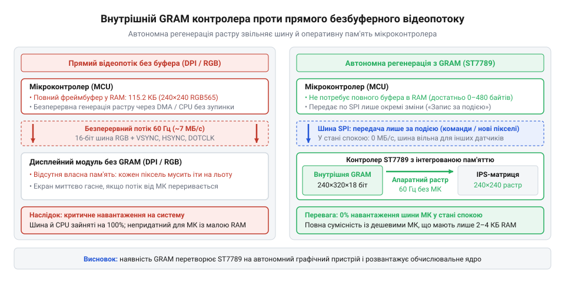
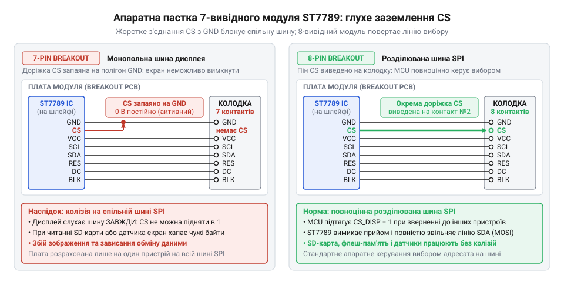
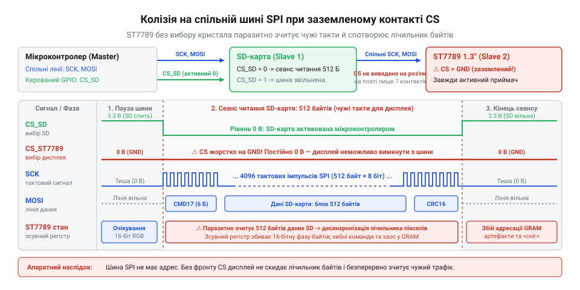
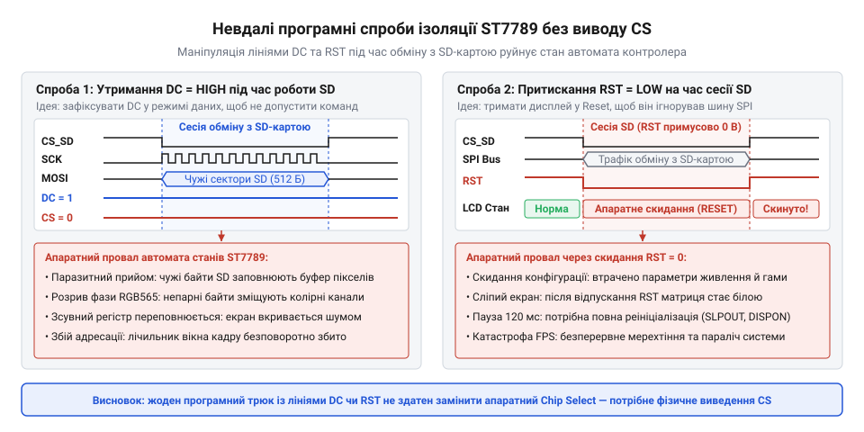
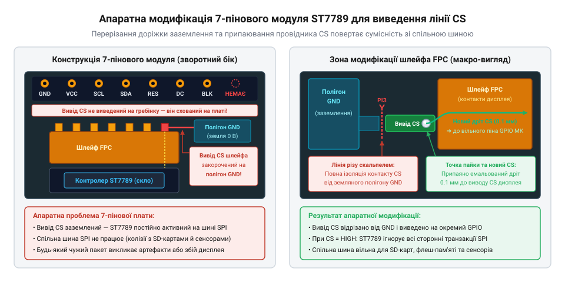
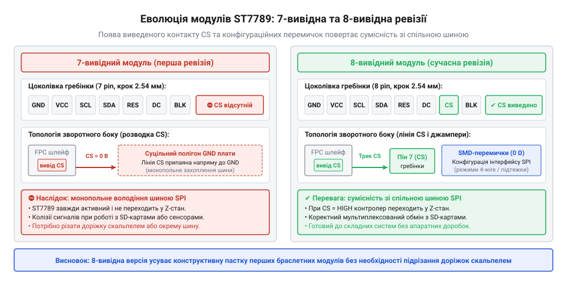
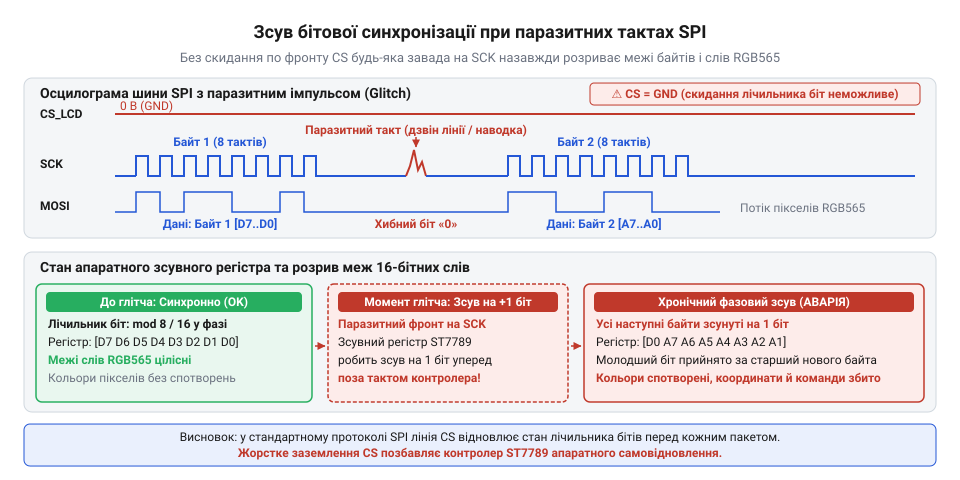

# IPS 1.3″ 240×240 (SPI, ST7789)

<preknowlist>
- [TFT 1.77″ 128×160 (SPI, ST7735S)](root:cat-hw-actuators/tft-st7735s) — базовий чотирипровідний інтерфейс SPI для графічних дисплеїв, функціональне призначення сигналів CS, DC, RST і характерні обмеження дешевих матриць TN за кутами огляду та роздільною здатністю
</preknowlist>

## Що ламалося без компактних IPS: монохромні крихти та вицвілий TN

Будь-який автономний вимірювальний вузол, польовий дозиметр чи кишеньковий реєстратор параметрів рано чи пізно потребує зв'язку з людиною. Щойно інженер намагається вивести на екран графік розряду батареї, кольорову гістограму чи багаторядкове меню налаштувань, звична мікроконтролерна схемотехніка впирається в жорсткі межі доступних компонентів. До кінця 2010-х років ринок малогабаритних дисплеїв пропонував розробникам вибір лише між двома крайніми компромісами, кожен із яких безнадійно руйнував графічний інтерфейс користувача.

Першим масовим вибором для компактних приладів тривалий час залишався крихітний [OLED-дисплей 0.96″ SSD1306 (I2C, 128×64)](root:cat-hw-actuators/oled-ssd1306) (англ. @@en|Organic Light-Emitting Diode@@ — органічний світловипромінювальний діод; від дав.-гр. ὄргаνον — знаряддя та δίς + ὁδός — подвійний шлях), або його ще вужчий родич [OLED 0.91″ 128×32 (I2C)](root:cat-hw-actuators/oled-091-128x32). Проте геометричні розміри робочого поля (приблизно 22 × 11 мм) перетворювали виведення даних на боротьбу за кожен міліметр: роздільна здатність 128×64 точки дозволяла розмістити щонайбільше чотири короткі рядки, кодування кольором було фізично неможливим, а статичні піктограми швидко випалювали екран (англ. @@en|burn-in@@).

Коли приладу був конче потрібен колір, єдиною бюджетною альтернативою ставали дешеві кольорові модулі на базі [TFT 1.77″ 128×160 (SPI, ST7735S)](root:cat-hw-actuators/tft-st7735s) (TFT — англ. @@en|Thin-Film Transistor@@ — тонкоплівковий транзистор; від лат. @@la|trans@@ — крізь та @@la|resistere@@ — чинити опір). Проте спроба оживити графіку на такій матриці наражалася на конструктивну ваду технології TN (англ. @@en|Twisted Nematic@@ — скручений нематик; від дав.-гр. νῆμα — нитка). Рідкі кристали всередині кожної комірки розташовані спіраллю між двома схрещеними поляризаторами (від новолат. @@la|polaris@@ — полярний, від дав.-гр. πόλος — вісь). Під дією керувальної напруги молекули розкручуються й нахиляються перпендикулярно до скляної пластини, перекриваючи потік світла.

Цей нахил створює сильну оптичну анізотропію (від дав.-гр. ἄνισος — нерівний та τρόπος — напрямок). Щойно погляд спостерігача відхиляється від строгої нормалі, світлові промені проходять крізь нахилені кристали під кутом і зазнають паразитного фазового зсуву. Внаслідок цього темні півтони раптово стають світлішими за сусідні білі, а насичені кольори перетворюються на бляклі плями. Цей оптичний злам називають інверсією кольорів (англ. @@en|color inversion@@; від лат. @@la|inversio@@ — перевертання). Варто було операторові поглянути на прилад знизу чи збоку під кутом понад 30°, як темне тло набувало молочно-сірого кольору, а графіки й підписи перетворювалися на негативну каламуть. До того ж роздільна здатність 128×160 точок на діагоналі 1.8 дюйма давала щільність лише близько 114 точок на дюйм (англ. @@en|pixels per inch@@, PPI): криві ліній виглядали східчастими драбинами, а тривалий час релаксації нематичних молекул спричиняв помітне змазування рухомих елементів інтерфейсу.

> 🔧 **Навіщо це.**
> Стабільність контрасту при довільному нахилі корпусу — обов'язкова вимога до польових та ручних приладів. Якщо екран вицвітає чи інвертує відтінки при відхиленні на кілька десятків градусів, оператор втрачає можливість миттєво зчитати стан системи краєм ока, не тримаючи пристрій строго перпендикулярно до обличчя.

Поруч існував світ смартфонів, де технологія IPS (англ. @@en|In-Plane Switching@@ — перемикання в площині; від лат. @@la|planum@@ — площина) давно забезпечувала бездоганну передачу кольору під кутами до 178°. В IPS-матрицях електроди розташовані в одній площині, і кристали обертаються суто паралельно до поверхні скла без паразитного нахилу вперед чи назад. Проте спроби приєднати дисплей від смартфона до звичайного мікроконтролера впиралися в нездоланний апаратний бар'єр — [інтерфейс MIPI DSI](root:hw-motion/mipi-dsi) (англ. @@en|Mobile Industry Processor Interface Display Serial Interface@@ — мобільний дисплейний послідовний інтерфейс).

Шина MIPI DSI працює на швидкісних диференційних лініях передачі зі швидкістю в сотні мегабітів на секунду на кожну пару. Звичайні 8-бітні чи 32-бітні мікроконтролери початкового рівня просто не мають у своєму кремнії фізичного трансивера D-PHY. Крім того, телефонні матриці функціонують у так званому відеорежимі (англ. @@en|video mode@@): на самій скляній панелі немає власної пам'яті для зберігання растру. Хост-процесор зобов'язаний безперервно прокачувати кожен піксель зображення з кадровою частотою 60 Гц. Для кольорового растру формату 240×240 точок у 16-бітному форматі кольору RGB565 розмір одного повного кадру в пам'яті становить:

```
V_frame
= 240 × 240 × 2 байти    [роздільна здатність на 16 бітів кольору RGB565]
= 115 200 байтів         [розмір одного повного кадру в пам'яті]
= 112.5 КБ               [переведення в кілобайти діленням на 1024]
```

Щоб оновлювати такий екран у прямому потоковому режимі без миготіння, мікроконтролер повинен генерувати постійний безперервний потік даних:

```
B_video
= 115 200 байтів × 60 Гц [розмір кадру на частоту розгортки]
= 6 912 000 байтів/с     [обчислення неперервного потоку даних]
≈ 6.59 МБ/с              [пропускна здатність відеопотоку]
```

Популярний кристал ATmega328P має лише 2 КБ оперативної пам'яті, а масовий 32-бітний мікроконтролер STM32F103C8 — 20 КБ. Жоден із них не здатний вмістити навіть один повний кадровий буфер (англ. @@en|frame buffer@@; від старофр. @@fro|buffe@@ — пом'якшувач поштовху), не кажучи про виділення майже 7 мегабайтів на секунду для потокової передачі. Альтернативні матриці з широкими паралельними шинами (RGB888 чи 8080) вимагали від 16 до 24 виводів GPIO та спеціалізованих апаратних контролерів із зовнішньою динамічною пам'яттю SDRAM. Це змушувало переходити на дорогі процесори під керуванням Linux і перетворювало копійчаний вимірювач на громіздкий багатоплатний комп'ютер. Аматорська електроніка опинилася в глухому куті: між мізерним монохромним віконцем та сліпим під кутом TN-екраном не існувало жодного практичного варіанта.

## Бум наручної електроніки: фабричний надлишок Шеньчженя та прорив ST7789

Вихід із дисплейної кризи відбувся не через каталоги промислових дистриб'юторів, а завдяки стрімкому вибуху ринку споживчих ношених пристроїв. На межі 2018–2020 років світовий ринок заполонили доступні смарт-годинники та фітнес-трекери. Фабрики Шеньчженя щомісяця випускали мільйони наручних ґаджетів бюджетного класу — таких як серія Colmi P8 чи масові пристрої на платформах MoYoung. Водночас зростав інтерес спільноти розробників до відкритих апаратних годинників, найпомітнішим серед яких став проєкт PineTime від ініціативи Pine64.

Усі ці ґаджети будувалися довкола енергоефективних систем на кристалі (чипі; англ. @@en|chip@@ — уламок, пластина) сімейства Nordic nRF52 (зокрема чипа nRF52832 з обчислювальним ядром ARM Cortex-M4F та радіоблоком Bluetooth Low Energy). Виробники наручних приладів зіткнулися з тими самими фізичними вимогами, що й автори кишенькових вимірювачів. З одного боку, екран годинника людина зчитує на ходу під найрізноманітнішими кутами: матриці TN сюди не підходили взагалі, адже найменший поворот зап'ястка інвертував циферблат. З іншого боку, екран діагоналлю 1.3 дюйма вимагав високої чіткості: матриця 240×240 точок забезпечувала щільність близько 261 PPI, за якої людське око на відстані руки вже не розрізняє окремих пікселів.

Головне обмеження диктували ресурси самого мікроконтролера nRF52832: кристал мав лише 64 КБ оперативної пам'яті та близько 32 фізичних виводів. Їх належало поділити між радіоантеною, ємнісним сенсорним склом, акселерометром, оптичним пульсометром та вузлом керування живленням. Виділити 16 ліній під паралельну шину чи зберігати повний кадровий буфер у 115 КБ процесор не міг фізично.

Відповіддю на цю проблему стала інтеграція спеціалізованого кремнієвого контролера ST7789 (модифікацій ST7789V та ST7789H2) тайванської компанії Sitronix безпосередньо на скляну основу матриці за методом [Chip-on-Glass](root:hw-motion/cog-technology) (COG — кристал на склі). Вирішальна перевага архітектури ST7789 полягала у власному внутрішньому масиві графічної пам'яті GRAM (англ. @@en|Graphic RAM@@ — графічна пам'ять довільного доступу; від дав.-гр. γράφω — пишу): кристал містить статичну пам'ять конфігурації 240 × 320 × 18 бітів (понад 170 КБ інтегрованого ОЗП).

> 🔧 **Навіщо це.**
> Інтегрована пам'ять GRAM усередині дисплейного контролера звільняє мікроконтролер від потреби генерувати безперервний відеопотік. Екран автономно читає власну внутрішню пам'ять і оновлює фізичні рідкі кристали з частотою 60 Гц. Процесор пересилає байти шиною лише тоді, коли стан графіки змінився, і лише для тих пікселів, які реально оновилися.

Зв'язок із мікроконтролером Sitronix спроєктувала через високошвидкісний чотирипровідний інтерфейс SPI (англ. @@en|Serial Peripheral Interface@@ — послідовний периферійний інтерфейс; від лат. @@la|series@@ — ряд та дав.-гр. περιφέρεια — окружність), здатний стабільно працювати на тактових частотах до 60 МГц. Завдяки внутрішнім апаратним лічильникам контролера процесору достатньо надіслати дві короткі команди визначення прямокутної зони оновлення — координати стовпчиків `CASET` (англ. @@en|Column Address Set@@) та рядків `RASET` (англ. @@en|Row Address Set@@), після чого відкрити потоковий запис байтів у пам'ять командою `RAMWR` (англ. @@en|Memory Write@@). На тактовій частоті шини 40–50 МГц передача окремої піктограми чи текстового поля триває частки мілісекунди. Це дозволило формувати плавний інтерфейс із частотою 30–50 кадрів на секунду навіть на недорогих чипах без створення громіздких буферів у системному ОЗП.


*Структурне порівняння прямого безбуферного відеопотоку та автономної регенерації растру з внутрішньої пам'яті GRAM контролера ST7789: видно відсутність навантаження на пам'ять та шину мікроконтролера.*

Коли світовий попит на фітнес-годинники підскочив, фабрики дисплейного скла (зокрема BOE та Tianma) налагодили масовий випуск 1.3-дюймових панелей ST7789 десятками мільйонів одиниць. Однак життєвий цикл споживчих моделей у Шеньчжені дуже короткий. Уже наприкінці 2019 року виробники масово перейшли на видовжені екрани 1.4″ та 1.69″ із заокругленими гранями 2.5D, а також на круглі дисплейні матриці.

Внаслідок цієї різкої зміни поколінь на складах заводів і торгових павільйонів ринку Хуацянбей (англ. @@en|Huaqiangbei@@) осіли гігантські надлишки готових квадратних матриць 1.3″ IPS 240×240. Щоб швидко повернути заморожені кошти, місцеві майстерні почали паяти ці скляні панелі на мініатюрні друковані адаптери. Гнучкий шлейф FPC (нім. @@de|Schleife@@ — стрічка, петля; англ. @@en|Flexible Printed Circuit@@ — гнучка друкована плата) з'єднували з контактною колодкою з кроком 2.54 мм і викидали модулі у продаж на AliExpress, eBay та Taobao за ціною від півтора до двох доларів за штуку.

Для світової спільноти розробників це стало проривом: насичена IPS-панель із щільністю понад 260 PPI, яка зберігає бездоганну контрастність під будь-яким кутом і керується лише кількома сигнальними лініями, стала коштувати дешевше за старий монохромний SSD1306. Проте в гонитві за простотою та економією площі плати китайські розробники перших модулів вдалися до одного схемотехнічного спрощення, яке згодом перетворилося на приховану пастку для тисяч користувачів.

## Спадщина годинникової схемотехніки: як заземлений CS став пасткою 7-вивідних плат

Коли на фабричних складах у Шеньчжені накопичилися мільйонні надлишки мініатюрних 1.3-дюймових дисплеїв від масових смарт-годинників на кшталт Colmi P8 та відкритих пристроїв PineTime, місцеві пакувальники комплектуючих вирішили вивести їх на ринок аматорської електроніки. Щоб скляну панель можна було встановити у макетну плату (англ. @@en|breakout board@@; від @@en|break out@@ — виводити назовні), її шлейф (від німецького @@de|Schleife@@ — петля, стрічка) вимагав перехідної друкованої плати зі стандартним кроком контактів 2.54 мм. Замість проєктування нової універсальної обв'язки під потреби радіоаматорів інженери монтажних майстерень дослівно перенесли на текстоліт готову референсну схему (від пізньолатинського @@la|referens@@ — той, що відсилає) з годинникових платформ на базі однокристальних систем [nRF52832](root:hw-arch/nrf-radio-mcu).

Через гострий дефіцит виводів загального призначення (GPIO) у компактних чипах nRF52 дисплей на контролері ST7789 підключали в смарт-годинниках як монопольний пристрій. Коли на лініях зв'язку немає інших чипів, потреба керувати лінією вибору кристала (англ. @@en|chip select@@, скорочено CS; від латинського @@la|selegere@@ — обирати) зникає. Контролер ST7789 влаштований так, що низький рівень на вході CS активує його інтерфейс і дозволяє приймати байти. Розробники годинників скористалися цим і з'єднали вивід CS дисплейного шлейфа із шиною GND просто на платі. Це спростило розведення доріжок і позбавило прошивку потреби смикати окремий пін перед передачею кадру через прямий доступ до пам'яті (DMA).

Виробники макетних модулів для AliExpress скопіювали цей вузол без жодних змін. Гнучкий шлейф матриці (від латинського @@la|matrix@@ — джерело, основа) запаяли на плату-адаптер, контакт CS посадили прямо на полігон заземлення під дисплеєм, а на зовнішній штировий роз'єм вивели лише сім контактів: живлення `GND` і `VCC`, тактову лінію `SCL`, лінію даних `SDA`, апаратне скидання `RES`, вибір режиму `DC` (команда або дані) та керування підсвічуванням `BLK`. У рекламних описах на торгових майданчиках відсутність виводу CS подавали як проривну перевагу: модуль нібито економив дефіцитні виводи контролера користувача, дозволяючи підключити повноцінний кольоровий IPS-екран лише чотирма сигнальними лініями.

> 🔧 **Навіщо це.** Лінія вибору кристала (CS) слугує апаратним вимикачем шинного інтерфейсу: переведення її у високий логічний рівень змушує мікросхему ігнорувати будь-які сигнали на спільних лініях тактування та даних, дозволяючи процесору безперешкодно спілкуватися з іншими периферійними пристроями.

На перший погляд, таке рішення здавалося вдалим спрощенням, схожим на роботу мініатюрних екранів на кшталт [OLED-дисплея 0.96″ SSD1306 (I2C, 128×64)](root:cat-hw-actuators/oled-ssd1306). Якщо модуль підключали до плати розробника як єдину периферію, екран працював бездоганно: контролер постійно слухав лінію даних і слухняно відмальовував графіку. На відміну від класичних повнорозмірних модулів на кшталт [TFT 1.77″ 128×160 (SPI, ST7735S)](root:cat-hw-actuators/tft-st7735s), де лінію CS завжди чесно виводили на гребінку контактів, нова 7-вивідна плата ST7789 приховувала небезпечну схемотехнічну пастку, розраховану виключно на замкнену екосистему годинника.


*Принципова схема 7-вивідного модуля: лінію вибору кристала дисплея наглухо припаяно до полігону GND на платі, тому зовнішній роз'єм містить лише сім контактів.*

## Колізії на спільній шині SPI: катастрофа постійно відкритого приймача

Ілюзія зручності 7-вивідних модулів розвіялася, щойно радіоаматори спробували використати їх у реальних інженерних проєктах: автономних реєстраторах даних, погодних станціях або радіотерміналах. У таких системах мікроконтролер не працює з дисплеєм наодинці — йому потрібно періодично зчитувати покази з сенсорів, передавати пакети через трансивер LoRa або зберігати масиви інформації на карту пам'яті за протоколом [роботи SD-карт у режимі SPI](root:hw-arch/sd-card-spi-mode). Коли всі ці компоненти підключали до одного апаратного порту мікроконтролера, уся підсистема вводу-виводу миттєво виходила з ладу.

Причина криється у фундаментальних правилах [послідовного периферійного інтерфейсу SPI](root:hw-arch/spi-bus-protocol) (англ. @@en|Serial Peripheral Interface@@; від латинського @@la|series@@ — ряд, ланцюг). Це синхронний інтерфейс (від грецьких слів @@el|syn-@@ — разом та @@el|chronos@@ — час), побудований на спільних лініях тактування SCLK та передачі даних MOSI. Щоб передати байт конкретному чипу на шині, мікроконтролер переводить у низький рівень його індивідуальну лінію CS. Усі інші ведені мікросхеми, чиї лінії CS у цей момент утримуються на високому логічному рівні, зобов'язані повністю відключитися від шини: їхні вхідні буфери перестають реагувати на тактові імпульси, вихідні лінії переходять у стан високого імпедансу (англ. @@en|high-impedance state@@, Z-стан; від латинського @@la|impedire@@ — перешкоджати), а внутрішні лічильники бітів очікують нового циклу звернення.

Через глухе заземлення контакту CS контролер ST7789 не здатний перейти у пасивний стан. Для його апаратного приймача зв'язок активний завжди, без жодної паузи. Коли мікроконтролер піднімає лінію вибору SD-карти або датчика, активує обмін і починає генерувати імпульси SCLK для читання сектора на швидкості в кілька десятків мегагерців, ST7789 не знає, що цей трафік призначений не йому. Вхідний зсувний регістр (від латинського @@la|registrum@@, від @@la|regerere@@ — записувати) дисплея захоплює кожен фронт чужого тактового сигналу та зчитує логічний рівень, що у цей момент присутній на спільній лінії MOSI.

Тут виникає катастрофічна колізія (від латинського @@la|collisio@@ — зіткнення) протокольного рівня. Контролер ST7789 очікує суворого вирівнювання потоку бітів по межах восьмирозрядних байтів або шістнадцятирозрядних слів кольору. За штатних умов переведення лінії CS у високий рівень після завершення передачі скидає внутрішній бітовий десеріалізатор: навіть якщо через наведення чи апаратний збій на шині з'явився зайвий тактовий імпульс, наступний пакет гарантовано почнеться зі старшого значущого біта (MSB). На платі із заземленим CS скидання десеріалізатора фізично неможливе. Обмін даними з SD-картою містить ініціалізаційні пакети, команди читання та масиви по 512 байтів із контрольними сумами, сумарна кількість тактових імпульсів у яких ніяк не кратна байтовим циклам дисплея.

У результаті настає незворотна десинхронізація (від префікса грецького походження @@el|des-@@ — скасування, вивільнення та @@el|synchronos@@ — одночасний) внутрішнього автомата станів ST7789. Лічильник бітів зміщується: третій біт чужого сектора дисплей приймає за сьомий біт своєї команди. Ситуацію погіршує стан лінії `DC`: коли контролер спілкується зі сторонньою периферією, лінія `DC` або залишається в невизначеному стані, або випадково опиняється на рівні нуля. Сприймаючи чужі байти як команди, ST7789 хаотично виконує випадкові операції: переходить у режим сну (`0x10`), вимикає генерацію зображення (`0x28`), вмикає інверсію кольорів або ламає внутрішні регістри меж адресації (`0x2A` та `0x2B`). Якщо ж `DC` виявляється високим, чужий масив записується в пам'ять кадру, заливаючи екран кольоровим шумом і смугами. Коли мікроконтролер нарешті повертається до роботи з дисплеєм, зв'язок уже паралізовано: зміщений десеріалізатор не розпізнає справжні команди керування.


*Часова діаграма колізії на шині SPI: сигнал вибору SD-карти активує обмін, але заземлений вхід CS дисплея змушує ST7789 захоплювати чужі такти й спотворювати межі внутрішніх байтів.*

> 🔧 **Навіщо це.** Скидання логіки зв'язку через перепад лінії CS на початку кожного сеансу передачі повертає внутрішній лічильник бітів у нульовий стан. Завдяки цьому збій у передачі окремого тактового імпульсу не перетворюється на незворотний зсув усіх наступних байтів протоколу.

Спроби вирішити проблему програмними милицями зайшли в глухий кут. Деякі розробники намагалися перед кожним зверненням до екрана подавати імпульс апаратного перезавантаження через вивід `RES`, щоб примусово скинути завислий автомат станів. Проте за специфікацією ST7789 вихід із режиму скидання та стабілізація вбудованих перетворювачів напруги вимагають паузи щонайменше 120 мілісекунд, після чого контролер потребує повної повторної ініціалізації всіх службових регістрів. Частота оновлення екрана при цьому падала до нестерпних одного-двох кадрів на секунду, а зображення супроводжувалося постійним блиманням. Розведення дисплея та інших пристроїв на різні віртуальні порти за допомогою програмної емуляції SPI марнувало обчислювальні ресурси процесора та знижувало швидкість відмальовування в десятки разів. Заземлений пін CS виявився апаратним глухим кутом.

## Аматорські доробки та скальпельні операції: вивільнення прихованого піна CS

Поява на ринку наддешевих семививідних модулів із діагоналлю 1.3″ та роздільною здатністю 240×240 точок спричинила справжній фурор серед розробників електроніки. Яскрава матриця @@en|IPS@@ тішила широкими кутами огляду та насиченими кольорами, бездоганно працюючи, коли екран був єдиним підключеним периферійним пристроєм. Проте перша ж спроба створити на цій базі складніший автономний пристрій — метеостанцію, логер показників чи портативну консоль — завершувалася апаратним глухим кутом. Щойно на ту саму шину @@en|SPI@@ під'єднували зчитувач карток microSD або сторонній датчик, зв'язок руйнувався: дисплей заповнювався випадковим візуальним шумом, а сусідні ведені пристрої не відповідали. Причиною була відсутність на планці модуля виводу вибору кристала — @@en|chip select@@ (CS, від англ. *chip* — кристал та *select* — обирати), який виробники плати наглухо закоротили на землю.

На відміну від [класичних модулів TFT 1.77″ 128×160 на ST7735S](root:cat-hw-actuators/tft-st7735s), де лінія CS завжди була доступна розробникові, дешевий семививідний модуль на ST7789 не дозволяв звільнити шину. Спільнота розробників розкололася на два табори: прихильників програмних хитрощів у коді бібліотек та апаратних хакерів, які взялися за дослідження кремнієвої топології.

### Глухий кут програмних обходів

Автори популярних графічних бібліотек (зокрема Adafruit-GFX та TFT_eSPI) спробували обійти обмеження залізяччя програмними методами. Першим очевидним розв'язком стало перенесення ліній тактування (SCL) і даних (SDA) дисплея на окремі вільні виводи мікроконтролера за допомогою [програмної емуляції протоколу (bit-banging)](root:sf-devices/bitbang-protocol) (від англ. *bit* — двійковий розряд та *bang* — гатити, вдаряти). Дисплей одержував ізольований персональний інтерфейс і більше не конфліктував із пристроями на головній апаратній шині SPI.

Проте плата за програмну ізоляцію виявилася нищівною. Апаратний контролер SPI сучасного 32-розрядного мікроконтролера здатний передавати графічні байти на тактових частотах від 40 до 80 МГц із розвантаженням центрального процесора через прямий доступ до пам'яті (DMA). Натомість програмне перемикання станів виводів загального призначення (GPIO) інструкціями процесора рідко перевищує частоту 1 МГц, повністю блокуючи виконання решти коду.

Для перенесення одного повного кадру з глибиною кольору 16 біт (формат RGB565) потрібно передати 240 × 240 = 57 600 пікселів, тобто 115 200 байтів або 921 600 бітів. Порівняння часу оновлення матриці наочно демонструє крах такого підходу:

```
T_frame
= N_bits ÷ F_spi
= 921 600 ÷ 40 000 000     [підстановка для апаратного SPI на частоті 40 МГц]
= 0.023 с                  [період передавання кадру, відповідає ~43 кадрам/с]
```

```
T_frame
= N_bits ÷ F_spi
= 921 600 ÷ 1 000 000      [підстановка для програмного виводу на частоті 1 МГц]
= 0.922 с                  [період передавання кадру, відповідає ~1.1 кадру/с]
```

Швидкісний екран перетворювався на повільний проектор діапозитивів, знищуючи головну перевагу матриці IPS — плавний інтерфейс і динамічну анімацію.

Друга хвиля програмних спроб полягала в маніпуляціях лініями керування даними й командами (DC) або скидання (RST) прямо на спільній шині, аби «заглушити» чутливість екрана під час транзакцій з іншими чипами. Обидва варіанти спричиняли фатальні збої автомата станів контролера:

1. **Притискання лінії DC до логічного нуля.** Розробники сподівалися, що в разі активного обміну мікроконтролера з SD-карткою екран ігноруватиме чужі байти. Однак низький рівень на виводі DC переводить ST7789 у режим інтерпретації вхідного потоку як команд керування. Довільні блоки бінарних даних із флешкартки неминуче збігалися з кодами системних команд: `0x01` (програмне скидання), `0x28` (вимкнення дисплея), `0x10` (перехід у глибокий сон) або `0x2A`/`0x2B` (зсув меж робочого вікна адресації). Екран блимав, вимикався або зсував зображення на довільну кількість рядків.
2. **Апаратне скидання через вивід RST.** Примусове скидання чипа заморожувало всю систему через неможливість уникнути 120-мілісекундної паузи стабілізації зарядових насосів під час кожної транзакції.


*Часові діаграми сигналів під час спроб програмного глушіння дисплея: притискання лінії DC спричиняє помилкове виконання байтів даних як керуючих команд ST7789, а імпульс RST паралізує шину тривалою паузою стабілізації зарядових насосів.*

Стало очевидно: програмного порятунку для монопольно заземленого входу не існує.

### Збільшувальне скло й відкриття апаратного виводу

Апаратні хакери звернулися до першоджерел — офіційної документації на кристал Sitronix ST7789V. Дослідження внутрішньої структури кристала показало, що він монтується безпосередньо на скло панелі за технологією @@en|chip-on-glass@@ (COG, від англ. *chip* — кристал та *glass* — скло) і має стандартний набір інтерфейсних виводів, зокрема апаратний вхід вибору кристала CS (активний низький рівень).

Від скляної підкладки матриці до друкованої плати модуля сигнали передаються через плоский гнучкий шлейф — @@en|flexible printed circuit@@ (FPC, від лат. *flexibilis* — гнучкий та лат. *circuitus* — коловорот, обхід). Дослідивши під мікроскопом розведення контактних майданчиків шлейфа, ентузіасти виявили: лінія CS виведена на окрему доріжку гнучкого шлейфа (зазвичай контакт 8 або 9 залежно від ревізії шлейфа матриці), але на самій текстолітовій перехідній платі модуля залита суцільним мідним полігоном землі (GND).

Китайські фабрики робили це свідомо, копіюючи схему підключення смарт-годинників: у компактному годиннику екран завжди був єдиним пристроєм на шині, а відмова від зайвого піна на рознімі здешевлювала виробництво й монтаж. Але на платі розширення для макетування це перетворилося на конструкторську пастку.

> 🔧 **Навіщо це.**
> Апаратна лінія вибору кристала переводить внутрішній приймач і вихідні каскади мікросхеми в стан ігнорування тактових імпульсів або високого імпедансу. Завдяки цьому десятки різнорідних пристроїв — екрани, зовнішня пам'ять, радіотрансивери та сенсори — можуть безперешкодно ділити спільні лінії передавання даних на граничній частоті процесорного контролера без ризику колізій сигналів чи зависань.

### Скальпельна хірургія та відновлення контролю над шиною

Виявлення прихованої лінії спричинило хвилю аматорських модифікацій, які детально описувалися на майданчиках Hackaday, GitHub та форумах Arduino. Операція повернення повноцінного керування шиною вимагала точності ювеліра й складалася з кількох обов'язкових етапів:

1. **Локалізація точки заземлення.** За допомогою мікроскопа або сильної годинникарської лупи на зворотному боці модуля знаходили контактний майданчик шлейфа FPC, що відповідав сигналу CS, і відстежували тонку друковану доріжку, яка з'єднувала його з масивним мідним полігоном GND.
2. **Скальпельний різ.** Гострим кінчиком модельного або хірургічного скальпеля (лезо No 11) поперек доріжки робили два акуратні мікронадрізи на відстані приблизно 0.3 мм один від одного, видаляючи фрагмент міді. Головне полягало в тому, щоб не пошкодити сусідні чутливі сигнальні провідники шини тактування та не прорізати поліімідну основу самого гнучкого шлейфа.
3. **Контроль розриву.** За допомогою цифрового мультиметра в режимі перевірки опору або продзвонювання вимірювали стан між звільненим контактом шлейфа та загальною землею модуля. Падіння опору мало змінитися з 0 Ом на нескінченність (обрив ланцюга).
4. **Монтаж перемички.** До крихітного контактного майданчика шлейфа FPC або залишку ізольованої доріжки підпаювали тонкий ізольований мідний провідник — монтажну дротяну перемичку, або @@en|bodge wire@@ (від англ. *bodge* — підлатати, підігнати та *wire* — дріт). Зазвичай застосовували обмотувальний емальований дріт типу ПЕВ діаметром 0.05–0.1 мм.
5. **Фіксація та виведення.** Паяне з'єднання захищали краплею ультрафіолетової паяльної маски або епоксидного клею, запобігаючи випадковому відриванню мікроскопічної контактної плодинки під час вигинів. Другий кінець дроту виводили назовні як восьмий незалежний контакт або підпаювали до вільного отвору на макетній платі.


*Топологія доопрацювання зворотного боку 7-вивідного модуля: скальпельний перетин земляного містка ізолює вивід CS контролера ST7789 на шлейфі FPC, а припаяна тонка дротяна перемичка відновлює повноцінне селективне керування шиною SPI.*

Після такої доробки модуль перетворювався на повноправного учасника шини SPI. Коли мікроконтролер встановлював на виведеній лінії CS рівень логічної одиниці, контролер ST7789 повністю відключався від інтерпретації сигналів на лініях SCL і SDA. Це дозволило розробникам повернутися до повношвидкісного апаратного SPI із тактовими частотами 40–80 МГц та підтримкою DMA поруч із картами microSD і швидкими радіомодулями.

Масовий розголос у спільноті та сотні публікацій зі скальпельними доробками надіслали азійським виробникам чіткий ринковий сигнал: для аматорських модулів вивід CS є критично необхідним. Цей колективний спротив хибній оптимізації безпосередньо змусив фабрики переробити топологію плат і випустити наступне покоління модулів із повноцінним восьмипіновим інтерфейсом.

## Еволюція ринку та друге покоління: перехід до 8-вивідного стандарту

Поява на масовому ринку наддешевих модулів 1.3″ IPS 240×240 із контролером ST7789 викликала ажіотаж серед розробників вбудованих систем (@@en|embedded systems@@). Якісна матриця з широкими кутами огляду та соковитими кольорами коштувала стільки ж, скільки тьмяні дисплеї попереднього покоління на кшталт [TFT 1.77″ 128×160 (SPI, ST7735S)](root:cat-hw-actuators/tft-st7735s). Проте перша хвиля цих модулів мала суттєву конструктивну ваду: лінія вибору кристала CS (від англ. @@en|Chip Select@@, лат. *selector* — той, що обирає) була заземлена на загальну шину GND безпосередньо на платі й не виводилася на контактну колодку.

Каталізатором змін став розвиток відкритих апаратних проєктів, насамперед смарт-годинника @@en|PineTime@@ (Pine64, кінець 2019 року) на мікроконтролері Nordic nRF52832 та чипі ST7789V. Довкола проєкту сформувалася інженерна спільнота, яка розробляла відкриті прошивки для смарт-годинників.

Під час макетування периферії розробники зіткнулися з тим, що готові breakout-модулі (від англ. @@en|breakout board@@ — допоміжна плата з виведеними контактами) блокували спільну шину SPI (від нім. *Schiene* — рейка, планка). У реальному годиннику екран, зовнішня флеш-пам'ять SPI NOR для шрифтів та сенсори мали працювати на спільних лініях узгоджено. На макеті ж наглухо заземлений CS 7-вивідного модуля змушував зсувний регістр ST7789 сприймати будь-який чужий обмін як команди малювання, спотворюючи зображення та блокуючи шину.

На форумах розробників бібліотек дисплеїв почали масово з'являтися скарги та аматорські інструкції з апаратного втручання в топологію плати. Інженери під мікроскопом зачищали захисну маску на гнучкому поліімідному шлейфі (FPC, від англ. @@en|Flexible Printed Circuit@@ — гнучка друкована плата), скальпелем перерізали заземлену доріжку та припаювали тонкий емальований дріт діаметром 0.1 мм до дев'ятого виводу шлейфа, виводячи відрізаний сигнал CS назовні. Потреба в такій ювелірній модифікації свідчила про очевидний провал заводської топології: плата, створена як утилітарний напівфабрикат для однопристроєвих браслетів, не відповідала базовим вимогам макетування та шинної інтеграції.

Постійний потік рекламацій у відгуках на торговельних майданчиках AliExpress і Taobao та прямі звернення спільноти до виробників у Шеньчжені принесли результат. Китайські фабрики друкованих плат оперативно переробили трасування та випустили друге покоління модулів. Новий формфактор отримав 8-вивідну цоколівку (від італ. *zoccolo* — підставка, черевик) зі стандартним монтажним кроком гребінки 2.54 мм (0.1 дюйма), де сигнал CS вивели окремим контактом між лінією вибору типу даних DC та контактом керування підсвічуванням BLK.


*Порівняння розводки 7-вивідного та 8-вивідного модулів: поява виводу CS на колодці та паяльних перемичок для вибору конфігурації шини на зворотному боці плати.*

Разом із додатковим виводом на зворотному боці оновлених плат з'явилися конфігураційні паяльні перемички (від англ. @@en|solder jumper@@ — спарені мідні площадки, які комутують ланцюги краплею припою або нульовим SMD-резистором). Вони надали модулю гнучкість, якої бракувало першій ревізії:

1. **Комутація сигналу CS.** На платах передбачили перемичку, яка дозволяє вибрати режим роботи лінії вибору кристала. За замовчуванням доріжка веде безпосередньо до сьомого виводу гребінки, забезпечуючи повноцінний [арбітраж шини SPI](root:com-devices/spi-multimaster). Якщо ж розробник використовує мініатюрний мікроконтролер з обмеженою кількістю портів введення-виведення (GPIO) і не планує підключати інші мікросхеми, крапля припою на контактах перемички з'єднує лінію CS із полігоном GND. Це повертає плату в режим постійної активності без необхідності займати додатковий дріт чи вивід керування.
2. **Апаратне налаштування інтерфейсу (контакти IM).** Деякі розширені ревізії 8-вивідних плат отримали додаткові паяльні перемички для ліній вибору інтерфейсу контролера (IM0–IM2). Заводська конфігурація задає 4-провідний протокол SPI (лінії SCLK, MOSI, CS та окремий сигнал DC для розрізнення байтів команд і піксельних даних). Перепаюванням перемичок на звороті можна перевести контролер ST7789 у 3-провідний режим 9-бітного SPI, де призначення переданого байта кодується дев'ятим бітом у кадрі, що повністю вивільняє лінію DC на мікроконтролері.

Завдяки цим змінам спеціалізований годинниковий напівфабрикат перетворився на повноцінний промисловий компонент DIY-електроніки. Наявність виводу CS та конфігураційних площадок зняла обмеження на спільне використання шини та дозволила інтегрувати швидкісний IPS-екран у складні мультиприладові комплекси.

> 🔧 **Навіщо це.**
> Окремий керований вивід CS перетворює дисплей зі споживача монопольної лінії зв'язку на стандартного учасника спільної шини SPI. Мікроконтролер може по черзі обслуговувати дисплей, зовнішню флеш-пам'ять та SD-карту на єдиній парі провідників тактування (SCK) і даних (MOSI). Дисплей активується низьким логічним рівнем лише на час запису вікна кадру через прямий доступ до пам'яті (DMA), а переведення CS у високий рівень відключає вхідний інтерфейс ST7789, гарантуючи захист від колізій і викривлення зображення під час обміну даними з іншими периферійними пристроями.

## Підсумки еволюції та розвінчання трьох інженерних міфів

Масова поява на ринку компактних модулів @@en|IPS@@ (від англійського @@en|In-Plane Switching@@, перемикання в площині) розміром 1.3″ з роздільною здатністю 240×240 точок стала прямим наслідком перевиробництва та перепрофілювання компонентів для фітнес-браслетів і смарт-годинників. Проте вихід матриць на контролері @@en|ST7789@@ у широкий аматорський і промисловий простір супроводжувався хвилею інженерних непорозумінь. Перші 7-вивідні плати спричинили масу труднощів під час інтеграції, породивши технічні міфи, які роками кочували документацією аматорських бібліотек і профільними форумами. Справжні причини цих проблем крилися не в дефектах кристала, а у фізиці синхронних шин та специфіці топології (від грецького *topos* — місце та *logos* — вчення), закладеної фабриками годинників.

### Міф перший: апаратна відсутність вибору кристала в кремнії

Перший поширений міф стверджував, що контролер ST7789 від тайванської компанії Sitronix узагалі позбавлений апаратного входу вибору кристала @@en|Chip Select@@ (CS, лінія вибору мікросхеми для шинного арбітражу, від латинського *arbitratus* — розсуд, посередництво), або що на ринок потрапила спеціальна спрощена «безпінова» ревізія кристала для дешевих виробів.

Кремнієвий кристал ST7789 від самого початку спроєктовано за класичними стандартами послідовного інтерфейсу @@en|SPI@@ (від англійського @@en|Serial Peripheral Interface@@, послідовний периферійний інтерфейс). На кристалі присутній повнофункціональний контакт `CSX`, активний за низького логічного рівня. Відсутність цього контакту на перших популярних модулях була суто утилітарним скороченням собівартості з боку виробників смарт-годинників. У компактному наручному ґаджеті екран є єдиним споживачем на виділених лініях мікроконтролера. Заземлення контакту `CSX` безпосередньо на шлейфі чи платі заощадило один вивід керуючого чипа та спростило трасування гнучкого шлейфа. Коли ж надлишки матриць потрапили на ринок у вигляді плат розширення (від англійського @@en|breakout board@@), пакувальники просто продублювали готову схему шлейфа, вивівши назовні 7 контактів. Аматорська спільнота хибно сприйняла це монтажне спрощення плати за апаратне обмеження самого кремнію.

### Міф другий: безпечне використання «безпінового» модуля на спільній шині

Другий міф полягав у переконанні, що дисплей із заземленим контактом CS можна безпечно розділяти на одній фізичній шині SPI з іншими пристроями — наприклад, із зовнішньою пам'яттю чи датчиками. Прихильники цієї ідеї намагалися розв'язати проблему програмно: маніпулювали лінією вибору команд і даних (DC), тримали лінії шини в штучних логічних станах під час пауз або скидали контролер імпульсом RST.

Ця омана розбивається об базовий принцип побудови синхронних (від грецького *syn* — разом та *chronos* — час) інтерфейсів. На відміну від адресних протоколів, таких як I2C (наприклад, у [I2C-адаптер для LCD 1602 (PCF8574)](root:cat-hw-actuators/i2c-lcd-adapter) чи [OLED-дисплей 0.96″ SSD1306 (I2C, 128×64)](root:cat-hw-actuators/oled-ssd1306)), шина SPI не має апаратної адресації пристроїв у потоці даних. Єдиним механізмом селекції слугує індивідуальна лінія CS: високий рівень на ній переводить вхідний зсувний регістр веденого вузла в неактивний стан. Якщо ж контакт CS жорстко заземлений, вхідний регістр ST7789 слухає лінію SCK безупинно. Кожен тактовий імпульс, згенерований для опитування стороннього датчика чи зчитування картки пам'яті, зсуває біти всередині дисплейного контролера. Якщо лінія DC у цей час випадково має високий рівень, екран інтерпретує чужі дані як пікселі й засмічує пам'ять кадрів; якщо низький — чужі байти сприймаються як команди, руйнуючи конфігурацію вікна відображення та вводячи контролер у стан зависання. Жодні програмні трюки неспроможні зупинити роботу фізичного вхідного зсувного регістра, коли на його тактовий вхід надходять імпульси.

### Міф третій: несумісність ST7789 з апаратним SPI мікроконтролерів

Третій міф покладав провину на вигадані «помилки в кремнії» ST7789, через які контролер нібито збоїв при роботі з апаратними периферійними блоками швидких мікроконтролерів (зокрема ESP32 чи RP2040). Розробники стикалися зі зміщенням кольорів, появою кольорового снігу та розпадом зображення на високих швидкостях передачі даних, чого не спостерігалося на старіших контролерах, як-от [TFT 1.77″ 128×160 (SPI, ST7735S)](root:cat-hw-actuators/tft-st7735s).

Справжнім джерелом збоїв була втрата синхронізації байтових меж через відсутність стробування (від грецького *strobos* — кружіння, вихор) лінією CS та неправильний вибір [Режими шини SPI (CPOL і CPHA)](root:com-devices/spi-mode-selection). Контролер ST7789 веде безперервний відлік бітів, групуючи їх у 16-бітні слова пікселів RGB565. Будь-який паразитний сплеск (@@en|glitch@@) на лінії тактування SCK під час ініціалізації мікроконтролера неминуче зсуває бітову фазу внутрішнього лічильника.

За наявності робочого сигналу CS спадний фронт примусово скидає цей лічильник перед початком кожного кадру. На 7-вивідних платах із заземленим CS лічильник скинути неможливо: одиничний зсув бітової фази назавжди розриває 16-бітні колірні слова, перетворюючи зображення на статичний шум. Щойно на платах вивели фізичний контакт CS або забезпечили коректний стан лінії SCK у режимі SPI Mode 3, усі прояви «несумісності» зникли: ST7789 демонструє стабільне приймання даних на частотах до 62.5 МГц.


*Часові діаграми тактування шини SPI з паразитним імпульсом: без апаратного скидання лічильника спадним фронтом CS зсув бітів накопичується у зсувному регістрі й безповоротно руйнує межі 16-бітних слів пікселів.*

### Урок шинної топології

Еволюція 1.3-дюймового модуля від випадкових годинникових 7-вивідних напівфабрикатів до повноцінних 8-вивідних плат закріпила головний архітектурний урок: програмні алгоритми не здатні скасувати фундаментальні фізичні вимоги шинної топології. Сигнал вибору кристала в синхронних інтерфейсах є не допоміжною опцією економії виводів, а обов'язковою лінією відновлення фазового кадрування та захисту від колізій.

> 🔧 **Навіщо це.** Знання природи обмежень 7-вивідних модулів оберігає від безплідних спроб програмного усунення апаратних колізій на спільній шині SPI. Для систем із кількома пристроями (дисплей, картка SD, датчики) слід застосовувати виключно 8-вивідні модулі з окремою лінією CS. Залишки 7-вивідних плат без виведеного CS придатні виключно для проєктів, де екран займає виділений, монопольний апаратний порт SPI, вільний від будь-якого іншого трафіку.
