# IPS 1.3″ 240×240 (SPI, ST7789)

<preknowlist>
- [TFT 1.77″ 128×160 (SPI, ST7735S)](root:cat-hw-actuators/tft-st7735s) — принципи підключення графічних дисплеїв через шину SPI, керування лінією DC для розрізнення команд і даних, обмеження TN-матриць за кутами огляду та базовий механізм віконної адресації відеопам'яті
- [OLED-дисплей 0.96″ SSD1306 (I2C, 128×64)](root:cat-hw-actuators/oled-ssd1306) — концепція координатної сітки пікселів (X, Y), поняття кадрового буфера в оперативній пам'яті мікроконтролера та обмеження монохромного 1-бітного виводу графіки
</preknowlist>

## Криза засобів відображення в компактних автономних пристроях

Коли розробник проєктує портативний прилад — кишеньковий дозиметр, тестер акумуляторів, регулятор паяльної станції чи автономний реєстратор польотних даних, — інтерфейс користувача швидко стає головним вузьким місцем усієї конструкції. Пристрій мусить не просто показувати поточні цифри, а візуалізувати графіки динаміки процесів, виділяти тривожні стани кольором та зберігати розбірливість у руках користувача під будь-яким кутом нахилу. Спроба розв'язати це завдання звичними компонентами початкового рівня призводить до низки жорстких інженерних компромісів.

Класичний [символьний дисплей LCD 1602A](root:cat-hw-actuators/lcd-1602), навіть за умови підключення через [I2C-адаптер на базі PCF8574](root:cat-hw-actuators/i2c-lcd-adapter), займає значну частину корпусу приладу, але обмежується двома рядками по шістнадцять монохромних символів на жорсткій сітці матриць 5×8 точок. На ньому неможливо побудувати криву напруги, векторну діаграму чи плавний прогрес-бар.

Монохромні графічні екрани на органічних світлодіодах, такі як [OLED-дисплей 0.96″ SSD1306](root:cat-hw-actuators/oled-ssd1306) або мініатюрний [OLED 0.91″ 128×32](root:cat-hw-actuators/oled-091-128x32), вирішують проблему габаритів і контрастності, проте мають власні фундаментальні вади. Однобітний піксель (англ. *pixel*, скорочення від *picture element* — елемент зображення) не дає змоги розділити графіки чи позначити небезпечну зону кольором. Головна ж фізична проблема органічних світлодіодів — швидке й незворотне вигоряння люмінофора під час тривалого відображення статичних елементів інтерфейсу: рамок, одиниць вимірювання чи логотипів. За кілька сотень годин безперервної роботи на матриці з'являються стійкі паразитичні силуети.

Дешеві кольорові рідкокристалічні панелі на матрицях типу TN (@@en|Twisted Nematic@@), прикладом яких є [TFT 1.77″ 128×160 на контролері ST7735S](root:cat-hw-actuators/tft-st7735s), дають повну палітру кольорів, але створюють оптичну катастрофу в переносних пристроях. Молекули рідких кристалів у комірці TN скручуються у вертикальній площині, створюючи виражену оптичну анізотропію (грец. *an* — не, *isos* — рівний, *tropos* — напрямок). Достатньо відхилити погляд від перпендикуляра на 20–30 градусів по вертикалі, як зображення зазнає паралаксу (грец. *parallaxis* — зміщення): контраст падає до нуля, а світлі й темні ділянки інвертуються, перетворюючи графік на нечитабельний фотонегатив.

З іншого боку, використання повнорозмірних графічних дисплеїв планшетного чи смартфонного класу з паралельною шиною (RGB або 16/24-бітний паралельний інтерфейс 8080) вимагає десятків сигнальних виводів мікроконтролера. Більше того, панель без власної пам'яті вимагає постійної регенерації кадрової розгортки: мікроконтролер мусить щосекунди надсилати мільйони пікселів на екран, витрачаючи всю обчислювальну потужність ядра і потребуючи окремого кадрового буфера в оперативній пам'яті (RAM). Для кадру розміром 240×240 пікселів із 16-бітним кольором буфер займає:

    240 × 240 × 2 байти = 115 200 байтів ≈ 112.5 кБ

Для масових мікроконтролерів, де обсяг вбудованої оперативної пам'яті рідко перевищує 20–64 кБ, виділення такого суцільного масиву фізично неможливе.

Так формується сукупність суворих інженерних вимог до дисплея портативного приладу:
- фізична діагональ близько 1.3 дюйма за роздільності не менше ніж 240×240 пікселів (щільність понад 260 точок на дюйм забезпечує гладкі криві та чіткі дрібні шрифти);
- оптична стабільність кольорів під кутами огляду до 178° у будь-якій площині;
- наявність вбудованого контролера з власною відеопам'яттю (GRAM, @@en|Graphic RAM@@), який автономно генерує сигнали розгортки рідких кристалів і звільняє процесор від необхідності безперервно пересилати пікселі;
- мінімальна кількість сигнальних ліній для підключення через [послідовний інтерфейс SPI](root:com-devices/spi-bus);
- живлення від стандартної для сучасних мікроконтролерів напруги 3.3 В.

Точкою збігу цих вимог став модуль кольорового екрана діагоналлю 1.3 дюйма на базі IPS-матриці та інтегрованого контролера ST7789, що входить до ширшої родини [дисплеїв родини ST7789](root:cat-hw-actuators/st7789-family). Поява цих мініатюрних дисплеїв на ринку компонентів пов'язана зі стрімким розвитком портативної електроніки: детальніше про цей шлях розповідає [історія появи модулів 1.3″ IPS 240×240 у мейкерській практиці](root:cat-hw-actuators/ips-st7789/hist-smartwatch-display-breakouts.md).

Сама концепція розташування керівного кремнієвого кристала безпосередньо на склі дисплея (технологія COG, @@en|Chip-on-Glass@@) реалізує підхід, детально описаний у матеріалі про [узагальнений клас мікросхем контролерів-драйверів графічних РК-дисплеїв із вбудованою GRAM](root:cat-hw-actuators/ips-st7789/comp-display-driver-controller.md): хост-контролер взаємодіє з екраном як з адресованим сховищем даних, оновлюючи лише змінені фрагменти графіки за потреби.

> 🔧 **Навіщо це.**
> Вбудована відеопам'ять GRAM повністю розділяє процес генерації графіки мікроконтролером і процес регенерації зображення на матриці. Мікроконтролеру не потрібно виділяти мегагерци процесорного часу чи сотні кілобайтів RAM на підтримку розгортки: він записує у вікно потрібні байти лише в момент зміни показань датчика або натискання кнопки, а решту часу процесор може виконувати обчислення чи перебувати в енергоощадному сні.

## Фізична будова IPS-матриці та оптоелектроніка підсвічування

Рідкі кристали (нематична фаза; грец. *nēma* — нитка, грец. *krystallos* — лід) самі по собі не випромінюють фотонів. Рідкокристалічна панель працює як керований просторовий оптичний фільтр, що затримує або пропускає світловий потік від заднього блока підсвічування (BLU, @@en|Backlight Unit@@).

Конструктивно 1.3-дюймова матриця являє собою оптичний пакет із кількох функціональних шарів, зібраних у єдиний прецизійний сендвіч товщиною менше ніж 1.5 мм. Світло проходить послідовно крізь такі елементи:
1. **Блок світлодіодного підсвічування**: складається з білих світлодіодів торцевого розташування, світловоду з оптичного поліметилметакрилату з нанесеною матрицею лазерних мікропризм, нижнього дзеркального відбивача та шарів дифузних і призматичних плівок, які формують рівномірний паралельний потік світла по всій площі матриці 23.4 × 23.4 мм.
2. **Нижній поляризаційний фільтр**: перетворює неполяризований потік підсвічування на лінійно поляризоване світло (франц. *polarisation*, від лат. *polus* — полюс) з фіксованим кутом коливання вектора напруженості електричного поля.
3. **Нижня скляна підкладка з масивом TFT**: містить тонкоплівкові польові транзистори (TFT, @@en|Thin-Film Transistor@@), шини рядків і стовпців та планарні електроди керування кожним субпікселем. Будову цієї активної матриці розглядає [архітектура матриці тонкоплівкових транзисторів](root:hw-motion/tft-array-architecture).
4. **Шар рідких кристалів**: тонкий прошарок (близько 3–3.5 мкм) нематичних рідких кристалів із позитивною діелектричною анізотропією.
5. **Верхня скляна підкладка зі світлофільтрами**: несе матрицю мікроскопічних барвників червоного, зеленого та синього (RGB) кольорів, розділених непрозорою решіткою (@@en|Black Matrix@@) для запобігання перехресному засвіченню субпікселів.
6. **Верхній поляризаційний фільтр (аналізатор)**: поляризаційна плівка, вісь пропускання якої строго перпендикулярна до осі нижнього поляризатора (схрещена оптична конфігурація під кутом 90°).

Головна відмінність, що забезпечує панелям IPS перевагу над матрицями TN, криється в геометрії електричного поля та орієнтації рідких кристалів.

У класичній матриці TN керуючі прозорі електроди розташовані на різних скляних пластинах: один знизу, другий зверху комірки. Електричне поле між ними спрямоване вертикально. Без напруги молекули рідких кристалів утворюють гвинтову спіраль, яка повертає площину поляризації світла на 90°, дозволяючи йому вийти крізь схрещений верхній поляризатор (режим @@en|normally white@@). Коли ж на електроди подається напруга, молекули під дією вертикального поля вишиковуються перпендикулярно площині підкладок. Оскільки витягнуті молекули кристала оптично анізотропні, промінь світла, що проходить під кутом до їхньої поздовжньої осі, зазнає зовсім іншого заломлення, ніж промінь по нормалі. Це створює спотворення фази світлової хвилі: при зміні кута спостереження змінюється яскравість і колір субпікселів, аж до повної інверсії півтонів.

Технологія IPS (@@en|In-Plane Switching@@ — перемикання в площині) змінює просторову орієнтацію поля. Обидва керівні електроди (позитивний і нульовий) розташовані на одній нижній скляній підкладці поруч із TFT-ключем і виконані у вигляді гребінчастих зустрічних смуг (міжгребінчасті електроди). Завдяки такій геометрії силові лінії електричного поля замикаються горизонтально — строго паралельно площині скла.

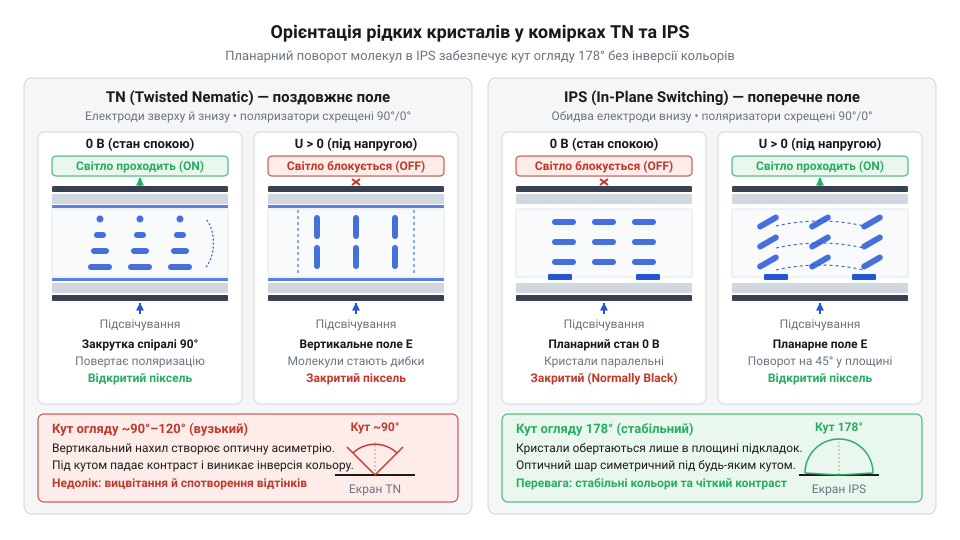
*Орієнтація рідких кристалів у комірках TN та IPS у спокійному стані та під напругою: планарний поворот молекул в IPS виключає просторову оптичну анізотропію, зберігаючи колірну гаму під кутами до 178°.*

Молекули рідких кристалів у комірці IPS у вихідному стані орієнтовані паралельно поверхні підкладки вздовж осі нижнього поляризатора. Коли між гребінчастими електродами виникає напруга, електричне поле примушує молекули повертатися виключно в горизонтальній площині підкладки, не піднімаючи їхні кінці вгору. Незалежно від кута, під яким спостерігач дивиться на дисплей, ефективна товщина оптичного шару й проекція молекул залишаються незмінними. Це гарантує симетричні кути огляду до 178° по горизонталі та вертикалі без деградації контрасту та паразитної інверсії відтінків. Повний огляд технології та конструктивних варіантів планарних панелей наведено в матеріалі про [узагальнений клас матриць рідкокристалічних дисплеїв із технологією IPS](root:cat-hw-actuators/ips-st7789/comp-ips-tft-panel.md).

З цієї кінематики випливає критично важлива оптична властивість IPS: це дисплей із режимом @@en|normally black@@ (нормально-закритий).
- **Без напруги на електродах**: молекули рідких кристалів паралельні осі пропускання нижнього поляризатора. Світловий потік проходить крізь шар рідких кристалів без зміни стану поляризації й повністю блокується ортогональним верхнім аналізатором. Піксель залишається глибоко чорним.
- **Під дією напруги**: горизонтальне електричне поле повертає молекули в площині на кут до 45°. Оптична вісь кристалів зміщується відносно осі поляризації світла, шар набуває керованого подвійного променезаломлення і перетворює лінійно поляризоване світло на еліптичне. Компонента світлової хвилі, співнапрямлена з віссю верхнього аналізатора, вільно виходить назовні, формуючи потрібну яскравість субпікселя.

Режим «normally black» забезпечує набагато вищий контраст порівняно з TN, оскільки якість чорного кольору залежить не від точності вертикального орієнтування молекул у граничному полі, а від оптичної непроникності якісних схрещених поляризаторів.

Проте зворотним боком трансмісивної природи IPS та режиму «normally black» є залежність від активного підсвічування. Коли світлодіоди вимкнені, екран лишається абсолютно темним і не відбиває зовнішнього світла. Блок світлодіодного підсвічування 1.3″ дисплея потребує постійного струму живлення в межах 15–25 мА при падінні напруги близько 3.0–3.2 В. У загальному енергетичному балансі пристрою підсвічування споживає:

    P_bl = 3.2 В × 0.02 А = 0.064 Вт = 64 мВт

Це становить понад 85–90% від сумарного енергоспоживання дисплейного модуля, що змушує інженера застосовувати апаратне керування яскравістю через ШІМ для автономних рішень із живленням від акумулятора.

> 🔧 **Навіщо це.**
> Розуміння режиму «normally black» критичне під час конфігурації драйвера ST7789. У контролері передбачено окрему команду апаратної інверсії кольору (`INVON` / `INVOFF`). Для панелей типу IPS із нормально-закритими комірками інверсія має бути увімкнена (`INVON`), щоб нульовий код кольору (`0x0000`) залишав комірки без напруги (чорними), а максимальний код (`0xFFFF`) повністю відкривав субпікселі. Якщо прошивка завантажить стандартну конфігурацію від панелей TN, дисплей покаже інвертоване негативне зображення.

## Архітектура спеціалізованого контролера ST7789 та організація відеопам'яті (GRAM)

Рідкокристалічний піксель не має власної пам'яті. Кожен мікроскопічний рідкокристалічний конденсатор субпікселя розряджається крізь струми витоку за лічені частки мілісекунди. Якщо не подавати заряд напруги на комірку безперервно десятками разів на секунду, орієнтація молекул розпадеться, а зображення на екрані згасне або замерехтить.

Матриця з роздільною здатністю 240×240 точок містить 57 600 пікселів, кожен з яких складається з трьох окремих субпікселів червоного, зеленого та синього кольорів — разом 172 800 керованих аналогових комірок. При стандартному 16-бітному кодуванні один повний кадр займає 115 200 байтів. Щоб людське око сприймало картинку без мерехтіння й спотворень руху, екран вимагає частоти регенерації не менше 60 кадрів на секунду:

```text
Кадровий трафік
= 240 × 240 × 16 біт × 60 с⁻¹   [роздільність × колір × частота оновлення]
= 57 600 × 16 × 60              [кількість бітів за секунду]
= 55 296 000 біт/с              [корисна швидкість передачі даних]
≈ 55.3 Мбіт/с                   [переведення в мегабіти]
```

Для порівняння, типовий мікроконтролер загального призначення має від 20 до 64 кілобайтів загальної оперативної пам'яті (RAM, від англ. @@en|Random Access Memory@@ — пам'ять із довільним доступом). Він фізично не здатен виділити 115 КБ навіть під один повноцінний кадровий буфер. Більше того, якби центральний процесор безперервно транслював понад 55 Мбіт щосекунди через послідовні порти, його обчислювальне ядро було б повністю паралізоване регенерацією картинки, не маючи змоги опитувати сенсори чи виконувати алгоритми керування. Повні математичні залежності між тактовою частотою шини та частотою кадрів наведено в [розрахунку смуги пропускання шини SPI](root:cat-hw-actuators/ips-st7789/math-spi-display-bandwidth.md).

Цю проблему вирішує інтегрований кристал-посередник — спеціалізований контролер-драйвер дисплея (від англ. @@en|display driver controller@@, де слово «драйвер» походить від англійського *drive* — рухати, керувати навантаженням). Його монтують безпосередньо на скло самої дисплейної панелі методом кристала на склі (@@en|Chip-on-Glass@@, COG). Для дисплеїв [родини ST7789](root:cat-hw-actuators/st7789-family) таким ядром виступає мікросхема ST7789 виробництва компанії Sitronix. Вона бере на себе всю рутину: самостійно тримає кадр у власній кремнієвій пам'яті та автономно регенерує поляризаційні заряди на склі. Мікроконтролеру достатньо передати нові координати й кольори лише тоді, коли картинка змінюється. Загальну концепцію та схемотехніку таких мікросхем описано в [архітектурі контролерів-драйверів дисплеїв](root:cat-hw-actuators/ips-st7789/comp-display-driver-controller.md).

Кристал ST7789 об'єднує кілька взаємопов'язаних функціональних блоків високої щільності інтеграції:

1. **Інтерфейсний логічний блок (Host Interface).** Приймає байти по інтерфейсу [послідовної шини SPI](root:com-devices/spi-bus) на тактових частотах аж до 60 МГц. Внутрішній автомат станів дешифрує службові команди та спрямовує потоки пікселів у блок адресації пам'яті.
2. **Вбудована відеопам'ять кадру GRAM (Graphic Random-Access Memory).** Це масив статичної пам'яті (SRAM, від лат. *staticus* — нерухомий), який зберігає растровий образ зображення. Фізичний розмір масиву становить 240 стовпців на 320 рядків із глибиною кольору до 18 біт на точку (262 144 відтінки), що сумарно дає 1 382 400 бітів (172.8 КБ) пам'яті безпосередньо всередині кремнієвого кристала.
3. **Генератори помножувачів напруги (Charge Pumps).** Польові транзистори матриці на аморфному кремнію вимагають для керування затворами напруг, що значно перевищують рівень логічного живлення 3.3 В. Внутрішні ємнісні помпи заряду генерують високу додатну напругу відкривання затворів VGH (+12...+15 В) та від'ємну напругу надійного замикання каналу VGL (-7...-10 В).
4. **Блок формування опорних напруг та гамма-корекції.** Людське око сприймає яскравість світла логарифмічно, а оптичний відгук рідкого кристала залежить від напруги нелінійно. Спеціальний резистивний дільник формує багаторівневу шкалу аналогових потенціалів для точного калібрування градацій яскравості кожного субпікселя.
5. **Високовольтні драйвери рядків (Gate Drivers) та стовпців (Source Drivers).** Драйвери рядків містять зсувний регістр, який по черзі, рядок за рядком, подає відкриваючий імпульс VGH на горизонтальні затвори матриці. Драйвери стовпців паралельно перетворюють цифрові коди 240 точок відкритого рядка в аналогові напруги й заряджають ємності рідкокристалічних субпікселів через вертикальні електроди.

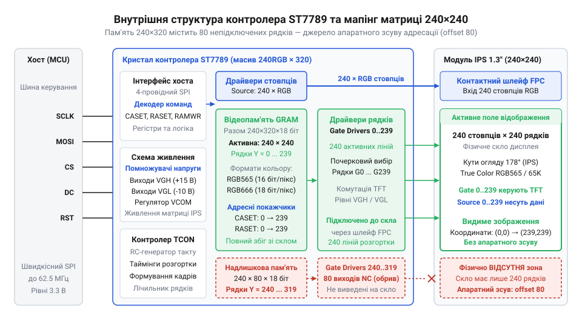
*Блок-схема внутрішньої архітектури кристала ST7789: взаємозв'язок інтерфейсу хоста, масиву GRAM 240×320, помп заряду та драйверів рядків і стовпців із непідключеною зоною 80 рядків.*

> 🔧 **Навіщо це.**
> Розуміння того, що дисплей має власну пам'ять GRAM, оптимізує графічний код: програмі не потрібно виділяти масив під повний кадр у 115 КБ в оперативній пам'яті мікроконтролера. Достатньо задати прямокутне вікно оновлення й надіслати байти пікселів лише для тих елементів інтерфейсу, які змінили свій стан, залишаючи решту площі екрана недоторканою.

У будові 1.3-дюймового модуля криється ключова апаратна невідповідність між кремнієвим кристалом і скляною панеллю. Контролер ST7789 створювався розробниками компанії Sitronix як універсальне масове рішення під стандартну телефонну роздільність 240×320 точок (формат QVGA). Відповідно, його фізичний масив GRAM містить 240 стовпців на 320 рядків, а вихідний каскад драйверів рядків має 320 ліній.

Проте квадратна скляна панель діагоналлю 1.3 дюйма має матрицю лише з 240 рядків і 240 стовпців. Під час розведення шлейфа 80 крайніх виходів рядкових драйверів кристала залишаються незадіяними — доріжки від них просто не виводяться на скло. Відповідні їм 80 рядків пам'яті GRAM (240 × 80 = 19 200 осередків) продовжують існувати всередині мікросхеми, але не мають фізичного зв'язку з рідкими кристалами.

Через це видима область екрана 240×240 займає лише частину простору GRAM. Залежно від трасування шлейфа конкретної фабрики та орієнтації матриці, видиме вікно або починається з нульового рядка, або має фіксований зсув на 80 рядків. Якщо програма намагається вивести зображення за стандартними координатами (X=0, Y=0) без урахування апаратного зміщення під час повороту картинки на 90°, 180° чи 270°, корисні пікселі записуються в «сліпу» пам'ять, а на дисплеї з'являється смуга випадкового шуму з неініціалізованої пам'яті. Формули перерахунку координат для кожного кута розвороту наведено в [математиці зсувів вікна пам'яті GRAM](root:cat-hw-actuators/ips-st7789/math-gram-window-offsets.md).

Хоча контролер ST7789 здатний зберігати 18 біт на точку (по 6 бітів на канали R, G, B, що потребує трьох окремих байтів на піксель), у мікроконтролерних пристроях практично завжди вмикають 16-бітний режим. Для цього використовують [формат представлення кольору RGB565](root:sf-visual/rgb565-color-format), де червоний і синій канали кодуються 5 бітами, а найчутливіший для людського зору зелений канал — 6 бітами. Це скорочує розмір одного пікселя до рівно 2 байтів, зменшуючи трафік шини SPI на 33% без помітної втрати колірної глибини на компактному екрані.

## Електрична схемотехніка модуля, конфігурація виводів (7 проти 8 пінів) та узгодження логічних рівнів

Гнучкий поліімідний шлейф дисплея, закріплений на скляній підкладці матриці, не призначений для прямого встановлення в макетні плати чи з'єднання дротами. Крім того, кристал ST7789 потребує стабільного живлення та фільтрації високочастотних перешкод. З цієї причини модуль постачають на друкованій платі (від англ. @@en|breakout board@@ — плата розпаювання виводів), яка містить допоміжну електричну обв'язку та стандартний роз'єм із кроком контактів 2.54 мм.

Принципова електрична схема модуля об'єднує три функціональні вузли: лінійний стабілізатор напруги, контур керамічних фільтрів живлення та комутатор підсвічування.

1. **Лінійний стабілізатор напруги (LDO).** Кремнієвий кристал ST7789 розрахований на напругу цифрового та аналогового живлення в межах 2.6...3.3 В, а перевищення позначки 3.6 В викликає незворотний пробій затворів його польових транзисторів. Щоб забезпечити роботу від джерел 5 В і захистити мікросхему від стрибків живлення, на плату встановлюють [лінійний інтегральний стабілізатор із малим падінням напруги](root:hw-power/ldo) (LDO, від англ. @@en|Low Drop-Out@@, типово XC6206 або RT9193 у компактному корпусі SOT-23). Стабілізатор приймає напругу від 3.5 до 5.5 В на контакті VCC і видає стабільні 3.3 В на виводи живлення кристала дисплея.
2. **Фільтрувальні керамічні конденсатори.** Одночасне перемикання сотень тисяч транзисторів матриці та робота внутрішніх імпульсних помп заряду викликають стрибки споживання струму з крутими фронтами наносекундної тривалості. Якщо їх не компенсувати локально, індуктивність провідників живлення спричинить просідання напруги та збій внутрішніх регістрів контролера. Для гасіння завад біля виводів живлення кристала розпаюють багатошарові керамічні конденсатори ємністю 0.1 мкФ (100 нФ) для придушення високих частот і 1...10 мкФ як локальний накопичувач енергії.
3. **Транзисторний ключ підсвічування.** Лінійка світлодіодів заднього підсвічування споживає від 35 до 60 мА при прямій напрузі близько 3.0...3.2 В. Цифровий вивід більшості мікроконтролерів розрахований на струм не більше 10–20 мА, тому пряме підключення світлодіодів спалить вихідний каскад порту мікроконтролера. На платі модуля встановлено комутуючий транзистор — N-канальний польовий транзистор MOSFET (наприклад 2N7002) або біполярний NPN-транзистор (наприклад S8050). Контакт BLK (від англ. @@en|backlight@@ — підсвічування) з'єднаний із затвором чи базою цього ключа. Логічна одиниця 3.3 В відкриває транзистор і вмикає підсвічування, а подання сигналу широтно-імпульсної модуляції (ШІМ) дозволяє плавно регулювати яскравість екрана зміною шпаруватості.

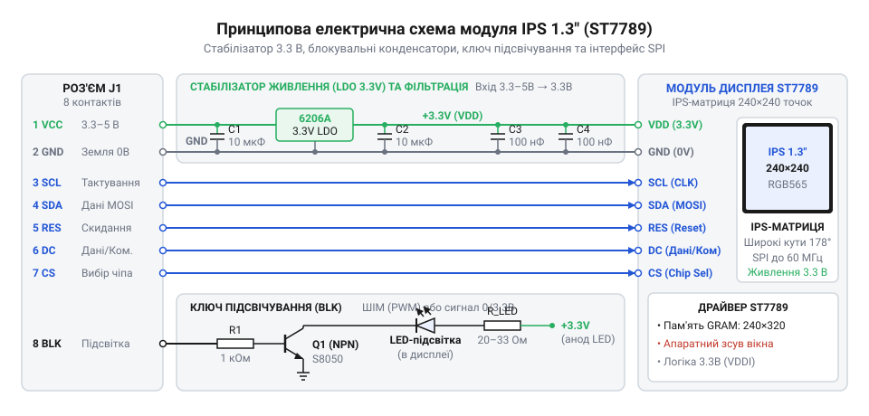
*Принципова електрична схема плати модуля 1.3″ IPS: лінійний стабілізатор LDO 3.3 В, розв'язувальні конденсатори, транзисторний комутатор підсвічування BLK та лінії інтерфейсу SPI.*

Контактна гребінка забезпечує взаємодію з мікроконтролером за 4-провідним протоколом [послідовного інтерфейсу SPI](root:com-devices/spi-bus). Повний опис електричних рівнів і часових діаграм кожного виводу містить [довідник цоколівки модуля 1.3″ IPS](root:cat-hw-actuators/ips-st7789/api-ips-1-3-st7789-pinout.md):

- `GND` — спільний провід схеми (0 В), точка відліку всіх сигналів.
- `VCC` — шина вхідного живлення плати (3.3 В або 5 В за наявності бортового стабілізатора LDO).
- `SCL` (або `SCLK`, `CLK`) — тактова лінія шини SPI. Контролер фіксує біти на лінії даних за кожним наростаючим фронтом тактового сигналу.
- `SDA` (або `MOSI`, `DIN`) — лінія послідовних даних від мікроконтролера до дисплея. У 4-провідній конфігурації зв'язок є односпрямованим: контролер ST7789 працює виключно на прийом.
- `RES` (або `RST`) — апаратне скидання (від англ. @@en|reset@@, активний рівень — низький). Подання логічного нуля щонайменше на 10 мкс примусово повертає внутрішні регістри та логіку контролера в початковий фабричний стан.
- `DC` (або `RS`, `A0`) — вибір типу переданих даних (від англ. @@en|Data/Command@@). Низький рівень (0) вказує, що переданий байт є кодом команди керування, а високий рівень (1) — що передаються параметри або кольори пікселів для запису у відеопам'ять GRAM.
- `CS` — вибір кристала (від англ. @@en|Chip Select@@, активний рівень — низький). Дозволяє інтерфейсному вузлу ST7789 приймати дані з ліній SCL та SDA.
- `BLK` — лінія керування підсвічуванням. Якщо вивід не підключений, підсвічування світить на повну яскравість завдяки резистору підтяжки на платі модуля.

На ринку присутні два варіанти виконання модулів: 8-вивідні плати з повною цоколівкою та 7-вивідні модулі, у яких контакт CS відсутній на роз'ємі.

Поява 7-вивідних плат пов'язана з масовим випуском розумних годинників і браслетів, де екран був єдиним пристроєм на внутрішній шині мікроконтролера. Історію переходу цих матриць у хобі-електроніку викладено в [історії смарт-годинникових дисплеїв](root:cat-hw-actuators/ips-st7789/hist-smartwatch-display-breakouts.md). Щоб спростити розводку та зменшити габарити плати, виробники з'єднали вивід CS кристала безпосередньо із загальним проводом GND просто на друкованій доріжці, зафіксувавши активний нуль назавжди.

Відсутність окремої лінії CS створює небезпечну системну колізію. У стандартному інтерфейсі SPI лінії тактування (SCL) та даних (SDA) призначені для спільного використання кількома периферійними пристроями. Мікроконтролер активує потрібний чип переведенням його лінії CS у нуль, проводить сеанс обміну, після чого повертає одиницю, переводячи ведений пристрій у високоімпедансний стан спокою.

Якщо лінія CS жорстко заземлена, контролер ST7789 слухає шину безперервно. Коли до тих самих пінів SCL та SDA під'єднати інший пристрій (наприклад, зчитувач карток MicroSD чи сенсор тиску) і почати з ним обмін, дисплей сприйме чужий потік байтів як власні команди та координати. Вміст GRAM миттєво спотвориться випадковим шумом, а внутрішній автомат команд може заблокуватися. Крім того, якщо через заваду на лінії SCL загубиться хоча б один такт, збій фази байтів неможливо скинути перемиканням CS — знадобиться повне апаратне пересмикування лінії RES. Саме тому 8-вивідні модулі з виведеним контактом CS є стандартом надійної схемотехніки.

Другий критичний аспект — узгодження рівнів сигналів. Хоча бортовий стабілізатор LDO дозволяє живити плату від 5 В через вивід VCC, усі сигнальні контакти (SCL, SDA, CS, DC, RES) ідуть від роз'єму безпосередньо на кристал ST7789, оминаючи стабілізатор.

Внутрішня напівпровідникова структура мікросхеми виготовлена за технологією КМОН (комплементарний метал-оксид-напівпровідник, від англ. @@en|CMOS@@) і має жорстке обмеження вхідної напруги:

```text
V_IN(max)
= VDD + 0.3 В                  [максимальна напруга цифрового входу]
= 3.3 В + 0.3 В                [підстановка робочої напруги ядра]
= 3.6 В                        [поріг початку пробою захисних діодів]
```

Якщо підключити сигнальні лінії дисплея безпосередньо до 5-вольтового мікроконтролера (наприклад, класичної плати Arduino Uno на базі ATmega328P), надлишкова напруга 5 В відкриє кремнієві захисні діоди кристала. Це спричинить тиристорне защіпання (від англ. @@en|latch-up@@), лавиноподібне зростання наскрізного струму, нагрівання кристала та незворотне вигоряння вхідних транзисторів ST7789.

Для надійної роботи дисплея з 5-вольтовими мікроконтролерами необхідні [схеми узгодження логічних рівнів](root:hw-digital/level-shifter):

- **Резистивні дільники напруги.** Оскільки лінії шини SPI передають сигнал лише в один бік (від мікроконтролера до дисплея), для кожного цифрового входу застосовують подільник із верхнього резистора R1 (1.0...1.2 кОм) та нижнього резистора R2 (2.0...2.2 кОм), з'єднаного з GND:

```text
V_OUT
= V_IN × (R2 / (R1 + R2))      [формула резистивного дільника]
= 5.0 В × (2.0 кОм / (1.0 кОм + 2.0 кОм)) [підстановка номіналів]
= 5.0 В × (2.0 / 3.0)          [скорочення опорів]
≈ 3.33 В                       [вихідна безпечна логічна напруга]
```

Вихідний опір дільника разом із паразитною ємністю друкованих провідників утворює інтегруючий фільтр низьких частот, який завалює крутизну фронтів сигналів на високих швидкостях. Резистивні подільники коректно працюють лише на тактових частотах шини SPI до 8–10 МГц.

- **Спеціалізовані мікросхеми буферних перетворювачів.** Для роботи на повній швидкості шини SPI (20–40 МГц) застосовують цифрові неінвертуючі буфери із живленням 3.3 В і входами, толерантними до напруги 5 В (наприклад 74LVC245 або 74LVC125). Вони забезпечують круті фронти сигналів тривалістю менше 3 наносекунд без завалювання сигналу. Двосторонні транзисторні перетворювачі з підтяжками 10 кОм (які часто використовують для повільної шини I2C) для швидкісного SPI непридатні.

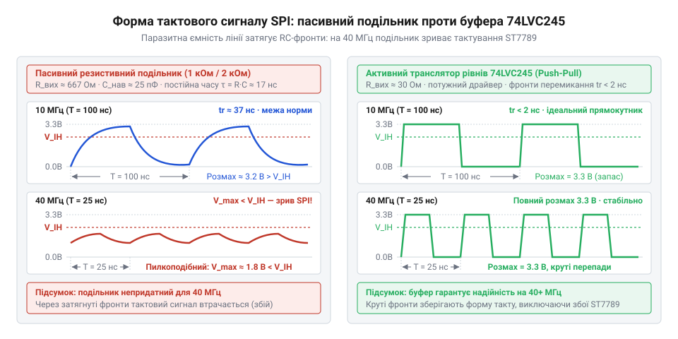
*Осцилограми тактового сигналу SPI на частотах 10 МГц та 40 МГц: паразитна ємність завалює фронти після резистивного дільника, тоді як активний буфер 74LVC245 зберігає круті прямокутні імпульси на повній швидкості шини.*

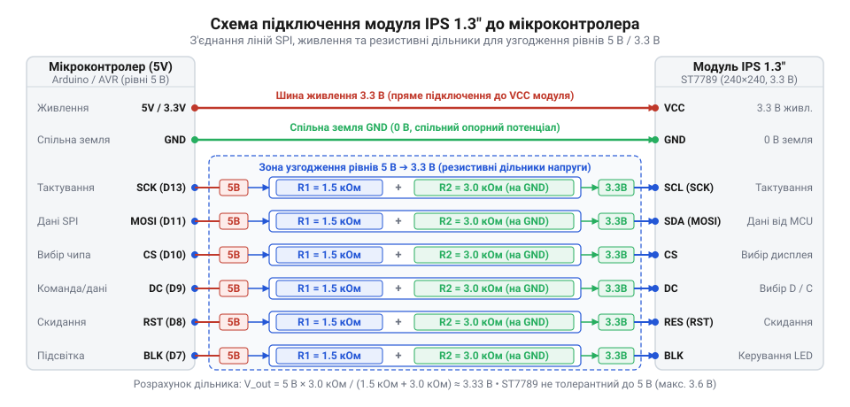
*Схема з'єднання виводів модуля 1.3″ IPS із мікроконтролером: підключення живлення 3.3 В, спільний провід, сигнальні лінії шини SPI та подільники напруги для захисту від 5-вольтових сигналів.*

> 🔧 **Навіщо це.**
> Перед придбанням модуля завжди перевіряють наявність виводу CS на колодці роз'єму. Якщо лінія CS відсутня, модуль можна використовувати виключно на окремій, виділеній шині мікроконтролера. Якщо ж на ту саму шину SPI планується підключати SD-карту або датчики, обов'язково обирають 8-вивідну версію. При підключенні до 5-вольтових плат сигнальні лінії захищають резистивними подільниками або мікросхемами буферів серії 74LVC.

## Протокол 4-провідного SPI та базова система команд контролера

Керування графічним дисплеєм вимагає регулярної передачі двох принципово відмінних потоків інформації: команд конфігурації (налаштування регістрів, полярності кольору, напрямку розгортки) та масивів піксельних даних для запису у відеопам'ять. Якщо передавати обидва потоки через стандартний [послідовний інтерфейс SPI](root:com-devices/spi-bus) (від англ. @@en|Serial Peripheral Interface@@) за допомогою внутрішньосмугових службових заголовків (пакетних префіксів чи керівних байтів), кожен окремий піксель або рядок вимагав би додаткових накладних витрат. Для повноколірного екрана 240×240 точок передача одного кадру в 16-бітному кольорі становить 115 200 байтів, тому додавання навіть одного байта префікса на кожну транзакцію знизило б корисну пропускну здатність шини й створило б значне навантаження на обчислювальне ядро.

Цю проблему розв'язує апаратна модифікація шини — 4-провідний інтерфейс SPI (@@en|4-wire 8-bit serial interface@@). До класичної трійки ліній — вибору кристала `CS` (від англ. @@en|Chip Select@@), тактування `SCL` (@@en|Serial Clock@@) та послідовних даних `SDA` (@@en|Serial Data@@, лінія `MOSI`) — додається окрема апаратна лінія керування `DC` (@@en|Data/Command@@, від лат. @@la|datum@@ — дане та @@la|commandare@@ — наказувати). Стан лінії `DC` зчитується внутрішнім десеріалізатором контролера безпосередньо в момент фіксації останнього біта переданого байта:
- `DC = 0` (низький логічний рівень): прийнятий байт інтерпретується внутрішньою логікою чипа як 8-бітний код команди (адреса регістру);
- `DC = 1` (високий логічний рівень): прийнятий байт або послідовність байтів сприймаються як параметри попередньо надісланої команди або як безперервний потік кольорових точок.

Завдяки винесенню ознаки типу інформації на фізичну лінію, хост-мікроконтролер перемикає рівень на піні `DC` один раз перед початком пакетної передачі й транслює мегабайти графічних даних на максимальній швидкості шини без жодного службового біта навантаження. Цоколівку та електричні параметри ліній модуля детально подає вставка [api-ips-1-3-st7789-pinout](root:cat-hw-actuators/ips-st7789/api-ips-1-3-st7789-pinout.md).

```
          ┌── Байт команди (DC=0) ──┐  ┌── Байт параметра / пікселя (DC=1) ──┐
CS   ─────┘                         └──┴───────────────────────────────────────
SCL  ───────┐ ┌─┐ ┌─┐ ┌─┐ ┌─┐ ┌─┐ ┌─┐ ┌───┐ ┌─┐ ┌─┐ ┌─┐ ┌─┐ ┌─┐ ┌─┐ ┌─┐ ┌──────
            └─┘ └─┘ └─┘ └─┘ └─┘ └─┘ └─┘   └─┘ └─┘ └─┘ └─┘ └─┘ └─┘ └─┘ └─┘
SDA  ───────< D7 X D6 X D5 X D4 X D3 X D2 X D1 X D0 >< D7 X D6 X D5 X D4 X D3 X D2 X D1 X D0 >
DC   ─────────────────────────────────────┐
     (Команда: 0)                         └──────────────────────────────────── (Дані: 1)
```

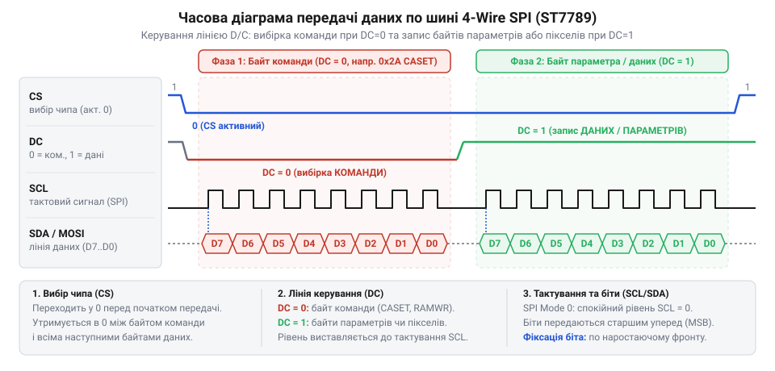
*Часова діаграма передачі даних по 4-провідній шині SPI: зміна рівнів на лініях CS, SCL, SDA та керуючій лінії DC при надсиланні байта команди (DC=0) та наступних байтів параметрів чи пікселів (DC=1).*

Контролер ST7789 підтримує два режими синхронної передачі SPI: Режим 0 (`Mode 0`: `CPOL = 0`, `CPHA = 0`) та Режим 3 (`Mode 3`: `CPOL = 1`, `CPHA = 1`). Полярність тактового сигналу `CPOL` (від англ. @@en|Clock Polarity@@, лат. @@la|polaris@@ — полюсний) задає вихідний рівень лінії `SCL` під час простою шини: 0 для Режиму 0 та 1 для Режиму 3. Фаза тактування `CPHA` (від англ. @@en|Clock Phase@@, грец. @@el|phasis@@ — поява) визначає, за яким фронтом фіксуються дані. В обох допустимих режимах біти на лінії `SDA` захоплюються внутрішнім регістром зсуву за наростаючим фронтом (перехід від 0 до 1), а змінюються передавачем за спадним фронтом тактового сигналу. Порядок передачі бітів у байті — завжди від старшого до молодшого (@@en|MSB first@@).

Часові характеристики шини накладають апаратні межі на граничну швидкість обміну:
- мінімальна тривалість періоду тактування запису `t_CYCW` у лабораторних умовах становить 16 нс (теоретична частота до 62.5 МГц), однак паразитна ємність з'єднувальних дротів і монтажних плат обмежує стабільну частоту діапазоном 30–40 МГц;
- час встановлення даних `t_DST` (тривалість стабільного стану біта на `SDA` до приходу наростаючого фронту `SCL`) становить щонайменше 10 нс;
- час утримання даних `t_DHT` після наростаючого фронту тактового сигналу — не менше 10 нс;
- лінія `DC` повинна переходити у відповідний логічний стан щонайменше за 10 нс до першого тактового імпульсу переданого байта й утримуватися незмінною до завершення фіксації останнього біта;
- лінія вибору `CS` активується низьким рівнем за 10 нс до початку генерації тактових імпульсів і може залишатися низькою протягом усього сеансу передачі масиву точок.

Розрахунок частоти оновлення екрана залежно від тактової частоти шини та накладних витрат містить вставка [math-spi-display-bandwidth](root:cat-hw-actuators/ips-st7789/math-spi-display-bandwidth.md).

> 🔧 **Навіщо це.**
> Помилка в налаштуванні режиму SPI (наприклад, вибір `Mode 1` замість `Mode 0` чи `Mode 3`) призводить до того, що мікроконтролер перемикає лінію даних саме в момент наростаючого фронту тактування. Контролер ST7789 захоплює проміжний невизначений стан, усі коди команд зсуваються на один біт ліворуч чи праворуч, і жоден регістр чипа не ініціалізується — екран залишається чорним або білим без будь-якої реакції на команди.

Після подачі напруги живлення контролер перебуває в стані апаратного очікування з вимкненими генераторами розгортки. Для переведення дисплея в робочий режим необхідна чітка послідовність базових команд, бітова структура та правила виконання яких стандартизовані в системі команд чипа. Повний перелік регістрів подано у вставці [api-st7789-command-set](root:cat-hw-actuators/ips-st7789/api-st7789-command-set.md).

### Програмне скидання: SWRESET (`0x01`)
Команда програмного скидання (від англ. @@en|Software Reset@@) повертає всі внутрішні регістри конфігурації до заводських початкових значень і скидає стан внутрішніх автоматів. Регістри пам'яті кадру при цьому не затираються. Виконання скидання вимагає обов'язкової програмної затримки щонайменше 5 мс перед надсиланням будь-якої наступної інструкції, щоб внутрішні ланцюги зміщення та джерела опорної напруги завершили перехідні процеси. Якщо скидання викликається після виходу зі сплячого режиму, тривалість паузи збільшують до 120 мс.

### Вихід зі сну: SLPOUT (`0x11`)
Команда виходу зі сплячого режиму (від англ. @@en|Sleep Out@@) вимикає низькоспоживаючий черговий генератор та запускає вбудовані DC/DC помпи помножувача напруги (забезпечують високовольтні рівні живлення затворів рідкокристалічних транзисторів `VGH` і `VGL`), а також схеми температурної компенсації. Контролеру необхідно до 120 мс для стабілізації вихідних напруг помп помножувача. Надсилання команд запису у відеопам'ять чи ввімкнення екрана до завершення цього інтервалу призводить до апаратного блокування матриці.

### Налаштування формату кольору: COLMOD (`0x3A`)
Регістр вибору розрядності представлення пікселів (від англ. @@en|Color Format Set@@) визначає, скільки бітів пам'яті виділяється під один піксель у відеопам'яті кадру при записі через послідовний інтерфейс. Команда супроводжується одним байтом параметра:
- біти `[6:4]` визначають формат паралельного інтерфейсу RGB (не застосовуються в 4-провідному SPI);
- біти `[2:0]` визначають розрядність для послідовного керуючого інтерфейсу: значення `0b101` (`0x05`) встановлює 16-бітний [формат представлення кольору RGB565](root:sf-visual/rgb565-color-format) (2 байти на піксель), а значення `0b110` (`0x06`) — 18-бітний колір RGB666 (3 байти на піксель із надмірними накладними витратами на передачу).

Стандартне значення для модулів 1.3″ становить `0x55` (або `0x05`), що налаштовує компактний 16-бітний потік пікселів.

### Керування доступом до пам'яті: MADCTL (`0x36`)
Регістр керування адресацією пам'яті кадру (від англ. @@en|Memory Data Access Control@@) налаштовує напрямок інкременту адресних лічильників при читанні та записі у відеопам'ять, порядок субпікселів та взаємну орієнтацію рядків і стовпців. Команда приймає один конфігураційний байт, у якому критичне значення мають такі біти:
- біт 7 (`MY`, @@en|Page Address Order@@): дзеркальне відображення рядків (0 — згори вниз, 1 — знизу вгору);
- біт 6 (`MX`, @@en|Column Address Order@@): дзеркальне відображення стовпців (0 — зліва направо, 1 — справа наліво);
- біт 5 (`MV`, @@en|Page/Column Selection@@): взаємний обмін осей X і Y (0 — портретна розгортка, 1 — альбомна розгортка);
- біт 3 (`BGR`): порядок передачі субпікселів (0 — послідовність RGB, 1 — послідовність BGR).

Більшість IPS-модулів з діагоналлю 1.3″ використовують прямий порядок субпікселів `BGR = 0`. Помилкове встановлення цього біта в 1 міняє місцями червоний і синій канали, роблячи синє небо жовтогарячим.

### Інверсія відображення: INVON (`0x21`)
Команда ввімкнення інверсії (від англ. @@en|Display Inversion On@@, лат. @@la|inversio@@ — перевертання) є обов'язковою для коректної візуалізації на модулях 1.3″ IPS через специфіку їхньої оптичної структури. 

У класичних рідкокристалічних матрицях типу TN (@@en|Twisted Nematic@@) комірки працюють у режимі «нормально білий» (@@en|normally white@@): за відсутності керуючої напруги рідкі кристали скручені спіраллю й пропускають поляризоване світло підсвічування крізь вихідний поляризатор. Щоб отримати чорну точку, контролер мусить прикласти максимальну напругу, розкручуючи молекули перпендикулярно до скла. 

IPS-матриці (@@en|In-Plane Switching@@) за своєю фізичною природою є «нормально чорними» (@@en|normally black@@). У вимкненому стані (за нульової напруги на гребінчастих електродах) молекули рідких кристалів орієнтовані суворо паралельно до площини підкладки, і світло повністю блокується вихідним поляризаційним фільтром, забезпечуючи глибокий чорний колір. Щоб відкрити субпіксел, контролер прикладає горизонтальне електричне поле, повертаючи кристали в площині екрана.

Типово після апаратного скидання контролер ST7789 перебуває в стані `INVOFF` (`0x20`), розрахованому на застарілі «нормально білі» панелі: максимальний рівень сигналу відповідає темним точкам, а нульовий — світлим. На IPS-матриці це спричиняє ефект повного оптичного фотонегатива: чорний колір відображається сліпучо білим, червоний перетворюється на бірюзовий, а будь-яка графіка втрачає контраст. Команда `INVON` (`0x21`) інвертує таблицю цифро-аналогового перетворювача драйверів стовпців, узгоджуючи шкалу яскравості з оптичною характеристикою комірок IPS.

### Ввімкнення розгортки: DISPON (`0x29`)
Команда активації показу (від англ. @@en|Display On@@) з'єднує вихідні буфери драйверів рядків і стовпців безпосередньо з шинами матриці й запускає циклічну регенерацію зображення з пам'яті кадру на рідкокристалічну панель.

Нижче наведено базовий приклад взаємодії з 4-провідним SPI для ініціалізації ST7789.

:::tabs
:::code ips-st7789-d/c/st7789-write-command.c
:::code ips-st7789-d/cpp/st7789interface.cpp
:::

## Механізм віконної адресації GRAM, математичний розрахунок зміщень і зміна орієнтації

Оновлення графіки на екрані рідко вимагає переписування всієї площі кадру: виведення текстового символу, переміщення стрілки індикатора чи миготіння піктограми охоплюють лише локальну ділянку пікселів. Якби мікроконтролер для кожної зміни окремої точки мусив передавати повні координати X та Y, накладні витрати шини зросли б утричі. 

Для оптимізації трафіку контролер ST7789 реалізує механізм прямокутної віконної адресації відеопам'яті (GRAM, від англ. @@en|Graphic Random Access Memory@@, лат. @@la|memoria@@ — пам'ять). Хост-контролер задає чотири координати, що обмежують активний прямокутник, після чого передає безперервний потік кольорових слів пікселів. Внутрішній апаратний лічильник автоматично переміщує покажчик адреси всередині обраного вікна.

Протокол відкриття вікна оновлення складається з трьох послідовних інструкцій:
1. `CASET` (`0x2A`, @@en|Column Address Set@@): встановлює ліву та праву межі стовпців. Команда супроводжується чотирма байтами параметрів:
   - `XS[15:8]`, `XS[7:0]` — початковий стовпець `X_start`;
   - `XE[15:8]`, `XE[7:0]` — кінцевий стовпець `X_end`.
2. `RASET` (`0x2B`, @@en|Row Address Set@@): встановлює верхню та нижню межі рядків за допомогою чотирьох байтів:
   - `YS[15:8]`, `YS[7:0]` — початковий рядок `Y_start`;
   - `YE[15:8]`, `YE[7:0]` — кінцевий рядок `Y_end`.
3. `RAMWR` (`0x2C`, @@en|Memory Write@@): активує режим безпосереднього запису у відеопам'ять. Отримавши цей код, контролер скидає внутрішній покажчик у координату `(X_start, Y_start)`.

Після надсилання `RAMWR` лінія `DC` перемикається в стан даних (`DC = 1`), і хост передає масив байтів пікселів. Кожні два байти формують 16-бітне колірне слово RGB565. Після запису кожного пікселя внутрішній лічильник стовпців автоматично збільшується на одиницю (`X ← X + 1`). Коли значення досягає кінцевого стовпця `X_end`, лічильник X повертається до початкового значення `X_start`, а лічильник рядків інкрементується (`Y ← Y + 1`). Процес триває циклічно до заповнення вікна або до надсилання нової команди. Загальна кількість переданих пікселів для прямокутника становить:

```
N_pixels
= (X_end - X_start + 1) × (Y_end - Y_start + 1)      [кількість точок у прямокутному вікні]
```

Коли ж завдання вимагає не локального перемальовування, а динамічного вертикального зсуву списків чи консольного тексту, повторне надсилання пікселів через послідовний інтерфейс створювало б надмірний трафік. Для таких сценаріїв призначений [апаратний скролінг графічних контролерів дисплеїв](root:sf-devices/display-hardware-scrolling) — механізм кільцевого зсуву покажчиків рядків відеопам'яті (команди `VSCRDEF` і `VSPAS`), що забезпечує плавне панорамування без завантаження шини хоста.

### Апаратне зміщення координат у матриці 240×240

Кристал контролера ST7789 є універсальним чипом [дисплеїв родини ST7789](root:cat-hw-actuators/st7789-family) і проєктувався для роботи з матрицями з максимальною роздільною здатністю до 240×320 пікселів. Внутрішня відеопам'ять кадру фізично містить 240 стовпців (колонкові драйвери) та 320 рядків (рядкові драйвери затворів TFT). 

Модуль 1.3″ IPS має квадратну видиму матрицю розміром 240×240 точок. Фізичні рідкокристалічні комірки під'єднані лише до 240 виходів затворних драйверів, тоді як решта 80 рядкових виходів кристала залишаються апаратно не розпаяними. У стандартному топологічному розведенні скляної панелі активні 240 рядків відповідають фізичним адресам рядків пам'яті від 0 до 239 (або від 80 до 319 залежно від орієнтації кристала на шлейфі). 

Якщо передати контролеру координати вікна без урахування неспівпадіння геометрії пам'яті та скла, виникає характерний апаратний зсув: зображення зміщується за межі видимої області екрана, а на протилежному боці з'являється смуга неініціалізованого шуму чи залишкових байтів пам'яті. 

### Повороти орієнтації та математика зсувів MADCTL

Зміна орієнтації екрана (поворот на 0°, 90°, 180° чи 270°) здійснюється перезаписом бітів `MY`, `MX` та `MV` у конфігураційному регістрі `MADCTL` (`0x36`). Проте зміна напрямку розгортки докорінно трансформує взаємне розташування видимої ділянки 240×240 відносно апаратного буфера 240×320:
- біт `MV` (@@en|Row/Column Exchange@@) міняє місцями адресацію X та Y: коли `MV = 0`, вісь X відповідає колонкам (240), а Y — рядкам (320); коли `MV = 1`, вісь X спрямовується вздовж рядків пам'яті (320), а Y — вздовж колонок (240);
- біт `MY` (@@en|Row Address Order@@) за значення 1 змушує внутрішній лічильник адресувати рядки у зворотному порядку — від останнього фізичного рядка 319 униз до 0;
- біт `MX` (@@en|Column Address Order@@) за значення 1 інвертує порядок адресації стовпців — від стовпця 239 ліворуч до 0.

Оскільки непід'єднані 80 рядків зосереджені на одному з країв адресної площини чипа, дзеркальне розгортання координат за бітом `MY` чи `MX` призводить до того, що нульова логічна точка програми потрапляє на непід'єднані рядки пам'яті. Для збереження відображення в межах видимого скла кожна логічна координата програми `(X, Y)` повинна трансформуватися у фізичні координати контролера `(X_phys, Y_phys)` шляхом додавання апаратних зміщень `X_offset` та `Y_offset`:

```
X_phys = X + X_offset
Y_phys = Y + Y_offset
```

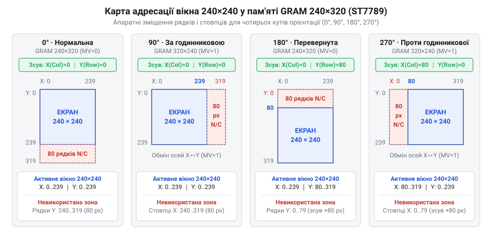
*Геометрична карта відображення вікна 240×240 точок усередині фізичної пам'яті GRAM 240×320 контролера ST7789 для чотирьох кутів повороту (0°, 90°, 180°, 270°) із числовими значеннями зміщень рядків і стовпців.*

Розглянемо виведення зміщень для чотирьох кутів орієнтації типового модуля 1.3″ IPS 240×240:

#### 1. Орієнтація 0° (Портретна звичайна)
- конфігурація `MADCTL`: `MY = 0`, `MX = 0`, `MV = 0` (значення `0x00`);
- вісь X транслюється на стовпці GRAM (розмір 240), вісь Y — на рядки GRAM (розмір 320);
- видима матриця під'єднана до початкових рядків 0..239, тому зміщення дорівнюють нулю:
  `X_offset = 0`, `Y_offset = 0`.

#### 2. Орієнтація 90° (Альбомна за годинниковою стрілкою)
- конфігурація `MADCTL`: `MY = 0`, `MX = 1`, `MV = 1` (значення `0x60` або `0x70` з BGR);
- осі X та Y переставлені місцями (`MV = 1`): вісь X проектується на рядки GRAM (довжина 320), вісь Y — на стовпці (довжина 240);
- рядки скануються в прямому порядку від 0 до 239:
  `X_offset = 0`, `Y_offset = 0`.

#### 3. Орієнтація 180° (Перевернута портретна)
- конфігурація `MADCTL`: `MY = 1`, `MX = 1`, `MV = 0` (значення `0xC0`);
- біт `MY = 1` перевертає сканування рядків: апаратний рядок 0 тепер починається з фізичного рядка 319 пам'яті GRAM і рахується у зворотному напрямку;
- фізичні затворні лінії скла, розпаяні на виводи 0..239, опиняються в адресному просторі `[320 - 240, 319]`, тобто від адреси 80 до 319;
- щоб логічний рядок 0 потрапив на перший видимий фізичний рядок панелі, координату Y необхідно зсунути на величину різниці пам'яті:

```
Y_offset
= H_GRAM - H_panel      [різниця повної пам'яті контролера та фізичної матриці]
= 320 - 240             [підстановка висоти GRAM та кількості підключених рядків]
= 80                    [величина апаратного зміщення в рядках]
```

При цьому вздовж осі стовпців різниця відсутня (`240 - 240 = 0`), тому `X_offset = 0`.

#### 4. Орієнтація 270° (Перевернута альбомна)
- конфігурація `MADCTL`: `MY = 1`, `MX = 0`, `MV = 1` (значення `0xA0`);
- осі переставлені (`MV = 1`), тому вісь X логічного екрана відповідає фізичним рядкам пам'яті GRAM (розмір 320);
- інверсія `MY = 1` спрямовує початок відліку вздовж рядків з адреси 319 назад, що вимагає внесення поправки на 80 точок уже вздовж координати X:

```
X_offset
= H_GRAM - W_panel      [зміщення вздовж осі рядків при транспонуванні осей]
= 320 - 240             [підстановка висоти GRAM та ширини видимої області]
= 80                    [величина апаратного зміщення в стовпцях]
```

Вздовж осі Y зміщення залишається нульовим: `Y_offset = 0`.

Математичні матриці перетворень та варіанти адресації для нестандартних шлейфів наведено у вставці [math-gram-window-offsets](root:cat-hw-actuators/ips-st7789/math-gram-window-offsets.md).

> 🔧 **Навіщо це.**
> Ігнорування апаратного зміщення при зміні орієнтації на 180° або 270° призводить до того, що третина зображення (рівно 80 рядків чи стовпців) «зрізається» за край екрана й записується у сліпу зону відеопам'яті, тоді як з протилежного боку панелі з'являється чорна смуга завширшки 80 пікселів або хаотичне сміття.

### Алгоритм програмного відсікання меж (Clipping)

Перед надсиланням координат вікна в контролер драйвер зобов'язаний виконати відсікання меж прямокутника (@@en|clipping@@, від англ. @@en|to clip@@ — обрізати). Якщо координати малювання виходять за фізичні межі видимого екрана 240×240 (наприклад, при малюванні рухомого об'єкта, що частково виходить за межі дисплея), невідсічені координати спричинять запис у сусідні рядки або скинуть внутрішній лічильник адреси.

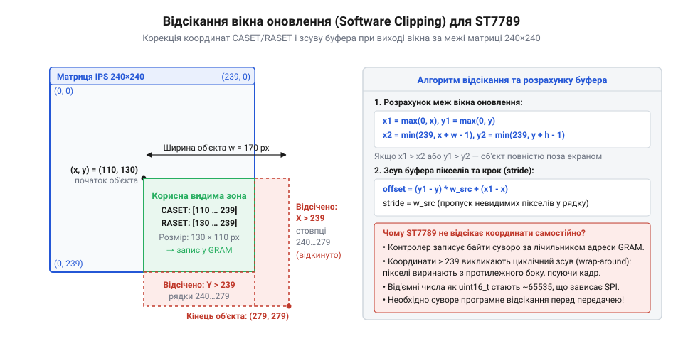
*Геометрична схема відсікання прямокутного вікна оновлення при частковому виході за межі фізичної матриці 240×240: координати прямокутника, що виходять за діапазон 0..239, програмно обрізаються до меж дисплея, що запобігає переповненню адреси та спотворенню пам'яті кадру.*

Алгоритм підготовки вікна складається з таких кроків:
1. Перевірка на повний вихід за межі екрана: якщо `x1 < 0` або `x0 ≥ W_panel` чи `y1 < 0` або `y0 ≥ H_panel`, процедура миттєво повертає керування без звернення до шини SPI.
2. Обмеження координат відсіканням:
   `x0_clipped = max(0, x0)`
   `x1_clipped = min(W_panel - 1, x1)`
   `y0_clipped = max(0, y0)`
   `y1_clipped = min(H_panel - 1, y1)`
3. Додавання апаратних зміщень орієнтації:
   `XS = x0_clipped + X_offset`
   `XE = x1_clipped + X_offset`
   `YS = y0_clipped + Y_offset`
   `YE = y1_clipped + Y_offset`
4. Передача значень у регістри `CASET` та `RASET` старшим байтом уперед (MSB).

Реалізацію функцій встановлення вікна та зміни орієнтації наведено нижче. Повний каркас бібліотеки описує вставка [api-st7789-c-driver](root:cat-hw-actuators/ips-st7789/api-st7789-c-driver.md).

:::tabs
:::code ips-st7789-d/c/st7789-set-rotation.c
:::code ips-st7789-d/cpp/displayorientation.cpp

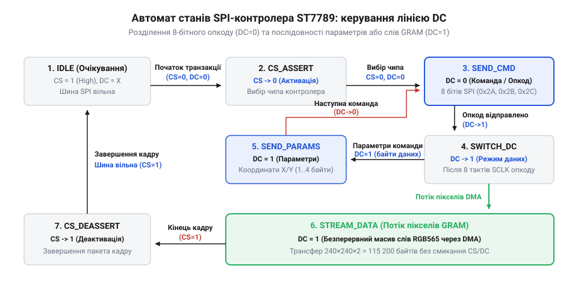
*Граф автоматних станів контролера SPI при перемиканні лінії DC між передачею опкоду команди та потоком піксельних даних: перехід лінії DC у високий стан після команди RAMWR перемикає контролер у неперервний цикл прийому та адресації пікселів у відеопам'яті.*
:::

## Кодування кольору RGB565, порядок байтів та бітові операції

Графічні контролери вимагають представлення кожного пікселя набором чисел, що описують інтенсивність випромінювання трьох базових складових оптичного спектра: червоної, зеленої та синьої. Таке розділення спирається на трикомпонентну теорію колірного зору (@@en|RGB@@, від англ. @@en|Red, Green, Blue@@). У повноколірній комп'ютерній графіці (@@en|True Color@@) кожному з трьох каналів відводять по вісім бітів. Загальний розмір одного пікселя в такому разі становить 24 біти (три байти), що відкриває доступ до понад 16.7 мільйона відтінків. Однак для компактного екрана з роздільною здатністю 240×240 точок збереження та передача такого обсягу даних через послідовний інтерфейс створює відчутне навантаження на систему:

```
V_frame = 240 × 240 × 3 = 172 800 байтів (≈168.75 КБ)
```

Для багатьох поширених мікроконтролерів оперативна пам'ять обмежена десятками кілобайтів. Навіть мікросхеми з сотнями кілобайтів RAM зазнають надлишкового навантаження, якщо безперервно транслювати такий масив послідовною шиною. Кожен додатковий байт у каналі зв'язку знижує граничну частоту кадрів і підвищує енергоспоживання пристрою.

Щоб зменшити витрати ресурсів, у графічних панелях малого розміру застосовують ущільнене 16-бітне представлення — [формат представлення кольору RGB565](root:sf-visual/rgb565-color-format). У цьому форматі кожен піксель займає рівно два байти, тобто одне машинне півслово:

```
V_frame = 240 × 240 × 2 = 115 200 байтів (112.5 КБ)
```

Таке пакування скорочує обсяг переданих даних рівно на третину, що робить оновлення зображення значно швидшим. Проте 16 бітів не діляться порівну на три колірні компоненти. Розподіл розрядів між червоним, зеленим і синім кольорами враховує біологічну будову людського зору.

### Анатомія пакування RGB565 та біологія зору

Якби 16-бітне слово ділили симетрично (формат RGB555, по п'ять бітів на канал), один біт лишався б порожнім баластом, а кожен канал мав би лише по 32 градації яскравості (разом 32 768 відтінків). Натомість автори формату RGB565 віддали шістнадцятий біт зеленому каналу:
- червоний канал (R) — 5 бітів (32 рівні квантування);
- зелений канал (G) — 6 бітів (64 рівні квантування);
- синій канал (B) — 5 бітів (32 рівні квантування).

Загальна кількість відтворюваних кольорів становить `32 × 64 × 32 = 65 536`. Причина такої нерівномірності криється у фізіології ока. Сітківка людини містить світлочутливі колбочки трьох типів, чутливі до довгих (L), середніх (M) та коротких (S) світлових хвиль. Сумарна крива спектральної чутливості денного зору має виражений максимум на довжині хвилі близько 555 нанометрів, що припадає саме на зелену частину спектра.

Людське око сприймає зелене світло як основу просторової яскравості. До змін інтенсивності зеленого кольору зорова система приблизно вдвічі чутливіша, ніж до градацій червоного, і майже вчетверо чутливіша, ніж до синього. Якби зеленому каналу залишили лише п'ять бітів, на плавних переходах зображення (градієнтах фону чи тінях) спостерігач чітко бачив би східчасті колірні розриви — колірний бандінг (@@en|color banding@@, від англ. @@en|band@@ — смуга). Подвоєння кількості рівнів зеленого до 64 усуває цей артефакт, зберігаючи відчуття плавності при мізерних двох байтах на точку.

Біти всередині 16-бітного беззнакового числа `uint16_t` розподілені наступним чином:

```
Біти:     [15 14 13 12 11]  [10  9  8  7  6  5]  [4  3  2  1  0]
Канал:    Червоний (R)      Зелений (G)          Синій (B)
Розмір:   5 бітів           6 бітів              5 бітів
Діапазон: 0..31             0..63                0..31
```

### Математика перетворення з 24-бітного простору

При створенні графічних елементів вихідні кольори зазвичай задаються у стандартному 24-бітному просторі, де кожен компонент займає байт зі значенням від 0 до 255. Щоб згорнути три байти `(R8, G8, B8)` у 16-бітне число `RGB565`, потрібно відкинути молодші біти кожного каналу, перетворивши вісім бітів червоного й синього на п'ять бітів, а вісім бітів зеленого — на шість:

```
R5 = R8 >> 3    [ділення на 8: з 256 рівнів залишається 32]
G6 = G8 >> 2    [ділення на 4: з 256 рівнів залишається 64]
B5 = B8 >> 3    [ділення на 8: з 256 рівнів залишається 32]
```

Отримані значення зсувають на їхні цільові бітові позиції всередині слова та об'єднують побітовим «АБО»:

```
color16 = (R5 << 11) | (G6 << 5) | B5
```

Цю дію записують чистою інлайн-функцією з бітовими масками, що запобігає виходу бітів за межі розрядів:

```c
static inline uint16_t rgb565_pack(uint8_t r, uint8_t g, uint8_t b)
{
    return ((uint16_t)(r & 0xF8) << 8) |
           ((uint16_t)(g & 0xFC) << 3) |
           ((uint16_t)b >> 3);
}
```

**Обчислення на прикладі:** перетворення бірюзового кольору морської хвилі з компонентами `R8 = 36` (`0x24`), `G8 = 178` (`0xB2`), `B8 = 210` (`0xD2`).

```
R5 = 0x24 >> 3 = 0x04 (двійкове: 00100)
G6 = 0xB2 >> 2 = 0x2C (двійкове: 101100)
B5 = 0xD2 >> 3 = 0x1A (двійкове: 11010)

Зсув R: 0x0004 << 11 = 0x2000 (двійкове: 0010000000000000)
Зсув G: 0x002C << 5  = 0x0580 (двійкове: 0000010110000000)
Зсув B: 0x001A << 0  = 0x001A (двійкове: 0000000000011010)

Результат = 0x2000 | 0x0580 | 0x001A
          = 0x259A
```

Зворотне перетворення з RGB565 у 24-бітне значення вимагає відновлення молодших бітів. Якщо просто зсунути `R5` ліворуч на три біти, молодші три розряди заповняться нулями, через що максимальне значення `31` перетвориться на `248` замість `255`. Для точного відновлення динамічного діапазону відкинуті молодші розряди дублюють старшими бітами:

```
R8 = (R5 << 3) | (R5 >> 2)
G8 = (G6 << 2) | (G6 >> 4)
B8 = (B5 << 3) | (B5 >> 2)
```

> 🔧 **Навіщо це.**
> Пакування RGB565 скорочує розмір графічних ресурсів рівно на третину. Без нього масиви піктограм і шрифтів вичерпують флеш-пам'ять мікроконтролера у півтора раза швидше, а передача нестиснених байтів знижує кадрову частоту інтерфейсу.

### Пастка порядку байтів (endianness) на послідовній шині

Правильно обчислене число `0x259A` при спробі надіслати його на дисплей через шину SPI часто породжує неочікуваний дефект: замість бірюзового відтінку екран відображає брудно-помаранчевий або фіолетовий тон. Ще помітнішим є збій на чистому червоному кольорі `0xF800`: замість полум'яно-червоної заливки панель забарвлюється у блідий зелено-блакитний колір.

Причина полягає у конфлікті способів збереження чисел у пам'яті та їх передачі шиною. Поняття порядку байтів (@@en|endianness@@, від англ. @@en|endian@@ — порядок розміщення кінців слова; термін походить від сатиричного образу Джонатана Свіфта про протистояння тих, хто розбиває яйця з тупого чи гострого кінця) визначає, в якій послідовності байти багатобайтового числа розташовані в оперативній пам'яті.

Більшість процесорів сучасних мікроконтролерів (ARM Cortex-M, ESP32 на ядрах Xtensa та RISC-V, восьмибітні AVR) реалізують прямий порядок (@@en|Little-Endian@@). У такій системі молодший байт 16-бітного слова завжди розміщується за меншою адресою пам'яті, а старший — за більшою:

```
Адреса пам'яті:        0x20000000    0x20000001
Вміст для 0xF800:      0x00          0xF8
Значення байта:        [молодший]    [старший]
```

Однак контролер ST7789 згідно з правилами [низькорівневого інтерфейсу системи команд](root:cat-hw-actuators/ips-st7789/api-st7789-command-set.md) очікує надходження даних послідовною лінією у зворотному порядку — від старшого до молодшого байта (@@en|Big-Endian@@). Спочатку дисплей повинен прийняти старший байт пікселя (червоні біти та верхню половину зелених), і лише потім — молодший байт (нижню половину зелених та сині біти).

Апаратний передавач [послідовного інтерфейсу SPI](root:com-devices/spi-bus) відправляє масив байтів послідовно від нульового індексу до кінця, виставляючи біти старшим уперед (@@en|MSB-first@@, від англ. @@en|Most Significant Bit first@@). Якщо передати покажчик на змінну `uint16_t` без попередньої підготовки:

```c
uint16_t red = 0xF800;
spi_write_bytes((uint8_t*)&red, 2);
```

Передавач зчитає з пам'яті спочатку нульовий байт (`0x00`), а потім перший байт (`0xF8`). Контролер ST7789 змонтує отримані байти:

```
Отриманий старший байт:   0x00 (R = 0, верхній G = 0)
Отриманий молодший байт:  0xF8 (нижній G = 7, B = 24)
Результуючий колір:       0x00F8 (аквамариновий замість червоного)
```

Відбувається вивертання палітри: червоний колір перетворюється на блакитний, а чистий синій (`0x001F`), надісланий як послідовність байтів `0x1F`, `0x00`, сприймається екраном як `0x1F00` — насичений помаранчево-червоний.

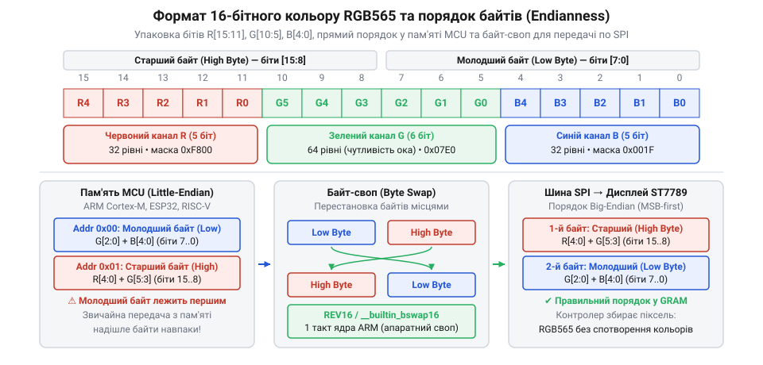
*Розподіл бітів по колірних каналах, виникнення спотворення через різницю порядків байтів у пам'яті процесора та на шині SPI, а також відновлення тону за допомогою байт-свопу.*

### Способи перестановки байтів (байт-своп)

Щоб кольори на екрані відповідали коду, байти кожного 16-бітного слова необхідно поміняти місцями (виконати @@en|byte swap@@) перед відправленням у чергу передавача SPI.

Існує кілька способів виконання цієї операції:

1. **Програмна перестановка бітовими зсувами.**
   Базовий вираз змінює байти місцями засобами мови:
   ```c
   static inline uint16_t swap_bytes(uint16_t val)
   {
       return (val >> 8) | (val << 8);
   }
   ```
   Цей код повністю переносний між архітектурами, проте під час виведення великих масивів пікселів програмні зсуви навантажують обчислювальне ядро.

2. **Апаратні інструкції ядра процесора.**
   Сучасні 32-бітні процесори мають спеціалізовану апаратну інструкцію для зміни порядку байтів за один машинний такт. Компілятори GCC та Clang підтримують вбудовану оптимізовану функцію:
   ```c
   uint16_t color_ready = __builtin_bswap16(color);
   ```
   На ядрах ARM Cortex-M3, M4, M7 та M33 цей виклик розгортається в одну машинну інструкцію `rev16`. Вона миттєво змінює порядок байтів усередині регістра без затримок конвеєра.

3. **16-бітний режим апаратного модуля SPI.**
   Якщо периферійний модуль SPI мікроконтролера підтримує налаштування ширини кадру на 16 бітів (наприклад, у мікроконтролерах STM32 через конфігураційний біт `DFF` або поле `DS`), перестановка байтів у пам'яті взагалі не потрібна.
   Коли ядро записує 16-бітне слово в регістр даних передавача, периферійний модуль послідовно виставляє на лінію `MOSI` біти від 15 до 0. Таким чином, біти 15..8 (старший байт кольору) фізично передаються першими, що повністю задовольняє вимоги контролера ST7789.

4. **Формування кольорів одразу в Big-Endian форматі.**
   Якщо константи кольорів задаються статично, їх вигідно пакувати з уже переставленими байтами на етапі компіляції:
   ```c
   #define COLOR_RED_SWAPPED   0x00F8  /* 0xF800 зі зміненим порядком байтів */
   #define COLOR_GREEN_SWAPPED 0xE007  /* 0x07E0 зі зміненим порядком байтів */
   #define COLOR_BLUE_SWAPPED  0x1F00  /* 0x001F зі зміненим порядком байтів */
   #define COLOR_WHITE_SWAPPED 0xFFFF
   #define COLOR_BLACK_SWAPPED 0x0000
   ```
   Цей підхід активно використовують графічні бібліотеки, зокрема фреймворк LVGL в [проєкті монітора на базі LVGL](root:cat-hw-actuators/ips-st7789/proj-st7789-lvgl-sensor-dashboard.md) за допомогою прапорця попередньої обробки `LV_COLOR_16_SWAP`. Це позбавляє мікроконтролер необхідності попіксельної обробки буфера перед відправкою кадру.

## Покроковий алгоритм запуску та побудова автономного C/C++ драйвера

Керування дисплеєм без застосування сторонніх бібліотек дозволяє контролювати стан шини, мінімізувати розмір бінарного коду та гарантувати точне витримування часових інтервалів. Програмний драйвер без операційної системи (@@en|bare-metal@@, від англ. @@en|bare metal@@ — голе залізо) взаємодіє з апаратурою безпосередньо. Він спирається лише на шар абстракції обладнання (@@en|HAL@@, від англ. @@en|Hardware Abstraction Layer@@), що зводиться до кількох функцій: встановлення логічного рівня на лініях GPIO та передачі масиву байтів через шину SPI.

Повна схема підключення ліній і призначення контактів модуля наведені в [довіднику цоколівки та інтерфейсу IPS 1.3″ ST7789](root:cat-hw-actuators/ips-st7789/api-ips-1-3-st7789-pinout.md).

### Часова діаграма та послідовність подачі живлення

Контролер ST7789 містить аналогові помпи заряду, логічні схеми синхронізації та статичну відеопам'ять кадру. Порушення послідовності старту або скорочення технологічних пауз призводить до того, що внутрішні помножувачі напруги не встигають вийти на стабільний режим. У результаті екран блокується в стані апаратного збою або піддає рідкі кристали деструктивній постійній напрузі.

Процедура ініціалізації розгортається за чітким регламентом:

1. **Стабілізація первинного живлення.**
   Після подачі напруги 3.3 В на контакти живлення модуль потребує паузи щонайменше 10–20 мс для заряду фільтрувальних керамічних конденсаторів і виходу інтегрованого регулятора LDO на номінальний режим. Будь-які сигнали на лініях керування до завершення перехідних процесів живлення неприпустимі.

2. **Формування апаратного імпульсу скидання (лінія RES).**
   Контролер має виділений вхід скидання з низьким активним рівнем. Для надійного перезапуску внутрішніх лічильників і автоматів керування мікроконтролер опускає лінію `RES` у нульовий логічний рівень і утримує її щонайменше 10 мікросекунд (на практиці формують затримку тривалістю від 20 до 50 мкс). Після цього лінію повертають у високий стан (3.3 В).

3. **Пауза завантаження заводських калібрувань.**
   Після зняття сигналу скидання чип вичитує службові коефіцієнти гамма-кривих та параметри зміщень із внутрішньої енергонезалежної пам'яті (OTP). До завершення цього зчитування шина SPI залишається неактивною. Мінімальна затримка після повернення `RES` у високий рівень становить 5 мілісекунд.

4. **Програмне скидання (`SWRESET`, код `0x01`).**
   Перша команда шини повертає конфігураційні регістри в початковий стан. Після надсилання байта `0x01` процесор витримує паузу не менше 150 мілісекунд (за стандартом — 120 мс), протягом яких кристал скидає внутрішню логіку.

5. **Вихід зі сплячого режиму (`SLPOUT`, код `0x11`).**
   За замовчуванням після скидання ST7789 перебуває в режимі сну з вимкненими генераторами внутрішнього тактування та знеструмленими високовольтними драйверами матриці. Команда `SLPOUT` запускає внутрішні осцилятори й каскади помп заряду.

6. **Критична пауза стабілізації помп (120 мс).**
   Це найважливіший інтервал запуску. Внутрішні помножувачі напруги мають сформувати високі потенціали живлення затворів польових транзисторів матриці: напругу відкривання затворів близько +13 В та напругу надійного замикання близько −10 В. Повний заряд накопичувальних ємностей вимагає не менше 120 мілісекунд. Якщо подати наступні команди конфігурації або ввімкнути сканування раніше, ніж помпи досягнуть цільових рівнів напруги, на затворах транзисторів виникне перекіс потенціалів. Це провокує затікання заряду в рідкокристалічні комірки, появу паразитних тіней або повну втрату контрасту.

7. **Конфігурація формату кольору (`COLMOD`, код `0x3A`).**
   Параметр `0x55` встановлює 16-бітний колір RGB565 для внутрішньої пам'яті кадру та вхідного послідовного інтерфейсу.

8. **Напрямок сканування та колірна модель (`MADCTL`, код `0x36`).**
   Байт конфігурації визначає орієнтацію рядків і колонок. При цьому враховується [математика апаратних зміщень координат вікна](root:cat-hw-actuators/ips-st7789/math-gram-window-offsets.md), оскільки фізична матриця 240×240 займає лише частину буфера пам'яті розміром 240×320.

9. **Увімкнення колірної інверсії (`INVON`, код `0x21`).**
   Для IPS-панелей, що працюють у режимі блокування світла за відсутності поля (@@en|normally black@@), ця команда обов'язкова. Без неї зображення відображається у фотонегативі: білий колір виглядає чорним, а червоний — блакитним.

10. **Активація формування зображення (`DISPON`, код `0x29`).**
    Команда запускає тактування драйверів рядків і стовпців. Між командою `DISPON` та фактичним виведенням графіки витримують паузу близько 20 мс.

11. **Початкове очищення кадру та активація підсвічування.**
    Перш ніж увімкнути світлодіодне підсвічування лінії `BLK`, драйвер повинен повністю заповнити видиму область чорним кольором. Якщо увімкнути підсвічування до очищення пам'яті, користувач побачить короткий яскравий спалах випадкового цифрового шуму, що залишився у відеопам'яті після ввімкнення живлення.

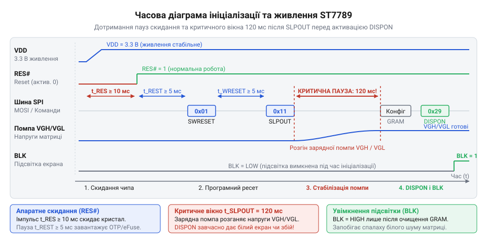
*Часова послідовність сигналів живлення, апаратного скидання та команд ініціалізації ST7789: точне витримування паузи 120 мс після команди SLPOUT гарантує вихід внутрішніх помп заряду на стабільний режим до активації розгортки.*

> 🔧 **Навіщо це.**
> Дотримання точних пауз під час запуску дисплея гарантує стабільну роботу пристрою при коливаннях температури навколишнього середовища. За низьких температур внутрішній опір ключів помножувача напруги зростає, і скорочення паузи 120 мс призводить до того, що на холоді екран взагалі не стартує.

### Програмна реалізація драйвера на мовах C та C++

Низькорівневий драйвер поділяється на три функціональні рівні:
1. **Рівень ліній зв'язку:** функції передачі байта команди (`st7789_write_command`) та блоку даних (`st7789_write_data`). Різниця полягає в стані лінії вибору режиму `DC`: логічний нуль позначає команду, логічна одиниця — параметри або коди пікселів.
2. **Рівень адресації:** встановлення прямокутного вікна (`st7789_set_address_window`) за допомогою команд `CASET` (вибір колонок, `0x2A`), `RASET` (вибір рядків, `0x2B`) та переведення матриці в режим прийому пікселів `RAMWR` (`0x2C`).
3. **Рівень графічних примітивів:** повне очищення екрана, малювання окремого пікселя з відсіканням за межами панелі (@@en|clipping@@, від англ. @@en|to clip@@ — обрізати) та швидке виведення зафарбованого прямокутника.

Повний перелік системних викликів наведено у вставці [програмного C/C++ API низькорівневого драйвера](root:cat-hw-actuators/ips-st7789/api-st7789-c-driver.md).

Нижче наведено практичну реалізацію драйвера: процедурний модульний код на мові C з виділеним шаром HAL та об'єктно-орієнтовану реалізацію на C++ для вбудованих систем.

:::tabs

:::code ips-st7789-d/c/snippet-5.c

:::code ips-st7789-d/c/write-cmd.c

:::code ips-st7789-d/cpp/st7789.cpp

:::

Для досягнення максимальної плавності графіки (понад 45 FPS) блокуюче надсилання пікселів замінюють асинхронним обміном з подвійною буферизацією, механізм якого продемонстровано у [проєкті швидкого індикатора з DMA](root:cat-hw-actuators/ips-st7789/proj-st7789-dma-gauge.md).

## Продуктивність тракту: розрахунок смуги пропускання SPI, межа FPS та асинхронне виведення через DMA

Коли графічний дисплей керується через послідовну шину, кожен піксель зображення мусить пройти через фізичну лінію даних біт за бітом. Для повноколірного екрана з роздільною здатністю 240×240 точок у форматі [RGB565](root:sf-visual/rgb565-color-format) кожен піксель кодується двома байтами (16 бітів). Передача повного статичного кадру вимагає прокачування фіксованого масиву даних:

```
V_frame
= 240 × 240 × 2          [роздільна здатність матриці на розмір пікселя RGB565]
= 57 600 × 2             [загальна кількість точок на 2 байти]
= 115 200 байтів         [підсумковий обсяг одного кадру]
```

У двійкових одиницях фізичного рівня шини [SPI](root:com-devices/spi-bus) це становить майже мільйон бітів:

```
V_bits
= 115 200 × 8            [переведення байтів у біти]
= 921 600 бітів          [загальний бітовий обсяг піксельних даних]
```

Якщо мікроконтролер тактує шину на типовій базовій частоті `f_SCK = 10 МГц`, тривалість одного тактового імпульсу складає `t_bit = 1 / 10 000 000 = 100 нс`. Чистий час фізичного проходження піксельних бітів по лінії становить:

```
T_wire_10M
= 921 600 × 100 нс       [кількість бітів на період тактування]
= 92 160 000 нс          [час тактування корисних даних]
= 92.16 мс               [переведення в мілісекунди]
```

До цього значення додаються накладні витрати: надсилання службових команд встановлення прямокутного вікна `CASET` і `RASET`, перемикання лінії керування `DC`, зміна рівня вибору чипа `CS` та мікросекундні паузи між байтами при програмному керуванні. Реальний час оновлення кадру зростає до 95–100 мс. Це накладає жорстку фізичну межу на частоту оновлення екрана (кадрова частота, @@en|FPS@@ — від англ. @@en|Frames Per Second@@, кадрів за секунду; лат. secundus — наступний):

```
FPS_10M
= 1000 мс / 100 мс       [відношення секунди до тривалості кадру]
= 10 кадрів/с            [максимальна швидкість оновлення]
```

Частота 10 кадрів/с сприймається людським оком як дискретне слайд-шоу, унеможливлюючи плавну анімацію інтерфейсу чи відтворення динамічних графіків. Проте головна проблема блокуючого виводу полягає навіть не у швидкості: під час виконання циклів очікування регістрів передавача (`while (!(SPI->SR & TXE))`) обчислювальне ядро процесора на 100% заблоковане передачею байтів. Жоден такт не виділяється на опитування сенсорів, обробку сигналів чи взаємодію з користувачем.

> 🔧 **Навіщо це.**
> Розрахунок пропускної здатності шини та перехід на асинхронний конвеєр розривають жорстку залежність між часом фізичної передачі бітів по дротах і роботою програми. Без цього мікроконтролер перетворюється на дорогий передавач бітів, нездатний одночасно анімувати рух стрілки приладу та вимірювати вхідний сигнал.

Перший крок подолання вузького місця — підвищення тактової частоти `SCK`. За специфікацією виробника контролер ST7789 підтримує мінімальний період такту запису `t_SCYCW = 16 нс`, що відповідає теоретичній частоті до 62.5 МГц. На практиці при підключенні модуля короткими лініями зв'язку стабільною робочою межею є частоти 40–50 МГц. За частоти `f_SCK = 40 МГц` період такту скорочується до `t_bit = 25 нс`:

```
T_wire_40M
= 921 600 × 25 нс        [кількість бітів на період тактування 40 МГц]
= 23 040 000 нс          [час безперервного тактування шини]
= 23.04 мс               [переведення в мілісекунди]
```

Теоретична межа частоти кадрів зростає до `1000 / 23.04 ≈ 43.4 кадри/с`, що повністю задовольняє вимоги до плавного графічного інтерфейсу (детальні математичні моделі та врахування міжпакетних пауз наведено у вставці [Розрахунок смуги пропускання шини SPI та частоти кадрів](root:cat-hw-actuators/ips-st7789/math-spi-display-bandwidth.md)).

Однак просте підвищення частоти шини не розв'язує проблему блокування процесора: ядро продовжує простоювати в очікуванні завершення кожного байта, витрачаючи ті самі 23 мс обчислювального часу на кожен кадр.

Природним розв'язком є делегування передачі масиву спеціалізованому апаратному вузлу — контролеру прямого доступу до пам'яті (@@en|DMA@@ — від англ. @@en|Direct Memory Access@@; direct — прямий; memory — пам'ять, від лат. memoria; access — доступ, від лат. accessus — наближення). Детальніше принципи цього вузла висвітлює [потокове виведення на дисплей через DMA](root:hw-arch/dma-display-streaming). Контролер DMA здатний самостійно вичитувати байти з оперативної пам'яті мікроконтролера та завантажувати їх у зсувний регістр SPI без участі процесора.

Тут інженер стикається з обмеженням оперативної пам'яті (RAM). Повний кадровий буфер екрана 240×240 точок у форматі RGB565 займає 115 200 байтів (112.5 КіБ). Більшість популярних мікроконтролерів для вбудованих систем мають від 20 до 64 КіБ загальної пам'яті SRAM, тому виділити безперервний масив розміром 112.5 КіБ під повний кадр фізично неможливо. Навіть на чипах із 256–512 КіБ RAM резервування третини пам'яті під один дисплей є необґрунтованим марнотратством.

Архітектурний вихід — подвійний рядковий буфер, або [подвійна буферизація пінг-понг](root:sf-devices/ping-pong-double-buffering) (@@en|ping-pong buffer@@ — пінг-понг буфер; фр. bouffard — захисна подушка). Матриця дисплея розбивається по вертикалі на кілька однакових горизонтальних смуг заввишки, наприклад, 16 рядків. Загальна висота 240 рядків ділиться на 15 блоків (`240 / 16 = 15`). Для роботи створюються два однакові масиви `Buffer A` та `Buffer B`.

Розмір одного 16-рядкового блоку становить:

```
V_block
= 240 × 16 × 2           [ширина на висоту смуги на глибину кольору]
= 3840 × 2               [кількість точок у смузі на 2 байти]
= 7680 байтів            [розмір одного буфера смуги]
```

Два такі буфери потребують сумарно лише:

```
V_buffers
= 7680 × 2               [два буфери A та B]
= 15 360 байтів          [15 КіБ оперативної пам'яті замість 112.5 КіБ]
```

Організація передачі будується у вигляді конвеєра (англ. @@en|pipeline@@ — трубопровід, конвеєр; pipe — труба, line — лінія), де обчислення наступної графічної смуги процесором та передача поточної смуги апаратним DMA відбуваються одночасно в паралельних потоках.

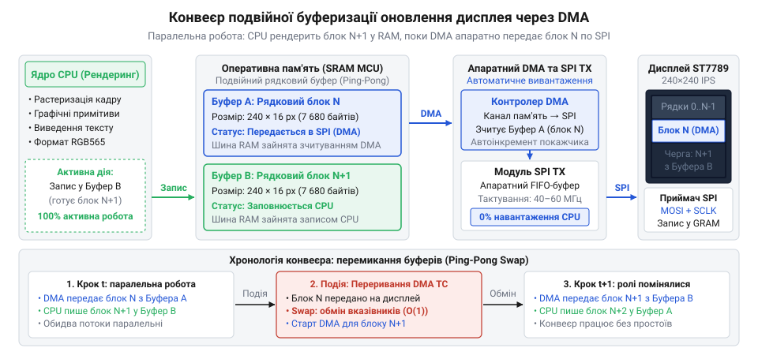
*Конвеєр фонового оновлення дисплея через DMA з подвійним рядковим буфером: процесор заповнює наступний буфер одночасно з апаратною передачею поточного по шині SPI без затримок ядра CPU.*

Конвеєр працює за чітким тактовим алгоритмом:
1. Процесор генерує графічні примітиви для рядків 0..15 і записує кольори пікселів у `Buffer A`.
2. Драйвер встановлює апаратне вікно ST7789 командою `CASET` (колонки 0..239) та `RASET` (рядки 0..15), перемикає лінію `DC` у стан даних і запускає асинхронну транзакцію DMA для масиву `Buffer A`.
3. Поки контролер DMA самостійно прокачує 7680 байтів з `Buffer A` в шину SPI, процесор розраховує та малює графіку наступної смуги (рядки 16..31) у `Buffer B`.
4. Завершення передачі DMA викликає апаратне переривання або встановлює прапорець готовності. Процесор переконується, що `Buffer B` заповнений, перемикає вікно ST7789 на рядки 16..31 і негайно запускає передачу DMA з `Buffer B`.
5. Поки DMA передає `Buffer B`, процесор повертається до `Buffer A` і починає малювати рядки 32..47.

Оскільки час малювання простої графіки (індикаторів, тексту чи ліній) зазвичай менший або співмірний із часом передачі смуги через SPI на частоті 40 МГц (`7680 × 8 × 25 нс ≈ 1.54 мс`), час формування повного кадру визначається суто фізичною пропускною здатністю шини:

```
T_frame_pipelined
= 15 × 1.54 мс           [15 блоків на час передачі одного блоку через DMA]
= 23.1 мс                [сумарний час передачі кадру]
```

Це забезпечує стабільні 40–45 кадрів на секунду без візуальних розривів і мерехтіння. При цьому процесор виконує корисну роботу з формування пікселів замість пустого очікування, або взагалі переходить у режим зниженого споживання (WFI — Wait For Interrupt), коли графіку наступного блоку вже розраховано раніше, ніж завершилась передача.

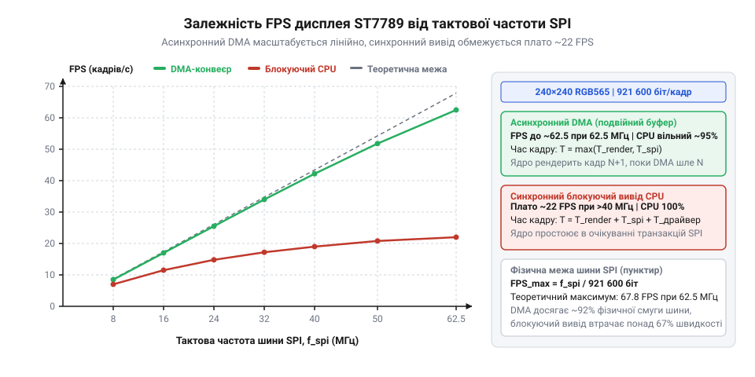
*Графік залежності реальної частоти кадрів (FPS) від тактової частоти шини SPI для синхронного блокуючого виводу та асинхронного конвеєра DMA: конвеєризація забезпечує виведення на максимальній фізичній швидкості шини без простоїв ядра CPU.*

Приклад практичної реалізації такого механізму в низькорівневому коді демонструє взаємодію між ядром мікроконтролера та периферійним DMA. Програмний інтерфейс драйвера, наведений нижче, відповідає специфікації [низькорівневого C/C++ API ST7789](root:cat-hw-actuators/ips-st7789/api-st7789-c-driver.md). Практичне застосування цієї схеми для виведення стрілочних та кругових приладів показано в проєкті [Стрілочний індикатор на базі ST7789 та DMA](root:cat-hw-actuators/ips-st7789/proj-st7789-dma-gauge.md), а інтеграцію подвійного буфера з віконним менеджером — у проєкті [Панель моніторингу сенсорів з бібліотекою LVGL](root:cat-hw-actuators/ips-st7789/proj-st7789-lvgl-sensor-dashboard.md).

:::tabs
:::code ips-st7789-d/c/st7789-dma-transfer-complete-isr.c
:::code ips-st7789-d/cpp/st7789dmapipeline.cpp
:::

## Діагностика типових проблем: апаратний сніг, зсуви, інверсія, просідання живлення та спотворення сигналів

При першому підключенні модуля 1.3″ IPS до мікроконтролера розробники часто стикаються з дефектами зображення: екран залишається суцільно білим або чорним, кольори набувають вигляду фотонегатива, біля краю матриці з'являється шумова смуга з хаотичних точок, або картинка розпадається на тремтячі лінії при спробі прискорити шину SPI. Переважна більшість таких несправностей викликана не фізичним пошкодженням кристала ST7789 чи рідкокристалічного скла, а типовими розбіжностями між математичною моделлю контролера, протоколом ініціалізації та схемотехнічними параметрами підключення.

Систематичне зіставлення зовнішніх проявів дефектів із їхніми першопричинами подано на схемі діагностики:

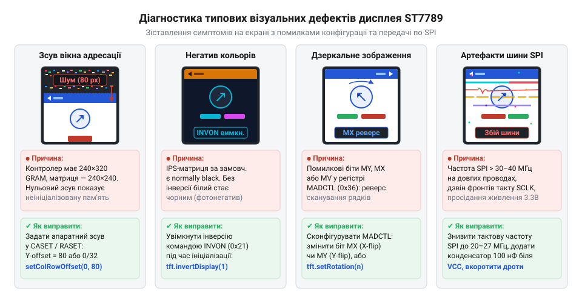
*Зіставлення апаратних і програмних помилок із зовнішнім виглядом екрана: смуга шуму при помилковому зміщенні вікна, фотонегативні кольори при вимкненій інверсії, перевернута орієнтація та спотворення пікселів на завищеній частоті SPI.*

> 🔧 **Навіщо це.**
> Покрокова діагностика (грец. διαγνωστικός, diagnostikos — здатний розпізнавати; dia — наскрізь, gnosis — знання) за візуальними ознаками дає змогу за лічені секунди відокремити програмну помилку ініціалізації регістрів від апаратного дзвону на шині SPI чи просідання напруги, захищаючи розробника від безпідставної заміни справних модулів.

Нижче наведено детальний аналіз фізичних та програмних механізмів кожної з типових несправностей і чіткі інженерні методи їх усунення.

### 1. Апаратний сніг і зміщення координат вікна

**Симптом:** зображення зсунуте вбік або вгору/вниз, частина корисної графіки зрізана за межами екрана, а вздовж протилежного краю дисплея відображається статична або мерехтлива смуга хаотично забарвлених пікселів («апаратний сніг»).

**Причина:** кристалічний драйвер ST7789 містить вбудовану відеопам'ять (GRAM) розміром 240 стовпців на 320 рядків (докладніше структуру кристала розкриває вставка [Узагальнений клас мікросхем контролерів дисплеїв](root:cat-hw-actuators/ips-st7789/comp-display-driver-controller.md)). Проте фізична скляна матриця 1.3″ IPS має лише 240×240 точок. Решта 80 рядків кристала апаратно не підключені до жодних електродів рідкокристалічної панелі.

Залежно від розведення фабричного гнучкого шлейфа дисплея, видима зона 240×240 займає не нульовий діапазон рядків, а зміщена всередині адресного простору GRAM. Якщо драйвер викликає команди встановлення вікна `CASET` (Column Address Set, код `0x2A`) та `RASET` (Row Address Set, код `0x2B`) із «наївними» координатами від 0 до 239 без урахування апаратного зсуву, дані записуються в непідключену пам'ять. Натомість видима ділянка дисплея частково показує комірки GRAM, куди програма взагалі не записувала дані. Після подачі живлення ці комірки містять випадковий стан транзисторів пам'яті, що виглядає як різнокольоровий цифровий шум.

**Розв'язок:** при розрахунку вікна виводу до логічних координат обов'язково додаються базові зміщення `X_offset` та `Y_offset`. Значення зміщень залежать від вибраного кута повороту екрана. Для модуля 1.3″ IPS 240×240 типові зміщення становлять:
- Орієнтація 0° (портретна): `X_offset = 0`, `Y_offset = 0` (або `Y_offset = 80` на деяких ревізіях модулів);
- Орієнтація 90° (альбомна): `X_offset = 0`, `Y_offset = 0` (або `X_offset = 80`);
- Орієнтація 180°: `X_offset = 0`, `Y_offset = 80`;
- Орієнтація 270°: `X_offset = 80`, `Y_offset = 0`.

Формули перетворення вікон і правила відсікання меж детально виведено у вставці [Математичний розрахунок апаратних зсувів координат](root:cat-hw-actuators/ips-st7789/math-gram-window-offsets.md).

### 2. Інверсія кольорів: ефект фотонегатива

**Симптом:** кольори на екрані інвертовані: чорний фон відображається яскраво-білим, білий текст стає чорним, червоні елементи інтерфейсу стають блакитними (ціановими), а зелені — пурпуровими. Зображення нагадує фотографічний негатив.

**Причина:** полягає у фундаментальній оптоелектроніці панелі (детально описаній у вставці [Узагальнений клас матриць IPS](root:cat-hw-actuators/ips-st7789/comp-ips-tft-panel.md)). IPS-матриці за своєю фізичною природою належать до класу @@en|normally black@@ (звичайно чорні): рідкі кристали без прикладеної напруги заблоковані поляризаторами, і піксель не пропускає світло підсвічування. На противагу цьому, старіші дешеві панелі TN TFT (наприклад, [TFT 1.77″ ST7735S](root:cat-hw-actuators/tft-st7735s)) є @@en|normally white@@ (звичайно білими) і пропускають світло без напруги.

Контролер ST7789 універсальний: він здатен працювати з обома типами панелей. Проте його внутрішній регістр конфігурації після скидання за замовчуванням виставляє режим `INVOFF` (Display Inversion Off, код `0x20`), оптимізований саме під TN-панелі. При надсиланні коду чорного кольору `0x0000` драйвер формує нульову напругу на електродах. Для панелі TN це дає чорний колір, але для матриці IPS це означає максимальне блокування, або навпаки — залежно від полярності керування напругою.

**Розв'язок:** у ланцюжку ініціалізації драйвера після виходу зі сну обов'язково надсилається команда увімкнення апаратної інверсії `INVON` (Display Inversion On, код `0x21`). Повний опис регістрів наведено у вставці [Система команд та регістрів ST7789](root:cat-hw-actuators/ips-st7789/api-st7789-command-set.md). Без команди `INVON` отримати коректну передачу кольорів на IPS-матриці фізично неможливо.

### 3. Дзеркальне відображення, перевертання осей або підміна RGB/BGR

**Симптом:** зображення перевернуте догори ногами, текст читається справа наліво у дзеркальному відображенні, рух об'єктів по осі X призводить до їх переміщення по осі Y, або синій та червоний канали поміняні місцями (людські обличчя виглядають синіми).

**Причина:** некоректна конфігурація керівного регістра орієнтації сканування (лат. oriens — схід, первинний напрямок) `MADCTL` (Memory Data Access Control, код `0x36`). Регістр містить бітові прапорці, які визначають, у якому напрямку апаратні лічильники ST7789 збільшують адресу стовпця та рядка при записі пікселів у GRAM:
- `MY` (біт 7, Page Address Order): змінює порядок перебору рядків зверху-вниз на знизу-вгору (дзеркало Y);
- `MX` (біт 6, Column Address Order): змінює порядок перебору стовпців зліва-направо на справа-наліво (дзеркало X);
- `MV` (біт 5, Row/Column Exchange): транспонує осі X та Y, змінюючи портретний режим на альбомний;
- `ML` (біт 4, Vertical Refresh Order): напрямок апаратної розгортки РК-панелі;
- `BGR` (біт 3, Color Selector): визначає порядок світлофільтрів субпікселів: `0` — порядок RGB, `1` — порядок BGR.

Якщо під час повороту екрана на 90° або 270° біт `MV` виставлено в 1, але біти `MX` та `MY` не узгоджено з фізичним розташуванням шлейфа, дисплей дає дзеркальне зображення. Якщо виставити біт `BGR = 1` для матриці з порядком смужок RGB, синій та червоний канали інвертуються.

**Розв'язок:** запис перевіреної маски бітів у регістр `MADCTL` відповідно до бажаного кута повороту:

| Кут повороту | Значення MADCTL | Біти (MY, MX, MV) | Порядок кольору | Зміщення (X, Y) |
| :--- | :--- | :--- | :--- | :--- |
| **0°** (за замовчуванням) | `0x00` | MY=0, MX=0, MV=0 | RGB (біт BGR=0) | (0, 0) |
| **90°** | `0x70` | MY=0, MX=1, MV=1 | RGB (біт BGR=0) | (0, 0) |
| **180°** | `0xC0` | MY=1, MX=1, MV=0 | RGB (біт BGR=0) | (0, 80) |
| **270°** | `0xA0` | MY=1, MX=0, MV=1 | RGB (біт BGR=0) | (80, 0) |

*Примітка: якщо кольори виглядають неприродно синіми, до відповідного байта додається маска `0x08` (біт BGR).*

### 4. Білий або чорний екран без реакції на команди

**Симптом:** дисплей не виводить жодної графіки. Екран залишається повністю чорним, або підсвічування світиться яскраво-білим світлом, але контролер не реагує на надсилання команд і даних. У деяких випадках при старті мікроконтролер циклічно перезавантажується.

**Причина 1: Порушення часової затримки після виходу зі сну `SLPOUT`.**
Контролер ST7789 містить внутрішні помпи помножувача напруги (charge pumps) для формування високовольтних рівнів відкривання затворів тонкоплівкових транзисторів (VGH/VGL до +13 В / -10 В). Після виходу зі сплячого режиму командою `SLPOUT` (код `0x11`) цим аналоговим схемам потрібно щонайменше 120 мілісекунд для стабілізації внутрішніх напруг та джерел опорного струму гамма-корекції. Якщо керуюча програма надсилає наступні команди ініціалізації одразу або використовує мікросекундну затримку замість мілісекундної, внутрішній цифровий автомат зависає в неініціалізованому стані.

**Причина 2: Просідання напруги живлення (@@en|voltage sag@@).**
Світлодіодна лінійка підсвічування модуля споживає від 30 до 50 мА струму. Якщо модуль підключено до 3.3-вольтового стабілізатора мікроконтролера через довгі макетні дроти, у момент подачі логічної одиниці на вхід `BLK` (ввімкнення підсвічування) виникає різкий стрибок споживання струму. Через паразитний активний опір контактів напруга на шині 3.3 В просідає нижче 2.5 В. Це спричиняє або апаратне скидання мікроконтролера за сигналом детектора зниження напруги (Brown-out Reset), або збій регістрів конфігурації ST7789.

**Причина 3: Конфлікт шини SPI на 7-вивідних модулях без виводу `CS`.**
На дешевих 7-контактних платах вивід вибору кристала `CS` з'єднаний із землею GND безпосередньо на платі (історія появи таких модулів описана у вставці [Історія появи модулів 1.3″ IPS у годинниках](root:cat-hw-actuators/ips-st7789/hist-smartwatch-display-breakouts.md)). Через це кристал ST7789 постійно слухає шину SPI. Якщо до тих самих ліній підключено інший периферійний пристрій (наприклад, SD-карту чи датчик), обмін даними з цим пристроєм сприймається дисплеєм як команди, збиваючи внутрішній стан контролера.

**Розв'язок:**
1. Обов'язкова апаратна пауза не менше 120 мс одразу після відправлення команди `SLPOUT`:
   ```c
   st7789_write_command(0x11); // SLPOUT: вихід зі сну
   delay_ms(120);              // Критична пауза для стабілізації помп заряду
   st7789_write_command(0x29); // DISPON: увімкнення відображення
   ```
2. Встановлення фільтрувального керамічного конденсатора ємністю 10 мкФ безпосередньо біля контактів VCC та GND на колодці модуля дисплея для демпфування пускових струмів.
3. Комутація контакту `BLK` через зовнішній польовий транзистор або використання окремого LDO-стабілізатора 3.3 В для живлення підсвічування.
4. На 7-вивідних модулях шина SPI має бути виділена виключно під дисплей, або слід обирати повноцінні 8-вивідні плати з ізольованим піном `CS` (деталі цоколівки наведено у вставці [Цоколівка та електричні параметри модуля](root:cat-hw-actuators/ips-st7789/api-ips-1-3-st7789-pinout.md)).

### 5. Тремтіння ліній, випадання байтів та артефакти на високій частоті SPI

**Симптом:** на тактовій частоті SPI 10 МГц зображення стабільне й чітке, але при збільшенні частоти до 30–40 МГц виникають випадкові горизонтальні зміщення рядків, окремі кольорові точки на суцільних заливках, текстури тремтять, або екран раптово втрачає орієнтацію та зсуває зображення по діагоналі.

**Причина:** деградація [цілісності сигналів](root:hw-pcb/signal-integrity-spi-bus) (@@en|signal integrity@@; лат. integer — цілий, непорушний; signum — знак) через високочастотні явища в довгих лініях зв'язку. Сучасні 32-бітні мікроконтролери формують фронти імпульсів SPI з часом наростання 1–3 наносекунди. За такої швидкості спектр сигналу містить гармоніки до сотень мегагерців.

Звичайний з'єднувальний провідник довжиною 15–20 см на безпайковій макетній платі має власну індуктивність близько 150–200 нГн та паразитну ємність відносно сусідніх ліній 10–20 пФ. Вхідні виводи контролера ST7789 мають високий вхідний опір і мізерну ємність (кілька пікофарад). У результаті на кінці лінії виникає ефект хвильового відбиття, що викликає затухаючий високочастотний резонансний дзвін (@@en|ringing@@ — дзвін, коливання; англ. ring — дзвеніти).

Якщо амплітуда коливального викиду напруги на лінії тактування `SCL` перевищує логічний поріг перемикання контролера, тригер Шмідта на вході ST7789 спрацьовує двічі на один такт (явище подвійного тактування, @@en|double clocking@@). У зсувному регістрі дисплея з'являється зайвий біт. Уся подальша послідовність байтів зсувається: старший біт кольору потрапляє на місце молодшого, координати вікон спотворюються, а екран покривається характерним косим шумом.

**Розв'язок:**
1. **Встановлення демпферних резисторів послідовного узгодження:** у розрив ліній `SCL` та `SDA` якомога ближче до вихідних ніжок мікроконтролера впаюються послідовні резистори (нім. dämpfen — глушити, гасити; лат. resistere — чинити опір) номіналом 22–47 Ом. Цей резистор разом із вхідною ємністю формує фільтр низьких частот, згладжуючи фронти сигналу та повністю гасячи коливальний дзвін:
   ```
   [Вивід МК SCL] ───[ 33 Ом ]───────────────────────────► [Вхід ST7789 SCL]
   [Вивід МК SDA] ───[ 33 Ом ]───────────────────────────► [Вхід ST7789 SDA]
   ```
2. **Скорочення фізичної довжини провідників:** довжина дротів між платою мікроконтролера та дисплеєм не повинна перевищувати 5–10 см на частотах понад 30 МГц.
3. **Екранування землею:** кожна сигнальна лінія високої частоти повинна супроводжуватися власним проводом заземлення GND поруч, або прокладатися над суцільним земляним полігоном друкованої плати для мінімізації площі індуктивного контуру.

Дотримання цих правил гарантує безперебійну роботу дисплея на граничних швидкостях контролера ST7789 без візуальних дефектів.

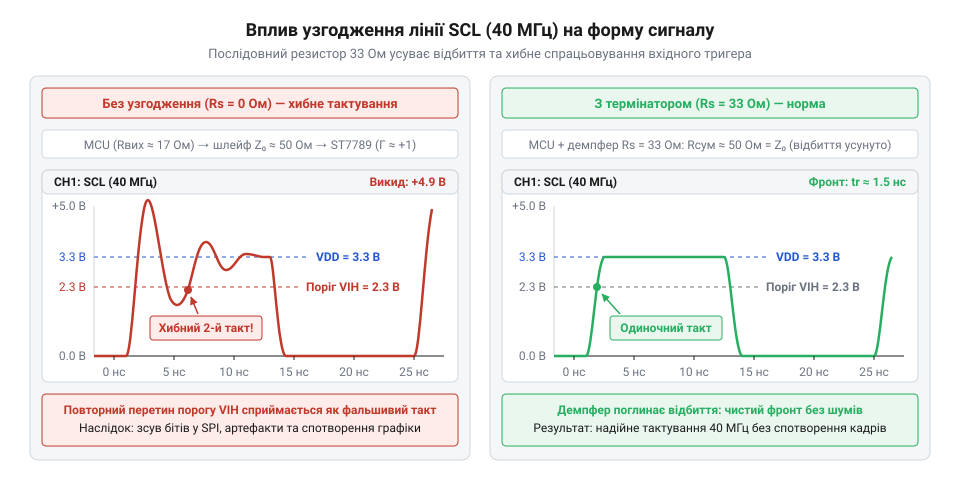
*Осцилограма форми тактового імпульсу SCL на частоті 40 МГц без узгодження (викиди напруги та дзвін, що перетинають поріг логічної одиниці) та після встановлення демпферного резистора 33 Ом (чистий фронт без шумів).*
