# IPS 1.3″ 240×240 (SPI, ST7789)

<preknowlist>
- [TFT 1.77″ 128×160 (SPI, ST7735S)](root:cat-hw-actuators/tft-st7735s) — принципи підключення графічних дисплеїв через шину SPI, призначення лінії DC для розрізнення команд і даних, оптичні обмеження TN-матриць за кутами огляду
- [OLED-дисплей 0.96″ SSD1306 (I2C, 128×64)](root:cat-hw-actuators/oled-ssd1306) — концепція координатної сітки пікселів (X, Y), принципи формування кадрового буфера в оперативній пам'яті мікроконтролера та проблема вигоряння люмінофора при статичному показі
</preknowlist>

## Обмеження простих екранів і ніша модуля IPS 1.3″

Компактні автономні прилади — кишенькові дозиметри, вимірювальні мультиметри, погодні станції, пульти керування та контролери батарей — потребують наочного відображення інформації. Користувачеві замало бачити сухі цифри: йому потрібні динамічні графіки зміни показників, піктограми стану акумулятора, кольорові зони аварійних меж і зручні меню налаштувань. Проте спроба побудувати такий інтерфейс на типовому мікроконтролері одразу стикається з оптичними або апаратними обмеженнями традиційних екранів.

Символьні рідкокристалічні панелі, такі як [Символьний дисплей LCD 1602A](root:cat-hw-actuators/lcd-1602) (англ. @@en|Liquid Crystal Display@@, рідкокристалічний дисплей, від лат. @@en|liquidus@@ — рідкий та грец. κρύσταλλος — лід, кришталь), мають жорстко зашиту матрицю знакомісць — зазвичай два рядки по 16 символів. На них неможливо побудувати довільну криву, вивести піктограму високої роздільності чи масштабувати шрифт: екран залишається суто текстовим.

Коли виникає потреба в довільній точковій графіці, розробник звертається до матричних мініатюрних екранів, наприклад, [OLED-дисплей 0.96″ SSD1306](root:cat-hw-actuators/oled-ssd1306) (англ. @@en|Organic Light-Emitting Diode@@, органічний світловипромінювальний діод, від грец. ὄργανον — знаряддя, інструмент та лат. @@en|di-@@ + грец. ὁδός — подвійний шлях). Матриці на органічних світлодіодах забезпечують глибокий контраст і мінімальну товщину, оскільки пікселі світяться самі й не потребують підсвічування. Проте органічні випромінювачі мають критичну ваду: нерівномірне деградування матеріалу під час тривалого світіння. У вимірювальних приладах рамки вікон, незмінні текстові мітки, шкали та піктограми живлення світяться годинами або днями на тих самих координатах. Пікселі під цими статичними зонами виснажуються швидше за сусідні, утворюючи незворотне вигоряння люмінофора (від лат. @@en|lumen@@ — світло та грец. φορός — носій) — на склі назавжди лишається темний відбиток інтерфейсу. До того ж більшість доступних OLED-модулів є монохромними й не дозволяють відокремити кольором тривожний стан приладу від норми.

Щоб отримати багатоколірне зображення без загрози органічного вигоряння, використовують рідкокристалічні дисплеї на тонкоплівкових транзисторах (англ. @@en|Thin-Film Transistor@@, TFT, від лат. @@en|transire@@ — переходити та англ. @@en|resistor@@). Проте бюджетні модулі, як-от [TFT 1.77″ 128×160](root:cat-hw-actuators/tft-st7735s), побудовані на матрицях типу TN (англ. @@en|Twisted Nematic@@, скручений нематик, від грец. νῆμα — нитка). Рідкі кристали в комірках такої матриці закручені у спіраль між двома скляними підкладками перпендикулярно до їхньої площини. Коли погляд спрямований суворо прямо, поляризоване світло проходить крізь шар передбачувано. Але варто відхилити екран на кілька градусів, як оптичний шлях крізь скручені молекули спотворюється: контраст різко падає, світлі тони вицвітають, а при погляді знизу або збоку кольори повністю інвертуються, перетворюючись на нерозбірливий фотонегатив. Для портативного приладу, кут огляду якого постійно змінюється в руках користувача, така оптична поведінка робить зчитування показників ненадійним.

Здавалося б, природним рішенням є встановлення повноцінної графічної РК-панелі безпосередньо до шини процесора. Проте тут розробник упирається в бар'єр пам'яті мікроконтролера. Графічна матриця формує зображення з пікселів (англ. @@en|pixel@@, скорочення від @@en|picture element@@ — елемент зображення, від лат. @@en|pictura@@ — картина та @@en|elementum@@ — першоелемент). Щоб екран світився стабільно, матрицю треба безперервно оновлювати десятками разів на секунду. Якщо панель не має власної пам'яті, мікроконтролер зобов'язаний тримати в оперативній пам'яті повний кадровий буфер (англ. @@en|framebuffer@@, від англ. @@en|frame@@ — кадр та @@en|buffer@@ — проміжний захисток, від старофранц. @@en|buffe@@ — удар, поштовх). Для роздільної здатності 240×240 пікселів у стандартному 16-бітному кольорі (RGB565, де кожен піксель займає 2 байти) обсяг пам'яті під один кадр становить:

```
240 × 240 × 2
= 115 200 байтів      [розмір піксельного масиву в байтах]
= 112.5 КіБ           [115 200 ÷ 1024 байтів у кібібайті]
```

Для порівняння, мікроконтролер ATmega328P має лише 2 КіБ оперативної пам'яті (SRAM), популярний STM32F103C8T6 містить 20 КіБ, а у чипа ESP8266 під потреби користувача лишається орієнтовно 40–80 КіБ. Жоден із цих чипів не здатен виділити 112.5 КіБ лише під одне зображення дисплея. Крім того, пряме керування панеллю потребує паралельної шини на 16–24 лінії даних і сигналів кадрової синхронізації, що забирає майже всі виводи мікроконтролера.

Модуль дисплея діагоналлю 1.3 дюйма з роздільною здатністю 240×240 пікселів під керуванням інтегрованого чипа ST7789 розв'язує ці суперечності завдяки трьом конструктивним складовим:

- **IPS-матриця** (англ. @@en|In-Plane Switching@@, перемикання в площині, від лат. @@en|planum@@ — площина). На відміну від TN, молекули рідких кристалів у комірках IPS не скручуються у вертикальну спіраль, а лежать паралельно скляним пластинам і повертаються суто в горизонтальній площині під дією поздовжнього електричного поля. Завдяки цьому оптичні властивості світла, що проходить крізь шар рідких кристалів, залишаються однаковими під будь-яким кутом зору. Зображення зберігає контраст, глибину чорного кольору та точну передачу відтінків під кутами до 178° як по горизонталі, так і по вертикалі без жодного ефекту інверсії кольорів.
- **Вбудована відеопам'ять GRAM** (англ. @@en|Graphic RAM@@, графічна оперативна пам'ять). Контролер ST7789 змонтований безпосередньо на склі дисплея за технологією COG (англ. @@en|Chip-On-Glass@@ — чип на склі) і містить власний апаратний масив пам'яті на 240×320 пікселів глибиною 18 бітів. ST7789 автономно зчитує цю пам'ять і безперервно регенерує зображення на склі з частотою близько 60 Гц. Мікроконтролеру більше не потрібно зберігати 112.5 КіБ кадрового буфера у власній пам'яті й витрачати такти ядра на розгортку — він звертається до дисплея лише тоді, коли потрібно оновити конкретні змінені координати чи вивести новий блок.
- **Шина SPI** (англ. @@en|Serial Peripheral Interface@@, послідовний периферійний інтерфейс, від лат. @@en|inter@@ — між та @@en|facies@@ — обличчя, вигляд). Замість громіздкої паралельної шини модуль потребує лише 4 сигнальні лінії для передачі даних і команд (лінії тактування, послідовних даних, вибору режиму «команда/дані» та керування вибором кристала або скиданням). Це дозволяє підключати якісний кольоровий графічний екран навіть до найпростіших мікроконтролерів, зберігаючи їхні виводи для датчиків і виконавчих пристроїв.

> 🔧 **Навіщо це.**
> Поєднання IPS-матриці та автономного контролера з власною відеопам'яттю усуває головний глухий кут компактних вбудованих систем: мікроконтролер із ліченими кілобайтами пам'яті та кількома вільними ніжками отримує можливість виводити повноколірну графіку рівня сучасного смартфона. Прилад можна нахиляти, тримати під довільним кутом і експлуатувати в режимі безперервної індикації роками, не побоюючись вицвітання під кутом чи вигоряння інтерфейсу.

## Оптичний пакет і геометрія рідких кристалів IPS

Рідкокристалічний екран не випромінює світло сам по собі — він діє як керований оптичний затвор, що перехоплює або пропускає світловий потік. Щоб керувати променем, шар матеріалу розміщують між оптичними фільтрами. Увесь модуль дисплея зібраний у багатошаровий пакет. Основою слугує світлодіодне підсвічування (@@en|backlight@@), поверх якого наклеєно нижній лінійний поляризатор. Далі встановлено скляну пластину з [активною матрицею тонкоплівкових транзисторів](root:hw-motion/tft) (@@en|TFT@@, англ. *thin-film transistor* — тонкоплівковий транзистор), де кожен транзистор комутує заряд окремого субпікселя. Над транзисторами лежить шар рідких кристалів нематичного типу (@@en|nematic@@, від грецького νη̃ма — нитка), здатних повертати площину поляризації світла. Завершують пакет матриця червоних, зелених і синіх колірних фільтрів та верхній вихідний поляризатор. Осі пропускання вхідного й вихідного поляризаторів розвернуті під кутом 90° одна до одної — це схрещені поляризатори (@@en|crossed polarizers@@). Якщо промінь проходить крізь кристали без зміни кута поляризації, вихідний фільтр поглинає його без залишку.

У класичних рідкокристалічних комірках типу [TN](root:cat-hw-actuators/tft-st7735s) (@@en|TN@@, англ. *twisted nematic* — скручений нематик) молекули закручені у спіраль між протилежними пластинами скла. Під дією напруги молекули випростовуються перпендикулярно до підкладки. Через це виникає просторова оптична анізотропія (@@en|optical anisotropy@@, від грецького ἄνισος — нерівний та τρόπος — напрямок): промінь, спрямований прямо, проходить крізь поздовжні осі молекул, а промінь під кутом — крізь поперечні. За відхилення погляду навіть на 30–40° екран різко втрачає контрастність, а відтінки інвертуються у фотонегатив.

В архітектурі IPS (@@en|IPS@@, англ. *in-plane switching* — перемикання в площині) керувальне поле формують інакше. Обидва електроди розташовують на одній нижній підкладці у вигляді взаємопроникних гребінок (@@en|interdigital electrodes@@). Електричне поле виникає паралельно склу. Під його дією довгі молекули кристалів не вигинаються вгору, а розвертаються суто в горизонтальній площині підкладки, наче стрілки годинника. Оскільки орієнтація молекул залишається незмінною відносно товщини комірки, бічні промені проходять той самий оптичний шлях, що й прямі. Це зберігає насиченість кольорів під кутами огляду до 178°.

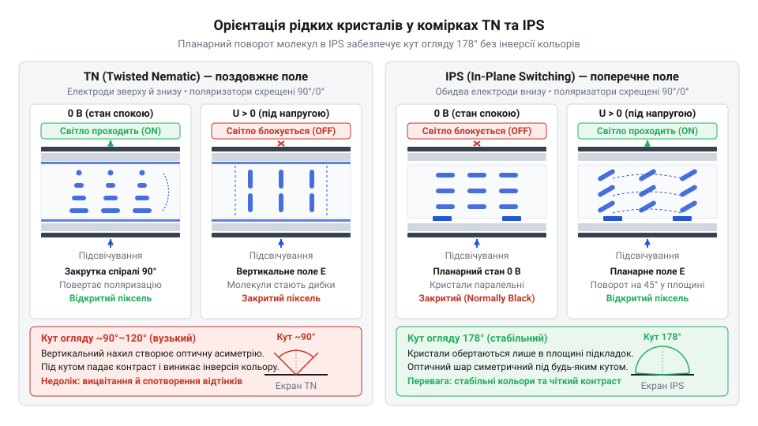
*Геометрія перемикання рідких кристалів: у комірках IPS гребінчасті електроди обертають молекули паралельно склу, усуваючи оптичну анізотропію та спотворення кольорів під кутами огляду до 178°.*

Положення кристалів за відсутності електричного поля задає початковий оптичний стан. У дисплеї 1.3″ IPS нематичні молекули в розслабленому стані вирівняні вздовж осі нижнього поляризатора. Світло проходить крізь них без обертання хвилі й повністю блокується схрещеним верхнім поляризатором. Без подачі напруги піксель залишається непрозорим — матриця працює в режимі normally black (@@en|normally black@@, англ. *normally black* — нормально-закритий). Подача напруги розвертає кристали горизонтально, змушуючи світлову хвилю повертатися й проходити крізь вихідний фільтр.

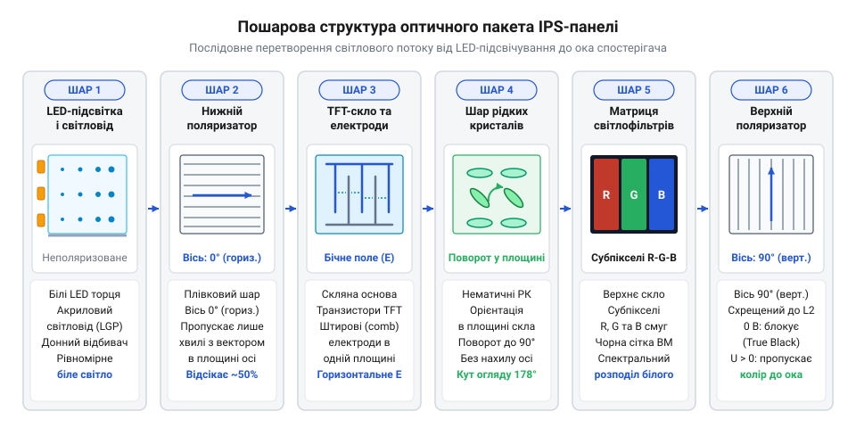
*Хід світлових променів крізь схрещені поляризатори та шар рідких кристалів у станах normally black та normally white: у режимі normally black без напруги хвиля повністю блокується вихідним фільтром.*

Нормально-закритий стан дає глибокий чорний колір і високу контрастність, оскільки закрита комірка фізично блокує світловий потік. Проте рідкокристалічний шар не світиться сам. Підсвічування позаду панелі працює безперервно незалежно від виведеного зображення. Саме на світлодіоди підсвічування припадає до 90% усього струму дисплейного модуля — приблизно 20–30 мА при живленні 3.3 В.

> 🔧 **Навіщо це.**
> Режим normally black дає чистий чорний колір без сірого засвічення, але не економить заряд: на відміну від [OLED-панелей](root:cat-hw-actuators/oled-ssd1306), показ чорного екрана тут не знижує струм споживання. Для подовження роботи автономного пристрою яскравість підсвічування обмежують ШІМ-керуванням через контакт BLK.

## Контролер ST7789: автономна регенерація та організація відеопам'яті

Кожна рідкокристалічна комірка працює як мініатюрний електричний конденсатор: тонкий шар діелектрика між електродами накопичує заряд, поданий через польовий транзистор. Але цей конденсатор не тримає напругу стабільно. Струми витоку крізь кристали та закритий транзистор розряджають комірку за частки мілісекунди. Щойно напруга падає, молекули розслабляються, а піксель повертається до закритого стану. Щоб картинка на екрані не тьмяніла й не мерехтіла, заряд у кожному пікселі потрібно поновлювати не менше 60 разів на секунду.

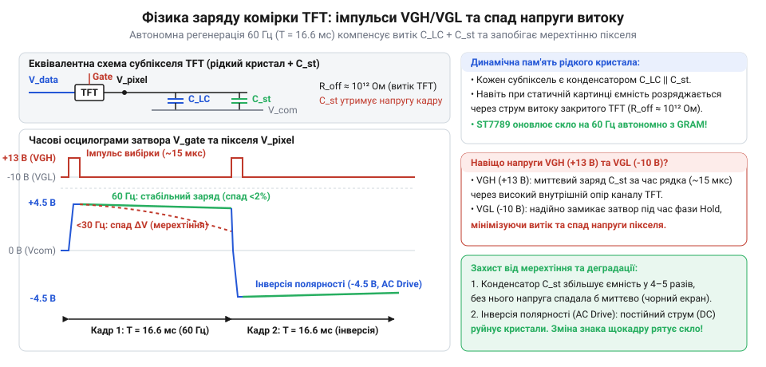
*Динаміка заряду та розряду комірки: через витоки струму напруга падає за частки мілісекунди, що вимагає регенерації заряду з частотою не менше 60 Гц.*

Для екрана роздільністю 240×240 точок із глибиною кольору 16 бітів (RGB565) потрібен такий потік даних:

Кадровий потік
= 240 × 240 × 16 бітів × 60 с⁻¹  [роздільність × глибина кольору × частота кадрів]
= 55 296 000 біт/с               [добуток]
≈ 55.3 Мбіт/с                    [переведення у мегабіти]

Безперервна передача 55.3 Мбіт/с повністю заблокувала б шину мікроконтролера, а збереження одного кадру вимагало б 112.5 КіБ оперативної пам'яті, якої немає в масових чипів на кшталт [контролерів із підтримкою простих дисплеїв](root:cat-hw-actuators/lcd-1602).

Цю проблему розв'язує графічний контролер ST7789. Його змонтовано безпосередньо на скляній підкладці екрана за технологією Chip-on-Glass (@@en|Chip-on-Glass@@, англ. *chip on glass* — чип на склі). Контролер містить власну статичну відеопам'ять GRAM (@@en|GRAM@@, від англ. *graphic random-access memory* — графічна пам'ять із довільним доступом) обсягом 240×320 точок по 18 бітів на колір. Внутрішній автомат розгортки самостійно зчитує байти з GRAM і з частотою 60 Гц перезаряджає рядки матриці. Мікроконтролеру більше не потрібно передавати кадри безперервно: він надсилає дані шиною SPI лише в моменти, коли зображення змінюється.

Для керування польовими транзисторами матриці звичайної напруги живлення 3.3 В недостатньо. Щоб відкрити затвор і швидко зарядити комірку за мікросекунди, потрібна висока напруга VGH (@@en|VGH@@, англ. *voltage gate high* — висока напруга затвора) рівня +12...+15 В. Для надійного замикання затвора на час сканування інших рядків необхідна від'ємна напруга VGL (@@en|VGL@@, англ. *voltage gate low* — низька напруга затвора) рівня -7...-10 В. Контролер ST7789 містить [вбудовані помпи заряду](root:hw-power/charge-pump) (@@en|charge pump@@, англ. *charge pump* — помпа заряду), які генерують ці біполярні рівні безпосередньо з вхідних 3.3 В за допомогою внутрішніх конденсаторів підкачування.

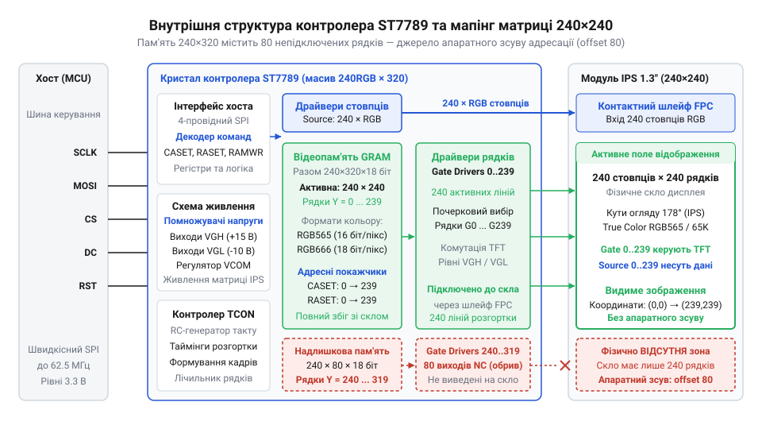
*Архітектура ST7789: вбудована відеопам'ять GRAM і помпи заряду VGH/VGL автономно регенерують стан матриці без участі зовнішнього процесора.*

Між внутрішнім простором пам'яті контролера та фізичним склом модуля існує апаратна розбіжність. Кристал ST7789 спроєктовано для прямокутних матриць формату QVGA на 240 стовпчиків і 320 рядків. Модуль 1.3″ має квадратну панель лише на 240 рядків. Через це 80 крайніх ліній керування затворами на склі залишаються фізично нерозведеними.

Проте масив пам'яті GRAM у чипі залишається повним — 240×320 комірок. Залежно від трасування конкретної ревізії скла, видимі 240 рядків екрана можуть починатися від нульового рядка пам'яті, бути центрованими або зміщеними на 80 рядків. Якщо мікроконтролер записує байти в буфер без урахування апаратного зсуву, частина кадрів потрапляє на непідключені рядки, а на видимій ділянці виникає смуга неініціалізованого шуму.

> 🔧 **Навіщо це.**
> Автономна GRAM дозволяє виводити складну кольорову графіку навіть із найпростіших мікроконтролерів із кількома кілобайтами RAM, оновлюючи лише змінені прямокутні вікна. Проте під час налаштування бібліотеки дисплея обов'язково вказують параметри зсуву координат (Y-offset або X-offset), інакше система намагатиметься малювати у непідключеній частині відеопам'яті ST7789.

## Схемотехніка модуля: живлення, узгодження рівнів і небезпека 7-вивідних плат

Рідкокристалічна панель разом із чипом керування не можуть працювати у схемі безпосередньо: скляна основа крихка, кристалу потрібна стабільна низьковольтна напруга з фільтрацією імпульсних завад, а світлодіодна матриця підсвічування споживає струм, що перевищує можливості виводів звичайного процесора. Друкована плата модуля перетворює скляну матрицю на закінчений вузол, об'єднуючи регулятор живлення, фільтрувальні ємності та схему комутації підсвічування.

Живлення логічного ядра та аналогових каскадів ST7789 становить 3.3 В. Для сумісності з різними джерелами живлення на платі встановлено лінійний стабілізатор (лат. *stabilis* — стійкий) з малим падінням напруги (англ. @@en|Low Dropout@@, LDO), як-от ME6211 або RT9193. Стабілізатор знижує вхідну напругу з виводу VCC (зазвичай від 3.6 В до 5.5 В) до фіксованих 3.3 В. Якщо система вже має стабілізовану лінію 3.3 В, модуль можна живити безпосередньо від неї: падіння напруги на повністю відкритому регуляторі становить лише близько 100–200 мВ, що зберігає працездатність схеми.

Особливістю внутрішньої архітектури ST7789 є помпи заряду (англ. @@en|charge pump@@). Вони генерують підвищені напруги керування затворами тонкоплівкових транзисторів матриці: позитивну напругу відкривання VGH (+13...+15 В) та негативну напругу надійного замикання VGL (-10 В). Комутація цих внутрішніх ємнісних помпових вузлів на високій частоті створює різкі імпульсні просідання струму в ланцюзі живлення. Для придушення високочастотних викидів на платі безпосередньо біля виводів живлення чипа розташовано керамічні блокувальні конденсатори (лат. *condensare* — згущувати) з низьким еквівалентним послідовним опором. Без належної локальної фільтрації пульсації на шині 3.3 В здатні зруйнувати внутрішні опорні рівні контролера, спричиняючи тремтіння зображення, горизонтальні смуги шуму або раптові перезавантаження логіки.

Світлодіоди підсвічування потребують для роботи від 20 до 40 мА струму, що є надмірним навантаженням для виводу загального призначення мікроконтролера. Через це на платі передбачено транзисторний комутатор (лат. *commutare* — змінювати) — біполярний NPN- або польовий N-канальний транзистор. Керувальний контакт BLK (або LED) під'єднано до бази чи затвора транзистора через струмообмежувальний резистор, а внутрішня підтяжка до лінії живлення тримає підсвічування постійно увімкненим, якщо вивід залишено вільним. Подаючи на контакт BLK логічний нуль, екран повністю гасять для збереження енергії, а підключення до сигналу широтно-імпульсної модуляції (ШІМ) дає змогу плавно налаштовувати яскравість свічення.

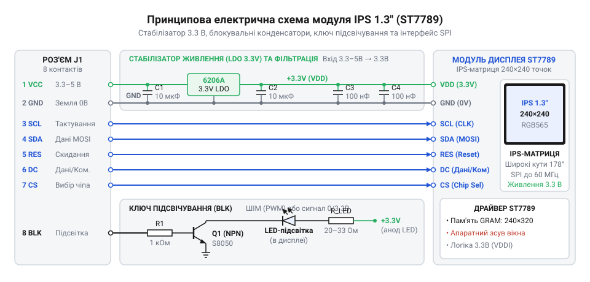
*Принципова електрична схема модуля: вхідне живлення стабілізується до 3.3 В, а шини SPI під'єднані безпосередньо до кристала ST7789.*

Хоча контакт VCC модуля допускає напругу 5 В завдяки вбудованому стабілізатору, сигнальні лінії шини зв'язку прямують безпосередньо до вхідних каскадів ST7789 без проміжних перетворювачів. Контролер виготовлено за технологією CMOS 3.3 В, і його цифрові входи не толерантні до напруги 5 В: максимальна допустима напруга на виводах не повинна перевищувати напругу живлення ядра плюс 0.3 В. Пряме підключення до керувальних плат із п'ятиватною логікою призводить до пробивання захисних діодів чипа, перегрівання та незворотного пошкодження вхідних буферів.

При роботі з 5-вольтовими контролерами обов'язковим є використання [вузлів узгодження рівнів](root:hw-digital/level-shifter):
- Резистивні дільники напруги (наприклад, 1 кОм у сигнальній лінії та 2 кОм на землю) знижують амплітуду сигналу до безпечних 3.3 В. Однак паразитна ємність монтажу разом з опором утворює фільтр низьких частот, який завалює крутизну фронтів і обмежує граничну частоту тактування шини SPI орієнтовно 4–8 МГц.
- Спеціалізовані цифрові буфери (англ. *buffer* — пом'якшувач) серії 74LVC (зокрема 74LVC245 або 74LVC1T45) забезпечують активне перезаряджання ємності лінії з мінімальною затримкою, що дає змогу вести обмін на максимальних для ST7789 частотах 20–40 МГц.
- Контролери із рідною напругою логіки 3.3 В підключаються до ліній модуля напряму, без додаткових обмежувальних компонентів.

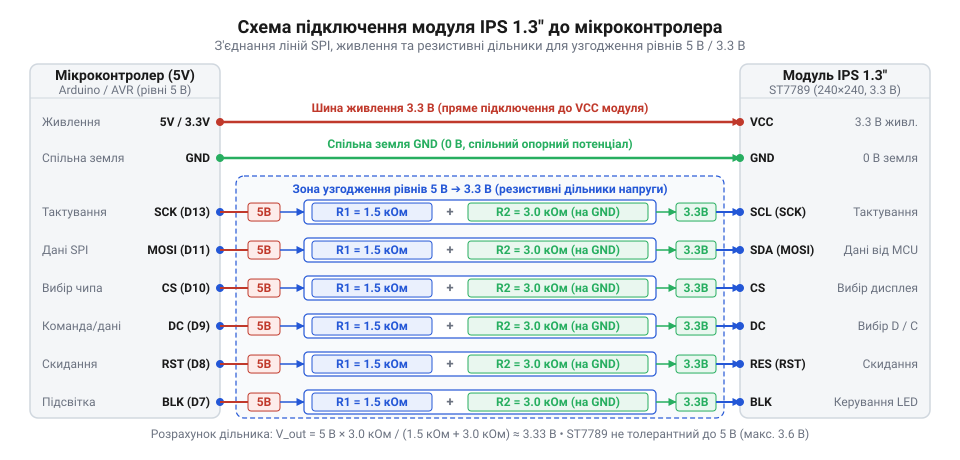
*Підключення модуля до мікроконтролера: пряме з'єднання з шиною 3.3 В або використання захисних дільників напруги та буферів 74LVC для 5-вольтових плат.*

Найпідступнішою практичною пасткою схемотехніки є поширені 7-вивідні варіанти плат. У повноцінному 8-вивідному модулі присутні всі виводи інтерфейсу: GND, VCC, SCL, SDA, RES, DC, CS, BLK. На 7-вивідних платах контакт вибору кристала CS (англ. @@en|Chip Select@@, вибір кристала) відсутній на гребінці — виробники модулів припаюють його доріжкою безпосередньо до загального проводу GND заради економії місця.

Постійне заземлення лінії CS несе дві системні небезпеки:
1. *Повна неможливість поділу шини SPI*: За стандартним протоколом високий рівень на CS переводить приймач у пасивний стан, дозволяючи обмінюватися даними з картами пам'яті SD чи іншими датчиками на тих самих лініях тактування й даних. При зафіксованому нулі ST7789 безперервно фіксує кожен імпульс на шині: будь-який обмін із сусіднім пристроєм дисплей сприймає як власні байти, записуючи сміття у відеопам'ять чи спотворюючи регістри налаштування. Модуль вимагає виключно виділеної шини.
2. *Неможливість скидання бітової фази*: Контролер очікує дані суворо порціями по 8 бітів. Якщо в момент увімкнення живлення або через електромагнітну наводку на лінії тактування SCL проскочить поодинокий паразитний сплеск, внутрішній лічильник бітів контролера зсунеться на один крок. На 8-вивідному модулі для скидання бітового лічильника достатньо підняти CS в одиницю та знову опустити в нуль. На 7-вивідній платі контакт CS заблоковано, тому відновити синхронізацію фази без повного апаратного скидання контролера імпульсом по лінії RES неможливо.

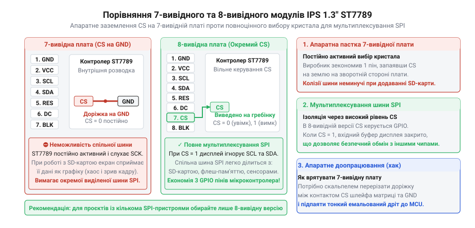
*Порівняння цоколівки та внутрішньої розводки 7-вивідної та 8-вивідної плат: відсутність виводу CS позбавляє можливості ділити шину SPI та скидати бітовий лічильник без перезапуску.*

> 🔧 **Навіщо це.**
> Для надійних комерційних виробів або пристроїв, де на спільну шину SPI підключено картридер чи зовнішню пам'ять, слід застосовувати виключно 8-вивідні плати з окремою лінією CS. Використання 7-вивідного модуля виправдане лише в найпростіших автономних індикаторах, де дисплей є єдиним периферійним пристроєм контролера і має окрему лінію апаратного перезапуску RES.

## Протокол обміну: керування лінією DC, часові затримки та ініціалізація

[Послідовна шина SPI](root:com-devices/spi-bus) передає потік байтів без внутрішнього розрізнення їхнього змісту: кожен байт виглядає як послідовність восьми імпульсів тактового сигналу. Якби протокол вимагав заголовка перед кожним блоком даних (як це реалізовано в складніших мережевих інтерфейсах), швидкість відтворення графіки впала б у кілька разів. Оновлення повноколірного кадру розміром 240×240 точок вимагає передачі 115 200 байтів інформації, тому будь-які протокольні накладні витрати безпосередньо знижують частоту кадрів.

Для розв'язання цього протиріччя в ST7789 використовують спеціальну апаратну лінію вибору даних або команд — DC (англ. @@en|Data/Command@@; лат. *dare* — давати та *mandare* — наказувати). Цей підхід аналогічний принципу керування в інших графічних екранах, зокрема в [TFT-дисплеях на базі ST7735S](root:cat-hw-actuators/tft-st7735s):
- `DC = 0` (низький логічний рівень): байт, що надходить шиною SPI, контролер інтерпретує як 8-бітний код команди чи адресу внутрішнього регістру (наприклад, команду вибору області адресації чи активації дисплея).
- `DC = 1` (високий логічний рівень): байти сприймаються як параметри щойно переданої команди або безпосередній масив кольорів точок для заповнення відеопам'яті.

Такий поділ усуває протокольні заголовки: контролер мікроконтролера надсилає єдину команду запису у відеопам'ять `0x2C` при низькому рівні лінії DC, перемикає DC у високий стан і починає безперервне передавання всього масиву пікселів на повній швидкості апаратного інтерфейсу.

Інтерфейс модуля використовує 4-провідний режим послідовного зв'язку (лінії CS, SCL, SDA, DC). Передавання даних завжди ведеться старшим бітом уперед (англ. @@en|Most Significant Bit first@@, MSB first). Контролер ST7789 підтримує два часові режими синхронізації шини:
- **SPI Mode 0**: лінія тактування SCL у пасивному стані утримує низький рівень (полярність CPOL = 0), а зчитування значення лінії даних SDA відбувається за переднім наростаючим фронтом тактового імпульсу (фаза CPHA = 0).
- **SPI Mode 3**: лінія SCL у стані спокою має високий рівень (CPOL = 1), а фіксація біта на лінії даних так само виконується за наростаючим фронтом сигналу (CPHA = 1).

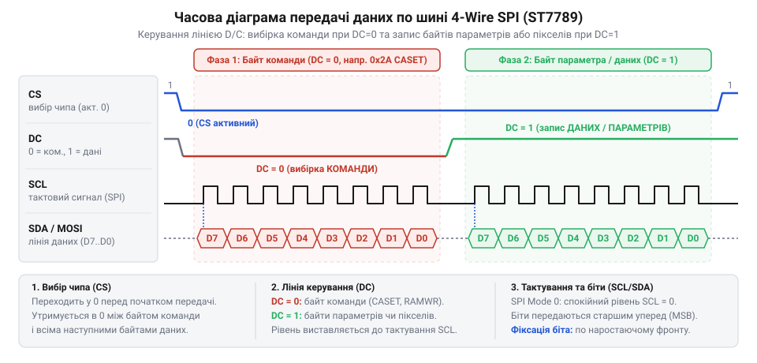
*Часові співвідношення сигналів SPI та DC: низький рівень DC супроводжує передачу коду команди, а високий відкриває потік параметрів або пікселів.*

Після подачі напруги живлення мікроконтролер не може відразу надсилати графічні дані: аналоговим помповим помножувачам, внутрішнім дільникам напруги та генераторам ST7789 потрібен чітко нормований час для встановлення стабільних робочих потенціалів. Порушення регламентованих часових інтервалів призводить до спотворення конфігураційних бітів або повного зависання кристала.

Послідовність початкового запуску вимагає дотримання таких кроків і затримок:
1. *Апаратне скидання (RES)*: Сигнал на лінії RES примусово опускають у логічний нуль щонайменше на 10 мкс, після чого повертають у високий стан. Перед відправленням будь-яких команд необхідно витримати обов'язкову паузу не менше 5 мс, щоб цифрова частина чипа завершила внутрішнє перезавантаження.
2. *Програмне скидання (команда `SWRESET`, код `0x01`)*: Програмна інструкція повертає всі регістри налаштування у вихідний стан за замовчуванням. Після надсилання байта `0x01` шина повинна витримати паузу щонайменше 5 мс (або до 120 мс, якщо чип перед цим перебував у режимі глибокого сну).
3. *Вихід із режиму сну (команда `SLPOUT`, код `0x11`)*: За замовчуванням після скидання контролер перебуває в енергоощадному режимі сну, в якому внутрішні помпи заряду VGH/VGL вимкнені. Команда `0x11` запускає тактовий генератор та перетворювачі напруг.
4. *Критична пауза 120 мс*: Між подачею команди `SLPOUT` та відправленням наступних команд налаштування чи увімкнення екрана обов'язково має пройти не менше **120 мс**. За цей час ємності помпових каскадів заряджаються до номінальних робочих значень (+13...+15 В і -10 В). Якщо надіслати команди ініціалізації раніше, драйвери рядків матриці залишаться без робочої напруги зміщення, і екран залишиться білим або не реагуватиме на оновлення.

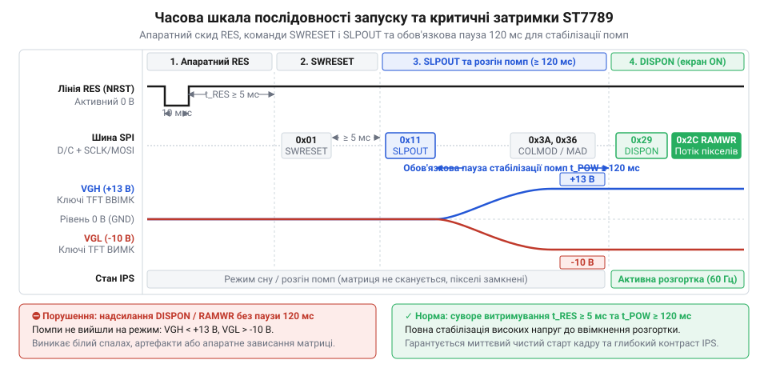
*Часова шкала імпульсів скидання та команд ініціалізації: витримка пауз 5 мс та 120 мс є критично необхідною для завершення перехідних процесів внутрішніх помп заряду ST7789.*

Після пробудження виконується базове налаштування робочих параметрів:
- **Встановлення формату пікселя (`COLMOD`, код `0x3A`)**: Команда визначає розрядність кольору. Передача байта параметра `0x55` задає 16-бітний формат RGB565 (5 бітів червоного, 6 бітів зеленого, 5 бітів синього). У цьому режимі кожен піксель займає рівно 2 байти, що оптимально узгоджується з 16-бітними буферами пам'яті мікроконтролера та зменшує обсяг трафіку шини на третину порівняно з 18-бітним кодуванням RGB666.
- **Увімкнення інверсії кольору (`INVON`, код `0x21`)**: Фізика матриці IPS базується на нормально-чорному режимі (англ. @@en|normally black@@): за відсутності керуючої напруги рідкі кристали орієнтовані паралельно пластинам і світло не проходить крізь схрещені поляризатори, створюючи глибокий чорний колір. Звичайні панелі TN діють протилежно — вони нормально-білі. Оскільки цифрова основа ST7789 спочатку створювалася під універсальні TN-панелі, таблиці вихідних напруг цифро-аналогових перетворювачів за замовчуванням налаштовані на нормально-білий режим. Без корекції максимальне значення яскравості драйвер формує нульовою напругою, що на IPS-матриці сприймається як повна темрява. В результаті чорний колір стає білим, червоний `0xF800` перетворюється на блакитний `0x07FF`, а зображення виглядає як фотонегатив. Команда `INVON` інвертує градаційні таблиці напруг, точно узгоджуючи роботу мікросхеми з оптичною будовою IPS.
- **Увімкнення відображення (`DISPON`, код `0x29`)**: Команда вмикає вихідні буфери керування рідкокристалічними комірками, дозволяючи бачити вміст відеопам'яті на екрані.

> 🔧 **Навіщо це.**
> Помилка в ініціалізації ST7789 найчастіше криється не в неправильних командах, а в пропущених паузах. Якщо знехтувати затримкою 120 мс після команди `SLPOUT`, високовольтні помпи не встигнуть вийти на режим, і дисплей лишиться сліпим. А якщо забути надіслати команду `INVON`, екран працюватиме, але з повністю перевернутою палітрою, перетворюючи кольоровий інтерфейс на негативну плівку.

## Віконна адресація пам'яті та апаратний зсув координат

Пересилання повного зображення на дисплей 240×240 точок вимагає передачі 57 600 пікселів. Оскільки кожен піксель кодується двома байтами, один кадр важить 115 200 байтів. Навіть на високій тактовій частоті шини SPI 20 МГц передача такого обсягу забирає щонайменше 46 мілісекунд, що обмежує частоту оновлення приблизно 21 кадром на секунду за умови, що мікроконтролер взагалі не витрачає процесорний час на обрахунки графіки. Водночас у типових інтерфейсах приладів більша частина екрана залишається статичною: змінюється лише числове значення вимірювання, переміщується стрілка шкали або блимає піктограма сповіщення. Оновлення невеликого прямокутника розміром 20×20 пікселів потребує передачі лише 800 байтів, що забирає менше третини мілісекунди.

Проте послідовна шина SPI передає потік байтів без окремих ліній для координат. Передавати координати X та Y для кожного окремого пікселя означало б учетверо збільшити накладні витрати трафіку. Контролер ST7789 розв'язує цю суперечність за допомогою прямокутного апаратного вікна адресації. Замість адресування кожної точки мікроконтролер один раз окреслює прямокутну область оновлення двома командами:
1. `CASET` (від англ. @@en|Column Address Set@@ — встановлення адрес колонок, код `0x2A`) — передає чотири байти: старший і молодший байти початкової колонки `XS`, а потім старший і молодший байти кінцевої колонки `XE`.
2. `RASET` (від англ. @@en|Row Address Set@@ — встановлення адрес рядків, код `0x2B`) — аналогічно передає чотири байти для початкового рядка `YS` та кінцевого рядка `YE`.

Після фіксації меж мікроконтролер надсилає команду `RAMWR` (від англ. @@en|Memory Write@@ — запис у пам'ять, код `0x2C`). Отримавши цю команду, контролер скидає внутрішній адресний лічильник на початкову точку `(XS, YS)` і переводить кристал у стан безперервного потокового прийому кольорів. Коли по шині надходять чергові два байти, чип записує їх у відповідну комірку внутрішньої відеопам'яті (GRAM) і автоматично збільшує (інкрементує, від лат. @@la|incrementum@@ — зростання, приріст) лічильник колонок `X`. Коли значення досягає межі `XE`, лічильник повертається на початок `XS`, а лічильник рядків `Y` збільшується на одиницю. Коли ж заповнюється останній рядок `YE`, покажчик знову зациклюється на `(XS, YS)`. На відміну від простих контролерів без адресованої відеопам'яті, де навіть для зміни однієї точки мікроконтролер змушений перезаписувати цілі сторінки пам'яті (як у монохромному [OLED-дисплеї SSD1306](root:cat-hw-actuators/oled-ssd1306)), ST7789 дозволяє оновлювати довільну пляму екрана без накладних витрат на передачу решти зображення.

> 🔧 **Навіщо це.** Апаратне вікно дозволяє виводити динамічну графіку (лічильники, анімовані графіки, рухомі маркери) з частотою понад 100 кадрів на секунду, оновлюючи лише змінені фрагменти екрана та вивільняючи до 95% обчислювального часу мікроконтролера і пропускної здатності шини SPI.

Фізична будова модуля 1.3″ приховує апаратну невідповідність, яка стає головною причиною збоїв відображення. Кристал контролера ST7789 є універсальним і містить у собі масив відеопам'яті розміром 240 колонок на 320 рядків (240×320 точок). Проте матриця дисплея 1.3″ має квадратну форму й роздільну здатність 240×240 точок. Виробник модуля приєднує виводи скляної панелі до перших 240 рядків вихідних формувачів кристала, а решта 80 рядків драйверів залишаються фізично непідключеними. У нульовій орієнтації рядки пам'яті від 0 до 239 точно відповідають рядкам на склі, а комірки від 240 до 319 існують у кремнії, але не мають фізичного виходу назовні.

Для зміни орієнтації зображення (повороту на 90°, 180° чи 270°) застосовують регістр `MADCTL` (від англ. @@en|Memory Data Access Control@@ — керування доступом до даних пам'яті, код `0x36`). Його службові біти апаратно змінюють напрямок обходу адресного простору чипа:
- `MY` (від англ. @@en|Row Address Order@@, біт 7) — інвертує порядок рядків (дзеркальне відображення вздовж осі Y);
- `MX` (від англ. @@en|Column Address Order@@, біт 6) — інвертує порядок колонок (дзеркальне відображення вздовж осі X);
- `MV` (від англ. @@en|Row/Column Exchange@@, біт 5) — міняє місцями осі X та Y, переводячи розгортку з портретного режиму в альбомний.

Коли в повнорозмірній матриці 240×320 біт `MY` інвертує вертикальний напрямок, сканування починається з протилежного фізичного краю — рядка 319. Але в дисплеї 240×240 рядок 319 розташований у тій зоні пам'яті, до якої скло не приєднане. Якщо програма спробує вивести кадр у діапазон рядків 0..239 для перевернутого екрана без поправки, контролер запише пікселі в непідключені комірки пам'яті 319..80, і зображення безслідно зникне. Водночас перші 80 рядків пам'яті, які реально підключені до нижнього краю скла, не отримають жодних нових даних: на склі відобразиться випадковий цифровий шум (неініціалізований стан комірок SRAM після ввімкнення живлення).

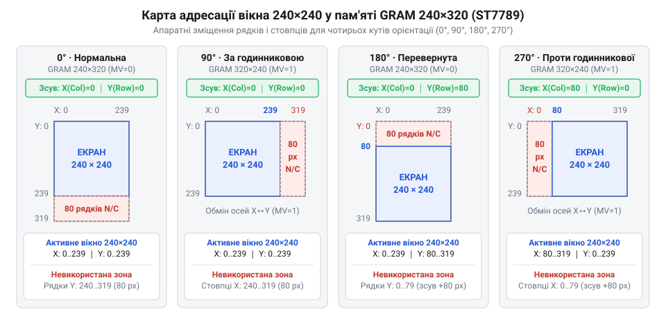
*Розподіл координат у масиві GRAM 240×320: зміна бітів MY, MX і MV у регістрі MADCTL повертає напрямок адресації відносно фіксованих виводів кристала, тому для збереження видимої зони 240×240 у положеннях 180° та 270° драйвер зобов'язаний додавати апаратне зміщення 80 пікселів.*

Щоб графіка потрапляла точно у видиму частину рідкокристалічної матриці, драйвер зобов'язаний додавати апаратне зміщення у 80 пікселів вздовж відповідної осі до початкових і кінцевих координат команд `CASET` та `RASET`:
- Орієнтація 0° (портретна за замовчуванням): `X_зсув = 0`, `Y_зсув = 0`;
- Орієнтація 90° (альбомна): `X_зсув = 0`, `Y_зсув = 0`;
- Орієнтація 180° (портретна перевернута): `X_зсув = 0`, `Y_зсув = 80`;
- Орієнтація 270° (альбомна перевернута): `X_зсув = 80`, `Y_зсув = 0`.

Якщо графічна бібліотека ігнорує ці зміщення або не виконує математичне відсікання меж (@@en|clipping@@, від англ. @@en|clip@@ — обрізати) під час виведення примітивів, що частково виходять за край екрана 240×240, координати обчислювального вікна виходять у зону від'єднаних рядків. У результаті лічильник адрес зациклюється, частина графіки зникає, а вздовж протилежного краю екрана виникає статична або мерехтлива кольорова смуга цифрового шуму.

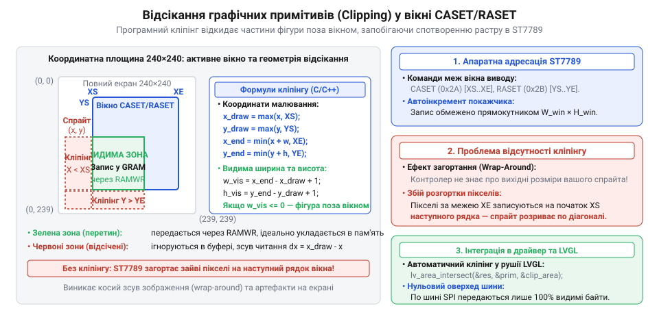
*Геометрична схема відсікання графічного примітива: пікселі за межами апаратного вікна CASET/RASET відсікаються програмно, запобігаючи виходу лічильника адрес у неініціалізовану область GRAM.*

## Колірний формат RGB565 та узгодження порядку байтів

У комп'ютерній графіці базовим є 24-бітний формат TrueColor (RGB888), де на кожен із трьох каналів — червоний (Red), зелений (Green) та синій (Blue) — виділяється по 8 бітів (по 256 градацій яскравості). Проте для дисплея 240×240 точок збереження одного кадру у форматі RGB888 потребує 172 800 байтів. Для вбудованих систем із мікроконтролерами передача такого масиву через послідовну шину SPI створює надмірне навантаження і знижує відгук інтерфейсу. Виникає потреба в пакуванні колірної інформації, яке відчутно зменшило б обсяг даних без помітної для ока втрати якості зображення.

Розв'язком є 16-бітний формат RGB565 (режим HighColor), який виділяє на один піксель рівно два байти. Розподіл бітів між каналами спирається на фізіологію людського зору. Сітківка ока сприймає світло фоторецепторами-колбочками трьох типів, однак кількість колбочок, чутливих до середньохвильової (зеленої) частини спектра, значно переважає кількість колбочок для синього кольору. Пік абсолютної спектральної чутливості ока за денного освітлення припадає на довжину хвилі приблизно 555 нанометрів. Людське око здатне розрізняти значно дрібніші градації яскравості в зеленому діапазоні, тоді як до східчастості переходу відтінків синього чи червоного зір менш критичний.

Тому 16 бітів розподіляються асиметрично:
- Червоний канал (R): 5 бітів (2⁵ = 32 рівні яскравості, біти 15..11);
- Зелений канал (G): 6 бітів (2⁶ = 64 рівні яскравості, біти 10..5);
- Синій канал (B): 5 бітів (2⁵ = 32 рівні яскравості, біти 4..0).

Загальна кількість відтворюваних кольорів становить 32 × 64 × 32 = 65 536 відтінків. Виграш у пропускній здатності шини розраховується безпосередньо:

```
(3 − 2) ÷ 3 × 100%
= 1 ÷ 3 × 100%           [різниця обсягів RGB888 та RGB565 на один піксель]
≈ 33.3%                  [частка зекономленого трафіку шини SPI]
```

Скорочення кожного пікселя з трьох байтів до двох заощаджує рівно третину трафіку шини SPI. При цьому подвоєна кількість рівнів у зеленому каналі усуває ефект постеризації (помітних смуг між плавними переходами відтінків) на більшості фотографічних і графічних сцен.

> 🔧 **Навіщо це.** Формат RGB565 ідеально відповідає 16-бітній та 32-бітній розрядності процесорів: кожен піксель вміщується рівно в одне машинне напівслово, що усуває потребу в дробовому вирівнюванні адрес у пам'яті й дає змогу передавати кадри апаратними блоками прямого доступу до пам'яті (DMA) без участі ядра мікроконтролера.

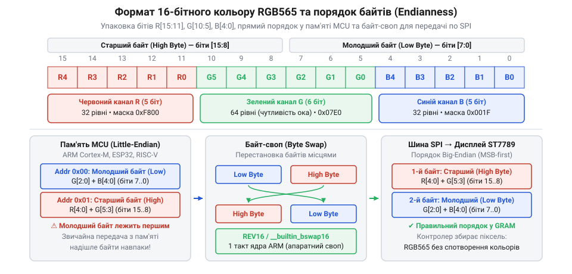
*Структура 16-бітного кольору RGB565: асиметричний розподіл 5-6-5 бітів узгоджений із зором людини, а розбіжність між порядком Little-Endian у пам'яті мікроконтролера та Big-Endian на шині SPI вимагає обов'язкової перестановки байтів для запобігання підміні каналів.*

При передачі 16-бітного кольору виникає фундаментальна пастка, пов'язана з [порядком байтів](root:hw-arch/endianness). Контролер дисплея ST7789 очікує дані по шині SPI у послідовності @@en|Big-Endian@@ (від англ. @@en|big-endian@@ — старшим кінцем уперед, прямий порядок): першим по лінії передається старший байт слова (біти 15..8), а другим — молодший байт (біти 7..0).

Водночас переважна більшість сучасних мікроконтролерів (архітектури ARM Cortex-M, ESP32 на Xtensa і RISC-V, класичні чипи AVR) зберігають багатобайтові числа в оперативній пам'яті у зворотному порядку — @@en|Little-Endian@@ (від англ. @@en|little-endian@@ — молодшим кінцем уперед). У пам'яті мікроконтролера молодший байт 16-бітної змінної завжди лежить за нижчою адресою, а старший — за вищою:
- За адресою `N` розташовано молодший байт `[G2..G0, B4..B0]`;
- За адресою `N + 1` розташовано старший байт `[R4..R0, G5..G3]`.

Якщо програма бере вказівник на таку 16-бітну комірку або передає масив пікселів у буфер передавача SPI як послідовність байтів, мікроконтролер надсилає їх у природному для своєї пам'яті порядку: спочатку молодший байт, а за ним старший. Отримавши байт синього каналу першим, ST7789 вважає його старшим і подає отримані біти на червоні субпікселі матриці. Старший байт червоного каналу, який надійшов другим, чип записує в сині субпікселі. У результаті червоний і синій канали міняються місцями, а біти зеленого каналу розриваються навпіл.

Для наочності візьмемо чистий насичений червоний колір: його шістнадцяткове значення в RGB565 дорівнює `0xF800` (двійковий запис: `11111000 00000000₂`):
- Старший байт: `0xF8`, молодший байт: `0x00`.
- У пам'яті Little-Endian байти лежать у послідовності: `0x00`, потім `0xF8`.
- При прямому вивантаженні в SPI спочатку передається `0x00`, а другим — `0xF8`.
- ST7789 інтерпретує отримане слово як `0x00F8` (червоний: 0, зелений: 7, синій: 24).
- Замість яскраво-червоного пікселя екран висвітлює насичений блакитний (ціан).

Щоб відновити правильну відповідність каналів, перед надсиланням кожного 16-бітного слова в передавач SPI необхідно виконати перестановку байтів (байт-своп, від англ. @@en|byte swap@@ — обмін байтів). Це реалізують одним із трьох способів:
1. Програмними зсувами: вираз `(колір >> 8) | (колір << 8)` міняє половини 16-бітного числа місцями;
2. Апаратними інструкціями процесора: у ядрах ARM Cortex-M є спеціальна асемблерна команда `REV16`, яка переставляє байти всередині 16-бітного напівслова за один машинний такт (доступна через вбудовану функцію компілятора `__builtin_bswap16`);
3. 16-бітним режимом апаратного модуля SPI: периферійний блок мікроконтролера налаштовують на роботу з 16-бітними словами, завдяки чому передавач сам виштовхує старший байт на лінію MOSI першим.

Помилка узгодження байтів разом із розглянутим раніше апаратним зміщенням адреси та інверсією матриці утворює трійку типових дефектів ініціалізації модуля ST7789. Спостереження за дефектом на склі дозволяє миттєво локалізувати програмну причину збою.

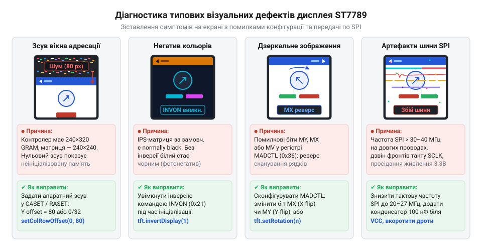
*Діагностична карта візуальних несправностей дисплея ST7789: вигляд спотворення на екрані дозволяє безпомилково визначити помилку в коді драйвера — від відсутності байт-свопу до некоректного зміщення вікна адресації.*

Підміна кольорів (червоний стає блакитним, а жовтий — фіолетовим) завжди свідчить про відсутність байт-свопу. Якщо ж кольори виглядають як фотонегатив (біле тло стає чорним, а чорний текст — білим), причина полягає у вимкненій інверсії для normally black матриці (пропущено команду `INVON`). Смуга хаотичного цифрового шуму на краю дисплея вказує на невраховане зміщення у 80 точок у команді вікна або відсутність відсікання меж малювання.

## Діагностика типових збоїв першого запуску

Перший запуск графічного дисплея рідко минає без ускладнень, проте фізична природа рідкокристалічної панелі перетворює екран на наочний діагностичний інструмент. На відміну від простих текстових індикаторів (як-от [LCD 1602A](root:cat-hw-actuators/lcd-1602)), де помилка зв'язку призводить лише до порожнього скла або суцільної смуги темних прямокутників, матриця з власним графічним контролером формує чіткі геометричні й колірні артефакти (від лат. @@la|artefactum@@ — штучно зроблене). Кожен дефект зображення є прямим наслідком конкретної помилки в таймінгах, програмній конфігурації регістрів або хвильових процесах у сигнальних лініях. Систематичний аналіз зовнішнього вигляду дисплея дозволяє точно локалізувати несправність без хаотичної заміни компонентів.

### Смуга цифрового шуму та зміщення координат

Поширений збій під час виведення першого зображення — зміщення графіки вбік або вгору, коли частина корисної картинки зрізається краєм рамки, а на протилежному боці з'являється статична смуга завширшки 80 пікселів, заповнена строкатим різнокольоровим «цифровим снігом».

Цей візуальний дефект зумовлений розбіжністю геометрії кремнієвого кристала та фізичного скла. Контролер ST7789 містить масив статичної відеопам'яті (GRAM) обсягом 240×320 точок, тоді як квадратна панель 1.3″ має фізичну роздільну здатність 240×240 пікселів. Вісімдесят рядків пам'яті фізично не з'єднані з електродами рідкокристалічних комірок. Під час увімкнення живлення тригери неініціалізованої пам'яті SRAM опиняються у хаотичному стані: частина бітів приймає стан логічного нуля, частина — одиниці. При зчитуванні генератором розгортки ці випадкові байти інтерпретуються як хаотичні 16-бітні значення кольору RGB565.

Команди віконного доступу `CASET` (`0x2A`) та `RASET` (`0x2B`) задають прямокутні межі адресації в загальному масиві пам'яті. Якщо програма мікроконтролера надсилає координати від 0 до 239 без урахування апаратного зміщення, або змінює напрямок сканування матриці через регістр `MADCTL` (`0x36`) для орієнтацій 180° чи 270°, нульова точка адресації зміщується в зону непід'єднаних рядків. У результаті контролер виводить на видиму ділянку скла випадковий цифровий шум із невикористовуваної пам'яті, а робоче зображення зміщується за межі екрана.

Для усунення зсуву в конфігурацію драйвера вносять програмну компенсацію: до початкових і кінцевих координат адресації вікна додають апаратний зсув у 80 рядків для орієнтацій, де нульовий рядок фізичної матриці не збігається з нульовою адресою внутрішнього масиву GRAM.

### Ефект фотонегатива

Якщо геометричні пропорції, шрифти та межі графічних елементів відтворюються правильно, але зображення виглядає вивернутим навиворіт (біле тло стає глибоким чорним, темні лінії світяться, а кольори перетворюються на власні комплементарні пари — наприклад, червоний стає блакитним), причина криється в неузгодженості оптичного режиму матриці.

Рідкі кристали панелей IPS працюють у режимі @@en|Normally Black@@ («зазвичай чорний»). У вимкненому стані, за відсутності електричного поля між гребінчастими електродами, кристали орієнтовані паралельно площині підкладки, і схрещені поляризатори повністю блокують світло світлодіодного підсвічування. Щоб відкрити субпіксель і отримати максимальну яскравість (значення 0xFFFF у форматі RGB565), контролер мусить прикласти до комірки найвищу керуючу напругу. На противагу цьому, старіші панелі TN працюють у режимі @@en|Normally White@@, де нульова напруга відповідає максимальній прозорості.

Універсальний кристал ST7789 після апаратного скидання запускається в базовому режимі `INVOFF` (`0x20`), де зв'язок між цифровим кодом пікселя та напругою на склі розрахований на традиційні матриці Normally White. Без додаткової команди контролер інтерпретує максимальні цифрові значення яскравості як вимогу вимкнути напругу на комірці, що у випадку IPS призводить до повного затемнення замість максимального свічення.

Розв'язанням є обов'язкове надсилання команди інверсії кольору `INVON` (`0x21`, @@en|Display Inversion On@@) під час початкової ініціалізації дисплея. Ця команда перемикає внутрішню таблицю цифро-аналогового перетворювача контролера, узгоджуючи потік цифрових даних із фізичною роботою комірок Normally Black.

### Відсутність реакції або білий екран

Ситуація, коли дисплей залишається повністю темним або, навпаки, заливає все скло сліпучим білим світлом без жодної реакції на команди мікроконтролера, зазвичай свідчить про порушення часових інтервалів запуску або електричні збої живлення.

Білий екран за наявності підсвічування означає, що світлодіоди отримують струм, але сам контролер ST7789 не здійснює регенерацію кадрів або перебуває у стані зависання. До цього призводять дві апаратні причини:

1. **Ігнорування затримки після виходу зі сну.** Контролер містить внутрішні помпи заряду, які перетворюють базову напругу живлення 3.3 В на високі потенціали керування затворами тонкоплівкових транзисторів: позитивний VGH (+12..+15 В) і негативний VGL (-10..-12 В). Команда виходу зі сплячого режиму `SLPOUT` (`0x11`) вмикає внутрішній тактовий генератор і запускає каскадний заряд конденсаторів помпи. Цей перехідний процес вимагає гарантованого часу тривалістю щонайменше 120 мс. Якщо мікроконтролер надсилає наступні команди конфігурації або команду ввімкнення показу `DISPON` (`0x29`) раніше завершення цієї паузи, цифрова логіка контролера збоїть, а ключі матриці залишаються знеструмленими.
2. **Просідання шини живлення під час увімкнення підсвічування (@@en|brownout reset@@).** Світлодіоди підсвічування екрана 1.3″ споживають від 30 до 50 мА, що становить понад 90% загального енергоспоживання модуля. Якщо модуль під'єднано через довгі тонкі макетні дроти або заживлено від слабкого стабілізатора мікроконтролера, раптове відкриття транзистора підсвічування BLK створює різкий імпульсний сплеск споживання струму. Напруга на лінії живлення VDD різко просідає нижче критичного порогу скидання контролера (~1.65 В). ST7789 виконує неконтрольоване апаратне перезавантаження, скидаючи всі завантажені регістри до початкового стану сну, тоді як підсвічування продовжує світити крізь знеструмлені рідкі кристали.

Щоб запобігти збою, у коді ініціалізації витримують обов'язкову затримку не менше 120 мс одразу після відправки `SLPOUT`. По лінії живлення безпосередньо біля виводів плати дисплея встановлюють керамічний або танталовий блокувальний конденсатор ємністю 10–47 мкФ, а керування яскравістю реалізують через плавне наростання шпаруватості ШІМ на виводі BLK.

### Розпад зображення та косі смуги на високих частотах SPI

Під час роботи на низьких тактових частотах шини SPI (4–8 МГц) дисплей може формувати бездоганну картинку, проте спроба збільшити частоту до 20–40 МГц для досягнення плавної анімації нерідко викликає розпад зображення: прямокутні блоки розсинхронізуються, виникають діагональні смуги, а колірні відтінки пікселів хаотично змінюються.

На тактових частотах у десятки мегагерців тривалість фронтів цифрових сигналів мікроконтролера становить одиниці наносекунд. За такої швидкості наростання сигналу (@@en|slew rate@@) звичайні з'єднувальні дроти довжиною 10–20 см перестають бути простими провідниками і починають поводитися як довгі лінії передачі з вираженою розподіленою індуктивністю та ємністю, де критичною стає [цілісність сигналів шини SPI](root:com-devices/spi-speed). Через розбіжність низького вихідного опору драйвера мікроконтролера (20–40 Ом) та високого вхідного імпедансу ST7789 виникають багаторазові хвильові відбиття (від лат. @@la|reflexio@@ — повернення назад).

Ці відбиття накладаються на основний прямокутний імпульс тактової лінії SCLK, утворюючи високочастотні коливання — передзвін (@@en|ringing@@). Коли амплітуда коливань передзвону перетинає пороговий рівень логічного перемикання вхідного тригера контролера дисплея, ST7789 фіксує фальшивий додатковий такт. Оскільки колір кожного пікселя передається 16-бітним словом, один зайвий або втрачений такт зміщує весь подальший бітовий потік на один розряд. Старші біти каналів кольору потрапляють у молодші розряди сусідніх субпікселів, а межі координатних вікон зміщуються в кожному наступному рядку, утворюючи характерний діагональний розрив кадру.

Усувають хвильові відбиття встановленням послідовних демпферних резисторів (від @@en|damper@@, нім. @@de|Dämpfer@@ — глушник; номіналом 22–47 Ом) безпосередньо біля вихідних виводів мікроконтролера на лініях SCLK та MOSI. Резистор узгоджує вихідний опір передавача з хвильовим опором лінії та гасить добротність паразитного коливального контуру. Внаслідок цього передзвін зникає, фронти сигналів набувають плавної монотонної форми, і контролер стабільно приймає дані на граничних швидкостях шини. Додатково довжину сигнальних ліній скорочують до 5–10 см.

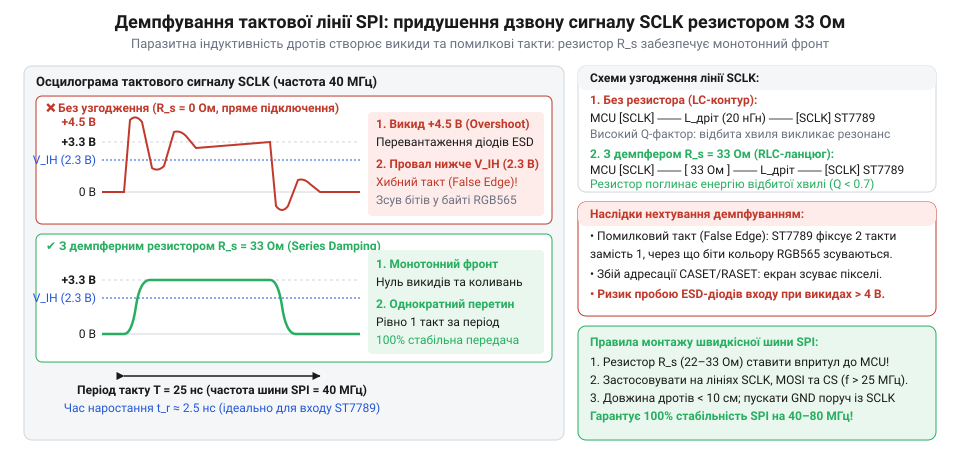
*Осцилограма сигналу тактування SCLK: хвильовий передзвін на довгих провідниках викликає хибні такти й розсинхронізацію пікселів, а послідовний резистор 33 Ом згладжує викиди та відновлює надійний обмін.*

> 🔧 **Навіщо це.**
> Системна діагностика за формою спотворень заощаджує години апаратного пошуку. Якщо екран демонструє стабільну зміщену смугу шуму чи вигляд фотонегатива — апаратна частина повністю справна, і проблема полягає виключно в реєстрах `MADCTL` або `INVON`. Навпаки, косі смуги, білий екран чи хаотичний зрив кольорів вимагають перевірки електричного тракту: якості живлення, довжини сигнальних провідників і наявності демпферних резисторів.

| Зовнішня ознака на екрані | Фізична причина збою | Спосіб усунення |
|---|---|---|
| Смуга різнокольорового шуму 80 px та зсув зображення | Невідповідність скла 240×240 масиву GRAM 240×320 при повороті матриці | Додати зміщення у 80 рядків до початкової координати вікна в регістрах `CASET`/`RASET` |
| Ефект фотонегатива (інвертовані кольори та яскравість) | Пропущена команда адаптації під оптичний режим Normally Black | Надіслати команду `INVON` (`0x21`) у ланцюжку початкової ініціалізації |
| Повна відсутність реакції, темний екран | Передача команд до завершення стабілізації помп високої напруги | Витримати паузу не менше 120 мс одразу після команди `SLPOUT` (`0x11`) |
| Суцільний білий екран після подачі живлення | Просідання напруги VDD нижче порогу скидання через пусковий струм підсвічування | Встановити буферний конденсатор 10–47 мкФ по шині 3.3 В, плавно вмикати ШІМ на виводі BLK |
| Розпад картинки на косі смуги на високих частотах SPI | Хвильові відбиття та передзвін на лінії SCLK через паразитну індуктивність дротів | Встановити послідовні резистори 22–47 Ом біля виводів МК, вкоротити дроти до 5–10 см |
