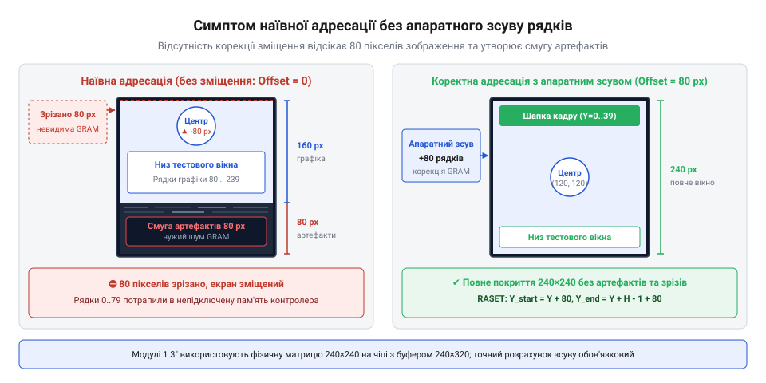
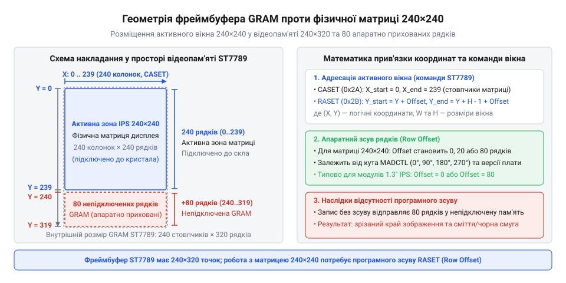
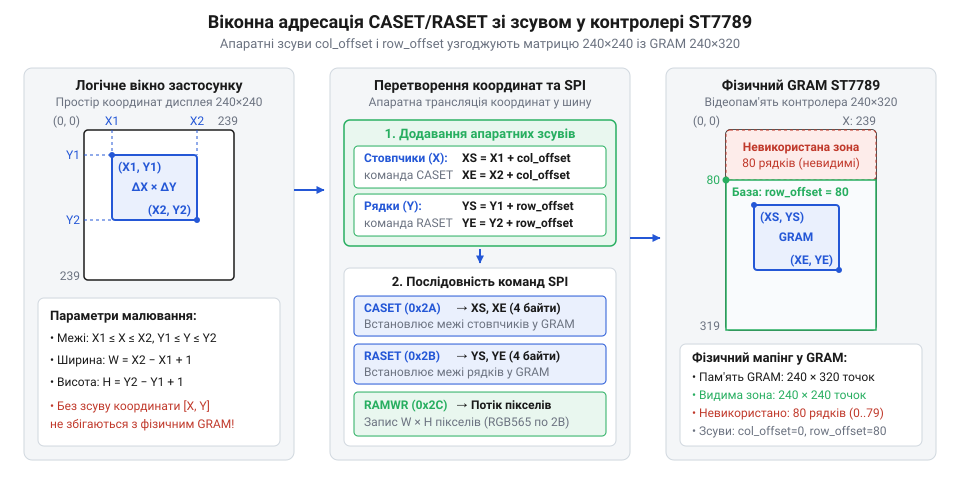
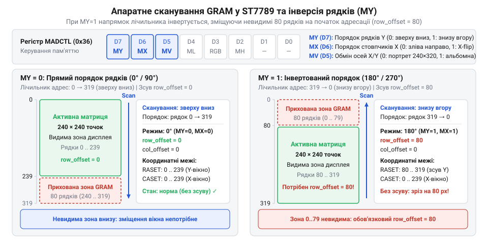
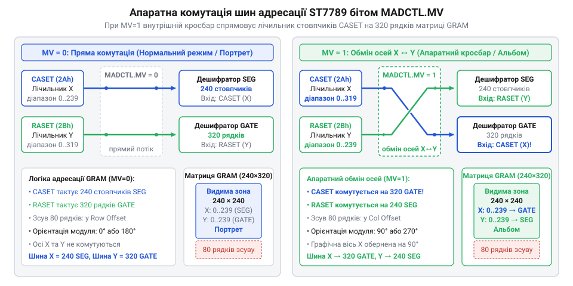
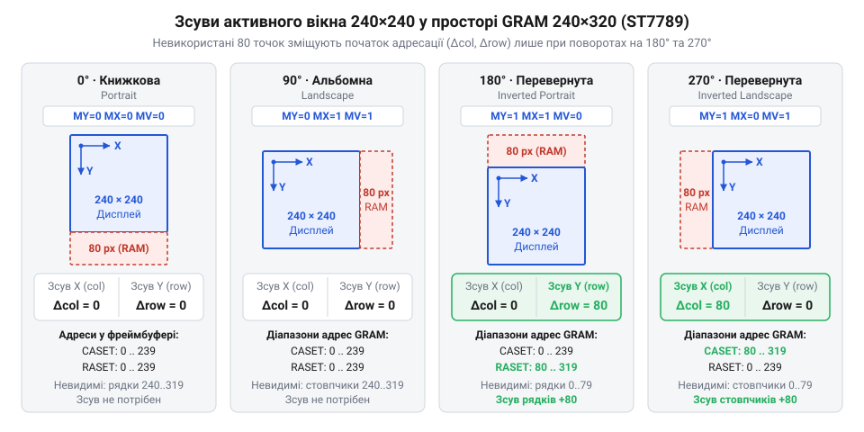
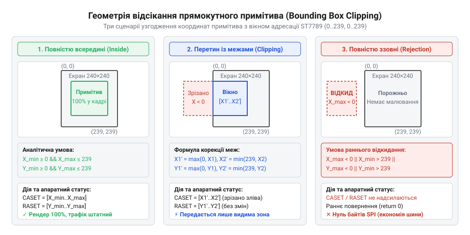
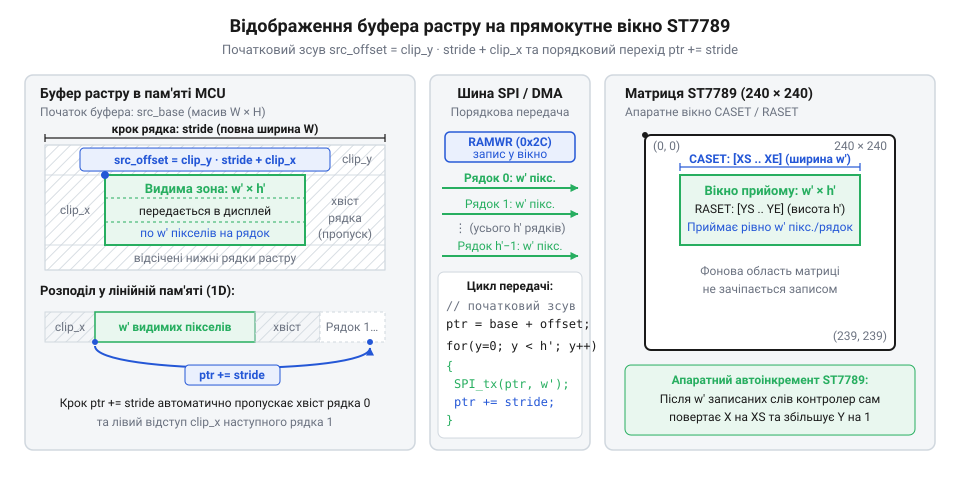

# IPS 1.3″ 240×240 (SPI, ST7789)

<preknowlist>
- [TFT 1.77″ 128×160 (SPI, ST7735S)](root:cat-hw-actuators/tft-st7735s) — організація фреймбуфера GRAM у графічних контролерах, принцип віконного запису командами CASET і RASET та призначення бітів регістра MADCTL
</preknowlist>

## Наївна адресація та симптом координатного зсуву

Під час підключення компактного квадратного дисплея (англ. @@en|display@@, від лат. @@la|displicare@@ — розгортати, показувати) IPS 1.3″ із заявленою роздільністю 240×240 точок до мікроконтролера по шині SPI розробник очікує прямолінійної поведінки координатної сітки: екран має 240 стовпчиків і 240 рядків, тому передача логічних координат від точки `(0, 0)` до `(239, 239)` повинна рівномірно заповнити всю площу скла. Проте перша спроба очистити екран, вивести суцільну заливку чи нарисувати прямокутну рамку вздовж зовнішніх меж виявляє грубе оптичне спотворення. Частина графіки зникає за межами видимого скла, а на протилежному боці залишається порожня некерована смуга шириною 80 пікселів (англ. @@en|pixel@@, скорочення від @@en|picture element@@ — елемент зображення).

Уявімо тривіальну задачу: побудувати контрольну рамку по периметру активної зони екрана. Програма описує прямокутник у нативній декартовій системі координат (лат. @@la|cum@@ — разом та @@la|ordinatus@@ — упорядкований), де початок відліку `(0, 0)` відповідає лівому верхньому куту, а протилежний кут має значення `(239, 239)`:
- верхня лінія: `y = 0`, де `x ∈ [0, 239]`;
- нижня лінія: `y = 239`, де `x ∈ [0, 239]`;
- ліва вертикаль: `x = 0`, де `y ∈ [0, 239]`;
- права вертикаль: `x = 239`, де `y ∈ [0, 239]`.

Коли цей наївний набір координат безпосередньо передається контролеру дисплея, зображення зазнає асиметричного зрізання. Верхня горизонтальна лінія рамки та перші 80 рядків графічного вмісту взагалі не з'являються на склі. Малюнок починається відразу із середини сюжету на самому верхньому фізичному зрізі панелі. Нижня лінія рамки, яка мала б проходити по нижній кромці модуля, опиняється на дві третини висоти екрана, а під нею лежить незмінна чорна чи зашумлена смуга завширшки рівно 80 рядків.


*Схема екрана 240×240 точок при наївній адресації: верхня третина зображення втрачається в непідключених комірках пам'яті, а внизу виникає некерована смуга артефактів завширшки 80 пікселів.*

Математично цей артефакт (лат. @@la|artefactum@@, від @@la|ars@@ — ремесло та @@la|facere@@ — робити) описується як фіксований зсув між простором координат, який очікує програма, і областю, яку сканує екран. Якщо фізична видима зона починається з рядка 80 внутрішньої пам'яті, то передача діапазону `Y ∈ [0, 239]` призводить до розсічення рисунка на дві частини:

```
N_cut
= 80 - 0                 [кількість рядків у невидимій зоні]
= 80 пікселів            [висота відтятої частини рисунка]
```
```
H_vis
= 240 - 80               [висота рисунка, що потрапила у видиму зону]
= 160 пікселів           [висота фрагмента, відображеного на склі]
```
```
H_stripe
= 240 - 160              [непокрита висота фізичної матриці]
= 80 пікселів            [висота паразитної смуги внизу екрана]
```

Спроба виправити проблему програмним поворотом орієнтації (лат. @@la|oriens@@ — схід, висхідний напрямок) екрана на 90°, 180° або 270° через типові бібліотечні виклики лише поглиблює деструкцію. При зміні орієнтації координатна сітка не просто повертається навколо центру скла: паразитна смуга завширшки 80 пікселів раптово стрибає на лівий або правий край, графіка зсувається вбік, частково вилітаючи за межі видимої матриці, а текст відсікається по діагоналі. Програмний простір і фізичне скло поводяться так, ніби вони розірвані та обертаються навколо різних геометричних осей.

> 🔧 **Навіщо це.**
> Розуміння симптому координатного зсуву запобігає безплідному пошуку помилок у низькорівневих налаштуваннях шини SPI, полярності тактового сигналу чи таймінгах контролера. Зрізання зображення на 80 пікселів і поява мертвої зони — це суто геометрична невідповідність між логічною адресацією та топологією внутрішньої пам'яті, яку неможливо усунути зміною швидкості передачі даних.

## Кремнієва топологія: прямокутна пам'ять і квадратне скло

Причина зсуву лежить у кремнієвій архітектурі [графічного контролера ST7789](root:cat-hw-actuators/ips-st7789) та економіці виробництва дисплейних модулів. Розробка та літографія нового спеціалізованого кристала інтегральної схеми під нестандартну роздільність коштує сотні тисяч доларів. Тому виробники компактних дисплеїв використовують масові універсальні мікросхеми, спроєктовані для ширшого ринку мобільних пристроїв. Чип ST7789 початково створювався для прямокутних екранів стандарту QVGA з роздільністю 240×320 точок.

Кристал контролера містить внутрішній фреймбуфер (англ. @@en|frame@@ — кадр та англ. @@en|buffer@@ — проміжний накопичувач) відеопам'яті GRAM (англ. @@en|Graphic RAM@@ — графічна оперативна пам'ять), організований у вигляді матриці (лат. @@la|matrix@@ — першооснова, джерело) розміром 240 стовпчиків на 320 рядків. Стовпчиками керують 240 вихідних формувачів сигналів (джерельні драйвери, @@en|source drivers@@), а рядками — 320 високовольтних ключів розгортки (рядкові драйвери, @@en|gate drivers@@), які по черзі відмикають тонкоплівкові транзистори (англ. @@en|transistor@@, від @@en|transfer@@ — переносити та @@en|resistor@@ — опір) TFT-панелі.

Модуль IPS 1.3″ має фізичну матрицю розміром 240×240 точок. Скляна підкладка потребує рівно 240 ліній стовпчиків і 240 ліній рядків. Чип контролера монтується безпосередньо на скло за технологією COG (англ. @@en|Chip-on-Glass@@ — кристал на склі) або підключається гнучким шлейфом FPC (англ. @@en|Flexible Printed Circuit@@). Топологія (грец. @@grc|τόπος@@ — місце та @@grc|λόγος@@ — вчення) з'єднань така: усі 240 стовпчикових драйверів чипа з'єднані зі стовпчиками матриці один до одного, проте з 320 рядкових драйверів до скляних доріжок підключено лише 240 ліній. Решта 80 рядкових виводів кристала залишаються апаратно висячими в повітрі (непідключеними).


*Геометричне зіставлення фізичної матриці 240×240 і фреймбуфера GRAM 240×320: активне скло займає рядки 80–319, утворюючи фантомну непідключену зону в діапазоні рядків 0–79.*

Оскільки пам'ять GRAM контролера є цілісним масивом статичної пам'яті, комірки для всіх 240×320 точок фізично існують на кристалі та доступні для запису по шині SPI. Схожий принцип доступу до відеобуфера використовує [TFT 1.77″ 128×160 (SPI, ST7735S)](root:cat-hw-actuators/tft-st7735s), де адресація також здійснюється через віконні лічильники пам'яті. Проте 80 рядків пам'яті ST7789 утворюють так звану «фантомну» зону: мікроконтролер записує туди дані кольору, але відповідні драйвери рядків нікуди не під'єднані, і рідкі кристали ніколи не отримують від них електричного поля.

Положення фантомної зони у просторі адрес жорстко зафіксоване трасуванням контактних майданчиків шлейфа. У модулях IPS 1.3″ фізичні доріжки скла підпаяні не до перших рядків чипа, а до виводів із номерами 80–319. Тобто рядки пам'яті з адресами від 0 до 79 є апаратно сліпими.

Математичне зіставлення обсягу пам'яті та активного поля:

```
S_gram
= W_gram × H_gram        [загальна ємність відеопам'яті контролера]
= 240 × 320              [множення кількості стовпчиків на кількість рядків]
= 76800 точок            [повний обсяг слів у фреймбуфері]
```
```
S_panel
= W_panel × H_panel      [розмір активного поля скляної матриці]
= 240 × 240              [множення фізичних розмірностей екрана]
= 57600 точок            [кількість видимих точок на дисплеї]
```
```
S_phantom
= S_gram - S_panel       [обсяг непідключеної відеопам'яті]
= 76800 - 57600          [віднімання площі матриці від ємності GRAM]
= 19200 точок            [кількість сліпих комірок пам'яті]
```

Звідси випливає фундаментальне геометричне (грец. @@grc|γεωμετρία@@, від @@grc|γῆ@@ — земля та @@grc|μετρέω@@ — вимірювати) правило: логічна координата точки на квадратному екрані `(x_log, y_log)` не тотожна її фізичній адресі у відеобуфері `(X_gram, Y_gram)`. Щоб точка потрапила на активне скло, її координати повинні зазнавати афінного паралельного перенесення на вектор апаратного зсуву (англ. @@en|offset@@, від @@en|off@@ — убік та @@en|set@@ — встановлювати) `(col_offset, row_offset)`:

```
X_gram = x_log + col_offset
Y_gram = y_log + row_offset
```

Для модуля 1.3″ у портретній орієнтації стовпчики збігаються (`col_offset = 0`), а рядковий зсув компенсує сліпу зону (`row_offset = 80`). Граничні фізичні координати тоді точно лягають у діапазон підключених доріжок скла:

```
Y_gram_min
= 0 + 80                 [додавання зсуву до початкового логічного рядка]
= 80                     [перший фізичний рядок підключеного скла]
```
```
Y_gram_max
= 239 + 80               [додавання зсуву до граничного логічного рядка]
= 319                    [останній фізичний рядок фреймбуфера контролера]
```

> 🔧 **Навіщо це.**
> Визначення базового апаратного зсуву дозволяє абстрагувати графічний рушій від топології конкретного модуля. Якщо ввести параметри `col_offset` та `row_offset` у дескриптор драйвера дисплея, усі високорівневі алгоритми малювання примітивів, шрифтів та віконного відсікання продовжують працювати в зручному діапазоні `0..239`, а корекція адрес відбувається централізовано під час формування апаратних команд вікна.

## Віконна адресація CASET/RASET і базова трансляція координат

Під час оновлення графічного екрана через послідовний інтерфейс передача індивідуальних координат для кожного окремого пікселя (від англ. @@en|pixel@@, скорочення від @@en|picture element@@ — елемент зображення) катастрофічно знижує швидкодію шини. У дисплеї роздільністю 240×240 точок із шістнадцятибітовим кольором повний кадр налічує 57 600 пікселів, тобто 115 200 байтів даних. Якби перед кожним кольоровим значенням мікроконтролер надсилав координати X та Y, службовий трафік утричі або вчетверо перевищив би корисне навантаження, знижуючи частоту оновлення до лічених кадрів на секунду.

Для усунення адресного оверхеду графічний контролер ST7789 реалізує механізм віконної адресації (від англ. @@en|window@@ — вікно та франц. @@fr|adresse@@ — звернення, напрямок). Замість адресації окремих точок мікроконтролер один раз задає межі прямокутної зони оновлення: початковий і кінцевий стовпчики та початковий і кінцевий рядки. Після фіксації периметра вікна хост-процесор надсилає безперервний потік байтів кольору, а внутрішні лічильники контролера автоматично переміщують покажчик пам'яті після кожного прийнятого пікселя.

> 🔧 **Навіщо це.**
> Віконна адресація дає змогу передавати прямокутні масиви пікселів безперервним потоком через апаратний прямий доступ до пам'яті (DMA) на максимальній частоті шини SPI. Мікроконтролер обчислює межі вікна один раз, вивільняючи процесорне ядро для розрахунків під час передачі графіки.

### Протокол віконного запису: CASET, RASET та RAMWR

Контролер ST7789 керує межами прямокутного вікна через три послідовні команди:

1. **`CASET` (0x2A, @@en|Column Address Set@@)** — встановлення діапазону адрес стовпчиків (від лат. @@la|columna@@ — стовп). Приймає чотири байти параметрів, що кодують два 16-бітних цілих числа без знака у форматі @@en|big-endian@@ (старший байт попереду): початковий стовпчик `XS` (@@en|X-Start@@) та кінцевий стовпчик `XE` (@@en|X-End@@).
2. **`RASET` (0x2B, @@en|Row Address Set@@)** — встановлення діапазону адрес рядків. Також приймає чотири байти параметрів: початковий рядок `YS` (@@en|Y-Start@@) та кінцевий рядок `YE` (@@en|Y-End@@).
3. **`RAMWR` (0x2C, @@en|Memory Write@@)** — переведення контролера в режим запису у внутрішній фреймбуфер GRAM (від лат. @@la|graphicus@@ — зображувальний та англ. @@en|buffer@@ — проміжний накопичувач). Усі наступні байти даних інтерпретуються як значення кольору пікселів і заносяться в комірки пам'яті.

Схожий принцип віконного запису використовують й інші контролери дисплеїв, наприклад [TFT 1.77″ 128×160 (SPI, ST7735S)](root:cat-hw-actuators/tft-st7735s), де прямокутне вікно також обмежується парами стовпчиків і рядків.

### Внутрішні автоінкрементні лічильники пам'яті

Всередині контролера ST7789 діють два апаратні адресні регістри (від лат. @@la|registrum@@ — список, книга записів): покажчик поточного стовпчика `C` та покажчик поточного рядка `R`. Їхня поведінка підпорядковується алгоритму автоінкременту (від грец. @@grc|autos@@ — сам та лат. @@la|incrementum@@ — збільшення, зростання):

1. При надходженні команди `RAMWR` лічильники ініціалізуються початковими координатами: `C = XS`, `R = YS`.
2. Кожен прийнятий піксель (два байти у форматі RGB565) записується в комірку пам'яті з адресою `(C, R)`.
3. Покажчик стовпчика збільшується на одиницю: `C = C + 1`.
4. Якщо покажчик досягає правої межі (`C == XE`), наступний піксель повертає його на початок рядка (`C = XS`), а покажчик рядка збільшується: `R = R + 1`.
5. Якщо покажчик рядка досягає нижньої межі (`R == YE`), після запису останнього пікселя адреса повертається у вихідну точку `(XS, YS)`.

Завдяки цьому піксельний масив заповнює прямокутник рядками зліва направо та згори вниз. Загальна кількість пікселів `N` у вікні становить:

    N = (XE - XS + 1) × (YE - YS + 1)

Відповідно, обсяг переданих даних через шину дорівнює `2 × N` байтів для шістнадцятибітового кольору.

### Апаратні зсуви та лінійна трансляція координат

Невідповідність між фізичною квадратною матрицею IPS 1.3″ (240×240 пікселів) та внутрішньою пам'яттю ST7789 (240 стовпчиків на 320 рядків) створює 80 невидимих рядків GRAM. Кристал контролера спроєктовано під матриці до 240×320 точок, тому в модулі 240×240 вісімдесят ліній сканування залишаються апаратно непід'єднаними до скляної підкладки.

У логічній системі координат програми початок відліку `(0, 0)` відповідає верхньому лівому куту видимого екрана. Область оновлення описується вектором вершин `(x₁, y₁)` та `(x₂, y₂)`, де:

    0 ≤ x₁ ≤ x₂ < 240
    0 ≤ y₁ ≤ y₂ < 240

У фізичному просторі пам'яті GRAM комірки адресовано індексами `col ∈ [0, 239]` та `row ∈ [0, 319]`. Залежно від розведення виводів кристала на гнучкому шлейфі дисплея, активна матриця прив'язується до пам'яті з постійними апаратними зміщеннями: `col_offset` (зсув стовпчиків) та `row_offset` (зсув рядків, від англ. @@en|offset@@ — зміщення від бази). Для нульової просторової орієнтації типового модуля IPS 1.3″ зсуви становлять:

    col_offset = 0
    row_offset = 0

(У деяких модифікаціях плати екран під'єднано зі зміщенням `row_offset = 80`, коли активна матриця розташована в нижній частині адресного простору GRAM).


*Трансляція меж логічного вікна [x₁, x₂] та [y₁, y₂] у фізичні адреси GRAM [XS, XE] та [YS, YE]: додавання базових апаратних зсувів col_offset та row_offset узгоджує координати програми з межами активної матриці.*

Для прямокутного вікна трансляція (від лат. @@la|translatio@@ — перенесення) координат з логічного простору у фізичний здійснюється лінійним зсувом:

    XS = x₁ + col_offset         [додавання зсуву стовпчиків]
    XE = x₂ + col_offset         [додавання зсуву стовпчиків]
    YS = y₁ + row_offset         [додавання зсуву рядків]
    YE = y₂ + row_offset         [додавання зсуву рядків]

Якщо програма проігнорує `row_offset` на модулі зі зміщеною розводкою, перші рядки зображення потраплять у непід'єднані комірки пам'яті GRAM, а нижня частина екрана покаже випадкове сміття або залишиться чорною.

### Числовий приклад розрахунку вікна

Нехай потрібно оновити прямокутну піктограму розміром 32×32 пікселі, верхній лівий кут якої розташований за координатами `(x₁, y₁) = (100, 50)` на дисплеї зі зсувами `col_offset = 0` та `row_offset = 0`.

**Розрахунок меж вікна адресації:**

    x₂ = x₁ + 32 - 1
       = 100 + 31                [додавання ширини мінус один]
       = 131                     [права межа за горизонталлю]

    y₂ = y₁ + 32 - 1
       = 50 + 31                 [додавання висоти мінус один]
       = 81                      [нижня межа за вертикаллю]

    XS = x₁ + col_offset
       = 100 + 0                 [трансляція початкового стовпчика]
       = 100                     [фізичний стовпчик XS]

    XE = x₂ + col_offset
       = 131 + 0                 [трансляція кінцевого стовпчика]
       = 131                     [фізичний стовпчик XE]

    YS = y₁ + row_offset
       = 50 + 0                  [трансляція початкового рядка]
       = 50                      [фізичний рядок YS]

    YE = y₂ + row_offset
       = 81 + 0                  [трансляція кінцевого рядка]
       = 81                      [фізичний рядок YE]

Контролеру передаються послідовності байтів:
- Для `CASET`: `0x2A`, `0x00`, `0x64` (100), `0x00`, `0x83` (131).
- Для `RASET`: `0x2B`, `0x00`, `0x32` (50), `0x00`, `0x51` (81).
- Для `RAMWR`: `0x2C`, після чого передаються `32 × 32 × 2 = 2048` байтів колірних даних.

### Програмна реалізація адресації вікна

Функція налаштування вікна обчислює трансляцію координат і передає команди шиною SPI перед кожним блоковим записом:

:::tabs
:::code math-gram-window-offsets/c/st7789-set-address-window.c
:::code math-gram-window-offsets/cpp/st7789display.cpp
:::

## Регістр MADCTL та інверсія осей сканування

Спроба програмного повороту зображення на екрані з квадратною матрицею 240×240 точок розкриває апаратну розбіжність між фізичним склом та внутрішнім устроєм графічного контролера ST7789. У вихідному положенні активне вікно виводиться без спотворень: фізичні рядки дисплея займають перші 240 адрес кремнієвої пам'яті. Коли ж орієнтацію пристрою необхідно змінити — наприклад, повернути графічний інтерфейс на 90°, 180° або 270° для альбомного чи перевернутого показу, — попіксельний перерахунок координат у пам'яті центрального процесора вимагає виділення додаткового буфера кадру (англ. *frame* — кадр + англ. *buffer* — буфер, пом'якшувач) та сотень тисяч циклів копіювання. Контролер ST7789 пропонує нульову затримку перетворення завдяки апаратному перемиканню напрямків лічильників пам'яті через службовий регістр (лат. *registrum* — список, перелік) @@en|Memory Data Access Control@@ (`MADCTL`, код `0x36`). Проте звичайне перемикання бітів інверсії в цьому регістрі замість дзеркального відображення призводить до руйнування кадру: третина зображення — рівно 80 рядків — безслідно зникає за межами екрана, а на протилежному боці утворюється порожня чорна смуга.

> 🔧 **Навіщо це.**
> Апаратна зміна осей через регістр MADCTL перекладає всю геометрію обертання кадру з обчислювальних ядер мікроконтролера на вбудований кремнієвий дешифратор (фр. *déchiffrer* — розгадувати, від лат. *de-* — зняття та араб. *sifr* — цифра, нуль) контролера дисплея. Один байт конфігурації миттєво змінює просторовий порядок заповнення пам'яті під час послідовного приймання байтів через інтерфейс SPI без витрат оперативної пам'яті мікроконтролера на проміжне транспонування.

Регістр `MADCTL` керує напрямком автоматичного інкременту внутрішніх лічильників адрес фреймбуфера @@en|GRAM@@ (англ. *Graphic Random Access Memory*, грец. *graphikos* — накреслений, письмовий). За просторову орієнтацію осей відповідають три старші біти:

* `MY` (біт 7, @@en|Page Address Order@@, грец. *selis* / лат. *pagina* — сторінка, рядок): визначає послідовність обходу рядків. При `MY = 0` апаратний лічильник адрес рядків зростає зверху вниз; при `MY = 1` обхід відбувається у зворотному напрямку — знизу вгору.
* `MX` (біт 6, @@en|Column Address Order@@, лат. *columna* — стовп): визначає послідовність обходу стовпчиків. При `MX = 0` лічильник адрес стовпчиків інкрементується зліва направо; при `MX = 1` напрямок змінюється на дзеркальний — справа наліво.
* `MV` (біт 5, @@en|Page/Column Selection@@, лат. *mutare* — міняти, переставляти): керує транспонуванням (лат. *transpositio* — переставляння, від *trans* — через і *ponere* — класти) осей координат. При `MV = 0` горизонтальна координата керує лічильником стовпчиків, а вертикальна — лічильником рядків. При `MV = 1` фізичні шини міняються ролями: горизонтальна вісь перемикається на дешифратор рядків, а вертикальна — на дешифратор стовпчиків.

Схожа модель трибітового керування скануванням (лат. *scandere* — вимірювати, сходити) закладена і в інші дисплейні мікросхеми, зокрема в [контролері ST7735S](root:cat-hw-actuators/tft-st7735s). Проте в модулі ST7789 з роздільністю 240×240 біти просторового сканування діють на асиметричний кремнієвий масив пам'яті.

Внутрішній масив GRAM контролера ST7789 завжди має повний фізичний розмір:
`W_gram = 240` стовпчиків на `H_gram = 320` рядків.
Фізична рідкокристалічна панель має роздільність:
`W_panel = 240` на `H_panel = 240` точок.

Рідкокристалічні комірки екрана з'єднані з апаратними [драйверами рядків](root:hw-motion/lcd-gate-source-drivers) дешифратора лише на перших 240 виходах: діапазон фізичних адрес `Y_phys ∈ [0, 239]` є видимим полем модуля. Решта 80 рядків кристала з адресами `Y_phys ∈ [240, 319]` не мають контактних майданчиків на склі матриці й утворюють апаратно невидиму зону пам'яті.

Коли біт інверсії рядків вимкнено (`MY = 0`), апаратний покажчик рядків працює в прямому напрямку:

```
Y_phys
= y                             [пряме відображення логічної адреси на фізичну шину при MY = 0]
```

Усі логічні рядки кадру `y ∈ [0, 239]` потрапляють безпосередньо у видимий сектор дисплея `Y_phys ∈ [0, 239]`, а невидима 80-рядкова зона `[240, 319]` мирно залишається в кінці адресного простору, ніяк себе не виявляючи.

Коли програмне забезпечення встановлює біт `MY = 1`, дешифратор контролера інвертує напрямок рахунку відносно *всього* апаратного обсягу пам'яті кристала `H_gram = 320`, а не відносно скороченого вікна панелі:

```
Y_phys
= (H_gram - 1) - y               [апаратне правило інверсії лічильника рядків при MY = 1]
= (320 - 1) - y                 [підстановка повної апаратної висоти GRAM H_gram = 320]
= 319 - y                       [обчислення максимального індексу рядка кремнієвої пам'яті]
```

Визначимо, які значення логічної координати `y` тепер потрапляють у видимий діапазон фізичних виходів матриці `Y_phys ∈ [0, 239]`:

```
0 ≤ Y_phys ≤ 239
0 ≤ 319 - y ≤ 239               [підстановка виразу інвертованої фізичної координати]
-319 ≤ -y ≤ -80                 [віднімання 319 від усіх частин нерівності]
80 ≤ y ≤ 319                    [множення на -1 зі зміною напрямку нерівностей]
```

Ця нерівність доводить причину зсуву кадру. При інверсії `MY = 1` невидимі 80 рядків пам'яті миттєво переходять з кінця адресного простору на його початок: логічні адреси `y ∈ [0, 79]` тепер транслюються у фізичний діапазон `Y_phys = 319 - y ∈ [240, 319]`. Оскільки ці виходи апаратно не під'єднані до матриці, перші 80 рядків надісланих даних записуються у кремнієве нікуди. Сама ж видима матриця `[0, 239]` очікує дані лише за логічними адресами `y ∈ [80, 319]`.

Щоб зображення не обрізалося, логічну координату користувача `y_user ∈ [0, 239]` необхідно скоригувати апаратним зсувом рядків `Δrow = 80`:

```
y
= y_user + Δrow                 [компенсація зміщення активного вікна]
= y_user + 80                   [підстановка апаратного зсуву невидимої зони]
```

Перевірка підтверджує повернення всієї площини кадру у фізичні межі матриці:

```
Y_phys
= 319 - y                       [апаратне перетворення при MY = 1]
= 319 - (y_user + 80)           [підстановка скоригованого значення координати y]
= 319 - y_user - 80             [розкриття дужок]
= 239 - y_user                  [чиста інверсія в межах фізичного вікна 240 рядків]
```

Для верхнього рядка користувача `y_user = 0` фізична адреса дорівнює `Y_phys = 239`, а для нижнього `y_user = 239` адреса дорівнює `Y_phys = 0`. Кадр розгортається дзеркально знизу вгору, і жоден рядок не втрачається.


*Апаратне перемикання напрямків обходу адресного простору GRAM контролера ST7789: встановлення біта MY обертає адресацію відносно повного розміру пам'яті (320 рядків), через що непід'єднана зона у 80 рядків переміщується на початок логічного вікна, а біт MV транспонує осі, переводячи зсув на шину стовпчиків.*

Для горизонтальної осі поведінка відрізняється відсутністю фантомних елементів: кремнієвий простір стовпчиків `W_gram = 240` строго збігається з фізичною шириною дисплея `W_panel = 240`. При інверсії стовпчиків бітом `MX = 1` дешифратор обчислює фізичну координату за правилом:

```
0 ≤ X_phys ≤ 239
0 ≤ (W_gram - 1) - x ≤ 239      [підстановка правила інверсії стовпчиків при MX = 1]
0 ≤ 239 - x ≤ 239               [підстановка ширини фреймбуфера W_gram = 240]
-239 ≤ -x ≤ 0                   [віднімання 239 від усіх частин нерівності]
0 ≤ x ≤ 239                     [множення на -1 зі зміною напрямку нерівностей]
```

Кожен логічний стовпчик `x ∈ [0, 239]` транслюється у фізичний стовпчик матриці без виходу за межі під'єднаного кристала. Зсув уздовж осі стовпчиків при зміні біта `MX` залишається строго нульовим: `Δcol = 0`.

Увімкнення біта `MV = 1` докорінно перебудовує маршрутизацію ліній дешифрації. Внутрішній комутатор міняє ролями адресні шини контролера:
1. Команда вибору стовпчиків @@en|Column Address Set@@ (`CASET`, код `0x2A`), яка в звичайному режимі адресує 240-елементну горизонтальну вісь, тепер керує внутрішнім 320-рядковим апаратним лічильником.
2. Команда вибору рядків @@en|Row Address Set@@ (`RASET`, код `0x2B`) перемикається на керування 240-елементним дешифратором стовпчиків.

Через комутацію осей асиметрична невидима зона обсягом 80 точок переміщується з вертикальної осі на горизонтальну. Тепер саме вісь `CASET` містить 80 надлишкових адрес пам'яті, а вісь `RASET` стає повністю заповненою матрицею без зміщень. Отже, при перемиканні в альбомні орієнтації (`MV = 1`) величина апаратного зсуву `80` застосовується вже не до рядків, а до стовпчиків (`Δcol = 80`), тоді як зсув рядків стає нульовим (`Δrow = 0`).


*Комутація шин дешифраторів адреси між командами CASET/RASET та фізичними лініями GRAM при встановленні біта MV: апаратне перемикання лічильника стовпчиків на 320-рядкову шину переносить непід'єднану зону пам'яті на вісь стовпчиків.*

Кожна просторова трансформація зображення вимагає одночасного врахування напрямку розгортки та динамічного перенесення апаратного зсуву між координатними регістрами.

## Матриця перетворення координат і розрахунок зсувів для чотирьох орієнтацій

Спроба змінити просторову орієнтацію зображення на квадратному модулі IPS 1.3″ з роздільністю 240×240 пікселів типовою командою повороту на 90° чи 180° призводить до несподіваного ефекту: зображення зміщується, частково зрізається за межами екрана, а вздовж краю з'являється смуга зі «сміттям» або чорне порожнє поле. Причина криється в апаратній невідповідності геометричних розмірів: внутрішній кадровий буфер контролера ST7789 (@@en|GRAM@@, від англ. @@en|Graphic Random Access Memory@@) містить 240 стовпчиків і 320 рядків, тоді як фізична скляна матриця має розмір 240×240 точок. Рівно 80 рядків відеопам'яті контролера апаратно не під'єднані до виводів керування рідкокристалічними комірками екрана. При зміні напрямку розгортки ці приховані комірки переміщуються відносно початку адресного простору, через що віконні регістри адресації починають вказувати на неіснуючі виводи дешифратора.

> 🔧 **Навіщо це.**
> Замкнена математична модель адресації усуває підбір числових зсувів навмання під час адаптації графічних бібліотек до різних партій дисплеїв. Отримані аналітичні формули й матриці дозволяють перераховувати координати примітивів, вікон оновлення та буферів прямого доступу до пам'яті (DMA) за фіксований час без умовних розгалужень у внутрішніх циклах малювання.


*Геометричне розміщення видимого вікна 240×240 у буфері GRAM 240×320 для чотирьох кутів орієнтації: інверсія та обмін осей визначають положення точки початку відліку й величину апаратного зсуву.*

### Геометрія фреймбуфера та апаратна інверсія адреси

Контролер ST7789 містить фіксовану матрицю відеопам'яті розміром `W_gram × H_gram = 240 × 320` комірок. Фізична панель дисплея має розмір `W_disp × H_disp = 240 × 240` точок. Різниця по вертикальній осі утворює мертву зону адресації:

```
Δ = H_gram - H_disp = 320 - 240 = 80 рядків
```

Залежно від розведення контактних доріжок шлейфа модуль може під'єднуватися до ліній рядкових драйверів трьома способами. Початковий зсув матриці вздовж осі рядків позначається через `y₀`:
1. Верхнє вирівнювання: активні рядки `0 … 239`, невикористані — `240 … 319` (`y₀ = 0`). Це найпоширеніший варіант для модулів 1.3″.
2. Нижнє вирівнювання: невикористані рядки `0 … 79`, активні — `80 … 319` (`y₀ = 80`).
3. Симетричне центрування: активна зона розташована посередині `40 … 279` (`y₀ = 40`).

Апаратне керування орієнтацією виконується через регістр доступу до пам'яті MADCTL (команда `0x36`). За напрямок обходу пам'яті відповідають три біти:
- `MY` (від англ. @@en|Mirror Y@@ / Page Address Order, біт 7): інверсія порядку рядків;
- `MX` (від англ. @@en|Mirror X@@ / Column Address Order, біт 6): інверсія порядку стовпчиків;
- `MV` (від англ. @@en|Mirror / eXchange View@@ / Page/Column Order, біт 5): транспонування (від лат. @@la|transpositio@@ — перестановка), тобто обмін осей стовпчиків і рядків.

Коли біт `MY = 0`, внутрішній адресний лічильник збільшує фізичний номер рядка `R` від `0` до `319`. Коли біт `MY = 1`, апаратний дешифратор обертає напрямок сканування відносно всієї фізичної ємності пам'яті `H_gram = 320`:

```
R = (H_gram - 1) - R_reg = 319 - R_reg
```

Саме в цьому відніманні від числа 319 замість 239 полягає корінь виникнення зсувів. Для неперевернутої розгортки (`MY = 0`) активна матриця з початком `y₀` вимагає, щоб логічний рядок `y ∈ [0, 239]` проектувався безпосередньо у регістр адреси:

```
R_reg = y + y₀
```

Звідси прямий апаратний зсув становить `row_offset = y₀`.

Коли вмикається інверсія рядків (`MY = 1`), логічний рядок `y = 0` мусить потрапляти на протилежний край фізичної матриці, тобто на рядок `y₀ + 239`. Зі збільшенням `y` фізична адреса `R` має спадати:

```
R = (y₀ + 239) - y
```

Підставимо формулу дії дешифратора контролера `R = 319 - R_reg` у цю рівність і знайдемо залежність для регістра `R_reg`:

```
319 - R_reg = y₀ + 239 - y
R_reg
= 319 - (y₀ + 239 - y)           [перенесення доданка]
= 319 - 239 - y₀ + y             [розкриття дужок]
= 80 - y₀ + y                    [обчислення 319 - 239]
= y + (80 - y₀)                  [виділення логічної координати y]
```

Таким чином, апаратний зсув при активному біті інверсії дорівнює:

```
row_offset_inv = 80 - y₀
```

Для стовпчиків різниця між буфером і матрицею дорівнює нулю: `W_gram - W_disp = 240 - 240 = 0`. Інверсія бітом `MX` дзеркалить адресу відносно межі `239 - C_reg`. Оскільки діапазон повністю заповнений склом, зсув стовпчиків завжди дорівнює нулю: `col_offset = 0` (доки осі не поміняні місцями).

Коли біт `MV = 1`, контролер міняє призначення команд адресації: віконний регістр стовпчиків CASET (команда `0x2A`) керує лініями рядків (розмір 320), а віконний регістр рядків RASET (команда `0x2B`) — лініями стовпчиків (розмір 240). Відповідно, зсув мертвої зони `80` переходить до координати стовпчиків `col_offset`.

Подібний принцип узгодження вікна через зсуви через розбіжність розмірів скла та пам'яті застосовується також у контролері [ST7735S](root:cat-hw-actuators/tft-st7735s), де активна зона зміщена відносно базового буфера.

### Аналітичні моделі чотирьох квадрантів орієнтації

Просторову орієнтацію (від лат. @@la|oriens@@ — схід, напрямок) визначають чотири кути повороту модуля за годинниковою стрілкою: 0°, 90°, 180° та 270°. Для кожного положення координати точки на екрані `(x, y)` пов'язані з фізичними адресами комірок GRAM афінним перетворенням (від лат. @@la|affinis@@ — суміжний, споріднений).

В однорідних координатах вектор логічної точки `p = [x, y, 1]ᵀ` перетворюється у вектор адреси пам'яті `P_gram = [X_gram, Y_gram, 1]ᵀ` через матрицю розміром 3×3 (від лат. @@la|matrix@@ — джерело, таблиця):

```
[ X_gram ]   [ a₁₁  a₁₂  t_x ] [ x ]
[ Y_gram ] = [ a₂₁  a₂₂  t_y ] [ y ]
[   1    ]   [  0    0    1  ] [ 1 ]
```

Розглянемо виведення зсувів віконних команд CASET/RASET і матриці прямої адресації пам'яті для канонічного модуля з верхнім вирівнюванням (`y₀ = 0`).

#### Квадрант 0: орієнтація 0° (книжкова, за замовчуванням)
Модуль розташований шлейфом униз. Осі екрана повністю збігаються з фізичними осями пам'яті.
- Біти MADCTL: `MY = 0, MX = 0, MV = 0` (код `0x00`).
- Апаратні зсуви вікна:
  ```
  col_offset = 0
  row_offset = y₀ = 0
  ```
- Адреси для команд вікна: `X_caset = x + 0`, `Y_raset = y + 0`.
- Матриця афінного перетворення:

```
[ X_gram ]   [ 1  0  0 ] [ x ]
[ Y_gram ] = [ 0  1  0 ] [ y ]
[   1    ]   [ 0  0  1 ] [ 1 ]
```

#### Квадрант 1: орієнтація 90° (альбомна, поворот за годинниковою стрілкою)
Дисплей повернуто на 90° праворуч. Логічна вісь `x` розгортається вздовж колишньої вертикалі, тому потрібен обмін осей (`MV = 1`). Щоб новий початок координат опинився у верхньому лівому куті повернутого екрана, вісь рядків матриці інвертується бітом `MX = 1`, тоді як `MY = 0`.
- Біти MADCTL: `MY = 0, MX = 1, MV = 1` (код `0x60`).
- Оскільки `MV = 1`, регістр CASET керує віссю на 320 ліній із увімкненою інверсією:
  ```
  col_offset = 80 - y₀ = 80 - 0 = 80
  row_offset = 0
  ```
- Адреси для команд вікна: `X_caset = x + 80`, `Y_raset = y + 0`.
- При розрахунку прямих адрес пам'яті логічний рядок `y` зміщується вздовж стовпчиків у зворотному напрямку, а стовпчик `x` стає рядком:

```
[ X_gram ]   [ 0  -1  239 ] [ x ]
[ Y_gram ] = [ 1   0    0  ] [ y ]
[   1    ]   [ 0   0    1  ] [ 1 ]
```

#### Квадрант 2: орієнтація 180° (книжкова перевернута)
Дисплей повернуто догори ногами. Осі не обмінюються (`MV = 0`), але обидва напрямки сканування дзеркаляться (`MY = 1`, `MX = 1`).
- Біти MADCTL: `MY = 1, MX = 1, MV = 0` (код `0xC0`).
- Вісь стовпчиків інвертована, але повна (240 точок): `col_offset = 0`. Вісь рядків інвертована дешифратором на 320 ліній:
  ```
  col_offset = 0
  row_offset = 80 - y₀ = 80 - 0 = 80
  ```
- Адреси для команд вікна: `X_caset = x + 0`, `Y_raset = y + 80`.
- Матриця інвертує обидві координати відносно робочого поля 240×240:

```
[ X_gram ]   [ -1   0  239 ] [ x ]
[ Y_gram ] = [  0  -1  239 ] [ y ]
[   1    ]   [  0   0    1 ] [ 1 ]
```

#### Квадрант 3: орієнтація 270° (альбомна, поворот проти годинникової стрілки)
Дисплей повернуто на 90° ліворуч. Осі обмінюються (`MV = 1`). Інвертується вісь `MY = 1`, а `MX = 0`.
- Біти MADCTL: `MY = 1, MX = 0, MV = 1` (код `0xA0`).
- Регістр CASET керує віссю на 320 ліній без інверсії (`MX = 0`), тому зсув дорівнює `y₀ = 0`. Регістр RASET керує віссю на 240 ліній з інверсією (`MY = 1`), де розмір буфера збігається зі склом, тому зсув дорівнює 0:
  ```
  col_offset = y₀ = 0
  row_offset = 0
  ```
- Адреси для команд вікна: `X_caset = x + 0`, `Y_raset = y + 0`.
- Матриця прямого перетворення:

```
[ X_gram ]   [  0  1    0  ] [ x ]
[ Y_gram ] = [ -1  0  239  ] [ y ]
[   1    ]   [  0  0    1  ] [ 1 ]
```

**Обчислення фізичних адрес точки при повороті**

**Умова:** знайти координати комірки пам'яті GRAM для пікселя з логічними координатами `(x = 35, y = 80)` при просторовій орієнтації 90° за годинниковою стрілкою.

```
X_gram
= 0 · x + (-1) · y + 239         [множення першого рядка матриці на вектор]
= 0 · 35 - 80 + 239             [підстановка числових значень]
= 159                           [обчислення 239 - 80]

Y_gram
= 1 · x + 0 · y + 0             [множення другого рядка матриці на вектор]
= 1 · 35 + 0 · 80 + 0           [підстановка числових значень]
= 35                            [обчислення результату]
```

**Висновок:** логічний піксель `(35, 80)` потрапляє у фізичну комірку пам'яті `(159, 35)`. Під час запису через апаратне вікно CASET/RASET із конфігурацією MADCTL `0x60` драйвер передає аргументи з додаванням зсувів: `X_caset = 35 + 80 = 115`, `Y_raset = 80 + 0 = 80`. Апаратний блок MADCTL самостійно виконує матричне обертання та спрямовує потік байтів у комірку `(159, 35)`.

### Інженерна таблиця параметрів адресації

Під час ініціалізації модуля значення конфігураційного байта MADCTL та апаратні зсуви заносяться у структуру дескриптора орієнтації драйвера. Наведена таблиця містить вичерпні параметри адресації для всіх чотирьох станів екрана залежно від варіанта розведення скла.

| Орієнтація | Кут повороту | Біти MADCTL (MY, MX, MV) | Байт MADCTL (HEX) | Розмір вікна (W × H) | Зсуви для y₀ = 0 (col, row) | Зсуви для y₀ = 80 (col, row) | Зсуви для y₀ = 40 (col, row) |
| :--- | :---: | :---: | :---: | :---: | :---: | :---: | :---: |
| Книжкова (нормальна) | 0° | 0, 0, 0 | `0x00` | 240 × 240 | (0, 0) | (0, 80) | (0, 40) |
| Альбомна (за годинниковою) | 90° | 0, 1, 1 | `0x60` | 240 × 240 | (80, 0) | (0, 0) | (40, 0) |
| Книжкова (перевернута) | 180° | 1, 1, 0 | `0xC0` | 240 × 240 | (0, 80) | (0, 0) | (0, 40) |
| Альбомна (проти годинникової) | 270° | 1, 0, 1 | `0xA0` | 240 × 240 | (0, 0) | (80, 0) | (40, 0) |

У реальних дисплейних модулях IPS біт 3 регістра MADCTL (порядок колірних каналів RGB/BGR) часто вимагає встановлення в `1` (`0x08`) для запобігання інверсії червоного та синього каналів. У такому разі до шістнадцяткових значень байта MADCTL із таблиці додається маска `0x08`, утворюючи послідовність команд `0x08`, `0x68`, `0xC8` та `0xA8`. Апаратні зсуви координат при цьому залишаються незмінними.

## Прямокутне відсікання та захист меж адресації

Під час побудови інтерфейсу користувача, анімації меню, виведення тексту чи руху ігрових спрайтів координати графічних об'єктів постійно перетинають фізичні межі екрана. Текстовий рядок випливає з-за правого краю, курсор частково ховається за ліву межу, або рухомий елемент повністю залишає поле зору. Контролер ST7789 не має вбудованого апаратного блоку геометричного відсікання координат: він послідовно виконує низькорівневі команди віконної адресації `CASET` (`0x2A`) та `RASET` (`0x2B`), очікуючи на вході 16-бітні значення початкових і кінцевих адрес у межах фізичного масиву пам'яті. Якщо передати в ці регістри координати об'єкта напряму, без попередньої перевірки, графічна підсистема стикається з трьома апаратними збоями:

1. **Інтерпретація від'ємних значень як 16-бітного переповнення.** У графічних алгоритмах положення об'єктів задають знаковими цілими числами (`int16_t`), щоб вільно описувати координати за межами екрана (наприклад, `x = -12`). Команди `CASET` і `RASET` приймають байти як беззнакові значення `uint16_t`. Неявне або пряме приведення типу перетворює число `-12` на `65524` (`0xFFF4`). Спроба передати `65524` як початкову адресу колонки ламає базове апаратне правило `SC ≤ EC` і виходить далеко за межі фізичної адресної сітки контролера.
2. **Марний запис у невидимі ділянки відеопам'яті (GRAM).** Кремнієвий кристал ST7789 містить внутрішню пам'ять розміром 240 стовпчиків на 320 рядків. Квадратна IPS-матриця 1.3″ має роздільність 240×240 точок — 80 рядків кристала (рядки 240..319 за нульового кута повороту) залишаються апаратно не розпаяними на електроди рідкокристалічної панелі. Якщо координати частково потрапляють у діапазон нерозпаяної пам'яті, контролер приймає байти кольору та записує їх у статичні комірки GRAM. Екран не відображає жодного з цих пікселів, але шина SPI, центральний процесор і контролер DMA витрачають такти й пропускну здатність на передачу невидимого сміття.
3. **Циклічний перекид адресного лічильника (@@en|wrap-around@@; англ. *wrap-around* — кільцевий перекид) і поява фантомних пікселів.** Внутрішні лічильники стовпчиків і рядків контролера автоматично інкрементуються після кожного прийнятого слова даних у режимі запису `RAMWR` (`0x2C`). Якщо кінцева координата вікна виходить за апаратний край адресної сітки або якщо значення початкової адреси перевищує кінцеву, лічильник адреси досягає межі кремнієвого масиву, скидається в нуль і продовжує запис із протилежного боку. Пікселі, які мали зникнути за правою чи нижньою межею екрана, несподівано з'являються з лівого або верхнього краю дисплея, утворюючи кільцеві паразитні артефакти.

> 🔧 **Навіщо це.**
> Прямокутне відсікання ізолює математику інтерфейсу від фізичних обмежень дисплея. Високорівневі компоненти — віджети, вікна, рухомі спрайти — вільно оперують будь-якими знаковими координатами. Драйвер гарантує, що апаратні команди `CASET` і `RASET` отримують виключно допустимі адреси, шина SPI не перевантажується невидимими точками, а екран захищений від паразитних накладань через переповнення лічильників.

Для запобігання цим артефактам застосовують аналітичне @@en|clipping@@ (відсікання; англ. *clip* — обрізати, відтинати) обмежувального прямокутника примітива межами @@en|viewport@@ (видового вікна; англ. *viewport* — вікно перегляду). Якщо для векторних ліній геометричне відсікання виконує [алгоритм відсікання відрізків Коена — Сазерленда](root:sf-algorithms/cohen-sutherland-clipping), то для прямокутних графічних примітивів задача зводиться до обрізання координат за осями X та Y.

Видове вікно дисплея задається діапазоном допустимих цілих координат:

```
V = [0, W - 1] × [0, H - 1]
```

де для дисплея 1.3″ IPS роздільністю 240×240 пікселів `W = 240`, `H = 240`. Будь-який прямокутний графічний примітив (прямокутник, бітова карта, гліф шрифту) описується своїм обмежувальним прямокутником (bounding box) із верхнім лівим кутом `[x₀, y₀]` та розмірами `w` (ширина) і `h` (висота). Нижні праві координати примітива становлять:

```
x₁ = x₀ + w - 1                 [координата правого краю]
y₁ = y₀ + h - 1                 [координата нижнього краю]
```

Взаємне розташування прямокутника примітива та видового вікна дисплея зводиться до трьох взаємовиключних геометричних ситуацій:

1. **Повне включення (повна видимість).** Прямокутник цілком лежить усередині екрана:
   `0 ≤ x₀` і `x₁ < W` і `0 ≤ y₀` і `y₁ < H`.
   Жодні координати не змінюються; вихідний прямокутник передається у конвеєр адресації без коригування.
2. **Повне відкидання (@@en|trivial rejection@@; англ. *trivial rejection* — тривіальне відкидання).** Примітив не має жодної спільної точки з видимою площиною дисплея:
   `(x₁ < 0) ∨ (x₀ ≥ W) ∨ (y₁ < 0) ∨ (y₀ ≥ H)`.
   Якщо хоча б одна з цих чотирьох нерівностей виконується, перетин порожній (`B ∩ V = ∅`). Програма виконує @@en|early exit@@ (ранній вихід; англ. *early exit* — ранній вихід із функції): операція малювання завершується негайно, без виклику команд `CASET`, `RASET` чи транзакцій передачі даних по шині SPI.
3. **Частковий перетин (часткова видимість).** Прямокутник перетинає одну або кілька меж екрана. У цьому випадку обчислюють скориговані межі видимого прямокутного вікна `[x'₀, y'₀]`..`[x'₁, y'₁]`:

```
x'₀ = max(0, x₀)                [відсікання лівого краю]
y'₀ = max(0, y₀)                [відсікання верхнього краю]
x'₁ = min(W - 1, x₁)            [відсікання правого краю]
y'₁ = min(H - 1, y₁)            [відсікання нижнього краю]
```

Скориговані геометричні розміри видимого залишку прямокутника становлять:

```
w'
= x'₁ - x'₀ + 1                 [скоригована видима ширина]

h'
= y'₁ - y'₀ + 1                 [скоригована видима висота]
```


*Геометричні умови прямокутного відсікання: взаємне розташування обмежувального прямокутника відносно видимого вікна [0, W-1] × [0, H-1] для випадків повного входження, часткового перетину та тривіального відкидання.*

Для суцільно зафарбованого прямокутника обчислення нових меж вичерпує задачу: координати `x'₀, x'₁, y'₀, y'₁` транслюються у вікно контролера, після чого передається рівно `w' × h'` однакових слів кольору.

Якщо ж примітивом є растрове зображення, спрайт або гліф шрифтового знакогенератора, дані пікселів зчитуються з лінійного масиву пам'яті мікроконтролера (Flash або RAM). Для таких об'єктів відсікання вимагає синхронного перерахунку початкового зсуву пам'яті та міжрядкового інтервалу.

Вихідне растрове зображення має геометричні розміри `W_src × H_src`. У лінійній пам'яті рядки пікселів розташовані послідовно один за одним. Кількість елементів між початком поточного рядка та початком наступного визначає @@en|stride@@ (крок растру; англ. *stride* — крок, розмах). Для неперервно упакованого масиву `stride = W_src`.

Коли прямокутник зсувається ліворуч (`x₀ < 0`) або вгору (`y₀ < 0`), верхні рядки та ліві стовпчики вихідного зображення виходять за екран і не повинні малюватися. Кількість відтятих рядків і стовпчиків обчислюється як різниця скоригованої та початкової координат:

```
Δx = x'₀ - x₀                   [зсув видимого початку по горизонталі]
Δy = y'₀ - y₀                   [зсув видимого початку по вертикалі]
```

Оскільки першим видимим пікселем стає точка з локальними координатами `(Δx, Δy)` у вихідному растрі, початковий покажчик у лінійному масиві даних необхідно змістити:

```
src_offset
= Δy · stride + Δx              [зсув першого видимого пікселя у вихідному масиві]
```

Під час передачі кожного видимого рядка драйвер передає у шину SPI лише `w'` пікселів. Решту пікселів вихідного рядка (відтяті праворуч точки поточного рядка та відтяті ліворуч точки наступного рядка) необхідно пропустити. Кількість елементів для міжрядкового стрибка покажчика дорівнює:

```
row_skip
= stride - w'                   [кількість пікселів для пропуску в кінці рядка]
```

Для довільного рядка `r` у діапазоні `0 ≤ r < h'` адреса початку даних у буфері джерела обчислюється аналітично:

```
row_addr(r)
= src_base + (Δy + r) · stride + Δx    [початок рядка r у буфері джерела]
```

Якщо проігнорувати перерахунок `src_offset` і `stride`, растрове зображення або літера шрифту при спробі виходу за лівий край не обріжеться, а зміститься по фазі: рядки почнуть зчитуватися з нульового індексу, що викличе діагональний зсув текстури і спотворення графіки.


*Схема відображення лінійного буфера растру на частково видиме прямокутне вікно: показано зсув початкового покажчика src_offset, видиму ширину w' та крок stride, що запобігають фазовому зсуву графіки під час відсікання.*

**Розрахунок відсікання та кроку пам'яті для растрового спрайта 16×16 точок на краю екрана:**

Вихідний спрайт розміром `16 × 16` точок (`w = 16`, `h = 16`, `stride = 16`) виводиться за координатами `x₀ = -4`, `y₀ = -6` на дисплей розміром `240 × 240` точок (`W = 240`, `H = 240`).

```
x₁
= -4 + 16 - 1
= 11                            [правий край вихідного прямокутника]

y₁
= -6 + 16 - 1
= 9                             [нижній край вихідного прямокутника]

x'₀
= max(0, -4)
= 0                             [скоригований лівий край]

y'₀
= max(0, -6)
= 0                             [скоригований верхній край]

x'₁
= min(239, 11)
= 11                            [скоригований правий край]

y'₁
= min(239, 9)
= 9                             [скоригований нижній край]

w'
= 11 - 0 + 1
= 12                            [видима ширина прямокутника]

h'
= 9 - 0 + 1
= 10                            [видима висота прямокутника]

Δx
= 0 - (-4)
= 4                             [зсув початку по горизонталі]

Δy
= 0 - (-6)
= 6                             [зсув початку по вертикалі]

src_offset
= 6 · 16 + 4
= 96 + 4
= 100                           [індекс початкового пікселя у буфері]

row_skip
= 16 - 12
= 4                             [пропуск пікселів між рядками растру]
```

Замість повної передачі 256 пікселів контролер налаштовує адресне вікно розміром `12 × 10` точок (`[0..11]` по горизонталі та `[0..9]` по вертикалі). Передаються рівно `120` слів кольору, починаючи з сотого елемента масиву, з пропуском по 4 елементи після кожних 12 точок. Економія пропускної здатності шини SPI перевищує 53%, а контролер повністю захищений від від'ємних чи некоректних адресних параметрів.

Подібний апарат прямокутного відсікання та апаратних зсувів вікна адресації є універсальним для більшості контролерів дисплеїв із послідовною шиною SPI, зокрема [TFT 1.77″ 128×160 (SPI, ST7735S)](root:cat-hw-actuators/tft-st7735s), де невідсічені координати призводять до аналогічного переповнення внутрішніх адресних регістрів.

Узагальнений конвеєр обробки графічного примітива об'єднує всі стадії перетворення координат:
1. Отримання логічного прямокутника `(x₀, y₀, w, h)`.
2. Перевірка умови повного відкидання (trivial rejection): якщо перетин порожній, негайне повернення.
3. Обчислення скоригованих меж `[x'₀, x'₁]` та `[y'₀, y'₁]`.
4. Для растру або шрифту — розрахунок `src_offset`, `w'`, `h'` та кроку `stride`.
5. Додавання апаратних зміщень кристала ST7789 (`col_offset`, `row_offset`), визначених орієнтацією дисплея:
   ```
   col_start = x'₀ + col_offset
   col_end   = x'₁ + col_offset
   row_start = y'₀ + row_offset
   row_end   = y'₁ + row_offset
   ```
6. Передача параметрів у регістри `CASET` (`0x2A`) та `RASET` (`0x2B`).
7. Подача команди `RAMWR` (`0x2C`) та передача видимих пікселів у шину SPI.

:::tabs
:::code math-gram-window-offsets/c/st7789-clip-rect.c
:::code math-gram-window-offsets/cpp/rect.cpp
:::
