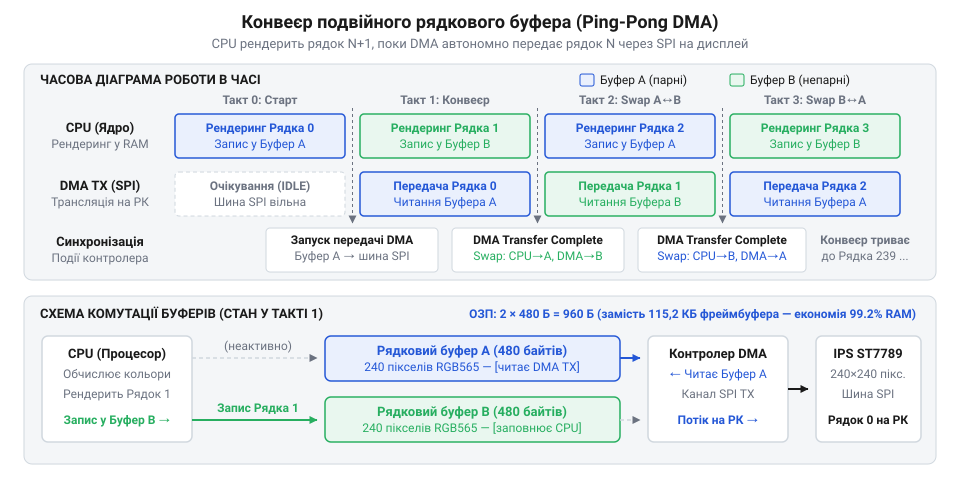

# IPS 1.3″ 240×240 (SPI, ST7789)

<preknowlist>
- [TFT 1.77″ 128×160 (SPI, ST7735S)](root:cat-hw-actuators/tft-st7735s) — базовий принцип послідовного керування графічним контролером дисплея через шину SPI, розділення команд та даних лінією D/C і концепція віконного запису у відеопам'ять (GRAM)
</preknowlist>

## Пастка мініатюрності: чому екран 1.3″ перевантажує мікроконтролер

Розробник підключає до мікроконтролера кольоровий IPS-модуль діагоналлю 1.3 дюйма (трохи більше 33 міліметрів). Плата з екраном за площею ледь перевищує поштову марку або монету. Маючи попередній досвід роботи з простими матрицями на зразок [OLED-дисплея 0.96″ SSD1306](root:cat-hw-actuators/oled-ssd1306), інженер природно очікує легкого запуску динамічної графіки: стрілочних індикаторів, плавних графіків вимірювань і відгукливого інтерфейсу користувача з кадровою частотою щонайменше 30 кадрів на секунду (англ. @@en|FPS@@, скорочення від @@en|frames per second@@ — кадрів на секунду).

Проте перша ж спроба вивести рухому анімацію стикається з низкою неочікуваних візуальних та системних збоїв:

- Ефект сповзання рядків (жалюзі): кадр (фр. @@fr|cadre@@ від лат. @@la|quadrum@@ — чотирикутник) оновлюється повільно й нерівномірно, хвилею заповнюючи екран згори донизу. Замість миттєвої зміни зображення користувач на власні очі спостерігає покрокову побудову рядків.
- Катастрофічне просідання частоти: лічильник показує лічені 2–4 кадри на секунду, перетворюючи плавний рух на серію уривчастих ривків.
- Ефект розриву кадру, або тиринг (англ. @@en|tearing@@, від @@en|tear@@ — рвати): коли об'єкт швидко зміщується горизонтально або вертикально, його силует розсікається на частини. Верхня половина фігури вже перемістилася в нові координати, тоді як нижня все ще відображає стан із попереднього кадру. Це стається через асинхронне зіткнення: внутрішній блок розгортки контролера дисплея читає відеопам'ять і формує зображення на рідкокристалічній матриці швидше, ніж мікроконтролер устигає оновити вміст цієї пам'яті через послідовну шину.
- Блокування обчислювального ядра: мікроконтролер припиняє вчасно опитувати сенсори, пропускає кроки енкодерів, втрачає байти в інтерфейсах зв'язку або перезавантажується апаратним сторожовим таймером. Процесор не завис на помилці — він виявився на 100% скутим у блокуючих циклах очікування передавача, вимушений чекати звільнення апаратного буфера після відправлення кожного байта.


*Схема виникнення розриву кадру (tearing): зіткнення покажчика розгортки ST7789 та покажчика запису через SPI спричиняє розсічення рухомого зображення через одночасний вивід ліній з різних кадрів.*

Причина такого колапсу криється в оманливості фізичного масштабу: компактний розмір пристрою створює хибне враження низької інформаційної вартості. Людське око бачить скляний квадратик зі стороною приблизно 23 міліметри, але для цифрової електроніки фізичні міліметри не існують. Мікроконтролер взаємодіє не з фізичним склом, а з повноцінною цифровою матрицею на 240 рядків і 240 стовпчиків, де кожна точка має власний незалежний колір. Кожен кадр стає масивним цифровим потоком, який необхідно протиснути крізь єдиний провідник послідовної шини SPI (англ. @@en|SPI@@, скорочення від @@en|Serial Peripheral Interface@@ — послідовний периферійний інтерфейс; шина від нім. @@de|Schiene@@ — рейка, смуга, англ. @@en|bus@@ від лат. @@la|omnibus@@ — для всіх).

Спроби усунути проблему навмання — підвищуючи тактову частоту шини без розрахунку чи скорочуючи затримки — або спричиняють апаратне спотворення даних через вихід за межі частотних характеристик чипа, або залишають просідання кадрів незмінним. Щоб побудувати стабільну систему, потрібен точний математичний розрахунок ланцюга передачі: від кількості точок растра й формату кодування кольору до пропускної здатності послідовної лінії, протокольних накладних витрат і часового бюджету процесора.

> 🔧 **Навіщо це.**
Розрахунок інформаційного потоку дисплея виконують до вибору конкретного мікроконтролера та написання графічного рушія. Якщо не обчислити смугу пропускання заздалегідь, можна обрати процесорне ядро, яке витрачатиме всі свої ресурси на проштовхування байтів у шину й не зможе одночасно виконувати вимірювання, керування приводами чи бездротовий зв'язок.

## Анатомія піксельного масиву: розрахунок інформаційного обсягу кадру в RGB565

Дисплейна матриця є прямокутною дискретною сіткою точок, розмір якої задають ширина `W` (англ. @@en|width@@) та висота `H` (англ. @@en|height@@). Для дисплея 1.3″ контролера ST7789 ці параметри дорівнюють `W = 240` та `H = 240`.

Загальна кількість пікселів (англ. @@en|pixel@@, скорочення від @@en|picture element@@ — елемент зображення, від лат. @@la|pictura@@ — картина та @@la|elementum@@ — першооснова) у межах одного повного кадру `N_pix` дорівнює добутку вимірів растра:

```
N_pix
= W × H              [добуток ширини та висоти растра]
= 240 × 240          [підстановка значень роздільної здатності]
= 57 600             [загальна кількість пікселів у матриці]
```

Щоб відтворити повноколірне зображення, кожен піксель синтезує відтінок змішуванням трьох базових випромінювань: червоного (англ. @@en|Red@@), зеленого (англ. @@en|Green@@) та синього (англ. @@en|Blue@@).

У комп'ютерній графіці високої чіткості використовують формат True Color (RGB888), де кожному каналу виділено 8 бітів (1 байт). Триточковий піксель займає 24 біти (3 байти), надаючи понад 16.7 мільйона відтінків. Проте у вбудованих системах 3-байтовий піксель створює суттєві накладні витрати: він не вирівнюється на 16- або 32-бітні межі регістрів мікроконтролера й вимагає пересилання зайвих 33% обсягу даних.

Через це в мікроконтролерних дисплеях стандартом є пакований 16-бітний формат [RGB565](root:sf-visual/rgb565-color-format). У ньому один піксель займає рівно 16 бітів (2 байти), розподілених між колірними складовими:

- червоний канал (R): 5 бітів (від 0 до 31, дає 32 рівні насиченості);
- зелений канал (G): 6 бітів (від 0 до 63, дає 64 рівні насиченості);
- синій канал (B): 5 бітів (від 0 до 31, дає 32 рівні насиченості).

Глибина кольору точки `b_pp` (англ. @@en|bpp@@, скорочення від @@en|bits per pixel@@ — бітів на піксель) обчислюється додаванням розрядностей складових:

```
b_pp
= b_R + b_G + b_B     [сума бітів колірних каналів пікселя]
= 5 + 6 + 5           [розподіл бітів за каналами R, G, B]
= 16 бітів            [глибина кольору однієї точки]
```

Нерівномірний розподіл бітів на користь зеленого каналу зумовлений біологією зору: крива спектральної чутливості людського ока досягає абсолютного піка в зоні довжин хвиль близько 555 нанометрів. Зорова кора людини значно точніше розрізняє перепади яскравості (від лат. @@la|lumen@@ — світло) у зеленому діапазоні спектра, ніж у червоному чи синьому. Додатковий шостий біт подвоює кількість градацій зеленого (64 замість 32), помітно згладжуючи колірні східці без розширення розміру пікселя понад два байти.


*Схема розкладання матриці 240×240 точок у потік байтів: 57 600 пікселів у форматі RGB565 потребують рівно 115 200 байтів на кадр.*

Оскільки кожен піксель займає 16 бітів, його розмір у байтах `b_byte` (англ. @@en|byte@@, від @@en|bite@@ — шматочок; біт від англ. @@en|bit@@, скорочення від @@en|binary digit@@ — двійкова цифра) дорівнює:

```
b_byte
= b_pp / 8           [переведення бітової глибини в байти]
= 16 / 8             [ділення бітів на розрядність байта]
= 2 байти            [розмір одного пікселя у пам'яті]
```

Сумарний інформаційний обсяг одного повного кадру в байтах `V_bytes` обчислюється множенням загальної кількості пікселів на розмір точки:

```
V_bytes
= N_pix × b_byte     [добуток кількості пікселів на байти однієї точки]
= 57 600 × 2         [підстановка 57 600 точок і 2 байтів на піксель]
= 115 200 байтів     [сумарний інформаційний обсяг кадру в байтах]
```

Для послідовної лінії передачі, де кожен біт виштовхується окремим тактом шини (такт від лат. @@la|tactus@@ — дотик, відчуття міри), розраховують інформаційну масу кадру в бітах `V_bits`:

```
V_bits
= V_bytes × 8        [переведення байтового масиву у біти]
= 115 200 × 8        [множення загальної кількості байтів на 8]
= 921 600 бітів      [корисний бітовий обсяг одного кадру]
```

Майже один мегабіт (921 600 бітів) даних необхідно передати крізь єдину лінію MOSI (англ. @@en|MOSI@@, скорочення від @@en|Master Out Slave In@@ — вихід ведучого, вхід веденого) лише для одноразового повного оновлення екрана.

Щоб оцінити масштаб цього числа, зіставимо його з вимогами монохромного [OLED-дисплея 0.96″ SSD1306](root:cat-hw-actuators/oled-ssd1306) роздільною здатністю 128×64 точок. У монохромній матриці кожен піксель має лише два стани (увімкнено або вимкнено), тому кодується одним бітом (`b_oled = 1`).

Інформаційний обсяг кадру для такого екрана `V_oled` дорівнює:

```
V_oled
= (W_oled × H_oled × b_oled) / 8    [інформаційний обсяг монохромного кадру]
= (128 × 64 × 1) / 8                [підстановка параметрів матриці 128×64]
= 8 192 / 8                         [переведення бітової карти в байти]
= 1 024 байти                       [рівно 1 кілобайт пам'яті]
```

Знайдемо співвідношення між обсягами кадрів двох дисплеїв `K_ratio`:

```
K_ratio
= V_bytes / V_oled                  [відношення обсягів кадрів]
= 115 200 / 1 024                   [ділення обсягу IPS ST7789 на обсяг OLED SSD1306]
= 112.5                             [кратність збільшення інформаційного потоку]
```

Один кадр компактного дисплея ST7789 за обсягом даних дорівнює 112.5 кадрам монохромного OLED-екрана. Навіть у порівнянні з кольоровим дисплеєм [TFT 1.77″ 128×160 (SPI, ST7735S)](root:cat-hw-actuators/tft-st7735s), чий повний кадр вимагає `128 × 160 × 2 = 40 960` байтів, екран 240×240 потребує майже втричі більшого обсягу інформації (`115 200 / 40 960 = 2.8125`).

Ця прірва в обсягах пояснює, чому спроби перенести програмні алгоритми з OLED на IPS призводять до зупинки процесора: те, що для монохромного екрана займає 1 кілобайт і передається непомітно, для IPS-матриці перетворюється на 115.2 кілобайта неперервного трафіку.

> 🔧 **Навіщо це.**
Значення 115 200 байтів безпосередньо диктує вибір апаратної архітектури мікроконтролера. Бюджетні чипи з обсягом оперативної пам'яті 2–20 КБ фізично не можуть виділити буфер під повний кадр. У них доводиться рендерити графіку частинами — смугами по 10–20 рядків — або переходити на процесори з оперативною пам'яттю понад 256 КБ. Отримане число 921 600 бітів слугує фундаментальним базовим чисельником у формулі розрахунку необхідної тактової частоти шини SPI під цільовий показник FPS.

## Ідеальна пропускна здатність шини та бітрейт для 30 і 60 FPS

Людське око сприймає зміну статичних зображень як плавний рух лише тоді, коли частота зміни кадрів — фреймрейт (від англ. @@en|frame rate@@ — частота кадрів) — досягає щонайменше 24–30 кадрів на секунду (FPS, від англ. @@en|frames per second@@). Для динамічних елементів інтерфейсу користувача, швидких графіків та ігрової графіки стандартом візуальної плавності є 60 FPS. Якщо цифровий канал передачі між мікроконтролером і дисплеєм не встигає доставляти повні масиви пікселів із такою частотою, рух стає уривчастим, випадають кадри, або виникає неприємний [розрив зображення](root:sf-visual/screen-tearing) — дефект, за якого верхня і нижня частини екрана відображають різні моменти часу.

Щоб оцінити фізичну спроможність послідовного інтерфейсу передавати динамічну картинку на IPS-екран 240×240 точок у форматі кольору RGB565, слід виходити з точного інформаційного обсягу одного кадру. Повний масив містить:

```
N_pixels
= 240 × 240                       [добуток ширини на висоту матриці]
= 57 600 пікселів                 [загальна кількість точок]
```

Оскільки кожен піксель у просторі RGB565 кодується 16 бітами (2 байти), обсяг кадру в байтах і бітах дорівнює:

```
N_bytes
= 57 600 × 2                      [множення кількості точок на 2 байти]
= 115 200 Байт                    [інформаційний обсяг кадру в байтах]
```

```
N_bits
= 115 200 × 8                     [переведення байтів у біти]
= 921 600 бітів                   [інформаційний обсяг кадру в бітах]
```

За припущення ідеального каналу зв'язку, де між сусідніми байтами та словами відсутні будь-які паузи чи очікування процесора, бітрейт (від англ. @@en|bit rate@@ — швидкість передачі бітів) визначається як прямий добуток інформаційної ємності кадру на цільову частоту оновлення:

```
R_bit = N_bits × FPS
```

Для цільової плавності у 30 FPS розрахунок необхідного потоку бітів має вигляд:

```
R_bit(30)
= N_bits × 30                     [визначення бітрейту через цільовий фреймрейт]
= 921 600 × 30                    [підстановка обсягу кадру 240×240 RGB565]
= 27 648 000 біт/с                [арифметичне множення]
= 27.648 Мбіт/с ≈ 27.65 Мбіт/с    [переведення в десяткові мегабіти, 10⁶]
```

У перерахунку на байтовий потік це вимагає передачі:

```
R_byte(30)
= R_bit(30) ÷ 8                   [перерахунок швидкості з бітів у байти]
= 27 648 000 ÷ 8                  [ділення кількості бітів на 8]
= 3 456 000 Байт/с                [байтовий потік на секунду]
= 3.456 МБ/с ≈ 3.46 МБ/с          [переведення в десяткові мегабайти, 10⁶]
```

Для досягнення граничної плавності у 60 FPS інформаційний потік подвоюється:

```
R_bit(60)
= N_bits × 60                     [визначення бітрейту для частоти 60 FPS]
= 921 600 × 60                    [підстановка обсягу кадру]
= 55 296 000 біт/с                [арифметичне множення]
= 55.296 Мбіт/с ≈ 55.30 Мбіт/с    [переведення в десяткові мегабіти]
```

```
R_byte(60)
= R_bit(60) ÷ 8                   [перерахунок швидкості з бітів у байти]
= 55 296 000 ÷ 8                  [ділення кількості бітів на 8]
= 6 912 000 Байт/с                [байтовий потік на секунду]
= 6.912 МБ/с ≈ 6.91 МБ/с          [переведення в десяткові мегабайти]
```

Послідовний інтерфейс SPI передає корисні дані однобітною лінією MOSI (від англ. @@en|Master Out Slave In@@ — вихід передавача, вхід приймача), де кожен біт супроводжується одним тактовим імпульсом лінії SCK (від англ. @@en|Serial Clock@@ — послідовний тактовий сигнал, від нім. @@de|Takt@@ через латин. @@la|tactus@@ — дотик, відчуття ритму). В однобітній шині за один період тактового сигналу `T_sck = 1 / f_sck` виставляється рівно один інформаційний біт.

Звідси випливає фундаментальна тотожність: за безперервної передачі без пауз максимальна теоретична пропускна здатність однобітної шини SPI у бітах на секунду чисельно дорівнює тактовій частоті шини в герцах:

```
R_bit_max = f_sck
```

Відповідно, мінімальна тактова частота `f_sck_min`, необхідна для трансляції відеопотоку із частотою `FPS`, має бути не меншою за розрахований бітрейт:

```
f_sck_min = R_bit = N_bits × FPS
```

Для 30 FPS мінімальна частота тактування шини становить 27.65 МГц, а для 60 FPS — 55.30 МГц.

Зіставлення цих значень із реальними можливостями мікроконтролерів виявляє суворе апаратне обмеження. Тактова частота SPI у більшості мікроконтролерів формується цілочисельним діленням базової частоти системної периферійної шини:

```
f_sck = f_periph ÷ Prescaler
```

Класичні 8-бітні платформи із тактовою частотою ядра 16 МГц мають максимальну частоту апаратного SPI `f_cpu ÷ 2 = 8 МГц`. Багато енергоощадних або бюджетних 32-бітних мікроконтролерів тактують периферійні шини на частотах, що обмежують швидкість SPI значеннями 8–16 МГц.

Якщо підставити ці частоти у формулу максимального фреймрейту за умови нульових пауз, виходить:

```
FPS_max(8 МГц)
= f_sck ÷ N_bits                  [співвідношення тактової частоти та бітів кадру]
= 8 000 000 ÷ 921 600             [підстановка тактової частоти 8 МГц]
≈ 8.68 FPS                        [обчислення максимального фреймрейту]
```

```
FPS_max(16 МГц)
= f_sck ÷ N_bits                  [співвідношення тактової частоти та бітів кадру]
= 16 000 000 ÷ 921 600            [підстановка тактової частоти 16 МГц]
≈ 17.36 FPS                       [обчислення максимального фреймрейту]
```

Щоб досягти хоча б мінімально прийнятної для ока динаміки у 20 FPS, тактова частота шини повинна становити:

```
f_sck_min(20)
= N_bits × 20                     [добуток бітів кадру на 20 FPS]
= 921 600 × 20                    [підстановка обсягу кадру]
= 18 432 000 Гц ≈ 18.43 МГц       [мінімальна тактова частота шини для 20 FPS]
```

На стандартній частоті SPI у 8 МГц екран здатен оновлюватися менше 9 разів на секунду, що сприймається як слайд-шоу. На частоті 16 МГц гранична швидкість становить лише 17.36 FPS, що фізично унеможливлює досягнення навіть 20 FPS при повнокадровому виведенні без розгону периферії або застосування контролерів із вищими базовими частотами шини.

Контролер ST7789 згідно зі специфікацією виробника підтримує тривалість періоду тактового сигналу запису `t_SCYCW` аж до 16 нс (за умови достатнього рівня напруги живлення логіки), що відповідає теоретичній межі тактової частоти:

```
f_sck_limit
= 1 ÷ (16 × 10⁻⁹)                 [обернена величина до мінімального періоду такту]
= 62 500 000 Гц = 62.5 МГц        [гранична тактова частота приймача ST7789]
```

Сам дисплейний контролер здатний приймати повноцінний потік 60 FPS на частоті 55.30 МГц. Головним вузьким місцем виступає передавач мікроконтролера, генератор тактових імпульсів його шини SPI та фізична якість з'єднувальних провідників.

> 🔧 **Навіщо це.**
> Розрахунок мінімальної тактової частоти ще до написання коду захищає від помилки вибору невідповідного мікроконтролера. Якщо пристрій вимагає анімації інтерфейсу або відображення графіків у реальному часі на повному екрані з частотою 30 FPS, мікроконтролер із шиною SPI на 8 чи 16 МГц фізично не впорається із завданням. Розрахунок однозначно вказує на архітектурне рішення: або використовувати мікроконтролер із тактуванням SPI на рівні 40–60 МГц (як-от ESP32 чи RP2040), або відмовлятися від повнокадрової перемальовки на користь часткового оновлення лише змінених ділянок екрана.

## Протокольні накладні витрати та часові межі адресації вікна ST7789

Графічний контролер дисплея не може просто приймати неперервний потік колірних байтів без попередньої вказівки, у яку саме область внутрішньої відеопам'яті (GRAM, від англ. @@en|Graphic RAM@@ — графічна пам'ять із довільним доступом) ці байти мають записуватися. На відміну від дисплеїв із класичним паралельним RGB-інтерфейсом, де положення точки на матриці визначається зовнішніми стробами горизонтальної та вертикальної синхронізації, контролер ST7789 містить власні апаратні лічильники адрес стовпчиків і рядків.

Після надходження кожного двобайтового значення пікселя внутрішній вказівник адреси автоматично зміщується зліва направо і зверху вниз, заповнюючи заздалегідь визначене прямокутне робоче вікно. Цю архітектуру адресації вікна контролер ST7789 успадкував від споріднених драйверів, таких як [ST7735S](root:cat-hw-actuators/tft-st7735s). Тому перед трансляцією масиву пікселів мікроконтролер зобов'язаний виконати транзакцію (від латин. @@la|transactio@@ — угода, завершення справи) адресації, що складається зі службових команд і координатних меж.

Для керування режимом шини контролер використовує лінію вибору мікросхеми CS (від англ. @@en|Chip Select@@ — вибір кристала, активний нулем) та керуючу лінію D/C (від англ. @@en|Data/Command@@ — дані/команда). Коли на лінії D/C встановлено низький рівень (нуль), переданий байт сприймається логікою ST7789 як регістрова команда. Коли на D/C виставлено високий рівень (одиниця), байти інтерпретуються як параметри налаштування або піксельні дані.

Повна послідовність адресації вікна перед записом пікселів містить рівно три обов'язкові етапи:

1. Встановлення діапазону стовпчиків — команда `CASET` (від англ. @@en|Column Address Set@@, шістнадцятковий код `0x2A`):
   - 1 байт команди `0x2A` (лінія D/C = 0);
   - 4 байти параметрів координат (лінія D/C = 1): два байти початкового стовпчика `XS[15:8]` і `XS[7:0]` та два байти кінцевого стовпчика `XE[15:8]` і `XE[7:0]`. Для повного екрана початковий стовпчик дорівнює 0 (`0x0000`), а кінцевий — 239 (`0x00EF`). Разом етап займає 5 байтів.
2. Встановлення діапазону рядків — команда `RASET` (від англ. @@en|Row Address Set@@, шістнадцятковий код `0x2B`):
   - 1 байт команди `0x2B` (лінія D/C = 0);
   - 4 байти параметрів координат (лінія D/C = 1): два байти початкового рядка `YS[15:8]` і `YS[7:0]` та два байти кінцевого рядка `YE[15:8]` і `YE[7:0]`. Для повного екрана координати складають від 0 (`0x0000`) до 239 (`0x00EF`). Разом етап займає 5 байтів.
3. Відкриття потокового запису у відеопам'ять — команда `RAMWR` (від англ. @@en|Memory Write@@, шістнадцятковий код `0x2C`):
   - 1 байт команди `0x2C` (лінія D/C = 0). Після надходження цього байта контролер перемикає свій внутрішній демультиплексор на масив комірок пам'яті й очікує безперервного потоку піксельних байтів за високого рівня лінії D/C = 1.

Сумарний протокольний обсяг адресації становить:

```
N_protocol
= 5 + 5 + 1                       [додавання байтів CASET, RASET та RAMWR]
= 11 байтів                       [загальний протокольний оверхед транзакції]
```

У бітах це дорівнює `11 × 8 = 88` бітів.


*Часова та протокольна діаграма трансляції кадру шиною SPI: взаємне розташування сигналів CS, D/C і MOSI під час передачі 11 байтів адресації та наступного потоку пікселів.*

Окрім передачі самих 11 байтів, протокол адресації вікна вимагає шестикратного перемикання фізичного стану лінії D/C:
- спад у 0 для команди `CASET`;
- підйом в 1 для 4 байтів меж колонок;
- спад у 0 для команди `RASET`;
- підйом в 1 для 4 байтів меж рядків;
- спад у 0 для команди `RAMWR`;
- фінальний підйом в 1 для потоку кольорів пікселів.

У програмному керуванні виводом кожне таке перемикання супроводжується зверненням до регістрів портів введення-виведення (GPIO), що вносить короткі апаратні затримки між посилками.

Щоб оцінити вплив протокольних витрат на пропускну здатність, розраховується відносний протокольний оверхед (від англ. @@en|overhead@@ — накладні витрати) як частка службових байтів у загальному обсязі транзакції:

```
η_overhead = N_protocol ÷ (N_protocol + N_data) × 100%
```

Для повного кадру масивом 240×240 точок корисні дані становлять `N_data = 115 200` байтів. Підстановка значень дає:

```
η_overhead(кадр)
= N_protocol ÷ (N_protocol + N_data)       [частка службових байтів у загальній транзакції]
= 11 ÷ (11 + 115 200)                      [підстановка розмірів для повного кадру]
= 11 ÷ 115 211                             [сума переданих байтів транзакції]
≈ 0.00009548                               [десятковий дріб]
≈ 0.0095% < 0.01%                          [протокольні накладні витрати у відсотках]
```

Для повнокадрового оновлення частка протокольних байтів становить менше однієї сотої відсотка. Накладні витрати шини SPI на адресацію повного екрана практично дорівнюють нулю: понад 99.99% пропускної здатності займає корисне колірне навантаження.

Проте ситуація кардинально змінюється, коли застосовується часткове оновлення робочої області (оновлення за прямокутними фрагментами чи окремими рядками). Розглянемо кілька характерних випадків геометричного розбиття:

1. Оновлення тайла знакогенератора або графічної плитки 16×16 точок:
   `N_pixels = 16 × 16 = 256` пікселів, корисні дані `N_data = 256 × 2 = 512` байтів.

```
η_overhead(16×16)
= N_protocol ÷ (N_protocol + N_data)       [частка службових байтів у транзакції плитки]
= 11 ÷ (11 + 512)                          [підстановка 512 байтів для плитки 16×16]
= 11 ÷ 523                                 [сума переданих байтів]
≈ 0.02103 ≈ 2.10%                          [протокольні накладні витрати у відсотках]
```

Накладні витрати зростають до 2.1%. Якщо весь екран розбити на сітку таких тайлів (`15 × 15 = 225` плиток), сумарний протокольний баласт складе `225 × 11 = 2 475` байтів на кадр.

2. Порядкове оновлення (рядки 240×1 точок):
   `N_pixels = 240`, корисні дані `N_data = 240 × 2 = 480` байтів.

```
η_overhead(рядок)
= N_protocol ÷ (N_protocol + N_data)       [частка службових байтів у транзакції рядка]
= 11 ÷ (11 + 480)                          [підстановка 480 байтів для рядка 240×1]
= 11 ÷ 491                                 [сума переданих байтів]
≈ 0.02240 ≈ 2.24%                          [протокольні накладні витрати у відсотках]
```

Оновлення екрана окремими лініями через 240 послідовних транзакцій додає `240 × 11 = 2 640` байтів службових даних та вимагає 1440 перемикань лінії D/C.

3. Оновлення одиночного спрайта або іконки розміром 8×8 точок:
   `N_pixels = 64`, корисні дані `N_data = 128` байтів.

```
η_overhead(8×8)
= N_protocol ÷ (N_protocol + N_data)       [частка службових байтів для вікна 8×8]
= 11 ÷ (11 + 128)                          [підстановка 128 байтів корисних даних]
= 11 ÷ 139                                 [сума байтів транзакції]
≈ 0.07914 ≈ 7.91%                          [протокольні накладні витрати у відсотках]
```

Накладні витрати сягають майже 8% від усього обсягу передачі.

4. Граничний випадок: запис одиничного пікселя (вікно 1×1):
   `N_pixels = 1`, корисні дані `N_data = 2` байти.

```
η_overhead(1×1)
= N_protocol ÷ (N_protocol + N_data)       [частка службових байтів для одного пікселя]
= 11 ÷ (11 + 2)                            [підстановка 2 байтів кольору]
= 11 ÷ 13                                  [сума байтів транзакції]
≈ 0.8462 ≈ 84.62%                          [протокольні накладні витрати у відсотках]
```

При точковому виведенні протокол поглинає майже 85% часу шини: щоб надіслати всього два байти кольору, необхідно передати 11 байтів налаштування координат.

Математичний розрахунок доводить: суцільне передавання великих масивів пікселів за одну транзакцію є найефективнішим способом утилізації шини. Подрібнення кадру на мікроскопічні регіони призводить до того, що шина витрачає помітну частку часу на передачу координат замість пікселів, а програмні накладні витрати на багаторазове перемикання піна D/C додатково гальмують конвеєр візуалізації.

> 🔧 **Навіщо це.**
> Розрахунок протокольних витрат задає архітектуру виведення графіки під час проектування графічних рушіїв для мікроконтролерів. Якщо в мікроконтролері бракує оперативної пам'яті для зберігання повного кадрового буфера (115.2 КБ), екран оновлюють частинами. Знання формули оверхеду допомагає вибрати правильний геометричний квант: розбиття екрана на горизонтальні смуги (наприклад, по 20 або 40 рядків) або середні прямокутники зберігає протокольні втрати на рівні менше 0.1%, тоді як попіксельне чи подрібнене оновлення перетворює протокол адресації на головне гальмо продуктивності системи.

## Міжбайтові паузи передавача та реальна частота кадрів

Осцилограф або логічний аналізатор, підключений до шини SPI під час виведення суцільного кадру 240×240 пікселів на контролер ST7789, виявляє несподівану картину. Розрахунок швидкості передачі масиву зі 115 200 байтів кольору RGB565 на тактовій частоті 40 МГц обіцяє завершення кадру за 23 мілісекунди та частоту оновлення понад 43 кадри на секунду. На практиці ж екран оновлюється помітно повільніше, ледь сягаючи 28–29 кадрів на секунду. Сигнал на лінії тактування SCK не йде неперервним суцільним потоком. Між кожною пачкою з восьми робочих тактів шина завмирає: тактовий сигнал зупиняється на десятки або й сотні наносекунд, утримуючи пасивний рівень напруги. Цей інтервал простою називають міжбайтовою паузою (лат. @@la|pausa@@ від грец. @@grc|pausis@@ — припинення, зупинка).

Апаратний блок SPI мікроконтролера виконує серіалізацію бітів автономно. Щойно черговий байт потрапляє до зсувного регістра (лат. @@la|registrum@@ від @@la|regerere@@ — вносити, записувати), апаратні тригери передавача самостійно генерують вісім імпульсів SCK і побітово виштовхують дані в лінію MOSI. Проте після завершення передачі восьмого біта передавач зупиняється й чекає наступну порцію даних. У типовому програмному циклі побайтового виведення процесорне ядро змушене виконати послідовність машинних інструкцій:
1. Зчитати статусний регістр SPI та перевірити прапорець спустошення передавального буфера (англ. @@en|buffer@@ від ст.-фр. @@fro|buffe@@ — поштовх, амортизатор; прапорець TXE або SPTEF).
2. Виявити готовність буфера та вийти з циклу очікування.
3. Зчитати черговий байт пікселя з оперативної пам'яті (RAM) у внутрішній регістр процесора.
4. Записати байт у регістр даних SPI.
5. Збільшити вказівник адреси пам'яті, декрементувати лічильник пікселів і виконати умовний перехід на початок циклу.

Навіть якщо ядро мікроконтролера працює на частоті 80–160 МГц і виконує більшість інструкцій за один-два такти (6–12 нс), виконання цього ланцюжка займає щонайменше 5–10 машинних тактів, створюючи апаратну паузу тривалістю `t_gap` від 50 до 100 наносекунд. Якщо ж передача байта оформлена у вигляді виклику окремої підпрограми чи бібліотечної функції, накладні витрати на збереження регістрів у стек, передачу аргументів, стрибок та повернення розтягують міжбайтовий простій до 150–300 наносекунд.


*Часова діаграма передачі байтів пікселів по шині SPI: пауза очікування буфера t_gap між пачками з 8 тактів тактового сигналу SCK багаторазово повторюється для 115 200 байтів кадру, збільшуючи сумарний час передачі кадру t_frame та знижуючи підсумковий FPS.*

Для оцінки масштабу проблеми зіставимо тривалість передачі одного байта безпосередньо по шині та тривалість супутньої паузи. На тактовій частоті `f_SCK = 40 МГц` період тактового імпульсу `t_SCK` становить:

```
t_SCK
= 1 / f_SCK                              [визначення періоду тактового сигналу через частоту]
= 1 / (40 · 10⁶ с⁻¹)                     [підстановка тактової частоти шини 40 МГц]
= 2.5 · 10⁻⁸ с                           [ділення одиниці на частоту]
= 25 нс                                  [переведення в наносекунди]
```

Передача восьми бітів одного байта по шині без урахування будь-яких затримок займає:

```
t_byte_pure
= 8 · t_SCK                              [множення кількості бітів у байті на період такту]
= 8 · 25 нс                              [підстановка тривалості одного такту SCK]
= 200 нс                                 [тривалість 8 тактів тактового сигналу]
```

Якщо між завершенням восьмого такту поточного байта і першим тактом наступного виникає мікроконтролерна затримка `t_gap`, повний час трансляції одного байта зростає до `8 · t_SCK + t_gap`.

Один кадр дисплея з роздільною здатністю 240×240 точок у форматі кольору RGB565 (два байти на піксель) містить 57 600 пікселів, тобто рівно `N_bytes = 115 200` байтів графічних даних. Повне рівняння часу передачі масиву кадру `t_frame` набуває вигляду:

```
t_frame
= N_bytes · (8 · t_SCK + t_gap)          [формула повного часу передачі кадру з міжбайтовими паузами]
```

В ідеальному теоретичному випадку, коли міжбайтова пауза відсутня (`t_gap = 0`), сумарний час передачі кадру та гранична частота оновлення на частоті 40 МГц дорівнюють:

```
t_ideal
= N_bytes · 8 · t_SCK                    [теоретичний час безперервної передачі бітів]
= 115 200 · 8 · (25 · 10⁻⁹ с)            [підстановка 115 200 байтів і періоду такту 25 нс]
= 115 200 · (200 · 10⁻⁹ с)               [час апаратної передачі 8 бітів без пауз]
= 0.02304 с                              [перемноження кількості байтів на тривалість байта]
= 23.04 мс                               [переведення часу передачі в мілісекунди]
```

```
FPS_ideal
= 1 / t_ideal                            [частота оновлення як величина, обернена до часу кадру]
= 1 / 0.02304 с                          [підстановка ідеальної тривалості передачі кадру]
≈ 43.402 с⁻¹                             [ділення одиниці на тривалість кадру]
≈ 43.4 FPS                               [округлення до десятих частоти кадрів]
```

Тепер розрахуємо реальну тривалість передачі кадру за наявності міжбайтової затримки `t_gap = 50 нс`, зумовленої мінімальними накладними витратами швидкого процесорного циклу:

```
t_frame
= 115 200 · (8 · 25 · 10⁻⁹ с + 50 · 10⁻⁹ с)  [підстановка параметрів для паузи 50 нс]
= 115 200 · (200 · 10⁻⁹ с + 50 · 10⁻⁹ с)     [додавання тривалості передачі бітів і затримки]
= 115 200 · (250 · 10⁻⁹ с)                   [повна тривалість байтового циклу з паузою]
= 0.0288 с                                   [перемноження кількості байтів на тривалість циклу]
= 28.80 мс                                   [переведення в мілісекунди]
```

Додатковий час, внесений паузою 50 нс:

```
Δt_gap
= N_bytes · t_gap                        [сумарний додатковий час простою шини за кадр]
= 115 200 · (50 · 10⁻⁹ с)                [підстановка 115 200 байтів і затримки 50 нс]
= 0.00576 с                              [обчислення втраченого часу передачі]
= 5.76 мс                                [переведення доданого часу в мілісекунди]
```

Результуюча частота оновлення падає:

```
FPS
= 1 / t_frame                            [розрахунок реальної частоти оновлення]
= 1 / 0.0288 с                           [підстановка реального часу кадру 28.80 мс]
≈ 34.722 с⁻¹                             [ділення одиниці на тривалість передачі]
≈ 34.7 FPS                               [округлення до десятих частоти кадрів]
```

Якщо ж цикл містить додаткові перевірки або латентність (лат. @@la|latentia@@ від @@la|latens@@ — прихований; затримка реагування) виклику функцій збільшує паузу до `t_gap = 100 нс`, паразитна затримка подвоюється:

```
Δt_gap
= 115 200 · (100 · 10⁻⁹ с)               [підстановка 115 200 байтів і затримки 100 нс]
= 0.01152 с                              [обчислення втраченого часу за кадр]
= 11.52 мс                               [переведення втраченого часу в мілісекунди]
```

```
t_frame
= 115 200 · (200 · 10⁻⁹ с + 100 · 10⁻⁹ с) [підстановка тривалості байта з паузою 100 нс]
= 115 200 · (300 · 10⁻⁹ с)                [тривалість байтового циклу з паузою 100 нс]
= 0.03456 с                               [перемноження кількості байтів на тривалість циклу]
= 34.56 мс                                [переведення часу кадру в мілісекунди]
```

```
FPS
= 1 / 0.03456 с                           [розрахунок частоти оновлення для часу 34.56 мс]
≈ 28.935 с⁻¹                              [ділення одиниці на тривалість передачі]
≈ 28.9 FPS                                [округлення до десятих частоти кадрів]
```

Затримка у 100 наносекунд між байтами здається непомітною в масштабі окремої команди. Але помножена на 115 200 операцій одного кадру, вона розтягує час передачі на 11.52 мілісекунди, обвалюючи розрахункові 43.4 FPS до реальних 28.9 FPS (а при додаткових накладних витратах переривань — до 28 FPS). За одну секунду неперервної анімації при 29 FPS сумарний час простою шини становить `29 · 11.52 мс ≈ 334 мс`: процесор втрачає третину робочої секунди на порожнє очікування прапорців буфера.

> 🔧 **Навіщо це.**
> Розуміння природи `t_gap` визначає вибір архітектури драйвера дисплея. Щоб усунути міжбайтові паузи й повернути втрачені 14–15 FPS, передачу даних переводять із програмного побайтового опитування на [DMA-передачу шини SPI](root:hw-arch/spi-dma-transfer), яка подає байти в зсувний регістр передавача апаратно без втручання процесорного ядра, скорочуючи паузу `t_gap` практично до нуля.

## Апаратні межі тактування ST7789 і вибір дільників мікроконтролера

Природним інженерним бажанням після виявлення падіння частоти кадрів стає збільшення тактової частоти шини SPI. Якщо на 40 МГц теоретична швидкість становить 43 FPS, здається логічним підняти частоту SCK до 80 МГц або 100 МГц, щоб компенсувати будь-які програмні паузи. Проте спроба довільного розгону шини негайно наштовхується на дві фундаментальні межі: кремнієві часові ліміти контролера ST7789 та дискретну сітку апаратних дільників частоти мікроконтролера.

Контролер дисплея ST7789 — це інтегральна мікросхема, чиї внутрішні тригери потребують фіксованого часу для стабілізації логічних рівнів і зчитування бітів з лінії MOSI по фронту сигналу SCK. Паспортні часові характеристики (англ. @@en|AC Characteristics@@) чотирипровідного інтерфейсу SPI контролера ST7789 встановлюють суворе апаратне обмеження на мінімальний період тактового імпульсу запису:

```
t_SCK(min) = 16 нс
```

Звідси випливає теоретична верхня межа робочої тактової частоти запису контролера ST7789:

```
f_SCK(max)
= 1 / t_SCK(min)                         [визначення максимальної частоти через мінімальний період]
= 1 / (16 · 10⁻⁹ с)                      [підстановка паспортного мінімального періоду запису ST7789]
= 62 500 000 с⁻¹                         [ділення одиниці на 16 наносекунд]
= 62.5 МГц                               [переведення частоти в мегагерци]
```

Будь-яка тактова частота, вища за 62.5 МГц, порушує специфікацію виробника: мінімальна тривалість перебування сигналу у високому рівні `t_SCKWH` та в низькому рівні `t_SCKWL` (щонайменше 7–8 нс), а також час випередження встановлення даних `t_SDS` (мінімум 4 нс) скорочуються нижче фізичного порогу спрацьовування вхідних каскадів ST7789. Контролер починає пропускати або неправильно зчитувати біти. Для порівняння, споріднений контролер [TFT 1.77″ 128×160 (SPI, ST7735S)](root:cat-hw-actuators/tft-st7735s) має значно жорсткіший ліміт періоду запису (мінімум 66 нс), що обмежує його частоту приблизно 15 МГц.

Друга перепона полягає в тому, як саме мікроконтролер формує тактовий сигнал шини SPI. Периферійний модуль SPI не містить довільного синтезатора частоти; він отримує тактування від базової системної шини або шини периферії `f_source` (наприклад, `f_PCLK` або `f_sys`) через апаратний дільник частоти — прескалер (лат. @@la|prae-@@ — попереду та @@la|scala@@ — сходинки, драбина; англ. @@en|prescaler@@).

У більшості архітектур мікроконтролерів коефіцієнт поділу прескалера `DIV` обмежений фіксованими степенями двійки:

```
DIV ∈ {2, 4, 8, 16, 32, 64, 128, 256}
```

Вихідна тактова частота шини SPI обчислюється дискретним співвідношенням:

```
f_SCK
= f_source / DIV                         [обчислення частоти шини через дільник прескалера]
```

Через це розробник не може встановити довільну частоту (наприклад, рівно 50 або 60 МГц):
- Якщо периферійна шина тактується від `f_source = 84 МГц`, мінімальний дільник `DIV = 2` формує `f_SCK = 84 / 2 = 42 МГц`, що безпечно вкладається в межу 62.5 МГц. Наступне значення `DIV = 4` дає вже тільки `21 МГц`.
- Якщо базова шина працює на `f_source = 168 МГц`, дільник `DIV = 2` задає `f_SCK = 168 / 2 = 84 МГц`. Ця величина на 34% перевищує паспортний максимум ST7789 (62.5 МГц) і викликає збій зв'язку. Інженер змушений перемкнути прескалер на `DIV = 4`, отримуючи ті самі `f_SCK = 168 / 4 = 42 МГц`.
- Якщо мікроконтролер працює на базовій частоті `f_source = 125 МГц` і використовує дільник `DIV = 2`, частота становить рівно `62.5 МГц` — гранично допустиме паспортне значення.

Однак встановлення граничної частоти 42 або 62.5 МГц на практиці найчастіше призводить до появи артефактів зображення: «снігу» з випадкових пікселів, зсуву рядків, інверсії кольорів або повного зависання контролера екрана. Причина криється у деградації фронтів імпульсів у реальному фізичному середовищі.

Кожен провідник у просторі володіє паразитною ємністю (грец. @@grc|parasitos@@ — нахлібник та лат. @@la|capacitas@@ — місткість). На безпайковій макетній платі металеві контактні рельси мають паразитну ємність 2–5 пФ на кожну лінію. Гнучкі з'єднувальні дроти додають 1–1.5 пФ на кожен сантиметр довжини. Типовий джгут дротів завдовжки 15–20 см разом із вхідною ємністю виводу модуля ST7789 утворює сумарну ємність навантаження `C_L` у межах 50–80 пФ.

Вихідний каскад виводу GPIO мікроконтролера має власний ненульовий внутрішній опір каналу відкритих транзисторів `R_on`, що зазвичай становить 25–50 Ом. Разом із паразитною ємністю лінії `C_L` цей опір утворює еквівалентний RC-фільтр нижніх частот зі сталою часу:

```
τ
= R_on · C_L                             [визначення сталої часу розряду-заряду ємності]
= 40 Ом · (80 · 10⁻¹² Ф)                 [підстановка внутрішнього опору та паразитної ємності]
= 3.2 · 10⁻⁹ с                           [перемноження опору на ємність]
= 3.2 нс                                 [стала часу перехідного процесу лінії]
```

Час наростання фронту сигналу `t_rise` від 10% до 90% логічного рівня становить:

```
t_rise
≈ 2.2 · τ                                [співвідношення часу наростання перехідного процесу RC-кола]
= 2.2 · 3.2 нс                           [підстановка сталої часу 3.2 нс]
= 7.04 нс                                [тривалість наростання фронту імпульсу]
```

На граничній частоті `f_SCK = 62.5 МГц` період коливань становить `T = 16 нс`, а час перебування сигналу у високому стані дорівнює лише половині періоду:

```
t_high
= T / 2                                  [тривалість імпульсу у високому стані для симетричного меандру]
= 16 нс / 2                              [підстановка періоду 16 нс на частоті 62.5 МГц]
= 8 нс                                   [тривалість півперіоду сигналу SCK]
```

Якщо наростання сигналу займає 7.04 нс, імпульс ледь встигає піднятися до рівня логічної одиниці, як мікроконтролер уже перемикає лінію на розряд у нуль. Прямокутні тактові імпульси перетворюються на згладжені трикутні хвилі зменшеної амплітуди. Рівень напруги не досягає порогу впевненого спрацьовування вхідного тригера ST7789 (`V_IH = 0.7 · VDD ≈ 2.3 В` при напрузі живлення 3.3 В), і контролер пропускає тактовий імпульс. Пропуск хоча б одного такту зміщує бітову сітку: червоні пікселі перетворюються на сині, а координати вікна виведення розсинхронізуються. Додатково паразитна індуктивність дротів (~20 нГн) при високій швидкості наростання фронту (англ. @@en|slew rate@@; див. [керування швидкістю наростання фронтів GPIO](root:hw-digital/slew-rate-gpio)) спричиняє коливальний перепад напруги — дзвін (англ. @@en|ringing@@), який провокує помилкові подвійні спрацьовування такту через порушення [цілісності швидкісних сигналів](root:hw-pcb/signal-integrity-fast-edges).

Вибір робочої тактової частоти SCK вимагає узгодження швидкості та стабільності:
- **На макетних платах із гнучкими дротами:** через значну ємність `C_L` безпечна тривалість фронту не повинна перевищувати 20–25% від півперіоду `t_high`. Це обмежує надійну тактову частоту діапазоном 20–28 МГц (наприклад, 24 МГц за дільника `/4` для тактування 96–100 МГц). За такої частоти півперіод становить 18–25 нс, що утричі довше за `t_rise` і гарантує збереження форми імпульсів та дотримання часових вікон `t_SDS` і `t_SDH`.
- **На фірмових друкованих платах із суцільним полігоном землі та короткими трасами (<5 см):** паразитна ємність знижується до 10–15 пФ. За таких умов лінія SCK зберігає круті фронти, дозволяючи надійно працювати на частотах 40–50 МГц, а за встановлення послідовних демпфуючих резисторів (22–33 Ом) для придушення відбиттів — на граничній паспортній частоті 62.5 МГц.

> 🔧 **Навіщо це.**
> Помилки передачі даних по шині SPI на високих частотах виглядають як програмні баги відмальовки чи дефекти відеопам'яті. Знання часових лімітів ST7789 та фізики деградації фронтів захищає від хибного пошуку помилок у графічному коді: якщо на макетній платі спостерігаються артефакти або зсув палітри, налаштування прескалера мікроконтролера на найближчу нижчу дискретну сходинку (зниження частоти з 40–60 МГц до 20–28 МГц) миттєво повертає стабільність зображення.

## Утилізація процесора: блокуючий SPI проти DMA та бюджет рендерингу

Виведення графіки на IPS-дисплей із роздільною здатністю 240×240 точок у 16-бітному форматі кольору RGB565 вимагає безперервного пересилання 115 200 байтів (921 600 бітів) на кожен кадр. За тактової частоти послідовної шини `f_SCK = 40 МГц` один тактовий імпульс триває `t_bit = 1 / f_SCK = 25 нс`. Відповідно, чистий фізичний час трансляції корисного бітового потоку становить:

```text
T_tx = N_bits / f_SCK
     = 921 600 / (40 × 10⁶)     [підстановка обсягу кадру та частоти шини]
     = 0.02304 с                 [ділення]
     = 23.04 мс                  [переведення в мілісекунди]
```

Якщо цільова частота зміни кадрів становить 30 кадрів на секунду (англ. @@en|Frames Per Second@@, FPS; від лат. *quadrum* — чотирикутник, рамка), інтервал між послідовними оновленнями екрана дорівнює:

```text
T_frame = 1 / FPS
        = 1 / 30 с               [підстановка цільової частоти 30 FPS]
        ≈ 0.03333 с              [ділення]
        = 33.33 мс               [переведення в мілісекунди]
```

Для дисплеїв меншої роздільної здатності на зразок [TFT 1.77″ 128×160 (SPI, ST7735S)](root:cat-hw-actuators/tft-st7735s) обсяг відеоданих становить лише 40 960 байтів, тому час пересилання на шині залишає відчутний запас. Натомість екран 240×240 займає 23.04 мс із наявних 33.33 мс суто на прокачування пікселів через дріт. Ключове інженерне питання полягає в тому, чим саме зайняте процесорне ядро протягом цих 23.04 мс: очікуванням апаратних прапорців передавача чи паралельною генерацією графічних примітивів наступного кадру.

У найпростішій програмній моделі мікроконтролер надсилає байти через модуль SPI за допомогою блокуючого опитування (англ. @@en|polling@@, від сер.-нижньонім. *polle* — голова). Процесор записує значення пікселя в регістр даних передавача (`SPI_DR` або чергу FIFO), після чого потрапляє в цикл очікування апаратного прапорця готовності (`TXE` — буфер передавача порожній, або `BSY` — шина зайнята). Доки апаратний зсувний регістр виштовхує 16 бітів на лінію MOSI за тактами SCK, ядро багаторазово зчитує регістр стану у щільному циклі `while (!(SPI->SR & SPI_SR_TXE))`.

За частоти SCK 40 МГц передача одного 16-бітного півслова триває `16 × 25 нс = 400 нс`. Якщо процесорне ядро працює на тактовій частоті 100 МГц, тривалість одного машинного такту становить 10 нс. За 400 нс очікування ядро встигає виконати 40 порожніх тактів опитування пам'яті. Для повного кадру з 57 600 пікселів процесор марнує:

```text
57 600 × 40 = 2 304 000 машинних тактів ядра
```

виконуючи суто холості перевірки бітів. Час, витрачений процесором виключно на трансляцію кадру в блокуючому режимі, дорівнює повній тривалості передачі: `t_CPU,tx(block) = T_tx = 23.04 мс`.

Коефіцієнт завантаження процесора (утилізація) безпосередньо під час трансляції даних шиною становить:

```text
U_tx,block = t_CPU,tx(block) / T_tx
           = 23.04 мс / 23.04 мс        [відношення зайнятого часу ядра до тривалості передачі]
           = 1.0                        [ділення]
           = 100%                       [переведення у відсотки]
```

Ядро повністю паралізоване протягом усього часу передачі.

Оскільки ядро зайняте пересиланням, воно не здатне паралельно обчислювати геометрію чи записувати нові кольори у пам'ять. Якщо змінити вміст бувера прямо під час передачі, на екрані виникне розрив зображення (англ. @@en|tearing@@, від давньоангл. *teran* — рвати). Тому рендеринг і передача відбуваються суворо послідовно: спершу процесор будує кадр за час `t_render`, а потім блокуючим циклом відправляє його за час `T_tx`.

Повна тривалість одного циклу оновлення в блокуючому режимі складається з двох послідовних фаз:

```text
T_cycle,block = t_render + T_tx
```

Щоб кадрова частота не впала нижче за цільову позначку `FPS_target`, повний цикл не повинен перевищувати період кадру `T_frame`:

```text
T_cycle,block ≤ T_frame
```

Звідси випливає фундаментальне обмеження на допустимий час рендерингу:

```text
t_render ≤ T_frame - T_tx
```

Розрахуємо допустимий бюджет часу на генерацію кадру при 30 FPS:

```text
t_render,avail = T_frame - T_tx
               = 33.33 мс - 23.04 мс    [підстановка періоду 30 FPS і тривалості передачі шиною]
               = 10.29 мс               [віднімання]
```

Загальна частка часу кадру, яку поглинає передача:

```text
U_bus,block = T_tx / T_frame
            = 23.04 мс / 33.33 мс       [відношення часу шини до періоду кадру]
            ≈ 0.6912                    [ділення]
            ≈ 69.1%                     [переведення у відсотки]
```

Майже 70% усього життєвого циклу кадру процесор працює звичайним лічильником очікування шини.

Якщо обчислення графіки займає більше за 10.29 мс (наприклад, `t_render = 15.0 мс` через складний розрахунок інтерфейсу або шрифтів), виникає затримка кадру:

```text
T_cycle,block = t_render + T_tx
              = 15.0 мс + 23.04 мс      [додавання часу рендерингу та часу передачі]
              = 38.04 мс                [сумарна тривалість повного циклу]
```

Реальна частота оновлення неминуче падає:

```text
FPS_actual = 1 / T_cycle,block
           = 1 / 0.03804 с              [обчислення фактичної частоти]
           ≈ 26.29 FPS                  [ділення]
```

Для частоти 60 FPS період кадру становить `T_frame = 16.67 мс`. Оскільки фізичний час передачі `T_tx = 23.04 мс` перевищує `16.67 мс` (`23.04 > 16.67`), блокуючий вивід повного кадру за частоти SCK 40 МГц не здатний досягти 60 FPS у принципі — навіть за нульового часу рендерингу (`t_render = 0`). Максимальна теоретична межа становить `1 / 0.02304 с ≈ 43.4 FPS`.

Щоб зняти з процесора тягар побайтового пересилання, застосовують [прямий доступ до пам'яті](root:hw-arch/dma) (англ. @@en|Direct Memory Access@@, DMA; direct — прямий, memory — пам'ять, access від лат. *accessus* — наближення, доступ). [Контролер DMA](root:hw-arch/dma-controller) — це спеціалізований апаратний автомат, що самостійно захоплює системну шину і виконує перенесення байтів з оперативної пам'яті (SRAM) у регістр передавача SPI щоразу, коли апаратний буфер FIFO готовий прийняти нову порцію даних.

Участь процесора при використанні DMA зводиться лише до двох коротких операцій на кадр:
1. Ініціалізація та запуск каналу DMA: запис адреси джерела (вказівник на буфер у пам'яті), адреси приймача (регістр SPI), довжини передачі `N = 115 200` байтів та встановлення біта ввімкнення каналу. Затрати ядра становлять `C_setup ≈ 100 ... 200` машинних тактів. За частоти ядра 100 МГц (`t_clk = 10 нс`): `t_setup = 200 × 10 нс = 2000 нс = 2.0 мкс = 0.002 мс`.
2. Обробка переривання завершення трансляції (англ. @@en|interrupt@@, від лат. *interruptus* — розірваний, зупинений): після передачі останнього байта DMA виставляє сигнал апаратного переривання (`Transfer Complete`). Процесор входить в обробник переривання (англ. @@en|Interrupt Service Routine@@, ISR), скидає прапорці та фіксує завершення. Затрати ядра на збереження контексту, вхід в ISR і вихід становлять `C_isr ≈ 150 ... 200` тактів: `t_isr = 200 × 10 нс = 2000 нс = 2.0 мкс = 0.002 мс`.

Сумарний час, який процесор фактично витрачає на обслуговування передачі кадру через DMA:

```text
t_CPU,DMA = t_setup + t_isr
          = 2.0 мкс + 2.0 мкс           [додавання часу запуску каналу та обробки переривання]
          = 4.0 мкс                     [сумарний час участі процесора]
          = 0.004 мс                    [переведення в мілісекунди]
```

Розрахуємо утилізацію ядра процесора під час трансляції відеоданих через DMA:

```text
U_tx,DMA = t_CPU,DMA / T_tx
         = 0.004 мс / 23.04 мс          [відношення часу роботи ядра до тривалості трансляції]
         ≈ 0.0001736                    [ділення]
         ≈ 0.017%                       [переведення у відсотки]
```

Частка процесорного ресурсу, що вивільняється під час роботи передавача шини:

```text
η_free = 100% - U_tx,DMA
       = 100% - 0.017%                  [віднімання частки завантаження ядра]
       = 99.983%                        [частка вивільненого ресурсу процесора]
       ≈ 99.98%                         [округлення до сотих]
```

Процесор звільняється на понад 99.9% часу передачі. Замість холостого очікування ядро має цілих 23.036 мс вільного часу паралельно з апаратним потоком даних на пінах шини.

Щоб скористатися цим часом і не зіпсувати зображення, яке передається на дисплей, застосовують шаблон [подвійної буферизації](root:sf-visual/double-buffering) (англ. @@en|double buffering@@; double від лат. *duplus* — подвійний, buffer від старофранц. *buffe* — поштовх, амортизатор). В оперативній пам'яті виділяють два окремі масиви:
- Активний буфер (англ. @@en|front buffer@@): утримує повністю сформований попередній кадр; контролер DMA автономно зчитує з нього пікселі та транслює їх через SPI на контролер ST7789.
- Фоновий буфер (англ. @@en|back buffer@@): утримує полотно, на якому процесорне ядро у цей самий час виконує растеризацію геометричних фігур, виведення тексту та рендеринг інтерфейсу наступного кадру.

Коли DMA завершує пересилання активного буфера, а процесор завершує малювання у фоновому, відбувається швидке перемикання буферів (англ. @@en|buffer swap@@ / @@en|pointer flip@@): адреси масивів міняються місцями. Фоновий буфер стає активним і підключається до DMA, а колишній активний буфер стає фоновим і віддається процесору під малювання.


*Порівняльна часова діаграма завантаження процесора та шини: блокуюче виведення змушує ядро чергувати рендеринг і передачу, спалюючи час у циклі очікування шини, тоді як DMA усуває затримку ядра і дозволяє повністю сумістити трансляцію поточного кадру з генерацією наступного за допомогою подвійної буферизації.*

Паралельна робота шини та процесора утворює конвеєр із двох одночасних процесів. Тривалість одного такту конвеєра визначається тим процесом, який триває довше:

```text
T_step = max(t_render, T_tx) + t_swap
```

Оскільки перемикання двох покажчиків у пам'яті `t_swap` вимагає лише кількох машинних інструкцій (`t_swap < 0.1 мкс = 0.0001 мс`), цим часом можна знехтувати:

```text
T_step ≈ max(t_render, T_tx)
```


*Часова діаграма конвеєра з подвійним рядковим буфером: процесор заповнює рядок N+1 у буфері B, поки DMA передає рядок N з буфера A через SPI на дисплей, завдяки чому трансляція та рендеринг повністю суміщаються в часі без блокування ядра.*

Для підтримки стабільної цільової частоти кадрів без жодного пропуску такт конвеєра не повинен перевищувати кадровий період:

```text
max(t_render, T_tx) ≤ T_frame
```

Це співвідношення розпадається на два незалежні рівняння-обмеження, які мусять виконуватися одночасно:
1. Обмеження шини: `T_tx ≤ T_frame`.
2. Обмеження процесора: `t_render ≤ T_frame`.

Порівняємо допустимий час рендерингу для блокуючого режиму та режиму DMA з подвійною буферизацією при цільовій частоті 30 FPS:
- У блокуючому режимі: `t_render ≤ T_frame - T_tx = 33.33 мс - 23.04 мс = 10.29 мс`.
- У режимі DMA: `t_render ≤ T_frame = 33.33 мс`.

Зростання допустимого бюджету рендерингу становить:

```text
G_render = T_frame / (T_frame - T_tx)
         = 33.33 мс / 10.29 мс          [відношення часових бюджетів DMA та блокуючого виводу]
         ≈ 3.239                        [ділення]
         ≈ 3.24                         [округлення до сотих]
```

Використання DMA розширює доступний для малювання час у 3.24 раза.

Залежно від співвідношення між `t_render` та `T_tx` конвеєр працює в одному з трьох характерних режимів:
1. Режим обмеження шиною (`t_render ≤ T_tx`):
Процесор завершує рендеринг фонового кадру швидше, ніж DMA встигає проштовхнути попередній кадр через SPI. Ядро переходить у стан очікування переривання від DMA (наприклад, за інструкцією WFI — @@en|Wait For Interrupt@@), переходячи у режим енергозбереження, або виконує інші задачі (опитування датчиків, мережевий стек, фонові обчислення). Частота оновлення екрана визначається виключно швидкістю шини: `FPS = 1 / T_tx`.
2. Режим обмеження процесором (`t_render > T_tx`):
DMA швидко передає дані на екран і зупиняється в очікуванні, поки процесор закінчить малювати важку графіку. Уся система пригальмовує під швидкість рендерингу. Якщо `t_render > T_frame`, виникає пропуск кадрів (англ. @@en|frame drop@@; drop від давньоангл. *dropa* — крапля): реальна частота стає рівною `FPS_actual = 1 / t_render < FPS_target`.
3. Режим фізичної неспроможності шини (`T_tx > T_frame`):
Якщо тактова частота SCK занизька або екран зависокої роздільної здатності, передача кадру фізично триває довше за період `T_frame`. У цьому разі жодна оптимізація коду малювання не допоможе досягти цільового FPS: межа задається фізикою шини `FPS_max = 1 / T_tx`.

> 🔧 **Навіщо це.**
> У розробці приладів з графічним інтерфейсом розрахунок балансу між `T_tx` та `t_render` визначає системну архітектуру мікроконтролера. Якщо інженер використовує блокуючий SPI, ядро витрачає понад 69% часу на очікування шини, через що інтерфейс смикається, а система не встигає реагувати на переривання від сенсорів чи радіоканалу. Перехід на DMA з подвійною буферизацією повертає процесору 99.98% часу передачі та потроює бюджет на малювання графіки. Математичний аналіз конвеєра вказує точну причину просідання FPS: якщо `t_render > T_tx`, оптимізують графічні алгоритми та растеризацію; якщо ж `T_tx > T_frame`, підвищують частоту SCK або звужують вікно оновлення до змінених областей екрана.
