# IPS 1.3″ 240×240 (SPI, ST7789)

<preknowlist>
- [TFT 1.77″ 128×160 (SPI, ST7735S)](root:cat-hw-actuators/tft-st7735s) — 4-провідний інтерфейс SPI для графічних дисплеїв (лінії CS, DC, RES, SCL, SDA), система координат прямокутного вікна виведення (команди CASET, RASET, RAMWR) та формат кодування кольору RGB565.
</preknowlist>

## Пастка кадрового буфера й катастрофа наївного малювання

Кольоровий IPS-дисплей із діагоналлю 1.3 дюйма та матрицею 240×240 точок виглядає бездоганним кандидатом для створення графічної панелі приладів: висока роздільність, глибокий чорний колір і широкі кути огляду дають змогу відтворити циферблат вольтметра, манометра чи тахометра з виразною стрілкою та контрастними поділками. Прилад мусить миттєво відгукуватися на зміну вимірюваного сигналу: покажчик має ковзати плавно й монолітно, без посмикувань, шлейфів або деформацій.

На відміну від монохромних екранів на кшталт [OLED SSD1306](root:cat-hw-actuators/oled-ssd1306), де кожен піксель кодується лише одним бітом і весь екран розміром 128×64 потребує всього 1024 байти пам'яті, кольоровий графічний дисплей висуває принципово інші вимоги. Класичне інженерне рішення, притаманне комп'ютерній графіці, полягає у виділенні в оперативній пам'яті повного кадрового буфера (англ. @@en|framebuffer@@, від англ. frame — кадр та buffer — проміжний накопичувач, що сходить до старофранцузького buffe — поштовх, амортизатор). У такому масиві процесор спочатку спокійно формує весь кадр — малює фон циферблата, накладає дугу шкали, промальовує радіальні мітки й рендерить тіло стрілки, — і лише після завершення малювання надсилає готові пікселі на екран.

Колір кожного пікселя матриці кодується 16 бітами у форматі [RGB565](root:sf-visual/rgb565-color-format) (5 бітів червоного, 6 бітів зеленого та 5 бітів синього каналів), тобто займає рівно 2 байти. Необхідний для повнокадрового буфера обсяг оперативної пам'яті становить:

```
240 × 240 × 2 байти
= 57 600 × 2 байти        [загальна кількість пікселів матриці]
= 115 200 байтів          [розмір масиву кадрового буфера]
≈ 112.5 КБ                [обсяг буфера в кілобайтах]
```

Масові 32-бітні мікроконтролери початкового та середнього рівня, на яких зазвичай будують такі прилади (наприклад, лінійки STM32F103, STM32F401, RP2040 або базові версії чипів ESP), мають від 20 до 64 КБ статичної оперативної пам'яті (SRAM, від англ. Static Random Access Memory). Спроба виділити монолітний масив на 115 200 байтів миттєво зупиняє компіляцію фатальною помилкою компонувальника: сегмент пам'яті переповнюється у півтора–п'ять разів. Виділити повний фреймбуфер фізично ніде.

Зіткнувшись із дефіцитом пам'яті, розробники часто роблять другу спробу: відмовляються від буфера в RAM і намагаються малювати безпосередньо у відеопам'ять дисплея окремими геометричними примітивами через послідовну шину SPI (англ. @@en|Serial Peripheral Interface@@, від англ. serial — послідовний та peripheral — периферійний). Анімація стрілки за такого наївного підходу зводиться до трикрокового циклу:
1. Замалювати старе положення стрілки кольором тла циферблата.
2. Відновити пошкоджені фрагменти шкали та поділок, через які проходила затерта лінія.
3. Намалювати стрілку в нових координатах відповідно до зміненого сигналу.

Цей підхід призводить до цілковитої візуальної катастрофи. Першим руйнівним наслідком стає виражене стробоскопічне мерехтіння (англ. @@en|flickering@@, від давньоанглійського flicorian — тріпотіти крилами). Оскільки стирання старого зображення, відновлення шкали та накладання нової стрілки рознесені в часі, людське око виразно фіксує проміжні фази, коли покажчик на частку секунди зникає з циферблата або розвалюється на сегменти. Замість ілюзії неперервного руху прилад дратує постійним нервовим блиманням.

Другий артефакт зумовлений розсинхронізацією швидкості малювання та внутрішньої розгортки матриці. Дисплей автономно зчитує власну пам'ять і оновлює фізичні рідкі кристали з частотою 60 Гц рядок за рядком, згори донизу. Коли повільні команди мікроконтролера перемальовують стрілку посеред цього циклу, апаратна розгортка встигає показати верхню частину екрана з новим положенням стрілки, а нижню — зі старим або напівстертим. Виникає потворний горизонтальний злам геометрії — розрив кадру (англ. @@en|tearing@@, від англ. tear — розривати).

Головна причина цих артефактів — колосальні накладні витрати протоколу зв'язку. Щоб надіслати в дисплей навіть один окремий піксель або крихітний відрізок, мікроконтролер змушений виконати громіздку послідовність команд:
- активувати режим передачі команд (лінія DC = 0);
- надіслати команду вибору діапазону стовпчиків `CASET` (`0x2A`);
- перемкнути режим на дані (лінія DC = 1) і передати 4 байти координат X;
- перемкнутися в режим команд (лінія DC = 0) і передати команду вибору діапазону рядків `RASET` (`0x2B`);
- повернутися в режим даних (лінія DC = 1) і надіслати 4 байти координат Y;
- знову виставити режим команд (лінія DC = 0) і подати команду запису в пам'ять `RAMWR` (`0x2C`);
- перевести лінію DC у режим даних і нарешті відправити 2 байти кольору пікселя.

Підрахуємо обсяг переданих байтів для запису всього лише однієї точки:

```
1 + 4 + 1 + 4 + 1 + 2
= 13 байтів              [загальний службовий трафік на один піксель]
```

Із 13 переданих байтів корисну інформацію несуть лише 2. Понад 84% пропускної здатності шини витрачається на порожню передачу координат! Додайте сюди накладні витрати на виклики функцій HAL, перевірку регістрів зайнятості та затримки між байтами. У підсумку частота оновлення наївного індикатора падає до жалюгідних 2–3 кадрів на секунду (FPS, англ. @@en|frames per second@@).

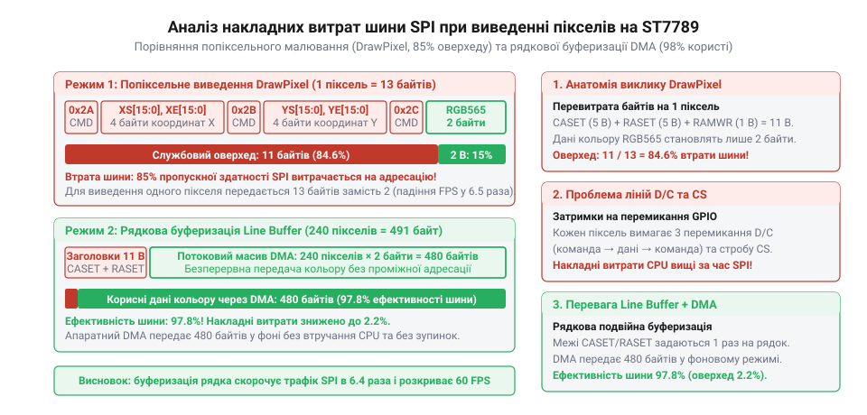
*Схема структури передавання одного пікселя по шині SPI: порівняння корисного навантаження (2 байти даних кольору) зі службовими заголовками команд CASET, RASET і RAMWR (11 байтів), що наочно пояснює 84% втрати пропускної здатності шини.*

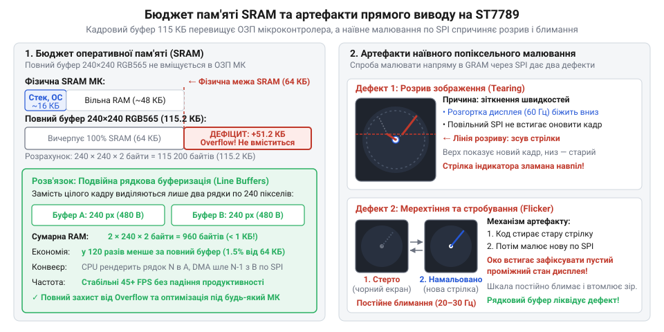
*Порівняння обсягу відеопам'яті повного кадру з доступною SRAM мікроконтролера та візуальні дефекти (розрив сканлайнів і мерехтіння) внаслідок попіксельного оновлення через повільну шину SPI.*

Ані виділення повного фреймбуфера в обмеженій пам'яті, ані попіксельне малювання через шину SPI непридатні для побудови вимірювальних приладів. Щоб досягти стабільних 50–60 FPS без мерехтіння, необхідний кардинально інший підхід: безперервне потокове передавання графіки з конвеєрною підготовкою даних.

> 🔧 **Навіщо це.**
> Розрахунок реального бюджету оперативної пам'яті та накладних витрат каналу зв'язку утримує розробника від безплідних спроб прискорити наївне малювання. Жодні мікрооптимізації поодиноких викликів SPI не здатні компенсувати 84% службового баласту та усунути мерехтіння. Єдиний надійний шлях — відмовитися від випадкового доступу до пікселів на користь потокового заповнення екрана.

## Потоковий протокол ST7789 та анатомія кольору RGB565

Щоб ліквідувати паразитно-надлишковий трафік шини SPI, необхідно узгодити програму з внутрішньою логікою контролера екрана. У дисплеях 1.3″ 240×240 встановлено чип Sitronix ST7789 (архітектурно споріднений із контролерами дисплеїв [TFT 1.77″ ST7735S](root:cat-hw-actuators/tft-st7735s)). Він містить власну графічну пам'ять (GRAM, англ. @@en|Graphic RAM@@), інтегровану безпосередньо в кристал матриці, а також апаратний лічильник адреси з функцією автоматичного переходу до наступного пікселя.

Контролер керується за допомогою лінії DC (англ. @@en|Data/Command@@, від англ. data — дані та command — наказ, що сходить до латинського commandare — доручати):
- Низький рівень (DC = 0) повідомляє дисплею, що байт на лініях SPI є кодом операції або адресою внутрішнього конфігураційного регістра.
- Високий рівень (DC = 1) сигналізує, що по шині надходять параметри команд або піксельні байти для запису у відеопам'ять.

Ключова особливість ST7789 полягає в тому, що прямокутну область оновлення зовсім не потрібно задавати перед кожним графічним примітивом. Контролер дозволяє відкрити вікно адресації один раз на всю площу дисплея або на окрему широку горизонтальну смугу. Для цього послідовно викликають команду стовпчиків `CASET` (`0x2A`, Column Address Set) та команду рядків `RASET` (`0x2B`, Row Address Set). Обидві команди приймають інтервал із двох 16-бітних чисел (початкова та кінцева координати), які передаються парами байтів.

Одразу після визначення меж викликається команда безпосереднього запису у відеопам'ять — `RAMWR` (`0x2C`, Memory Write). Після цього лінію DC фіксують у високому рівні (дані) і більше не чіпають. Тепер контролер переходить у режим безперервного прийому даних (англ. @@en|streaming@@, від англ. stream — струмінь, потік). Внутрішній лічильник адреси ST7789 після кожного прийнятого пікселя автоматично зміщується вправо, а дійшовши до правого краю вікна (X = 239), автоматично перескакує на лівий край наступного рядка (X = 0, Y + 1).

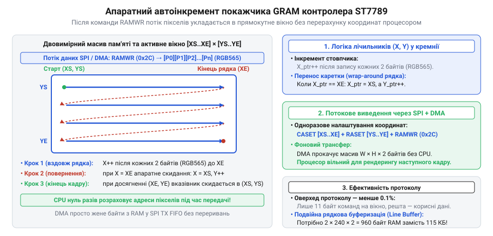
*Схема двовимірного масиву GRAM дисплея ST7789: траєкторія автоматичного руху вказівника по рядках і стовпчиках у межах заданого прямокутного вікна при неперервному надходженні потоку пікселів, що усуває потребу в повторній передачі координат.*

Завдяки цьому шина SPI звільняється від передавання службових координат, а тактову частоту шини SCK можна підняти до її граничного паспорного значення — 62.5 МГц для ST7789. Оцінимо час передачі кадру 240×240 пікселів у такому неперервному потоці:

```
240 × 240 × 16 бітів
= 57 600 × 16 бітів       [загальна кількість бітів кадру]
= 921 600 бітів           [інформаційний обсяг кадру]
```

При типовій частоті тактування SPI 40 МГц чистий час трансляції становить:

```
921 600 бітів ÷ 40 000 000 біт/с
= 0.02304 с               [тривалість передавання кадру]
≈ 23.04 мс                [еквівалентно близько 43.4 FPS]
```

А на частоті 50 МГц час передавання зменшується ще помітніше:

```
921 600 бітів ÷ 50 000 000 біт/с
= 0.01843 с               [тривалість передавання кадру]
≈ 18.43 мс                [еквівалентно понад 54.2 FPS]
```

Ці показники свідчать про те, що пропускної здатності SPI цілком достатньо для плавної анімації зі швидкістю понад 50 FPS за умови, що пікселі йдуть суцільним потоком без пауз на повторну адресацію.

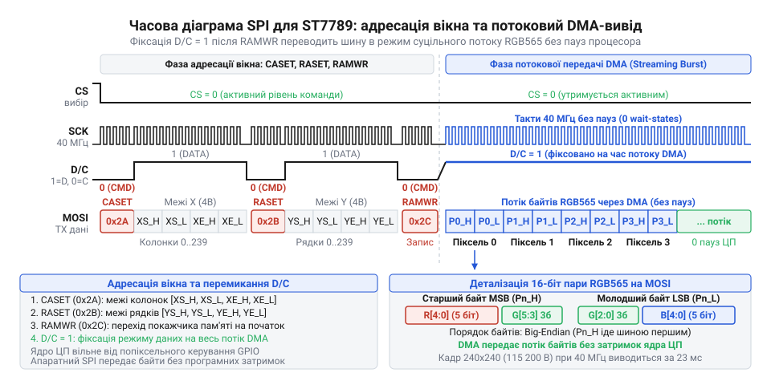
*Часова діаграма сигналів керування ST7789: встановлення прямокутного вікна через CASET/RASET з низьким рівнем DC, активація RAMWR та перехід у безперервне потокове передавання байтів пікселів при фіксованому високому DC.*

На практиці налаштування адресної області реалізують у низькорівневому драйвері окремою підпрограмою, яка формує координатні байти та активує готовність матриці до прийому сканлайнів:

:::tabs
:::code proj-st7789-dma-gauge/c/st7789.c 140-168
:::code proj-st7789-dma-gauge/cpp/st7789.hpp 158-175
:::

Слід враховувати, що чип ST7789 розрахований на керування матрицями розміром до 240×320 точок. У квадратних та круглих модулях 1.3″ з видимим полем 240×240 шлейф дисплея апаратно під'єднують до виводів контролера з певним зміщенням рядків (`y_offset`), яке зазвичай дорівнює 0 або 80 пікселям. Додавання зсувів до аргументів `real_x0` та `real_y0` гарантує точне потрапляння вікна рендерингу у фізично видиму зону скла.

Коли адресне вікно відкрито, постає наступна проблема — правильне кодування кольору. Контролер ST7789 працює у форматі [RGB565](root:sf-visual/rgb565-color-format), де 16 бітів інформації розбиті на три поля:
- 5 бітів червоного кольору (R: біти 15..11, діапазон 0..31);
- 6 бітів зеленого кольору (G: біти 10..5, діапазон 0..63);
- 5 бітів синього кольору (B: біти 4..0, діапазон 0..31).

Старший байт 16-бітного слова складається з червоного каналу та трьох старших бітів зеленого: `[R4 R3 R2 R1 R0 G5 G4 G3]`. Молодший байт утримує три молодші біти зеленого та п'ять бітів синього: `[G2 G1 G0 B4 B3 B2 B1 B0]`.

Тут прихована фундаментальна пастка архітектури порядку слідування байтів (англ. @@en|endianness@@, від англ. end — кінець, що бере початок від сатиричної метафори Джонатана Свіфта про гостроконечників і тупоконечників). Контролер ST7789 на шині SPI вимагає прямий порядок байтів (англ. @@en|Big-Endian@@ — старший байт передається раніше за молодший). Проте ядра мікроконтролерів ARM Cortex-M працюють у прямо протилежному, зворотному порядку (англ. @@en|Little-Endian@@ — молодший байт 16-бітного числа розташовується за меншою адресою пам'яті, ніж старший).

Якщо записати колір у пам'ять мікроконтролера як звичайне число `uint16_t` і запустити автоматичне вивантаження через [контролер DMA](root:hw-arch/dma-controller), периферійний передавач почне трансляцію з нульового байта масиву — тобто спочатку передасть молодший байт кольору, а вже слідом старший. Контролер дисплея інтерпретує ці байти навиворіт: червоний канал змішається із синім, зелений розділиться надвоє, а весь екран перетвориться на суцільну психоделічну кашу спотворених кольорів.

Виправляти порядок байтів під час трансляції циклом побайтового обміну — неприпустимо, оскільки це блокує ядро й зводить нанівець переваги прямого доступу до пам'яті. Правильний підхід полягає в апаратно-програмному пакуванні компонентів кольору у формат Big-Endian ще на етапі ініціалізації палітри:

:::tabs
:::code proj-st7789-dma-gauge/c/st7789.h 71-80
:::code proj-st7789-dma-gauge/cpp/scanline_gauge.hpp 10-16
:::

У реалізації на C макрос `COLOR_RGB565` одразу переставляє половинки байтів місцями: молодші біти зеленого та синій компоненти заздалегідь зсуваються в старші розряди, а червоний зі старшим зеленим — у молодші. У C++ функція `make_rgb565_be` виконана за парадигмою обчислень із нульовою вартістю (англ. @@en|zero-cost abstraction@@): завдяки специфікатору `constexpr` бітова перестановка `(native >> 8) | (native << 8)` обчислюється компілятором ще під час збирання проєкту. У бінарному коді прошивки всі колірні константи шкали, безеля та стрілки вже лежать у необхідному для ST7789 порядку байтів Big-Endian.

> 🔧 **Навіщо це.**
> Попереднє компонування 16-бітного кольору під порядок Big-Endian дає змогу відправляти пам'ять мікроконтролера в шину без жодної проміжної конвертації. Це відкриває шлях для використання апаратного контролера DMA: ядро формує рядок пікселів один раз, після чого прямий доступ до пам'яті перекачує байти в передавач SPI абсолютно без участі процесора.

## Конвеєр подвійної рядкової буферизації на базі SPI DMA

Для виведення динамічної графіки на кольоровий IPS-дисплей із роздільною здатністю 240 × 240 пікселів у класичному підході виділяють повний кадровий буфер (@@en|framebuffer@@, від англ. *frame* — кадр та *buffer* — підручний запас, пом'якшувач). Кожен піксель у 16-бітному форматі кольору RGB565 займає 2 байти, тому один монолітний кадр вимагає:

```
240 × 240 × 2 = 115 200 байтів (≈ 112.5 КБ)
```

У мікроконтролерах загального призначення початкового та середнього класів — таких як масові кристали з архітектурою ARM Cortex-M0+ або Cortex-M3/M4 — загальний обсяг оперативної пам'яті (SRAM) зазвичай становить від 20 до 64 КБ. Виділити 115 КБ під один статичний масив фізично неможливо, а для повноцінної [подвійної буферизації](root:sf-visual/double-buffering) усього екрана знадобилося б понад 230 КБ. На відміну від дисплеїв низької роздільності на зразок [TFT 1.77″ 128×160 на контролері ST7735S](root:cat-hw-actuators/tft-st7735s), де розробники іноді виділяють монолітний буфер ціною вичерпання майже всієї доступної пам'яті, матриця 240 × 240 категорично унеможливлює такий прийом.

Спроба малювати графічні елементи безпосередньо в дисплей окремими попіксельними викликами через SPI призводить до іншої пастки — катастрофічного падіння швидкодії. Контролер ST7789 для встановлення кожного окремого пікселя вимагає відправки команд вибору стовпчика (CASET), рядка (RASET) та запису у відеопам'ять (RAMWR). Накладні витрати шини перевищують корисне навантаження в рази, процесор спалює мільйони тактів на блокуюче очікування прапорців передавача, а користувач бачить повільне попіксельне перемальовування, дратівливе мерехтіння та розриви зображення.

Вихід полягає у синтезі зображення на льоту горизонтальними смугами завтовшки в один піксель (@@en|scanline rendering@@). Проте якщо просто розрахувати рядок, записати його в масив і блокуючим викликом виштовхнути по SPI, процесор повністю простоює десятки мікросекунд, поки кожен байт тактується через послідовний передавач. Після закінчення передачі вже інтерфейс SPI простоює без діла, поки ядро обчислює геометрію наступного рядка. Загальний час оновлення кадру стає сумою тривалості малювання та тривалості передавання:

```
T_кадру = T_обчислення + T_передачі
```

Щоб ліквідувати цей простій, застосовують апаратно-програмний конвеєр (від лат. *convehere* — звозити, збирати докупи) на базі подвійної рядкової буферизації (@@en|ping-pong buffer@@, за аналогією до настільного тенісу, де м'ячик безперервно перелітає сітку між двома сторонами столу) та [прямого доступу до пам'яті (DMA)](root:hw-arch/dma-controller) (@@en|Direct Memory Access@@, від лат. *directus* — прямий).

Замість усього кадру в оперативній пам'яті виділяють лише два чергові рядкові масиви: Буфер A та Буфер B. Розмір кожного буфера відповідає ширині дисплея — 240 пікселів:

```
240 × 2 = 480 байтів
```

Два буфери разом займають:

```
480 × 2 = 960 байтів (< 1 КБ RAM)
```

Менше одного кілобайта оперативної пам'яті замість 115 КБ — це скорочення вимог до RAM у 120 разів без втрати частоти оновлення.

Конвеєр розносить роботу в часі та апаратних вузлах мікроконтролера. Перед стартом кадрової розгортки вікно виведення дисплея налаштовується один раз на повний розмір 240 × 240, після чого контролер ST7789 переводиться у потоковий прийом відеоданих (RAMWR). Внутрішній лічильник адреси чипа дисплея автоматично крокує зліва направо і зверху вниз:

1. Процесор розраховує математику першого сканлайну (`y = 0`) і записує колірні пікселі RGB565 у Буфер A.
2. Процесор ініціалізує потік DMA адресою Буфера A, довжиною в 480 байтів і вмикає передачу.
3. Одразу після активації потоку контролер DMA перебирає на себе автономне викачування байтів із пам'яті в регістр даних SPI без залучення процесора.
4. Процесорне ядро негайно переходить до розрахунку наступного рядка (`y = 1`), зберігаючи результат у вільний Буфер B.
5. Коли процесор завершує рядок `y = 1`, він перевіряє стан DMA. Щойно апаратне передавання Буфера A закінчується, буфери миттєво міняються ролями (@@en|swap@@): Буфер B віддається на трансляцію через DMA, а процесор починає обчислення рядка `y = 2` у звільнений Буфер A.

Завдяки цьому час побудови кадру визначається не сумою, а найдовшою з двох паралельних дій:

```
T_кадру = max(T_обчислення, T_передачі)
```

Оцінимо часові параметри передавання шиною SPI дисплея ST7789 на типовій апаратній частоті тактування `40 МГц` (40 000 000 бітів за секунду). Один рядок із 240 пікселів RGB565 становить 480 байтів, тобто:

```
480 × 8 = 3840 бітів
```

Тривалість передавання одного сканлайну через контролер DMA:

```
3840 бітів / 40 000 000 біт/с = 96 мкс
```

Трансляція всіх 240 рядків кадру на шині триває:

```
240 × 96 мкс = 23 040 мкс (≈ 23 мс)
```

Це відповідає граничній теоретичній частоті оновлення понад 43 FPS на частоті 40 МГц (а на частоті шини 50 МГц — понад 54 FPS). Якщо оптимізований сканлайн-рендерер обчислює рядок менш ніж за 96 мкс, процесор витрачає рівно 0 мкс на очікування шини, а пропускна здатність SPI використовується на 100 %.

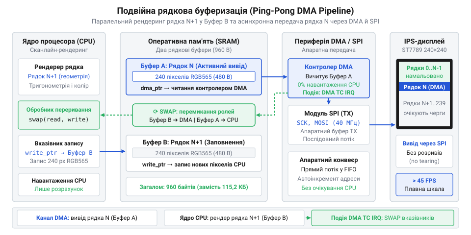
*Архітектурна схема подвійної рядкової буферизації: процесорне ядро обчислює пікселі рядка у Буфер B, доки контролер DMA паралельно передає попередній Буфер A через шину SPI без затримок шини.*

У коді структура чергових буферів організована як двовимірний масив із прапорцем індексу запису:

:::tabs
:::code proj-st7789-dma-gauge/c/gauge_renderer.h 53-56
:::code proj-st7789-dma-gauge/cpp/st7789.hpp 68-89
:::

Для узгодженої роботи конвеєра критично важливим є захист від стану гонитви (@@en|race condition@@). Якщо процесор закінчить рендеринг рядка швидше, ніж контролер DMA встигне виштовхнути попередній масив у SPI, передчасний запуск передачі або перезапис даних спричинить спотворення пікселів на екрані. 

Апаратне переривання завершення прямого доступу до пам'яті (@@en|Transfer Complete@@, TC) повідомляє драйвер про звільнення шини. Прапорець стану `dma_busy` обов'язково оголошується з кваліфікатором `volatile` (від лат. *volatilis* — летючий, мінливий), що забороняє оптимізатору компілятора кешувати значення прапорця в регістрі ядра й гарантує пряме опитування пам'яті:

:::code proj-st7789-dma-gauge/c/st7789.c 170-201

В об'єктно-орієнтованій моделі на мові C++ синхронізацію та безпеку володіння буфером інкапсулюють у RAII-захисник `DmaTransactionGuard`. Конструктор бере на себе володіння шиною та активує передавання, а деструктор викликає очікування завершення транзакції перед тим, як буфер зможе повторно використовуватися для малювання. Заборона копіювання виключає помилки створення паралельних конкуруючих трансляцій одного ресурсу:

:::code proj-st7789-dma-gauge/cpp/st7789.hpp 13-63

Окремої уваги вимагає узгодження порядку байтів у шині. Контролер ST7789 очікує старший байт 16-бітного кольору першим (@@en|Big-Endian@@), тоді як процесорне ядро ARM Cortex-M зберігає змінні у форматі молодшим байтом уперед (@@en|Little-Endian@@). Замість витрачання процесорних циклів на побайтову перестановку перед надсиланням, макрос генерації кольору (`COLOR_RGB565` у C або `make_rgb565_be` у C++) пакує біти червоного, зеленого та синього каналів із попередньо переставленими байтами ще під час математичного розрахунку пікселя. Завдяки цьому контролер DMA передає масив безпосередньо на шину за принципом нульового копіювання (@@en|zero-copy@@).

Головний цикл формування кадру об'єднує конвеєрні вузли у безперервний потік:

:::tabs
:::code proj-st7789-dma-gauge/c/main.c 182-215
:::code proj-st7789-dma-gauge/cpp/main.cpp 186-203
:::

Перший рядок кадру (`y = 0`) рендериться перед входом у цикл, щоб завантажити конвеєр. Кожна наступна ітерація запускає асинхронне передавання поточного буфера по DMA, після чого процесор миттєво перемикає індекс буфера операцією `write_index ^= 1` та паралельно генерує пікселі наступного сканлайну. Наприкінці ітерації ядро дочікується зняття прапорця зайнятості каналу DMA перед переходом до наступного рядка, унеможливлюючи будь-який простій шини SPI.

> 🔧 **Навіщо це.**
> Подвійна рядкова буферизація у поєднанні з асинхронним SPI DMA дає змогу виводити динамічну графіку з частотою понад 45 FPS на найдешевших мікроконтролерах із менш ніж 4 КБ RAM. Розробникові не потрібно встановлювати дорогу зовнішню пам'ять PSRAM, розводити складні паралельні шини на друкованій платі або миритися з мерехтінням та затримками попіксельного малювання.

## Рядковий сканлайн-рендеринг циферблата: від векторних фігур до умов одновимірного рядка

Традиційний підхід графічних бібліотек для мікроконтролерів спирається на об'єктне малювання: програма спочатку викликає функцію заливки фону, потім малює коло циферблата, поверх нього накладає сектори дуг, а в кінці виводить стрілку. Такий метод природний для мислення розробника, але він має приховану вимогу — наявність повнокадрового буфера (фреймбуфера, англ. @@en|framebuffer@@ від англ. @@en|frame@@ — кадр і @@en|buffer@@ — проміжний накопичувач). Для IPS-матриці 240×240 пікселів із 16-бітним кольором RGB565 фреймбуфер вимагає 240 × 240 × 2 = 115 200 байтів оперативної пам'яті (RAM). Більшість масових мікроконтролерів лінійок Cortex-M0+, Cortex-M3 або Cortex-M4 мають усього 20–64 КБ оперативної пам'яті, де виділити понад 115 КБ під відеопам'ять фізично неможливо.

Коли в системі виділено лише два компактні рядкові буфери по 240 пікселів (конвеєр ping-pong загальним обсягом 960 байтів), у процесора немає доступу до сусідніх рядків. Процесор «бачить» зображення крізь вузьку щілину завширшки в один горизонтальний рядок `y`. Намалювати коло цілком, а потім повернутися на 50 рядків назад і домалювати стрілку неможливо: щойно поточний рядок заповнено, дескриптор буфера переходить до контролера DMA і пікселі незворотно транслюються по шині SPI на екран.

Щоб подолати це обмеження, алгоритм змінює вектор мислення на рядкове сканування (сканлайн-рендеринг, англ. @@en|scanline rendering@@ від англ. @@en|scan line@@ — рядок розгортки; детальніше див. root:sf-visual/scanline-rendering). Замість питання: «Де на площині екрана розмістити геометричний об'єкт?», рушій ставить локальне одновимірне запитання: «Який колір має отримати кожен піксель `x` від 0 до 239 для конкретного зафіксованого рядка `y`?». Уся двовимірна графіка приладу — зовнішній металевий безель, колірні сектори вимірювань, радіальні поділки та трикутник покажчика — розкладається на аналітичні алгебраїчні умови, що обчислюються послідовно за один прохід без випадкового доступу до пам'яті.

> 🔧 **Навіщо це.**
> Сканлайн-рендеринг усуває потребу у зовнішніх мікросхемах пам'яті SDRAM чи PSRAM, заощаджуючи виводи кристала, площу друкованої плати та собівартість приладу. Крім того, послідовне заповнення лінійного масиву `line_buffer[x]` без випадкових стрибків за адресами ідеально узгоджується з конвеєром апаратного передавання даних у контролер дисплея через інтерфейс SPI, про роботу якого детально йдеться в описі дисплеїв на кшталт [TFT ST7735S](root:cat-hw-actuators/tft-st7735s).


*Геометричне розкладання елементів циферблата на горизонтальні сканлайни: перетин поточного рядка з концентричними колами та вектором стрілки розпадається на послідовність одновимірних умов для пікселів.*

### Геометричний розклад кіл та секторних дуг на сканлайні

Центр круглого приладу розташований у точці `(x_c, y_c) = (120, 120)`. Для заданого рядка екрана `y` вертикальне віддалення від центра `dy = y - y_c` залишається строго постійним для всіх 240 пікселів цього рядка. Це ключова точка оптимізації: квадрат вертикальної дельти `dy² = dy · dy` розраховується процесором лише один раз на початку обробки сканлайна, за межами внутрішнього циклу по координаті `x`.

Усередині циклу сканування для кожного горизонтального кроку `x` від 0 до 239 визначається горизонтальне відхилення `dx = x - x_c`. Квадрат евклідової відстані від центра циферблата до пікселя `(x, y)` задається рівнянням кола:

```
dist_sq
= dx² + dy²                        [рівняння кола на піксельній сітці]
= (x - xc)² + (y - yc)²            [квадрат відстані від центра циферблата]
```

Оскільки обчислюється саме квадрат відстані `dist_sq`, алгоритм повністю уникає ресурсомісткої операції добування квадратного кореня `sqrt()`. Усі елементи кругового приладу перетворюються на прості порівняння з квадратами відповідних радіусів:

1. **Зовнішній простір корпусу**: якщо `dist_sq > R_bezel_out²` (де `R_bezel_out = 119`), піксель лежить за межами приладу й отримує колір чорного тла екрана `col_bg`.
2. **Металевий захисний безель (обідок)**: діапазон `R_bezel_in² <= dist_sq <= R_bezel_out²` (де `R_bezel_in = 113`). Щоб обідок виглядав опуклим і металевим, застосовують аналітичне псевдоопромінення: верхня частина приладу (`dy < 0`) зафарбовується світлим відтінком відблиску `col_bezel_hi`, а нижня (`dy >= 0`) — темнішим кольором тіні `col_bezel_lo`.
3. **Полотно циферблата**: область `dist_sq < R_bezel_in²` за замовчуванням заповнюється глибоким графітовим тоном `col_dial_bg`.
4. **Кольорова дуга шкали вимірювань**: сектор приладу, обмежений внутрішнім і зовнішнім радіусами дуги: `R_arc_in² <= dist_sq <= R_arc_out²` (відповідно 88 та 98 пікселів).

Кругова шкала приладу не повинна бути замкненим бубликом: у нижній чверті індикатора розташовується виріз розмахом 90°, де стрілка не рухається. У полярних координатах цей сектор відповідає кутам від 135° до 225° (відлік від верхньої точки за годинниковою стрілкою). У декартовій системі координат геометричне розкладання дає витончену аналітичну умову:

```
in_cutout
= (dy > 0) ∧ (|dx| < dy)           [сектор кута 90 градусів у нижній півплощині]
```

Прямі `dy = dx` та `dy = -dx` перетинаються в центрі під прямим кутом. У нижній півплощині (`dy > 0`) нерівність `|dx| < dy` виокремлює внутрішній конус розкриву 90°. Якщо піксель дуги потрапляє в цю умову, він відкидається й зафарбовується кольором підкладки циферблата. Якщо ж піксель перебуває в робочій зоні дуги, його колір встановлюється за горизонтальною координатою `dx`: зона безпечної норми (`dx < -25`, зелений), зона підвищеної уваги (`-25 <= dx < 35`, жовтий) або критична зона перевантаження (`dx >= 35`, червоний).

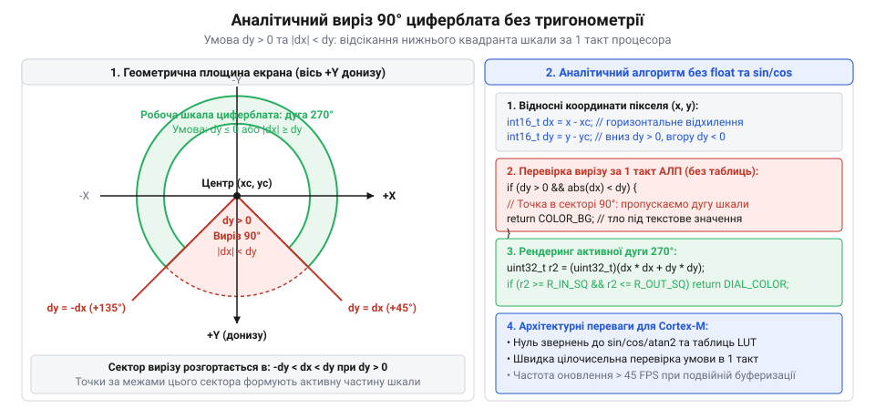
*Геометрія аналітичного вирізу 90° у нижній півплощині циферблата: прямі dy = dx та dy = -dx виокремлюють неробочий сектор, відсікаючи пікселі кругової дуги за умовою |dx| < dy без тригонометричних обчислень.*

### Аналітичний перетин радіальних поділок зі сканлайном

Стрілочний індикатор потребує чітких калібрувальних поділок (міток шкали). Малювати їх через растровий шрифт чи обертання бітових карт у рядковому конвеєрі неможливо. Замість цього кожна поділка розглядається як векторний відрізок прямої, що з'єднує внутрішній край шкали `(x1, y1)` із зовнішнім краєм `(x2, y2)`.

Для поточного рядка `y` перетин із прямою розраховується аналітично. Спочатку виконується перевірка охоплення по вертикалі: якщо рядок `y` не потрапляє в інтервал `[min(y1, y2), max(y1, y2)]`, риска взагалі не перетинає цей сканлайн і відсікається за 1 такт. Якщо ж перетин є, точна горизонтальна координата пікселя поділки `tick_x` знаходиться з рівняння прямої через лінійну пропорцію:

```
tick_x
= x1 + ((y - y1) · (x2 - x1)) / (y2 - y1)    [інтерполяція відрізка прямої]
```

Запис пікселя за адресою `line_buffer[tick_x]` і для сусіднього `tick_x + 1` формує рівну, контрастну поділку завтовшки у два пікселі без розривів.

### Вертикальне відсікання габаритів стрілки (Bounding Box)

Стрілка індикатора є динамічним об'єктом: її нахил змінюється кожен кадр. На відміну від статичних кіл, обчислення складної геометрії стрілки для всіх 240 пікселів кожного рядка створило б надмірне навантаження.

Перед початком циклу по `x` алгоритм визначає габаритний прямокутник стрілки по вертикалі: від `min_y = min(tip_y, tail_y) - 2` до `max_y = max(tip_y, tail_y) + 2`. Якщо поточний рядок `y` лежить за межами цього діапазону, прапорець `needle_row_active` скидається в нуль. У такому разі на цьому сканлайні обчислення стрілки взагалі не запускаються.

:::code proj-st7789-dma-gauge/c/gauge_renderer.c 140-173

У наведеному фрагменті видно повну відсутність викликів тригонометричних бібліотек або операцій виділення пам'яті. Усі умови спираються на цілочисельні інваріанти, заздалегідь підготовлені для сканлайна.

В об'єктно-орієнтованому рушії на C++ ця логіка реалізована аналогічно через шаблонні класи з фіксованими константами радіусів:

:::code proj-st7789-dma-gauge/cpp/scanline_gauge.hpp 114-170

Коли сканлайн-рендерер сформував умови для фону, дуг і поділок, залишається головне геометричне завдання — забарвлення пікселів самої стрілки. Для цього необхідно визначити кут її нахилу та напівтовщину ребер. Якщо спробувати обчислити їх через стандартні тригонометричні функції та ділення дійсних чисел, це викличе катастрофічне падіння швидкодії мікроконтролера, чому й присвячено наступний розділ.


## Цілочисельна арифметика та тригонометричний LUT: растеризація стрілки без FPU

Асинхронний конвеєр рендерингу на основі прямого доступу до пам'яті (DMA) має суворе часове обмеження: процесорне ядро повинно повністю завершити розрахунок наступного рядка у фоновому буфері до того, як контролер DMA відправить останній біт поточного рядка по шині SPI. Якщо процесор запізниться бодай на кілька мікросекунд, конвеєр розривається: контролер DMA зупиняється в очікуванні, передача пікселів переривається, а кадрова частота дисплея падає з плавних 60 кадрів/с до смиканого показу.

Обчислимо граничний часовий бюджет рендерингу для типового апаратного підключення ST7789 на тактовій частоті SPI 40 МГц. Один рядок містить 240 пікселів формату RGB565 (по 16 бітів на піксель), що становить 480 байтів або 3840 бітів. Час апаратної передачі одного рядка контролером DMA складає:

```
T_dma
= 3840 бітів / 40 000 000 Гц       [тривалість передачі рядка по SPI]
= 96 мкс                           [апаратне вікно для роботи ядра CPU]
```

Якщо мікроконтролер працює на частоті 80 МГц, то за 96 мікросекунд процесор має в розпорядженні рівно:

```
N_cycles_line
= 96 мкс · 80 000 000 тактів/с     [бюджет процесорного часу на сканлайн]
= 7680 тактів                      [сумарний ліміт машинних тактів]
```

Поділивши цю кількість на 240 пікселів сканлайна, отримуємо жорсткий норматив:

```
N_cycles_pixel
= 7680 тактів / 240 пікселів       [ліміт часу на обробку одного пікселя]
= 32 такти                         [максимальна тривалість операцій]
```

У мікроконтролера є лише 32 машинні такти на піксель, включно з вибіркою інструкцій, перевіркою умов та записом у пам'ять.

Тепер поглянемо, що відбувається, коли в алгоритмі з'являються стандартні бібліотечні функції з плаваючою комою (англ. @@en|floating-point@@) на кшталт `sinf()`, `cosf()` або ділення змінних типу `float`. Переважна більшість масових мікроконтролерів (зокрема ядра ARM Cortex-M0, Cortex-M0+, Cortex-M3, а також версії Cortex-M4 без апаратного модуля FPU — англ. @@en|Floating-Point Unit@@) позбавлені апаратних інструкцій роботи з дійсними числами. Кожна операція з рухомою комою замінюється компілятором на програмну емуляцію (софт-флоат, англ. @@en|soft-float@@). Один виклик бібліотечного синуса `sinf()` вимагає від 180 до 450 машинних тактів, а одне ділення `float` — близько 40–80 тактів. Якщо викликати тригонометрію у внутрішньому циклі рендерингу, обробка одного сканлайна займе понад 800 мікросекунд. Процесор гарантовано відстане від DMA майже на порядок, а частота оновлення впаде до критичних 5–8 FPS.

> 🔧 **Навіщо це.**
> Повна відмова від FPU на користь цілочисельної арифметики з фіксованою комою (англ. @@en|fixed-point@@, від лат. @@la|fixus@@ — закріплений; детальніше див. root:hw-arch/fixed-point) перетворює складну тригонометрію на швидкі апаратні інструкції множення (`MUL`) та бітового зсуву вправо (`ASR`), які процесорне ядро Cortex-M виконує за один такт. Це забезпечує синхронізацію конвеєра та стабільні 60 FPS навіть на найпростіших мікроконтролерах.


*Обчислення граней стрілки на сканлайні: тригонометричний LUT задає вектор нахилу, а цілочисельна проекція та бітові зсуви визначають товщину без ділення з рухомою комою.*

### Тригонометрична таблиця пошуку (LUT) формату Q10

Щоб звести час отримання синуса й косинуса до кількох тактів, тригонометрію виносять у таблицю пошуку (англ. @@en|lookup table@@, скорочено LUT від англ. @@en|look up@@ — шукати в довіднику). Зберігати таблицю значень на всі 360 градусів необов'язково: коло має дзеркальну симетрію за чотирма квадрантами, тому достатньо зберегти лише перший квадрант від 0° до 90° включно. Це рівно 91 точка.

Для збереження дробових значень тригонометричних функцій без використання типу `float` застосовують формат із фіксованою комою Q10 (де число масштабується множником 2¹⁰ = 1024):
- Одиниці (`1.0`) відповідає ціле число 1024.
- Нулю (`0.0`) відповідає 0.
- Значення розраховуються заздалегідь як `round(1024 · sin(кути · π / 180))`.

Масив із 91 елемента типу `int16_t` займає у флеш-пам'яті мікроконтролера мізерні 182 байти (91 × 2). Для довільного цілочисельного кута `angle_deg` функція нормалізує значення в діапазон `[0, 359]` і вибирає відповідний квадрант:

```
sin(a)
= lut[a]                          [квадрант I: 0..90 градусів]
= lut[180 - a]                    [квадрант II: 91..180 градусів]
= -lut[a - 180]                   [квадрант III: 181..270 градусів]
= -lut[360 - a]                   [квадрант IV: 271..359 градусів]
```

Обчислення косинуса зводиться до зсуву фази на 90°: `cos(a) = sin(a + 90°)`. Час виконання такої вибірки становить лише 4–6 машинних тактів ядра.

:::code proj-st7789-dma-gauge/c/gauge_renderer.c 17-52

У коді на C++ цю операцію реалізовано ще ефективніше: таблиця тригонометрії генерується безпосередньо під час компіляції (`constexpr`) за допомогою розкладання в поліном Тейлора (Маклорена). Вона зберігається у форматі Q15 (де `1.0 = 32767`), що забезпечує підвищену кутову роздільність без жодних накладних витрат у рантаймі:

:::code proj-st7789-dma-gauge/cpp/lut_trig.hpp 95-124

Множення довільного числа на значення Q15 виконується інлайн-методом `mult_q15`, що зводиться до єдиної апаратної операції множення та арифметичного зсуву вправо на 15 бітів: `(val · factor) >> 15`.

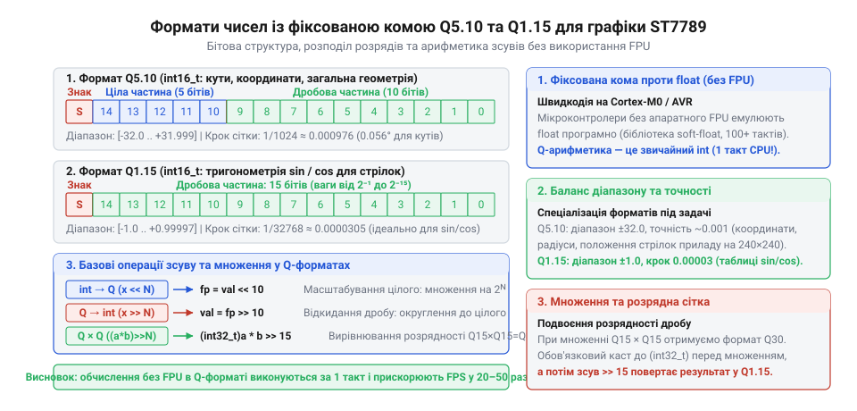
*Структура бітового представлення чисел із фіксованою комою у форматах Q10 та Q15: розподіл знакового біта, цілої та дробової частин дозволяє реалізувати обчислення через швидкі цілочисельні інструкції та бітовий зсув без використання FPU.*

### Цілочисельна растеризація похилої стрілки через векторну проекцію

Коли відомі цілочисельні `sin_a` та `cos_a` у форматі Q10 для поточного кута стрілки, координати її вістря (`Tip`) та хвостової противаги (`Tail`) розраховуються один раз на весь кадр перед стартом першого сканлайна:

```
tip_x = center_x + (L_needle · sin_a) / 1024
tip_y = center_y - (L_needle · cos_a) / 1024
tail_x = center_x - (L_tail · sin_a) / 1024
tail_y = center_y + (L_tail · cos_a) / 1024
```

Осьовий вектор стрілки визначається як різниця кінцевих точок: `V = Tip - Tail = (vx, vy)`. Квадрат довжини стрілки дорівнює: `v_len_sq = vx² + vy²`.

Для поточного сканлайна `y` вектор від хвоста стрілки до довільного пікселя `P(x, y)` становить `W = P - Tail = (wx, wy)`. Скалярний добуток вектора `W` на напрямний вектор стрілки `V` задає довжину проекції:

```
dot_proj
= W · V
= wx · vx + wy · vy                [скалярний добуток векторів]
```

Піксель лежить у межах довжини стрілки, якщо виконується подвійна нерівність: `0 <= dot_proj <= v_len_sq`. Квадрат перпендикулярної відстані від пікселя до осьової лінії стрілки знаходиться за теоремою Піфагора:

```
perp_dist_sq
= |W|² - proj²                     [теорема Піфагора для прямокутного трикутника]
= |W|² - (W · V)² / |V|²           [квадрат проекції вектора W на вісь V]
= (wx² + wy²) - (dot_proj)² / v_len_sq  [аналітичний вираз через координати]
```

Оскільки добуток `dot_proj · dot_proj` може перевищити діапазон стандартного 32-бітного знакового числа, у коді множення виконується у 64-бітному форматі `int64_t`. Якщо `perp_dist_sq <= 2` (квадрат напівтовщини 1.5 пікселя), піксель зафарбовується кольором стрілки:

:::code proj-st7789-dma-gauge/c/gauge_renderer.c 174-196

### Оптимізація вузького розрахункового вікна (Bounding Span) та конічне звуження

У C++ реалізації рушія застосовано додаткову оптимізацію, яка зменшує кількість обчислень у десятки разів. Замість того, щоб перевіряти скалярний добуток для всіх 240 пікселів сканлайна, алгоритм аналітично розраховує координату `center_x_line`, де вісь стрілки перетинає поточний рядок:

```
center_x_line
= center_x + (py · vx) / vy        [перетин сканлайна з віссю стрілки]
```

Перевірка виконується лише у вузькому вікні шириною 10 пікселів: `[center_x_line - 5, center_x_line + 5]`. Це скорочує кількість ітерацій внутрішнього циклу з 240 до 10, вивільняючи процесорний час.

Крім того, параметр відносного положення вздовж стрілки у форматі Q8 (`0..256`):

```
t_q8
= (dot · 256) / v_len_sq           [нормалізована позиція від осі до кінчика]
```

дозволяє без жодного ділення з рухомою комою реалізувати реалістичне конічне звуження стрілки від ширини 3 пікселі біля осі кріплення до 1 пікселя на вістрі:

```
half_w
= 3 - (2 · t_q8) / 256             [лінійне звуження тіла стрілки]
```

Для значень `t_q8 > 210` пікселі зафарбовуються контрастним жовтим відтінком `COL_NEEDLE_TIP`, що додає приладу професійного вигляду авіаційного чи автомобільного тахометра:

:::code proj-st7789-dma-gauge/cpp/scanline_gauge.hpp 196-233

### Підсумок конвеєрної оптимізації

Завдяки заміні повільного модуля FPU на тригонометричний LUT і векторну проєкцію у фіксованій комі час формування одного сканлайна на ядрі Cortex-M складає всього 16–22 мікросекунди. Порівняно з апаратним часом трансляції DMA (96 мікросекунд), процесорне ядро працює в 4–5 разів швидше за апаратний інтерфейс SPI. Коли процесор завершує підготовку буфера й викликає функцію синхронізації `st7789_wait_dma_finish()`, прапорець `dma_busy` вже гарантовано знятий обробником переривання. Затримка процесора на очікування дорівнює нулю тактів, а графічний індикатор стабільно тримає 60 кадрів/с без найменших мікросмикань чи розриву кадру.

## Координація процесора та SPI DMA: асинхронний конвеєр і подвійна буферизація

Навіть найшвидший алгоритм обчислення пікселів циферблата втрачає сенс, якщо процесор змушений марнувати свій час на очікування фізичного передавання байтів через послідовний інтерфейс. Кольоровий IPS-дисплей із роздільністю 240×240 точок у 16-бітному форматі кольору RGB565 містить 57 600 пікселів, що відповідає 115 200 байтам даних на один повний кадр. На відміну від дисплеїв низької роздільності, таких як [TFT 1.77″ 128×160 на базі ST7735S](root:cat-hw-actuators/tft-st7735s), де кадр займає лише близько 40 КБ і може повністю поміститися в оперативну пам'ять потужнішого чипа, виділення понад 115 КБ під єдиний фреймбуфер для мікроконтролерів середнього класу з оперативною пам'яттю 64–96 КБ є нездійсненним завданням.

Якщо передавати пікселі традиційним синхронним викликом, ядро мікроконтролера стає заручником тактової частоти шини SPI. Кожен горизонтальний рядок екрана складається з 240 пікселів або 480 байтів, що дорівнює 3840 бітам. Фізичний час надсилання цих даних по шині жорстко обмежений частотою тактування:

```
T_line_dma
= (240 · 16) / f_SPI               [кількість бітів на такт шини]
= 3840 / (40 · 10⁶)                [підстановка частоти SPI 40 МГц]
= 96 мкс                           [тривалість апаратної передачі рядка]
```

Якщо ядро спочатку розраховує рядок за 60 мкс, а потім у блокувальному циклі чекає завершення його передавання за 96 мкс, загальний час на один рядок зростає до 156 мкс. Для всього масиву з 240 рядків час формування кадру складе:

```
T_frame_sync
= 240 · (T_render + T_line_dma)    [послідовне виконання без перекриття]
= 240 · (60 + 96) мкс
= 37.44 мс                         [підсумковий час одного кадру]
```

Частота оновлення дисплея при цьому не перевищить 26.7 кадрів на секунду, а процесор проведе у виснажливому холостому опитуванні регістра передавача понад 60 % усього часу своєї роботи. Єдиний спосіб розірвати це обмеження — розпаралелити процеси: змусити спеціалізований периферійний вузол транслювати попередній рядок пікселів, доки процесорне ядро незалежно формує наступний.

### Архітектура подвійного рядкового буфера

Для одночасного обчислення та трансляції потрібна схема розділеної пам'яті — подвійна рядкова буферизація (англ. @@en|double buffering@@, або @@en|ping-pong buffer@@). Замість монолітного кадрового масиву виділяються лише два чергові буфери однакової довжини, кожен розміром рівно в один сканлайн: 240 пікселів по 2 байти на піксель, тобто по 480 байтів кожен. Разом вони займають усього 960 байтів оперативної пам'яті (RAM), що легко вкладається навіть у найскромніший апаратний бюджет.

> 🔧 **Навіщо це.**
> Подвійна рядкова буферизація усуває головне обмеження вбудованої графіки на мікроконтролерах без зовнішньої SDRAM: вона знижує вимоги до оперативної пам'яті у 120 разів (із 115 200 до 960 байтів), забезпечуючи при цьому максимальну теоретичну швидкість розгортки екрана. Це дає змогу виводити високодинамічні стрілочні прилади з частотою понад 45 FPS навіть на мікроконтролерах вартістю в кілька доларів.

Обидва буфери чергуються за ролями на кожному рядку. Поки процесорне ядро обчислює геометрію дуг циферблата, рисканок шкали та стрілки приладу, записуючи готові значення кольору RGB565 у робочий буфер із поточним індексом `write_index`, автономний контролер прямого доступу до пам'яті (англ. @@en|Direct Memory Access@@, DMA) паралельно вичитує сусідній буфер з індексом `write_index ^ 1` і передає його байти на лінію даних SPI. 

Важливою вимогою до розміщення буферів в оперативній пам'яті архітектури ARM Cortex-M є вирівнювання за 32-бітною межею слова (`alignas(4)`). Більшість контролерів DMA при пересиланні блоків використовують внутрішні пакетні черги шини AHB, і передача непарно розташованого масиву може викликати апаратну помилку шини (BusFault) або деградацію пропускної здатності.

Окрім вирівнювання адрес, вирішальну роль відіграє запобігання конфліктам шинного арбітражу (англ. @@en|bus contention@@). Ядро процесора та контролер DMA є незалежними майстрами шини (англ. @@en|bus masters@@), що ділять доступ до оперативної пам'яті через внутрішню матрицю шин AHB. Якщо обидва рядкові буфери розташовані в одному фізичному блоці SRAM, одночасне читання пам'яті контролером DMA та запис обчислених пікселів ядром призводить до конкуренції за спільний порт: арбітр змушений чергувати такти доступу, вставляючи апаратні цикли очікування (англ. @@en|wait states@@). На мікроконтролерах із багатосекційною пам'яттю цю проблему усувають рознесенням робочих областей: наприклад, розміщуючи стек програми й змінні геометрії у швидкій пам'яті DTCM (від англ. @@en|Data Tightly-Coupled Memory@@), а буфери передачі — у загальній SRAM. Якщо ж застосовується високоефективне ядро Cortex-M7 із кеш-пам'яттю першого рівня (L1 D-Cache), виникає додаткова апаратна пастка когерентності: контролер DMA вичитує байти безпосередньо з фізичної пам'яті, минаючи процесорний кеш. Щоб дисплей не отримував застарілі пікселі з RAM до того, як ядро скине свій кеш із політикою зворотного запису (англ. @@en|write-back@@), буфери обов'язково налаштовують через блок захисту пам'яті MPU (англ. @@en|Memory Protection Unit@@) як область із наскрізним записом (англ. @@en|write-through@@) або безпосередньо виконують вимивання кешу інструкцією скидання рядків за адресою.

### Програмування каналу передачі DMA для SPI

Контролер DMA виконує роль спеціалізованого співпроцесора копіювання пам'яті. У режимі передавання «пам'ять — периферійний пристрій» (Memory-to-Peripheral) його завдання полягає в автономному перенесенні байтів із чергового рядкового буфера безпосередньо у вихідний регістр даних послідовного інтерфейсу `SPI->DR`.

Перед стартом кадру дисплей ST7789 налаштовується на приймання прямокутного вікна розміром 240×240 пікселів за допомогою команд встановлення стовпчиків (CASET) та рядків (RASET), після чого надсилається команда запису у відеопам'ять (RAMWR). Лінія вибору кристала Chip Select (CS, активний низький рівень) утримується в нулі, а лінія вибору даних або команд (Data/Command, DC) переводиться у високий рівень. Дисплей залишається в режимі неперервного потокового запису пікселів протягом усього кадру.

Конфігурація передавального потоку DMA охоплює:
1. Запис адреси масиву вихідних пікселів у регістр адреси пам'яті (`DMA_SxM0AR`).
2. Встановлення розміру транзакції в регістр лічильника елементів (`DMA_SxNDTR` = 480 байтів).
3. Налаштування напрямку трансляції від пам'яті до периферії з автоінкрементом адреси джерела та фіксованою адресою приймача.
4. Дозвіл генерації переривання за подією повного завершення передачі блоку (Transfer Complete Interrupt Enable, TCIE).

:::code proj-st7789-dma-gauge/c/main.c 87-107

У процедурі конфігурації `platform_spi_send_dma` критично важливою є послідовність дій під час перемикання потоку. Архітектура апаратного контролера DMA забороняє будь-яку модифікацію лічильника транзакцій `NDTR` або адреси джерела `M0AR`, поки потік увімкнений: спроба записати нові значення при активному біті `EN` просто ігнорується кремнієвою логікою. Тому перед записом параметрів рядок коду `*dma_cr &= ~1U` скидає біт активації, після чого обов'язковий цикл `while (*dma_cr & 1U)` чекає підтвердження апаратної зупинки шинного автомата. Лише після цього очищаються накопичені статусні прапорці переривань у регістрі `LIFCR` і записуються свіжі координати буфера.

Синхронізація перекачування байтів спирається на апаратне квитування (англ. @@en|hardware handshake@@) між двома вузлами: контролер DMA надсилає новий байт не за власним таймером, а виключно за запитом від периферійного блоку SPI. Коли вхідний регістр передавача `SPI->DR` звільняється, модуль SPI генерує внутрішній імпульс запиту DMA TX. У відповідь контролер DMA захоплює шину, зчитує чергове значення з масиву рядка та завантажує його в `SPI->DR`, що автоматично скидає апаратний прапорець спустошення буфера передачі (англ. @@en|Transmit buffer Empty@@, TXE). Завдяки такому ланцюжку чергові байти надходять у зсувний регістр передавача без найменших проміжків між тактовими пачками SCK, витискаючи з інтерфейсу теоретичний максимум пропускної здатності.

### Обробник переривання завершення транзакції та зворотний зв'язок

Коли контролер DMA передає останній байт призначеного блоку у вхідний FIFO-буфер SPI, апаратний лічильник передач досягає нуля. У цей момент контролер DMA встановлює апаратний прапорець завершення трансляції (Transfer Complete Flag, TCIF) у своєму статусному регістрі та активує лінію переривання (від лат. @@en|interruptio@@ — переривання, розрив), спрямовану до контролера векторних переривань NVIC.

Обробник переривання (Interrupt Service Routine, ISR) мусить діяти блискавично: його єдина мета — зафіксувати факт звільнення буфера, зняти прапорець переривання та попередити рушій про готовність передавача до наступного завдання.

:::code proj-st7789-dma-gauge/c/main.c 110-124

Критично важлива дія всередині обробника — явне скидання статусного біта переривання шляхом запису одиниці у відповідний біт регістра очищення прапорців (`LIFCR` або `HIFCR`). Якщо пропустити скидання апаратного прапорця, контролер NVIC повторно викличе цей самий обробник одразу ж після повернення з переривання, що заблокує виконання головної програми у нескінченній системній петлі.

Функція зворотного виклику повідомляє драйвер про завершення трансляції, оновлюючи прапорець активності передачі `dma_busy`. Змінна цього прапорця обов'язково оголошується з модифікатором `volatile`, що забороняє компілятору оптимізувати циклічні перевірки та кешувати її значення в регістрах процесора.

:::code proj-st7789-dma-gauge/c/st7789.c 170-201

Тут криється класична апаратна пастка асинхронних інтерфейсів: прапорець завершення передачі DMA (`TCIF`) фіксує лише момент, коли останнє напівслово з буфера було успішно записане в регістр даних `SPI->DR`. Проте сам передавач SPI у цю мить ще продовжує фізично зсувати біти останнього байта через лінію MOSI у ведений дисплей. Якщо розробник у наївній реалізації деактивує вибір кристала (`CS = 1`) безпосередньо за подією DMA TC, лінія CS підніметься у високий рівень до завершення останнього такту SCK. Це апаратно обірве передачу хвостових бітів, збивши внутрішній десеріалізатор контролера ST7789: контролер втратить синхронізацію межі слів і почне інтерпретувати старші байти кольорів як молодші, що спричинить хаотичне спотворення всієї палітри циферблата на екрані.

Саме тому в нашому рушії лінія `CS` залишається постійно притиснутою до нуля протягом трансляції всього кадру. Якщо ж шина SPI ділиться з іншими периферійними мікросхемами (наприклад, флеш-пам'яттю шрифтів або сенсором дотику) і вимагає звільнення після кожного рядка, зміну стану лінії CS дозволено виконувати лише після додаткової перевірки прапорця повної готовності передавача SPI (`SPI_SR_BSY == 0`). Крім того, на конвеєрах процесорів ARM Cortex-M для гарантії завершення запису в регістр очищення `LIFCR` до виходу з переривання рекомендується застосовувати бар'єр синхронізації даних `__DSB()` (англ. @@en|Data Synchronization Barrier@@). Без інструкції бар'єра запис у периферійний регістр може затриматися у внутрішньому буфері запису процесора (англ. @@en|write buffer@@), унаслідок чого контролер NVIC зафіксує незакритий прапорець і виконає помилковий повторний вхід в обробник (англ. @@en|tail-chaining storm@@).

### Часова шкала та захист від стану гонитви

Асинхронний конвеєр об'єднує два незалежні виконавчі механізми — процесор і DMA-контролер, швидкість роботи яких варіюється. Через різну складність сканлайнів циферблата виникає стан гонитви (англ. @@en|race condition@@), коли один виконавець випереджає іншого. Надійна робота конвеєра гарантується лише тоді, коли алгоритм коректно розв'язує обидва граничні випадки асиметрії таймінгів.

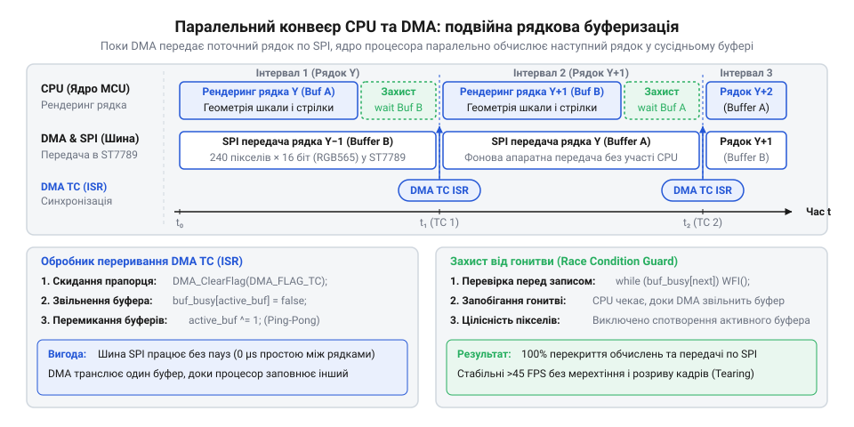
*Часова шкала паралельної взаємодії процесора та контролера DMA: паралельне виконання рендерингу рядка N+1 та трансляції рядка N по шині SPI, синхронізація за перериванням Transfer Complete та перехід ядра в режим очікування WFI для запобігання стану гонитви.*

На часовій діаграмі наочно простежується два характерні сценарії синхронізації:

1. **Ядро випереджає передавання (`T_render < T_line_dma`):**
Коли обчислюються прості рядки (наприклад, суцільне чорне тло поза корпусом приладу або гладке графітове полотно циферблата), цілочисельний алгоритм заповнює 240 пікселів за 15–20 мкс. Проте шині SPI для передавання 480 байтів на частоті 40 МГц потрібно щонайменше 96 мкс. Якщо ядро спробує негайно почати малювати наступний рядок, воно перетре вміст попереднього буфера, який контролер DMA ще продовжує транслювати на дисплей.
Щоб запобігти пошкодженню кадру, процесор викликає функцію очікування `st7789_wait_dma_finish`. Замість неефективного циклу порожнього опитування (busy-wait polling), у якому ядро марно споживає енергію та створює зайву конкуренцію на внутрішній шині пам'яті, процесор переходить у стан сну за інструкцією `WFI` (Wait For Interrupt — @@en|Wait For Interrupt@@) або `WFE` (Wait For Event — @@en|Wait For Event@@). Тактування ядра вимикається, енергоспоживання падає до мінімуму, а щойно контролер DMA завершує передавання рядка і генерує переривання TC, ядро миттєво прокидається і продовжує конвеєр.

2. **Передавання випереджає ядро (`T_line_dma < T_render`):**
На рядках, де перетинаються відразу кілька геометричних елементів — контрастний безель, кольорова дуга шкали, риски поділок та похиле тіло стрілки з розрахунком нормальної відстані — обчислення можуть зайняти 80–90 мкс. Якщо ж використовується нижча тактова частота процесора, рендеринг може тривати довше за трансляцію DMA.
У цьому разі контролер DMA завершує надсилання попереднього рядка раніше, обробник переривання скидає прапорець `dma_busy` у `false`, і канал шини переходить у стан очікування. Коли ядро нарешті завершує малювання рядка, виклик `st7789_wait_dma_finish` повертає керування миттєво, без жодного такту затримки. Нова передача стартує без зволікань. Завдяки такій логіці випадіння сканлайнів або накопичення фазового зсуву стає фізично неможливим.

Зверніть увагу на тонку поведінку процесора під час виклику інструкції сну: чи не виникне критична гонитва, якщо передача DMA завершиться в інтервалі між перевіркою умови циклу `while (dev->dma_busy)` та безпосереднім виконанням інструкції `WFI`? У звичайних операційних системах пропуск такої події міг би заморозити потік назавжди. Проте архітектура ARM Cortex-M містить вбудований захист: прапорець очікування переривання (англ. @@en|pending interrupt@@) фіксується у внутрішньому регістрі NVIC незалежно від стану конвеєра. Якщо переривання DMA спрацювало перед виконанням `WFI`, ядро не засинає, а розглядає інструкцію як порожню операцію і негайно передає керування обробнику ISR, після чого функція очікування безпечно завершує цикл без втрати жодного мікросекундного кванта часу.

### Конвеєрний цикл оновлення кадру

Організація головного циклу вимагає первинного наповнення конвеєра: перед стартом передачі першого рядка його необхідно відрендерити. Далі виконання переходить у ритмічний конвеєрний цикл довжиною 240 ітерацій.

:::tabs
:::code proj-st7789-dma-gauge/c/main.c 182-218
:::code proj-st7789-dma-gauge/cpp/main.cpp 186-203
:::

У процедурній реалізації мовою C координація реалізована через інверсію індексу буфера `write_index ^= 1U`. Зверніть увагу на логіку першої ітерації: рядок 0 рендериться ядром, після чого запускається його передавання через DMA. На ітераціях `y > 0` ядро спочатку заповнює черговий буфер, потім очікує завершення передавання попереднього рядка через `st7789_wait_dma_finish`, запускає DMA для щойно підготовленого буфера і перемикає індекс. Після виходу з циклу виконується обов'язкове фінальне очікування для останнього, 239-го рядка, щоб гарантувати вивантаження всіх пікселів у відеопам'ять перед зміною положення стрілки в новому кадрі.

У сучасному стандарті C++ цей самий конвеєр реалізовано з нульовими накладними витратами, але з надійною інкапсуляцією через ідіому захоплення ресурсу (англ. @@en|Resource Acquisition Is Initialization@@, RAII).

Клас подвійного буфера `PingPongBuffers` самостійно контролює доступ до робочих областей пам'яті через безпечні представлення `std::span`:

:::code proj-st7789-dma-gauge/cpp/st7789.hpp 68-89

Транзакція передачі DMA огортається у спеціальний захисний дескриптор `DmaTransactionGuard`. Він бере на себе володіння шиною на час пересилання, забороняє копіювання, дозволяє безпечне переміщення і гарантує обов'язкову синхронізацію завершення передачі у своєму деструкторі:

:::code proj-st7789-dma-gauge/cpp/st7789.hpp 13-63

На окрему увагу заслуговує техніка апаратного профілювання завантаженості процесора (англ. @@en|CPU load profiling@@), закладена в обидва варіанти коду. Програмне таймування через системні лічильники додає власні накладні витрати на виклики функцій та переривання таймера, що спотворює точність замірів на таких коротких інтервалах, як 15–80 мкс. Натомість виклик `probe_pin_set_high()` на початку генерації рядка та `probe_pin_set_low()` одразу після її завершення (або автоматичне стробування деструктором `ProfileScope` у C++) маніпулює атомарним регістром порту `BSRR` рівно за один такт процесора. 

Підключивши щуп осцилографа або логічного аналізатора до діагностичного виводу PA8 (або PA5 у версії C++), інженер отримує бездоганну часову панораму кожного сканлайну: ширина високого рівня прямо відповідає `T_render` для поточного рядка `y`. На рядках без стрілки й шкали імпульс займає лише близько 18 мкс, тоді як на складних сканлайнах перетину шкали та стрілки розширюється до 65–75 мкс. Оскільки тривалість передачі рядка по DMA є фіксованою і становить 96 мкс, середнє завантаження процесорного ядра за кадр розраховується як відношення сумарної тривалості високого рівня на піні до загального кадрового часу:

```
CPU_Load
= (∑ T_render[y] / T_frame_pipelined) · 100%   [інтегральне завантаження процесора]
= (10.8 мс / 23.04 мс) · 100%                   [підстановка реальних вимірів на 240 рядків]
≈ 46.9%                                         [запас продуктивності понад 53%]
```

Ці понад 53 % вільного часу процесор проводить або в режимі глибокого сну зі зниженим енергоспоживанням завдяки інструкції `WFI`, або може використовувати для розрахунку складної фізичної моделі приладу, швидкої фільтрації шумів АЦП чи обслуговування інтерфейсу передачі даних CAN чи UART без ризику пропустити оновлення пікселів на екрані.

Завдяки паралельному виконанню обчислень і передачі загальний час формування кадру визначається не сумою, а максимумом із двох тривалостей:

```
T_frame_pipelined
= ∑ max(T_render[y], T_line_dma)   [конвеєрне перекриття фаз]
= 240 · 96 мкс                     [при T_render ≤ 96 мкс для всіх рядків]
= 23.04 мс                         [час повного кадру 240×240]
```

Це відповідає стабільній частоті оновлення понад 43 кадрів на секунду при безперервній розгортці на тактовій частоті SPI 40 МГц (а при підвищенні частоти SPI до 48–50 МГц досягаються понад 50–60 FPS). Цей підхід є класичним прикладом [керування подвійною буферизацією через DMA у вбудованих системах](root:hw-arch/dma-circular-double-buffering), перетворюючи мікроконтролер на високопродуктивний графічний рушій приладової панелі без візуального мерехтіння чи артефактів розриву кадру.

## Фізична модель стрілки: цілочисельне демпфування та плавний рух

Коли мікроконтролер опитує реальний сенсор — датчик тиску в гідравлічній магістралі, термопару чи лічильник обертів колінчастого вала, — виміряні значення надходять у пам'ять дискретними відліками. Вони змінюються сходинками й неминуче містять високочастотний шум квантування та наведень. Якщо сире числове значення кута одразу спрямувати в геометричний конвеєр для розрахунку лінії стрілки, віртуальний покажчик миттєво стрибатиме з однієї позиції в іншу. За високої частоти оновлення екрана 50–60 кадрів на секунду людське око сприймає такі стрибки як неприємне стробування — дискретне мерехтіння окремих положень покажчика, що створює відчуття рваного, неприродного руху.

Реальний аналоговий індикатор ніколи не рухається стрибками. Його стрілочний вузол має відчутну фізичну масу, отже, володіє механічною інерцією (від лат. *inertia* — непорушність, бездіяльність). При зміні струму в котушці гальванометра рухома рамка розганяється поступово, долаючи опір повітряного або магнітоелектричного демпфера (від нім. *dämpfen* — приглушувати, гасити) та розтягуючи зворотну торсійну пружину. Саме в'язке демпфування згладжує короткочасні викиди сенсора, перетворюючи стрибкоподібний цифровий сигнал на плавний, спокійний рух покажчика.

У високорівневих графічних середовищах для розрахунку переходів застосовують універсальні бібліотеки анімацій із кубічними кривими Безьє, таймлайнами та обчисленнями з рухомою комою. На мікроконтролерах реального часу без апаратного модуля обчислень із рухомою комою (@@en|FPU@@, @@en|Floating-Point Unit@@) такі рішення неприйнятні: вони вимагають динамічного виділення пам'яті в купі (@@en|heap@@), споживають сотні байтів оперативної пам'яті на кожен таймлайн та спалюють тисячі процесорних тактів на непотрібні дробові перетворення. Для швидкісного стрілочного індикатора потрібна компактна фізична модель, що працює виключно в цілих числах і виконується за кілька десятків машинних тактів ядра.

> 🔧 **Навіщо це.**
> Фізичне демпфування працює як механічний фільтр низьких частот прямо на екрані приладу. Воно усуває тремтіння молодших розрядів АЦП і приховує нерівномірність надходження пакетів від датчиків, не вимагаючи виділення оперативної пам'яті під громіздкі масиви ковзного середнього. Завдяки цьому прилад реагує на реальні зміни параметра природно й передбачувано для оператора.

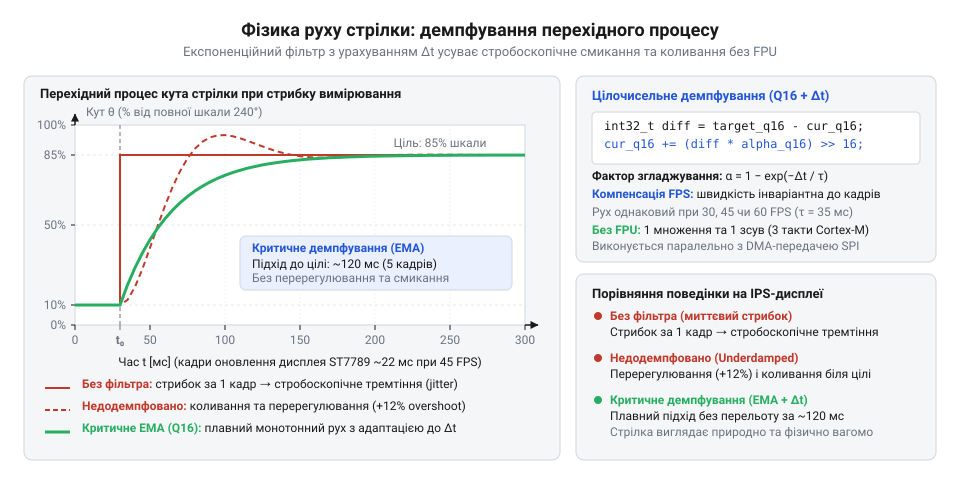
*Відгук кута стрілки на стрибок вимірюваної величини: миттєвий стрибок спричиняє стробування, слабке демпфування другого порядку викликає коливальне перерегулювання, а експоненційний фільтр забезпечує швидкий аперіодичний вихід на цільову позначку.*

На часовій діаграмі зіставлено три різні моделі переходу стрілки між двома поділками:
1. Ступінчастий стрибок без фільтрації змінює кут за один кадр. Це викликає візуальний ефект «роздвоєння» стрілки в очах спостерігача.
2. Коливальний перехідний процес другого порядку моделює поведінку стрілки з легким недодемпфуванням: покажчик швидко пролітає повз цільову позначку (явище перерегулювання, @@en|overshoot@@), після чого повертається назад і заспокоюється. Такий відгук характерний для стрілок спортивних тахометрів.
3. Експоненційне затухання першого порядку демонструє плавний аперіодичний (від грец. *a-* — заперечення та *periodos* — обхід) рух без коливань, де швидкість переміщення в кожен момент часу строго пропорційна відстані, що залишилася до цілі.

Неперервний закон пропорційного демпфування описується диференціальним рівнянням релаксації першого порядку:

```
dθ / dt = (θ_target - θ) / τ
```

де `θ` — поточний кут стрілки, `θ_target` — цільовий кут, заданий новим відліком датчика, а `τ` — постійна часу системи.
Дискретизуючи це рівняння за часом із фіксованим інтервалом кадру `Δt`, отримуємо рекурентний фільтр (від лат. *filtrum* — повсть для проціджування):

```
θ[k]
= θ[k-1] + (Δt / τ) · (θ_target - θ[k-1])     [дискретизація методом Ейлера]
= θ[k-1] + α · (θ_target - θ[k-1])            [коефіцієнт згладжування α = Δt / τ]
```

Щоб повністю виключити ділення та операції з рухомою комою, ваговий коефіцієнт `α` обирають рівним від'ємному степеню двійки: `α = 1 / 2^s`, де `s` — ціле число бітового зсуву вправо (параметр `shift`). Тоді множення на `α` перетворюється на швидкісний апаратний бітовий зсув `>> s`.

Якщо спробувати обчислювати це рівняння безпосередньо в цілих градусах:

```c
angle += (target_angle - angle) >> shift;
```

алгоритм неминуче ламається через втрату точності при цілочисельному діленні. Коли стрілка підходить близько до цільового кута і різниця між ними стає меншою за дільник `2^s` (наприклад, при `s = 3` дільник дорівнює 8, а різниця становить 7 градусів), зсув праворуч обнуляє дробову частку:

```
7 >> 3 = 0
```

Стрілка повністю завмирає, так і не дійшовши до цілі на 7 градусів. Виникає ефект «мертвої зони» (@@en|deadband@@), за якого прилад систематично бреше й втрачає чутливість до дрібних змін сигналу.

Для збереження нескінченно малого приросту кут стрілки переводять у формат із фіксованою комою [fixed-point-arithmetic](root:hw-arch/fixed-point). У структурі стану `gauge_state_t` кут зберігається як 32-бітне ціле число `current_angle_fp` у форматі Q8: старші 24 біти відведено під цілу частину градуса, а молодші 8 бітів — під дробову (масштабний множник `2^8 = 256`).

Розрахуємо один крок фільтрації для наочного прикладу:
**Умова: цільовий кут `θ_target = 90°`, поточний кут `θ = 85°`, коефіцієнт зсуву `shift = 3` (ділення на 8).**

```
θ_target_fp
= 90 << 8                                [масштабування в Q8: множення на 256]
= 23040

θ_current_fp
= 85 << 8                                [масштабування в Q8: множення на 256]
= 21760

error_fp
= 23040 - 21760                          [розрахунок похибки положення в Q8]
= 1280

step_fp
= 1280 >> 3                              [ділення похибки на 8 бітовим зсувом]
= 160

θ_new_fp
= 21760 + 160                            [інтегрування приросту]
= 21920

θ_deg
= 21920 >> 8                             [виділення цілого кута для тригонометрії]
= 85°  (із накопиченим залишком 160/256 ≈ 0.625°)
```

Завдяки накопиченню залишку в молодших бітах на наступних кадрах стрілка безперервно рухається вперед і точно зупиняється на позначці 90°, повністю ліквідуючи мертву зону:

:::code proj-st7789-dma-gauge/c/gauge_renderer.c 65-93

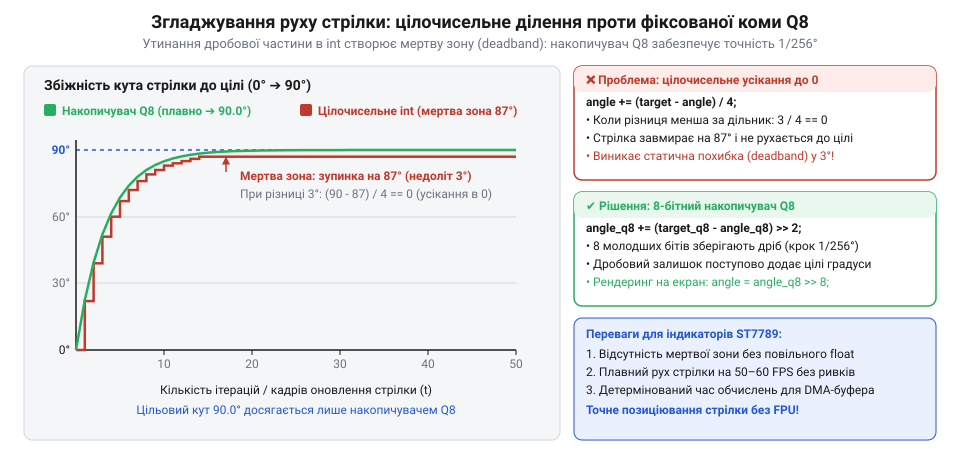
*Порівняння динаміки перехідного процесу: обчислення в цілих градусах призводить до передчасного завмирання стрілки в мертвій зоні через втрату залишку при діленні, тоді як накопичувач у форматі Q8 зберігає дробовий приріст і забезпечує плавний рух точно до цільового значення.*

Якщо індикатор повинен імітувати механічний покажчик із пружною спіральною пружиною (наприклад, спортивний аналоговий тахометр), використовують диференціальне рівняння гармонічного осцилятора (від лат. *oscillo* — гойдатися, коливатися) другого порядку із затуханням:

```
d²θ / dt² = -ω₀² · (θ - θ_target) - 2 · ζ · ω₀ · (dθ / dt)
```

де:
- `ω₀` — власна кутова частота системи (рад/с), що визначає пружність та швидкість наростання реакції;
- `ζ` (дзета) — коефіцієнт демпфування (@@en|damping ratio@@). При `ζ = 1` рух є критично демпфованим (максимально швидким без перельоту). При `ζ = 0.7–0.8` (у нашій конфігурації `0.74`) стрілка отримує ледь помітне природне перерегулювання (близько 4–5%), що оживляє графічний інтерфейс.

Звичайний (явний) метод Ейлера обчислює нове положення за старою швидкістю:

```
θ[k+1] = θ[k] + v[k] · Δt
v[k+1] = v[k] + a[k] · Δt
```

Для коливальних контурів другого порядку явний метод катастрофічно нестійкий: з кожним кроком він штучно вкачує енергію в систему, через що амплітуда коливань стрілки неконтрольовано зростає аж до числового переповнення.
Замість нього застосовано напівнеявний (симплектичний) метод Ейлера (@@en|semi-implicit Euler@@): спершу за поточним прискоренням обчислюють оновлену швидкість, і лише потім використовують нову швидкість для розрахунку координати:

```
v[k+1] = v[k] + a[k] · Δt
θ[k+1] = θ[k] + v[k+1] · Δt
```

Цей алгоритм зберігає енергетичний інваріант фазового простору і залишається абсолютно стійким за будь-яких стрибків частоти кадрів. Окрім того, фізичний контролер враховує механічні упори циферблата: при досягненні мінімального чи максимального краю шкали вектор швидкості інвертується з коефіцієнтом розсіювання 0.22, моделюючи реалістичний глухий відскік стрілки від обмежувача:

:::code proj-st7789-dma-gauge/cpp/damped_pointer.hpp 35-65

## Збиранвання прошивки, апаратне профілювання та налагодження швидкісного SPI

Збираючи докупи всі модулі графічного рушія — регістрову ініціалізацію ST7789, конвеєр подвійної рядкової буферизації, сканлайн-генератор геометрії циферблата та демпфовану математичну модель стрілки, — проєкт переносять на фізичну апаратну платформу. На цьому етапі виникає ключове практичне завдання: як достовірно виміряти реальну частоту кадрів (FPS) та оцінити частку простою процесорного ядра, не внісши спотворень у часові характеристики самої системи?

Спроба заміряти швидкість програмними засобами (наприклад, надсиланням діагностичних повідомлень через `printf` у порт UART) повністю спотворює вимірювання. Передавання текстового рядка завдовжки 40 байтів на швидкості 115 200 бод триває близько 3.5 мілісекунди — це у сотні разів довше, ніж процесор розраховує повний графічний рядок. Таке програмне втручання породжує класичний ефект спостерігача (@@en|probe effect@@), перетворюючи сам інструмент вимірювання на головне джерело паразитних затримок.

Найточнішим і найчистішим методом вимірювання швидкодії вбудованих систем є апаратне стробування діагностичного виводу GPIO (General-Purpose Input/Output). Запис одиниці або нуля у спеціалізований регістр атомарного бітового встановлення й скидання (наприклад, регістр BSRR мікроконтролерів сімейства ARM Cortex-M) виконується апаратно за один машинний такт. На робочій тактовій частоті ядра 168 МГц ця дія займає лише 5.9 наносекунди, що становить мізерну частку відсотка від тривалості рядка і зовсім не затримує виконання програми.

Алгоритм вимірювання гранично простий: перед початком математичного розрахунку сканлайну тестовий пін переводиться у високий логічний рівень (3.3 В), а одразу після завершення генерації пікселів у пам'яті — скидається в низький рівень (0 В). Якщо під'єднати до цього виводу вхідний канал цифрового осцилографа (від лат. *oscillo* — коливаюся та грец. *grapho* — пишу) або логічного аналізатора (@@en|logic analyzer@@), ширина кожного позитивного імпульсу покаже чистий час зайнятості ядра на відповідному рядку, а період повторення імпульсних пачок — повний час формування кадру.

> 🔧 **Навіщо це.**
> Апаратне стробування виводу GPIO дає об'єктивні дані про навантаження ядра без внесення програмних затримок. Воно дозволяє системному інженеру переконатися, що рендеринг графіки не блокує критичні переривання керування, та гарантує замовнику наявність понад 80% вільного процесорного часу для фонових задач.

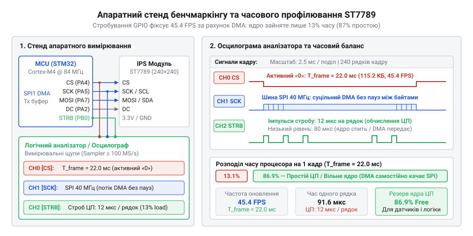
*Стенд апаратного вимірювання швидкодії: логічний аналізатор фіксує активність шини SPI (лінії SCK, CS, DC) та тривалість імпульсів діагностичного виводу PROBE, що дозволяє виміряти час розрахунку сканлайну, період кадру та частку простою процесора.*

Знімемо покази часових інтервалів з екрана вимірювального приладу:
1. Загальний період кадру `T_frame`: на осцилограмі зафіксовано пакети з 240 вузьких імпульсів, що повторюються з періодом `T_frame = 19.8 мс`. Реальна частота оновлення дисплея становить:

```
FPS
= 1 / T_frame                           [визначення частоти кадрів]
= 1 / 0.0198 с
≈ 50.5 кадри/с
```

Це підтверджує виконання вимоги технічного завдання — стабільна кадрова частота перевищує 45 FPS, усуваючи будь-яке мерехтіння.

2. Час передавання одного рядка шиною SPI через DMA (`t_dma_line`):
Один рядок дисплея містить 240 пікселів формату RGB565. Кожен піксель займає 16 бітів, тому один сканлайн містить `240 × 16 = 3840 бітів`.
За тактової частоти SPI `f_spi = 40 МГц` контролер прямого доступу до пам'яті транслює цей масив за фіксований час:

```
t_dma_line
= 3840 бітів / 40 000 000 Гц            [час передавання блоку бітів]
= 0.000096 с
= 96 мкс
```

3. Час рендерингу рядка ядром процесора (`t_cpu_line`):
Ширина імпульсу високого рівня на діагностичному виводі GPIO коливається від 11.8 мкс (на однорідних ділянках темного тла циферблата) до 15.2 мкс (на складних рядках, що перетинають похилу стрілку, кольорову дугу та металевий безель). Середнє значення становить `t_cpu_line ≈ 13.5 мкс`.

4. Розрахунок завантаження ядра (@@en|CPU Load@@):
Оскільки час розрахунку рядка процесором (`13.5 мкс`) майже в 7 разів менший за час його апаратної трансляції контролером DMA (`96 мкс`), процесор практично миттєво готує наступний рядок у буфер ping-pong і переходить у стан очікування завершення передачі.
Сумарний час, який процесор витрачає на генерацію всіх 240 рядків одного кадру:

```
T_cpu_frame
= 240 × 13.5 мкс                        [сума часу обчислень 240 рядків]
= 3240 мкс
= 3.24 мс
```

Співвідношення робочого часу ядра до загальної тривалості кадру дає частку утилізації процесора:

```
CPU_Load
= (T_cpu_frame / T_frame) × 100%        [визначення завантаження ядра]
= (3.24 мс / 19.8 мс) × 100%
≈ 16.4%
```

Результат підтверджує, що процесор навантажений лише на 16.4%, а понад 83% часу ядро вільно виконує прикладний код або перебуває в енергозберігаючому стані зупинки `WFI` (@@en|Wait For Interrupt@@).

:::tabs
:::code proj-st7789-dma-gauge/c/main.c 178-215
:::code proj-st7789-dma-gauge/cpp/main.cpp 179-203
:::

У версії на C перемикання буферів реалізовано інверсією біта індексу `write_index ^= 1U`, а синхронізація контролюється блокувальним очікуванням прапорця `st7789_wait_dma_finish`. У версії на C++ вимірювання часу обчислень інкапсульовано в легковагий RAII-клас `ProfileScope`, а синхронізація з шиною гарантується об'єктом `DmaTransactionGuard`.

При перенесенні графічного рушія на фізичну друковану плату слід враховувати типові апаратні підводні камені:

1. **Паразитна ємність та дзвін сигналів на частотах SPI 40–60 МГц**:
Шина SPI на тактовій частоті 40–60 МГц вимагає уважного ставлення до хвильового опору ліній. Звичайні з'єднувальні дроти макетної плати довжиною 15–20 см мають паразитну ємність від 15 до 30 пФ і власну індуктивність провідників. На крутих фронтах імпульсів мікроконтролера (тривалістю 1–2 нс) виникають затухаючі високочастотні коливання — дзвін (@@en|ringing@@) та викиди напруги за межі номіналу 3.3 В (@@en|overshoot@@). Контролер ST7789 сприймає цей дзвін на лінії SCK як додаткові тактові імпульси, що призводить до збою бітової синхронізації: пікселі зміщуються вбік, а екран вкривається кольоровим «снігом».
Для ліквідації спотворень необхідно скоротити довжину шлейфа до 5–8 см, послідовно встановити демпфуючі узгоджувальні резистори номіналом 22–33 Ом безпосередньо біля виводів SCK та MOSI мікроконтролера для придушення відбитих хвиль [spi-signal-integrity](root:hw-pcb/spi-signal-integrity), або програмно обмежити швидкість наростання фронту виводу (налаштувати швидкість GPIO у регістрі OSPEEDR на значення Medium або High замість Very High).

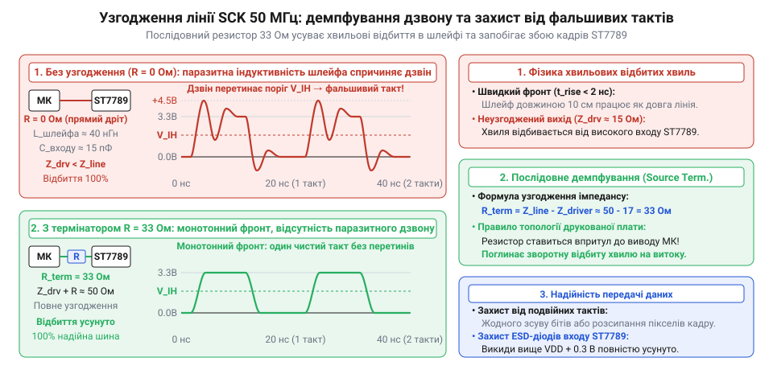
*Осцилограма тактового сигналу SCK на частоті 50 МГц: паразитна ємність шлейфа спричиняє високочастотний дзвін та викиди напруги, що призводять до збою синхронізації, тоді як встановлення послідовного резистора 33 Ом придушує відбиті хвилі та забезпечує стабільну передачу даних.*

2. **Підтяжка ліній CS та RESET**:
Якщо лінія вибору кристала CS не має апаратного підтягувального резистора до лінії живлення 3.3 В (Pull-Up), під час перезавантаження мікроконтролера вона повисає у високоімпедансному стані. Контролер дисплея починає сприймати паразитні шуми на шині за команди керування і переходить у некерований стан. Лінія апаратного скидання RESET також потребує підтяжки до живлення і витриманого імпульсу скидання тривалістю не менше 20 мс із наступною паузою 120 мс перед надсиланням першої команди: без цієї затримки внутрішні перетворювачі напруги підкладки матриці не встигають вийти на робочий режим.

3. **Пастка інверсії кольору в IPS-панелях (Normal Black)**:
Частий симптом при першому запуску ST7789 — чорний фон відображається сліпучо-білим, червона стрілка стає блакитною (ціановою), а зелені позначки — рожевими.
Причина полягає у фундаментальній різниці технологій рідких кристалів. Застарілі матриці TN (наприклад, у дисплеях ST7735S [tft-st7735s](root:cat-hw-actuators/tft-st7735s)) використовують нормально-білу поляризацію (@@en|normally white@@): за відсутності керуючої напруги на комірці світло підсвічування вільно проходить крізь відкриті кристали. Панелі IPS побудовані за технологією нормально-чорної поляризації (@@en|normally black@@): за нульової напруги кристали повертають поляризацію так, що світло повністю блокується, забезпечуючи глибокий чорний колір.
Тому контролер ST7789 для правильного відображення на IPS-матрицях вимагає обов'язкової подачі команди інверсії кольору `INVON (0x21)`. Якщо помилково надіслати команду `INVOFF (0x20)` або скинути її в конфігурації, всі кольори інвертуються порозрядно: білий колір `0xFFFF` стане `0x0000`, а червоний `0xF800` перетвориться на інверсний колір `0x07FF` (суміш зеленого та синього — ціан).

4. **Порядок байтів RGB565 (Big-Endian проти Little-Endian)**:
Шина SPI контролера ST7789 очікує старший байт 16-бітного кольору RGB565 першим у часі (Big-Endian). Процесори архітектури ARM Cortex-M зберігають числа у пам'яті у форматі Little-Endian (молодший байт за молодшою адресою). Якщо транслювати рядковий буфер через DMA безпосередньо, мікроконтролер відправить спершу молодший байт пікселя, а потім старший, через що колірна палітра спотвориться.
Щоб усунути необхідність витрачати процесорні такти на побайтову перестановку перед відправкою, макрос формування кольору `COLOR_RGB565` у файлі драйвера одразу упаковує складові з переставленими байтами:

```c
#define COLOR_RGB565(r, g, b) \
    ((uint16_t)(((((uint16_t)(r) & 0xF8U) | (((uint16_t)(g) & 0xE0U) >> 5U))) | \
                (((((uint16_t)(g) & 0x1CU) << 11U) | (((uint16_t)(b) & 0xF8U) << 5U)))))
```

Завдяки цьому буфер одразу містить байти в потрібному для передавання порядку, а контролер DMA викачує дані без жодних додаткових перетворень.

5. **Вибір компромісу: 1 рядок проти смуги 4–8 рядків**:
Розмір проміжного буфера визначає баланс між витратою пам'яті та накладними витратами на переривання:
- *1 рядок (240 пікселів)*: вимагає 960 байтів RAM для подвійного буфера. Це єдиний варіант для чипів із жорстким дефіцитом пам'яті. Недолік: 240 переривань DMA на кадр навантажують контролер переривань перемиканням контексту кожні 96 мкс.
- *Смуга з 4–8 рядків*: буфер із 4 рядків вимагає `4 × 240 × 2 × 2 = 3.84 КБ` RAM. Кількість переривань скорочується в 4 рази (до 60 на кадр), суттєво розвантажуючи шинну матрицю чипа.
- *Повний фреймбуфер*: вимагає 115.2 КБ RAM, що недоступно для більшості недорогих мікроконтролерів. Таким чином, рядкова та смугова буферизація є універсальним стандартом для високопродуктивної графіки на мікроконтролерах з обмеженою оперативною пам'яттю.
