# IPS 1.3″ 240×240 (SPI, ST7789)

<preknowlist>
- [TFT 1.77″ 128×160 (SPI, ST7735S)](root:cat-hw-actuators/tft-st7735s) — принципи взаємодії з РК-контролерами по шині SPI, призначення ліній CS, DC, RES та базове кодування пікселів у форматі RGB565
- [OLED-дисплей 0.96″ SSD1306 (I2C, 128×64)](root:cat-hw-actuators/oled-ssd1306) — концепція кадрового буфера в пам'яті мікроконтролера, процес періодичного оновлення екрана та відмінність між формуванням графіки в RAM і передачею на дисплей
</preknowlist>

## Межі автономного монітора: від примітивних індикаторів до кольорової графіки

Побудова портативного автономного приладу для контролю мікроклімату — кімнатної метеостанції або персонального газоаналізатора — починається зі спроби вивести дані на екран так, щоб користувач міг оцінити стан середовища за частку секунди. Інженер стикається з типовим набором сенсорів: температура, вологість, атмосферний тиск, концентрація летких органічних сполук та залишковий заряд акумулятора. Для першого прототипу розробник зазвичай обирає найдоступніші індикатори: текстовий [LCD 1602A](root:cat-hw-actuators/lcd-1602) або мініатюрний монохромний [OLED SSD1306](root:cat-hw-actuators/oled-ssd1306). Проте цей шлях миттєво заходить у глухий кут, щойно вимоги до інтерфейсу виходять за межі сухих числових стовпчиків.

На символьному рідкокристалічному індикаторі доступно лише 32 знакомісця у двох рядках. Якщо розмістити поточні показники температури й вологості, екран вичерпує свій простір: вивести графік зміни тиску за останні шість годин або наочну кругову шкалу просто неможливо. Монохромний OLED-модуль із діагоналлю 0.96 дюйма надає повноцінне бітове поле розміром 128×64 точки, але його корисна площа становить менше ніж п'ять квадратних сантиметрів. Спроба одночасно розмістити на такому просторі кілька графічних шкал, лінійний графік тренду та піктограму батареї перетворює інтерфейс на нерозбірливу кашу з однобітних пікселів. Читати такий екран на відстані витягнутої руки важко, а кольорове кодування тривожних зон (наприклад, жовтий колір для підвищеної вологості чи червоний для небезпечної концентрації газів) фізично відсутнє. Інтерфейс вимагає простору, високої щільності точок та кольору.

Природним вибором стає перехід на повноколірний рідкокристалічний дисплей розміром 1.3 дюйма з роздільною здатністю 240×240 пікселів на базі матриці @@en|IPS@@ (від англ. *In-Plane Switching* — перемикання в одній площині) під керуванням контролера ST7789. Широкі кути огляду без інверсії кольорів та 57 600 індивідуальних колірних точок дають змогу побудувати сучасний інформативний дашборд (від англ. *dashboard* — панель приладів). Проте цей крок одразу розбивається об жорсткий бар'єр апаратних ресурсів мікроконтролера.

Перша перешкода — гострий дефіцит оперативної пам'яті (RAM). Контролер ST7789 відображає графіку в 16-бітному колірному форматі RGB565, де кожен піксель кодується двома байтами (5 бітів на червоний канал, 6 на зелений і 5 на синій). Класичний підхід до формування зображення передбачає виділення в оперативній пам'яті мікроконтролера повного кадрового буфера (@@en|framebuffer@@, від англ. *frame* — кадр та *buffer* — проміжне сховище), куди процесор записує геометричні фігури й текст перед відправленням на дисплей.

Розрахунок необхідного обсягу пам'яті для одного повного кадру показує глибину проблеми:

```
W × H × 2 байти
= 240 × 240 × 2 байти      [розмір матриці у пікселях та глибина кольору RGB565]
= 57600 × 2 байти          [загальна кількість пікселів екрана]
= 115200 байтів            [необхідний обсяг пам'яті для повного кадрового буфера]
= 112.5 КБ                 [ділення на 1024 байтів у кілобайті]
```

Для типових мікроконтролерів автономних систем виділення 112.5 КБ неперервної пам'яті є нездійсненною вимогою. Популярні чипи на кшталт STM32F103 мають усього 20 КБ загальної RAM, а 8-бітні архітектури взагалі обмежені 2–4 КБ. Навіть на продуктивніших платформах із 320–512 КБ RAM (ESP32, RP2040) вилучення понад 112 КБ під один статичний масив паралізує роботу пристрою: не залишається простору для мережевих стеків, черг операційної системи реального часу, буферів файлових систем та сенсорних вимірювань.

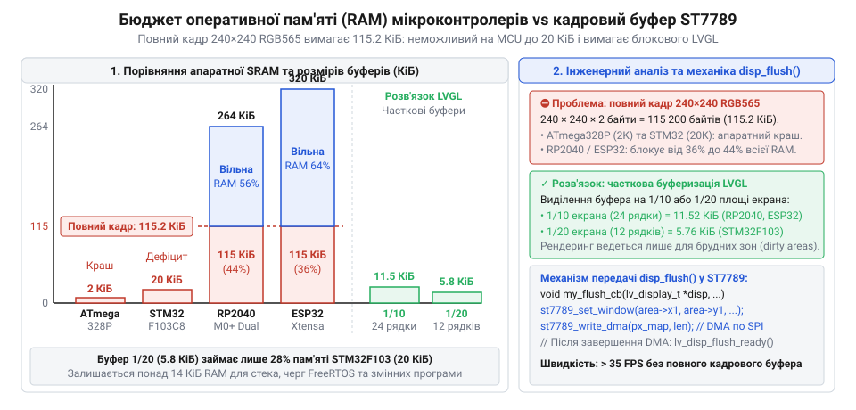
*Стовпчикова діаграма порівняння доступної RAM типових мікроконтролерів (STM32F103, ATmega328P, RP2040, ESP32) та розміру повного кадрового буфера RGB565 240×240: наочно демонструє неможливість повнокадрового рендерингу на молодших чипах і гострий дефіцит на старших.*

Друга перешкода — пропускна здатність послідовної шини та блокування процесора. Якщо відмовитися від кадрового буфера й малювати графіку «на льоту» прямими командами по шині SPI, на кожну лінію чи коло мікроконтролер змушений посилати координатні команди позиціонування та поодинокі пікселі. При тактовій частоті шини SPI 40 МГц передача повного масиву кадру займає суттєвий час:

```
115200 байтів × 8 бітів
= 921600 бітів                [кількість бітів у повному кадрі 240×240]
t = 921600 бітів ÷ 40 Мбіт/с  [теоретичний час передачі на тактовій частоті 40 МГц]
= 0.02304 с                   [ділення величин]
= 23.04 мс                    [мінімальний час передачі кадру без протокольних затримок]
```

При попіксельному малюванні через SPI накладні витрати протоколу зростають у рази. Процесор зависає в нескінченних циклах очікування завершення транзакцій шини, а на екрані з'являється помітне для ока перемальовування елементів — розрив кадру (@@en|screen tearing@@, від англ. *tear* — рвати) та мерехтіння. Показники сенсорів оновлюються повільно, а інтерфейс виглядає смиканим і застарілим.

Третя перешкода — енергетичний баланс портативного пристрою. Кольорова рідкокристалічна матриця, на відміну від випромінювальних діодів [TFT ST7735S](root:cat-hw-actuators/tft-st7735s) чи OLED, працює на просвіт і вимагає постійного потужного світлодіодного підсвічування. Якщо залишити підсвічування увімкненим на повну потужність, струм споживання модуля дисплея сягає 45–55 мА, що перевищує струм самого мікроконтролера в активному стані. Від компактного акумулятора ємністю 500 мА·год такий прилад виснажиться менш ніж за сім годин, навіть якщо процесор більшість часу перебуває у сні.

> 🔧 **Навіщо це.**
> Розуміння апаратних бар'єрів визначає структуру графічної системи: замість наївного виділення пам'яті під весь екран розробник застосовує часткову рядкову буферизацію (@@en|partial buffering@@) та подієву модель оновлення. Це дозволяє створювати насичені векторні віджети навіть на мікроконтролерах із кількома десятками кілобайтів RAM.

Розв'язанням цієї сукупності проблем є поєднання дисплейного контролера ST7789 та спеціалізованої графічної бібліотеки [LVGL](root:sf-devices/hrafichnyi-interfeis) (@@en|Light and Versatile Graphics Library@@ — легка та гнучка графічна бібліотека). Архітектура LVGL спирається на три інженерні принципи:

1. **Часткова рядкова буферизація замість повного кадру.** Графічний рушій виділяє буфер лише на частину екрана — наприклад, на 1/10 чи 1/20 площі (від 12 до 24 рядків матриці). Для смуги у 24 рядки потрібно всього 11.25 КБ RAM:

```
W × h × 2 байти
= 240 × 24 × 2 байти       [ширина матриці, висота смуги у 24 рядки та глибина RGB565]
= 5760 × 2 байти           [кількість пікселів у буфері]
= 11520 байтів             [обсяг необхідної оперативної пам'яті]
= 11.25 КБ                 [ділення на 1024 байтів у кілобайті]
```

2. **Оновлення лише змінених областей.** Якщо на дашборді оновилася лише стрілка шкали або цифра температури, LVGL не витрачає час на рендеринг усього екрана. Рушій обчислює прямокутник змін (@@en|dirty area@@), відмальовує його у вузький буфер пам'яті й за одну неперервну транзакцію відправляє координати та пікселі у внутрішню пам'ять контролера ST7789.
3. **Апаратна адаптація живлення.** Завдяки гнучкому регулюванню яскравості підсвічування дисплей динамічно пристосовується до зовнішнього освітлення та переходить у режим затемнення за відсутності дій користувача, зберігаючи автономність системи.

## Електричне сполучення ST7789 та апаратний ключ підсвічування

Фізична інтеграція модуля 1.3″ IPS ST7789 вимагає узгодження цифрових сигнальних ліній шини SPI та побудови надійного силового каскаду для керування світлодіодним підсвічуванням. Типовий модуль оснащено 7- або 8-контактним роз'ємом:

* `GND` — спільний нульовий провідник живлення та сигналів.
* `VCC` — напруга живлення логіки та внутрішнього перетворювача (3.3 В). Контролер ST7789 розрахований на логічні рівні від 1.65 В до 3.3 В. Подача напруги 5 В на лінії живлення або сигнали неприпустима: це спричиняє тепловий пробій захисних діодів кристала.
* `SCL` (SCK, CLK) — лінія тактування шини SPI (@@en|Serial Clock@@, від лат. *series* — послідовність). Задає синхронізацію передачі кожного біта даних на частотах аж до 40–60 МГц.
* `SDA` (MOSI, DIN) — послідовна лінія передачі даних від мікроконтролера до дисплея (@@en|Master Out Slave In@@). Модуль працює виключно на прийом (симплексний режим, @@en|simplex mode@@), лінія зворотного зв'язку MISO фізично відсутня.
* `RES` (RST) — лінія апаратного скидання (@@en|Reset@@, від лат. *re-* — знову та давньоангл. *settan* — ставити). Активний рівень — логічний нуль. Імпульс низького рівня тривалістю не менше 10 мкс переводить внутрішні регістри ST7789 у вихідний стан під час старту системи.
* `DC` (D/C, RS) — вибір режиму «дані / команда» (@@en|Data/Command@@). Рівень логічного нуля сповіщає контролер, що переданий байт є командою або адресою регістра. Рівень логічної одиниці вказує на аргумент команди або 16-бітні колірні дані пікселів.
* `CS` — вибір мікросхеми (@@en|Chip Select@@). Активний рівень — логічний нуль. Дозволяє виділяти дисплей серед інших пристроїв на спільній шині SPI. На деяких спрощених 7-пінових модулях лінія CS жорстко з'єднана із землею на самій платі, проте для надійної роботи в шині наявність виведеного піна CS є обов'язковою.
* `BLK` (BL, LED) — вивід керування світлодіодним підсвічуванням матриці (@@en|Backlight@@).

Найпоширеніша помилка схемотехніки — пряме підключення виводу BLK до лінії живлення 3.3 В або безпосередньо до виводу загального призначення (GPIO) мікроконтролера.

Якщо підключити лінію BLK безпосередньо до живлення 3.3 В, матриця світлодіодів підсвічування споживає постійний некерований струм від 40 до 50 мА. Розрахунок потужності розсіювання та впливу на автономність показує небезпеку такого рішення:

```
P = U × I
= 3.3 В × 0.045 А          [напруга лінії живлення та струм підсвічування]
= 0.1485 Вт                [потужність розсіювання світлодіодної лінійки]
≈ 148.5 мВт                [переведення у мілівати]
```

При живленні від компактного акумулятора ємністю 500 мА·год та загальному струмі системи близько 70 мА (25 мА на мікроконтролер із сенсорами та 45 мА на підсвічування) батарея розрядиться за лічені години:

```
t = C ÷ I_total
= 500 мА·год ÷ 70 мА       [номінальна ємність акумулятора та сумарний струм приладу]
≈ 7.14 год                 [час автономної роботи до повного виснаження]
```

Спроба живити світлодіодне підсвічування безпосередньо з виводу GPIO мікроконтролера призводить до апаратної аварії. Вихідний каскад виводу сучасного мікроконтролера (@@en|push-pull@@) розрахований на тривалий струм не більше 12–20 мА (наприклад, для ESP32 рекомендований максимум становить 12 мА, для STM32 — 20–25 мА на один пін). Струм 45 мА викликає перегрів кремнієвого кристала, деградацію внутрішніх транзисторів порту і спричиняє просідання внутрішньої напруги ядра, що викликає раптове аварійне скидання процесора (@@en|brownout reset@@, від англ. *brownout* — часткове падіння напруги та *reset* — скидання).

Єдино правильним інженерним розв'язком є [транзисторний ключ нижнього плеча](root:hw-components/mosfet-low-side-switch) (@@en|low-side switch@@) на базі N-канального польового МОН-транзистора з логічним керуванням (@@en|Logic-Level N-Channel MOSFET@@, наприклад 2N7002, BSS138 або низькоомний AO3400).

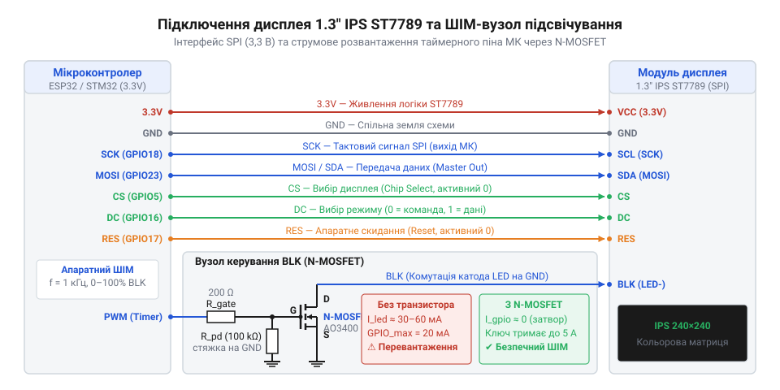
*Принципова електрична схема підключення модуля 1.3″ IPS ST7789 до мікроконтролера за шиною SPI та транзисторного ключа керування яскравістю підсвічування BLK через ШІМ: розподіл сигналів забезпечує безпечну комутацію струму світлодіодів без перевантаження виводів процесора.*

Транзисторний вузол містить два критичні елементи обв'язки:

1. **Струмообмежувальний резистор затвора (R_gate = 100–220 Ом).** Затвор польового транзистора має власну вхідну ємність (@@en|gate capacitance@@, зазвичай 20–60 пФ). У моменти перемикання ШІМ-сигналу з крутими фронтами незахищений вивід мікроконтролера бачить затвор як коротке замикання, через що виникають імпульсні струми амплітудою в сотні міліампер. Послідовний резистор 100 Ом обмежує піковий струм перезаряджання ємності до безпечних 33 мА та пригнічує високочастотний дзвін паразитних коливальних контурів друкованої плати.
2. **Стягувальний резистор (R_pulldown = 10–47 кОм).** Резистор встановлюється між затвором транзистора та спільною землею GND. Під час увімкнення живлення, прошивання мікроконтролера або скидання процесора всі виводи GPIO переходять у високоімпедансний стан (@@en|Hi-Z@@, від англ. *high impedance* — високий опір). Без стягувального резистора ізольований затвор під дією електростатичних наведень може довільно відкрити транзистор, викликаючи паразитичні спалахи підсвічування до старту прошивки. Резистор надійно фіксує потенціал нульового вольта на затворі.

Порівняно з біполярним NPN-транзистором (наприклад, BC847 чи 2N3904), MOSFET має принципову перевагу: він керується напругою, а не струмом, тому не споживає постійного струму з виводу мікроконтролера у відкритому стані. Крім того, опір відкритого каналу сучасного MOSFET (десяті чи соті частки ома) забезпечує мізерне спадання напруги порівняно з напругою насичення колектор-емітер біполярного ключа (0.2–0.3 В), що гарантує повну яскравість світлодіодів від лінії 3.3 В.

Керування транзистором здійснюється за допомогою апаратного таймера мікроконтролера через [ШІМ-регулювання яскравості](root:hw-motion/pwm-led-dimming) (@@en|Pulse-Width Modulation@@, @@en|PWM@@, від лат. *modulatio* — розміреність). Зміна коефіцієнта заповнення (@@en|duty cycle@@, від англ. *duty* — робота та *cycle* — цикл) імпульсів дозволяє регулювати середнє значення струму через світлодіоди від 0 до 100%.

Вибір тактової частоти ШІМ визначається фізичними обмеженнями:
* Частота нижче 100 Гц неприпустима: вона опускається нижче частоти злиття мерехтінь людського зору (@@en|flicker fusion threshold@@), викликаючи втомливе тремтіння екрана та смуги на камерах спостереження.
* Діапазон від 200 Гц до 15 кГц може викликати акустичний писк керамічних конденсаторів друкованої плати через зворотний п'єзоелектричний ефект (@@en|piezoelectric effect@@, від грец. *piezein* — стискати).
* Оптимальною є ультразвукова частота понад 20 кГц (типово 25–30 кГц) або стабільний діапазон 1–2 кГц при використанні якісних пасивних компонентів.

> 🔧 **Навіщо це.**
> Апаратний ШІМ-ключ на лінії BLK перетворює пасивний дисплей на керовану підсистему живлення: зниження яскравості до 10% під час очікування скорочує споживання підсвічування з 45 мА до 4.5 мА, подовжуючи час роботи батарейного монітора в кілька разів без погіршення читабельності інтерфейсу.

## Низькорівневий драйвер ST7789 та віконна адресація пам'яті через SPI

Фізичне підключення ліній живлення та інтерфейсних сигналів до мікроконтролера ще не змушує рідкокристалічний екран показувати зображення. При першому подаванні живлення кристалічний контролер ST7789 перебуває в апаратному стані глибокого сну з вимкненими генераторами зміщення напруг, а його внутрішня відеопам'ять (@@en|GRAM@@, від англ. *Graphics Random Access Memory*) заповнена випадковими значеннями. Якщо без чіткої ініціалізації просто подати тактовий сигнал і дані на матрицю, на екрані залишиться суцільна темрява або спалахне хаотичний шум. Щоб перетворити кремнієву мікросхему дисплея на кероване графічне полотно, мікроконтролер має налаштувати фізичні параметри синхронної шини, розбудити контролер суворою послідовністю команд та підпорядкувати геометрію його внутрішніх регістрів фізичному склу.

> 🔧 **Навіщо це.**
> Низькорівневий драйвер забезпечує пряме апаратне керування дисплеєм без накладних витрат важких універсальних бібліотек. Розуміння віконної адресації дозволяє оновлювати лише окремі змінені координати екрана на максимальній швидкості шини SPI, заощаджуючи процесорний час для вимірювань і розрахунків.

### Фізика обміну по шині SPI та роль ліній керування

Зв'язок між мікроконтролером і контролером ST7789 здійснюється через послідовний синхронний інтерфейс SPI. Контролер ST7789 апаратно підтримує два режими передачі: @@en|Mode 0@@ (де полярність тактового сигналу `CPOL = 0`, а фаза вибірки `CPHA = 0`) та @@en|Mode 3@@ (`CPOL = 1`, `CPHA = 1`). В обох конфігураціях (від лат. *configuratio* — взаємне розташування) передача даних є функціонально ідентичною: біти на інформаційній лінії `MOSI` (яка на платах дисплеїв часто маркується як `SDA`) змінюються на спадному фронті тактового сигналу `SCK` (маркується як `SCL`), а фіксуються приймальним регістром дисплея на наростаючому фронті (@@en|rising edge@@). Режим Mode 0 є найбільш розповсюдженим і підтримується апаратними периферійними модулями будь-якого мікроконтролера, тому саме він обирається як базовий. Детальніше роботу синхронного інтерфейсу розібрано в окремій темі [Протокол шини SPI: режими CPOL/CPHA та організація передачі](root:com-devices/spi-mode-selection).

Шина SPI передає безперервний потік восьмибітних байтів, однак контролер дисплея повинен однозначно розрізняти, чи є черговий байт керівною інструкцією (номером регістра), чи параметром налаштування, чи масивом кольорів пікселів. Оскільки стандартний апаратний SPI передає лише 8 бітів без адресного тегу, дисплей використовує окрему цифрову лінію керування `DC` (@@en|Data/Command@@, у технічній документації виробника — `D/CX`):
- Низький логічний рівень (`DC = 0`) перемикає внутрішній демультиплексор контролера в режим інтерпретації байта як коду команди.
- Високий логічний рівень (`DC = 1`) вказує, що всі наступні байти є аргументами попередньої команди або чистим потоком пікселів для запису у відеопам'ять.

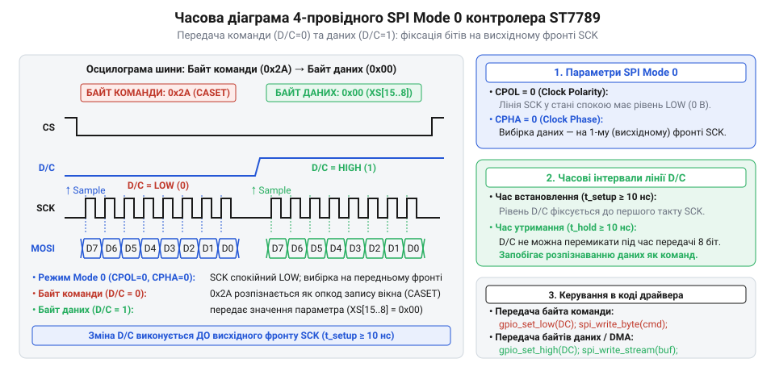
*Часова діаграма передачі байта команди (DC=0) та байта даних (DC=1) на шині SPI Mode 0: зміна бітів на лінії MOSI відбувається на спадному фронті тактового сигналу SCK, а фіксація — на висхідному; логічний рівень лінії DC однозначно визначає, чи інтерпретується байт як код інструкції, чи як дані.*

Крім лінії вибору типу даних, алгоритм обміну спирається на дві додаткові лінії керування:
- `CS` (@@en|Chip Select@@) — вибір кристала активним низьким рівнем (`CS = 0`). Коли на цій лінії присутній високий рівень, контролер відключає свої вхідні буфери від шини SPI, що дозволяє підключати на ті самі лінії тактування та даних інші периферійні пристрої.
- `RES` (@@en|Reset@@) — апаратне скидання низьким рівнем. Перед початком конфігурації утримання лінії `RES` у нулі протягом щонайменше 10 мкс гарантовано переводить внутрішній автомат станів ST7789 у вихідну точку.

### Послідовність команд ініціалізації контролера

Внутрішня схемотехніка ST7789 містить помпи заряду, стабілізатори опорної напруги для матриці та логіку гамма-корекції. Подавання напруги живлення залишає ці вузли заблокованими, щоб уникнути кидків струму. Процес «пробудження» дисплея складається з низки суворо нормованих у часі кроків:

1. **Програмне скидання (`SWRESET`, код `0x01`):** очищає програмні регістри. Після відправлення цієї команди контролеру потрібно щонайменше 120 мс для завершення внутрішнього скидання, протягом яких заборонено передавати інші інструкції.
2. **Вихід зі сну (`SLPOUT`, код `0x11`):** вмикає внутрішній тактовий генератор та помпи заряду рідкокристалічних формувачів. Необхідна пауза становить не менше 120 мс, щоб вихідні аналогові напруги стабілізувалися до номінальних значень.
3. **Формат кольору пікселів (`COLMOD`, код `0x3A`):** визначає бітову глибину представлення кольору. Для роботи в 16-бітному режимі високої чіткості передається аргумент `0x55`. Старша шістнадцяткова п'ятірка вказує на формат 16 біт/піксель (RGB565) для паралельного інтерфейсу, а молодша — для послідовного SPI.
4. **Керування доступом до відеопам'яті (`MADCTL`, код `0x36`):** задає напрямок сканування рядків і стовпчиків під час оновлення кадру (біти `MY`, `MX`, `MV`), а також порядок чергування колірних фільтрів (біт `BGR`). Подібні регістри конфігурації є типовими для більшості графічних контролерів, з якими можна ознайомитися у статті [TFT 1.77″ 128×160 (SPI, ST7735S)](root:cat-hw-actuators/tft-st7735s).
5. **Інверсія кольору (`INVON`, код `0x21`):** рідкокристалічні панелі технології IPS (@@en|In-Plane Switching@@) за своєю оптичною природою є нормально чорними (@@en|normally black@@). Без інверсії (від лат. *inversio* — перевертання) напруга на рідких кристалах формує зворотне пропускання світла, перетворюючи чорний колір на сліпучо-білий, а всі відтінки — на негатив. Команда `INVON` встановлює коректну колірну передачу.
6. **Увімкнення відображення (`DISPON`, код `0x29`):** відкриває вихідні ключі драйверів рядків і стовпчиків, передаючи сформований у відеопам'яті кадровий масив безпосередньо на фізичні електроди рідких кристалів.

### Протокол віконного запису пікселів

Відеопам'ять ST7789 є статичною оперативною пам'яттю (GRAM). Щоб намалювати довільний графічний елемент, нема потреби щоразу передавати на дисплей усі пікселі екрана: протокол ST7789 реалізує механізм прямокутної віконної адресації. Процес запису локальної ділянки складається з трьох послідовних кроків:

- **Вибір діапазону стовпчиків (`CASET`, код `0x2A`, @@en|Column Address Set@@):** команда супроводжується чотирма байтами параметрів, що задають координати початкового стовпчика `XS` та кінцевого стовпчика `XE`:
  `XS[15:8]`, `XS[7:0]`, `XE[15:8]`, `XE[7:0]`.
- **Вибір діапазону рядків (`RASET`, код `0x2B`, @@en|Row Address Set@@):** команда також приймає чотири байти, що задають координати початкового рядка `YS` та кінцевого рядка `YE`:
  `YS[15:8]`, `YS[7:0]`, `YE[15:8]`, `YE[7:0]`.
- **Запис у відеопам'ять (`RAMWR`, код `0x2C`, @@en|Memory Write@@):** перемикає внутрішній контролер адрес у режим прийому даних.

Після надсилання коду `RAMWR` лінія `DC` переводиться у високий стан (`DC = 1`), і мікроконтролер починає передавати масив 16-бітних значень кольорів пікселів. Внутрішній лічильник адреси ST7789 працює апаратно: з кожним прийнятим пікселем він автоматично збільшує координату `X` від `XS` до `XE`. Щойно досягнуто правої межі `XE`, лічильник повертається до значення `XS`, а координата `Y` збільшується на одиницю. Заповнення триває суворо до точки `(XE, YE)`.

### Апаратна пастка геометрії 1.3″ 240×240: зсуви координат

На етапі віконного виведення інженери стикаються з апаратною пасткою, характерною для квадратних модулів 1.3″ з роздільністю 240×240 пікселів. Кристал контролера ST7789 розроблявся як універсальне рішення для прямокутних екранів мобільних телефонів із фізичною матрицею 240×320 пікселів, тому його внутрішня відеопам'ять має розмірність 240 стовпчиків на 320 рядків.

У квадратному модулі 1.3″ використано матрицю з 240 фізичними рядками. Виробники дисплейних модулів підключають вихідні гнучкі шлейфи матриці не до нульового виводу драйвера, а з апаратним зміщенням. Якщо мікроконтролер звертається за адресами рядків від 0 до 239, дані потрапляють у ту область кремнієвої пам'яті контролера, виходи якої взагалі не з'єднані з фізичним склом. В результаті зображення зміщується за межі видимої зони, нижня частина графіки обрізається, а на протилежному боці екрана виникає смуга шириною у кілька десятків пікселів із неініціалізованим «снігом» цифрового шуму.

Залежно від орієнтації сканування в регістрі `MADCTL`, фізичне вікно дисплея зміщене відносно початку координат GRAM:
- Для портретної орієнтації: зміщення по осі X становить `X_OFFSET = 0`, а по осі Y — `Y_OFFSET = 20` (або `Y_OFFSET = 80` залежно від трасування шлейфа виробником модуля).
- Для альбомної орієнтації зі зміною напрямку рядків і стовпчиків: `X_OFFSET = 20` (або `80`), `Y_OFFSET = 0`.

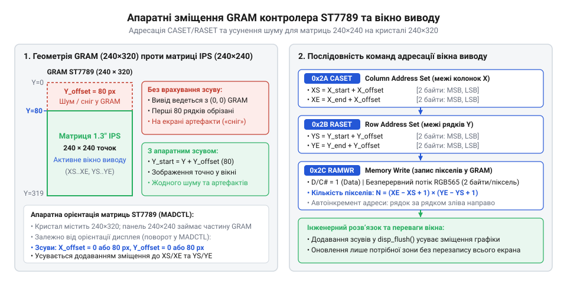
*Геометричне зіставлення кадрової пам'яті ST7789 (240×320) та фізичного вікна дисплея 240×240: введення апаратного зміщення координат усуває смуги шуму та точно позиціонує прямокутні області запису CASET/RASET.*

Щоб повністю усунути геометричні викривлення, низькорівневий драйвер зобов'язаний додавати апаратні зміщення до кожної координати перед надсиланням меж у команди `CASET` та `RASET`:

```
XS = x_start + X_OFFSET
XE = x_end   + X_OFFSET
YS = y_start + Y_OFFSET
YE = y_end   + Y_OFFSET
```

### Програмна реалізація низькорівневого драйвера

Нижче наведено практичну реалізацію базового драйвера ST7789 мовою C, що реалізує ініціалізацію, корекцію апаратного зміщення та віконне заповнення прямокутних областей.

:::code proj-st7789-lvgl-sensor-dashboard/c/st7789-write-cmd.c

Реалізований низькорівневий інтерфейс повністю абстрагує апаратні особливості ST7789: верхній графічний рівень оперує звичайними прямокутними координатами від `(0, 0)` до `(239, 239)`, передаючи піксельні масиви безпосередньо у виділене вікно відеопам'яті.

## Подолання дефіциту оперативної пам'яті за допомогою часткової буферизації LVGL

Коли низькорівневий драйвер забезпечує запис масиву пікселів у довільне вікно дисплея, постає наступна інженерна проблема: як формувати складний графічний інтерфейс із градієнтами, згладженими шрифтами та віджетами в умовах жорсткого обмеження оперативної пам'яті мікроконтролера. Класичний підхід комп'ютерної графіки вимагає наявності повного кадрового буфера (@@en|framebuffer@@, від англ. *frame* — кадр та *buffer* — проміжний накопичувач), у якому кожен піксель екрана займає відповідну комірку в RAM. Для кольорового дисплея 240×240 такий підхід миттєво вичерпує ресурси більшості мікроконтролерів.

> 🔧 **Навіщо це.**
> Часткова буферизація дозволяє запускати сучасні графічні інтерфейси високої роздільності на недорогих мікроконтролерах із малим обсягом RAM. Замість витрачання понад 100 КіБ пам'яті під один статичний кадр система обходиться буфером у 5–11 КіБ, вивільняючи RAM для стеків завдань, мережевих буферів та алгоритмів фільтрації сенсорів.

### Математика апаратного ліміту: чому повний кадровий буфер неприйнятний

Розглянемо витрати оперативної пам'яті, необхідні для виділення повного кадрового буфера під квадратний екран 240×240 пікселів у стандартному форматі високої колірної чіткості RGB565 (16 бітів, або 2 байти на один піксель).

**Розрахунок розміру повного кадрового буфера:**

```
N_bytes
= 240 × 240 × 2                  [роздільність 240×240 пікселів по 2 байти на точку RGB565]
= 115200 байтів                  [множення]
= 112.5 КіБ                      [ділення на 1024: 115200 ÷ 1024 = 112.5 КіБ]
```

Для створення плавного виведення без мерехтіння графічні рушії традиційно застосовують подвійну буферизацію (@@en|double buffering@@), де поки один буфер передається на дисплей, другий малюється процесором. Це збільшує вимоги до пам'яті вдвічі — до 225 КіБ.

Порівняємо це число з апаратними характеристиками типових мікроконтролерів. Багато популярних чипів серії STM32F103 мають лише 20 КіБ загальної RAM, серія STM32F401 — від 64 до 96 КіБ, а мікроконтролери архітектури ESP8266 — близько 40–50 КіБ доступної динамічної пам'яті. Виділення 112.5 КіБ на таких платформах є фізично неможливим. Навіть на чипах сімейства ESP32, що мають близько 320 КіБ вільної внутрішньої RAM, резервування третини всієї оперативної пам'яті виключно під піксельний масив екрана паралізує роботу мережевих протоколів Wi-Fi, стеків TLS та черг операційної системи реального часу.

З подібним обмеженням розробники стикаються і в монохромних екранах, про що йдеться у статті [OLED-дисплей 0.96″ SSD1306 (I2C, 128×64)](root:cat-hw-actuators/oled-ssd1306), проте для 16-бітного кольору високої роздільності ціна кожного пікселя зростає у 16 разів.

### Механізм брудних областей та часткового рендерингу LVGL

Вихід із глухого кута дефіциту оперативної пам'яті полягає у зміні парадигми відображення. Контролер ST7789 вже має на власному кремнієвому кристалі інтегровану відеопам'ять GRAM обсягом понад 150 КіБ. Щойно пікселі записані в його внутрішню пам'ять, дисплей автономно утримує зображення завдяки власним формувачам напруги, взагалі не навантажуючи мікроконтролер процесом регенерації рядків.

Графічний рушій LVGL (@@en|Light and Versatile Graphics Library@@) проєктувався спеціально для ресурсних мікроконтролерів і використовує дві ключові оптимізації:

1. **Відстеження невалідних або «брудних» ділянок (@@en|dirty areas@@):** коли мікрокліматичний сенсор оновлює значення температури, 95% площі дашборду залишаються незмінними (фонові рамки, статичні підписи, сусідні шкали). LVGL обчислює найменший обмежувальний прямокутник (@@en|bounding box@@), що охоплює лише змінений елемент інтерфейсу. Тільки цей прямокутник позначається як брудний і ставиться в чергу на перемальовування.
2. **Часткова смугова буферизація (@@en|partial buffer rendering@@):** замість зберігання всього полотна в RAM рушій виділяє компактний робочий масив фіксованого розміру, що вміщує лише кілька рядків екрана. Якщо брудна область перевищує розмір цього робочого буфера, рушій автоматично нарізає її на послідовні горизонтальні смуги (@@en|stripes@@).

Процес відтворення відбувається послідовно:
1. Рушій відмальовує графічні примітиви першої смуги у виділений проміжний буфер RAM.
2. Викликається функція зворотного виклику `disp_flush()`, яка задає координати смуги через команди `CASET` і `RASET` та передає пікселі по шині SPI у GRAM дисплея.
3. Після завершення передачі буфер негайно звільняється і повторно використовується для рендерингу наступної горизонтальної смуги.

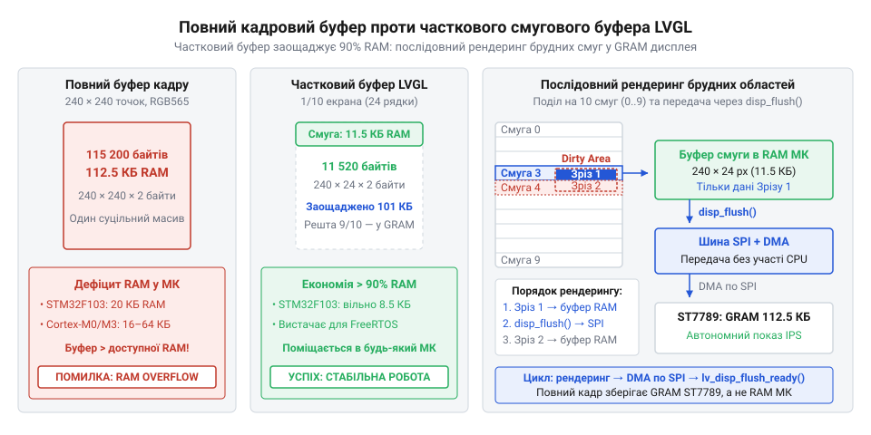
*Порівняння розподілу оперативної пам'яті МК: повний кадровий буфер 112.5 КіБ проти часткового рядкового буфера LVGL на 24 рядки (11.25 КіБ); показано послідовний процес рендерингу брудних прямокутників (dirty areas) у вузьку смугу пам'яті.*

### Інженерний розрахунок часткового буфера

Розмір буфера `lv_disp_draw_buf_t` задається розробником на етапі конфігурації. Мінімальною практичною одиницею є смуга шириною у повний рядок дисплея (240 пікселів), щоб передача пікселів уздовж рядка відбувалася безперервним блоком без додаткового перемикання віконної адресації.

**Загальна формула обсягу пам'яті буфера:**

```
N_bytes = W × H_stripe × sizeof(lv_color_t)
```

де `W = 240` — ширина екрана в пікселях, `H_stripe` — висота виділеної смуги в рядках, а `sizeof(lv_color_t) = 2` байти для формату RGB565.

Розрахуємо вимоги до пам'яті для двох інженерних стандартів буферизації LVGL: 1/10 та 1/20 площі екрана.

**Варіант 1: Буфер на 1/10 площі екрана (24 рядки)**

```
H_stripe
= 240 ÷ 10                       [одна десята від 240 рядків]
= 24 рядки                       [ділення]

N_pixels
= 240 × 24                       [ширина екрана помножена на кількість рядків]
= 5760 пікселів                  [множення]

N_bytes
= 5760 × 2                       [кожен піксель займає 2 байти у форматі RGB565]
= 11520 байтів                   [множення]
= 11.25 КіБ                      [ділення на 1024: 11520 ÷ 1024 = 11.25 КіБ ≈ 11.5 КБ]
```

**Варіант 2: Буфер на 1/20 площі екрана (12 рядків)**

```
H_stripe
= 240 ÷ 20                       [одна двадцята від 240 рядків]
= 12 рядків                      [ділення]

N_pixels
= 240 × 12                       [ширина екрана помножена на кількість рядків]
= 2880 пікселів                  [множення]

N_bytes
= 2880 × 2                       [кожен піксель займає 2 байти у форматі RGB565]
= 5760 байтів                    [множення]
= 5.625 КіБ                      [ділення на 1024: 5760 ÷ 1024 = 5.625 КіБ ≈ 5.7 КБ]
```

Як видно з розрахунку, виділення смуги на 1/10 екрана вимагає всього 11.25 КіБ RAM, а на 1/20 — скромні 5.625 КіБ. Такий обсяг легко розміщується навіть у контролерах із 20–32 КіБ оперативної пам'яті, залишаючи достатньо місця під системний стек і змінні програми. Детальний внутрішній конвеєр графічного ядра розглядається у темі [Архітектура та конвеєр рендерингу бібліотеки LVGL](root:sf-devices/hrafichnyi-interfeis).

### Компроміс між розміром буфера та накладними витратами шини SPI

Виникає природне питання: якщо пам'ять настільки критична, чому б не зменшити розмір буфера до екстремальних меж — наприклад, до одного рядка (240 пікселів = 480 байтів) або взагалі до одного пікселя?

Тут діє класичний інженерний компроміс (@@en|trade-off@@) між обсягом зайнятої пам'яті та накладними витратами каналу зв'язку. Кожна операція скидання смуги на екран вимагає надсилання службових байтів протоколу ST7789:
- Команда `CASET` (1 байт) та її параметри (4 байти).
- Команда `RASET` (1 байт) та її параметри (4 байти).
- Команда `RAMWR` (1 байт).
- Перемикання станів ліній `DC` та `CS`, а також час очікування готовності передавача SPI.

Сумарно на кожну окрему смугу припадає 11 байтів суто протокольних накладних витрат плюс затримки синхронізації апаратного драйвера.

- **Гіпотетичний випадок буфера в 1 рядок:** для повного оновлення екрана 240×240 потрібно виконати 240 окремих викликів `disp_flush()`. Це створює `240 × 11 = 2640` байтів паразитного трафіку на шині. Але набагато гірше те, що процесор змушений 240 разів переривати обчислення, перезапускати транзакції SPI та обробляти контекстні перемикання. Пропускна здатність шини падає через простої між короткими посилками, і анімація починає помітно смикатися.
- **Буфер на 1/10 екрана (24 рядки):** повне оновлення кадру вимагає лише 10 транзакцій. Накладні витрати становлять мізерні `10 × 11 = 110` байтів на весь екран (менше 0.1% від корисного потоку 115 200 байтів даних). SPI-контролер передає пікселі довгими неперервними блоками на максимальній тактовій частоті шини (до 40–80 МГц).

Експериментальні заміри показують, що буфер розміром 1/10 площі екрана забезпечує 98% від теоретично можливої частоти кадрів (FPS) повнокадрового рендерингу, споживаючи при цьому вдесятеро менше пам'яті. Буфер на 1/20 площі екрана дає незначне зниження швидкості оновлення (на 5–8%), але заощаджує додаткові 5.6 КіБ пам'яті.

### Конфігурація часткового буфера в структурі LVGL

Для інтеграції часткової буферизації в рушій LVGL розробник створює статичний масив пікселів та ініціалізує структуру керування кадровим буфером `lv_disp_draw_buf_t`. Бібліотека підтримує два режими роботи з частковими буферами:

1. **Одинарний частковий буфер (@@en|single partial buffer@@):** виділяється один масив. Процесор рендерить смугу, потім блокується на час передачі по SPI (або чекає завершення), після чого рендерить наступну смугу в той самий масив.
2. **Подвійний частковий буфер (@@en|double partial buffer@@):** виділяються два однакових компактних масиви (наприклад, по 11.25 КіБ кожен). Поки перший буфер асинхронно передається у відеопам'ять ST7789 за допомогою прямого доступу до пам'яті (DMA), центральний процесор без жодних пауз малює наступну смугу в другий буфер. Це забезпечує максимальний паралелізм без витрат на гігантські повнокадрові буфери.

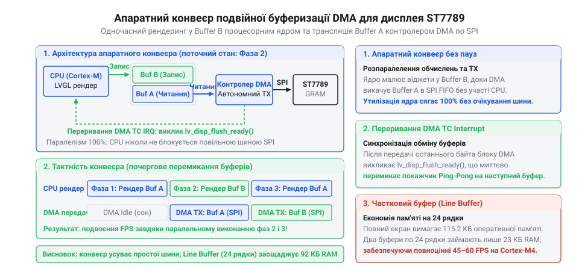
*Конвеєр подвійної буферизації DMA: одночасна паралельна робота процесорного ядра над відмальовкою наступної ділянки та апаратної передачі попередньої по шині SPI.*

Приклад ініціалізації часткового буфера на 1/10 площі дисплея мовою C:

:::code proj-st7789-lvgl-sensor-dashboard/c/lvgl-buffer-setup.c

Виділення компактної смуги в оперативній пам'яті створює необхідний апаратний міст між вимогливими векторними алгоритмами малювання LVGL та жорсткими лімітами пам'яті мікроконтролера.

## Інтеграція апаратного драйвера в конвеєр LVGL: зворотний виклик disp_flush()

Коли графічний інтерфейс оновлює показання сенсора на екрані — наприклад, значення температури змінюється з 21.4 на 21.5 °C, — графічна бібліотека точно знає, які саме пікселі змінили колір. Проте бібліотека не має уявлення про те, як дисплей фізично під'єднаний до мікроконтролера: чи це послідовна шина SPI, паралельний інтерфейс 8080 чи сегментний драйвер. Для графічного ядра екран є суто математичною площиною прямокутних віджетів та масивом кольорів у пам'яті. Фізичний дисплей на базі контролера ST7789, навпаки, вимагає чіткої апаратної послідовності: встановлення прямокутного вікна адресації командами CASET і RASET та потокового запису байтів через команду RAMWR.

Для розділення розрахунку графіки й передачі електричних сигналів бібліотека LVGL використовує концепцію зворотного виклику (англ. @@en|callback@@, від @@en|call@@ — кликати та @@en|back@@ — назад). Рушій бере на себе растеризацію векторних ліній, накладання шрифтів і змішування кольорів у проміжному буфері оперативної пам'яті, а власне вивантаження сформованих пікселів у відеопам'ять передає функції `disp_flush()` (від англ. @@en|flush@@ — стрімкий потік, виливання або спорожнення буфера).

На відміну від невеликих монохромних екранів на кшталт [OLED SSD1306](root:cat-hw-actuators/oled-ssd1306), де весь кадровий буфер 128×64 займає лише 1024 байти RAM, кольоровий IPS-екран 240×240 у 16-бітному кольорі потребує 115 200 байтів. На більшості мікроконтролерів виділити такий цілісний масив неможливо. LVGL розв'язує цю проблему частковим рендерингом: екран розбивається на інвалідовані ділянки (від лат. *invalidus* — нечинний; англ. @@en|dirty areas@@ — змінені зони), які прораховуються по черзі в компактному буфері рядків і частинами відправляються дисплею.

### Анатомія та аргументи колбеку disp_flush()

Сигнатура функції зворотного виклику строго визначена ядром бібліотеки:

```c
void disp_flush(lv_disp_drv_t *disp_drv, const lv_area_t *area, lv_color_t *color_p);
```

Функція приймає три параметри:
1. `disp_drv` — покажчик на дескриптор дисплея (від лат. *descriptor* — той, хто описує), зареєстрований у системі. Через нього драйвер повідомляє ядро про стан передачі та готовність до наступного кадру.
2. `area` — покажчик на структуру прямокутника оновлення (від лат. *rectangulum* — прямий кут; англ. @@en|bounding box@@), що містить координати кутів `x1`, `y1` (верхній лівий) та `x2`, `y2` (нижній правий). Обидві межі задаються включно, тобто крайні пікселі також входять у ділянку відтворення.
3. `color_p` — покажчик на лінійний масив кольорів типу `lv_color_t`, розташований у RAM, де ядро LVGL уже сформувало готове зображення для переданого прямокутника.

Геометричний розмір прямокутника та сумарний обсяг даних розраховуються безпосередньо з координат ділянки:

```
Ширина   = x2 - x1 + 1
Висота   = y2 - y1 + 1
Пікселі  = Ширина × Висота
ОбсягRAM = Пікселі × 2          [формат RGB565: 2 байти на піксель]
```

### Трансляція координат у протокол ST7789

Отримавши прямокутник `area`, драйвер перетворює його координати на апаратні команди віконного доступу контролера ST7789, подібні до команд інших РК-контролерів, таких як [TFT 1.77″ ST7735S](root:cat-hw-actuators/tft-st7735s):

1. **CASET** (англ. @@en|Column Address Set@@, код `0x2A`): задає діапазон колонок. Драйвер передає 4 байти: два байти початкової координати `x1` (старший, потім молодший) та два байти кінцевої координати `x2`.
2. **RASET** (англ. @@en|Row Address Set@@, код `0x2B`): задає діапазон рядків. Передаються 4 байти координат `y1` та `y2`.
3. **RAMWR** (англ. @@en|Memory Write@@, код `0x2C`): переводить внутрішній контролер пам'яті дисплея в режим прийому пікселів. Усі наступні байти, передані по SPI за високого рівня лінії DC (англ. @@en|Data/Command@@), записуються послідовно у виділене вікно зліва направо й зверху вниз.

Якщо модуль 240×240 зібрано на базі матриці з контролером, розрахованим на ширший адресний простір 240×320 пікселів, нульовий фізичний піксель екрана може мати апаратне зміщення у відеопам'яті GRAM (наприклад, `y + 80` або `y + 20` залежно від орієнтації шлейфа). Це зміщення додається до координат `x1, x2` та `y1, y2` безпосередньо перед формуванням байтів команд CASET і RASET.

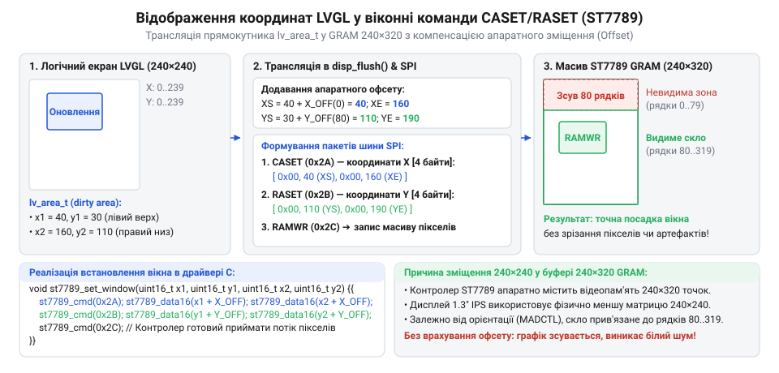
*Схема перетворення координат прямокутника оновлення LVGL в апаратні команди CASET і RASET контролера ST7789: координати ділянки транслюються з урахуванням апаратного зміщення матриці, забезпечуючи вивантаження пікселів через RAMWR строго у виділену область відеопам'яті.*

### Синхронізація конвеєра: критична роль lv_disp_flush_ready()

Передавши масив байтів контролеру дисплея, функція `disp_flush()` зобов'язана повідомити ядро LVGL про завершення передачі викликом:

```c
lv_disp_flush_ready(disp_drv);
```

Цей виклик є наріжним каменем конвеєра синхронізації. Коли графічний рушій викликає `disp_flush()`, він блокує роботу над наступними ділянками екрана: буфер відтворення перебуває у власності апаратного драйвера. 

Порушення цього контракту призводить до двох типових збоїв:
- **Відсутність виклику `lv_disp_flush_ready()`**: конвеєр рендерингу зупиняється назавжди. LVGL безкінечно чекає на звільнення буфера після першого ж відмальованого прямокутника. Лічильники часу й опитування сенсорів у системі можуть продовжувати працювати, але графічний інтерфейс повністю зависає.
- **Передчасний виклик `lv_disp_flush_ready()`**: типова помилка під час використання асинхронного прямого доступу до пам'яті ([DMA](root:hw-arch/dma-spi-transfers)). Якщо передача кадру по SPI запускається через DMA і на наступному ж рядку коду викликається `lv_disp_flush_ready()`, ядро вважає буфер вільним і негайно починає растеризувати в нього наступний віджет. Тим часом контролер DMA продовжує зчитувати цей самий буфер для передачі на дисплей. На екрані виникають розриви зображення (англ. @@en|tearing@@), миготіння та горизонтальні смуги зі змішаних фрагментів графіки.

У синхронному режимі з блокуючою передачею SPI виклик `lv_disp_flush_ready()` здійснюється строго після завершення відправки всіх байтів. В асинхронному режимі з DMA виклик повинен виконуватися виключно всередині обробника переривання (ISR, англ. @@en|Interrupt Service Routine@@) про повне завершення апаратної транзакції шини.

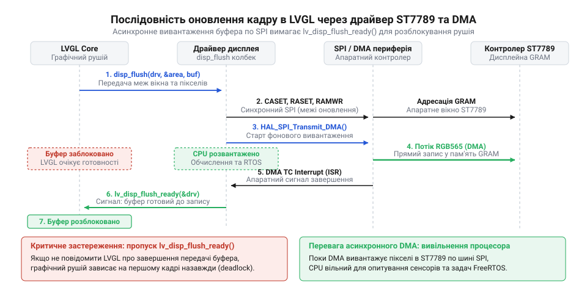
*Часова діаграма взаємодії рушія LVGL та апаратного драйвера дисплея: графічний конвеєр формує ділянку кадру в буфері, передає координати та покажчик через disp_flush(), очікує завершення передачі по SPI та розблоковується викликом lv_disp_flush_ready().*

> 🔧 **Навіщо це.**
> Чітке розмежування рендерингу та фізичного транспортування через `disp_flush()` дає змогу будувати модульний вбудований код. Один і той самий інтерфейс дашборду працює без змін графічної логіки як на повільному програмному SPI, так і на високих швидкостях апаратного DMA або паралельних 16-бітних шинах.

### Реєстрація драйвера дисплея в структурі lv_disp_drv_t

Щоб графічний рушій міг викликати створений колбек, екран необхідно зареєструвати під час ініціалізації системи. Для цього ініціалізується проміжний буфер відтворення `lv_disp_draw_buf_t` та структура дескриптора `lv_disp_drv_t`.

Код нижче демонструє реалізацію зворотного виклику `disp_flush()` та реєстрацію дисплея ST7789 для двох поширених платформ.

:::tabs
:::code proj-st7789-lvgl-sensor-dashboard/c/st7789-send-cmd.c
:::code proj-st7789-lvgl-sensor-dashboard/cpp/st7789-write-cmd.cpp
:::

## Пастка формату RGB565: порядок байтів Little-Endian та відновлення кольорів

Після першого запуску щойно підключеного драйвера розробник зазвичай спостерігає спантеличливу картину: графічний інтерфейс успішно ініціалізується, шрифти чіткі, прямокутники й дуги займають точні координати, але кольорова гама повністю спотворена. Замість насиченої червоної шкали індикатор світиться холодним бірюзовим відтінком, помаранчевий колір стає синім, а світлі зелені акценти набувають неприродної жовтизни.

Причина такого ефекту полягає не в пошкодженні матриці чи помилці у верстці віджетів, а в конфлікті порядку байтів ([endianness](root:hw-arch/endianness)) між архітектурою обчислювального ядра мікроконтролера та контролером дисплея ST7789.

### Бітова структура формату RGB565

Кольоровий формат RGB565 кодує один піксель шістнадцятьма бітами (2 байти). Око людини найчутливіше до зеленого спектра, тому під зелений канал виділено 6 бітів, а під червоний і синій — по 5 бітів:
- **Червоний (R)**: біти 15..11 (5 бітів, діапазон 0..31)
- **Зелений (G)**: біти 10..5 (6 бітів, діапазон 0..63)
- **Синій (B)**: біти 4..0 (5 бітів, діапазон 0..31)

У 16-бітному числі біти розподіляються між двома восьмибітними половинами:
- Старший байт (англ. @@en|high byte@@): біти 15..8 містять `[R4 R3 R2 R1 R0 G5 G4 G3]`
- Молодший байт (англ. @@en|low byte@@): біти 7..0 містять `[G2 G1 G0 B4 B3 B2 B1 B0]`

### Конфлікт Little-Endian мікроконтролера та Big-Endian дисплея

Сучасні мікроконтролери архітектур ARM Cortex-M, RISC-V та ESP32 (Xtensa) зберігають багатобайтові змінні у пам'яті за принципом молодшим байтом уперед (англ. @@en|little-endian@@; термін запропонував фахівець комп'ютерних мереж Денні Коен 1980 року, взявши алегорію Джонатана Свіфта про гостроконечників). У цій схемі молодший байт 16-бітного слова завжди розміщується за меншою адресою пам'яті, а старший — за більшою.

Контролер ST7789 під'єднаний через восьмибітну шину SPI і працює за принципом старшим байтом уперед (англ. @@en|big-endian@@). Його вхідний конвеєр очікує, що першим байтом транзакції надійде старший байт пікселя з даними червоного каналу, а другим — молодший байт із синім каналом.

Коли мікроконтролер передає масив пікселів з пам'яті через периферійний контролер SPI або канал DMA, передача здійснюється лінійно: спочатку байт із нульової адреси, потім з першої.

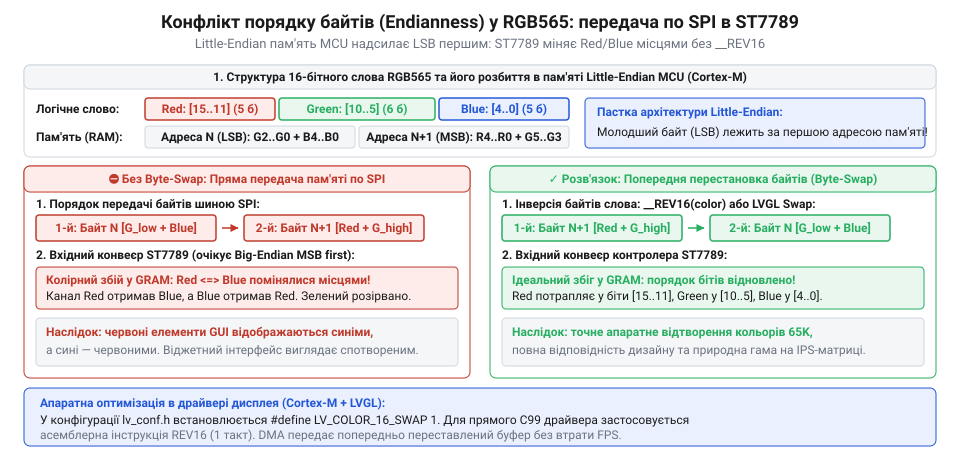
*Побітова схема вивантаження 16-бітного слова RGB565 з пам'яті Little-Endian у 8-бітний зсувний регістр SPI та вхідний конвеєр контролера ST7789: випереджальна передача молодшого байта розриває бітові поля кольору та підміняє червоний канал синім.*

Розглянемо, що відбувається з чистим червоним кольором на рівні бітів:

```
Червоний канал  = 31 (0b11111)
Зелений канал   = 0  (0b000000)
Синій канал     = 0  (0b00000)

Значення RGB565 = (31 << 11) | (0 << 5) | 0
                = 0xF800                [бінарно: 11111000_00000000₂]
```

У пам'яті Little-Endian мікроконтролера це число зберігається у зворотному порядку:

```
Адреса N     = 0x00                     [молодший байт: G2..G0, B4..B0]
Адреса N + 1 = 0xF8                     [старший байт:  R4..R0, G5..G3]
```

Шина SPI послідовно передає байти в порядку зростання адрес:
1. Першим на лінію MOSI йде байт `0x00`. Контролер ST7789 вважає його старшим байтом пікселя й завантажує нулі у свій червоний регістр.
2. Другим передається байт `0xF8`. Контролер дисплея інтерпретує його як молодший байт. П'ять одиниць опиняються в регістрі синього каналу, а залишок — у зеленому.

Замість чистого червоного кольору піксель спалахує бірюзово-синім (`0x00F8`). Червоний і синій канали фактично помінялися місцями, а зелений канал виявився розірваним і спотвореним.

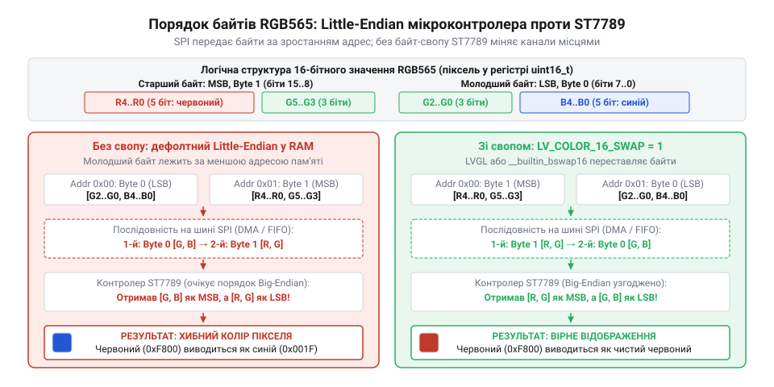
*Бітова розкладка 16-бітного кольору RGB565 у пам'яті Little-Endian мікроконтролера проти очікуваної послідовності байтів шини Big-Endian ST7789: взаємне зміщення байтів спотворює червоний і синій канали, що вимагає перестановки байтів перед відправленням.*

> 🔧 **Навіщо це.**
> Послідовні шини (SPI, I2C, UART) оперують виключно потоками окремих байтів. Розуміння порядку слідування байтів рятує від багатогодинного безплідного пошуку помилок у схемотехніці чи графічних стилях щоразу, коли 16- або 32-бітні дані процесора передаються у зовнішній периферійний контролер.

### Шляхи усунення: налаштування LVGL проти апаратного переставляння

Існує два інженерних шляхи розв'язання проблеми: зміна порядку байтів ще на етапі растеризації в графічному ядрі або переставляння байтів (англ. @@en|byte swap@@, від англ. @@en|swap@@ — обмін) під час передачі на фізичну шину.

#### Спосіб 1: Прапорець конфігурації LV_COLOR_16_SWAP (рекомендований)

Бібліотека LVGL містить вбудований механізм попередньої зміни порядку байтів. У файлі конфігурації `lv_conf.h` достатньо увімкнути директиву:

```c
#define LV_COLOR_DEPTH 16
#define LV_COLOR_16_SWAP 1
```

Коли макрос `LV_COLOR_16_SWAP` активний, ядро LVGL виконує зміну порядку байтів під час формування пікселів безпосередньо у внутрішньому буфері. У пам'яті мікроконтролера байт `0xF8` записується за адресою `N`, а `0x00` — за адресою `N + 1`.

Коли контролер SPI або DMA вичитує буфер лінійно, старший байт вирушає першим, і дисплей ST7789 отримує канонічний Big-Endian потік. Це рішення є оптимальним, оскільки не додає жодного додаткового циклу обробки буфера перед викликом передачі: сформовані дані відправляються в DMA-канал миттєво.

#### Спосіб 2: Програмний або апаратний байт-своп у драйвері

Якщо графічний буфер надходить із зовнішнього джерела (наприклад, декодоване зображення камери без прапорця свопу), зміну порядку байтів доводиться виконувати на рівні драйвера безпосередньо у функції `disp_flush()`.

Для швидкої перестановки байтів у 16-бітних словах використовують вбудовану функцію компілятора (англ. @@en|compiler intrinsic@@, від лат. *intrinsecus* — внутрішній) `__builtin_bswap16()`:

:::tabs
```c
// Програмна зміна порядку байтів для ARM / RISC-V на C
#include <stdint.h>
#include <stddef.h>

void st7789_swap_pixels(uint16_t *pixels, size_t count) {
    for (size_t i = 0; i < count; ++i) {
        // Компілятор транслює виклик в одну апаратну інструкцію REV16 на ARM Cortex-M
        pixels[i] = __builtin_bswap16(pixels[i]);
    }
}
```
```cpp
// Програмна зміна порядку байтів для вбудованих систем на C++
#include <cstdint>
#include <cstddef>

void st7789SwapPixels(uint16_t* pixels, std::size_t count) {
    for (std::size_t i = 0; i < count; ++i) {
        // Процесорне переставляння без додаткового виділення пам'яті
        pixels[i] = __builtin_bswap16(pixels[i]);
    }
}
```
:::

На мікроконтролерах ARM Cortex-M компілятор перетворює виклик `__builtin_bswap16` на одиничну процесорну інструкцію `REV16`. Проте ручна обробка масиву в циклі змушує процесор щокадрово перезаписувати тисячі комірок пам'яті. Для буфера розміром 240×24 пікселі це 5760 додаткових операцій зчитування й запису перед стартом кожної передачі, що затримує запуск DMA.

| Критерій | Конфігурація `LV_COLOR_16_SWAP 1` | Функція `__builtin_bswap16()` у драйвері |
| :--- | :--- | :--- |
| **Етап виконання** | Під час растеризації у ядрі LVGL | Перед стартом передачі в `disp_flush()` |
| **Накладні витрати CPU** | Нульові під час вивантаження | Додатковий прохід по всьому буферу в RAM |
| **Сумісність із DMA** | Повна: буфер одразу готовий до вичитування | Потребує повного завершення циклу перед стартом DMA |
| **Гнучкість** | Глобальне налаштування для всього проєкту | Локальне керування окремими масивами |

Використання прапорця `LV_COLOR_16_SWAP 1` у конфігурації проєкту є стандартом під час роботи з екранами ST7789, забезпечуючи максимальну частоту оновлення кадрів без додаткового навантаження на процесорне ядро.

## Апаратне ШІМ-регулювання яскравості підсвічування дисплея (BLK) та енергозбереження

IPS-матриця працює на просвіт: рідкі кристали не випромінюють фотонів самостійно, а лише поляризують і дозують світловий потік, створений блоком світлодіодного підсвічування позаду скляної підкладки. У той час як логічна схема контролера ST7789 за активного обміну даними споживає приблизно 2–4 мА від шини 3.3 В (близько 10 мВт), лінійка білих світлодіодів вимагає від 30 до 50 мА постійного струму (до 165 мВт). Світлодіоди підсвічування забирають понад 85–90% усього струму дисплейного модуля. Якщо під'єднати лінію BLK (від англійського @@en|backlight@@ — заднє підсвічування) напряму до шини живлення, автономний монітор із літієвим акумулятором ємністю 500 мА·год вичерпає заряд менш ніж за 10–12 годин роботи, причому екран світитиме на повну потужність навіть у темряві, засліплюючи оператора.

На відміну від панелей на органічних діодах, таких як [OLED-дисплей 0.96″ SSD1306](root:cat-hw-actuators/oled-ssd1306), де темні пікселі взагалі не споживають енергії, рідкокристалічна IPS-панель (подібно до [TFT 1.77″ ST7735S](root:cat-hw-actuators/tft-st7735s)) формує чорний колір блокуванням світла закритими рідкими кристалами, але підсвічування позаду них продовжує марнувати повну потужність акумулятора.

Живити підсвічування безпосередньо від виводу загального призначення (GPIO) мікроконтролера не можна: допустимий струм навантаження цифрового виводу зазвичай обмежений 12–20 мА, тоді як три або чотири паралельні кристали підсвічування вимагають до 50 мА. Пряме підключення перегріває вихідні каскади мікроконтролера і спричиняє падіння напруги живлення ядра. Тому на дисплейній платі встановлюють транзисторний ключ (польовий N-канальний MOSFET або біполярний NPN), затвором або базою якого керує логічний рівень на контакті BLK.

Подавати на вхід ключа проміжну аналогову напругу через цифро-аналоговий перетворювач неефективно: транзистор перейде в лінійний режим, і вся надлишкова потужність розсіюватиметься на його переході у вигляді паразитного тепла. Розв'язком є @@en|PWM@@ (широтно-імпульсна модуляція, від латинського *modulatio* — розміреність): транзистор перемикається між станом повного насичення (відкритий, падіння напруги близьке до нуля) та станом відсічки (закритий, струм дорівнює нулю). В обох граничних станах потужність розсіювання на ключі прямує до нуля.

Людське око внаслідок інерційності зорового сприйняття (@@en|persistence of vision@@) інтегрує дискретні світлові імпульси у часі, сприймаючи середнє значення світлового потоку. Яскравість визначається коефіцієнтом заповнення (@@en|duty cycle@@, від латинського *coefficiens* — той, що сприяє):

```
D = t_on / T
  = t_on × f_pwm
```

де `t_on` — час увімкненого стану ключа протягом періоду `T`, а `f_pwm` — опорна частота модуляції.

Опорну частоту ШІМ обирають у діапазоні 1–5 кГц з огляду на такі фізичні обмеження:

1. **Мерехтіння та стробоскопічний ефект.** За частоти нижче 200 Гц око фіксує переривчастість світла під час швидкого переведення погляду (сакад). Камери смартфонів під час знімання екрана дають темні смуги через конфлікт із періодом спрацьовування електронного затвора (@@en|rolling shutter@@).
2. **Акустичний писк конденсаторів.** У чутному діапазоні від 300 Гц до 1 кГц керамічні багатошарові конденсатори (MLCC) в колах живлення дисплея через зворотний п'єзоелектричний ефект (@@en|singing capacitor@@) деформуються в такт зі стрибками струму і починають видавати тонкий свист.
3. **Комутаційні втрати транзистора.** За частот вище 20–50 кГц паразитні ємності затвора польового транзистора не встигають перезаряджатися через вихідний опір виводу мікроконтролера. Транзистор довше затримується в активній лінійній зоні, нагріваючись і втрачаючи енергію. Крім того, на високій частоті [апаратному ШІМ-таймеру мікроконтролера](root:hw-arch/hardware-pwm) не вистачає дискретних тактів внутрішнього генератора для забезпечення високої роздільної здатності регулювання.

Частота 4 кГц лежить вище порога зорової фіксації, забезпечує високу роздільну здатність лічильника (10–12 біт) і не створює надлишкового нагріву транзисторного ключа.

Зорове сприйняття людини нелінійне і підпорядковується закону Вебера — Фехнера: зміна яскравості на темних ділянках відчувається набагато контрастніше, ніж на світлих. Лінійне збільшення коефіцієнта заповнення від 0% до 50% суб'єктивно виглядає як стрибок майже до 80% яскравості. Для досягнення візуально плавного кроку застосовують квадратичну корекцію:

```
duty_corrected = (brightness × brightness) / 100
```

Стрибкоподібне вмикання підсвічування від 0% до 100% спричиняє різкий імпульс струму на шині живлення дисплея. У пристроях з акумулятором внутрішній опір джерела та затримка реакції стабілізатора напруги призводять до короткочасного просідання напруги 3.3 В — явище, на усунення якого спрямоване [керування живленням мікроконтролерів від акумуляторів](root:hw-power/battery-power-management-mcu). Це падіння може активувати схему скидання процесора за зниженням живлення (@@en|Brown-out Reset@@, BOR). Алгоритм плавного старту (@@en|soft-start@@) нарощує яскравість від нуля до робочого значення поступово протягом 150–300 мс, розвантажуючи перехідні процеси в колі живлення.

> 🔧 **Навіщо це.**
> Апаратний ШІМ підсвічування дисплея перетворює екран із головного споживача струму на керований енергоощадний вузол: зниження яскравості до 10–12% у стані бездіяльності зменшує струм споживання підсвічування з 45 мА до 4–5 мА, подовжуючи роботу акумулятора в 4–6 разів без вимикання логіки та втрати читабельності тексту.

Стратегія автономного енергозбереження реалізується через машину станів із таймаутом бездіяльності:

- **Активний режим (ACTIVE):** яскравість 100% (або рівень, заданий користувачем під час взаємодії).
- **Режим затемнення (DIMMED):** якщо протягом 30 секунд користувач не натискав кнопок і сенсори не сигналізують про аварію, підсвічування за 500 мс плавно переходить на рівень 12%. Текст залишається помітним, але витрата енергії мінімальна.
- **Пробудження:** будь-яка активність миттєво підіймає яскравість до 100% за 150 мс через плавний пуск.

:::tabs
:::code proj-st7789-lvgl-sensor-dashboard/c/brightness-to-duty.c
:::code proj-st7789-lvgl-sensor-dashboard/c/brightness-to-duty.c
:::

## Проєктування та покрокова верстка віджетного дашборду мікроклімату в LVGL

Квадратна геометрія дисплея 240×240 пікселів за фізичної діагоналі 1.3 дюйма створює щільність пікселів близько 260 @@en|DPI@@ (активна зона становить 23.4 × 23.4 мм). За такої деталізації дрібні написи висотою менше ніж 12–14 пікселів важко розпізнати з відстані 60 см, а надлишок числових полів перевантажує зір. Співвідношення сторін 1:1 виключає застосування традиційних вертикальних колонок чи горизонтальних рядків: квадратний простір вимагає симетричного радіального центрування навколо найважливішої метрики.

Ергономіка (від грецьких *ergon* — робота та *nomos* — закон) диктує трирівневу вертикальну структуру інтерфейсу:

1. **Верхній рядок стану (Status Bar, y = 0..24, висота 24 px):** містить ідентифікатор пристрою ліворуч та піктограму заряду батареї з відсотком праворуч. Він закріплений у верхній частині екрана і не змінює позиції.
2. **Центрально-радіальний блок клімату (y = 26..154, висота 128 px):** головний візуальний фокус. Дві концентричні кругові дуги на базі віджета `lv_arc` (від латинського *arcus* — дуга) відображають температуру та вологість. У центрі дуг розміщено великий цифровий індикатор температури на базі `lv_label` з контрастним шрифтом, а під ним меншим шрифтом — відносну вологість.
3. **Нижній блок тренду (y = 156..236, висота 80 px):** компактний графік зміни атмосферного тиску або якості повітря на базі `lv_chart`. Графік будується у формі лаконічного спарклайну (@@en|sparkline@@): без масивних числових осей, які марнують екранний простір, але з плавним контуром ходу кривої.

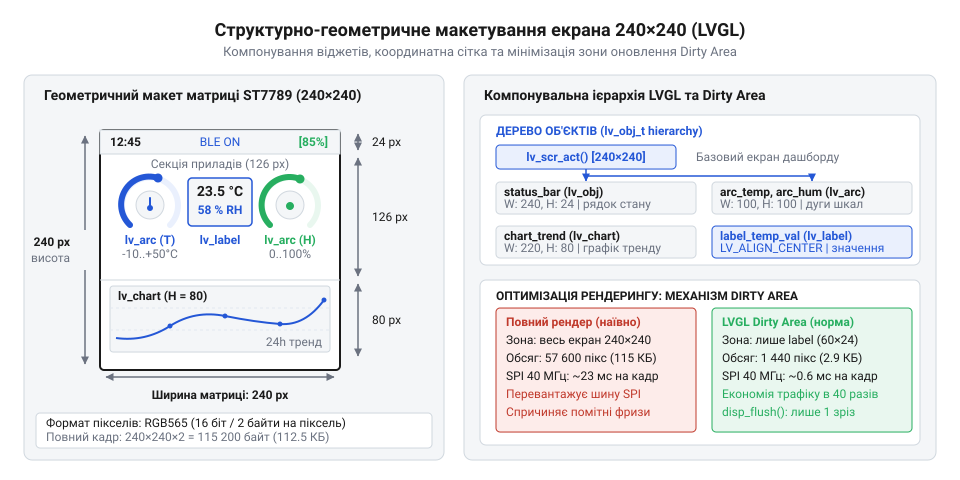
*Геометричне зонування робочого простору 240×240 пікселів: верхній рядок стану, центральні концентричні дуги температури й вологості з числовим значенням та нижній спарклайн атмосферного тиску.*

Колірне кодування зон комфорту (@@en|comfort zone@@) передає стан середовища периферійному зору оператора ще до того, як він вчитається в цифри:
- **Зона комфорту (18.0–24.5 °C, 40–60% RH):** смарагдово-зелений колір індикатора сигналізує про оптимальний мікроклімат.
- **Зона попередження (15.0–17.9 °C або 24.6–28.0 °C):** теплий бурштиновий колір привертає увагу до помірного переохолодження чи нагріву.
- **Критична зона (< 15.0 °C або > 28.0 °C):** яскраво-синій (холод) або насичено-червоний (спека) колір вимагає втручання.

> 🔧 **Навіщо це.**
> Чітке просторове зонування екрана 240×240 та динамічна зміна кольору дуг дозволяють оцінити мікроклімат за 0.2 секунди з будь-якого кута огляду IPS-панелі, усуваючи необхідність наближатися до приладу для розпізнавання дрібних літер.

У графічній бібліотеці LVGL, відповідно до [архітектури віджетів та стилів](root:sf-devices/hrafichnyi-interfeis), кожен графічний елемент є екземпляром базової структури `lv_obj_t`. Щоб мінімізувати фрагментацію та споживання оперативної пам'яті:
- Усі віджети прив'язуються до фіксованих координат екрана (`lv_obj_set_pos`, `lv_obj_set_size` або `lv_obj_align`) без запуску важких алгоритмів автоматичного динамічного компонування (Flexbox чи Grid).
- Дугові індикатори `lv_arc` переводяться в суто пасивний режим показу: прапорець інтерактивності знімається викликом `lv_obj_clear_flag(arc, LV_OBJ_FLAG_CLICKABLE)`, а візуальний маркер ручки (кноб) видаляється через `lv_obj_remove_style(arc, NULL, LV_PART_KNOB)`. Це заощаджує пам'ять на прорахунок дотиків і прискорює рендеринг кадру через `disp_flush()`.

Нижче наведено повну реалізацію створення дашборду та функцію передачі виміряних значень сенсорів у графічні віджети.

:::code proj-st7789-lvgl-sensor-dashboard/c/get-temp-comfort-color.c

## Неблокуюча архітектура системи: диспетчеризація таймерів LVGL, опитування сенсорів та оновлення UI

Спроба зібрати повноцінний автономний прилад на мікроконтролері найчастіше розбивається об організацію головного циклу виконання. Коли на екрані розгорнуто статичний інтерфейс із круговими шкалами температури та числовими показниками, виникає потреба регулярно зчитувати зовнішні кліматичні датчики через послідовні інтерфейси на кшталт I2C. Типове рішення початківця — вставити функцію опитування сенсора безпосередньо в тіло нескінченного циклу `while (1)` разом із блокуючою затримкою (англ. @@en|blocking call@@ від старофр. *bloc* — колода, перешкода) виду `delay(1000)`, щоб запитувати нові дані щосекунди. Результат такої побудови виявляється катастрофічним: графічний інтерфейс повністю «завмирає», плавні анімації стрілок перетворюються на уривчасті стрибки, реакція на натискання кнопок зникає, а дисплей оновлюється з помітними заїканнями.

Причина такої поведінки полягає у фундаментальній різниці між простими текстовими індикаторами та повноцінними графічними рушіями. У пристроях на зразок [Символьний дисплей LCD 1602A](root:cat-hw-actuators/lcd-1602) або модулів із розширювачем [I2C-адаптер для LCD 1602 (PCF8574)](root:cat-hw-actuators/i2c-lcd-adapter) апаратний контролер самостійно утримує статичні символи у власній пам'яті, тож мікроконтролер може зупиняти виконання на будь-який час. Натомість легка графічна бібліотека LVGL — це асинхронний рушій зі збереженням стану (англ. @@en|state-driven GUI@@ від лат. *status* — положення, стан). Вона керує графом графічних об'єктів, розраховує траєкторії анімацій, згладжує шрифти та динамічно обчислює ділянки перемальовування. Графічний рушій не має власного автономного апаратного процесора — він потребує регулярного виділення процесорних квантів часу для обчислення кожного кадру.

В основі життєвого циклу графічного рушія лежать два взаємопов'язані механізми: джерело часових імпульсів та диспетчер завдань. Джерелом часу слугує так званий тікер (англ. @@en|ticker@@ від звуконаслідувального *tick* — цокання годинника), який інформує бібліотеку про реальний перебіг фізичного часу через виклик функції `lv_tick_inc(uint32_t tick_period)`. Графічна бібліотека позбавлена прямого доступу до апаратних регістрів мікроконтролера, тому без регулярного виклику цієї функції внутрішній час рушія зупиняється. Надійний інженерний підхід вимагає виклику `lv_tick_inc(1)` зсередини апаратного переривання (лат. *interruptio* — розрив, зупинка) періодичного таймера мікроконтролера з фіксованим кроком в 1 мілісекунду.

Другим механізмом є диспетчеризація (англ. @@en|dispatching@@ від італ. *dispacciare* або ісп. *despachar* — відправляти, прискорювати). Її реалізує функція `lv_timer_handler()`, яку необхідно циклічно викликати в головному потоці програми. Під час кожного входу цей обробник перевіряє системний таймлайн, обчислює зміну параметрів у часі, запускає обчислення геометрії забруднених прямокутних областей екрана і передає сформовані пікселі драйверу дисплея через функцію зворотного виклику `disp_flush()`. Якщо між викликами `lv_timer_handler()` виникає блокуюча пауза на 500 чи 1000 мс, графічний рушій втрачає можливість генерувати проміжні кадри анімації, що призводить до повного візуального паралічу інтерфейсу.

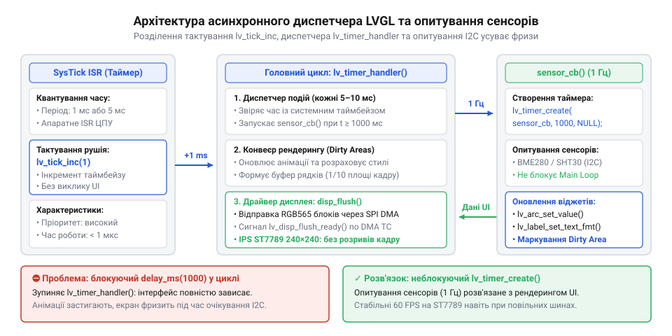
*Архітектура взаємодії неблокуючих компонентів: апаратний таймер забезпечує квантування часу для lv_tick_inc(), головний цикл виконує диспетчеризацію задач через lv_timer_handler(), а періодичний таймер LVGL оновлює дані сенсорів без затримок у рендерингу.*

Для усунення взаємного блокування графіки та вимірювального тракту застосовують подієву модель періодичного опитування. В автономних системах без операційної системи реального часу опитування кліматичного датчика виносять у програмний таймер самої графічної бібліотеки за допомогою `lv_timer_create()`. Рушій реєструє функцію зворотного виклику з заданим періодом спрацьовування (наприклад, 1000 мс для температурного сенсора). Диспетчер `lv_timer_handler()` сам відстежує інтервал і запускає опитування датчика лише тоді, коли спливе заданий час, не зупиняючи рендеринг в інших ітераціях циклу.

Якщо час перетворення датчика перевищує кілька мілісекунд (що типово для кліматичних вимірювачів на кшталт [Сенсор мікроклімату BME280 (I2C/SPI)](root:hw-sensing/sensor-bme280)), доцільно розділити процес на дві фази за принципом скінченного автомата: перший виклик таймера відправляє команду запуску примусового вимірювання, а наступний зчитує готові регістри.

У складніших приладах із підтримкою багатозадачності завдання рендерингу та опитування сенсорів розділяють на два незалежні потоки під керуванням [Багатозадачність, семафори та м'ютекси у FreeRTOS](root:sf-tasks/freertos-tasks-mutexes). Задача вимірювань опитує датчик і переходить у режим сну через `vTaskDelay()`, повністю звільняючи процесорне ядро. Проте тут постає проблема узгодженого доступу: графічне ядро бібліотеки не є потокобезпечним (англ. @@en|thread-safe@@). Якщо задача сенсора почне змінювати параметри віджета саме тоді, коли графічний потік розбирає дерево вузлів усередині `lv_timer_handler()`, виникає стан гонки (англ. @@en|race condition@@), що спричиняє пошкодження структур пам'яті та аварійний збій процесора. Для захисту спільних графічних ресурсів обов'язково застосовують бінарний семафор або м'ютекс (англ. @@en|mutex@@ від *mutual exclusion* — взаємне виключення). Будь-яка модифікація віджетів виконується виключно після захоплення м'ютекса.

Наступна типова помилка під час оновлення числових значень полягає у повторному створенні віджетів. Початківці нерідко видаляють старий текстовий напис викликом `lv_obj_del()` і створюють новий за допомогою `lv_label_create()`. Така тактика спричиняє постійне виділення та звільнення пам'яті в купі, викликає фрагментацію оперативної пам'яті та супроводжується неприємним мерехтінням екрана.

Правильний підхід базується на одноразовому створенні графічного кістяка під час ініціалізації дашборду. Покажчики на динамічні елементи зберігаються у статичних змінних або спеціальній структурі стану. Під час надходження нових вимірювань викликаються виключно цільові функції модифікації: `lv_arc_set_value()` для переміщення секторної шкали та `lv_label_set_text_fmt()` для оновлення числового напису. Отримавши нове значення, рушій автоматично порівнює його з поточним, обчислює мінімальний обмежувальний прямокутник зміненого елемента і маркує цю ділянку як недійсну (інвалідація, від лат. *invalidus* — недійсний). Під час наступного виклику `lv_timer_handler()` на контролер ST7789 передаються лише оновлені пікселі шкали та цифр, тоді як весь статичний фон залишається недоторканим.

:::tabs
:::code proj-st7789-lvgl-sensor-dashboard/c/read-climate-sensor.c
:::code proj-st7789-lvgl-sensor-dashboard/c/lvgl-tick-timer-cb.c
:::

> 🔧 **Навіщо це.**
> Побудова неблокуючої подієвої архітектури — єдиний спосіб позбутися заїкання інтерфейсу в приладах із вимірювальними трактами. Відділення квантування часу від обробки кадру та ізоляція шинних опитувань дозволяють системі плавно малювати рух стрілок і миттєво реагувати на органи керування навіть у моменти, коли зовнішні датчики повільно збирають фізичні величини.

## Діагностика типових несправностей, граничні випадки та оптимізація швидкодії

На етапі практичного запуску графічного тракту розробник неминуче стикається з тонкими крайовими дефектами, які не виявляються на рівні абстрактного коду. Найпоширенішим візуальним збоєм дисплеїв 1.3″ IPS є зсув зображення на 1–2 пікселі, поява смуги випадкового «шуму» біля краю або повне спотворення геометрії під час зміни орієнтації екрана з портретної на альбомну.

Корінь цієї проблеми криється у внутрішній схемотехніці кристала ST7789. Інтегрована відеопам'ять графічного контролера має фізичну сітку 240 стовпчиків на 320 рядків. Водночас матриця круглого або квадратного дисплея 1.3″ налічує лише 240×240 активних рідкокристалічних комірок. Виробники дисплейних модулів під'єднують шлейф матриці не від нульової лінії пам'яті, а з фіксованим апаратним зміщенням (наприклад, із рядка 0 або 80).

Керування орієнтацією виконується записом байта конфігурації в регістр (від лат. *registrum* — список, книга записів) контролера `MADCTL` (Memory Data Access Control, команда `0x36`). Три біти цього регістра задають просторовий порядок: `MY` (інверсія адреси рядків), `MX` (інверсія адреси стовпчиків) та `MV` (обмін рядків і стовпчиків місцями). Коли програма встановлює альбомний режим (`MV = 1`), контролер міняє напрямок адресації пам'яті. Якщо при цьому віконні команди `CASET` (Column Address Set, `0x2A`) та `RASET` (Row Address Set, `0x2B`) надсилають координати без урахування повороту координатної сітки, активна ділянка матриці зміщується відносно області розгортки контролера.

Зсув на один піксель виникає через математичну помилку в обчисленні меж прямокутника. Команди `CASET` та `RASET` приймають кінцеві адреси включно. Якщо координату кінця обчислити як `start + width` замість `start + width - 1`, контролер отримує вікно шириною у 241 піксель. Кожен рядок зміщується на одну позицію праворуч, перетворюючи вертикальні межі інтерфейсу на діагональні спотворення.

:::code proj-st7789-lvgl-sensor-dashboard/c/st7789-set-address-window.c

Другим поширеним дефектом є артефакт (від лат. *artefactum* — штучно зроблене) розриву кадру, відомий як тирінг (англ. @@en|screen tearing@@ від давньоангл. *teran* — рвати, розривати). На відміну від дисплеїв із повільною зміною статичних даних на зразок [TFT 1.77″ 128×160 (SPI, ST7735S)](root:cat-hw-actuators/tft-st7735s) чи монохромних матриць [OLED-дисплей 0.96″ SSD1306 (I2C, 128×64)](root:cat-hw-actuators/oled-ssd1306), динамічні інтерфейси на кольорових IPS-панелях вимагають високої частоти оновлення. Внутрішній блок сканування ST7789 безперервно зчитує власну відеопам'ять і переносить рівні на рідкі кристали зверху вниз із фіксованою кадровою частотою 60 Гц (один прохід триває приблизно 16.6 мс).

Якщо мікроконтролер записує нові пікселі через SPI в момент, коли апаратний промінь зчитування знаходиться посередині дисплея, верхня половина кадру відображає новий стан графіки, а нижня — попередній. На динамічних стрілках з'являється горизонтальна лінія розриву. Для подолання цього явища використовують лінію синхронізації TE (англ. @@en|Tearing Effect signal@@). Команда `0x35` (`TEON`) вмикає генерацію імпульсу на виводі TE під час інтервалу вертикального гасіння (англ. @@en|vertical blanking interval@@), коли внутрішнє сканування матриці завершило нижній рядок і ще не перейшло до верхнього. Прив'язка виклику `disp_flush()` до фронту переривання сигналу TE повністю усуває лінію розриву.

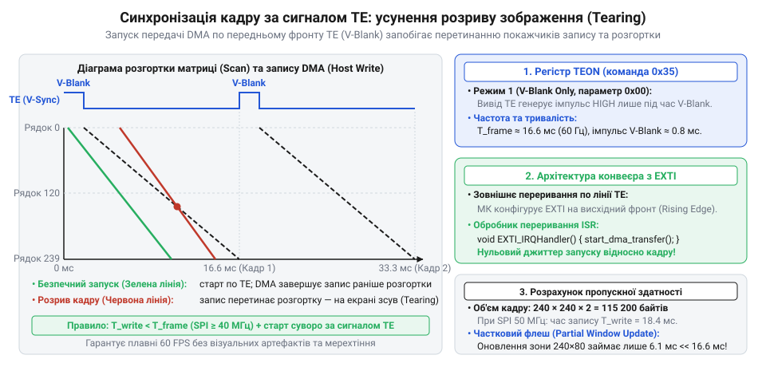
*Часова діаграма вертикального гасіння ST7789: імпульс сигналу TE та лінія сканування панелі визначають безпечне вікно запуску передачі кадру через DMA, що усуває артефакти розриву зображення.*

Третя критична зона відмови — вичерпання внутрішнього динамічного пулу пам'яті рушія. Бібліотека виділяє пам'ять під віджети, стилі, координати анімацій та дескриптори таймерів зі спеціального масиву, розмір якого конфігурується параметром `LV_MEM_SIZE` у конфігураційному файлі `lv_conf.h`. Якщо цей пул переповнюється, виклики створення нових елементів повертають нульовий вказівник, текст обривається, а виклик `lv_label_set_text_fmt()` може спричинити скидання процесора через внутрішній макрос перевірки пам'яті `LV_ASSERT_MEM()`.

Діагностика стану пулу виконується за допомогою вбудованого монітора:

```c
// Зняття діагностичних метрик пулу пам'яті LVGL
lv_mem_monitor_t memory_status;
lv_mem_monitor(&memory_status);

printf("Пам'ять LVGL: зайнято %d%%, вільно %u байтів, фрагментація %d%%\n",
       memory_status.used_pct,
       (unsigned int)memory_status.free_size,
       memory_status.frag_pct);
```

Для простого сенсорного дашборду на роздільність 240×240 достатньо виділити 24–32 КБ пам'яті (`#define LV_MEM_SIZE (32U * 1024U)`). Якщо в інтерфейсі використовуються складні графіки `lv_chart` або завантажуються користувацькі шрифти високої чіткості, пул розширюють до 48–64 КБ, або спрямовують виділення пам'яті в загальну системну купу прапорцем `LV_MEM_CUSTOM 1`.

Фінальним завданням налагодження системи є максимізація кадрової частоти (FPS, англ. @@en|frames per second@@). Головним вузьким місцем виступає пропускна здатність послідовної шини SPI. Формат кодування кольору RGB565 вимагає 2 байти (16 біт) на кожен піксель.

Обчислимо повний інформаційний обсяг одного кадру для матриці 240×240:

```
N_bits
= 240 × 240 × 16                       [роздільність екрана × глибина кольору RGB565]
= 57600 × 16                           [загальна кількість пікселів матриці]
= 921600 біт                           [повний інформаційний обсяг одного кадру]
```

Розрахуємо тривалість передачі повного кадру та граничну теоретичну частоту кадрів за частоти шини SPI 10 МГц:

```
T_frame_10MHz
= 921600 біт ÷ 10000000 Гц             [час передачі = обсяг кадру ÷ тактова частота SPI]
≈ 0.0922 с                             [тривалість апаратного виведення кадру]

FPS_10MHz
= 1 ÷ 0.0922 с                         [максимальна частота оновлення дисплея]
≈ 10.8 кадр/с                          [низька плавність з помітним тремтінням анімацій]
```

За частоти тактування 40 МГц пропускна здатність зростає вчетверо:

```
T_frame_40MHz
= 921600 біт ÷ 40000000 Гц             [час передачі = обсяг кадру ÷ тактова частота SPI]
≈ 0.0230 с                             [тривалість апаратного виведення кадру]

FPS_40MHz
= 1 ÷ 0.0230 с                         [максимальна частота оновлення дисплея]
≈ 43.5 кадр/с                          [комфортна динамічна графіка для вбудованих інтерфейсів]
```

За тактування 80 МГц тривалість передачі скорочується до мінімуму:

```
T_frame_80MHz
= 921600 біт ÷ 80000000 Гц             [час передачі = обсяг кадру ÷ тактова частота SPI]
≈ 0.0115 с                             [тривалість апаратного виведення кадру]

FPS_80MHz
= 1 ÷ 0.0115 с                         [максимальна частота оновлення дисплея]
≈ 86.9 кадр/с                          [повний запас продуктивності вище кадрової розгортки 60 Гц]
```

Контролер ST7789 підтримує тривалість тактового імпульсу запису до 16 нс, що дозволяє шині стабільно працювати на частотах до 60–80 МГц за умови довжини провідників шлейфа не більше 5–10 см.

Однак навіть на частоті 80 МГц блокуюча передача пікселів змушує процесорне ядро марнувати мільйони тактів в очікуванні завершення транзакцій SPI. Радикальне розвантаження ядра забезпечує подвійна буферизація (англ. @@en|buffering@@ від старофр. *buffe* — амортизатор) у поєднанні з асинхронним механізмом: прямий доступ до пам'яті (англ. @@en|Direct Memory Access@@, DMA від лат. *directus* — прямий) за підтримки [Апаратний контролер прямого доступу до пам'яті (DMA)](root:hw-arch/dma-controller).

Виділяються два часткові рядкові буфери однакового розміру — наприклад, на 24 рядки (1/10 площі екрана, що займає лише 11 520 байтів оперативної пам'яті на кожен буфер). Коли перший буфер заповнюється згенерованою графікою, контролер DMA починає автономну передачу байтів по шині SPI у фоновому режимі. Процесор не чекає завершення передачі, а негайно починає прораховувати наступні 24 рядки графіки у другий буфер. Після закінчення передачі апаратне переривання DMA викликає `lv_disp_flush_ready()`, сигналізуючи про звільнення буфера. Завдяки паралелізму обчислення пікселів і їхнього фізичного виведення на дисплей час кадру скорочується вдвічі, перетворюючи портативний вимірювальний прилад на плавний і високопродуктивний інтерфейс.

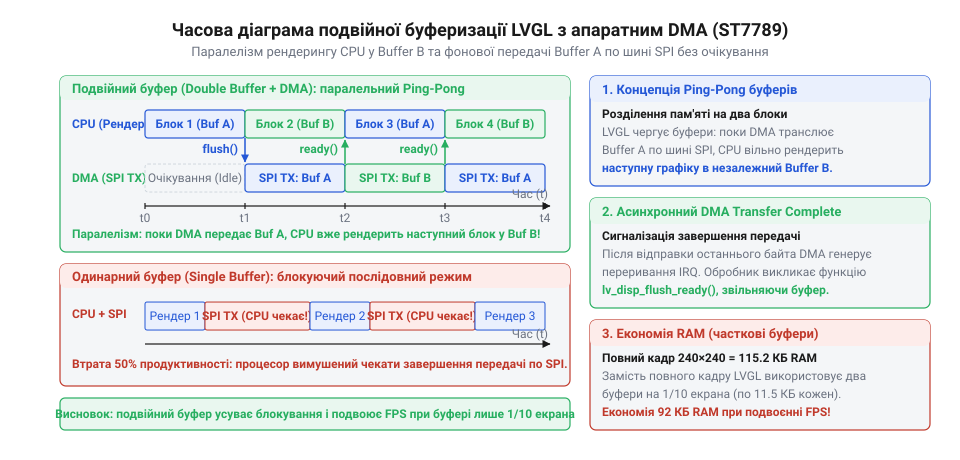
*Часова діаграма роботи подвійного часткового буфера з DMA: обчислення графіки в буфер B відбувається паралельно з апаратною передачею буфера A по шині SPI, що усуває простої процесора й удвічі скорочує тривалість формування кадру.*

:::code proj-st7789-lvgl-sensor-dashboard/c/spi-dma-complete-isr.c

> 🔧 **Навіщо це.**
> Діагностика зсувів адресації, апаратна синхронізація через лінію TE та організація асинхронного DMA-тракту перетворюють нестабільний лабораторний макет на комерційно надійний прилад. Відсутність візуального тирінгу, розгін шини та паралельне заповнення буферів усувають тремтіння графіки й забезпечують максимальну швидкість відгуку панелі при мінімальному нагріванні мікроконтролера.
