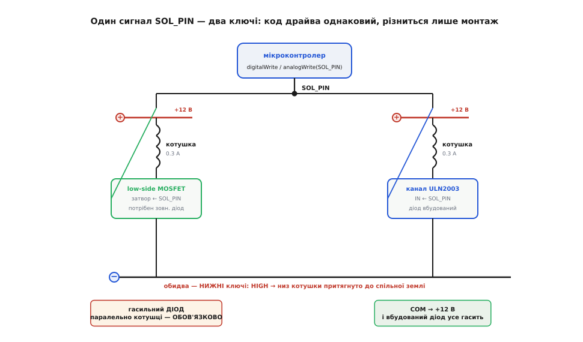

# ⚙️ Код драйва JF-0530B: імпульс, «повна-тоді-утримання», обидва ключі

Соленоїд — залізяка чесна: подав струм — втягнулося, зняв — вискочило. Але між цим «подав» і «зняв» ховається вся інженерія. Скільки тримати струм? Що робити, коли команда прийшла двічі за одну мілісекунду? Як не спалити обмотку, якщо десь у коді хтось забув її вимкнути? І головне — як утримувати шток втягнутим годинами, коли постійні 3.6 вата перетворять брусок на грілку за півхвилини?

Розберімо драйвер JF-0530B у коді від найпростішого імпульсу до прийому, що зрізає нагрів у три-чотири рази. Мова тут одна — **C/C++**: це регістри, таймери, ніжки мікроконтролера й лічені мікросекунди, тобто той самий домен, де притягувати Python чи Go було б грою в піддавки. Код — робочий. Від мікроконтролера скрізь потрібне те саме: ніжка-вихід, ШІМ-здатний канал за нею й вільний лічильник мілісекунд — а як воно зветься, залежить уже від середовища. Тому кожен приклад показано трьома доріжками: Arduino (найкоротший вхід), ESP-IDF і STM32 HAL; де важлива саме апаратна тонкість, покажу й регістровий бік.

Домовмося про одне позначення на весь текст: ніжку, що керує ключем, назвемо `SOL_PIN`, а «увімкнути соленоїд» означатиме «виставити ключ так, щоб струм потік крізь обмотку». Обидва наші ключі — [нижні](root:hw-components/mosfet-switch): і MOSFET, і канал ULN2003 притягують нижній кінець котушки до землі, тож логіка скрізь однакова — **високий рівень на ніжці → струм тече → осердя втягується** (в Arduino це `HIGH`, в ESP-IDF — `1`, у STM32 HAL — `GPIO_PIN_SET`).

## Задача перша: одноразовий імпульс, а не «увімкнув і забув»

Найперша спокуса, і найгірша: керувати соленоїдом як світлодіодом.

:::tabs
```arduino
digitalWrite(SOL_PIN, HIGH);   // клац!
```
```esp-idf
gpio_set_level(SOL_PIN, 1);    // клац!
```
```stm32
HAL_GPIO_WritePin(SOL_GPIO_Port, SOL_Pin, GPIO_PIN_SET);   // клац!
```
:::

Проблема не в тому, що це не спрацює — спрацює чудово. Проблема в тому, що **воно так і лишиться ввімкненим**. Ніжка тримає високий рівень, ключ відкритий, крізь обмотку тече 0.3 ампера, і брусок починає перетворювати 3.6 вата на тепло. Забули дописати вимикання, десь далі в коді сталася помилка й програма застрягла — соленоїд гріється, поки хтось не висмикне живлення. За хвилину-дві обмотка стає гарячою на дотик, а за довшого утримання її можна довести до відмови.

Тож перше правило драйва соленоїда: **клацання — це не стан, це подія**. Не «увімкнути», а «увімкнути на стільки-то мілісекунд і гарантовано вимкнути». Найчистіше — обгорнути це в одну функцію, якій фізично неможливо «забути» відпустити:

:::tabs
```arduino
const uint8_t  SOL_PIN   = 5;      // ніжка на затвор MOSFET (або на IN ULN2003)
const uint16_t PULSE_MS  = 60;     // скільки тримати втягнутим на один клац

void solenoidFire() {
    digitalWrite(SOL_PIN, HIGH);   // втягуємо осердя
    delay(PULSE_MS);               // тримаємо, поки шток дійде до упору й зробить свою справу
    digitalWrite(SOL_PIN, LOW);    // відпускаємо — пружина виштовхне назад
}
```
:::code proj-drive-solenoid/c/esp-idf/zadacha-persha-odnorazovyi.c
```stm32
/* ніжку SOL_GPIO_Port / SOL_Pin налаштовано як GPIO_Output (push-pull) */
#define PULSE_MS  60               // скільки тримати втягнутим на один клац

void Solenoid_Fire(void) {
    HAL_GPIO_WritePin(SOL_GPIO_Port, SOL_Pin, GPIO_PIN_SET);    // втягуємо осердя
    HAL_Delay(PULSE_MS);           // тримаємо, поки шток дійде до упору
    HAL_GPIO_WritePin(SOL_GPIO_Port, SOL_Pin, GPIO_PIN_RESET);  // відпускаємо
}
```
:::

Тепер вимикання — **частина самого клацання**, а не окрема команда, яку легко проґавити. Скільки ставити в `PULSE_MS`? Досить, щоб осердя встигло пройти хід і механізм спрацював. Для JF-0530B з ходом ≈10 мм це десятки мілісекунд — 50–80 мс із запасом. Менше — ризикуєте, що шток не дійде до кінця під навантаженням; сильно більше — марно гріємо обмотку після того, як робота вже зроблена.

> 🔧 **Навіщо це.** Різниця між «увімкнути» і «клацнути на 60 мс» — це різниця між робочим пристроєм і обгорілою котушкою. У реальному коді помилки трапляються завжди: десь `return` спрацював раніше, десь виняток, десь просто забули. Якщо «увімкнено» — це окремий стан, будь-який збій лишає соленоїд під струмом. Якщо клацання **саме себе завершує** — навіть найкривіший код не втримає обмотку ввімкненою довше за `PULSE_MS`. Це не педантизм, а прямий захист заліза від вашого ж майбутнього недогляду.

Утім, `delay(60)` має свою ваду: він **заморожує всю програму** на ці 60 мс. Поки соленоїд клацає, мікроконтролер не може ні зчитати кнопку, ні моргнути індикатором, ні обслужити інший соленоїд. Для іграшки байдуже, для реального пристрою — ні. Тож серйозний варіант тримає час [неблокувально, за вільним лічильником мілісекунд](root:sf-devices/millis-micros) (`millis()` в Arduino, `esp_timer_get_time()` в ESP-IDF, `HAL_GetTick()` у STM32): вмикаємо, запам'ятовуємо мить увімкнення й **щоразу перевіряємо**, чи не пора вимикати — не спиняючи решту роботи.

:::tabs
:::code proj-drive-solenoid/c/arduino/zadacha-persha-odnorazovyi.ino
:::code proj-drive-solenoid/c/esp-idf/zadacha-persha-odnorazovyi-2.c
:::code proj-drive-solenoid/c/stm32/zadacha-persha-odnorazovyi.c
:::

Тут «зараз мінус мить увімкнення» — це «скільки мілісекунд минуло», і щойно воно дотягує до `PULSE_MS`, ми гасимо ключ. Різниця беззнакова, тому [переповнення 32-бітного лічильника через ≈49 діб її не ламає](root:sf-devices/millis-micros) — віднімання за модулем 2³² дає правильний інтервал. Програма при цьому ні на мить не застигає: головний цикл крутиться далі, а соленоїд живе своїм таймером збоку.

## Задача друга: дребезг і навала повторів

Тепер підступніше. Клац соленоїда часто чіпляють до кнопки — і тут вилазять одразу дві біди.

Перша — **[дребезг контакту](root:hw-digital/contact-debounce)**. Механічна кнопка не замикається чисто: у першу пару мілісекунд її пружинна пластина кілька разів відскакує, і мікроконтролер бачить не одне натискання, а чергу з п'яти-десяти `LOW→HIGH→LOW`. Читаєте кнопку в лоб — соленоїд клацне стільки ж разів поспіль. Замок, який мав відчинитися раз, гримить кулеметною чергою.

Друга біда тонша — **навала повторів від самої програми**. Навіть без дребезгу: якщо ви клацаєте соленоїд у циклі за умовою, а умова тримається `true` кілька проходів головного циклу, то без захисту клацання полетять один за одним, зливаючись у безперервне «увімкнено». Обмотка знову гріється, бо між клацаннями немає пауз.

Ліки від обох — **мінімальний проміжок між клацаннями**. Соленоїд фізично не може спрацьовувати частіше, ніж раз на, скажімо, 200 мс (осердя має і втягнутися, і встигнути вискочити назад пружиною). Тож заведімо правило: **клацання приймаємо, лише якщо від попереднього минуло не менш ніж `REARM_MS`**. Це одним махом гасить і відскок контакту, і програмну навалу — усі зайві виклики за час «перезарядки» просто відкидаються.

:::tabs
:::code proj-drive-solenoid/c/arduino/zadacha-druha-drebezh-i.ino
:::code proj-drive-solenoid/c/esp-idf/zadacha-druha-drebezh-i.c
:::code proj-drive-solenoid/c/stm32/zadacha-druha-drebezh-i.c
:::

Прочитаймо логіку `solenoidTryFire`. Вона відмовляє у двох випадках: якщо соленоїд **зараз** під струмом (`solOn`), і якщо від кінця минулого клацання минуло **менше** за `REARM_MS`. Пройшли обидві перевірки — вмикаємо. Тепер хоч десять разів за мілісекунду смикайте кнопку з усім її дребезгом — спрацює рівно раз, а решта викликів чемно повернуть `false` і нічого не зроблять, поки не мине перезарядка.

Зверніть увагу, що це **дешевший** спосіб приборкати дребезг, ніж класичне очікування «стабільні N мс поспіль»: нам не треба вистежувати, чи заспокоївся контакт, — ми просто **ігноруємо все**, що прийшло надто рано. Для соленоїда це навіть правильніше: його справжнє обмеження — не чистота сигналу, а те, що осердя механічно не встигає клацати частіше. `REARM_MS` = 200 і захищає від дребезгу (кілька мс), і поважає фізику приладу (сотні мс на повний цикл).

> 🔧 **Навіщо це.** «Мертвий час» — це не лише боротьба з дребезгом, це **правило безпеки заліза**. Соленоїд, що клацає без пауз, — це соленоїд, що гріється без пауз. Обмеживши частоту клацань знизу, ви заразом гарантуєте, що між спрацюваннями обмотка встигає **охолонути**, а осердя — вернутися. Один параметр `REARM_MS` захищає одразу від трьох напастей: від відскоку контакту, від програмної навали й від теплового перегріву через надто часті клацання.

## Задача третя: стеля часу-ввімкнення проти перегріву

Навіть з усіма запобіжниками лишається одна дірка: а що, як хтось **навмисне** захоче тримати соленоїд втягнутим довго? Скажімо, засувка має бути відчинена, поки людина проходить у двері, — секунд десять. Або логіка помилилася й тримає `HIGH` без вимикання.

Обмотка на це не розрахована. 3.6 вата в маленькому корпусі без тепловідводу — це швидкий нагрів, і за хвилини безперервного утримання котушку можна перегріти до відмови ізоляції. Тож розсудливий драйвер має **власну стелю**: скільки б згори не просили тримати, він **не дасть** соленоїду бути під струмом довше за безпечний максимум і **сам** його вимкне.

Це запобіжник останнього рубежу — «сторожовий таймер» самого соленоїда. Він не заважає нормальній роботі (клацання по 60 мс і близько не підходять до стелі), але ловить будь-яку спробу — навмисну чи через баг — тримати обмотку ввімкненою хвилинами.

:::tabs
:::code proj-drive-solenoid/c/arduino/zadacha-tretia-stelia.ino
:::code proj-drive-solenoid/c/esp-idf/zadacha-tretia-stelia.c
:::code proj-drive-solenoid/c/stm32/zadacha-tretia-stelia.c
:::

Ключове тут — `solenoidUpdate()` **не питає дозволу** у вищої логіки. Хоч би що робив основний код, цей запобіжник щоразу перевіряє час і, дійшовши до `MAX_ON_MS`, вимикає обмотку без обговорень. Три секунди для JF-0530B — уже щедро; якщо ваш сценарій вимагає утримувати довше, це прямий сигнал, що соленоїд узагалі не той інструмент (для тривалого утримання беруть самозатискний, латкувальний соленоїд) — **або** що час переходити до прийому, який робить довге утримання безпечним. Саме до нього й переходимо.

## Головний прийом: повна напруга на втягування, знижений ШІМ на утримання

Ось де ховається найкорисніше, що варто знати про соленоїд. Усі попередні хитрощі оминали проблему нагріву, **уникаючи** довгого утримання. А що, як утримувати таки треба — довго й безпечно? Тоді працює прийом, який англійською звуть **«peak and hold»** («пік і утримання») або **«hit and hold»** («вдар і тримай»): дати повний струм рівно настільки, щоб **втягнути** осердя, а тоді **знизити** струм до рівня, який лише **утримує** вже втягнуте.

Щоб зрозуміти, чому це взагалі можливо, треба одну фізичну річ — і вона не очевидна.

### Чому тримати легше, ніж зрушити

Сила [електромагніта](root:ph-electromagnetism/electromagnet) на осердя залежить не лише від струму, а й від того, **де осердя зараз**. І залежність ця різка. Поки штифт **висунутий** (велика повітряна щілина між осердям і серцевиною котушки), магнітному потокові важко замкнутися крізь повітря — опір магнітного кола (його звуть **магнітним опором**, або рел*ю*ктансом, лат. *reluctari* — «опиратися») високий, потік слабкий, а отже й сила на осердя мала. Тому на **початку** ходу, з широкою щілиною, соленоїд тягне кволо — і щоб зрушити осердя через усю щілину, потрібен **повний** струм.

Але щойно осердя **втягнулося** й щілина зімкнулася майже в нуль — картина стрибком міняється. Тепер потік замикається майже цілком по залізу, магнітний опір падає в рази, той самий струм дає **набагато сильніший** потік, а сила на зімкнуте осердя стає багато більшою. І ось наслідок, задля якого все й затівається: **щоб просто втримати вже зімкнуте осердя, потрібно куди менше струму, ніж щоб його спершу притягнути**. Зімкнутий магнітний ланцюг «чіпляється» сам за себе — і кволого струму досить, щоб пружина не змогла виштовхнути штифт назад.

```
осердя ВИСУНУТЕ:  щілина велика → магн. опір високий → потік слабкий → сила мала
                  ⇒ щоб ЗРУШИТИ через щілину, треба ПОВНИЙ струм (0.3 А)

осердя ВТЯГНУТЕ:  щілина ≈ 0    → магн. опір низький → потік сильний → сила велика
                  ⇒ щоб УТРИМАТИ зімкнуте, вистачає ЗНИЖЕНОГО струму (~0.1 А)
```

Ось і весь секрет. Повний струм потрібен лише на **коротку мить втягування**, поки осердя долає щілину. А далі, коли щілина зникла, ту саму роботу — не пустити пружину назад — робить утричі менший струм. Тримаємо менший струм — виділяємо менше тепла: адже [потужність нагріву](root:hw-analog/ohms-law) обмотки — це `I² · R`, тобто **квадрат** струму. Урізали струм утричі — тепловиділення впало в дев'ять разів. Брусок, що на повному струмі стає гарячим за півхвилини, на утримувальному ледь теплішає й може тримати штифт хоч годинами.

> 🔧 **Навіщо це.** Це той рідкісний прийом, що дає **все й одразу**: соленоїд надійно втягується (бо на кидку — повний струм) і при цьому може довго утримувати без перегріву (бо на утриманні — струм у рази менший). Квадратична залежність тепла від струму робить виграш величезним: зниження струму лише втричі зрізає нагрів у дев'ять разів. Без цього прийому соленоїд — прилад для коротких клацань; із ним — повноцінний «тримач», що не боїться довгого ввімкнення. Одна зміна в коді перетворює брусок на якісно інший інструмент.

### Як знизити струм: ШІМ

Знизити струм в обмотці можна було б резистором, але це і громіздко (окрема деталь, що теж гріється), і незручно (треба перемикати два різні кола). Куди елегантніше — **[широтно-імпульсна модуляція, ШІМ](root:hw-analog/pwm)**: замість тримати ключ відкритим постійно, **швидко-швидко перемикати** його ввімк-вимк. Якщо ключ відкритий, скажімо, третину часу (**шпаруватість**, англ. *duty cycle*, — 33%), то й **середній** струм крізь обмотку — приблизно третина повного. Обмотка тут наша спільниця: як [котушка](root:ph-electromagnetism/inductor-coil), вона згладжує ці перемикання, і струм тече рівненько на зниженому рівні, майже не пульсуючи, — треба лише перемикати досить швидко (одиниці-десятки кілогерц).

ШІМ у будь-якому мікроконтролері робить апаратний таймер, а програмі лишається задати одне число — шпаруватість; називають це по-різному: в Arduino `analogWrite(pin, duty)` зі шкалою 0…255, в ESP-IDF — канал модуля LEDC, у STM32 — регістр порівняння `CCR` каналу таймера. Отже, весь прийом у коді — це **дві фази**: спершу повна шпаруватість на короткий кидок, тоді знижена — на утримання.

:::tabs
:::code proj-drive-solenoid/c/arduino/iak-znyzyty-strum-shim.ino
:::code proj-drive-solenoid/c/esp-idf/iak-znyzyty-strum-shim.c
:::code proj-drive-solenoid/c/stm32/iak-znyzyty-strum-shim.c
:::

Логіка читається як маленький **[автомат станів](root:sf-apps/state)**: `IDLE` (спокій) → `PEAK` (повний струм, поки осердя втягується) → `HOLD` (знижений ШІМ, поки треба тримати). `solenoidEngage()` б'є повним струмом і запускає таймер; `solenoidUpdate()` за `PEAK_MS` перемикає на утримання; `solenoidRelease()` вимикає зовсім. Тепер соленоїд можна тримати втягнутим хоч десять секунд, хоч довше — і він не перегріється, бо в фазі `HOLD` крізь обмотку тече лише третина струму, а тепла виділяється дев'ята частина.

Кілька тонкощів, які легко проґавити:

- **`SOL_PIN` мусить бути ШІМ-здатна.** ШІМ виходить не з кожної ніжки — лише з тих, за якими стоїть канал апаратного таймера. На Arduino Uno це піни 3, 5, 6, 9, 10, 11; на ESP32 канал LEDC чіпляється майже до будь-якої ніжки; на STM32 ніжка мусить мати альтернативну функцію потрібного `TIMx_CHy`. Повісите соленоїд на не-ШІМ-ніжку — фаза утримання просто не запрацює.
- **`HOLD_DUTY` добирають під конкретний примірник.** 90 із 255 (≈35%) — розумний старт, але «наскільки можна опустити струм, щоб осердя ще не відпало» залежить від пружини й навантаження. Метод простий: тримаєте втягнутим і поволі знижуєте `HOLD_DUTY`, доки штифт **не почне випадати**, тоді відступаєте назад із запасом. Занизите — пружина проштовхне осердя назад посеред утримання; лишите завеликим — марно гріється.
- **Частота ШІМ.** Стандартні ~490/980 Гц Arduino Uno для соленоїда згодяться, але на межі чутного — обмотка може ледь чутно пищати на цій частоті (магнітострикція). Хочете тиші — підніміть частоту ШІМ вище чутного (20+ кГц): на ESP32/RP2040 це вільно задається, на Uno чи STM32 — правкою регістрів таймера.

### Регістровий бік: коли готової ШІМ-обгортки замало

Проста обгортка на кшталт `analogWrite` зручна, але ховає від вас частоту й розрядність: ви не обираєте ні того, ні того. Коли треба саме **тиха** висока частота (щоб обмотка не пищала) або точний контроль, спускаються на щабель нижче — до [самого таймера-ШІМ](root:hw-arch/hardware-pwm), де частота є **дільником тактової**, а шпаруватість — числом у регістрі порівняння. Фаза утримання тоді виглядає так:

:::tabs
:::code proj-drive-solenoid/c/arduino/rehistrovyi-bik-koly.ino
:::code proj-drive-solenoid/c/esp-idf/rehistrovyi-bik-koly.c
:::code proj-drive-solenoid/c/stm32/rehistrovyi-bik-koly.c
:::

Скрізь тут явно задано **25 кГц** — вище за поріг чуття, тож магнітострикційний писк обмотки зникає, — і 8-бітну шкалу шпаруватості, де 255 — повний струм, 90 — утримувальний. Видно й спільну механіку: частота = такт таймера, поділений на передільник і на довжину періоду (`ARR` у STM32, роздільність у LEDC), а шпаруватість — число всередині цього періоду. Решта логіки (таймер переходу `PEAK`→`HOLD`) лишається та сама; змінюється лише **як** ми подаємо на ніжку повний і знижений рівень. На RP2040 роль LEDC грає апаратний PWM-слайс через `pwm_set_wrap`/`pwm_set_gpio_level`, ідея та сама.

## Обидва ключі в коді: MOSFET і вільний канал ULN2003

Тепер найприємніше: **весь код вище працює без жодної зміни для обох способів підключення**. І low-side MOSFET, і вільний канал ULN2003 — це **нижні ключі**, що притягують низ котушки до землі, і обидва відкриваються високим рівнем на керівній ніжці. Тож `SOL_PIN` — це або затвор MOSFET, або вхід `INx` мікросхеми, і той самий сигнал — рівень чи ШІМ — керує ними однаково.


*Керівна ніжка `SOL_PIN` заходить або на затвор MOSFET (ліворуч), або на вхід `INx` ULN2003 (праворуч). Обидва — нижні ключі: `HIGH` відкриває, струм крізь котушку тече, осердя втягується. Логіка коду — `digitalWrite`/`analogWrite` — для обох ідентична; різниця лише в тому, куди фізично йде дріт із ніжки.*

Різниця між ними — **не в коді, а в двох апаратних застереженнях**, і кожне варте окремої уваги, бо саме на них новачок і спотикається.

**Шлях MOSFET.** Тут ви самі відповідаєте за гасіння кидка. Обмотка при вимиканні [б'є стрибком напруги](root:hw-components/inductor-kickback) у десятки-сотні вольт, і без зовнішнього **гасильного (flyback) діода** паралельно котушці — MOSFET помирає. Код цього не бачить і не рятує: команда «погасити ніжку» виконається, а от чи переживе транзистор кидок — вирішує саме той діод, а не програма. Тож із MOSFET залізне правило: **діод у схемі — обов'язковий**, скільки б чистим не був код.

Є, до речі, тонкість, де **ШІМ-утримання підступно рятує ключ**: у фазі `HOLD` ми весь час перемикаємо струм у котушці, тобто щоцикла робимо мікро-кидок. Без діода ці кидки лупили б по ключу тисячі разів на секунду. З діодом — струм на кожному вимкнутому півперіоді ШІМ добігає своє коло крізь діод, тихо циркулюючи; саме тому в схемі з ШІМ гасильний діод не просто бажаний, а критично потрібен.

**Шлях ULN2003.** Тут вбудований захист знімає з вас клопіт про діод — але додає **свій єдиний обов'язок**. Мікросхема має власні гасильні діоди на кожному каналі, зведені катодами на спільний вивід **COM** (перевірено за даташитом Texas Instruments ULN2003A: сім вбудованих flyback-діодів, катоди виведені на пін COM). Але ці діоди «оживають», лише коли **COM заведено на плюс живлення котушки** — на ті самі +12 В. Забули завести COM на +12 В — вбудовані діоди виявляються ні до чого не під'єднані, кидок котушки нема куди відвести, і чіп гине так само, як MOSFET без діода.

І ще одне число, щоб спати спокійно: канал ULN2003 тримає **≈500 мА** (за даташитом), а нам треба 0.3 А — влазить із півторакратним запасом. У фазі ШІМ-утримання середній струм і зовсім падає до сотні міліампер, тож каналу зовсім легко.

```text
Різниця MOSFET vs ULN2003 — НЕ в коді, а в монтажі. Код обох варіантів той самий:

  MOSFET:   SOL_PIN → резистор → затвор; гасильний діод паралельно котушці ОБОВ'ЯЗКОВО.
  ULN2003:  SOL_PIN → вхід INx;          COM звести на +12 В — і вбудований діод усе гасить.

Керівний сигнал на SOL_PIN — рівень чи ШІМ — керує обома однаково.
```

> 🔧 **Навіщо це.** Найважливіше, що дає цей розбір: **код драйва однаковий, а гине залізо з різних причин**. З MOSFET забудете зовнішній діод — згорить транзистор. З ULN2003 забудете завести COM на плюс — згорить мікросхема. В обох випадках програма виглядає бездоганно й нічого не підкаже: команда «вимкнути» чесно погасить ніжку, а куди подінеться кидок котушки — питання **монтажу**, не коду. Тому, дописавши драйвер, перевіряйте не лише логіку, а й схему: **де в ній замикається кидок?** Немає відповіді — залізо приречене.

## Складання докупи й пастки

Зберімо все в один робочий драйвер — з мертвим часом, стелею часу та ШІМ-утриманням разом. Це вже не навчальний фрагмент, а те, що можна ставити в пристрій:

:::tabs
:::code proj-drive-solenoid/c/arduino/skladannia-dokupy-i-pastky.ino
:::code proj-drive-solenoid/c/esp-idf/skladannia-dokupy-i-pastky.c
:::code proj-drive-solenoid/c/stm32/skladannia-dokupy-i-pastky.c
:::

Цей драйвер дає обидва режими одним інтерфейсом: `solenoidPulse()` — одиночне клацання (для замків, штовхачів монет — усе, що «клац і готово»), `solenoidHold()` + `solenoidRelease()` — тривале холодне утримання (для засувок, що стоять відчинені). Мертвий час, ШІМ-утримання і страхувальна стеля вбудовані всередину й спрацьовують самі. Основному коду лишається кликати `solenoidUpdate()` у кожному проході головного циклу й смикати `Pulse`/`Hold`/`Release` за логікою пристрою.

Тепер пастки — коротко, кожна вже пояснена вище, але зібрана докупи, бо саме на них ламаються реальні збірки:

- **Пусковий струм вищий за 0.3 А.** У першу мить кидка, поки осердя ще не зрушило, струм короткочасно перевищує паспортні 0.3 А. Тому і джерело, і ключ беруть **із запасом** (джерело на ≥1 А, MOSFET на кілька ампер), а не «рівно під 0.3». ШІМ-утримання цього не стосується — там струм навпаки менший; запас потрібен саме на **старт**.
- **Гасильний діод / COM на +12 В — не опція.** З MOSFET — зовнішній діод паралельно котушці. З ULN2003 — COM на плюс живлення. Пропустите — ключ згорить від кидка, і жоден рядок коду цього не покаже. У схемі з ШІМ це критично подвійно: кидок б'є щоцикла.
- **Спільна земля.** Мінус 12-вольтового джерела й земля мікроконтролера — **обов'язково в одну точку**. Без спільної землі рівень `HIGH` на ніжці не має спільного відліку з силовою частиною, і ключ поводиться дико: класичне «все під'єднав, а не спрацьовує» — майже завжди про роз'єднані землі.
- **ШІМ — лише на ШІМ-здатній ніжці.** Повісите фазу утримання на ніжку без апаратного таймера — `HIGH`-кидок спрацює, а знижений струм — ні, і соленоїд або гріється на повному, або відпускає. Перевірте, що `SOL_PIN` уміє ШІМ на вашій платі.
- **Не тримати повним струмом хвилинами.** Якщо утримання довше за кілька секунд — переходьте на ШІМ-утримання **або** визнайте, що соленоїд не той інструмент. Страхувальна стеля `MAX_ON_MS` — останній рубіж, а не робочий режим.

Головна думка, яку цей код вкладає в руки: **соленоїдом керує не одна команда, а маленький протокол**. Клацання завершує само себе, повтори просіюються мертвим часом, довге утримання або зрізається стелею, або робиться холодним через ШІМ, а на кидку струму завжди чекає гасильний діод. Опануйте цей протокол на копійчаному JF-0530B — і той самий каркас драйва ляже на будь-який соленоїд, електромагнітний клапан чи реле: усі вони — та сама котушка, що хоче повного струму на ривок, зниженого на утримання й діода на кидок.
