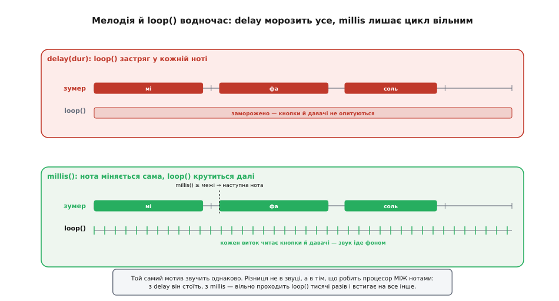

# ⚙️ Модуль прошивки для KY-006: тони, мелодії й сигнали, що не морозять loop()

Виставити на піні тон KY-006 уміє один рядок — `tone(pin, freq)`. Але між «пін пищить» і «пристрій живе повним життям, поки грає мелодія» лежить провалля, у яке з розгону падає майже кожен. Скетч має **водночас** опитувати кнопки, читати давачі, крутити мотор — і при цьому програти три ноти з паузами між ними. Пишеш це навпростець через `delay` — і на час мелодії пристрій сліпне й глухне: кнопку не помітить, аварію на давачі проґавить. Пишеш «правильно» — і раптово доводиться самому стежити за часом, бо `tone()` лише **запускає** ноту й тут-таки повертається, нічого не чекаючи.

Зберемо тут невеликий, але завершений **модуль прошивки** під пасивний зумер: неблокувальний плеєр тонів і мелодій, що рухає ноти сам, за годинником, і жодного разу не спиняє головний цикл; таблицю частот нот, щоб мелодію писати нотами, а не голими герцами; звукову шкалу «значення давача → частота», якою пристрій співає свій стан; і короткі сигнали-патерни на кожен день — «успіх», «помилка», «попередження». Поряд назвемо кожну пастку, поки вона не з'їла вечір: чому `tone()` не чекає, чому дві однакові ноти зливаються в одну, звідки береться тиша замість звуку й коли пасивному зумеру раптом потрібен транзистор.

Мова — **C/C++ на голому залізі**, і не для галочки: керування зумером упирається в конкретну периферію — таймер, що жене меандр на пін, регістр, канал ШІМ. Тут високорівнева мова ні до чого; питання не «якою мовою зручно», а «як саме мікроконтролер смикає ніжку». А периферія в кожного своя, тож приклади нижче йдуть вкладками: **Arduino** (найкоротший шлях до звуку), **ESP-IDF** (драйвер LEDC) і **STM32 HAL** (таймер у режимі ШІМ). Логіка плеєра в усіх трьох однакова — різниться лише те, чим саме заводиться меандр; наприкінці ця межа розібрана окремо.

## Задача: звук як повноцінний громадянин програми

Сформулюймо чесно, чого ми хочемо, бо саме нечітке формулювання й породжує `delay`-код. Ми хочемо, щоб зумер був **ще одним фоновим процесом**, як миготіння світлодіода: сказав йому «грай ось цю мелодію» — і забув, а він сам, у власному темпі, вчасно міняє ноти, тримає паузи й замовкає наприкінці, поки головна програма займається своїми справами.

Розкладімо це на три рівні, що нанизуються один на одний:

- **Один тон із тривалістю** — програти частоту `f` рівно `t` мілісекунд і замовкнути, не спиняючи цикл. Це цеглинка всього решта.
- **Мелодія** — послідовність тонів різної висоти й довжини, з паузами між ними, що теж грає фоном. По суті — «список цеглинок, які плеєр проходить сам».
- **Осмислений сигнал** — коли висота чи мотив щось **означають**: успіх, помилка, поточне значення давача. Це вже не музика, а голос пристрою.

Спільний ворог усіх трьох — `delay()`. Він робить рівно одне: спиняє процесор на задану кількість мілісекунд, і в цей час **не виконується більше нічого**. Для мигання світлодіодом раз на секунду це ще пробачно; для звуку — смертельно, бо мелодія з десяти нот по 300 мс це три секунди, протягом яких пристрій — камінь.

> 🔧 **Навіщо це.** Уся складність музики на KY-006 не в тому, щоб видобути звук — це один `tone()`, — а в тому, щоб видобути його **не ціною сліпоти пристрою**. Щойно ти сформулюєш задачу як «звук паралельно з рештою», а не «спочатку дограємо, потім живемо», код майже сам поведе тебе до неблокувального плеєра за `millis()`. І навпаки: кожен `delay` у циклі — це маленька смерть чуйності, яку ти сам собі підписав.

## Ідея: годинник замість очікування

Річ, на якій усе тримається, проста до образливого. Меандр у мікроконтролері жене **таймер**, а не процесор: йому задають частоту, і далі він смикає ніжку сам, поки його не спинять. Тому виклик, що заводить тон, **не тримає** процесор — ні `tone(pin, freq)` в Arduino, ні `ledc_set_freq()` в ESP-IDF, ні `HAL_TIM_PWM_Start()` на STM32: усі троє налаштовують залізо й **одразу повертаються**. Звук іде сам собою, а програма вільна. Отже, щоб програти ноту протягом 300 мс, процесору **не треба чекати** ці 300 мс — треба лише **запам'ятати, коли ноту вимкнути**, і час від часу перевіряти, чи не настав цей момент.

Оце і є вся ідея неблокувального коду: замість «зупинися й почекай» — «запам'ятай дедлайн і біжи далі, а на кожному витку зазирни на годинник». Годинник є в кожної платформи, і суть у всіх одна — лічильник, що росте від старту: `millis()` в Arduino, `HAL_GetTick()` на STM32, `esp_timer_get_time()` (мікросекунди) в ESP-IDF. Замість `delay(300)` ми пишемо: «нота почалася в момент `t0`; на кожному витку головного циклу дивимося, чи `millis() − t0 ≥ 300`; якщо так — вимикаємо ноту й беремося за наступну».



*Звук в обох випадках однаковий — різниця в тому, що процесор робить МІЖ нотами. Угорі (delay) кожна нота — це застиглий цикл: поки грає «мі», loop() стоїть, кнопки й давачі не опитуються. Унизу (millis) плеєр лише перевіряє на кожному витку, чи не час міняти ноту; між нотами loop() проходить тисячі разів і встигає на все інше. Пунктир — мить, коли millis() перевалив за дедлайн ноти й плеєр бере наступну.*

Це та сама думка, що стоїть за неблокувальним миготінням світлодіода — [лічити час замість того, щоб його марнувати](root:sf-devices/millis-micros). І та сама, що за будь-яким [скінченним автоматом](root:hw-digital/finite-state-machines): плеєр у кожен момент перебуває в одному зі станів — «мовчу», «граю ноту №5, вимкнути її о 12345 мс» — і переходить між станами не за командою «чекай», а за подією «годинник перевалив за дедлайн».

> 🔧 **Навіщо це.** Різниця між `delay` і `millis` — це різниця між «пристрій уміє робити одне діло за раз» і «пристрій жонглює багатьма». Вона не про звук; той самий прийом тримає одночасно опитування кнопок, миготіння, читання давача й обмін по мережі. Зумер — гарний привід засвоїти його раз і назавжди: тут наслідки чутно вухом. Мелодія, що грає, поки пристрій жвавий, звучить точно як мелодія, що грає, поки пристрій мертвий, — але поводяться ці два пристрої по-різному, і різницю задає один вибір: чекати чи глянути на годинник.

## Крок 1: один тон, що замовкає сам

Почнімо з найменшої цеглинки й одразу неблокувально — щоб не переучуватися. Задача: увімкнути тон і домовитися, коли його вимкнути, не спиняючи цикл.

**Умова.** KY-006 підключено: `S` — на вихід, здатний давати меандр (D8 на Arduino Uno, GPIO18 на ESP32, ніжка каналу таймера на STM32), `−` на GND. Хочемо метод «грай `freq` герців протягом `dur` мілісекунд», що не блокує.

Ключ — розділити «почати» й «підтримувати». `beep()` лише запускає тон і записує дедлайн. Окремий `update()`, який ми кличемо на **кожному** витку `loop()`, стежить за годинником і вчасно замовкає:

:::tabs
:::code proj-ky006-buzzer/c/arduino/krok-1-odyn-ton-shcho.ino
:::code proj-ky006-buzzer/c/esp-idf/krok-1-odyn-ton-shcho.c
:::code proj-ky006-buzzer/c/stm32/krok-1-odyn-ton-shcho.c
:::

Порівняй із наївним `tone(PIN_BUZ, 1000); delay(200); noTone(PIN_BUZ);`. Результат для вуха той самий — пік на 200 мс. Але наївний варіант **краде** ці 200 мс у всієї програми, а наш — ні: `beep()` повертається за мікросекунди, а `buzzerUpdate()` на кожному витку робить одне копійчане порівняння `millis() >= toneOffAt`. Між пуском і вимиканням тону `loop()` устигає прокрутитися тисячі разів.

Зверни увагу на тип `unsigned long` для `toneOffAt`. `millis()` повертає саме `unsigned long` і переповнюється (обнуляється) приблизно кожні **49.7 доби** безперервної роботи. Порівняння `millis() >= toneOffAt` це переживає коректно лише доти, доки інтервали короткі — а вони в нас короткі (ноти, а не доби), тож на практиці проблеми немає. Але записати дедлайн у `int` було б помилкою: `int` на Uno 16-бітний, максимум 32767, і вже через 33 секунди після старту `millis()` його переросте.

> 🔧 **Навіщо це.** `beep()`/`buzzerUpdate()` — це шаблон **усього** неблокувального заліза: одна функція «запусти й запиши дедлайн», друга «на кожному витку доведи до кінця». Той самий кістяк ти напишеш для розтягнутого в часі миготіння, для антифренького [усунення брязкоту кнопки](root:hw-digital/contact-debounce), для таймауту очікування відповіді. Засвоївши його на зумері, ти вже вмієш робити неблокувальним що завгодно — а це головна навичка, що відрізняє чуйний пристрій від того, що «підвисає».

## Крок 2: мелодія як список нот

Один тон є — зробімо з них мелодію, і теж неблокувальну. Мелодія — це **послідовність** тонів, і плеєр має сам, за годинником, переходити від ноти до ноти, не спиняючи цикл.

Перше, від чого варто позбутися, — голі герци в тексті мелодії. `{330, 300}` нічого не каже; `{NOTE_E4, 300}` каже «мі четвертої октави». Тож заведімо **таблицю частот нот**. Висота ноти — це фізика, однакова для будь-якого інструмента: рівномірно темперований стрій прив'язаний до камертонного «ля» (A4 = 440 Гц), а кожна наступна нота вища за попередню в ¹²√2 разів (дванадцять півтонів на октаву, октава — подвоєння частоти). Порахувавши це раз, отримуємо звичні значення:

:::code proj-ky006-buzzer/cpp/krok-2-melodiia-iak-spysok.cpp

Кожна частота тут — не магічне число, а `440 · 2^((n−69)/12)`, де `n` — номер клавіші (MIDI): для «ля» першої октави (A4) `n = 69`, і формула дає рівно 440; для «до» (C4) `n = 60` — виходить 261.6, округлюємо до 262. Округлення на слух непомітне: вухо не відрізнить 262 від 261.6 Гц.

> 🔧 **Навіщо це.** Таблиця нот перетворює мелодію з шифровки на ноти. `{NOTE_E4, 300}` читається як партитура; `{330, 300}` — як дамп пам'яті. Але глибша користь — розуміння, **звідки** беруться ці герци: це не довільні цифри з інтернету, а рівномірний стрій від камертона. Знаючи формулу, ти згенеруєш будь-яку ноту будь-якої октави сам і не залежатимеш від чужих таблиць — а заразом зрозумієш, чому на KY-006 низькі октави звучать тихіше: вони далі від механічного резонансу пластини ≈2 кГц.

Тепер сам плеєр. Мелодію задамо масивом пар `{частота, тривалість}`, а плеєр працюватиме у **два такти**: грає ноту — тримає коротку паузу — грає наступну. Він пам'ятає **індекс наступної ноти**, **дедлайн поточної фази** й **чи він зараз у паузі** (`inGap`). На кожному витку `update()` дивиться, чи не вичерпалась поточна фаза, і як настане її дедлайн — перемикає такт: нота → пауза → наступна нота. Ніякого `delay`:

:::tabs
:::code proj-ky006-buzzer/c/arduino/krok-2-melodiia-iak-spysok.ino
:::code proj-ky006-buzzer/c/esp-idf/krok-2-melodiia-iak-spysok.c
:::code proj-ky006-buzzer/c/stm32/krok-2-melodiia-iak-spysok.c
:::

І застосування — мелодія стає просто даними, а грає вона фоном:

:::tabs
:::code proj-ky006-buzzer/c/arduino/krok-2-melodiia-iak-spysok-2.ino
:::code proj-ky006-buzzer/c/esp-idf/krok-2-melodiia-iak-spysok-2.c
:::code proj-ky006-buzzer/c/stm32/krok-2-melodiia-iak-spysok-2.c
:::

Розберімо два тонкі місця, об які тут спотикаються найчастіше.

**Пауза між нотами — окрема фаза, а не подовження ноти.** Ось навіщо прапорець `inGap`. Коли нота відзвучала, плеєр не хапає наступну одразу: спершу гасить звук і ставить **окремий** дедлайн на `GAP_MS` мілісекунд — це фаза тиші, і лише коли й вона мине, наступний виток заведе чергову ноту. Тому між двома нотами справді пролягає `GAP_MS` реальної мовчанки. Наївно було б просто доточити паузу до дедлайну ноти — `phaseEndAt = millis() + n.dur + GAP_MS`; але це не пауза, а та сама нота, що звучить на 30 мс довше: `noTone` спрацював би аж наприкінці подовженого дедлайну, а зразу по ньому, тим самим викликом, пішов би `tone` наступної ноти — і між ними не минуло б жодної мілісекунди. Тиша з'являється лише тоді, коли на неї виділено **власну** фазу з власним дедлайном. А потрібна вона тому, що дві однакові ноти поспіль (два «мі» підряд) без розриву **зіллються в один суцільний звук**: тон, що тягнеться без перерви, вухо чує як **одну** довгу ноту. Крихітна мовчанка — і мозок чує дві. Різні по висоті ноти розділяє сам стрибок частоти, а однакові — тільки ця пауза (музиканти звуть її артикуляцією).

**Дедлайн рахуємо від «зараз», а не додаємо до старого.** Щоразу `phaseEndAt = millis() + ...` береться від поточного моменту, коли ми **фактично** перемкнули такт, а не доточується до попереднього дедлайну. Якби ми копили `phaseEndAt += ...`, то будь-яка затримка витка `loop()` (наприклад, повільне читання давача) не з'їдалася б, а накопичувалась, і мелодія повзла б у часі. Рахунок від `millis()` на кожному переході — і ноти, і паузи — щоразу «підрівнює» плеєр до реального годинника: окрема фаза може вийти на частку мілісекунди довшою, зате мотив не дрейфує.

> 🔧 **Навіщо це.** Плеєр — це маленький [скінченний автомат](root:hw-digital/finite-state-machines) на два стани: «граю ноту» і «тримаю паузу», а `inGap` лише пам'ятає, у якому ти зараз. Перехід між ними — за однією подією «годинник перевалив за дедлайн фази». Помітивши це, ти легко доточиш що завгодно: повтор мелодії (на кінці не гасити `playing`, а обнулити `noteIndex` і повернутись у фазу паузи), обрив звуку ззовні (`stopMelody()` ставить `playing = false` і кличе `noTone`), навіть дві мелодії по черзі. Уся «музика» звелася до перемикання двох тактів за годинником — і жодного `delay`, тому пристрій увесь цей час жвавий.

## Крок 3: короткі сигнали на кожен день

Найчастіше від зумера треба не мелодію, а **коротку фразу-квитанцію**: «прийняв», «помилка», «увага». Це ті самі мелодії, лише крихітні, тож вони одразу лягають на наш плеєр — оголошуємо їх раз і кличемо `playMelody` за подією.

Тут працює звукова інтуїція, стара як світ і зрозуміла без слів: **угору — добре, униз — погано, повторюваний різкий — тривога**. Висхідні дві ноти («ді-дінь!») вухо чує як «готово, вийшло»; спадні («дон-дон») — як «щось не так»; короткий повтор однакового різкого тону — як «увага, дивись сюди». Ми не вигадуємо ці асоціації, а спираємось на вже наявні в голові:

:::code proj-ky006-buzzer/cpp/krok-3-korotki-syhnaly-na.cpp

Тепер код каже сам за себе — і жоден із цих викликів не блокує, звук іде фоном, поки логіка біжить далі:

:::tabs
```arduino
void loop() {
  buzzerUpdate();

  if (buttonPressed())   soundOk();      // прийняв натиск — бадьорий «ді-дінь»
  if (sensorFailed())    soundError();   // давач замовк — глухий «дон-дон»
  if (batteryLow())      soundWarn();    // сідає батарея — наполегливе «пік-пік-пік»
  // ...і все це не спиняє loop() ні на мить...
}
```
:::code proj-ky006-buzzer/c/esp-idf/krok-3-korotki-syhnaly-na.c
:::code proj-ky006-buzzer/c/stm32/krok-3-korotki-syhnaly-na.c
:::

Зверни увагу на `SND_WARN`: три однакові `{NOTE_A5, 80}` поспіль — і **жодного явного REST** між ними. Без роздільника вони злилися б в один суцільний писк на чверть секунди, але плеєр сам вставляє між кожними двома нотами свою фазу `GAP_MS`, і саме вона розбиває ряд на три окремі удари — той тривожний пульс, який вухо чує як «увага». Тиша тут — не пропуск, а **повноцінний елемент** сигналу, і плеєр робить її сам. А коли треба пауза **ширша** за копійчані 30 мс (розлогіше «пі... пі... пі» чи ритмічна цезура всередині мелодії), для цього й лишається `REST`: постав `{REST, N}` явною нотою — це навмисна довга мовчанка на твій смак, тоді як `GAP_MS` — мінімальний автоматичний роздільник, щоб узагалі ніщо не злипалось.

> 🔧 **Навіщо це.** Троє готових сигналів закривають чи не всю щоденну потребу пристрою у звуці, і всі троє — просто дані для того самого плеєра, ніякого нового коду. Але глибша думка — **звук має бути мовою, а не шумом**. Висота й ритм несуть зміст: користувач за пів дня привчається, що висхідне «ді-дінь» — усе гаразд, а глухе «дон-дон» — біда, і вже не мусить дивитися на екран. Пасивний KY-006 тут незамінний саме тому, що вміє **різні** тони: активний зумер, який знає один писк, такої мови не дав би.

## Крок 4: пристрій, що співає свій стан

Найцікавіше пасивний зумер уміє те, чого активний не зможе ніколи: **перетворювати число на висоту тону**. Далекомір, що пищить тим вище, чим ближча стіна; термометр, що співає тим дзвінкіше, чим гарячіше; рівень заряду голосом. Це зветься **соніфікація** (лат. *sonus* — звук) — подавати дані звуком, і на KY-006 вона робиться одним відображенням «діапазон значень → діапазон частот».

**Умова.** Є давач, що дає число `value` в межах `[valMin; valMax]` (скажімо, відстань 5…100 см із далекоміра). Хочемо: чим менша відстань, тим вищий тон — як паркувальний радар.

Суть — лінійно перекласти одне вікно чисел в інше. Arduino має для цього готову `map(x, inMin, inMax, outMin, outMax)`; в ESP-IDF і в HAL такої функції немає — там цю пропорцію пишуть самі, одним рядком. Пастки в неї всюди ті самі дві, їх і розберемо. Ось звукова шкала:

:::tabs
:::code proj-ky006-buzzer/c/arduino/krok-4-prystrii-shcho.ino
:::code proj-ky006-buzzer/c/esp-idf/krok-4-prystrii-shcho.c
:::code proj-ky006-buzzer/c/stm32/krok-4-prystrii-shcho.c
:::

Дві пастки тут коштують багатьох згаяних вечорів, бо код виглядає правильним, а звук — дикий.

**Перша: `map()` не тримає межі.** `map` — це чиста пропорція, вона радо продовжує пряму **за** заданими межами. Дасть давач через шум `value` трохи менше за `valMin` чи більше за `valMax` — і `map` видасть частоту **поза** `[TONE_MIN_HZ; TONE_MAX_HZ]`: то нижче нуля (тиша або сміття), то під стелю, і зумер зненацька зривається на вереск. Лікує рядок `constrain(value, valMin, valMax)` **перед** `map`: він затискає вхід у вікно, і частота вже не вилетить. Пропустиш його — отримаєш випадкові верески на краях діапазону.

**Друга: `map()` рахує цілими й ділить націло.** Проміжних частот він не згладжує — на вузькому вхідному діапазоні тон стрибатиме сходинками, а не повзтиме плавно. Для паркрадара це навіть добре (чутно дискретні щаблі наближення), але якщо хочеться гладкості, бери ширший вхідний діапазон або рахуй частоту у `float`. Головне — знати, що `map` це **лінійна** шкала: подвоєння відстані дає рівне зменшення частоти в герцах, тоді як вухо чує висоту **логарифмічно** (октава — це подвоєння частоти). Для чесно «музичного» відчуття шкалу роблять логарифмічною, але для індикації лінійної цілком досить.

> 🔧 **Навіщо це.** Соніфікація — це суперсила пасивного зумера, недоступна активному. Пристрій отримує **голос**: не «блимнув світлодіод», а «заспівав вище — стіна близько». Око треба навести на індикатор, а вухо чує звідусіль і паралельно з усім, тож звукова шкала часто зручніша за екран: майстер длубається руками, а пристрій підказує тоном, тепліше чи холодніше. Уся магія — одне лінійне відображення `map` плюс `constrain`, що не дає йому зірватися на краях; а KY-006 тут єдиний можливий, бо тільки він бере будь-яку частоту.

## ESP32: та сама логіка, інша периферія

Переносиш модуль на ESP32 (бо потрібен Wi-Fi чи більше пам'яті) — і компілятор одразу лається: **`tone()` на ESP32 немає**. Причина не в примсі: на класичному AVR-Arduino `tone()` — тонка обгортка над апаратним Timer2, а в ESP32 таймери влаштовані інакше. Зате там є окремий периферійний блок **LEDC** (LED Control) — той самий, що робить [ШІМ](root:hw-analog/pwm): багато незалежних каналів, кожному задають частоту й шпаруватість, і будь-який жене меандр на пін. Меандр із шпаруватістю рівно **50%** — це і є чистий тон, тож `ledcWriteTone(pin, freq)` робить точно те, що нам треба.

Уся **логіка плеєра лишається незмінною** — таблиця нот, `struct Note`, `buzzerUpdate`, сигнали, соніфікація. Міняється тільки найнижчий шар: три виклики `tone`/`noTone` замінюємо на LEDC. Зведімо їх в один шлюз, щоб решта модуля не знала, на якому вона залізі:

:::tabs
:::code proj-ky006-buzzer/c/arduino/esp32-ta-sama-lohika-insha.ino
:::code proj-ky006-buzzer/c/esp-idf/esp32-ta-sama-lohika-insha.c
:::

На нових ядрах ESP32 (Arduino core 3.x) API LEDC спростили: замість пари `ledcSetup` + `ledcAttachPin` — один `ledcAttach(pin, freq, res)`, а тон дає `ledcWriteTone(pin, freq)` прямо в пін (без номера каналу). Ідея та сама, лише виклики коротші; логіка плеєра знову не міняється ні на йоту.

> 🔧 **Навіщо це.** Головний урок ESP32 — розділяй **що** робиш («грай ноту `freq`») і **чим** («такий-то генератор меандру цієї плати»). Верхній шар (плеєр, ноти, сигнали, соніфікація) чистий і однаковий на будь-якому залізі; нижній (`tone` через Timer2 чи через LEDC) прив'язаний до плати й міняється. Тримай межу між ними чіткою — і твій модуль переїде з Uno на ESP32 переписуванням **однієї** функції-шлюзу, а не всього коду. Це та сама межа, що рятує в будь-якому портуванні прошивки.

## Складність і пастки: де це ламається насправді

Код вище робочий, але навколо нього — поле граблів. Пройдімося по тих, на які наступають найчастіше; більшість — не «падіння з помилкою», а тиша чи каша замість звуку, і шукати доводиться вухом.

**`tone()` лише запускає — чекати мусиш сам.** Найголовніша пастка, з якої все й почалося. `tone(pin, freq, dur)` із тривалістю **не блокує** до кінця `dur` — він заводить тон, ставить залізу «вимкнутись через `dur`» і **негайно повертається**. Напишеш у циклі підряд `tone(pin, C4, 300); tone(pin, E4, 300);` без жодного очікування між ними — і другий виклик миттю перекриє перший: ти почуєш **тільки** E4, бо C4 не встиг прозвучати й наносекунди. Саме тому потрібен або наш `buzzerUpdate` за `millis`, або (у навчальному прикладі) чесний `delay(dur)` після кожної ноти. «Запустив» і «дочекався» — різні дії; `tone` робить лише першу.

**Дві однакові ноти без паузи зливаються в одну.** Уже казали, але це коштує стількох «чому в мене замість трьох писків один довгий», що варте окремого пункту. Тон, що тягнеться без розриву, вухо чує як **одну** ноту незалежно від того, скільки разів ти подумки «зіграв» її. Щоб два однакові удари почулися як два, між ними **обов'язкова** крихітна тиша — і саме тому в плеєрі вона винесена в **окрему фазу** (`GAP_MS`), а не доточена до дедлайну ноти: доточена до ноти «пауза» лише подовжила б звук, не розірвавши його. Різні по висоті ноти розділяє самий стрибок частоти, а однакові — тільки ця мовчанка.

**`tone()` займає таймер і б'ється з `analogWrite`.** На Arduino Uno `tone()` сидить на **Timer2** — тому самому, що дає апаратний ШІМ на **пінах 3 і 11**. Поки зумер грає, `analogWrite(3, …)` і `analogWrite(11, …)` працюватимуть криво або ніяк: не крути на цих двох пінах світлодіод-регулятор чи мотор, доки звучить тон. Пиши широтно-модульований вихід на **інші** ШІМ-піни (на Uno вільні лишаються 5, 6, 9, 10), і конфлікту не буде. *(Timer2 і піни 3/11 — усталений факт для ATmega328/Uno; на інших платах номери таймера й пінів свої.)*

**Одночасно грає рівно один тон.** `tone()` не вміє двоголосся: він може вести звук лише на **одному** піні за раз. Захочеш другий зумер на іншому піні — спершу `noTone()` на першому, тільки тоді `tone()` на другому. Акорд на KY-006 не зіграєш; мелодія завжди одноголоса. Це обмеження самого механізму (один таймер — один тон), а не пасивного зумера.

**Нижче ≈31 Гц тону не буде.** `tone()` на Uno не опускається нижче приблизно **31 Гц** — глибший бас таймер уже не тягне. Передати менше число можна, але доброго тону не вийде. Утім, для KY-006 це не втрата: його пластина й так ледь чутна на низах і оживає ближче до 2 кГц, тож робочий діапазон однаково лежить вище цієї стелі. *(Мінімум ≈31 Гц — задокументована межа функції `tone` на ATmega328.)*

**Гучність — від струму піна; для гучного треба ключ.** Пасивний зумер пищить рівно настільки гучно, наскільки сильно розгойдано пластину, а розмах задає **струм**, що через неї тече. Струм із ніжки мікроконтролера обмежений (на AVR — десятки міліампер), і на цій межі KY-006 звучить кволо. Хочеш **гучну** сирену — не мучиш пін, а ставиш між ним і зумером **транзистор-ключ**: слабкий меандр із піна керує [транзистором](root:hw-components/transistor-idea), а той качає через пластину повноцінний струм від шини живлення. Для навчального «біп» ключ зайвий — пін витягне; для гучного сигналу тривоги він потрібен. Ознака, що вперся в межу піна, проста: додаєш живлення, а голосніше не стає — значить, розгойдування вже обмежене не напругою, а струмом, і час на транзистор.

**Забув викликати `buzzerUpdate()` — плеєр застигне.** Уся неблокувальність тримається на тому, що `buzzerUpdate()` кличеться **на кожному** витку головного циклу — `loop()` в Arduino, `while (1)` чи задача RTOS деінде. Заб'єш `loop` довгим `delay` чи важким обчисленням — і плеєр не зможе вчасно перемкнути ноту: мелодія «зависне» на поточному тоні, поки цикл не звільниться. Правило те саме, що для будь-якого коду за `millis`: `loop()` має **крутитися швидко й часто**, ніде надовго не застрягаючи. Один `delay(1000)` десь у циклі — і весь неблокувальний плеєр знову стає блокувальним по факту.

## Що з цього винести

Модуль звуку для KY-006 стоїть на одній думці, і вона не про зумер: **звук — це фоновий процес, а не пауза в програмі**. `tone()` лише запускає меандр залізом і одразу повертається, тому чекати кінця ноти не треба — треба записати **дедлайн** і на кожному витку `loop()` зазирати на `millis()`. З цього виростає весь неблокувальний плеєр: `beep`/`buzzerUpdate` для одного тону, той самий кістяк із індексом по масиву — для мелодії, готові сигнали «успіх/помилка/попередження» як крихітні мелодії, і звукова шкала `map`+`constrain` для соніфікації, коли пристрій співає свій стан висотою тону.

Три речі варто закарбувати. Перша — **дедлайн замість очікування**: це навичка, що робить чуйним будь-яке залізо, від кнопок до мережі, а зумер лише дає почути наслідки вухом. Друга — **тиша як окрема фаза, а не подовження ноти**: пауза між нотами мусить бути власним тактом плеєра з власним дедлайном, бо доточена до ноти «пауза» лише розтягує звук — і однакові ноти все одно злипаються; `GAP_MS` тому й винесений в окремий такт. Третя — **межа «що робимо» проти «чим робимо»**: плеєр однаковий на Uno, ESP32 і STM32, а міняється лише шлюз (`tone` через Timer2, `ledc_*` через LEDC чи ШІМ-канал таймера через HAL), і саме чітка ця межа дає портувати модуль правкою однієї функції.

А довкола — пастки, де код виглядає правильним, а звуку немає або він каша: `tone` не чекає, однакові ноти злипаються, Timer2 б'ється з `analogWrite` на пінах 3 і 11, тон один за раз і не нижче ≈31 Гц, гучність упирається в струм піна, а забутий `buzzerUpdate` морозить плеєр. Жодна не падає з помилкою — усі чутно (чи не чутно) лише вухом. Тримай їх у голові — і маленька синя платка заспіває рівно ту фразу, яку ти задумав, і не забере в пристрою ні миті його жвавості.
