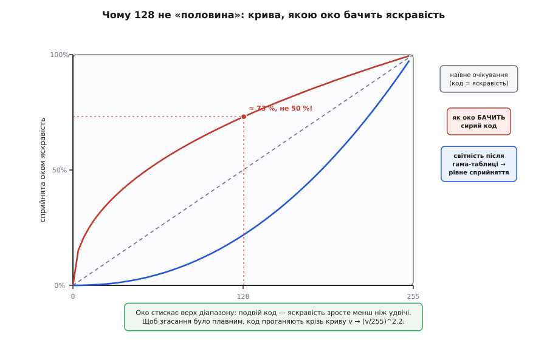

# ⚙️ Практика кольору на KY-009: fade, райдуга, гама

Три числа шпаруватості на трьох ШІМ-виходах вмикають будь-який колір — це вже знаєш. Але між «увімкнув колір» і «модуль дихає плавною райдугою, а згасання виглядає як згасання, а не як обрив» лежить купа дрібниць, на яких спотикається кожен. Чому синій кристал світить ледь-ледь, коли ти просив рівний білий? Чому `analogWrite(pin, 128)` виглядає майже так само яскраво, як 255? Чому та сама програма на ESP32 навіть не компілюється? І що робити, коли замовив жовтий, а спалахнув бузковий?

Зберемо тут повний робочий код керування KY-009 — від однорядкового `setColor` до райдуги через відтінок і гама-виправлених згасань — і поряд назвемо кожну пастку, поки вона не з'їла твій вечір. Усе під **спільний катод і 5 В** (саме такий KY-009), з окремими нотатками, де для спільного анода чи для 3.3-вольтового ESP32 усе інакше.

## Задача: від «горить» до «керую»

Голий факт про модуль: три кристали, спільний мінус на землю, кожен колір — на свій PWM-пін через власний гасильний резистор. Керування зводиться до того, щоб у будь-яку мить тримати на трьох пінах три числа яскравості — і вміти ці числа **міняти в часі** так, щоб око бачило те, що ти задумав.

Задач, по суті, чотири, і вони нанизуються одна на одну:

- **Задати колір** — одним викликом виставити трійку (r, g, b). Це фундамент, усе решта будується на ньому.
- **Плавно перейти** між двома кольорами — щоб не «клац» з червоного на синій, а перетікання. Це вже рух чисел у часі.
- **Пройти всю райдугу** — безперервний обхід кольорового кола, коли модуль повільно перебирає весь спектр. Тут стає видно, що RGB — незручна система координат для «наступного кольору», і треба інша: відтінок.
- **Зробити це красиво для ока** — щоб згасання не обривалося наприкінці, а яскравість (128, 128, 128) не виглядала майже як повна. Тут у гру входить гама.

Пройдемо їх по черзі. Мова — **C/C++**: KY-009 живе на пінах мікроконтролера, керування впирається в конкретну апаратну периферію PWM, і саме тут C/C++ лягає ідеально — жодна високорівнева мова тут ні до чого. Від заліза потрібне скрізь одне й те саме: **три виходи, кожен під каналом апаратного таймера в режимі ШІМ**. Далі — три ідіоматичні втілення цієї вимоги: **Arduino** (`analogWrite`), **ESP-IDF** (периферія LEDC) і **STM32 HAL** (три канали одного таймера). Логіка кольору в них спільна до останнього рядка; різниться лише те, як платформа заводить таймер і пише в нього шпаруватість. Наприкінці — окремий блок про ESP32 саме в Arduino-середовищі, бо там звичний `analogWrite` не працює.

## Фундамент: setColor і чому саме так

Почнімо з єдиної функції, крізь яку проходитиме **весь** колір. Не розкидаємо записи шпаруватості по коду, а замикаємо їх в одному місці — бо саме туди потім вставимо і гама-виправлення, і інверсію для спільного анода, і будь-що інше. Один шлюз на всі кольори.

:::tabs
== Arduino (AVR: Uno / Nano)

:::code proj-ky009-color/c/arduino/fundament-setcolor-i-chomu.ino

== ESP-IDF (ESP32, периферія LEDC)

:::code proj-ky009-color/c/esp-idf/fundament-setcolor-i-chomu.c

== STM32 (HAL, три канали одного таймера)

:::code proj-ky009-color/c/stm32/fundament-setcolor-i-chomu.c
:::

Тут усе прозоро: `setColor(255, 0, 0)` — повний червоний, `setColor(0, 0, 0)` — темрява. Жовтий виходить сумішшю червоного й зеленого, бо око складає їхнє світло — це і є [додаткове змішування кольору](root:sf-visual/color-formats), той самий принцип, що в кожному екрані. Керує яскравістю [ШІМ](root:hw-arch/pwm-on-mcu): пін не вміє видати «пів-напруги», він швидко-швидко вмикається й вимикається, а число 0…255 задає частку часу «ввімкнено».

> 🔧 **Навіщо це.** Замикання всього кольору в одну `setColor` — не косметика, а страховка. Коли за пів години з'ясується, що твій модуль спільноанодний (усе світиться навиворіт) або що згасання «обриваються» без гами, ти виправиш це **в одному рядку однієї функції**, а не полюватимеш на записи шпаруватості по всьому коді. Дисципліна «один шлюз» окупається на першій же правці.

Одразу зауваж тип `uint8_t` замість `int`. Яскравість фізично не виходить за 0…255 — це один байт. Взяти правильний тип — це поставити огорожу: додаси десь `+50` до значення 220, і замість «яскравіше нікуди» отримаєш загорнуте через нуль число 14, тобто раптову темряву. Про це ще згадаємо в пастках, але звичку варто закласти від початку.

## Плавний перехід: рух чисел у часі

«Плавно» означає одне: не стрибати з кольору A в колір B, а пройти проміжні значення. Найпростіше плавне — **згасання** (англ. *fade*): від якогось кольору до чорного або назад. Зробимо загальну функцію, що за задану кількість кроків перетікає з однієї трійки в іншу.

Механіка — лінійна інтерполяція (лат. *inter* — між, *polio* — гладжу): на частці шляху `t` (від 0 до 1) кожна складова дорівнює `старе + (нове − старе)·t`. При `t = 0` маємо старий колір, при `t = 1` — новий, між ними — рівний перехід.

:::code proj-ky009-color/cpp/plavnyi-perekhid-rukh.cpp

Придивись до приведення `(int)(r1 - r0)`. Воно тут захисне, а не рятівне. У C перед відніманням обидва `uint8_t` **автоматично просуваються до знакового `int`** (цілочислове просування, англ. *integer promotion*) — бо `int` вміщає будь-яке значення `uint8_t`. Тому й без приведення `r1 - r0` рахується зі знаком: якщо новий колір **темніший** за старий (`r1 < r0`), різниця чесно виходить від'ємною, а не загортається через нуль у велике додатне число. Явне `(int)` тут нічого не змінює — воно лише робить знак видимим і закладає правильний рефлекс. А рефлекс не зайвий, бо просування рятує не завжди: щойно операнди стануть ширшими й беззнаковими (два `uint16_t` там, де `int` 16-бітний), автоматичного розширення до знакового вже не буде — і різниця таки загорнеться вгору. Ось там таке приведення справді необхідне, а не косметичне.

> 🔧 **Навіщо це.** `fadeTo` — це вже не «колір», а **анімація**: числа рухаються в часі. Дві ручки — `steps` (скільки проміжних точок, тобто гладкість) і `wait` (пауза між ними, тобто швидкість) — задають характер руху. Хочеш повільне театральне затемнення — більше `steps`, більший `wait`. Хочеш різкий спалах — мало кроків. Уся інша анімація кольору, аж до райдуги, — це варіації на тему «рухай числа в часі».

Але спробуй `fadeTo` на згасання до нуля — і побачиш неприємне. Перехід від 255 до 0 виглядає нерівно: перша половина повзе ледь помітно, а на останній чверті світло раптом обривається в темряву. Начебто ми ж рахували рівні кроки! Числа справді спадають рівно — а око бачить ривок. Причина — не в коді, а в оці, і саме через неї існує гама. Але спершу розберемося з райдугою, бо там та сама лінійна механіка впирається в іншу стіну.

## Райдуга: чому RGB — незручні координати

Спробуй запрограмувати «повільно перебрати всі кольори веселки» в RGB — і швидко відчуєш незручність. Червоний → жовтий — це підняти зелений. Жовтий → зелений — прибрати червоний. Зелений → блакитний — підняти синій. І так по колу, шістьма окремими відрізками, на кожному ти вручну вирішуєш, який канал зараз росте, а який падає. Виходить драбина з `if`-ів, яку легко наплутати.

Проблема в тому, що RGB — це координати **пам'яті екрана**, а не координати «сусіднього кольору». У них немає ручки «наступний відтінок». А хочеться саме її: крутнув одне число — колір поїхав по веселці, не міняючи ні яскравості, ні насиченості.

Така ручка існує — це система **HSV**: **H**ue (відтінок), **S**aturation (насиченість), **V**alue (яскравість). Відтінок H — це кут на кольоровому колі, 0…360°: 0° червоний, 120° зелений, 240° синій, і 360° знову червоний. Насиченість S — наскільки колір «чистий» проти сірого. Яскравість V — наскільки він світлий. Райдуга в HSV — це просто **збільшуй H по колу, тримаючи S і V на максимумі**. Одне число.

Систему HSV (і споріднену HLS) впорядкував американський інформатик **Елві Рей Сміт** (Alvy Ray Smith) у статті «Color Gamut Transform Pairs» у серпневому числі *Computer Graphics* за 1978 рік; він тоді працював у Computer Graphics Lab при Нью-Йоркському технологічному інституті, а згодом став співзасновником Pixar. Мотив був саме той, що й у нас: дати людині координати, у яких думати про колір природно — «який відтінок, наскільки яскравий, наскільки насичений», — замість трьох рівнів червоного-зеленого-синього. *(Факт документований: стаття в Computer Graphics, серпень 1978; авторство Сміта — усталене.)*

Щоб крутити H, а світити на KY-009 доводиться однаково через R, G, B, потрібне перетворення **HSV → RGB**. Ось воно, у повній цілочисловій формі для максимальної насиченості й керованої яскравості:

:::code proj-ky009-color/cpp/raiduha-chomu-rgb.cpp

Тепер райдуга — це буквально `for (h = 0; h < 360; h++)`. Уся возня «який канал зараз росте» сховалася в шість рядків `switch`, і вони однакові для будь-якого модуля. Зверни увагу на приведення `(uint16_t)` у формулах p, q, t: добуток `v * s` легко перевалює за 255 і не влазить у байт — множимо в 16-бітному типі, ділимо, і лише результат кладемо в `uint8_t`. Пропустиш це приведення — отримаєш переповнення й брудні кольори на переходах. Кут на колі тримає [синус-косинусна](root:math-geometry/sine-cosine) інтуїція «повного оберту на 360°», але саме тут тригонометрія нам не потрібна — секторна формула точніша й дешевша за виклик `sin` на кожен піксель.

> 🔧 **Навіщо це.** HSV — це зміна **системи координат** заради зручної ручки. Та сама точка кольору, але тепер у неї є вісь «наступний відтінок», якої в RGB не було. Це загальний прийом інженерії: коли операція в наявних координатах виходить кострубатою (драбина `if`-ів), часто існує інша система, де вона стає одним рухом. Райдуга — наочний випадок; а перетворення туди-назад просто ганяєш на льоту.

## Гама: чому 128 не половина

Тепер повернімося до того обриву наприкінці згасання. Ми рахували яскравість рівними кроками, а око бачило ривок. Річ у тім, що **око сприймає яскравість нелінійно**. Подвоїш фізичну кількість світла — відчуття яскравості зросте набагато менше ніж удвічі. Око гостро розрізняє темні рівні й майже не помічає різниці між яскравими: перехід від 10 до 20 воно бачить як велику зміну, а від 240 до 250 — майже ніяк.

Тому `analogWrite(pin, 128)` — фізично рівно половина світла — виглядає на око не як «півсвітла», а десь як 70–75% від повного. Половина коду не дає половини **сприйнятої** яскравості. Ось ця розбіжність на графіку:



*Пунктирна діагональ — те, що наївно очікуєш: половина коду = половина яскравості. Червона крива — реальність: сирий код 128 око бачить як ≈73%, а не 50%, бо верх діапазону воно «стискає». Синя крива — світність, яку ми кладемо в гама-таблицю (v/255 у степені 2.2): вона провисає донизу так, щоб скомпенсувати око й зробити сприйняття рівним.*

Виправлення зветься **гама-корекція** (гр. *gámma* — третя літера абетки, звідти показник степеня γ). Замість того щоб слати на пін сире число з коду, ми проганяємо його крізь криву `вихід = (вхід/255)^γ · 255`. Ця крива тисне середину вниз: код 128 перетвориться приблизно на 56 (за γ = 2.2), і фізичного світла піде менше — рівно настільки, щоб око нарешті побачило «половину». Показник γ для звичних екранів історично близький до **2.2**: це не випадкове число, а приблизно обернене до того, як стискає яскравість наше око. Стандарт sRGB задає складнішу кусково-задану криву (лінійний шматочок унизу плюс степенева частина з показником 2.4), але на практиці вона добре наближається простим степенем 2.2 — саме його зазвичай і беруть для світлодіодів. *(Значення 2.2 та нелінійність людського сприйняття яскравості — усталений факт колориметрії; докладніше — у книжковій статті про [гама-корекцію](root:sf-visual/gamma-correction).)*

Рахувати `pow()` на кожен піксель дорого й безглуздо — крива та сама завжди, тож її прораховують **один раз** у таблицю з 256 значень і далі просто беруть готове. Ось найпростіший спосіб — вписати таблицю прямо в код (щоб не тягти математику з плаваючою комою на дрібний Uno):

:::code proj-ky009-color/cpp/hama-chomu-128-ne-polovyna.cpp

Тепер вставляємо таблицю в **той самий єдиний шлюз** `setColor` — і всі функції вище (fade, HSV, райдуга) автоматично стають плавними, бо весь колір іде крізь одне місце:

:::tabs
== Arduino

```arduino
void setColor(uint8_t r, uint8_t g, uint8_t b) {
  analogWrite(PIN_R, gamma8[r]);   // сире число з коду → крізь гама-криву → на пін
  analogWrite(PIN_G, gamma8[g]);
  analogWrite(PIN_B, gamma8[b]);
}
```

== ESP-IDF

```esp-idf
static void set_color(uint8_t r, uint8_t g, uint8_t b) {
    const uint8_t v[3] = { gamma8[r], gamma8[g], gamma8[b] };  // крізь гама-криву
    for (int i = 0; i < 3; i++) {
        ledc_set_duty(LEDC_LOW_SPEED_MODE, CH[i], v[i]);
        ledc_update_duty(LEDC_LOW_SPEED_MODE, CH[i]);
    }
}
```

== STM32 (HAL)

```stm32
static void set_color(uint8_t r, uint8_t g, uint8_t b) {
    __HAL_TIM_SET_COMPARE(&htim3, TIM_CHANNEL_1, gamma8[r]);   // крізь гама-криву
    __HAL_TIM_SET_COMPARE(&htim3, TIM_CHANNEL_2, gamma8[g]);
    __HAL_TIM_SET_COMPARE(&htim3, TIM_CHANNEL_3, gamma8[b]);
}
```
:::

Одна правка одного рядка — і згасання перестає обриватися, а райдуга йде рівно. Ось де окупилася дисципліна єдиного шлюзу: гама лягла в одне місце й полагодила все.

Якщо не хочеться тримати «магічну» таблицю руками, її можна порахувати раз під час ініціалізації — але тоді потрібен `pow()` з плаваючою комою (на дрібному 8-бітному МК він є, просто повільний, тож рахуємо раз на старті, не в циклі). Сама функція розрахунку — звичайний C, однаковий скрізь; різниться лише те, звідки її кличуть:

:::tabs
== Arduino

:::code proj-ky009-color/c/arduino/hama-chomu-128-ne-polovyna.ino

== ESP-IDF

```esp-idf
#include <math.h>                   // powf(); тіло функції — те саме, що й у вкладці Arduino

void app_main(void) {
    build_gamma(2.2f);              // спершу крива — вона потрібна вже першому set_color()
    leds_init();                    // потім таймер і канали LEDC
    // … далі анімація
}
```

== STM32 (HAL)

:::code proj-ky009-color/c/stm32/hama-chomu-128-ne-polovyna.c
:::

Обидва шляхи дають те саме; таблиця в коді економить пам'ять програми на розрахунок і працює навіть там, де `pow` небажаний, а розрахунок на старті зручніший, коли хочеш крутити показник γ на льоту й дивитися, що краще для ока.

> 🔧 **Навіщо це.** Гама — не примха KY-009 і не «покращайзинг». Це властивість **зору**, однакова для всіх світлодіодів, ламп і екранів. Без неї будь-яке плавне згасання виглядає зламаним наприкінці, а «половина яскравості» бреше. Ключова інженерна ідея — **таблиця замість формули**: коли перетворення завжди те саме, рахуєш його раз і кладеш у пам'ять, а не молотиш `pow` мільйон разів. Ця думка (передрахунок у таблицю) повертатиметься скрізь — від тригонометрії до кодеків.

## ESP32: та сама логіка, інша периферія

Переносиш свій скетч на ESP32 (бо потрібен Wi-Fi, більше пам'яті чи просто плата під рукою) — і компілятор одразу лається: **`analogWrite` на ESP32 не існує**. Причина не в примсі: на класичному AVR-Arduino PWM намертво прив'язаний до конкретних ніжок таймерами, і `analogWrite` — тонка обгортка над цими таймерами. В ESP32 архітектура інша — є окремий периферійний блок **LEDC** (LED Control), спеціально зроблений для керування світлодіодами: він уміє багато незалежних PWM-каналів, кожен із власною частотою й роздільністю, і будь-який канал можна прив'язати майже до будь-якого піна. Потужніше — але вимагає явного налаштування замість одного `analogWrite`.

Логіка кольору **не міняється ні на йоту** — HSV→RGB, гама-таблиця, fade лишаються ті самі. Міняється лише сам шлюз: замість `analogWrite` — виклики LEDC. У нативному ESP-IDF той самий блок LEDC налаштовується так, як показано у вкладках вище; тут же мова про **Arduino-ядро для ESP32**, і його обгортка над LEDC помітно змінилася між версіями — розберемо обидві.

**Старий API (ESP32 Arduino core 2.x)** — канал і пін налаштовуються окремо:

:::code proj-ky009-color/c/arduino/esp32-ta-sama-lohika-insha.ino

**Новий API (ESP32 Arduino core 3.x)** прибрав явні номери каналів — прив'язуєш пін і задаєш частоту одним викликом, а пишеш прямо в пін:

:::code proj-ky009-color/c/arduino/esp32-ta-sama-lohika-insha-2.ino

І в обох випадках `fadeTo`, `setHSV`, райдуга з розділів вище працюють **без жодної зміни** — вони кличуть `setColor`, а що там усередині, `analogWrite` чи `ledcWrite`, їм байдуже. Знову дивіденд від єдиного шлюзу: портування на іншу архітектуру — це переписати одну функцію, а не весь скетч.

> 🔧 **Навіщо це.** Головний урок ESP32 — розділяй **що** робиш («колір такий-то») і **чим** («такий-то PWM-блок цієї плати»). Верхній шар (HSV, гама, анімація) — чистий і однаковий на будь-якому залізі; нижній (як саме мікроконтролер виставляє шпаруватість) — прив'язаний до плати й міняється. Тримай межу між ними чіткою — і код переїжджає з Uno на ESP32 за п'ять хвилин, а не переписується. Ще нюанс: ESP32 живить логіку від **3.3 В**, тож гасильні резистори під нього рахуй на 3.3, а не на 5 — інакше кольори перекосяться (нижче про це окремо).

## Пастки: де це ламається насправді

Код вище робочий, але навколо нього — поле граблів. Пройдімося по тих, на які наступають найчастіше.

**Спільний анод: усе навиворіт.** Якщо твій модуль виявився спільноанодним (плюс спільний, кольори вмикаються мінусом), уся яскравість інвертується: 0 має світити на повну, 255 — гасити. Ознака проста й лячна — просиш білий, а гасне; просиш чорний, а все спалахує. Лікується одним рядком у шлюзі: подавай `255 − value`. Причому інверсію став **до** гами або після — не однаково; правильно спершу гама, потім інверсія готового числа:

:::tabs
== Arduino

```arduino
// Для СПІЛЬНОГО АНОДА: спершу гама, потім інвертуємо результат.
void setColor(uint8_t r, uint8_t g, uint8_t b) {
  analogWrite(PIN_R, 255 - gamma8[r]);
  analogWrite(PIN_G, 255 - gamma8[g]);
  analogWrite(PIN_B, 255 - gamma8[b]);
}
```

== ESP-IDF

```esp-idf
// Для СПІЛЬНОГО АНОДА: спершу гама, потім інвертуємо результат.
static void set_color(uint8_t r, uint8_t g, uint8_t b) {
    const uint8_t v[3] = { 255 - gamma8[r], 255 - gamma8[g], 255 - gamma8[b] };
    for (int i = 0; i < 3; i++) {
        ledc_set_duty(LEDC_LOW_SPEED_MODE, CH[i], v[i]);
        ledc_update_duty(LEDC_LOW_SPEED_MODE, CH[i]);
    }
}
```

== STM32 (HAL)

```stm32
// Для СПІЛЬНОГО АНОДА: спершу гама, потім інвертуємо результат.
// Апаратна альтернатива: лишити числа як є, а каналу таймера в CubeMX
// поставити CH Polarity = Low — тоді інверсію робить сама периферія.
static void set_color(uint8_t r, uint8_t g, uint8_t b) {
    __HAL_TIM_SET_COMPARE(&htim3, TIM_CHANNEL_1, 255 - gamma8[r]);
    __HAL_TIM_SET_COMPARE(&htim3, TIM_CHANNEL_2, 255 - gamma8[g]);
    __HAL_TIM_SET_COMPARE(&htim3, TIM_CHANNEL_3, 255 - gamma8[b]);
}
```
:::

Знову ж — правка в одному місці, і весь код (fade, HSV) миттю стає під анод. KY-009 — спільний катод, тож для нього інверсія не потрібна; це нотатка на випадок, коли під руку трапиться інший RGB-модуль із розсипу.

**Різні резистори псують білий.** Це найпідступніша пастка, бо код бездоганний, а колір бреше. Червоний кристал має нижчу пряму напругу (≈1.8 В) за зелений і синій (≈2.8 В), тож якщо на всі три лінії поставити **однакові** резистори, червоного піде більше струму — і `setColor(255, 255, 255)` дасть не білий, а рожевий. Ти можеш скільки завгодно правити числа в коді, але фізику струму це не виправить. Три різні номінали (≈180 Ом на червоний, ≈110 Ом на зелений і синій за 5 В) — це і є апаратне балансування білого. Якщо номінали вже впаяні однакові й перепаювати ліньки, останній рятунок — **програмне** балансування: трохи прибрати червоний у шлюзі.

:::tabs
== Arduino

```arduino
// Кустарний баланс білого, коли резистори однакові й червоний «пре».
// Підбери коефіцієнти на око під свій конкретний модуль.
void setColor(uint8_t r, uint8_t g, uint8_t b) {
  analogWrite(PIN_R, gamma8[(uint16_t)r * 200 / 255]);  // притлумити червоний
  analogWrite(PIN_G, gamma8[g]);
  analogWrite(PIN_B, gamma8[b]);
}
```

== ESP-IDF

:::code proj-ky009-color/c/esp-idf/pastky-de-tse-lamaietsia.c

== STM32 (HAL)

```stm32
// Ті самі коефіцієнти — тільки перед записом у регістр порівняння.
static void set_color(uint8_t r, uint8_t g, uint8_t b) {
    __HAL_TIM_SET_COMPARE(&htim3, TIM_CHANNEL_1, gamma8[(uint16_t)r * 200 / 255]);
    __HAL_TIM_SET_COMPARE(&htim3, TIM_CHANNEL_2, gamma8[g]);
    __HAL_TIM_SET_COMPARE(&htim3, TIM_CHANNEL_3, gamma8[b]);
}
```
:::

Це кустарщина й компроміс — правильно балансувати резисторами, — але як швидка латка на готовій платі працює.

**Порядок пінів −R G B vs −G R B.** Дві апаратні версії KY-009 виводять кристали в різному порядку: на одних `− R G B`, на інших зелений і червоний поміняні — `− G R B`. Симптом кумедний і збиває з пантелику: просиш `setColor(255, 0, 0)` (червоний) — спалахує зелений. Код правильний, схема правильна — просто ніжки кристала розведені інакше. Не переписуй логіку: або поміняй місцями два дроти, або два рядки в коді. Найчистіше — знову ж таки у шлюзі, помінявши, куди йдуть канали:

```cpp
// Версія плати − G R B: фізичні піни під R і G переставлені.
// Лікуємо в одному місці — міняємо адресацію каналів, логіка кольору ціла.
const uint8_t PIN_R = 10;  // «червоний» кристал реально сидить на цьому піні
const uint8_t PIN_G = 9;   // а «зелений» — на цьому
const uint8_t PIN_B = 11;
```

Мораль та сама, що з підключенням: дивись на **написи біля пінів конкретної плати**, а не на очікуваний порядок.

**Струм піна при білому на повну.** Кожен колір тягне до ~20 мА, а `setColor(255, 255, 255)` вмикає всі три разом — до 60 мА через модуль. Поки кожен колір висить на **окремому** піні (як і має бути), усе гаразд: 20 мА на пін класичний AVR тримає. Але спокуса заощадити піни й повісити два кольори на один вихід (або гнати кілька KY-009 з одного піна) впирається в межу струму піна — вихід просяде, колір поблякне, а в гіршому разі пін деградує. Один KY-009 на три PWM-піни — безпечно й правильно; більше навантаження — став транзистор або драйвер між піном і світлодіодом, як для [адресних світлодіодних](root:hw-motion/addressable-leds) стрічок, де струм узагалі окремим живленням.

**Переповнення в цілочисловій арифметиці.** Уже торкалися, але це коштує стількох згаяних вечорів, що варте окремого пункту. Уся тонкість у тому, **де** воно справді підстерігає. Віднімання двох `uint8_t` — як `r1 - r0` у `fadeTo` — безпечне: C наперед просуває обидва до знакового `int`, тож різниця чесно виходить від'ємною, і явне `(int)` там лише документує намір. Небезпека починається там, де проміжок **не** влазить у тип, у якому рахується. У формулах HSV добуток `v * s` сягає 255·255 = 65025 і переповнює 16-бітний `int` на Uno — тому й рахуємо його в `uint16_t`. І навпаки: віднімання двох по-справжньому широких беззнакових (двох `uint16_t` там, де `int` 16-бітний) до знакового вже не просувається — от воно й загорнеться через нуль у величезне число. Правило: **знай, у якому типі рахується проміжок, і бери його достатньо широким**, а в байт клади лише готовий результат. Цей клас помилок не падає й не кричить — він просто малює неправильну картинку, і шукати доводиться очима.

**Мерехтіння й частота PWM.** Частоту ШІМ задає таймер, і питання лише в тому, чи пускає тебе середовище до цієї ручки. Стандартний `analogWrite` на Uno дає ШІМ близько 490 Гц — око цього не бачить, але камера телефона зловить смуги, а швидкий рух під таким світлом «застрибає». Там, де частота відкрита — `freq_hz` у LEDC на ESP32, пара «дільник + період» (Prescaler і ARR) на таймері STM32, — 5 кГц добрий вибір: далеко за порогом ока й камери. Ставити мегагерци ні до чого — на них 8-бітна роздільність почне «здавати», бо таймеру бракне тактів на 256 щаблів. П'ять кілогерц — золота середина для світлодіода.

## Що з цього винести

Керування кольором на KY-009 стоїть на трьох стовпах, і всі вони — не про сам модуль, а про загальні речі, що переносяться будь-куди.

Перший — **єдиний шлюз `setColor`**. Увесь колір проходить крізь одну функцію, і тому гама, інверсія для анода, баланс білого, перестановка пінів чи перехід на ESP32 — це правка в **одному** місці, а не полювання по всьому скетчу. Дисципліна, що окупається на першій же зміні.

Другий — **HSV як зручні координати**. RGB — це пам'ять екрана, у ній немає ручки «наступний колір»; HSV дає її одним числом-відтінком, і райдуга стає циклом `for` замість драбини `if`-ів. Перетворення HSV→RGB (за Елві Реєм Смітом, 1978) ганяєш на льоту — і думаєш про колір так, як думає людина.

Третій — **гама як властивість ока**. Око бачить яскравість нелінійно, тож сире число з коду бреше: 128 виглядає як ~73%, а не 50%, і згасання без гами обривається наприкінці. Крива `(v/255)^2.2`, порахована **раз** у таблицю, компенсує око — і робить це задарма під час роботи. Таблиця замість формули — прийом, що повертатиметься скрізь.

А довкола них — поле пасток, де код правильний, а картинка ні: інверсія для спільного анода, різні резистори проти рожевого «білого», дві версії порядку пінів, струм піна при повному білому, переповнення байта в арифметиці, частота ШІМ проти мерехтіння. Жодна з них не падає з помилкою — усі показують себе лише неправильним світлом. Тримай їх у голові — і маленький квадратик 5050 засвітиться рівно тим кольором, який ти задумав, плавно перетече в наступний і проживе довго.
