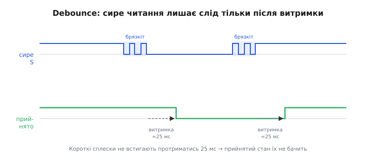

# ⚙️ Проєкт: «магічна чаша» в коді

Дві платки лежать на столі, кожна на чотирьох проводах під'єднана до плати мікроконтролера. Живлення й земля зведено на спільні шини, виходи вимикачів S — на цифрові ноги, входи світлодіодів L — на ноги з ШІМ. Залізо готове й нічого поки не робить: нахиляєш плату — світлодіод на ній так само світить, бо між вимикачем і світлодіодом на платі немає дроту. Увесь ефект перетікання ще попереду — і живе він **тільки в коді**. Плата дає сирі цеглинки: з одного боку віддає «нахилено / ні», з іншого приймає число яскравості. Зв'язати одне з іншим так, щоб світло *перелилося* з чаші в чашу, — задача прошивки, і саме її ми зараз розв'яжемо до останнього рядка.

Від мікроконтролера ця задача просить рівно чотири речі: два цифрові входи, два виходи з апаратним ШІМ, лічильник мілісекунд і головний цикл. Це є в кожному чипі — різняться лише імена, якими воно кличеться. Тому кожен приклад нижче йде вкладками: **Arduino** (ATmega328P на 16 МГц, UNO чи Nano) — бо це найкоротший вхід у тему; поруч **ESP-IDF** і **STM32 HAL** — щоб ту саму задачу впізнав і той, хто скетчів не пише. Це не псевдокод: імена функцій, типи, оголошення — усе таке, як воно є в реальному проєкті, без жодної зовнішньої бібліотеки.

## Що саме треба збудувати

Перш ніж писати, домовмося словами, чого хочемо, — бо половина помилок у таких проєктах від того, що ефект «в голові» і ефект «у коді» розходяться. Поведінка така:

- у спокої обидві чаші світять **наполовину** — світло рівно поділене;
- поки тримаєш нахил у бік чаші A, її світло повільно **наростає**, а чаші B — рівно настільки ж **спадає**;
- відпустив — рух спиняється, чаші лишаються там, де застигли;
- нахил у бік B жене процес назад.

Ключове слово тут — **повільно**. Нахил не *встановлює* яскравість, а лише задає **напрямок руху**: поки вимикач замкнений, спільний рівень повзе на крок щотакту. Тримаєш довше — світло переллється далі; смикнув і відпустив — зрушиться ледь-ледь. Саме тому ефект виглядає як плавне переливання рідини, а не як клацання перемикача. І саме тому кульковий вимикач тут достатній, хоч він і не вміє міряти *кут*: нам потрібен не кут, а лише «в який бік лити».

Звідси й уся архітектура скетча — маленький конвеєр, що прокручується щотакту `loop()`:


*Один прохід головного циклу. Сирий сигнал вимикача брязкотить, тож його спершу «гасять» до чистого «замкнено/розімкнено»; за чистим станом рівень переливу посувають на один крок; рівень задає яскравість чаші A напряму, а чаші B — доповненням до 255. Наступний такт починає все спочатку — і саме з цих дрібних кроків складається плавність.*

Розберемо конвеєр по ланці: спершу як читати вимикач без брязкоту, тоді як зберегти сумарну яскравість, а тоді складемо все в один робочий скетч.

## Ланка перша: читаємо вимикач без брязкоту

Пін S дає рівень «високо/низько» — здавалося б, прочитай стан входу (`digitalRead` в Arduino, `gpio_get_level` в ESP-IDF, `HAL_GPIO_ReadPin` на STM32) і все. Але механічна кулька, докочуючись до контактів, за кілька мілісекунд встигає торкнутись і відскочити багато разів, і читання ніжки в ці миті повертає чергу `1-0-1-0`, перш ніж усе устаканиться. Якщо на кожному такому «0» ми штовхатимемо рівень, один нахил дасть не плавний рух, а рвані стрибки. Тому сире читання треба **згасити** (англ. *debounce*): приймати нове значення лише коли воно протрималося стабільним якийсь час.

Принцип видно на часовій діаграмі. Зверху — що реально приходить на ніжку; знизу — стан, який ми **приймаємо** за правду:


*Сирий рівень (угорі) під час кожного перемикання видає пачку коротких сплесків. Прийнятий стан (унизу) міняється тільки тоді, коли новий рівень протримався стабільним усю витримку (тут ≈25 мс). Короткі сплески не встигають її вистояти — і залишаються непоміченими. Так із брудного сигналу виходить чистий «замкнено/розімкнено».*

Механіка згасання проста: щоразу, коли сире читання **відрізняється** від того, що ми досі вважали станом, ми не віримо йому одразу, а запам'ятовуємо момент і чекаємо. Якщо за час витримки читання лишилося новим — приймаємо; смикнулося назад — скидаємо таймер і чекаємо знову. Ось ця логіка, загорнута в маленьку структуру, щоб на дві плати завести дві незалежні копії:

:::tabs
:::code proj-magic-cup/c/arduino/lanka-persha-chytaiemo.ino
:::code proj-magic-cup/c/esp-idf/lanka-persha-chytaiemo.c
:::code proj-magic-cup/c/stm32/lanka-persha-chytaiemo.c
:::

Уся суть — в останньому `if`. Ми міняємо `stable` (чистий стан) не тоді, коли сигнал *уперше* стрибнув, а тоді, коли він стрибнув **і** відтоді минуло `DEBOUNCE_MS` без нового стрибка. Пачка коротких сплесків щоразу зсуває `changedAt` на «зараз», лічильник витримки не встигає добігти — і `stable` спокійно стоїть на місці, доки контакт не заспокоїться остаточно.

> 🔧 **Навіщо це.** Спокуса «прочитати S і зреагувати» коштує вечора налагодження. Без згасання перетікання **сіпається**: тримаєш нахил рівно, а рівень то повзе, то підстрибує назад, бо кожен сплеск брязкоту система тлумачить як окрему подію. Найгірше, що плата при цьому **справна** — брязкотить сам механічний контакт, це властивість будь-якого кулькового вимикача, а не дефект примірника. Заведи згасання один раз структурою на кожну лінію — і сирий смітний сигнал перетвориться на чисте «замкнено/розімкнено», з яким уже можна працювати. Докладніше про сам прийом і вибір витримки — [усунення брязкоту контактів](root:hw-digital/contact-debounce).

Чому 25 мс, а не 5 чи 200? Це компроміс. Замало — крізь фільтр протече частина брязкоту (пачки бувають і на 10 мс). Забагато — вимикач почне «тупити»: швидкий нахил-відпускання система прогавить, бо не дочекається витримки. Для кулькового вимикача 20–50 мс — золота середина; 25 лишає запас в обидва боки. Це число варто мати змінною, а не «магічною» константою в коді, щоб підкрутити під свій примірник, якщо треба.

## Ланка друга: спільний рівень і збереження суми

Тепер серце ефекту. Заведемо **одну** спільну змінну — рівень переливу, ціле число від 0 до 255. Домовимося: це число — **яскравість чаші A**. А яскравість чаші B — його **доповнення до 255**:

```
яскравість A = level
яскравість B = 255 − level
```

Чому саме так — видно, якщо додати два рядки: `A + B = level + (255 − level) = 255`, завжди, за будь-якого `level`. Сума яскравостей двох чаш **стала**. Скільки світла забрали в однієї — рівно стільки додали іншій. Око бачить не появу й зникнення світла, а його **перетікання**: загальна кількість сяйва в парі не міняється, міняється лише його розподіл. Оце «завжди 255» — уся математика фокуса, більше нічого.

Тепер прив'яжемо рух рівня до вимикачів:

- чиста подія «чаша A нахилена» → **збільшуємо** `level` на крок (A яскравішає, B тьмянішає);
- чиста подія «чаша B нахилена» → **зменшуємо** `level` на крок (навпаки);
- жодна не нахилена → `level` стоїть.

І тут — тонкість, яку легко проґавити: `level` не має вилізти за межі `0..255`, бо саме такий діапазон шпаруватості ми домовились виводити на ШІМ (вісім бітів), а `uint8_t`, переповнившись, підступно «загорнеться» з 255 у 0 і чаша різко спалахне навпаки. Тому крок робимо з **упором** об край:

:::code proj-magic-cup/cpp/main.cpp

Рахунок навмисне ведемо в `int`, а не в `uint8_t`: якби ми писали `level += STEP` прямо у восьмибітній змінній, то на 255 воно б перескочило в 0 (переповнення без попередження), і замість «упертись у стелю» чаша A блимнула б у темряву. Проміжний `int` бачить, що `next` виліз за 255, і ми чесно притискаємо його до краю. Дрібниця на два рядки — але без неї ефект ламається саме на найяскравішому місці, куди дивишся найпильніше.

Швидкість переливу задає `STEP`. Крок 3 за такт при циклі раз на ~4 мс дає повний перелив (0 → 255) приблизно за 255 / 3 × 4 мс ≈ **340 мс** утримання — тобто третину секунди від «повністю A» до «повністю B». Хочеш повільнішого, млявого переливу — зменш `STEP` до 1; хочеш різкого — підніми. Це найголовніша ручка «відчуття» ефекту, і її теж тримаємо змінною.

> 🔧 **Навіщо це.** Одна спільна змінна замість двох окремих яскравостей — не економія пам'яті, а **гарантія**, що сума не попливе. Якби ми крутили яскравість A і B незалежно, довелося б щоразу стежити, щоб вони узгоджувались, і будь-яка неточність накопичувалась би: то сумарне світло тьмяніє, то яскравішає, ефект «дихає». Тримаючи **один** рівень і виводячи B як його дзеркало, ми робимо збереження суми не побажанням, а математичним фактом коду — його неможливо порушити, бо друга яскравість завжди рахується з першої.

## Складаємо робочий скетч

Тепер зшиваємо обидві ланки в цілу прошивку. Розкладка виводів — та сама, що при монтажі пари: S обох плат на будь-які цифрові входи, L обох — **обов'язково** на виводи, здатні видавати ШІМ. На UNO це ноги з позначкою `~` (беремо `~D9` і `~D6`, вимикачі — на `D8` і `D7`); на ESP32 ШІМ дає периферія LEDC, прив'язана до довільного GPIO; на STM32 — канал таймера, виведений на свою ніжку. Це повний файл; збирай і працює.

:::tabs
:::code proj-magic-cup/c/arduino/skladaiemo-robochyi-sketch.ino
:::code proj-magic-cup/c/esp-idf/skladaiemo-robochyi-sketch.c
:::code proj-magic-cup/c/stm32/skladaiemo-robochyi-sketch.c
:::

Пройдімо головний цикл очима, бо в цих п'ятнадцяти рядках — увесь ефект. Спершу дістаємо **чисті** стани обох вимикачів: `debounceRead` повертає згашений рівень, а порівняння з `TILTED` перетворює його на зрозуміле `true/false` — «нахилено чи ні». Далі — правило руху: якщо нахилена **тільки** A, штовхаємо рівень до неї; тільки B — до неї; якщо тримають обидві або жодної, навмисно нічого не робимо (перелив спиняється). І насамкінець виводимо: `level` іде на світлодіод A напряму, `255 − level` — на B. Один прохід зрушує світло на мікрокрок; сотні проходів за секунду зливають його з чаші в чашу плавно.

Пауза наприкінці такту (`delay(4)`, `vTaskDelay`, `HAL_Delay(4)` — одне й те саме) не марнує час, а **задає темп** переливу. Кожні 4 мс рівень посувається на `STEP`, і разом ці два числа визначають, за скільки світло перетече повністю. Просто заснути тут припустимо, бо прошивка більше нічого не робить: уся її робота — читати два піни й писати два. Якби плата паралельно вела ще щось (мережу, дисплей), паузу довелось би прибрати й рухати рівень за годинником (`millis()`, `esp_timer_get_time()`, `HAL_GetTick()`), але для самого ефекту чаші це зайве ускладнення.

> 🔧 **Навіщо це.** Зверни увагу на випадок «обидві нахилені разом» — `tiltA && tiltB`. Легко його проґавити й написати два незалежні `if`, і тоді при одночасному спрацюванні рівень за один такт смикнеться і туди, і сюди — ефект «затремтить». Умова `tiltA && !tiltB` («тільки A») закриває це чисто: коли активні обидва вимикачі, жодна гілка не спрацьовує, рівень стоїть. Для дзеркально змонтованої пари таке трапляється рідко (один нахил вмикає одну плату й **відпускає** іншу), але покласти цей запобіжник у код — дешевше, ніж ловити тремтіння потім.

Ось і вся «магія» — п'ятнадцять рядків циклу плюс дві допоміжні функції. Жодної бібліотеки, жодного ШІМ там, де вивід його не вміє. Тепер варіанти.

## Варіант без пари: одна плата як індикатор нахилу

А що, як плата в тебе одна? Пари для повного ефекту нема, але сама зв'язка «вимикач → плавне світло» лишається повчальною й корисною сама по собі. Найпростіше застосування однієї KY-027 — **індикатор нахилу з плавним відгуком**: тримаєш плату рівно — світлодіод пригашений, нахиляєш — він плавно **розгоряється** до повної яскравості, вертаєш — так само плавно гасне. Не клац-клац, а м'яке «дихання» у відповідь на нахил.

Логіка та сама, лише замість двох світлодіодів з дзеркальними яскравостями — один, і рівень тепер повзе до максимуму, поки нахилено, і до нуля, поки рівно:

:::tabs
:::code proj-magic-cup/c/arduino/variant-bez-pary-odna.ino
:::code proj-magic-cup/c/esp-idf/variant-bez-pary-odna.c
:::code proj-magic-cup/c/stm32/variant-bez-pary-odna.c
:::

Тут видно, що прийом ширший за саму чашу. «Накопичувати рівень і виводити його через ШІМ» — універсальний спосіб перетворити **дискретну** подію (нахилено / ні) на **плавну** реакцію. Та сама заготовка робить нічник, що м'яко світлішає, коли його беруть у руку й нахиляють; індикатор, що плавно набирає яскравість від струсу; реакцію іграшки на рух. Пара з двох плат — лише найгарніший окремий випадок, де «плавна реакція» однієї чаші — це «спад» іншої.

> 🔧 **Навіщо це.** Помітна деталь: тут ми не вмикаємо світлодіод *миттю* при нахилі, хоч могли б (`digitalWrite(PIN_L, tilted)`). Плавність — навмисна: різкий спалах видає, що всередині просто вимикач, а м'яке наростання **приховує** дискретність події й виглядає «розумно». Це загальний прийом дизайну відгуку: між грубим датчиком і оком постав інтегратор (накопичення рівня), і поведінка стане плавною, хоч джерело — двійкове «так/ні». Той самий трюк, що робить чашу магічною, робить приємним будь-який індикатор на копійчаному вимикачі.

## Перенесення на ESP32: ledc замість analogWrite

Arduino-вкладка вище приколочена до ATmega328P однією річчю — функцією `analogWrite`. Якщо лишатися в звичному Arduino-середовищі, але взяти ESP32, то на ньому її класична форма поводиться інакше (в старих версіях ядра її взагалі не було, у нових вона є, але ШІМ там влаштований інакше), тож перелив краще будувати на «рідному» для ESP32 генераторі ШІМ — периферії **LEDC** (англ. *LED Control*). Різниць рівно три, і кожну варто знати, бо на них спотикаються при переході.

**Перша — напруга. ESP32 живиться й працює від 3.3 В, не 5.** Плати KY-027 це терплять (усередині лише світлодіод із резистором і підтяжка), але світлодіод від 3.3 В світить помітно тьмяніше: менша напруга — менший струм крізь той самий гасильний резистор. Для наочної демонстрації в яскравій кімнаті це відчутно; лік — або мати темніше тло, або (акуратно) зменшити гасильний резистор на платі. Пін `+` чаш вішаємо на `3V3`, не на 5 В.

**Друга — ніжки. У ESP32 ШІМ доступний майже на будь-якому виводі**, а не лише на позначених `~`, бо LEDC — це матриця з кількох незалежних каналів-таймерів, які можна «прив'язати» до потрібних GPIO. Але деякі ноги зайняті або примхливі (ноги завантаження, лише-вхідні GPIO 34–39), тож беремо звичайні безпечні виходи, скажімо `GPIO 18` і `GPIO 19`.

**Третя — сам виклик.** Замість `analogWrite(pin, value)` на ESP32 ШІМ спершу **налаштовують** на ніжці (частота й розрядність), а тоді пишуть у неї шпаруватість. У сучасному ядрі Arduino-ESP32 (версія 3.x, 2024 і новіші) це роблять двома функціями:

```cpp
ledcAttach(pin, frequency, resolution_bits);   // налаштувати ШІМ на ніжці
ledcWrite(pin, duty);                           // виставити шпаруватість
```

`ledcAttach` замінила пару старих `ledcSetup` + `ledcAttachPin` і сама роздає внутрішні канали — раніше канал доводилось заводити вручну. Розрядність — скільки бітів у числі шпаруватості: візьмемо **8 бітів**, і тоді діапазон `duty` — рівно `0..255`, той самий, що звик `analogWrite`, і решта коду переливу лишається без змін. Частоту для світлодіода досить узяти близько **5 кГц** — далеко за межею, де око ловить блимання.

Ось той самий ефект чаші, перенесений на ESP32 у середовищі Arduino; уся логіка (згасання, рівень, збереження суми) — дослівно та сама, підмінилися лише три рядки роботи з ніжками:

:::code proj-magic-cup/c/arduino/perenesennia-na-esp32-ledc.ino

Порівняй два скетчі поряд — і видно, що чаша **не залежить** від конкретного чипа. Уся її суть (згасити брязкіт, тримати один рівень, вивести його доповненням) переносна дослівно; чипозалежні лише три речі — як налаштувати ніжку під ШІМ, як у неї писати і яка напруга живлення. Це добра наука взагалі: коли пишеш прошивку, тримай **логіку ефекту** окремо від **доступу до заліза**, і перенесення на інший мікроконтролер зведеться до підміни кількох рядків, а не переписування всього.

> 🔧 **Навіщо це.** Якщо в тебе ядро Arduino-ESP32 **старіше** за 3.x, `ledcAttach` не існуватиме — компілятор лайнеться на невідому функцію. Тоді або онови ядро (найпростіше), або зверни виклики на давню трійцю: `ledcSetup(channel, freq, bits)` заводить канал, `ledcAttachPin(pin, channel)` чіпляє його до ніжки, а `ledcWrite(channel, duty)` пише вже **в канал**, не в ніжку. Це найчастіша причина, чому чужий ESP32-скетч із інтернету «не збирається»: код і версія ядра з різних епох. Спершу перевір версію ядра, тоді вибирай форму викликів.

## Складність і пастки: де перелив ламається

Усі варіанти вище ми довели до робочих. Тепер чесний перелік того, на чому цей код спотикається найчастіше, — кожен пункт з'їв у когось вечір.

**L на не-ШІМ-нозі — найпоширеніша.** На UNO `analogWrite` дає плавну яскравість **тільки** на ногах із позначкою `~` (3, 5, 6, 9, 10, 11). Повісиш L на звичайну ногу (скажімо, D8) — і `analogWrite` там перетвориться на грубе «увімк/вимк»: значення нижче 128 дасть темно, вище — повну яскравість, і жодного проміжку. Перелив розсиплеться на клацання: замість плавного зливання світло стрибатиме між «яскраво» і «темно». Плата й код справні — просто нога не вміє ШІМ. Лік: тримай L обох чаш на `~`-ногах, а вимикачі (яким ШІМ не потрібен) — на будь-яких цифрових.

**Забутий debounce — сіпання переливу.** Читаєш S голим `digitalRead` без згасання — і кожен сплеск брязкоту система рахує як окрему подію нахилу. Тримаєш плату рівно, а рівень то повзе, то стрибає назад; лічба «скільки разів нахилили» бреше. Це не дефект вимикача, це його природа. Без ланки згасання ефект виглядає нервовим і несправним, хоч залізо ціле.

**Неправильна орієнтація вимикача — «спокій» переплутано зі «нахилом».** Кульковий вимикач несиметричний і чутливий переважно до нахилу в **один** бік. Поставиш трубку не тим боком — і в спокої вона вважатиметься «нахиленою», а справжній нахил читатиметься як спокій. Ефект працюватиме «навпаки» або взагалі не спинятиметься. Проявляється як «світло тече саме собою, без нахилу» або «нахиляю, а нічого». Лік не в коді логіки, а в константі `TILTED` (який рівень S означає «нахилено» для *твоєї* орієнтації) і в тому, яким боком фізично лежить плата. Пару монтують дзеркально, щоб один нахил вмикав одну й відпускав другу.

**Полярність / плутанина, який рівень «нахилено».** Пін S показує стан вимикача через підтяжку «навпаки»: замкнений вимикач тягне S **до землі** (LOW), розімкнений — підтяжка тримає HIGH. Легко вписати `TILTED = HIGH`, коли насправді `LOW`, — і вся реакція перевернеться. Якщо перелив іде не в той бік або взагалі не спиняється, перше, що перевіряй, — значення `TILTED`: заміни `LOW` на `HIGH` (чи навпаки) і подивись, чи стало правильно. Це одна константа, а не переробка коду.

**Переповнення рівня — спалах на краю.** Якщо посувати `level` прямо у `uint8_t` (`level += STEP`), то на 255 воно перескочить у 0 (а на 0 при відніманні — у 255): найяскравіша чаша раптом провалиться в темряву, а темна спалахне на повну. Це видно саме на краях переливу, куди дивишся найпильніше. Лік — рахувати наступне значення в `int` і **притискати** до `0..255`, як у `nudge()`. Два зайві рядки рятують ефект від різкого стрибка на межі.

**ESP32: стара vs нова форма ledc.** Скетч під ESP32 не збереться, якщо форма викликів LEDC не збігається з версією ядра. Ядро 3.x і новіше хоче `ledcAttach(pin, freq, bits)` + `ledcWrite(pin, duty)`; ядро 2.x хоче `ledcSetup` + `ledcAttachPin` + `ledcWrite(channel, duty)`. Симптом — помилка компіляції «`ledcAttach` was not declared» (стара версія) або «too few arguments to `ledcWrite`» (нова версія зі старим кодом). Перевір версію Arduino-ESP32 і бери відповідну форму.

**ESP32: 3.3 В — тьмяно.** Той самий скетч на ESP32 світить помітно блідіше, ніж на UNO, бо живлення 3.3 В замість 5. Ефект **фізично** такий самий (сума яскравостей стала), але видно його гірше в яскравому світлі. Це не помилка коду — це напруга. Демонструй у тіні або зменш гасильний резистор.

Наскрізна думка під усіма пастками одна. Залізо KY-027 віддає лише сирі цеглинки: «нахилено / ні» з одного боку, число яскравості — з іншого. **Увесь ефект — у трьох речах коду**: згасити брязкіт до чистої події, тримати один спільний рівень і посувати його за нахилом, вивести його як дзеркальну пару яскравостей через ШІМ. Прибери бодай одну — і магія розсиплеться: без згасання вона сіпається, без спільного рівня сума пливе, без ШІМ-ноги перелив стає клацанням. А склади всі три правильно — і два копійчані кулькові вимикачі почнуть переливати світло з чаші в чашу так, наче в них справді щось налито.
