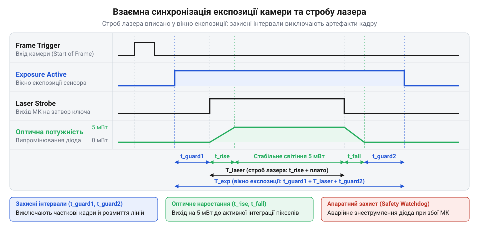
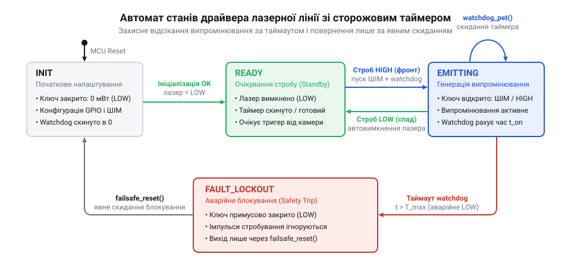

# Лазерний модуль з лінією (5 мВт, з фокусом)

<preknowlist>
- [KY-008](root:cat-hw-actuators/ky-008-laser) — схемотехніка підключення лазерного модуля через транзисторний ключ (біполярний або польовий), обмеження робочого струму діода та заходи оптичної безпеки при роботі з лазерним променем
</preknowlist>

## Безпечна ініціалізація виводів без паразитного спалаху

Під час подачі живлення або апаратного перезавантаження мікроконтролера цифровий вузол керування опиняється в нестабільному перехідному стані. Доки напруга на шинах живлення стабілізується, а внутрішній супервізор скидання (англ. @@en|Power-On Reset@@, POR) утримує ядро в стані ресету, цифрові виводи введення-виведення (англ. @@en|GPIO@@, від @@en|General Purpose Input/Output@@) апаратно переводяться у стан високого імпедансу (англ. @@en|high impedance@@, або @@en|Hi-Z@@, від латинського *impedire* — перешкоджати).

У стані високого імпедансу вихідні ключі виводу розімкнені, а внутрішні підтягувальні резистори вимкнені. Лінія керування фізично висить у повітрі, перетворюючись на чутливу антену. Модуль лазерної лінії, як-от [модуль KY-008](root:cat-hw-actuators/ky-008-laser), комутується електронним ключем — польовим транзистором (транзистор, від англійського @@en|transfer@@ та @@en|resistor@@ — переносний опір) або біполярним транзистором. Затвор польового транзистора (англ. @@en|MOSFET gate@@) має майже нескінченний вхідний опір і паразитну ємність від десятків до сотень пікофарад. Навіть мізерні електромагнітні завади від перехідних процесів стабілізатора або ємнісне наведення від сусідніх провідників здатні зарядити затвор до порогової напруги відкриття `V_GS(th)`. У результаті транзисторний ключ відкривається, і лазерний діод (діод, від грецького *di-* — два та *hodos* — шлях) генерує неконтрольований спалах світла ще до того, як завантажувач мікроконтролера виконає першу інструкцію прошивки.

> 🔧 **Навіщо це.**
> Раптовий паразитичний спалах під час старту неприпустимий з двох причин: оптичної безпеки та цілісності сенсорів. Лазерне випромінювання потужністю 5 мВт належить до класу безпеки 3R: випадковий погляд в апертуру модуля в момент увімкнення приладу загрожує сітківці ока оператора. Крім того, неконтрольований спалах засвічує високочутливу оптичну матрицю тріангуляційного 3D-сканера під час калібрування нульового рівня чорного, викликаючи помилки всього конвеєра комп'ютерного зору.

Щоб повністю усунути паразитичне відкриття ключа на апаратному рівні, лінію керування обов'язково оснащують зовнішнім стягувальним або підтягувальним резистором:

- Для схем з N-канальним MOSFET або NPN-транзистором (активний рівень — логічна одиниця) встановлюють зовнішній стягувальний резистор (англ. @@en|pull-down@@) опором 10 кОм між затвором і землею `GND`. Він гарантовано розряджає затвор і утримує потенціал 0 В у фазі Hi-Z.
- Для схем з P-канальним MOSFET або PNP-транзистором (активний рівень — логічний нуль) встановлюють зовнішній підтягувальний резистор (англ. @@en|pull-up@@) опором 10 кОм між затвором і шиною живлення `VCC`.

Проте навіть за наявності зовнішнього резистора помилковий порядок програмної ініціалізації в прошивці викликає короткочасний сплеск напруги — голку (англ. @@en|glitch@@ — перехідна імпульсна завада тривалістю від одиниць наносекунд до кількох мікросекунд). Поширена помилка початківців полягає у виклику перемикання напрямку виводу до налаштування його логічного рівня:

```c
// Небезпечна послідовність: викликає паразитний спалах лазера
pinMode(LASER_PIN, OUTPUT);     // Вивід переведено у вихід, у вихідному регістрі міг бути залишковий стан 1!
digitalWrite(LASER_PIN, LOW);   // Запізніле скидання в пасивний рівень
```

В архітектурі сучасних мікроконтролерів (зокрема ARM Cortex-M) стан піна визначається незалежними регістрами (регістр, від латинського *registrum*, від *regerere* — вносити, записувати):
- Регістр напрямку / режиму: наприклад, `MODER` (`00b` — вхід / Hi-Z, `01b` — вихід загального призначення).
- Регістр вихідних даних: `ODR` або атомарний регістр встановлення/скидання бітів `BSRR` (або `BRR`).

Якщо у вихідному регістрі після попереднього м'якого перезавантаження зберігся стан одиниці або якщо регістр за замовчуванням має невизначений стан, то в момент запису `01b` у `MODER` вихідний буфер миттєво підключає лінію до шини живлення `VDD`. Мікроконтролер видає на затвор логічну одиницю. Скидання лінії в нуль наступною інструкцією відбувається лише через кілька машинних тактів. За тактової частоти 84 МГц пауза між двома інструкціями може сягати 50–100 нс, а за наявності переривань чи повільної шини периферії — кількох мікросекунд. Цього часу цілком достатньо, щоб польовий транзистор повністю відкрився і діод спалахнув.

Щоб досягти абсолютно безглітчевого увімкнення ([запобігання паразитним завадам GPIO](root:sf-devices/gpio-glitch-prevention)), драйвер реалізує суворий програмний порядок кроків:

1. Тактування: вмикається тактування порту введення-виведення в блоці керування тактуванням периферії (регістр `RCC->AHB1ENR`).
2. Внутрішня підтяжка: регістр конфігурації підтягувальних резисторів (`PUPDR`) налаштовується на стягування до землі (`01b` — pull-down) для підтримки зовнішнього резистора.
3. Попередній запис неактивного рівня: у вихідний регістр (`ODR`) або скидальну частину атомарного регістра (`BSRR`) записується пасивний рівень (0 для активної одиниці або 1 для активного нуля). Вихідний буфер отримує безпечний рівень ДО того, як буде з'єднаний із зовнішнім виводом.
4. Активація виходу: лише тепер біти режиму в регістрі `MODER` переводяться зі стану входу (`00b`) у режим виходу (`01b`). Лінія перемикається без найменшого стрибка потенціалу.
5. Попередня конфігурація таймера: виділений апаратний таймер готується до роботи заздалегідь. До перемикання виводу в режим альтернативної функції (Alternate Function, `10b` у `MODER`) канал порівняння таймера тримають у вимкненому стані (`CCxE = 0` у регістрі `CCER`), щоб внутрішній логічний рівень схеми захоплення/порівняння не породив апаратний глітч під час зміни мультиплексора виводу.

Нижче наведено практичну реалізацію безпечної ініціалізації виводу керування лазером мовами C та C++.

:::tabs
:::code api-laser-line-driver-cpp/c/laser-gpio-init-safe.c
:::code api-laser-line-driver-cpp/cpp/laserlinepin.cpp
:::

## Мікросекундне стробування та апаратна синхронізація з камерою

Постійна генерація неперервного випромінювання (англ. @@en|Continuous Wave@@, CW) неприпустима в прецизійних оптичних сканерах. Напівпровідниковий лазерний діод має низький коефіцієнт корисної дії: лише 20–30% підведеної електричної енергії перетворюється на фотони, а решта виділяється у вигляді тепла на мікроскопічному p-n переході. Безперервне світіння викликає локальний перегрів кристала, що призводить до двох негативних фізичних явищ:
1. Температурний дрейф спектра: зі зростанням температури заборонена зона напівпровідника звужується, зміщуючи довжину хвилі на 0.2–0.3 нм на кожен градус Цельсія, що знижує контраст при проходженні через вузькосмуговий оптичний фільтр об'єктива.
2. Падіння оптичної потужності: тепловий дрейф зменшує інтенсивність світлового потоку, викликаючи катастрофічну оптичну деградацію дзеркал резонатора (англ. @@en|Catastrophic Optical Damage@@, COD).

Крім перегріву, у динамічному 3D-скануванні постійне підсвічування спричиняє геометричний брак — розмиття руху (англ. @@en|motion blur@@). Якщо сканувальний об'єкт рухається відносно камери або сканувальна лазерна головка переміщується сервоприводом, лазерна смуга за час експозиції кадру зміщується на поверхні деталі. Оптична матриця інтегрує яскравість уздовж траєкторії руху, внаслідок чого на знімку формується широка розмита лінія замість чіткого профілю завширшки в 1–2 пікселі. Алгоритми субпіксельного обчислення центра лінії втрачають збіжність, спотворюючи просторову карту глибини.

Розв'язанням є стробування (грецькою *strobos* — вихор, кружляння; англійською @@en|strobe@@) — імпульсне ввімкнення лазера виключно на короткий час активної інтеграції заряду пікселями матриці.

> 🔧 **Навіщо це.**
> Застосування мікросекундного стробування вирішує дві протилежні інженерні задачі: боротьбу із зовнішнім фоновим світлом (ambient light rejection) та дотримання норм лазерної безпеки. Замість того щоб тримати постійну потужність 5 мВт, діод вмикають коротким імпульсом тривалістю 50 мкс синхронно із затвором камери. У результаті яскравість лазерної лінії на пікселях матриці залишається максимальною, тоді як паразитна фонова засвітка від цехових ламп скорочується у 200 разів (пропорційно шпаруватості). Водночас середня інтегральна потужність випромінювання знижується в сотні разів, переводячи пристрій у повністю безпечний для людини лазерний клас 1.

Синхронізація стробу з камерою базується на чіткому часовому співвідношенні сигналів. Промислова камера формує апаратний цифровий вихід стану затвора — сигнал активної експозиції (англ. @@en|Exposure Active@@ або @@en|Flash Out@@). Лазерний спалах повинен строго вписуватися у вікно експозиції [сенсора з глобальним затвором](root:hw-sensing/camera-global-shutter-sync) (англ. @@en|global shutter@@).


*Часова діаграма взаємної синхронізації: лазерний спалах генерується апаратно всередині вікна Exposure Active з урахуванням часу оптичного наростання діода та захисних інтервалів, що виключає змазування світлового профілю.*

Як видно з часової діаграми, імпульс лазера не можна подавати одночасно з фронтом експозиції камери. Лазерний діод має власний час наростання оптичної потужності `t_rise` (типово 50–200 нс для швидких транзисторних драйверів, але до кількох мікросекунд у модулях з інтегрованими стабілізаторами струму). Крім того, на початку та наприкінці експозиції матриці камери необхідні захисні інтервали:
- `t_guard_start`: захисний інтервал після відкриття затвора сенсора перед увімкненням лазера, що гарантує завершення перехідних процесів скидання пікселів матриці.
- `t_guard_end`: захисний інтервал між вимкненням лазера та закриттям затвора, що унеможливлює потрапляння світла у фазу зчитування зарядів (readout phase).

Програмна генерація стробу через виклики затримок на кшталт `delay_us()` у циклі або навіть у стандартному обробнику переривань (ISR) непридатна для прецизійних задач через фазове тремтіння — джиттер (англ. @@en|jitter@@ — дрижання). Конкурентні системні переривання ядра (наприклад, таймер операційної системи SysTick або стек передачі даних), промахи кешу інструкцій та конвеєризація процесора створюють випадкову варіацію моменту запуску та тривалості імпульсу від 2 до 20 мкс. За загальної тривалості стробу 50 мкс похибка у 10 мкс означає коливання оптичної експозиції на 20%, що проявляється у вигляді смуг різної яскравості між сусідніми кадрами відеопотоку.

Детерміноване формування стробу реалізується за допомогою [режиму одиничного імпульсу таймера](root:sf-devices/hardware-timer-one-pulse-mode) (англ. @@en|One-Pulse Mode@@, OPM, від латинського *modus* — міра, спосіб). 

В апаратній структурі таймера режим OPM працює повністю без участі процесора:
1. Лічильник таймера `CNT` перебуває в зупиненому стані зі значенням 0.
2. Зовнішній тригерний сигнал від камери (фронт `Exposure Active`) надходить на вхідний канал таймера (наприклад, `TI1` або пін зовнішнього тригера `ETR`).
3. Контролер підлеглого режиму таймера (англ. @@en|Slave Mode Controller@@), налаштований на тригерний режим (Trigger Mode, біти `SMS = 110b`), фіксує фронт і апаратно встановлює біт лічби `CEN = 1` у регістрі керування `CR1`.
4. Лічильник починає тактуватися. Доки значення `CNT` менше за регістр захоплення/порівняння `CCR1`, вихідний пін каналу утримується в пасивному стані — це формує захисну затримку `t_guard_start`.
5. У момент збігу `CNT == CCR1` апаратний компаратор миттєво перемикає вихід у активний стан: транзистор відкривається, лазер випромінює світло.
6. Лічильник продовжує лічбу до значення автоперезавантаження `ARR`, яке дорівнює сумі затримки та тривалості стробу.
7. У момент досягнення `CNT == ARR` компаратор скидає вихід у пасивний стан (лазер гасне), а логіка OPM автоматично скидає біт `CEN = 0` у регістрі `CR1`.

Лічильник зупиняється рівно після одного імпульсу. Джиттер такої схеми становить 0 наносекунд відносно тактової сітки таймера: процес детермінований на рівні кремнієвої логіки.

Нижче наведено розрахунок параметрів конфігурації регістрів таймера.

**Розрахунок параметрів регістрів таймера для формування лазерного стробу тривалістю 50 мкс із захисною затримкою 5 мкс при тактовій частоті шини таймера 84 МГц:**

```
f_cnt  = f_tim ÷ (PSC + 1)                   [частота тактування лічильника]
       = 84 000 000 ÷ (83 + 1)               [ділення базової частоти 84 МГц дільником PSC = 83]
       = 1 000 000 Гц = 1 МГц                [результат: крок лічильника становить рівно 1 мкс]

t_tick = 1 ÷ f_cnt                           [тривалість одного такту таймера]
       = 1 ÷ 1 000 000                       [підстановка частоти 1 МГц]
       = 1 × 10⁻⁶ с = 1 мкс                  [кожен відлік CNT дорівнює 1 мкс]

CCR1   = t_guard_start ÷ t_tick              [поріг початку спалаху: тривалість затримки]
       = 5 ÷ 1                               [підстановка t_guard_start = 5 мкс]
       = 5                                   [значення для запису в регістр CCR1]

ARR    = (t_guard_start + T_pulse) ÷ t_tick  [поріг завершення спалаху: затримка плюс імпульс]
       = (5 + 50) ÷ 1                        [підстановка тривалості стробу 50 мкс]
       = 55                                  [значення для запису в регістр ARR]
```

Висновок: лічильник відраховує 5 тактів (5 мкс) у пасивному стані, після чого вихід активується на 50 тактів (від 5 до 55), формуючи строб-імпульс тривалістю рівно 50 мкс, і автоматично вимикається.

У лістингах нижче наведено реалізацію низькорівневого драйвера апаратного стробування мовами C та C++.

:::tabs
:::code api-laser-line-driver-cpp/c/laser-strobe-init.c
:::code api-laser-line-driver-cpp/cpp/laserstrobedriver.cpp
:::

## Високочастотне ШІМ-керування яскравістю та буферизоване оновлення таймера

Під час оптичного 3D-сканування лазерний промінь потрапляє на поверхні з принципово різною відбивною здатністю. Білий полірований фарфор або світлий глянцевий термопласт відбивають до 90% світлового потоку, викликаючи глибоке насичення світлочутливих елементів матриці камери — паразитна світлова пляма розтікається на сусідні пікселі й спотворює координати лазерної лінії. Натомість матова чорна гума, вуглецеве волокно чи окиснений метал інтенсивно поглинають світло, внаслідок чого слабкий відбитий сигнал губиться у власних шумах квантування сенсора. Щоб тріангуляційний контур працював однаково стабільно, оптичну потужність модуля необхідно оперативно адаптувати до оптичних властивостей конкретної ділянки деталі.

Перша інтуїтивна спроба регулювати випромінювання аналоговою зміною робочого струму через регульований стабілізатор або ЦАП є неприпустимою для напівпровідникових лазерів. Лазерний діод у модулі на кшталт [KY-008](root:cat-hw-actuators/ky-008-laser) генерує когерентне випромінювання лише завдяки вузькому p-n переходу та внутрішньому оптичному резонатору Фабрі — Перо. Зміна струму живлення неминуче змінює тепловий режим кристала: нагрівання зсуває ширину забороненої зони напівпровідника, через що довжина хвилі випромінюваного світла зміщується з темпом близько 0.2–0.3 нм на кожен градус Цельсія. Оптична лінза коліматора розрахована під строго визначену довжину хвилі; будь-який спектральний зсув спричиняє хроматичну аберацію — сфокусована лазерна лінія розмивається, її товщина на об'єкті зростає, а алгоритм субпіксельного виділення піка профілю втрачає геометричну точність. Якщо ж струм опустити нижче порогового значення генерації (англ. @@en|threshold current@@), лазерний режим миттєво зривається: прилад перетворюється на звичайний тьмяний світлодіод із некогерентним розсіяним випромінюванням.

Єдиним фізично коректним розв'язком є імпульсне керування за допомогою широтно-імпульсної модуляції (ШІМ; лат. *modulatio* — мірність, розміреність; англ. @@en|Pulse-Width Modulation@@, PWM). При ШІМ лазерний кристал у моменти ввімкнення завжди працює на своєму оптимальному, каліброваному струмі з незмінною спектральною лінією та стабільним фокусом. Середня інтегральна яскравість оптичної лінії змінюється виключно зміною співвідношення часу ввімкненого та вимкненого стану в межах фіксованого періоду — коефіцієнта заповнення (англ. @@en|duty cycle@@).

> 🔧 **Навіщо це.**
> Цифрове ШІМ-регулювання дозволяє динамічно підлаштовувати освітленість лінії під різну оптичну густину сканованих матеріалів (від чорної гуми до білої кераміки), зберігаючи незмінними довжину хвилі та мікронну різкість оптичного коліматора без перегріву лазерного кристала.

Швидкісні камери лазерних сканерів захоплюють кадри з дуже короткими витримками — типово від 200 мікросекунд до 2 мілісекунд, що необхідно для запобігання геометричному змазуванню при русі деталі на конвеєрі. Якщо частота ШІМ буде низькою (наприклад, 500 Гц або 1 кГц, як у базових таймерах загального призначення), виникає деструктивний стробоскопічний ефект (грец. *strobos* — кружляння + *skopeo* — дивлюся). Період сигналу частотою 1 кГц триває 1000 мкс. За час кадрової експозиції тривалістю 500 мкс лазерний діод устигне спалахнути максимум один раз або взагалі потрапить у паузу між імпульсами залежно від випадкової фази запуску кадру. На зображенні це проявляється як хаотичне мерехтіння яскравості від кадру до кадру. Ще критичніша ситуація на сенсорах з електронним затвором типу @@en|rolling shutter@@ ([артефакти сенсорів rolling shutter](root:hw-sensing/rolling-shutter)): рядки матриці експонуються з послідовним часовим зсувом, через що низькочастотний ШІМ перетворює зображення на чергування яскравих та чорних смуг (ефект жалюзі або смугастого биття), що унеможливлює розпізнавання контуру лінії.

Щоб світлочутлива матриця камери бачила стабільний суцільний слід без інтерференційних смуг (лат. *inter* — між, взаємно + *ferio* — вдаряю), несуча частота ШІМ мусить перевищувати 20–50 кГц. При несучій частоті 30 кГц період одного коливання триває лише 33.3 мікросекунди. Навіть під час ультракороткої експозиції у 300 мікросекунд сенсор встигає зінтегрувати рівно 9 повних циклів випромінювання. Око матриці сприймає таку серію як монолітний потік світла зі стабільною яскравістю, пропорційною коефіцієнту заповнення. Додаткова інженерна перевага діапазону 20–50 кГц полягає в тому, що він лежить за межами сприйняття людського вуха, усуваючи неприємний високочастотний писк керамічних фільтрувальних конденсаторів та силових індуктивностей на платі драйвера.

Розрахунок робочих параметрів апаратного таймера мікроконтролера базується на частоті тактування лічильника `f_timer`, значенні передподільника частоти (англ. @@en|prescaler@@, `PSC`) та значенні регістра автоматичного перезавантаження періоду (англ. @@en|auto-reload register@@, `ARR`):

```
f_PWM = f_timer / ((PSC + 1) × (ARR + 1))
```

Тривалість активного стану лінії виводу визначається значенням регістра порівняння каналу (англ. @@en|capture/compare register@@, `CCR`). Коефіцієнт заповнення `D` обчислюється як відношення часу логічної одиниці до повного періоду:

```
D = CCR / (ARR + 1)
```

Відповідно, значення `CCR` для бажаного значення коефіцієнта заповнення `D` (де `D ∈ [0.0, 1.0]`):

```
CCR = round(D × (ARR + 1))
```

Нехай тактова частота таймера становить `f_timer = 84 МГц`, а цільова несуча частота ШІМ дорівнює `f_PWM = 30 кГц`. Для збереження максимальної роздільної здатності регулювання коефіцієнта заповнення встановлюємо дільник передподільника у нуль (`PSC = 0`).

Розрахунок значення періоду `ARR`:

```
ARR + 1 = f_timer / ((PSC + 1) × f_PWM)
        = 84 000 000 / (1 × 30 000)
        = 2800
ARR     = 2800 - 1
        = 2799
```

За таких налаштувань лічильник таймера генерує рівно 2800 дискретних кроків квантування яскравості, що забезпечує роздільну здатність понад 11 біт (точність встановлення заповнення становить `1 / 2800 ≈ 0.0357%`). Якщо для матової темної поверхні сканера потрібен коефіцієнт заповнення 35% (`D = 0.35`), цільове значення регістра порівняння дорівнює:

```
CCR = round(0.35 × 2800)
    = 980
```

Під час динамічної зміни яскравості виникає критична небезпека апаратного збою — формування паразитного імпульсу (англ. @@en|glitch@@). Якщо програма записує нове значення у регістр порівняння `CCR` напряму в довільний момент часу, запис може припасти на середину періоду лічби. Розглянемо випадок: лічильник `CNT` уже дорахував до 1200, попереднє значення `CCR` дорівнювало 1500, а нове бажане значення становить 500. Оскільки лічильник уже пройшов позначку 500, умова рівності `CNT == CCR` у поточному періоді не виконається. В результаті апаратний компаратор не скине вихідний пін у нуль, і лазер залишиться увімкненим на повні 100% тривалості періоду аж до переповнення `ARR`. Для високочутливої матриці такий одиничний спалах максимальної потужності створює локальний спалах-засвітку, що збиває фільтри детектування профілю лінії.

Щоб унеможливити такі сплески, апаратні таймери мікроконтролерів оснащуються механізмом тіньових регістрів (англ. @@en|shadow registers@@) та буферів попереднього завантаження (англ. @@en|preload registers@@). Коли в конфігурації каналу таймера ввімкнено прапорець буферизації порівняння (наприклад, біт `OCxPE` в архітектурі ARM Cortex-M), процесор записує нове число не в активний компаратор, а в проміжний буферний регістр. Фізичне копіювання значення з буфера в робочий тіньовий регістр виконується виключно самою апаратною логікою таймера в строго визначений момент — при виникненні події оновлення (англ. @@en|update event@@, UEV), коли лічильник досягає `ARR` і скидається в 0. Завдяки цьому новий коефіцієнт заповнення завжди застосовується строго з початку нового періоду ШІМ, усуваючи будь-які артефакти та паразитні спалахи на лінії.

Нижче наведено детерміновану реалізацію драйвера високочастотного ШІМ на C++, що інкапсулює безпечний розрахунок параметрів таймера та буферизоване оновлення яскравості на льоту:

:::code api-laser-line-driver-cpp/cpp/timerhwconfig.cpp

## Сторожовий таймер безпеки та автомат станів захисного блокування

У лазерних тріангуляційних системах оптична лінія працює в синхронізованому імпульсному режимі: лазер активується лише на короткий інтервал експозиції сенсора камери (зазвичай 1–5 мс), після чого вимикається на час зчитування рядків і передачі кадру (25–45 мс). Така скважність випромінювання дозволяє використовувати підвищену пікову оптичну потужність (наприклад, 5 мВт для чіткого контрасту на темних поверхнях), зберігаючи інтегральну експозиційну дозу в межах безпечного для зору лазерного Класу 1 або 2 згідно зі стандартом безпеки лазерної продукції. Крім того, мініатюрні модулі без масивних зовнішніх радіаторів не розраховані на постійне відведення тепла за максимальної потужності діода.

Критична небезпека виникає тоді, коли верхній програмний рівень сканера — потік комп'ютерного зору (OpenCV), USB-драйвер камери або мережевий конвеєр передачі зображень — зазнає програмного збою. Типовими сценаріями є дедлок при синхронізації м'ютексів буфера кадру, блокування черги DMA, зависання операційної системи або падіння користувацького процесу саме в той момент, коли на транзисторний ключ подано команду ввімкнення лазера. У такій ситуації вихідний пін мікроконтролера залишається зафіксованим у логічній одиниці.

Наслідки неконтрольованого зависання катастрофічні за двома критеріями:
1. **Оптична безпека персоналу**: неперервне неконтрольоване випромінювання на повній потужності миттєво переводить установку у небезпечний Клас 3R або 3B. Прямий чи дзеркально відбитий промінь може пошкодити сітківку ока оператора за час, менший за рефлекс кліпання (менш ніж 250 мс).
2. **Термічна деградація кристала**: за відсутності пауз охолодження температура p-n переходу лазерного діода лавиноподібно зростає. Виникає локальний перегрів оптичних вихідних граней резонатора, що призводить до катастрофічного оптичного руйнування дзеркал (англ. @@en|Catastrophic Optical Damage@@, COD) або теплового пробою напівпровідника протягом кількох секунд.

Щоб унеможливити подібний розвиток подій, керування лазером покладається на незалежну апаратно-програмну підсистему захисту — сторожовий таймер безпеки (англ. @@en|safety watchdog@@; від англ. *watch* — стежити та *dog* — собака). Сторожовий таймер функціонує як перемикач пильності мерця (англ. @@en|dead man's switch@@): коли лазер переходить у стан випромінювання, паралельно запускається таймер зворотного відліку з жорстко обмеженим таймаутом (наприклад, 20 мс). Якщо потік обробки зображень функціонує штатно, він регулярно підтверджує свою життєздатність скиданням сторожового таймера (операція «годування собаки», англ. @@en|watchdog pet@@). Якщо ж потік зависає і час таймера вичерпується, апаратне переривання сторожового таймера безумовно знеструмлює лазер незалежно від стану головної програми.

Для гарантування абсолютної надійності архітектура драйвера будується у вигляді детермінованого автомата скінченних станів (лат. *automatus* — саморухомий; англ. @@en|finite state machine@@, FSM). Автомат ізолює небезпечні переходи та запобігає будь-яким спонтанним повторним увімкненням.


*Діаграма переходів автомата станів драйвера: взаємодія станів за строб-імпульсами, захисним скиданням таймера та переходом у стан блокування.*

Автомат охоплює чотири обов'язкові інваріантні стани:

1. `INIT` (ініціалізація): Початковий стан після подачі живлення або апаратного скидання процесора. Усі керуючі виводи апаратно стягнуті до землі внутрішніми резисторами (pull-down), переривання безпеки сконфігуровані, таймери вимкнені. Лазер гарантовано знеструмлений. Після перевірки цілісності конфігурації драйвер автоматично переходить у стан `READY`.
2. `READY` (готовий): Система перебуває у стані спокою. Транзисторний ключ закритий, випромінювання відсутнє. Автомат очікує зовнішнього апаратного строб-імпульсу від камери або програмної команди запуску випромінювання.
3. `EMITTING` (випромінювання): Лазер активний (увімкнено вихід ШІМ або постійний високий рівень стробу). Одночасно активовано апаратний таймер безпеки, що відліковує максимально дозволений час одного імпульсу. Якщо тривалість штатного стробу добігла кінця, вихід вимикається і система повертається у стан `READY`. Якщо необхідне тривале випромінювання, керуюча програма зобов'язана періодично викликати операцію `pet()`, яка перезавантажує лічильник таймера.
4. `FAULT_LOCKOUT` (аварійне блокування): Стан захисної аварійної ізоляції (англ. @@en|failsafe lockout@@). Сюди автомат переходить безумовно за перериванням таймауту сторожового таймера, якщо програма не скинула його вчасно, або при фіксації зовнішньої апаратної помилки.

> 🔧 **Навіщо це.**
> Захисне блокування `FAULT_LOCKOUT` запобігає прихованим аваріям: якщо конвеєр комп'ютерного зору завис посеред спалаху, таймер автовимкнення захищає кристал діода від перегорання та очі персоналу від випромінювання, блокуючи будь-які наступні спроби ввімкнення до явного перезапуску системи.

Головний принцип захисного блокування (failsafe lockout) полягає в тому, що після настання аварійного таймауту відновлення нормальної роботи не може відбутися автоматично. Будь-які наступні виклики функцій увімкнення лазера (`start_emission`) категорично відхиляються драйвером. Вихід із блокування можливий виключно через окрему процедуру явного скидання захисту (англ. @@en|failsafe reset@@). Ця процедура вимагає усвідомленої реакції від високорівневого контролера: перевірки усунення зависання, очищення буферів кадрів та підтвердження готовності конвеєра, після чого стан автомата повертається до `READY`.

Нижче наведено повну реалізацію автомата станів драйвера лазерної лінії із вбудованим сторожовим таймером безпеки на Modern C++:

:::code api-laser-line-driver-cpp/cpp/laserstate.cpp

## Формальний автомат станів та архітектура аварійного блокування

Вимкнення живлення лазера в момент виявлення збою є обов'язковою, але недостатньою умовою надійності. Якщо драйвер після аварійного скидання піна залишається у відкритому стані готовності, виникає небезпека циклічного збійного перезапуску. Припустимо, у конвеєрі комп'ютерного зору стався дедлок у черзі передачі кадрів через інтерфейс USB. Сторожовий таймер безпеки коректно зафіксував таймаут і знеструмив напівпровідниковий модуль на кшталт [KY-008](root:cat-hw-actuators/ky-008-laser). Проте керуючий процес або апаратний кадровий генератор продовжує надсилати чергові періодичні запити стробування. Якщо драйвер слухняно прийме наступний виклик, лазер знову увімкнеться, через кілька мілісекунд знову аварійно вимкнеться за таймаутом і повторюватиме цей цикл сотні разів на хвилину.

Такий паразитно-імпульсний режим є вкрай небезпечним. По-перше, серія коротких неконтрольованих спалахів загрожує зору оператора, створюючи стробоскопічне засліплення. По-друге, лазерний кристал і транзисторний ключ зазнають багаторазових ударних струмових навантажень без повноцінного періоду релаксації, що призводить до прогресуючої термічної втоми напівпровідникової структури. По-третє, система породжує потік сміттєвих, частково експонованих даних, які забруднюють алгоритми фільтрації хмари точок.

Щоб запобігти цьому, реакція на збій повинна мати властивість фіксації (лат. *fixus* — міцний, непорушний). Драйвер будується на базі формального автомата скінченних станів (англ. @@en|finite state machine@@, FSM; лат. *automatus* — саморухомий), який при будь-якій аномалії переводить систему в режим жорсткого аварійного блокування (англ. @@en|failsafe lockout@@; від англ. *fail* — збій, *safe* — безпечний, *lockout* — блокування).

Поведінка системи описується чотирма взаємовиключними станами:

```
+-------------------------------------------------------------------+
|                           СТАНИ АВТОМАТА                          |
+---------------+---------------------------------------------------+
| INIT          | Початкове конфігурування портів GPIO та таймерів.  |
|               | Лазер фізично знеструмлено (вивід стягнуто до GND)|
+---------------+---------------------------------------------------+
| READY         | Очікування сигналу запуску. Лазер знеструмлено.   |
|               | Усі системи безпеки активні та готові до стробу.   |
+---------------+---------------------------------------------------+
| EMITTING      | Активна оптична генерація (ШІМ або постійний ток).|
|               | Відлік таймауту watchdog, контроль тривалості.     |
+---------------+---------------------------------------------------+
| FAULT_LOCKOUT | Аварійна ізоляція. Силовий ключ примусово закрито.|
|               | Будь-які команди ввімкнення категорично блоковано.|
+---------------+---------------------------------------------------+
```

Перехід у стан `FAULT_LOCKOUT` супроводжується записом першопричини у бітовий регістр помилок. Драйвер фіксує три критичні типи відмов:

1. `ERR_WATCHDOG_TIMEOUT` (біт 0): Потік обробки кадрів не надав підтвердження життєздатності (`pet`) протягом відведеного кванту часу або апаратний строб перевищив жорстко встановлену верхню межу тривалості (типово понад 20 мс).
2. `ERR_OVERHEAT` (біт 1): Апаратний температурний сенсор модуля (або вбудована динамічна теплова модель кристала діода) зафіксував перевищення критичної температури корпусу (понад +50 °C).
3. `ERR_SYNC_LOST` (біт 2): Втрата синхронізації (грец. *syn* — разом + *chronos* — час). Сигнал кадрового тригера від камери надійшов у недозволений момент (наприклад, коли лазер ще не завершив попередній строб, або коли тривалість імпульсу не відповідає заздалегідь узгодженому протоколу експозиції).

> 🔧 **Навіщо це.**
> Архітектура жорсткого блокування `FAULT_LOCKOUT` з бітовими прапорцями запобігає неконтрольованому циклічному мигтінню лазера при падінні високорівневого софту і надає сервісній діагностиці точну причину відмови: зависання камери, перегрів діода чи збій тактових ліній.

Головний безпековий інваріант стану `FAULT_LOCKOUT` полягає в тому, що з нього неможливо вийти викликом штатних команд сканування (`start_strobe` або `set_brightness`). Будь-яка спроба активувати лазер повертає помилку `DRIVER_FAULT_LOCKED`.

Вихід з аварійного стану можливий виключно через захищену процедуру явного відновлення (англ. @@en|failsafe reset@@). Ця операція є бар'єром підтвердження безпеки і виконується у три послідовні кроки:

```
[Виклик failsafe_reset()]
         │
         ▼
 1. Апаратна діагностика:
    • Фізичний вихід лазера примусово утримується в 0.
    • Опитування датчика температури: чи впав нагрів нижче порогу скидання (+40 °C)?
    • Перевірка лінії стробування камери: відсутність шуму та паразитних імпульсів.
         │
         ├───[Діагностика провалена]───► Залишаємось у FAULT_LOCKOUT,
         │                               повертаємо статус помилки
         ▼ [Діагностика успішна]
 2. Скидання конвеєра:
    • Очищення бітових прапорців помилок.
    • Перезавантаження лічильників таймерів та сторожової підсистеми.
         │
         ▼
 3. Перехід у безпечний стан:
    • Переведення автомата в стан INIT для верифікації регістрів,
      після чого система готова до роботи у стані READY.
```

Нижче наведено формальну програмну реалізацію автомата станів із захищеним протоколом скидання помилок:

:::code api-laser-line-driver-cpp/cpp/driverstate.cpp

## Інтеграція драйвера у виробничий конвеєр 3D-профілометра

Окремі підсистеми апаратного таймера, високочастотного ШІМ та сторожового автомата станів набувають завершеної форми лише під час інтеграції в цілісний програмний модуль. У лазерному 3D-профілометрі (італ. *profilo* — обрис + грец. *metreo* — вимірюю) вимірювальний конвеєр працює на частотах від 100 до 500 профілів на секунду. Якщо драйвер міститиме блокуючі очікування (затримки `delay_us` чи активні цикли опитування прапорців `spin-wait`), процесор втратить мікросекунди, критично необхідні для [субпіксельної тріангуляції центру смуги](root:hw-sensing/subpixel-laser-triangulation) та пакування даних у мережевий буфер.

Драйвер повинен надавати абсолютно неблокуюче публічне API:
1. Запуск стробу здійснюється асинхронно: функція конфігурує апаратний таймер і миттєво повертає керування прикладній програмі.
2. Вимкнення лазера за завершенням експозиції виконується апаратним каналом порівняння таймера без участі центрального процесора.
3. Підтвердження життєздатності сторожового таймера (`watchdog pet`) вбудовується у реальний життєвий цикл кадру: воно викликається лише тоді, коли кадр успішно зафіксовано датчиком зображення і конвеєр готовий до наступного кроку.

Нижче наведено промислову реалізацію заголовкового файлу драйвера лазерної лінії:

:::code api-laser-line-driver-cpp/cpp/state.cpp

Файл реалізації драйвера забезпечує атомарність переходів та суворе дотримання вимог безпеки під час обробки переривань:

:::code api-laser-line-driver-cpp/cpp/snippet-9.cpp

Практична інтеграція драйвера в конвеєр обробки зображень 3D-профілометра демонструє повну синхронізацію оптичного випромінювання з конвеєром камери та обробку аварійних сценаріїв:

:::code api-laser-line-driver-cpp/cpp/cameraframe.cpp

> 🔧 **Навіщо це.**
> Інтеграція виклику `pet_safety_watchdog()` безпосередньо в конвеєр обробки кадру гарантує: якщо сенсор камери чи шина DMA зависнуть, сторожовий таймер перестане отримувати скидання й апаратно знеструмить лазер ще до того, як нерухомий промінь пошкодить оптику або зір оператора.
