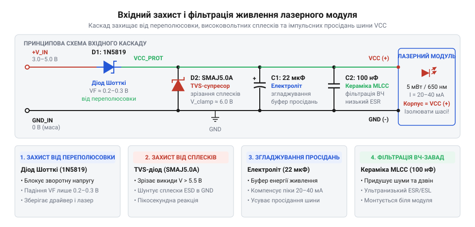
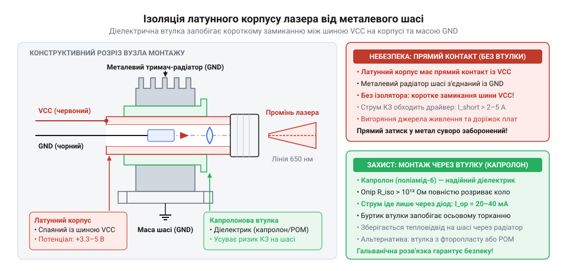

# Лазерний модуль з лінією (5 мВт, з фокусом)

<preknowlist>
- [KY-008 — лазерний модуль](root:cat-hw-actuators/ky-008-laser) — базовий принцип підключення напівпровідникового лазерного діода, струмообмеження та логіка керування випромінюванням дискретним сигналом
</preknowlist>

## Пастка прямого підключення: вразливість лазерного діода

Червоний лазерний лінійний модуль зовні легко сплутати зі звичайним світлодіодом, поміщеним у металеву гільзу: два провідники живлення, червоне світіння, робоча напруга в кілька вольт. Через цю зовнішню подібність виникає спокуса під'єднати його як індикаторний світлодіод — припаяти безпосередньо до виводу мікроконтролера або вставити в безпайкову макетну плату поруч із цифровими мікросхемами. Проте напівпровідниковий лазер має кардинально іншу фізичну будову, ніж світлодіод. Помилки, які звичайний індикатор переносить без втрати працездатності — випадкову короткочасну переполюсовку, імпульсний сплеск напруги від сусіднього реле або живлення від слабкого логічного виходу, — для лазерного модуля стають фатальними.

Напівпровідниковий лазерний діод (грец. *dis* — двічі, *hodos* — шлях; англ. @@en|laser@@, акронім від @@en|Light Amplification by Stimulated Emission of Radiation@@ — підсилення світла за допомогою вимушеного випромінювання) містить усередині оптичний резонатор (лат. *resono* — звучу у відповідь). Це кристал напівпровідника з плоскопаралельними сколами, які відіграють роль напівпрозорих оптичних дзеркал. Світло, проходячи крізь зону p-n переходу, викликає лавину однакових, синхронних фотонів. Оскільки переріз зони генерації вимірюється одиницями квадратних мікрометрів, густина оптичного випромінювання на вихідному дзеркалі досягає колосальних значень — сотень кіловатів і навіть мегаватів на квадратний сантиметр.

Найменший короткочасний сплеск струму або мікросекундна перенапруга різко підсилює внутрішнє оптичне поле. Напівпровідник не встигає розсіяти цю концентровану енергію, і настає катастрофічне оптичне руйнування дзеркал (англ. @@en|Catastrophic Optical Damage@@, COD): дзеркальні грані кристала плавляться від поглинання власного випромінювання. При цьому прилад не розриває коло і навіть продовжує світитися, але оптична генерація зникає назавжди. Лазер перетворюється на звичайний деградований світлодіод із тьмяним випромінюванням. Сфокусувати такий пучок у тонку лінію вже неможливо: на поверхні утворюється розпливчаста каламутна пляма.

Друга критична загроза — зворотна полярність живлення. Якщо кремнієві випрямні діоди витримують сотні вольт зворотної напруги, а звичайні світлодіоди без шкоди переносять до 5 В, то для лазерного кристала допустима зворотна напруга зазвичай не перевищує 2 В. Помилка під час підключення полярності живлення призводить до миттєвого тунельного або лавинного пробою чутливого гетеропереходу.

Спроба заживити модуль безпосередньо від виводу мікроконтролера породжує подвійну проблему. Більшість сучасних мікроконтролерів допускають навантаження на один цифровий вивід не більше 6–20 мА. Лазерний лінійний модуль споживає від 20 до 40 мА. При прямому підключенні на внутрішньому опорі вихідних транзисторів мікроконтролера падає помітна частка напруги. У результаті до модуля доходить напруга, занизька для стабільної генерації світла. Водночас виникає небезпечне перевантаження порту введення-виведення мікроконтролера, що загрожує деградацією кристала керуючого чипа. Крім того, імпульсний стрибок струму під час вмикання просаджує внутрішню шину живлення мікроконтролера, провокуючи помилкові спрацьовування детектора зниження живлення (англ. @@en|Brown-out Reset@@, BOR) та циклічні перезавантаження всієї системи. Подібно до базових точкових випромінювачів на кшталт [KY-008](root:cat-hw-actuators/ky-008-laser), модуль вимагає комутації через окремий транзисторний ключ або драйвер.

Остання загроза пов'язана з роботою на спільній шині живлення. У реальних приладах лазерний модуль часто сусідить із силовими актуаторами: сервоприводами, кроковими двигунами, електромагнітними замками чи реле. Комутація індуктивних навантажень спричиняє в лініях живлення короткочасні викиди напруги амплітудою в десятки вольт. Для захисту кристала від цих факторів на вході живлення модуля обов'язково встановлюють захисну фільтрувальну ланку.


*Принципова схема вхідного захисту та фільтрації живлення: діод Шотткі від переполюсовки, керамічний конденсатор 100 нФ для придушення високочастотних завад, електроліт 22 мкФ для згладжування імпульсних просідань та TVS-діод для зрізання високовольтних сплесків на шині VCC.*

Ця вхідна схема поєднує чотири захисні бар'єри:
- Діод Шотткі (англ. @@en|Schottky diode@@), встановлений послідовно у плюсову лінію, повністю виключає протікання зворотного струму при помилковій переполюсовці. Завдяки низькому прямому падінню напруги (0.2–0.3 В) він майже не зменшує робочу напругу, що живить модуль.
- Супресор (англ. @@en|TVS diode@@, від @@en|Transient Voltage Suppressor@@; лат. *supprimere* — стримувати, пригнічувати), увімкнений паралельно шині, захищає від імпульсних перенапруг. Коли амплітуда перешкоди на шині перевищує поріг спрацьовування (зазвичай 5.6–6.0 В), супресор відкривається за частки пікосекунди і шунтує сплеск енергії на землю.
- Керамічний конденсатор ємністю 100 нФ розташовують безпосередньо біля модуля для відсікання високочастотних перешкод та електромагнітних наведень завдяки низькому еквівалентному послідовному опору (англ. @@en|ESR@@, від @@en|Equivalent Series Resistance@@).
- Електролітичний або танталовий конденсатор ємністю 22 мкФ виступає локальним резервуаром енергії. Він компенсує паразитну індуктивність підвідних дротів живлення і згладжує динамічні просідання напруги в моменти комутації лазера.

> 🔧 **Навіщо це.**
> У лазерних сканерах, розмічальних приладах і системах технічного зору лазер часто монтується на рухомій каретці верстата поруч із тяговими двигунами. Вхідний захист гарантує, що при випадковій переполюсовці дротів під час налагодження модуль не згорить, а індуктивні викиди від зупинки двигунів не знищать дзеркала лазерного резонатора.

## Електричні параметри та інтерфейс підключення ліній живлення

Лазерний лінійний модуль потужністю 5 мВт підключається за допомогою двох вивідних провідників у гнучкій ізоляції:
- Червоний провідник — позитивна лінія живлення (VCC), призначена для подачі стабілізованої постійної напруги від +3.0 В до +5.0 В.
- Чорний провідник — спільна лінія живлення, опорний нуль або земля (GND).

Довжина вивідних дротів модуля зазвичай становить 100–150 мм при калібрі провідника AWG 26 або AWG 28. Якщо відстань до джерела живлення перевищує 30 см, опір та індуктивність дротів стають відчутними, тому локальний блокувальний конденсатор необхідно розпаювати безпосередньо на вході дротів у гільзу модуля.

Модуль відрізняється від окремого лазерного діода наявністю вбудованого вузла стабілізації або струмообмеження. Усередині латунної гільзи, безпосередньо позаду напівпровідникового кристала, встановлено мініатюрну друковану плату. На ній розміщено або простий баластний резистор поверхневого монтажу, або лінійний транзисторний регулятор постійного струму.

Власне напівпровідниковий гетероперехід червоного лазера (довжина хвилі 650 нм) має постійне пряме падіння напруги близько V_ld ≈ 2.2 В. Уся інша напруга зовнішнього живлення падає на внутрішньому обмежувальному елементі.

Допустимий робочий діапазон напруги модуля суворо обмежений межами 3.0–5.0 В. Вихід за ці межі порушує фізичні умови роботи лазера:
- **Зниження напруги нижче 3.0 В (зрив оптичної генерації).** Для переходу напівпровідникового кристала в режим когерентного лазерного випромінювання концентрація носіїв заряду в активній зоні має досягти порогового значення. Ця точка називається порогом генерації (англ. @@en|lasing threshold@@, від англ. @@en|threshold@@ — поріг, лат. *limen*). Для 5 мВт модуля пороговий струм генерації становить 15–18 мА. Якщо напруга живлення опускається нижче 3.0 В, напруги на баластному елементі стає недостатньо для підтримки цього струму. Струм падає нижче порогового значення, оптичний зворотний зв'язок у резонаторі зникає, і вимушене випромінювання зривається. Лазер переходить у неефективний режим спонтанного світіння: лінія стає блідою, неконтрастною і втрачає геометричну чіткість.
- **Підвищення напруги понад 5.0 В (тепловий пробій).** Внутрішня схема струмообмеження модуля є лінійною, тому будь-яка надлишкова напруга перетворюється на тепло.

Потужність, що розсіюється на внутрішньому обмежувальному елементі, визначається співвідношенням:
`
P_bal = (V_in - V_ld) × I
`
Для номінальної напруги 5.0 В при типовому струмі споживання 35 мА розсіювана потужність становить:
`
P_bal = (5.0 - 2.2) × 0.035
      = 2.8 × 0.035           [падіння напруги на баласті 2.8 В]
      = 0.098 Вт              [теплова потужність складає ~100 мВт]
`
Якщо напругу неконтрольовано підвищити до 7.0 В, струм крізь баластний вузол зростає приблизно до 60 мА:
`
P_bal = (7.0 - 2.2) × 0.060
      = 4.8 × 0.060           [падіння напруги на баласті 4.8 В]
      = 0.288 Вт              [теплова потужність зростає до ~290 мВт]
`
Розсіювання майже 0.3 Вт тепла в замкненому просторі герметичної гільзи, де площа плати не перевищує 25 мм², миттєво нагріває кристал до температури понад 80–90 °C. При нагріванні пороговий струм лазера зростає, напівпровідниковий гетероперехід перегрівається, руйнується кристалічна ґратка і настає незворотний тепловий пробій.

Номінальний струм споживання 5 мВт модуля становить:
- При напрузі 3.3 В: 20–25 мА (споживана потужність близько 65–85 мВт).
- При напрузі 5.0 В: 30–40 мА (споживана потужність близько 150–200 мВт).

При проектуванні джерела живлення для електронної системи під лазерний модуль закладають енергетичний запас не менше 50% за струмом (50–60 мА на один випромінювач). Якщо пристрій використовує багаторакурсну підсвітку з трьох чи чотирьох лазерних ліній, сумарний струм становить 120–160 мА. Таке навантаження не можна підключати до вбудованого 3.3 В лінійного регулятора плати мікроконтролера, оскільки це викличе його термічне перевантаження, просідання напруги ядра мікроконтролера і зависання всієї системи. Лазерні модулі вимагають живлення від окремого стабілізатора або незалежної силової гілки живлення.

> 🔧 **Навіщо це.**
> Чітке знання допустимого діапазону 3.0–5.0 В визначає вибір схемотехніки живлення в портативних акумуляторних приладах. Одинарний літієвий елемент живлення в процесі розряду змінює напругу від 4.2 В до 3.0 В. Пряме живлення від такого акумулятора неприпустиме: ближче до повного розряду лазер почне мерехтіти й вийде з лазерного режиму. Тому в автономних пристроях живлення лазера завжди стабілізують імпульсним або лінійним стабілізатором на фіксовані 3.3 В.

## Схема апаратного захисту та фільтрації шини живлення

Напівпровідниковий лазерний кристал — один із найвразливіших елементів електронних пристроїв. На відміну від звичайних світлодіодів чи ламп розжарювання, активна область гетероструктури лазерного діода має мікроскопічну товщину (менше одного мікрометра), а оптичні резонаторні грані утворюються сколюванням кристала. Будь-який електричний перевантажувальний імпульс (@@en|Electrical Overstress@@, EOS) тривалістю в кілька наносекунд призводить до катастрофічного оптичного руйнування дзеркал (@@en|Catastrophic Optical Damage@@, COD), випалюючи кристал без можливості відновлення. Реальні лінії живлення робототехнічних систем, верстатів та мікроконтролерних стендів далекі від ідеалу: під час комутації сусідніх електродвигунів, соленоїдів або котушок реле в них виникають викиди самоіндукції амплітудою в десятки вольтів, довгі дроти додають паразитну індуктивність і викликають просідання напруги, а людський фактор під час підключення часто призводить до переполюсовки. На відміну від найпростіших точкових випромінювачів на зразок [KY-008](root:cat-hw-actuators/ky-008-laser), де кристал інколи живлять через єдиний струмообмежувальний резистор, промисловий модуль вимагає повноцінного вхідного каскаду апаратного захисту та фільтрації.

Переполюсовка живлення (помилкове підключення плюса до чорного дроту, а маси — до червоного) становить смертельну небезпеку для напівпровідника. Гранична зворотна напруга p-n переходу лазерного діода становить лише від -2 В до -5 В. При перевищенні цього порогу кристал миттєво пробивається зворотним струмом і необоротно деградує. Використовувати стандартний кремнієвий випрямляльний діод (наприклад, 1N4007) тут неприпустимо: пряме падіння напруги на ньому сягає 0.7–1.0 В. Якщо модуль живиться від стандартної шини 3.3 В або 5.0 В, втрата майже одного вольта знижує вхідну напругу нижче порогу працездатності внутрішнього лінійного стабілізатора модуля (3.0 В), через що генерація випромінювання зривається.

Розв'язком є послідовне увімкнення діода Шотткі (названого на честь німецького фізика Вальтера Шотткі, нім. @@de|Walter Schottky@@). Завдяки бар'єру метал-напівпровідник замість класичного p-n переходу діод Шотткі має пряме падіння напруги лише 0.2–0.35 В при робочому струмі споживання модуля 20–40 мА. Втрати потужності на діоді при струмі 30 мА є мізерними:

```
P_loss
= I_load × V_F
= 0.030 А × 0.28 В
= 0.0084 Вт                [8.4 мВт розсіюваного тепла]
```

Таке тепловиділення не потребує радіатора й вільно розсіюється корпусом компонента. При штатній полярності діод пропускає струм живлення з мінімальними втратами напруги, а при переполюсовці — надійно розриває коло, захищаючи чутливий кристал. Для цієї ролі оптимально підходять малопотужні діоди Шотткі в мініатюрних корпусах, наприклад BAT54, SS14 або MBR0520.

Наступну загрозу становлять короткочасні імпульсні сплески перенапруги, викликані комутацією індуктивних навантажень або електростатичними розрядами (ESD, @@en|Electrostatic Discharge@@). Звичайні стабілітрони мають завеликий час реакції для перехоплення субмікросекундних фронтів перенапруги. Для їхнього зрізання паралельно лінії живлення після діода Шотткі встановлюють супресор TVS (від англ. @@en|Transient Voltage Suppressor@@ та лат. @@la|supprimere@@ — стримувати, придушувати). TVS-діод — це кремнієвий p-n перехід із великою площею напівпровідникового кристала, здатний переходити в режим лавинного пробою за пікосекунди (< 1 пс) і розсіювати кіловатні імпульси енергії, шунтуючи перенапругу на масу.

Підбір параметрів TVS-супресора базується на трьох величинах:
- Робоча напруга без спрацювання (`V_WM`, @@en|Stand-off Voltage@@): вибирається дещо вищою за максимальну напругу живлення (наприклад, 5.0 В або 5.5 В для 5-вольтової шини), що забезпечує мікроамперний струм витоку в штатному режимі.
- Пробивна напруга (`V_BR`, @@en|Breakdown Voltage@@): поріг початку лавинного пробою (типово 6.4–7.0 В).
- Напруга обмеження (`V_C`, @@en|Clamping Voltage@@): гранична напруга на виводах при піковому імпульсному струмі, яка гарантовано не повинна перевищувати поріг витримування внутрішніх мікросхем модуля (~7–8 В).
Для лінійного модуля з живленням 5 В стандартним є односпрямований супресор серії SMAJ5.0A або SMBJ5.0A, увімкнений катодом (від грец. @@el|κάθοδος@@ — рух униз) до плюсової лінії, а анодом (від грец. @@el|ἄνοδος@@ — рух угору) — до маси GND.

Завершальною ланкою вхідного вузла є комбінована фільтрація конденсаторами (від лат. @@la|condensare@@ — ущільнювати, згущувати). Довгі підвідні провідники мають власну паразитну індуктивність, яка перешкоджає швидкій зміні струму та разом із високочастотними перешкодами від імпульсних джерел спричиняє дзвін і просідання напруги на вході лазера. Для їхнього усунення застосовують два конденсатори:
- Керамічний конденсатор ємністю 100 нФ (типорозмір 0603 або 0805, діелектрик X7R/X5R). Має надзвичайно низький еквівалентний послідовний опір (ESR, @@en|Equivalent Series Resistance@@) та мінімальну власну індуктивність. Його запаюють безпосередньо біля введення дротів у корпус модуля. Він шунтує високочастотні завади від комутації сусідніх цифрових кіл, імпульсних драйверів і радіозавад.
- Електролітичний або танталовий конденсатор (від дав.-гр. @@el|Τάνταλος@@) ємністю 10–47 мкФ на робочу напругу 10–16 В. Встановлений паралельно кераміці, він працює як локальний накопичувач заряду. Маючи низький динамічний імпеданс (від лат. @@la|impedire@@ — перешкоджати) на низьких частотах, він демпфує (від нім. @@de|dämpfen@@ — глушити, гасити) динамічні просідання напруги під час пуску модуля або перемикання сусідніх споживачів на спільній шині. Танталові конденсатори мають перевагу над алюмінієвими завдяки меншому ESR, стабільності ємності в широкому діапазоні температур і відсутності висихання рідкого електроліту.

Повна принципова схема вхідного захисного фільтра має вигляд:

```
VCC_IN ───►|───┬────────┬────────┬─────── VCC (червоний дріт лазера)
            D1  │ +      │        │
              [TVS]    [C1]     [C2]
               D2     10–47 мкФ 100 нФ
GND_IN ────────┴────────┴────────┴─────── GND (чорний дріт лазера)
```

де `D1` — діод Шотткі (BAT54, SS14 або 1N5819), `D2` — захисний TVS-супресор (SMAJ5.0A), `C1` — танталовий конденсатор 10–47 мкФ (≥ 10 В), `C2` — керамічний конденсатор 100 нФ (X7R).

> 🔧 **Навіщо це.**
> У лабораторних умовах лазер зазвичай живлять від стабілізованого лабораторного джерела, де перехідні процеси мінімальні. Проте в реальних конструкціях — верстатах з ЧПК, 3D-принтерах чи установках технічного зору — спільна 5-вольтова шина насичена індуктивними сплесками крокових моторів та завадами імпульсних перетворювачів. Чотири компоненти вхідного фільтра займають мінімум місця на платі й коштують лічені центи, але усувають 99% випадків раптового виходу лазера з ладу через переполюсовку, статичний розряд або імпульсну перенапругу.

## Електричний статус латунного корпусу та правила гальванічної ізоляції при монтажі

Зовні циліндричний лазерний модуль справляє враження суцільнометалевої ізольованої деталі, яку природно хочеться закріпити в алюмінієвий кронштейн, шпиндельну плиту або металевий корпус верстата. Розробники часто розраховують використати масивне металеве шасі як безкоштовний радіатор для охолодження лазера. Проте в конструкції більшості циліндричних модулів криється апаратна пастка: зовнішній латунний корпус не є електрично нейтральним і майже ніколи не з'єднаний із масою (GND).

Усередині латунної гільзи безпосередньо запресовано корпус напівпровідникового лазерного діода (стандартний металевий типорозмір TO-18 або TO-56 діаметром 5.6 мм). Така жорстка запресовка необхідна для теплового контакту напівпровідника з гільзою та точного центрування оптичної осі променя з вихідною коліматорною лінзою. Проте кристал лазерного діода припаяний безпосередньо до масивного металевого фланця основи TO-18 для забезпечення первинного тепловідводу від підкладки напівпровідника.

У більшості масових червоних лазерних діодів (довжина хвилі 650 нм) кристал має внутрішнє розведення типу @@en|Case Positive@@: анод (плюсовий вивід p-n переходу) гальванічно з'єднаний із металевою основою корпусу TO-18. Оскільки основа діода металевим пресуванням контактує з внутрішньою поверхнею латунної гільзи, **весь зовнішній латунний корпус модуля опиняється під повним електричним потенціалом плюсової шини живлення VCC (+3.0–5.0 В)**.

Якщо такий модуль затиснути в незахищений металевий кронштейн або прикрутити до верстатної станини, які в будь-якому промисловому чи аматорському обладнанні з'єднані із загальною масою схеми (GND) або шиною захисного заземлення (PE, @@en|Protective Earth@@), виникає глухе коротке замикання. Плюсова шина живлення VCC через латунний циліндр і металевий тримач замикається безпосередньо на землю GND. Струм у колі миттєво злітає до десятків амперів (обмежуючись лише опором з'єднувальних дротів і потужністю блока живлення). Наслідки катастрофічні: вигорання друкованих доріжок на материнській платі, миттєве теплове руйнування лінійних регуляторів (наприклад, AMS1117), згоряння USB-портів підключеного комп'ютера та пошкодження внутрішньої струмообмежувальної схеми самого модуля.

Колір дротів або маркування на корпусі китайських модулів не гарантують відповідності стандартам. Перед механічним монтажем будь-якого лазерного вузла обов'язково виконують перевірку електричного потенціалу корпусу:
1. Повністю знеструмлюють лазерний модуль і від'єднують його від будь-яких плат керування.
2. Цифровий мультиметр переводять у режим перевірки цілісності кола (звукового продзвонювання) або в режим вимірювання мінімального опору (межа 200 Ом).
3. Один щуп мультиметра щільно притискають до зачищеної від оксидної плівки латунної поверхні гільзи.
4. Другим щупом торкаються зачищеного кінця червоного дроту живлення (VCC). Якщо мультиметр видає безперервний звуковий сигнал і показує нульовий опір (`R < 0.5 Ом`), латунний корпус жорстко з'єднаний із плюсовою шиною (`Case Positive`).
5. Переставляють другий щуп на чорний дріт (GND). Якщо зумер спрацьовує тут, корпус з'єднаний із масою (`Case Negative`).
6. Якщо в обох положеннях мультиметр показує розрив кола, прилад переводять у режим тестування p-n переходів і перевіряють спад напруги в обох полярностях відносно корпусу. Це дає змогу виявити наявність внутрішнього захисного діода або комутаційного ключа вбудованого драйвера.
У 95% циліндричних червоних лазерних лінійних модулів мультиметр підтверджує прямий електричний контакт корпусу з червоним дротом VCC.

Монтаж модуля вимагає розв'язання фундаментальної інженерної суперечності:
- Електрична вимога: повна гальванічна ізоляція (названа на честь італійського анатома й фізика Луїджі Гальвані, італ. @@it|Luigi Galvani@@) між латунним циліндром і металевим шасі з опором ізоляції не менше 10 МОм.
- Теплова вимога: безперервний відвід тепла. Навіть при оптичній потужності 5 мВт модуль споживає 100–200 мВт електричної потужності. Понад 90% цієї енергії виділяється у вигляді тепла на кристалі та лінійному стабілізаторі струму в крихітному об'ємі модуля. Перегрів кристала понад 45–50 °C спричиняє температурний дрейф довжини хвилі випромінювання, зниження яскравості лінії та прискорену деградацію структури діода.

Для поєднання надійної ізоляції та стабільного тепловідводу застосовують такі конструктивні рішення:
- **Діелектричні ізоляційні втулки з конструкційних полімерів.** Найефективнішими матеріалами є капролон (поліамід-6, від дав.-гр. @@el|πολύς@@ — численний та @@en|amide@@) або фторопласт (політетрафторетилен, від грец. @@el|φθόριον@@ — руйнування та @@el|πλαστός@@ — виліплений). З них виточують тонкостінну циліндричну гільзу з товщиною стінки 0.5–1.0 мм. Капролон має електричну міцність понад 20 кВ/мм, гарантуючи захист від електричного пробою, а мала товщина стінки створює прийнятний тепловий опір.
- **Заповнення контактних зон непровідною термопастою.** Повітряні мікрозазори між латунним корпусом, капролоновою втулкою та алюмінієвим радіатором мають вкрай високий тепловий опір. Їх заповнюють тонким шаром діелектричної кремнійорганічної термопасти (на основі оксиду цинку без металевих і графітових домішок), що покращує тепловідвід у кілька разів.
- **Двоетапний відокремлений радіатор.** Латунний корпус безпосередньо затискають в окремий невеликий алюмінієвий радіаторний блок без діелектричної втулки (забезпечуючи ідеальний тепловий контакт метал-метал). Цей алюмінієвий блок тепер перебуває під напругою VCC, але його ізолюють від основного шасі верстата за допомогою текстолітових пластин, капролонових стійок і нейлонових гвинтів.
- **Термозбіжна трубка.** Підходить лише як тимчасове рішення для стендового макетування. Тонка поліолефінова плівка забезпечує ізоляцію, але має погану теплопровідність, а при тривалій експлуатації та нагріванні може прорізатися краями металевого хомута.


*Конструктивний розріз вузла механічного кріплення: латунний циліндр модуля під потенціалом VCC надійно відокремлений від заземленого тримача-радіатора тонкостінною діелектричною втулкою з капролону, а зазори заповнені непровідною термопастою для ефективного розсіювання тепла.*

> 🔧 **Навіщо це.**
> На деревообробних верстатах, металевих розкрійних столах чи конвеєрних лініях лазерні лінійні модулі формують оптичні напрямні для оператора. Механіки традиційно прикручують циліндричні модулі стандартними металевими хомутами просто до заземленої рами верстата. Не знаючи про те, що корпус перебуває під плюсовою напругою живлення, вони спричиняють коротке замикання, яке випалює блок живлення чи автоматику верстата під час першого ж увімкнення. Тонкостінна капролонова гільза з термопастою запобігає апаратним аваріям, забезпечуючи багаторічну безперебійну роботу лазера.

## Динамічні характеристики комутації та схема керування зовнішнім ключем

Мікроконтролер не може живити лазерний модуль безпосередньо зі свого цифрового виводу загального призначення (англ. @@en|GPIO@@, general-purpose input/output). Стандартний вивід мікроконтролера розрахований на тривалий струм не більше 10–20 мА. Номінальне споживання 5-міліватного лазерного модуля становить 20–40 мА, а в момент подачі живлення внутрішні фільтрувальні конденсатори разом із запуском інтегрованого стабілізатора спричиняють імпульсний кидок струму до 100–150 мА. Пряме підключення модуля до виводу контролера викликає просідання шини живлення мікросхеми, спонтанне спрацьовування апаратного захисту від зниження напруги (англ. @@en|brown-out reset@@, BOR) з перезавантаженням процесора або незворотну теплову деградацію вихідного каскаду порту.

Для безпечного вмикання модуля використовують дискретний електронний ключ — польовий транзистор (англ. @@en|MOSFET@@, metal-oxide-semiconductor field-effect transistor; транзистор — від англ. @@en|transfer@@ — переносити та @@en|resistor@@ — опір) із каналом N-типу, увімкнений у розрив негативного провідника живлення (конфігурація @@en|low-side switch@@):
- Плюсовий дріт живлення модуля (червоний, `V[CC]`) під'єднують напряму до фільтрованої шини живлення +3.3 В або +5.0 В.
- Негативний дріт (чорний, `GND` модуля) підключають до стоку (англ. @@en|drain@@) польового транзистора.
- Витік (англ. @@en|source@@) транзистора з'єднують зі спільною системною шиною заземлення (`GND`).
- Затвор (англ. @@en|gate@@) комутується цифровим сигналом мікроконтролера через резистивну обв'язку.

Конфігурація @@en|low-side@@ дає змогу застосувати N-канальний польовий транзистор логічного рівня (наприклад, 2N7002, BSS138, IRLML2502 або AO3400). Такий транзистор повністю відкривається напругою затвора відносно землі (`V[GS]`), яка відповідає логічній одиниці мікроконтролера (3.3 В або 5.0 В), виключаючи потребу у верхніх зсувачах рівнів чи бутстрепних драйверах.

Металевий корпус модуля вимагає окремої уваги під час монтажу. У більшості червоних лазерних модулів потужністю 5 мВт латунна гільза має прямий електричний контакт із плюсовим виводом `V[CC]` через конструктивне запресовування кристала анодом на підкладку корпусу діода. У конфігурації @@en|low-side@@, коли транзистор закритий, на латунній гільзі присутній повний потенціал `+V[CC]`. Якщо модуль механічно закріпити в металевому кронштейні верстата чи сканера, з'єднаному зі спільним шасі (землею), виникне коротке замикання шини живлення на землю в обхід закритого MOSFET. Лазер мимовільно світитиметься, а джерело живлення зазнає перевантаження. Тому під час використання @@en|low-side@@ комутації модуль обов'язково встановлюють через діелектричну втулку або термоусадкову трубку.

Затвор MOSFET є ізольованою ємністю `C[iss] = C[GS] + C[GD]`, величина якої сягає сотень пікофарад. Для захисту мікроконтролера та запобігання хибним спрацьовуванням у коло затвора встановлюють два резистори:
- **Послідовний затворний резистор `R[G]` (100–330 Ом):** У момент перемикання розряджена ємність затвора створює режим короткого замикання для виводу мікроконтролера. Без обмеження імпульсний струм перезаряду сягає сотень міліампер, що пошкоджує вихідний каскад порту. Резистор `R[G]` обмежує зарядний струм на безпечному рівні:
  `I[G_max] = V[GPIO] / R[G] = 3.3 В / 150 Ом = 22 мА`
  Крім того, `R[G]` демпфує высокочастотні коливання, що виникають в коливальному контурі між індуктивністю друкованих доріжок і ємністю затвора, усуваючи паразитне дзвеніння.
- **Підтягувальний до землі резистор `R[PD]` (10–100 кОм, типово 47–100 кОм):** Під час старту, перезавантаження або роботи завантажувача мікроконтролера його виводи перебувають у високоімпедансному стані (англ. @@en|Hi-Z@@). Без струму витоку затвор транзистора накопичує електростатичний заряд або перешкоди з довкілля, спричиняючи випадкове напіввідкриття транзистора в лінійний режим. Це призводить до неконтрольованого спалаху лазера та перегріву ключа. Резистор `R[PD]` надійно утримує потенціал затвора на рівні 0 В доти, доки порт не буде явно ініціалізовано програмою.

> 🔧 **Навіщо це.**
> Номінал резистора `R[G]` обирають як компроміс між швидкістю заряду ємності затвора та піковим навантаженням на вивід мікроконтролера. Номінал `R[PD]` беруть у 100–300 разів більшим за `R[G]`, щоб подільник напруги не зменшував керуючий рівень на затворі: `V[GS] = V[GPIO] · R[PD] / (R[G] + R[PD]) ≈ V[GPIO]`.

Лазерні модулі нерідко виносять на рухомі каретки тріангуляційних сканерів на з'єднувальних проводах довжиною 0.5–2 м. Такі лінії мають помітну паразитну індуктивність (лат. @@la|parasitus@@ — нахлібник; лат. @@la|inductio@@ — наведення), що становить приблизно `L[wire] ≈ 1` мкГн на метр довжини пари. Під час різкого закриття MOSFET струм обривається за десятки наносекунд. За законом електромагнітної індукції:
`V[spike] = L[wire] · (di / dt)`
ЕРС самоіндукції формує на стоку транзистора позитивний викид напруги, здатний пробити транзистор або пошкодити внутрішній стабілізатор модуля. Для демпфування викидів безпосередньо біля модуля (або на платі комутатора) встановлюють керамічний блокувальний конденсатор ємністю 0.1–1.0 мкФ та супресор (TVS-діод) паралельно шині живлення. Конденсатор замикає контур високої частоти локально, усуваючи індуктивні викиди від довгих дротів.

На відміну від найпростіших випромінювачів з пасивним баластним резистором, таких як [модуль KY-008](root:cat-hw-actuators/ky-008-laser), лінійний модуль містить активний контур лінійної стабілізації струму та вхідні ємності. Через це після відкриття зовнішнього MOSFET оптичне випромінювання наростає з затримкою:
1. **0–2 мкс (комутація транзистора):** Напруга на затворі долає поріг `V[GS(th)]`, канал MOSFET відкривається, напруга на стоку падає до нуля, а до модуля прикладається повна напруга живлення.
2. **2–10 мкс (заряд внутрішніх ємностей):** Відбувається заряд внутрішніх конденсаторів модуля, супроводжуваний коротким стрибком струму. Контур зворотного зв'язку стабілізатора виходить із насичення.
3. **10–30 мкс (наростання струму до порогу):** Струм через кристал лазера плавно наростає до порогу лазерної генерації `I[th]`. Доки струм нижче порогу, напівпровідник працює в режимі спонтанного випромінювання як слабкий світлодіод без чіткої лінії.
4. **30–50 мкс (вимушена генерація та стабілізація):** Струм перевищує `I[th]`, виникає когерентне випромінювання, формується різка лазерна лінія, а внутрішній регулятор фіксує номінальний струм (20–40 мА).

Повний інтервал від подачі сигналу на затвор до досягнення 90–100% стабільної потужності випромінювання утворює час увімкнення (англ. @@en|turn-on time@@, `t[on]`). Для 5 мВт модулів цей інтервал становить 10–50 мкс.


*Схема каскаду комутації на low-side N-MOSFET з резисторами затвора R[G] та R[PD] і часові діаграми напруги затвора, струму споживання й оптичної потужності: стабільне випромінювання лазерної лінії встановлюється лише через 10–50 мкс після відкриття ключа.*

Під час створення прошивки керування ключем обов'язково витримують затримку на тривалість `t[on]`: якщо мікроконтролер запускає вимірювання чи захоплення кадру камерою, експозицію починають лише після повної стабілізації променя.

:::tabs
:::code api-laser-line-module-hw/c/setup.c
:::code api-laser-line-module-hw/c/laser-init.c
:::

## Граничні обмеження частоти модуляції та експлуатаційні межі

Спроба регулювати яскравість лазерного модуля високочастотним сигналом широтно-імпульсної модуляції (англ. @@en|PWM@@, pulse-width modulation) з типовою частотою 5–20 кГц призводить до порушення роботи пристрою. Причина полягає в наявності внутрішнього контуру стабілізації струму.

Вбудований лінійний стабілізатор має обмежену смугу пропускання контуру зворотного зв'язку з часовою сталою інтегрування порядку 20–50 мкс. Якщо подати ШІМ-сигнал частотою 5 кГц (період коливань `T = 200` мкс) із коефіцієнтом заповнення 10%, тривалість імпульсу становить лише 20 мкс, що менше за час виходу стабілізатора на режим (`t[on] = 10..50` мкс). Робота на частотах понад 1–2 кГц викликає три деструктивні ефекти:
1. **Зрив лазерної генерації:** Діод не встигає досягти порогового струму генерації `I[th]` або вимикається на стадії його зародження. Замість чіткої тонкої лінії модуль генерує розмите тьмяне світлодіодне світіння без когерентності.
2. **Просторове тремтіння та мерехтіння лінії:** За постійних перехідних процесів контур стабілізації перебуває на межі автоколивань. Лазерний кристал перескакує між різними оптичними модами (англ. @@en|mode hopping@@), через що яскравість, кут розбіжності та товщина лінії хаотично змінюються, руйнуючи точність сканування.
3. **Критичний тепловий перегрів і руйнування граней (COD):** На початку кожного імпульсу розімкнений контур регулятора прагне швидко підняти струм, викликаючи імпульсний переліт (англ. @@en|current overshoot@@). При частоті 5 кГц кристал зазнає 5000 ударних сплесків струму щосекунди. Це спричиняє локальний перегрів дзеркал оптичного резонатора та призводить до катастрофічного оптичного руйнування (англ. @@en|catastrophic optical damage@@, COD), після чого лазер назавжди перетворюється на слабкий світлодіод.

Тому модуль із вбудованою лінійною стабілізацією не призначений для ШІМ-димування. Якщо необхідно змінити рівень освітленості сцени, використовують оптичні фільтри нейтральної щільності (ND) або налаштування експозиції камери. Безпечна гранична частота стробування модуля не повинна перевищувати 100–200 Гц.

В оптичних тріангуляційних 3D-сканерах (лат. @@la|triangulum@@ — трикутник; метод обчислення відстаней за геометричним зміщенням лінії на матриці камери) лазерний модуль вмикають синхронно з кадрами зйомки. Імпульсне стробування (англ. @@en|strobing@@, від грец. @@grc|strobos@@ — вихор, кружляння) усуває безперервне нагрівання модуля й дає змогу працювати за зовнішнього освітлення завдяки скороченню експозиції.

> 🔧 **Навіщо це.**
> За безперервного світіння 5 мВт лазер нагріває закритий корпус сканера, через що довжина хвилі випромінювання зміщується зі швидкістю близько 0.25 нм/°C. Це викликає хроматичний дрейф коліматора, розмиває лінію та спотворює результати 3D-тріангуляції. Стробування знижує середню теплову потужність у десятки разів.

Тривалість імпульсу стробування `t[pulse]` повинна вміщувати час наростання генерації `t[on]`, захисний часовий інтервал `t[guard]` та витримку матриці камери `t[exp]`. Припустимо, камера працює з частотою `f[cam] = 60` кадрів/с (період кадру `T[frame] = 1 / f[cam] ≈ 16.67` мс), час експозиції дорівнює `t[exp] = 500` мкс, час виходу лазера на стабільний режим становить `t[on] = 50` мкс, а захисний запас — `t[guard] = 20` мкс:

```
t[pulse]
= t[on] + t[guard] + t[exp]        [додавання часу увімкнення, запасу та експозиції камери]
= 50 мкс + 20 мкс + 500 мкс        [підстановка часових параметрів модуля й сенсора]
= 570 мкс                          [необхідна сумарна тривалість увімкненого стану ключа]

D
= t[pulse] / T[frame]              [визначення коефіцієнта заповнення (duty cycle)]
= 0.570 мс / 16.67 мс              [відношення тривалості імпульсу до періоду кадру]
≈ 0.0342 (3.42 %)                  [частка активного стану лазера за період]

P[avg]
= P[nom] · D                       [розрахунок середньої споживаної потужності]
= (5.0 В × 35 мА) · 0.0342         [множення номінальної потужності живлення на коефіцієнт заповнення]
= 175 мВт · 0.0342
≈ 6.0 мВт                          [середня теплова потужність, що розсіюється модулем]
```

Завдяки стробуванню середнє тепловиділення знижується зі 175 мВт до 6.0 мВт, усуваючи нагрів оптичної системи сканера.

Експлуатація модуля вимагає дотримання граничних режимів роботи. Перевищення будь-якого з наведених значень спричиняє деградацію оптики або електричний пробій.

| Параметр | Позначення | Номінальний режим | Граничне значення (Absolute Max) | Одиниця | Наслідки перевищення |
| :--- | :--- | :--- | :--- | :--- | :--- |
| Напруга живлення | `V[CC]` | 3.0 … 5.0 | 5.5 | В | Тепловий пробій лінійного стабілізатора, перегрів кристала |
| Зворотна напруга | `V[R]` | 0.0 | -0.5 (без діода: -2.0) | В | Електричний пробій p-n переходу лазерного кристала |
| Струм споживання | `I[CC]` | 20 … 40 | 60 (піковий під час пуску: 150) | мА | Катастрофічне оптичне руйнування дзеркал (COD) |
| Оптична потужність | `P[opt]` | 4.0 … 5.0 | 6.0 | мВт | Прискорене старіння кристала, небезпека для очей |
| Частота стробування | `f[mod]` | 0 … 200 | 1000 (1.0 кГц) | Гц | Зрив генерації, просторове тремтіння лінії, перегрів |
| Мінімальний імпульс | `t[pulse_min]` | ≥ 500 | 100 | мкс | Недосягнення стаціонарного режиму, хаотичні спалахи |
| Температура корпусу | `T[case]` | +15 … +30 | -10 … +40 | °C | Стрибкоподібне зростання струму Ith, термодеградація |
| Температура зберігання | `T[stg]` | +10 … +25 | -20 … +60 | °C | Розтріскування кристала від внутрішніх термонапружень |

У разі виникнення несправностей локалізацію проблеми виконують за наступним алгоритмом:

**Симптом 1: Лазер не світить або дає слабке світлодіодне світіння без фокусованої лінії**
1. *Вимірювання напруги живлення:* Підключіть вольтметр безпосередньо до клем модуля. Якщо напруга нижче 3.0 В — перевірте падіння напруги на підвідних проводах або роз'ємах.
2. *Перевірка стану комутаційного ключа:* Виміряйте спад напруги між стоком і витоком MOSFET (`V[DS]`). При відкритому ключі спад не повинен перевищувати 0.1 В. Якщо `V[DS] > 0.5` В — ключ відкритий не повністю: перевірте напругу на затворі `V[GS]`. Для живлення 3.3 В слід застосовувати транзистори з порогом `V[GS(th)] ≤ 1.2..1.8` В (наприклад, IRLML2502); звичайні ключі (як IRF540) залишаються напівзакритими.
3. *Вимірювання струму споживання:*
   - Струм дорівнює 0 мА: перевірте цілісність дротів, якість пайки та полярність захисного діода.
   - Струм у діапазоні 2–5 мА: несправний внутрішній лінійний регулятор струму.
   - Струм номінальний (20–40 мА), але лінія відсутня: відбулося оптичне руйнування дзеркал (COD) через сплеск напруги або пошкоджено коліматорну оптику. Модуль підлягає заміні.

**Симптом 2: Лінія помітно мерехтить або тремтить за шириною та яскравістю**
1. *Контроль частоти модуляції:* Перевірте в програмі частоту імпульсного керування. Якщо вона перевищує 200–500 Гц, знизьте частоту або переведіть модуль у постійний режим для перевірки стабільності.
2. *Перевірка пульсацій живлення:* Підключіть осцилограф паралельно виводам модуля. Якщо просідання напруги під час увімкнення перевищують 0.3 В або наявні високочастотні пульсації амплітудою понад 200 мВ, встановіть паралельно живленню електролітичний конденсатор 47–100 мкФ і керамічний конденсатор 0.1–1.0 мкФ.
3. *Контроль ізоляції корпусу:* Перевірте відсутність електричного контакту між латунною гільзою та спільним шасі приладу. Паразитний контакт в обхід ключа створює контури заземлення та хаотичне мерехтіння.

**Симптом 3: Корпус модуля нагрівається понад 45–50 °C, яскравість швидко падає**
1. *Контроль рівня напруги живлення:* Якщо напруга живлення становить 5.5 В або вище, вбудований стабілізатор виділяє весь надлишок напруги у вигляді тепла: `P[heat] = (V[in] - V[laser]) · I`. Знизьте напругу живлення до 3.3–4.0 В.
2. *Організація тепловідведення:* Якщо модуль працює безперервно без стробування, встановіть латунну гільзу в алюмінієвий радіатор із теплопровідною пастою або зменшіть коефіцієнт заповнення увімкненого стану до 5–10%.
