# Лазерний модуль з лінією (5 мВт, з фокусом)

<preknowlist>
- [KY-008 — лазерний модуль](root:cat-hw-actuators/ky-008-laser) — Базова будова найпростішого лазерного модуля з пасивним баластним резистором, його реакція на коливання напруги живлення та причини непридатності такого підходу для надійної прецизійної роботи випромінювача.
</preknowlist>

## Чому лазерний діод не можна живити як звичайний світлодіод: поріг генерації та катастрофічне руйнування граней

Спроба заживити напівпровідниковий лазерний діод (лазер; англ. @@en|laser@@ — акронім від @@en|light amplification by stimulated emission of radiation@@, підсилення світла за допомогою вимушеного випромінювання; діод; грец. δίς, dis — двічі + ὁδός, hodos — шлях) подібно до стандартного світлодіода — через послідовний баластний резистор або від простого стабілізатора напруги — майже неминуче призводить до його миттєвого вигорання або стрімкої деградації. Попри зовнішню подібність напівпровідникових p-n переходів, фізичні процеси випромінювання в цих приладах докорінно відрізняються.

У звичайному світлодіоді працює механізм спонтанного випромінювання (лат. spontaneus — самочинний, добровільний; англ. @@en|spontaneous emission@@). Електрони та дірки рекомбінують незалежно один від одного, випромінюючи фотони (грец. φῶς, phos, родовий відмінок φωτός, photos — світло) з випадковими фазами, поляризаціями та просторовими напрямками. Оптична потужність світлодіода зростає від нуля плавно й практично лінійно в усьому діапазоні робочого струму. Навіть відчутні пульсації напруги чи невелике температурне зміщення спричиняють лише пропорційну й передбачувану зміну яскравості.

Лазерний діод влаштований інакше: його напівпровідниковий кристал містить оптичний резонатор (лат. resono — відгукуюся, лунаю у відповідь; [резонатора Фабрі — Перо](root:ph-waves/fabry-perot-interferometer)), утворений паралельними дзеркальними сколами кристалічної ґратки. Поки прямий струм через діод залишається малим, інжекції носіїв недостатньо для створення інверсії заселеності енергетичних рівнів. Внутрішні оптичні втрати на поглинанні та розсіюванні світла в напівпровіднику переважають підсилення: діод світить як украй тьмяний, неефективний звичайний світлодіод, випромінюючи слабке спонтанне некогерентне світло.

Картина різко ламається, коли прямий струм досягає критичної межі — порогового струму генерації (англ. @@en|threshold current@@) `I[th]`. У цей момент оптичне підсилення в активній зоні точно врівноважує сумарні втрати резонатора:

```
g[th] = α[i] + (1 / (2 · L)) · ln(1 / (R[1] · R[2]))    [умова балансу підсилення та втрат у резонаторі]
```

де `g[th]` — порогове матеріальне підсилення активного середовища, `α[i]` — коефіцієнт внутрішніх оптичних втрат кристала, `L` — геометрична довжина резонатора, `R[1]` та `R[2]` — коефіцієнти відбиття дзеркальних граней.

Щойно струм накачки перетинає поріг `I[th]`, вимушене випромінювання (лат. stimulo — спонукаю, збуджую; англ. @@en|stimulated emission@@) стає панівним. Кожен наступний інжектований електрон перетворюється на фотон, синфазний з оптичною хвилею резонатора. Ват-амперна характеристика лазера демонструє різкий злам, і кут її нахилу — крутизна або диференціальна квантова ефективність (англ. @@en|slope efficiency@@) `η[slope]` (вимірюється у Вт/А або мВт/мА) — стає винятково крутим:

```
P[opt] = 0                           [для I[F] ≤ I[th], нехтуючи спонтанним фоном]
P[opt] = η[slope] · (I[F] - I[th])    [для I[F] > I[th]]
```

Через високу крутизну робочої ділянки лазерний випромінювач має колосальну чутливість до найменших коливань струму.

**Приклад відгуку лазера на невеликий викид струму.**
Розглянемо типовий лазерний діод малої потужності з пороговим струмом `I[th] = 20 мА`, розрахунковим робочим струмом `I[F] = 25 мА` та крутизною `η[slope] = 1.0 мВт/мА`. Розрахуємо вихідну оптичну потужність у штатному режимі та при випадковому імпульсному стрибку струму всього на 5 мА (тобто на 20% від робочого значення):

```
P[opt,номінал]
= 1.0 · (25 - 20)           [номінальний струм 25 мА]
= 5.0 мВт                   [штатна оптична потужність]

P[opt,викид]
= 1.0 · (30 - 20)           [струм під час викиду 30 мА]
= 10.0 мВт                  [потужність зросла на 100%]
```

Збільшення струму лише на 20% призвело до подвоєння (на 100%) вихідної оптичної потужності. Для світлодіода аналогічне відхилення струму спричинило б зміну випромінювання не більше ніж на 18–20%.

Саме тут виявляється головна небезпека схем із пасивним резистивним баластом, таких як у найпростішому [лазерному модулі KY-008](root:cat-hw-actuators/ky-008-laser). У такій схемі струм задається різницею напруги живлення та прямого падіння на діоді: `I[F] = (V[cc] - V[f]) / R`. Проте в реальних умовах одночасно діють два температурні механізми:

1. Пряме падіння напруги на p-n переході `V[f]` зменшується з нагріванням із температурним коефіцієнтом `dV[f]/dT ≈ -1.5 ... -2.0 мВ/°C`. При фіксованій напрузі живлення `V[cc]` нагрівання зменшує падіння на діоді, збільшуючи напругу на резисторі, що змушує струм `I[F]` зростати.
2. Пороговий струм генерації `I[th]` із нагріванням зазнає [температурного зміщення](root:ph-condensed/laser-diode-physics) вправо через посилення безвипромінювальних втрат і витоку носіїв. Якщо кристал прогрівається, поріг віддаляється, і за фіксованого струму лазер може згаснути. Навпаки, при охолодженні поріг різко знижується: якщо баласт розраховували на кімнатну температуру, на холоді той самий струм накачки зажене оптичну щільність усередині резонатора в критичну заборонену зону.

Ця критична зона веде до безповоротного фізичного знищення приладу — катастрофічного оптичного руйнування граней кристала (англ. @@en|catastrophic optical damage@@, COD; грец. καταστροφή, katastrophe — переворот, руйнація + грец. ὀπτικός, optikos — зоровий + лат. damnum — пошкодження, збиток).

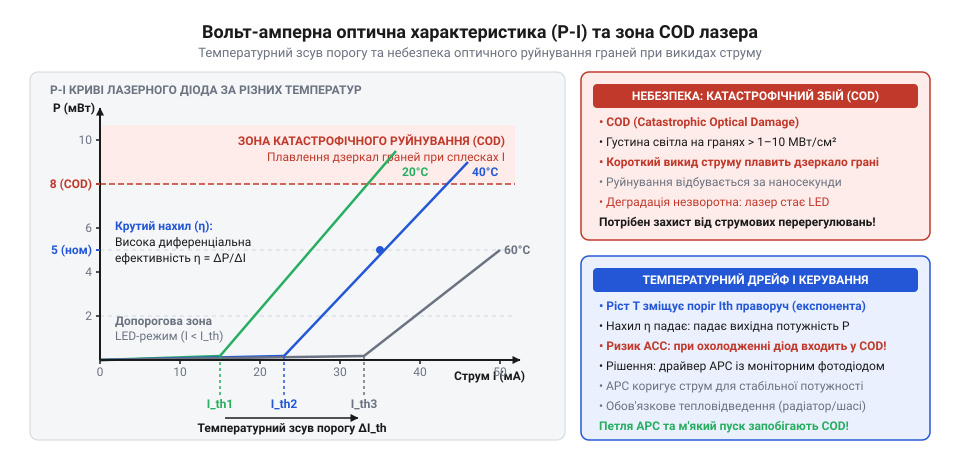
*Залежність вихідної оптичної потужності від прямого струму: стрімка ділянка генерації після порогового значення зміщується вправо з нагріванням, а будь-який імпульсний викид струму вище критичної межі спричиняє миттєве катастрофічне оптичне руйнування граней (COD).*

Механізм COD зумовлений мікроскопічною геометрією випромінювача та фізикою його дзеркал. Вихідний пучок генерується у вузькому хвилеводі активної зони поперечним перерізом приблизно 1–2 мкм заввишки та 3–5 мкм завширшки. Коли вихідна потужність становить лише 50–100 мВт, густина оптичної потужності на вихідній грані сягає екстремальних величин:

```
S[opt]
= P[opt] / A[facet]
= 50 · 10⁻³ Вт / (5 · 10⁻⁸ см²)    [розрахунок густини випромінювання на дзеркалі]
= 1 · 10⁶ Вт/см² = 1 МВт/см²        [мегавати на квадратний сантиметр]
```

Дзеркала резонатора формуються сколюванням монокристала. На поверхні сколу ідеальна кристалічна решітка обривається: виникають численні ненасичені хімічні зв'язки (обірвані валентності), поверхневі оксиди та дислокації. Вони утворюють високу щільність дефектних рівнів посеред забороненої зони напівпровідника.

Носії заряду поблизу грані починають інтенсивно рекомбінувати через ці поверхневі пастки без випромінювання світла. Енергія рекомбінації передається коливанням ґратки — фононам (грец. φωνή, phone — звук, голос), викликаючи локальний розігрів тонкого приповерхневого шару дзеркала завтовшки в кілька десятків нанометрів.

З підвищенням локальної температури ширина забороненої зони напівпровідника звужується (`dE[g]/dT < 0`). У результаті виникає фатальний ефект: енергія лазерних фотонів, що вільно проходять крізь прозоре охолоджене тіло кристала, стає більшою за звужену заборонену зону на розігрітій грані. Дзеркало, яке щойно було оптично прозорим, перетворюється на потужний поглинач власного лазерного випромінювання.

Виникає лавиноподібний позитивний тепловий зворотний зв'язок: поглинання оптичного потоку щільністю в мегавати на квадратний сантиметр викликає ще сильніший розігрів грані, що ще більше звужує заборонену зону та прискорює поглинання. Процес розвивається за одиниці наносекунд. Температура дзеркала миттєво сягає точки плавлення напівпровідника (понад 1200 °C для GaAs). Поверхневий шар кристала плавиться, втрачає площинність і кристалічну структуру, вкриваючись кратерами та сіткою мікротріщин.

Після розплавлення дзеркала коефіцієнт відбиття резонатора падає до нуля. Лазерна генерація припиняється назавжди. Прилад не відновлюється: він безповоротно перетворюється на звичайний надзвичайно дефектний світлодіод зі слабким розсіяним світінням та аномально високим струмом витоку.

Оскільки теплова лавина COD розгортається за наносекунди, лазерний кристал є беззахисним перед субмікросекундними імпульсними перенапругами, дзвоном паразитної індуктивності провідників, комутаційним брязкотом контактів чи електростатичним розрядом (ESD). Струмовий імпульс, який звичайний світлодіод чи випрямний діод поглине без жодних наслідків, для оптичної грані лазера є смертельним.

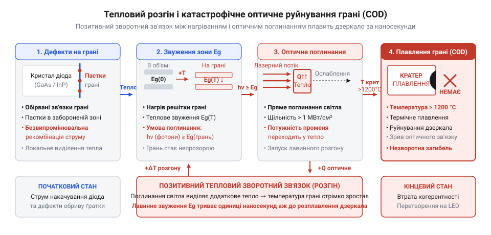
*Покрокова діаграма розвитку теплової лавини COD: безвипромінювальна рекомбінація на поверхневих дефектах дзеркала викликає локальний розігрів, термічне звуження забороненої зони та лавиноподібне самопоглинання лазерного випромінювання аж до розплавлення кристалічної грані.*

> 🔧 **Навіщо це.**
> Розуміння порогової нелінійності та фізики руйнування граней COD позбавляє інженера ілюзії, ніби лазерний діод можна регулювати простим потенціометром чи живити від джерела напруги. Будь-яка схема керування лазером зобов'язана бути швидкодіючим джерелом струму із замкненим контуром обмеження, обов'язковим колом плавного пуску та апаратним захистом від комутаційних викидів струму наносекундної тривалості.

## Анатомія лазерного вузла: інтегрований фотодіод і конфігурації виводів

Неможливість безпечного керування лазерним діодом за допомогою фіксованого струму змушує будувати схеми зі зворотним зв'язком. Оскільки прямий струм через температурні зсуви та старіння не визначає вихідну яскравість однозначно, вимірювати необхідно сам кінцевий параметр — оптичну потужність випромінювання.

Для цього стандартний напівпровідниковий лазерний прилад у металевому корпусі TO-can (TO-18, TO-56 діаметром 5.6 мм або 3.8 мм) виконують у вигляді оптико-електронного гібридного вузла. Усередині корпусу встановлено два окремі напівпровідникові кристали:

1. Випромінювальний лазерний діод (LD, англ. @@en|laser diode@@). Оптичний резонатор випромінює світло через обидві дзеркальні грані: передню та задню. Через передню грань виходить основний робочий пучок, спрямований у лінзову оптичну систему. Крізь задню грань назовні виходить невелика частка світла (зазвичай 5–10% від загального потоку), яка слугує контрольним сигналом.
2. Моніторний фотодіод (PD, англ. @@en|photodiode@@; грец. φῶς, phos — світло + діод). Він розташований на спільній монтажній основі безпосередньо за задньою гранню лазерного кристала. Фотодіод перехоплює зворотний пучок і формує вихідний фотострум `I[mon]`, суворо пропорційний випромінюваній оптичній потужності `P[opt]`:

```
I[mon] = S[pd] · P[opt]    [залежність струму монітора від оптичної потужності]
```

де `S[pd]` — чутливість моніторного фотодіода (англ. @@en|responsivity@@, типові значення становлять 0.05–0.5 мА/мВт).

Щоб відбите від поверхні кремнієвого фотодіода світло не потрапляло назад у резонатор лазера (що викликає оптичний зворотний зв'язок, хаотичні сплески інтенсивності та фазовий шум), кристал фотодіода завжди монтують під невеликим кутом (5°–15°) до поздовжньої оптичної осі випромінювача.

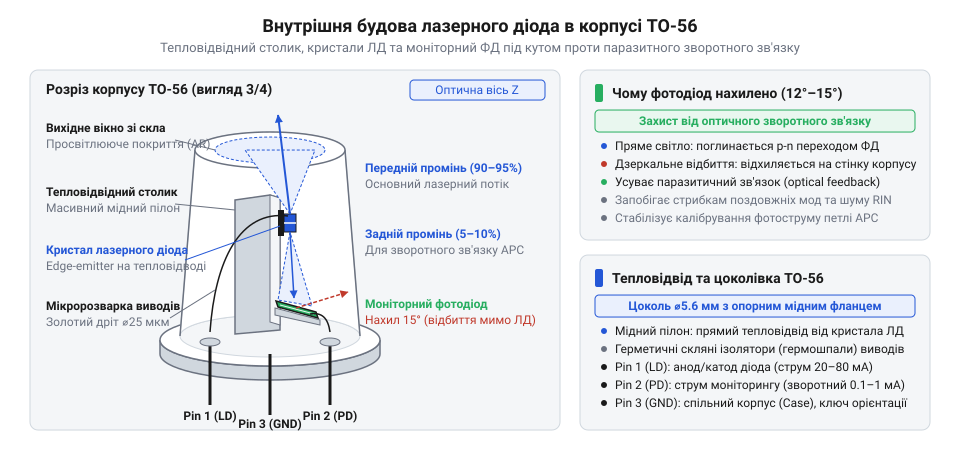
*Конструкція оптичного вузла у металевому корпусі TO-56: кристал лазерного діода змонтовано на масивній тепловідвідній основі, а моніторний фотодіод розміщено за його задньою гранню під кутом до оптичної осі для запобігання паразитним відбиттям назад у резонатор.*

Два кристали разом мають чотири електричні контакти: анод (грец. ἄнодов, anodos — рух угору; від ἀνά, ana — вгору + ὁδός, hodos — шлях) і катод (грец. κάθοδος, kathodos — рух униз; від κατά, kata — вниз + ὁδός, hodos — шлях) лазера, а також анод і катод фотодіода. Проте класичний корпус має лише три виводи. Четвертий вивід ліквідовано заради мініатюризації та зменшення паразитної індуктивності: два контакти об'єднано всередині корпусу в одну спільну точку, електрично сполучену з масивною металевою основою та ковпачком (CASE).

Залежно від того, які саме полюси кристалів об'єднано з корпусом, у промисловості сформувалися три класичні топології (грец. τόπος, topos — місце + λόγος, logos — вчення, слово) цоколівки: Style A, Style B та Style C.

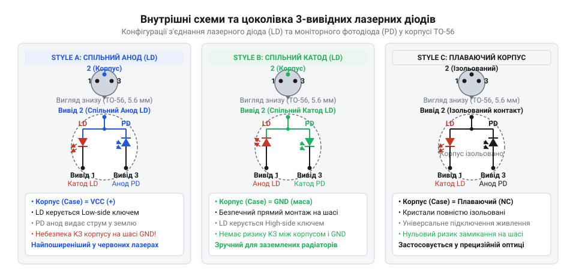
*Конфігурації цоколівки трививідного металевого корпусу: спільний анод (Style A), спільний катод (Style B) та незалежні кристали (Style C), що визначають вибір структури регулювального ключа (верхнє або нижнє плече).*

### Конфігурація Style A: спільний анод (Common Anode)

У збірках Style A анод лазерного діода та катод моніторного фотодіода з'єднано накоротко та виведено на спільний контакт, з'єднаний із металевим корпусом приладу. Катод лазера й анод фотодіода виведено на два ізольовані штирі.

Схемотехнічні наслідки Style A:
- Спільний вивід підключають до позитивної шини живлення (`+V[cc]`).
- Регулювальний транзистор (англ. @@en|transistor@@ — від @@en|transfer@@, переносити + @@en|resistor@@, опір) зобов'язаний стояти в нижньому плечі (англ. @@en|low-side@@) — між катодом лазерного діода та землею (GND). Це зручно для схемотехніки: нижнім плечем легко керувати за допомогою звичайного N-канального польового МОН-транзистора або біполярного NPN-транзистора без високовольтного зсуву рівнів.
- Анод фотодіода підключають до землі через струмовимірювальний резистор. Оскільки катод фотодіода сидить на плюсі живлення `+V[cc]`, на p-n переході фотодіода утворюється зворотна напруга зміщення. У цьому фотодіодному режимі (англ. @@en|photoconductive mode@@) розширення збідненої області зменшує бар'єрну ємність переходу в рази, що забезпечує високу швидкодію контуру оптичного регулювання.

### Конфігурація Style B: спільний катод (Common Cathode)

У збірках Style B катод лазерного діода та анод моніторного фотодіода об'єднано зі спільним виводом і металевим корпусом. Анод лазера та катод фотодіода мають окремі ізольовані виводи.

Схемотехнічні наслідки Style B:
- Спільний вивід з'єднують із загальним проводом схеми (GND / 0 В).
- Регулювальний транзистор необхідно вмикати у верхнє плече (англ. @@en|high-side@@) — між позитивною шиною живлення (`+V[cc]`) та анодом лазерного діода. Це вимагає використання P-канального польового МОН-транзистора або біполярного PNP-транзистора, а також відповідного зсуву керуючої напруги від операційного підсилювача, що дещо ускладнює схему.
- Катод фотодіода підтягують до позитивного джерела зміщення через вимірювальний резистор, щоб забезпечити зворотне зміщення переходу.

### Конфігурація Style C: незалежні кристали або плаваючі контакти

У варіанті Style C кристали лазера та фотодіода повністю ізольовані від металевого корпусу або мають індивідуальну конфігурацію виводів (наприклад, з'єднання однойменних полюсів — катод з катодом або анод з анодом). Металевий корпус при цьому слугує суто електростатичним екраном і виводиться окремим штирем або залишається незадіяним (англ. @@en|floating pinout@@).

Схемотехнічні наслідки Style C:
- Розробник отримує повну свободу вибору топології керування (high-side чи low-side).
- Фотодіод можна ввімкнути у [фотогенераторному режимі](root:hw-sensing/photodetector-physics) (англ. @@en|photovoltaic mode@@) з нульовою напругою зміщення, проте більша бар'єрна ємність переходу зменшує швидкодію зворотного зв'язку порівняно зі зворотно зміщеним фотодіодним режимом.

### Механічний монтаж і тепловідвід: прихована пастка

Внутрішня конфігурація виводів диктує не лише вибір транзистора, але й конструкцію всього механічного вузла лазера.

Кристал лазерного діода площею в частки квадратного міліметра виділяє під час роботи від 50 до 300 мВт концентрованого тепла. Щоб уникнути перегріву й теплового зсуву порогу генерації, корпус лазера щільно запресовують або угвинчують у масивний латунний чи алюмінієвий тубус коліматора (лат. collimo — спрямовую по прямій лінії), сполучений із зовнішнім радіатором.

Тубус коліматора утворює безпосередній електричний контакт із металевим корпусом лазера:
- Якщо використовується діод **Style B**, його корпус з'єднаний із катодом (землею). Радіатор коліматора можна жорстко кріпити до заземленого металевого шасі приладу чи металорізального верстата без жодної електричної ізоляції. Це забезпечує мінімальний тепловий опір і надійне охолодження.
- Якщо ж використовується діод **Style A**, його металевий корпус з'єднаний з анодом, тобто підключений до позитивної шини живлення `+V[cc]`. Якщо такий модуль механічно закріпити на заземленому металевому корпусі верстата, станеться миттєве глухе коротке замикання шини живлення на землю через коліматор.

Щоб уникнути замикання в модулях Style A, інженеру доводиться або електрично ізолювати коліматор за допомогою діелектричних втулок і теплопровідних прокладок (що неминуче збільшує тепловий опір перехід-радіатор і погіршує охолодження), або змінювати структуру живлення драйвера, роблячи заземленою позитивну шину й використовуючи від'ємне живлення (`-V[ee]`).

> 🔧 **Навіщо це.**
> Тип внутрішнього з'єднання кристалів є першим параметром, який перевіряють за документацією перед проєктуванням плати драйвера. Помилка у виборі конфігурації призводить до фатальних наслідків: підключення діода Style A до драйвера, розрахованого на Style B, перетворює зворотний зв'язок на позитивний або випалює моніторний фотодіод прямим струмом. Правильне визначення цоколівки гарантує електричну сумісність силового ключа, збереження робочого зміщення фотодіода та безпеку механічного монтажу на загальне шасі.

## Режим автоматичного контролю струму (ACC, Automatic Current Control): аналіз і розрахунок топологій постійного струму

Лазерний кристал (грец. *krystallos* — лід, гірський кришталь) докорінно відрізняється від звичайного освітлювального світлодіода характером своєї вольт-амперної характеристики (вольт від прізвища фізика Алессандро Вольта + ампер від Андре-Марі Ампера + характеристика від грец. *charaktēr* — тавро, ознака). Доки прямий струм (прасл. *struja*, від *stryti* — текти; лат. *currere* — бігти, текти) не досягне порогового значення `I[th]` (англ. @@en|threshold current@@, поріг генерації), напівпровідниковий гетероперехід випромінює слабке спонтанне некогерентне світло. Щойно поріг подолано, виникає лавиноподібна когерентна оптична генерація: внутрішній динамічний диференційний опір (лат. *differentia* — різниця; опір від прасл. *operti* — підпирати, протидіяти) кристала різко падає до одиниць ом (зазвичай 1–5 Ом), а оптична потужність випромінювання починає лінійно й надзвичайно круто зростати від найменшого збільшення струму. Якщо підключити такий діод до джерела напруги через пасивний струмообмежувальний резистор (як у найпростішому модулі [KY-008](root:cat-hw-actuators/ky-008-laser)), найменша пульсація лінії живлення всього на 50–100 мВ або температурний зсув прямого спаду напруги `V[f]` (що має типовий негативний температурний коефіцієнт близько -1.8 мВ/°C) спричиняє стрибок струму накачки в десятки міліампер. Надвисока концентрація фотонів (грец. *phōs*, родовий відмінок *phōtos* — світло) у вузькому оптичному резонаторі (лат. *resonare* — відлунювати, звучати у відповідь) призводить до теплового пробою дзеркальних поверхонь — виникає незворотне катастрофічне оптичне руйнування граней (англ. @@en|Catastrophic Optical Damage@@, COD; [руйнування граней лазера](root:ph-condensed/laser-diode-catastrophic-optical-damage)) за лічені наносекунди.

Безпечна робота напівпровідникового лазера вимагає керування винятково струмом, а не напругою: внутрішній опір драйвера (англ. @@en|driver@@ від давньоангл. *drīfan* — рухати, поганяти) має на кілька порядків перевищувати динамічний опір діода. Режим стабілізації струму без залучення оптичного зворотного зв'язку називають автоматичним контролем струму — @@en|Automatic Current Control@@ (ACC).

Найпростіші [джерела струму на дискретних біполярних транзисторах або струмових дзеркалах](root:hw-analog/bjt-current-sources-and-mirrors) (англ. @@en|transistor@@ від @@en|transfer resistor@@ — керований опір) непридатні для лазерів через виражену температурну нестабільність спаду напруги переходу база-емітер (`dV[be]/dT ≈ -2.1 мВ/°C`): нагрівання транзистора неминуче спричиняє тепловий дрейф струму накачки, що призводить до неконтрольованого зростання оптичної потужності та руйнування кристала.

Для усунення цієї похибки застосовують лінійний стабілізатор на базі прецизійного операційного підсилювача (ОП; підсилювач від прасл. *sila* — сила; операційний від лат. *operari* — діяти, працювати) та регулювального польового транзистора. У такій схемі операційний підсилювач охоплено глибоким негативним зворотним зв'язком (англ. @@en|negative feedback@@) за напругою на низькоомному вимірювальному шунті (англ. @@en|shunt@@ — відгалуження; від середньоангл. *shunten* — повертати вбік), розташованому в колі витоку транзистора.

```
+V[cc]
  │
 ┌┴┐
 │ │ Лазерний діод (LD)
 └┬┘
  │
 ┌┴─────────────────┐
 │ Стік (Drain)     │
 │ N-канальний FET  │
 │ Витік (Source)   │
 └┬─────────────────┘
  ├───────────────────────────────┐
  │                               │
 ┌┴┐                             ┌┴┐
 │ │ R[shunt]                    │ │ R[in-]
 └┬┘                             └┬┘
  │                               │
 GND                             ┌┴───────────────────────┐
                                 │ Інвертувальний вхід   │
                                 │ Операційного           │
                                 │ Підсилювача (IN-)      │
                                 └────────────────────────┘
```

Неінвертувальний вхід `IN+` операційного підсилювача підключають до стабільного джерела опорної напруги `V[ref]` ([опорне джерело напруги](root:hw-analog/voltage-reference-sources)). Інвертувальний вхід `IN-` з'єднують із витоком N-канального MOSFET. Завдяки нескінченно великому коефіцієнту підсилення з розімкненим контуром операційний підсилювач установлює таку напругу на затворі транзистора, за якої потенціал (лат. *potentia* — сила, спроможність) на інвертувальному вході стає рівним потенціалу на неінвертувальному вході:

`V[shunt] = V[ref]`

Струм, що протікає через вимірювальний шунт, визначається винятково опорною напругою та опором шунта:

`I[shunt] = V[ref] / R[shunt]`

Оскільки затвор польового транзистора ізольовано діелектриком, статичний струм затвора дорівнює нулю (`I[gate] = 0`). Отже, струм стоку, що проходить через лазерний діод, абсолютно строго дорівнює струму шунта: `I[LD] = I[shunt]`. У схемі повністю відсутня похибка базового струму, властива біполярним транзисторам.

Величина опорної напруги `V[ref]` є результатом інженерного компромісу. Якщо обрати `V[ref]` занадто високим (наприклад, 1–2 В), на шунті марно розсіюватиметься значна теплова потужність, а також зменшиться корисний запас за напругою (англ. @@en|headroom@@) для живлення лазерного діода. Якщо обрати `V[ref]` занадто низьким (наприклад, 10–20 мВ), напруга зміщення нуля (англ. @@en|input offset voltage@@) операційного підсилювача `V[os]` (яка для стандартних ОП становить 1–3 мВ) і її температурний дрейф внесуть неприпустиму відносну похибку в струм накачки (до 10–30%), а також зросте чутливість до наведень по спільній шині заземлення. Оптимальний діапазон `V[ref]` становить від 100 мВ до 250 мВ.

Розрахунок номіналів для живлення червоного лазерного діода з робочим струмом накачки `I[LD] = 35 мА` при опорній напрузі `V[ref] = 200 мВ`:

```
R[shunt]
= V[ref] / I[LD]                         [закон Ома для кола вимірювального шунта]
= 0.200 В / 0.035 А                      [підстановка значень опорної напруги та струму]
≈ 5.714 Ом                              [результат обчислення опору]
```

Обирають стандартний прецизійний резистор з допуском 0.1% або 1% номіналом 5.6 Ом і коригують дільник `V[ref]` до 196 мВ, або збирають комбінацію з паралельних резисторів для точного підбору.

Потужність, що розсіюється на вимірювальному шунті:

```
P[shunt]
= I[LD]² · R[shunt]                      [закон Джоуля-Ленца для розсіюваної потужності]
= (0.035 А)² · 5.714 Ом                  [підстановка значень струму та опору шунта]
≈ 0.0070 Вт = 7.0 мВт                   [обчислення теплових втрат на шунті]
```

Мінімальна напруга живлення схеми `V[cc(min)]` складається з прямого спаду на лазерному діоді `V[f(LD)]` (типово 2.2 В для довжини хвилі 650 нм), спаду напруги між стоком і витоком транзистора в лінійному режимі `V[ds(sat)]` (близько 0.25 В) та спаду на шунті `V[shunt]`:

```
V[cc(min)]
= V[f(LD)] + V[ds(sat)] + V[shunt]       [сума спадів напруги послідовного кола]
= 2.20 В + 0.25 В + 0.20 В               [підстановка падінь на діоді, транзисторі та шунті]
= 2.65 В                                 [мінімальна напруга живлення драйвера]
```

При стандартному живленні від шини 5.0 В надлишок напруги `5.00 В - 2.65 В = 2.35 В` падає на каналі польового транзистора. Теплова потужність транзистора становить `P[fet] = 2.35 В · 0.035 А ≈ 82.3 мВт`, що легко розсіюється стандартним корпусом SOT-23 без встановлення додаткового радіатора.

Головна небезпека лінійного драйвера на ОП криється в стійкості петлі зворотного зв'язку. Вхідна ємність затвора польового транзистора `C[iss] = C[gs] + C[gd]` (яка через ефект Міллера становить від сотень пікофарад до одиниць нанофарад) разом із вихідним опором операційного підсилювача у розімкненому стані `R[out]` утворює низькочастотний полюс:

`f[p_gate] = 1 / (2 · π · R[out] · C[iss])`

Цей полюс додає відставання за фазою аж до 90° всередині петлі регулювання. Якщо сумарний фазовий зсув на частоті одиничного підсилення петлі наблизиться до 180°, фазовий запас (англ. @@en|phase margin@@) впаде до нуля. Схема перетвориться на автогенератор і збудиться на частотах від сотень кілогерців до десятків мегагерців. Оскільки амплітуда високочастотних коливань струму на піках у кілька разів перевищує середній рівень, лазерний діод миттєво гине від оптичного руйнування граней (COD), хоча середній струм за показами мультиметра здаватиметься цілком безпечним.

Щоб гарантувати абсолютну стійкість, застосовують частотну корекцію (лат. *correctio* — виправлення):
1. Послідовно між виходом ОП і затвором транзистора вмикають антипаразитний резистор `R[gate]` (номіналом 100–330 Ом). Він ізолює вихід підсилювача від ємності затвора і демпфує (нім. *dämpfen* — глушити, гасити) високочастотні резонанси індуктивності друкованих провідників.
2. Між виходом ОП та його інвертувальним входом підключають коригувальний конденсатор `C[f]` (1–10 нФ), а вимірювальний шунт під'єднують до інвертувального входу через розв'язувальний резистор `R[in-]` (10 кОм).

На високих частотах конденсатор `C[f]` шунтує коло зовнішнього зворотного зв'язку і створює 100% локальний негативний зворотний зв'язок безпосередньо навколо операційного підсилювача. Підсилювач перетворюється на інтегратор (лат. *integrare* — відновлювати, об'єднувати в ціле) зі спадом підсилення -20 дБ/декада. Петльове підсилення падає нижче 0 дБ задовго до того, як фазовий зсув від ємності затвора встигне зруйнувати фазовий запас, забезпечуючи запас стійкості понад 60°.

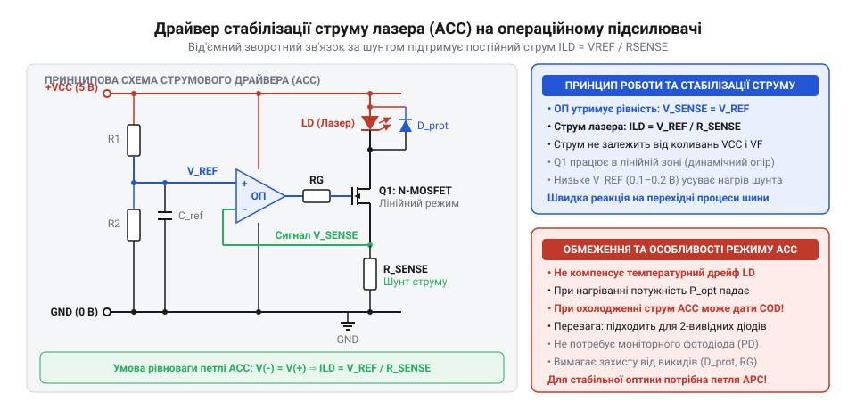
*Принципова схема прецизійного лінійного драйвера струму ACC на операційному підсилювачі та N-канальному польовому транзисторі: стабілізація напруги на вимірювальному шунті підтримує незмінний струм накачки незалежно від коливань живлення, а коригувальний RC-ланцюг усуває автоколивання, спричинені ємністю затвора.*

Незважаючи на ідеальну стабілізацію електричного струму, режим ACC має фундаментальне фізичне обмеження: постійний струм накачки не гарантує сталості вихідної світлової потужності. Пороговий струм лазерного діода `I[th]` експоненційно зростає з підвищенням температури напівпровідникової структури:

`I[th](T) = I[th0] · exp((T - T₀) / T₀_char)`

де `T₀_char` — характеристична температура гетероструктури (зазвичай 80–140 K). Одночасно з ростом температури падає диференціальна квантова ефективність (лат. *effectivus* — дієвий, результативний) `η[d]` через переважання безвипромінювальної рекомбінації носіїв заряду.

Якщо драйвер ACC налаштовано на фіксований струм 35 мА при температурі +20°C, то при нагріванні модуля до +50°C пороговий струм зростає з 20 мА до 32 мА. Ефективна різниця `(I[LD] - I[th])` падає від 15 мА до жалюгідних 3 мА. Оптична потужність випромінювання лазерного променя обвалюється на 70–80%, лінія стає ледь помітною або генерація взагалі зривається в некогерентне тьмяне світлодіодне світіння.

Зворотна ситуація ще небезпечніша: під час охолодження випромінювача (наприклад, увімкнення на морозі при -15°C) пороговий струм різко знижується до 10–12 мА, а квантова ефективність `η[d]` зростає. Струм накачки залишається незмінним (35 мА), тому різниця `(I[LD] - I[th])` стрибає від 15 мА до 25 мА. Оптична потужність перевищує номінальні 5 мВт у півтора-два рази, що спричиняє негайну оптичну деградацію (лат. *degradatio* — зниження рівня) або фатальне руйнування граней (COD).

Крім температури, кристал піддається незворотному старінню: з плином часу густина дефектів решітки зростає, поріг генерації неминуче підвищується, і під керуванням ACC яскравість випромінювача монотонно згасає протягом сотень годин експлуатації.

> 🔧 **Навіщо це.**
> Режим ACC обирають тоді, коли робоча температура напівпровідникового кристала штучно зафіксована з точністю до десятих часток градуса за допомогою термоелектричних модулів Пельтьє (TEC-контролерів) або коли застосовують імпульсну модуляцію з субнаносекундними фронтами, де паразитна ємність моніторного фотодіода занадто інерційна для миттєвого відпрацювання оптичного відгуку. Також ACC є незамінним під час зняття лабораторних вольт-амперних та ват-амперних характеристик для визначення фізичного порогу генерації та квантового виходу напівпровідникових структур.

## Режим автоматичного контролю потужності (APC, Automatic Power Control): побудова замкненої петлі за моніторним фотодіодом

Неможливість підтримувати стабільний світловий потік за допомогою фіксованого струму накачки робить замкнений оптичний зворотний зв'язок безальтернативним для систем неперервного випромінювання. Щоб випромінювана яскравість залишалася незмінною в широкому температурному діапазоні, струм через напівпровідниковий перехід повинен динамічно змінюватися: збільшуватися під час нагрівання кристала та автоматично зменшуватися під час його охолодження.

Для вимірювання миттєвої оптичної потужності безпосередньо всередині герметичного металевого корпусу (найчастіше формату TO-56 діаметром 5.6 мм або TO-38 діаметром 3.8 мм) встановлюють моніторний фотодіод (грец. *phōs*, родовий відмінок *phōtos* — світло + діод від грец. *di-* — два та *hodos* — шлях; англ. @@en|monitor photodiode@@, MPD).

```
 ┌──────────────────────────────────────────────┐
 │ Корпус TO-56                                 │
 │                                              │
 │                   Передня грань (R ≈ 10%)    │
 │                ┌──────────────────────┐      │
 │  Задня грань   │  Лазерний кристал    ├──────┼─► Вихідний корисний промінь
 │  (R ≈ 90%)     │  (Laser Diode)       │      │   P[opt] (5 мВт)
 │   ┌────────────┴──────────────────────┘      │
 │   ▼ Промінь витоку P[rear]                   │
 │  ┌─────────────────┐                         │
 │  │ Моніторний      │                         │
 │  │ фотодіод (MPD)  │                         │
 │  └─────────────────┘                         │
 └──────────────────────────────────────────────┘
```

Оптичний резонатор Фабрі-Перо утворюється двома паралельними дзеркальними гранями кристала. Передня грань має напівпрозоре діелектричне покриття з низьким коефіцієнтом відбиття (`R ≈ 4...15%`), крізь яке назовні виходить основний робочий промінь оптичної потужності `P[opt]`. Задня грань має високовідбивне дзеркальне напилення (`R ≈ 90...95%`), проте незначна частка світла (близько 5–10%) просочується крізь неї назад. Оскільки хвильовий розподіл електромагнітного поля всередині резонатора єдиний, потужність зворотного витоку строго пропорційна вихідній потужності основного променя:

`P[rear] = k[opt] · P[opt]`

Кремнієвий p-i-n фотодіод розташовано на металевому тепловідвідному цоколі прямо позаду задньої грані лазерного кристала. Поглинаючи випромінювання зворотного витоку, він генерує лінійний зворотний фотострум `I[PD]`:

`I[PD] = S[eff] · P[opt]`

де `S[eff]` — ефективна чутливість моніторного фотодіода (типово від 20 до 80 мкА/мВт для напівпровідникових випромінювачів червоного діапазону). Для модуля з номінальною потужністю 5 мВт фотострум становить від 100 до 400 мкА.

За внутрішнім електричним з'єднанням виводів у корпусі TO-56 виділяють три базові топології:
1. **Тип A**: спільні катод лазерного діода та анод фотодіода.
2. **Тип B**: спільні катод лазерного діода та катод фотодіода.
3. **Тип C**: спільні анод лазерного діода та катод фотодіода.

Конфігурація типу C є найбільш розповсюдженим промисловим стандартом для неперервних лазерних лінійних модулів. Спільний вивід з'єднують із плюсовою шиною живлення `+V[cc]`. Катод лазерного діода підключають до стоку керувального N-канального MOSFET або колектора NPN-транзистора (нижній ключ), а анод фотодіода з'єднують із землею через вимірювальний навантажувальний резистор `R[mon]`. У такій конфігурації фотодіод увімкнено зі зворотним зміщенням, що розширює його збіднену область, зменшує внутрішню бар'єрну ємність `C[j]` до одиниць пікофарад і забезпечує лінійність фотоструму в діапазоні кількох порядків.

Схемотехніка петлі APC (англ. @@en|Automatic Power Control@@) працює за принципом безперервного зрівноважування:
1. Фотострум `I[PD]` протікає крізь калібрувальний резистор `R[mon]`, формуючи напругу зворотного зв'язку:
   `V[mon] = I[PD] · R[mon]`.
2. Ця напруга подається на інвертувальний вхід підсилювача похибки (похибка від давньорус. *хыбити* — відхилятися, помилятися; англ. @@en|error amplifier@@) на базі прецизійного операційного підсилювача.
3. На неінвертувальний вхід ОП подається фіксована опорна напруга завдання оптичної потужності `V[set]`.
4. Вихід операційного підсилювача керує затвором прохідного транзистора, який задає струм накачки лазера `I[LD]`.

Якщо напівпровідниковий кристал нагрівається, оптична потужність починає падати. Світловий потік на моніторний фотодіод слабшає, внаслідок чого фотострум `I[PD]` падає, і напруга на вимірювальному резисторі стає меншою за опорну (`V[mon] < V[set]`). Підсилювач похибки реагує на різницю напруг і негайно збільшує вихідну напругу, відкриваючи прохідний транзистор сильніше. Струм накачки лазерного діода `I[LD]` зростає рівно настільки, щоб компенсувати втрату ефективності та повернути оптичну потужність до вихідного значення, де `V[mon]` знову дорівнюватиме `V[set]`.

Якщо кристал охолоджується, квантова ефективність зростає, спричиняючи підйом фотоструму `I[PD]`. Напруга `V[mon]` миттєво перевищує `V[set]`, і операційний підсилювач прикриває прохідний транзистор, скидаючи струм накачки та запобігаючи руйнуванню кристала (COD).

Розрахунок елементів петлі зворотного зв'язку для лазерного модуля потужністю `P[opt] = 5.0 мВт` за паспортної чутливості моніторного фотодіода `S[eff] = 0.040 мА/мВт` (40 мкА/мВт):

Розраховують номінальний струм моніторного фотодіода:

```
I[PD]
= S[eff] · P[opt]                        [залежність фотоструму від оптичної потужності]
= 0.040 мА/мВт · 5.0 мВт                 [підстановка паспортної чутливості та потужності]
= 0.200 мА = 200 мкА                    [номінальний струм моніторного фотодіода]
```

Опорну напругу завдання `V[set]` обирають на рівні 1.000 В (що забезпечує високу завадостійкість щодо шумів перемикання). Опір навантажувального резистора моніторного кола `R[mon]`:

```
R[mon]
= V[set] / I[PD]                         [закон Ома для кола навантаження фотодіода]
= 1.000 В / 0.000200 А                   [підстановка опорної напруги завдання та фотоструму]
= 5000 Ом = 5.0 кОм                     [розрахунковий опір вимірювального навантаження]
```

На практиці замість постійного резистора встановлюють послідовний ланцюг із постійного прецизійного резистора опором 3.3 кОм та багатообертового підлаштовного потенціометра на 4.7–5.0 кОм. Під час заводського налаштування випромінювач спрямовують у калібрований вимірювач оптичної потужності й обертанням потенціометра виставляють вихідну потужність лінії рівно на 5.0 мВт.

Головна проблема стійкості петлі APC полягає в тому, що система містить кілька інерційних ланок із високим коефіцієнтом підсилення. Лазерний діод перетворює струм на світло майже безінерційно (на гігагерцових частотах), проте фотодіод разом із високоомним резистором `R[mon]` утворює паразитний полюс:

`f[p_pd] = 1 / (2 · π · R[mon] · C[pd])`

При `R[mon] = 5 кОм` і ємності діода разом із монтажем `C[pd] ≈ 20 пФ` частота зрізу кола фотодіода становить близько 1.6 МГц. Якщо операційний підсилювач увімкнути як звичайний пропорційний підсилювач із великим коефіцієнтом передачі, фазовий зсув підсилювача разом із фазовим запізненням кола фотодіода та ємності затвора перевищить 180° на частоті, де підсилення контуру більше за 0 дБ. У системі виникне релаксаційна оптична автогенерація. Оскільки на вершинах коливань струм лазера значно перевищує поріг руйнування, виникають надпотужні оптичні спалахи з перерегулюванням (англ. @@en|overshoot@@), що знищують грань кристала (COD) протягом перших же мілісекунд після увімкнення.

Для стабілізації контуру APC підсилювач похибки перетворюють на класичний інтегратор. Між виходом операційного підсилювача та його інвертувальним входом підключають інтегрувальний конденсатор `C[int]`, а напругу з вимірювального резистора `R[mon]` подають на інвертувальний вхід через обмежувальний резистор `R[in]` опором 10 кОм.

Цей ланцюг формує домінантний інтегрувальний полюс із передавальною характеристикою:

`A(s) = - 1 / (s · R[in] · C[int])`

Підсилення контуру спадає зі швидкістю -20 дБ/декада і перетинає рівень 0 дБ на одиничній частоті зрізу контуру `f[c]`, яку обирають значно нижчою за частоту другого полюса фотодіода (зазвичай `f[c] = 20...50 кГц`).

Розрахунок інтегрувальної ємності `C[int]` для частоти зрізу петлі `f[c] = 50 кГц` при `R[in] = 10 кОм`:

```
C[int]
= 1 / (2 · π · R[in] · f[c])             [розрахунок ємності інтегратора за частотою зрізу]
= 1 / (2 · 3.1416 · 10000 Ом · 50000 Гц) [підстановка вхідного опору та частоти зрізу петлі]
≈ 3.18 · 10⁻¹⁰ Ф ≈ 318 пФ               [розрахункове значення інтегрувальної ємності]
```

Обирають стандартний керамічний конденсатор ємністю 330 пФ або 470 пФ з високостабільним діелектриком C0G (NP0). Інтегратор знижує підсилення контуру на високих частотах, забезпечуючи фазовий запас стійкості петлі понад 70° та усуваючи будь-які перехідні коливання або спалахи перерегулювання.

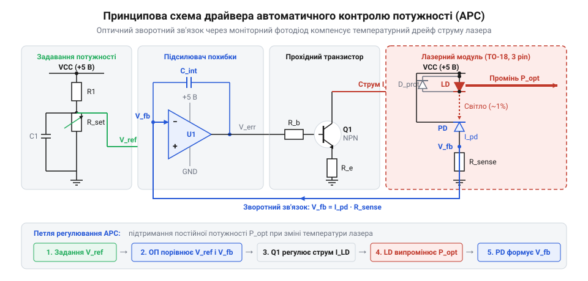
*Принципова схема драйвера автоматичного контролю оптичної потужності (APC): замкнена петля регулювання за фотострумом моніторного фотодіода з інтегрувальним підсилювачем похибки та апаратним обмежувачем струму, що підтримує незмінний світловий потік за коливань температури середовища.*

Схема APC несе специфічну приховану загрозу, яку інженери називають «пасткою темного фотодіода». Якщо під час експлуатації відпаяється або обірветься вивід моніторного фотодіода, трісне внутрішній контактний провідник у корпусі TO-56 або бруд перекриє зворотне вікно, фотострум стане рівним нулю (`I[PD] = 0`). Напруга на інвертувальному вході ОП впаде до нуля:

`V[mon] = 0 В < V[set]`

Підсилювач похибки сприйме відсутність світла як згасання лазера. Намагаючись відновити світловий потік, ОП видасть максимально можливу додатну напругу насичення на затвор транзистора. Транзистор повністю відкриється, скинувши весь доступний струм лінії живлення в лазерний діод. Без захисту лазер згорить за частки мікросекунди.

Щоб уникнути катастрофи, драйвер APC обов'язково доповнюють апаратним обмежувачем максимального струму (англ. @@en|current limiter@@). Послідовно в коло витоку польового транзистора встановлюють струмообмежувальний резистор `R[lim]`, або додають біполярний транзисторний захист, який фізично блокує напругу на затворі, якщо струм лазера перевищить абсолютний максимум (наприклад, 50–55 мА для 35-міліамперного кристала). Навіть якщо петля зворотного зв'язку за фотодіодом розірветься повністю, струм накачки увіпреться в жорстку стелю і кристал залишиться неушкодженим.

Крім обмежувача струму, обов'язковим вузлом APC є ланцюг плавного пуску (англ. @@en|soft-start@@). У момент первинної подачі живлення конденсатор інтегратора `C[int]` розряджений, а фотострум ще не встиг виникнути, що без запобіжних заходів викликає імпульсний стрибок струму накачки. Для блокування перерегулювання опорну напругу `V[set]` подають через інтегрувальний RC-ланцюг із постійною часу 5–20 мс, завдяки чому лазер плавно виходить на встановлений рівень потужності без найменших оптичних сплесків. Для усунення громіздкого дискретного обв'язу в сучасних промислових модулях контур автоматичного регулювання потужності, ланцюги плавного пуску та апаратний захист від перехідних процесів об'єднують у собі [спеціалізовані мікросхеми драйверів лазерних діодів](root:cat-hw-drivers/driver-apc-laser-controller).

> 🔧 **Навіщо це.**
> Режим APC є загальноприйнятим промисловим стандартом для геодезичних лазерних нівелірів, проекторів ліній машинного зору, сканерів штрихкодів та систем оптичної тріангуляції. Коли прилад працює на будівельному майданчику або в неопалюваному цеху за температур від -10°C до +45°C, APC підтримує стабільну контрастність та ширину спроєктованої лінії, гарантуючи водночас, що випромінювач ні за яких умов не перевищить санітарний поріг безпеки для очей (Class 1 або Class 2).

## Комплексний схемотехнічний захист лазерного діода від перехідних процесів, ESD та зворотної напруги

Напівпровідниковий лазерний діод (лазер — абревіатура від англійського @@en|laser@@: @@en|Light Amplification by Stimulated Emission of Radiation@@ — підсилення світла за допомогою вимушеного випромінювання; діод — від грецького @@el|di@@ — два та @@el|hodos@@ — шлях) принципово відрізняється від звичайних світлодіодів і силових випрямлячів своєю критичною вразливістю до динамічних перевантажень. Якщо стандартний кремнієвий p-n перехід здатний без деградації поглинати короткочасні викиди потужності впродовж мікросекунд завдяки теплоємності напівпровідникового кристала, то лазерний кристал зазнає незворотного руйнування за частки наносекунди (менше 1 нс).

Головна причина цієї надзвичайної чутливості — колосальна концентрація оптичної енергії на вихідній грані резонатора. Активна область напівпровідникового лазера має мікроскопічні поперечні розміри: типова товщина становить від 0.1 до 0.3 мкм, а ширина смужки — від 1 до 5 мкм. Коли оптична потужність випромінювання сягає навіть кількох десятків міліват, густина оптичного потоку на сколотій дзеркальній поверхні напівпровідника перевищує діапазон від 10⁶ до 10⁷ Вт/см² (від 1 до 10 МВт/см²).

Будь-який короткочасний сплеск струму накачки, спричинений перерегулюванням (@@en|overshoot@@; від англійського @@en|over@@ — понад та @@en|shoot@@ — вистрілювати) у контурі регулятора або індуктивним викидом у провідниках, викликає миттєве лавиноподібне зростання інтенсивності вимушеного випромінювання. На поверхні сколу кристала неминуче існують дефекти кристалічної ґратки та обірвані валентні зв'язки, які утворюють локальні енергетичні рівні всередині забороненої зони. Ці дефекти інтенсивно поглинають фотони, що призводить до безвипромінювальної рекомбінації носіїв заряду та різкого локального нагрівання поверхні грані. Зі зростанням температури ширина забороненої зони напівпровідника звужується, що зумовлює ще сильніше поглинання світла. Виникає лавиноподібний тепловий розгін у приповерхневому шарі завтовшки кілька десятків нанометрів. За час, менший за 1 нс, локальна температура грані сягає точки плавлення напівпровідникового матеріалу (для арсеніду галію це близько 1238 °C), і дзеркало резонатора плавиться. Це явище називають катастрофічним оптичним руйнуванням граней (COD, @@en|catastrophic optical damage@@; від грецького @@el|katastrophe@@ — перевертання, загибель; оптичне — від грецького @@el|optikos@@ — зоровий). Після виникнення COD лазерний діод назавжди втрачає здатність до генерації когерентного променя, перетворюючись на тьмяний світлодіод із високим струмом витоку або утворюючи коротке замикання.

Другою критичною вразливістю є гранично низька стійкість до зворотної напруги. На відміну від звичайних діодів із допустимою зворотною напругою в десятки або сотні вольт, надтонкий гетероперехід лазерного діода має максимальну зворотну напругу всього `V_R,max ≈ 2 … 3 В`. Будь-який негативний індуктивний викид або відбита хвиля в лінії живлення з амплітудою понад 2 В викликає лавинний пробій гетероструктури з локальною шнурівкою струму та миттєвим проплавленням p-n переходу.

Третім руйнівним фактором є електростатичний розряд (ESD, @@en|electrostatic discharge@@; електростатика — від грецького @@el|elektron@@ — бурштин та @@el|statikos@@ — нерухомий; розряд — зняття електричного заряду). Розряд від тіла людини чи незаземленого монтажного інструмента несе потенціал у кілька кіловольт із часом наростання фронту менше 1 нс. Енергія такого імпульсу, потрапляючи в активну зону об'ємом менше 10⁻¹¹ см³, миттєво викликає діелектричний пробій і руйнування кристалічної ґратки.

Чому статичні схеми автоматичної стабілізації струму (ACC) або оптичної потужності (APC) самі по собі не захищають випромінювач від цих загроз? Під час подачі живлення операційний підсилювач у петлі зворотного зв'язку ще не встигає увійти в лінійний режим: його внутрішні джерела струму зміщення встановлюються із запізненням, через що вихід підсилювача короткочасно влітає в насичення до рівня позитивної шини живлення. Керувальний транзистор повністю відкривається, пропускаючи крізь лазер ударний імпульс струму, обмежений лише внутрішнім опором джерела. Навіть у сталому режимі скінченна швидкість наростання вихідної напруги підсилювача (@@en|slew rate@@; від англійського @@en|slew@@ — повертати та @@en|rate@@ — швидкість) і обмежена смуга пропускання петлі зворотного зв'язку зумовлюють затримку реакції регулятора в межах від 1 до 10 мкс. Будь-який швидкий перехідний процес встигає знищити лазерний кристал задовго до того, як петля зворотного зв'язку встигне зреагувати. Смертельну небезпеку становить і гаряче підключення (приєднання лазера до вже увімкненого драйвера): вихідні блокувальні конденсатори схеми заряджені до напруги живлення, і в момент комутації розряджаються крізь кристал струмом у десятки ампер з нульовим послідовним опором. Пряме підключення діода через один лише баластний резистор, як у модулі [KY-008](root:cat-hw-actuators/ky-008-laser), залишає кристал цілком беззахисним перед комутаційними сплесками, що робить подібні рішення непридатними для надійних систем.

> 🔧 **Навіщо це.**
> Час незворотного оптичного руйнування лазерного переходу (COD) становить менше 1 наносекунди, тоді як регулятори на базі мікроконтролерів чи аналогових мікросхем реагують на перевантаження за мікросекунди — тобто в тисячі разів повільніше. Жоден програмний алгоритм чи внутрішній захист мікросхеми драйвера фізично не встигає зреагувати на наносекундний викид струму або електростатичний розряд. Комплексний апаратний захист є фізичним бар'єром навколо кристала, який демпфує, поглинає й обмежує перехідні процеси безпосередньо на виводах напівпровідника, гарантуючи збереження лазерного модуля під час комутації живлення, випадкових дотиків та індуктивних викидів у кабелі.

### Архітектура трирівневого апаратного захисту

Для гарантованого захисту лазерного діода застосовують багатобар'єрну систему, компоненти якої розділені за частотним діапазоном і фізичним механізмом дії:
1. **Перший рівень (низькочастотний комутаційний бар'єр):** вузол плавного пуску (@@en|soft-start@@; від англійського @@en|soft@@ — м'який та @@en|start@@ — початок), вбудований у коло опорної напруги драйвера. Він монотонно нарощує струм накачки впродовж мілісекунд, утримуючи підсилювач у зоні лінійного регулювання та виключаючи динамічне перерегулювання.
2. **Другий рівень (локальний напруговий бар'єр на виводах діода):** швидкодіючий антипаралельний діод Шотткі (@@en|Schottky diode@@; на честь німецького фізика Вальтера Шотткі, @@de|Walter Schottky@@), що обмежує зворотну напругу на рівні менше 0.3 В, та [супресор перехідних напруг](root:hw-components/tvs-diode) (TVS-діод, @@en|transient voltage suppressor@@; від латинського @@la|supprimere@@ — придушувати, стримувати, та @@la|transire@@ — переходити), який обмежує амплітуду високовольтних імпульсів ESD і прямої перенапруги.
3. **Третій рівень (хвильовий демпфувальний бар'єр):** феритові намистини (@@en|ferrite beads@@; ферит — від латинського @@la|ferrum@@ — залізо) на лініях живлення для поглинання високочастотного шуму та [демпфувальний RC-снаббер](root:hw-power/snubbers-dvdt) (від англійського @@en|snub@@ — різко зупиняти, гасити; демпфування — від німецького @@de|dämpfen@@ — глушити, приглушувати), увімкнений безпосередньо паралельно виводам діода для гасіння паразитного коливального контуру кабелю підключення.

### Вузол плавного пуску (soft-start): розрахунок параметрів

Вузол плавного пуску не повинен ставитися в силову шину живлення, оскільки це призвело б до падіння напруги та значного розсіювання тепла. Його формують у малопотужному керувальному колі драйвера як інтегрувальний ланцюг, що плавно піднімає опорну напругу `V_ref`, яка задає струм накачки для операційного підсилювача.

Під час подачі живлення напруга на конденсаторі інтегрувального RC-ланцюга наростає за експоненційним законом:
```
V_ref(t) = V_ref,0 · (1 - e^(-t / τ_ss))
```
де `V_ref,0` — стала опорна напруга в усталеному стані, `τ_ss` — стала часу інтегрувального ланцюга:
```
τ_ss = R_ss · C_ss
```

Струм накачки лазерного діода `I_LD(t)` відстежує опорну напругу через опір струмовимірювального шунта `R_sense`:
```
I_LD(t) = V_ref(t) / R_sense
        = (V_ref,0 / R_sense) · (1 - e^(-t / τ_ss))
        = I_LD,0 · (1 - e^(-t / τ_ss))
```

Щоб повністю усунути перерегулювання струму, час наростання плавного пуску `t_ss` повинен у тисячі разів перевищувати час реакції замкненої петлі підсилювача `t_loop` (типово `t_loop ≈ 1 … 5 мкс`). Для лазерних модулів малої та середньої потужності оптимальний час плавного пуску становить від 10 до 50 мс: це непомітно для людського ока під час увімкнення, але повністю знімає динамічний стрес з оптичного переходу.

Паралельно резистору `R_ss` обов'язково встановлюють швидкодіючий розрядний діод (катодом до шини живлення), через який конденсатор `C_ss` миттєво розряджається під час зникнення живлення. Якщо живлення вимкнеться і повторно з'явиться за частки секунди (брязкання контактів вимикача), конденсатор без діода залишився б зарядженим, і драйвер стартував би з повного струму без плавного пуску.

**Покроковий інженерний розрахунок кіл плавного пуску:**
Задано робочий струм лазерного діода `I_LD = 50 мА`, опір струмовимірювального шунта `R_sense = 10 Ом`.
Розраховуємо цільову опорну напругу в усталеному режимі:
```
V_ref,0 = I_LD · R_sense
        = 50 · 10⁻³ А · 10 Ом           [закон Ома для вимірювального шунта]
        = 0.5 В = 500 мВ                [усталена опорна напруга підсилювача]
```
Задаємо тривалість наростання струму до рівня 95% від номінального значення: `t_ss = 30 мс`.
Зв'язок між часом наростання до 95% та сталою часу ланцюга:
```
t_ss = -τ_ss · ln(1 - 0.95)
     = -τ_ss · ln(0.05)                 [рівень 95% експоненційного наростання]
     ≈ 3.0 · τ_ss
```
Визначаємо необхідну сталу часу інтегрування `τ_ss`:
```
τ_ss = t_ss / 3.0
     = 30 · 10⁻³ с / 3.0                [розрахунок необхідної сталої часу]
     = 10 · 10⁻³ с = 10 мс
```
Обираємо практичний опір резистора `R_ss = 100 кОм`. Визначаємо необхідну ємність конденсатора плавного пуску `C_ss`:
```
C_ss = τ_ss / R_ss
     = 10 · 10⁻³ с / (100 · 10³ Ом)     [розрахунок ємності інтегрувального конденсатора]
     = 100 · 10⁻⁹ Ф = 100 нФ
```
Швидкість наростання вихідного струму накачки:
```
dI_LD / dt ≈ I_LD / t_ss
           = 50 · 10⁻³ А / (30 · 10⁻³ с)  [середня швидкість наростання струму]
           ≈ 1.67 А/с = 1.67 мА/мс
```
При смузі пропускання петлі зворотного зв'язку підсилювача `f_c ≥ 100 кГц` час його реакції становить:
```
t_loop ≈ 1 / (2 · π · f_c)
       ≈ 1 / (2 · 3.1416 · 100 · 10³ с⁻¹)  [час відгуку петлі регулювання]
       ≈ 1.6 · 10⁻⁶ с = 1.6 мкс
```
Співвідношення часових масштабів:
```
t_ss / t_loop = 30 · 10⁻³ с / (1.6 · 10⁻⁶ с)
              ≈ 18750
```
Петля регулювання встигає відпрацювати зміну устави з величезним запасом: помилка регулювання прямує до нуля на кожному мікросекундному кроці, підсилювач ніколи не заходить у насичення, а викид струму повністю відсутній (`overshoot = 0%`).

### Захист від зворотної напруги та супресори TVS

Для надійного блокування зворотних викидів антипаралельно виводам лазерного діода (анод захисного діода до катода лазера, катод захисного діода до анода лазера) підключають діод Шотткі.

Звичайні випрямні чи імпульсні діоди на основі кремнієвого p-n переходу не здатні виконати це завдання з двох фізичних причин:
1. **Прямий спад напруги:** кремнієвий p-n перехід під час протікання імпульсного струму має прямий спад напруги від 0.7 до 1.1 В, а з урахуванням динамічного опору виводів — до 1.5 … 2.0 В. Ця напруга діє безпосередньо на зворотно зміщений лазерний кристал і перевищує допустимий поріг його руйнування.
2. **Час зворотного відновлення (@@en|reverse recovery time@@, `t_rr`):** у звичайному p-n переході прямий струм формується інжекцією неосновних носіїв заряду, які накопичуються в базі діода. Для закриття діода цей заряд повинен розсмоктатися, що створює затримку від 10 до 100 нс. Упродовж цієї затримки діод фактично закорочений у зворотному напрямку, пропускаючи відбитий імпульс струму назад у напівпровідник.

Діод Шотткі реалізує бар'єр метал-напівпровідник, у якому провідність забезпечується виключно основними носіями заряду. Ефект накопичення неосновних носіїв відсутній, тому час зворотного відновлення практично дорівнює нулю (`t_rr < 100 пс`), а прямий спад напруги при струмах у сотні міліампер становить лише 0.2 … 0.35 В.

Під час виникнення негативного індуктивного викиду зі струмом, наприклад, `I_spike = 100 мА`, діод Шотткі відкривається практично миттєво і жорстко обмежує зворотну напругу на кристалі:
```
V_LD,rev = -V_F,Schottky
         ≈ -0.3 В                       [напруга обмеження діодом Шотткі]
```
Оскільки абсолютне значення `|-0.3 В|` у рази менше за критичний поріг пробою `V_R,max ≈ 2.0 В`, лазерний перехід перебуває в глибоко підпороговій безпечній зоні зі струмом витоку менше 1 мкА.

Для поглинання високовольтних викидів ESD та захисту від прямої перенапруги паралельно лазерному діоду встановлюють супресор TVS. Параметри TVS-діода обирають відповідно до таких обмежень:
- **Робоча напруга відсічки (`V_RWM`, @@en|reverse standoff voltage@@):** максимальна напруга, за якої супресор повністю закритий і має струм витоку менше кількох мікроампер. Її обирають на 15 … 25% вищою за максимальну пряму напругу лазера: для червоних та ІЧ-лазерів (`V_F ≈ 2.2 … 2.5 В`) застосовують TVS із `V_RWM ≈ 3.3 В`, для синіх і зелених лазерів (`V_F ≈ 4.5 … 5.5 В`) — супресори з `V_RWM ≈ 6.0 В`.
- **Напруга пробою (`V_BR`, @@en|breakdown voltage@@):** напруга початку лавинного струму через супресор, яка повинна лежати трохи вище `V_RWM`.
- **Максимальна напруга обмеження (`V_C`, @@en|clamping voltage@@):** гранична напруга на супресорі при піковому імпульсному струмі розряду. Вона не повинна перевищувати абсолютний максимум прямої імпульсної напруги лазерного діода.
- **Паразитна ємність (`C_TVS`):** у схемах неперервного випромінювання (CW) власна ємність супресора не шкодить роботі. Проте у схемах із високочастотною модуляцією застосовують супресори з малою ємністю (`C_TVS ≤ 10 … 30 пФ`), щоб не шунтувати високочастотні фронти струму керування.

### Демпфування індуктивних викидів RC-снаббером і феритовими намистинами

Паразитна індуктивність монтажного кабелю (типово `L_wire ≈ 250 нГн`) разом із власною бар'єрною ємністю p-n переходу лазерного діода (`C_j ≈ 50 пФ`) та малим активним опором дротів (`R_wire ≈ 0.2 Ом`) утворює слабкозатухаючий коливальний контур із високою добротністю (`Q ≫ 1`). Будь-яка швидка комутація струму викликає в такій лінії високочастотний резонансний дзвін у десятки мегагерців: амплітуда першого напівперіоду коливання майже подвоює напругу й струм накачки (`overshoot ≈ 100%`), спричиняючи катастрофічне руйнування граней кристала (COD), а другий напівперіод створює небезпеку зворотного пробою гетеропереходу.

Для повного придушення коливань паралельно лазерному діоду підключають послідовний демпфувальний RC-снаббер із резистора `R_snub` та конденсатора `C_snub`. Конденсатор блокує постійний струм накачки, але вільно пропускає високочастотний струм резонансних коливань у резистор, де енергія викиду безповоротно розсіюється у вигляді тепла.

**Покроковий розрахунок елементів RC-снаббера:**
1. **Вибір ємності снаббера `C_snub`:**
Ємність конденсатора снаббера повинна помітно перевищувати власну ємність переходу лазерного діода, щоб домінувати в контурі:
```
C_snub ≈ 10 · C_j
       = 10 · 50 пФ = 500 пФ
```
Обираємо найближчий стандартний номінал з ряду E24: `C_snub = 470 пФ` (керамічний діелектрик NP0/C0G для виключення п'єзоефекту та діелектричних втрат).

2. **Розрахунок демпфувального резистора `R_snub`:**
Умова критичного демпфування контуру (коефіцієнт демпфування `ζ = 1`, добротність `Q = 0.5`), за якої перехідний процес перетворюється з коливального на монотонний аперіодичний:
```
R_snub = √(L_wire / C_snub)
       = √(250 · 10⁻⁹ Гн / (470 · 10⁻¹² Ф))  [умова критичного демпфування контуру]
       = √531.91 Ом²
       ≈ 23.06 Ом
```
Обираємо стандартний номінал з ряду E24: `R_snub = 22 Ом` або `24 Ом`. З цим резистором добротність контуру знижується до `Q ≈ 0.65`, усуваючи будь-який дзвін та перерегулювання.

Для поглинання завад мегагерцового діапазону в розрив анодної та катодної ліній безпосередньо біля виводів лазера встановлюють феритові намистини. Імпеданс феритової намистини має комплексну природу:
```
Z_bead(f) = R_bead(f) + j · X_bead(f)
```
На постійному струмі активний опір намистини мізерно малий (`R_DC < 0.05 Ом`), тому падіння постійної напруги не перевищує часток мілівольта:
```
V_drop,bead = I_LD · R_DC
            = 50 · 10⁻³ А · 0.05 Ом     [спад постійної напруги на феритовій намистині]
            = 2.5 мВ
```
На високих частотах (від 10 до 1000 МГц) магнітні втрати в осерді різко зростають, і активний резистивний опір намистини сягає сотень ом (`R_bead ≈ 100 … 600 Ом`). Намистина перетворює енергію високочастотних викидів та швидких фронтів ESD на тепло, не відбиваючи її назад у кабель.

### Повна принципова схема апаратного обв'язу захисту

Усі розглянуті захисні ланки поєднуються в єдину взаємодоповнюючу трирівневу систему, показану на схемі:

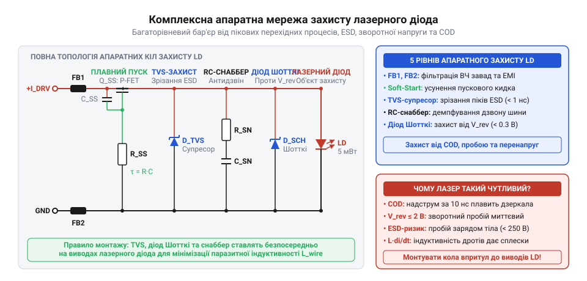
*Повна принципова схема багатобар'єрного апаратного захисту лазерного діода: інтегрувальний RC-вузол плавного пуску в колі завдання опорної напруги, феритові намистини фільтрації високочастотних завад, демпфувальний RC-снаббер паразитних коливань кабелю, антипаралельний діод Шотткі для блокування зворотної напруги та двоспрямований TVS-супресор захисту від електростатичних розрядів.*

Комплексна схема працює злагоджено під час будь-яких аварійних та перехідних сценаріїв:
- **Подача живлення:** інтегрувальний ланцюг `R_ss C_ss` повільно (за 30 мс) піднімає потенціал опорного входу підсилювача, не даючи йому увійти в насичення та забезпечуючи плавне наростання струму накачки без перерегулювання.
- **Зняття живлення:** розрядний діод `D_dis` відкривається, коли напруга шини живлення стає нижчою за потенціал конденсатора `C_ss`, і миттєво розряджає його на землю через кола джерела, готуючи схему до нового безпечного пуску.
- **Імпульс електростатичного розряду (ESD):** надвисоку напругу розряду зрізає TVS-діод, відводячи основну енергію імпульсу на заземлення, а високочастотний фронт струму розсіюється активним опором феритових намистин `FB1` та `FB2`.
- **Індуктивні коливання в кабелі:** енергія резонансу кабелю спрямовується через конденсатор снаббера `C_snub` у резистор `R_snub`, де затухає в аперіодичному режимі без генерації надлишкового струму.
- **Зворотний сплеск напруги:** антипаралельний діод Шотткі `D_Schottky` відкривається за частки наносекунди, фіксуючи зворотну напругу на рівні -0.3 В та повністю виключаючи пробій лазерного гетеропереходу.

Для практичної надійності схеми вирішальне значення має трасування друкованої плати (детальніше див. [правила проєктування друкованих плат для захисту від ESD](root:hw-pcb/shliakh-esd-vid-roziemu-do-zemli)). Усі компоненти локального захисту — `D_Schottky`, `TVS`, `C_snub`, `R_snub` та феритові намистини — повинні розташовуватися безпосередньо біля виводів лазерного діода або вихідного роз'єму. Провідник завдовжки лише 1 см між захисним діодом і виводом лазера вносить близько 10 нГн паразитної індуктивності. Під час швидкого перехідного процесу з крутизною фронту `di/dt ≈ 10⁸ А/с` ця паразитна індуктивність створить додатковий імпульсний спад напруги `V = L · (di/dt) ≈ 1 В`, що здатне повністю нівелювати захисний ефект діода Шотткі й призвести до пробою напівпровідникового кристала.

## Імпульсні режими роботи та високошвидкісна модуляція лазерного випромінювання

У лазерних далекомірах прямого вимірювання часу прольоту, тріангуляційних 3D-сканерах та оптичних лініях зв'язку випромінювач працює імпульсами з частотою від сотень кілогерців до сотень мегагерців. Модуляція (від латинського *modulatio* — розміреність; англійською @@en|modulation@@) оптичного потоку на таких швидкостях принципово відрізняється від керування світлодіодами: напівпровідниковий лазер має виражений поріг генерації, нелінійну динаміку накопичення носіїв заряду та руйнівну чутливість до швидкості наростання струму накачки.

Спроба промодулювати лазер комутацією звичайного ключа або прямим підключенням до логічного виходу спотворює форму спалахів, породжує фазове тремтіння та швидко спалює кристал. Спроба ж подати високочастотний сигнал у класичну схему автоматичного регулювання потужності створює ще більшу загрозу через обмеження швидкодії зворотного зв'язку.

### Чому повільний контур APC сліпне на високих частотах

Стандартний драйвер автоматичного підтримання потужності (APC) містить моніторний фотодіод та інтегратор на операційному підсилювачі. Контур розрахований на повільне відстеження оптичної потужності для компенсації нагрівання кристала або деградації резонатора. Смуга пропускання цієї петлі жорстко обмежена:
- Власна бар'єрна ємність фотодіода (10–50 пФ) разом із резисторами перетворювача струм-напруга обмежує зріз фотоприймача десятками чи сотнями кілогерців.
- Інтегратор помилки навмисно будують із низькочастотним полюсом (від 10 Гц до 10 кГц), щоб усунути фазовий зсув оптичного тракту й зберегти стійкість петлі.

Якщо на такий драйвер подати мегагерцовий сигнал, петля не встигає реагувати на окремі імпульси. Під час паузи світловий потік зникає. Інтегратор розцінює це як аварійне падіння потужності й починає нарощувати вихідну напругу, намагаючись відновити випромінювання. Виникає інтегральне насичення (від латинського *integrare* — відновлювати; англійською @@en|integrator windup@@): вихід підсилювача впирається у верхню шину живлення. Коли надходить наступний логічний імпульс і модулювальний ключ відкривається, струм через кристал обмежується лише насиченням вихідного транзистора, багаторазово перевищуючи робочий поріг.

Сплеск оптичної густини на вихідних дзеркалах миттєво перетинає поріг міцності напівпровідника, викликаючи катастрофічне оптичне руйнування граней (від грецького *katastrophe* — перелом, руйнація та *optike* — зоровий; англійською @@en|catastrophic optical damage@@, COD). Резонатор вигорає за кілька наносекунд, перетворюючи лазер на тьмяний світлодіод. Замкнений оптичний контур принципово непридатний для відстеження швидких фронтів модуляції.

### Пряма модуляція «від нуля»: фізика оптичної затримки та релаксаційний удар

Пряма комутація струму від нульового рівня до робочого значення `I_op` породжує дві фундаментальні проблеми: часову затримку випромінювання та коливальний зрив оптичної потужності.

Напівпровідниковий лазер випромінює когерентне світло лише тоді, коли струм накачки перевищує пороговий струм генерації (від давньоанглійського *therscold* — поріг, межа; англійською @@en|threshold current@@, `I_th`). За нульового струму активна зона спустошена. Коли ключ замикається і струм `I_p` надходить у кристал, інжектовані електрони й дірки мусять спершу накопичитися в зоні рекомбінації до критичної концентрації інверсії заселеностей.

Час накопичення заряду утворює затримку оптичного відгуку (час затримки вмикання, англійською @@en|turn-on delay@@, `t_d`), що підпорядковується логарифмічній залежності від часу життя носіїв спонтанної рекомбінації `τ_s`:

```
t_d = τ_s · ln(I_p / (I_p - I_th))                  [затримка накопичення носіїв до порогу]
```

Для арсеніду галію час життя носіїв `τ_s` становить 1.5–3.0 нс. Якщо амплітуда струмового імпульсу незначно перевищує поріг, затримка стає суттєвою:

**Розрахунок затримки вмикання лазера без попереднього зміщення:**
- Час життя спонтанних носіїв: `τ_s = 2.0 нс`
- Пороговий струм генерації: `I_th = 20 мА`
- Амплітуда струму імпульсу: `I_p = 25 мА`

```
t_d = τ_s · ln(I_p / (I_p - I_th))                  [закон накопичення заряду в активній зоні]
    = 2.0 · ln(25 / (25 - 20))                      [підстановка параметрів]
    = 2.0 · ln(5.0)                                 [натуральний логарифм: ln(5.0) ≈ 1.61]
    = 3.22 нс                                       [затримка появи оптичного випромінювання]
```

За тривалості електричного імпульсу 5 нс оптичний спалах триватиме лише 1.78 нс. Тепловий дрейф порогового струму змінює величину `t_d`, породжуючи фазове тремтіння (джиттер) переднього фронту: для далекоміра нестабільність затримки в 1 нс еквівалентна похибці вимірювання дистанції у 15 см.

Друга небезпека — [релаксаційні коливання](root:ph-condensed/laser-diode-relaxation-oscillations) (від латинського *relaxatio* — послаблення; англійською @@en|relaxation oscillations@@). Коли концентрація носіїв перетинає поріг, лавиноподібно зростає щільність фотонів. Стимульоване випромінювання спустошує резервуар носіїв швидше, ніж надходить струм накачки. Концентрація електронів падає нижче порогу, фотонне поле згасає, після чого носії накопичуються знову. Виникає високочастотний коливальний обмін енергією (1–5 ГГц). За крутого фронту перший пік перерегулювання перевищує стаціонарний рівень у 2–3 рази: діод номіналом 5 мВт у сплеску генерує до 12–15 мВт, що спричиняє незворотну деградацію дзеркал за механізмом COD.

Крім того, комутація від нуля викликає циклічні термомеханічні напруження: смужка активної зони шириною в кілька мікрометрів різко розширюється швидше за підкладку. При мільйонах циклів на секунду температурна втома спричиняє проростання темних ліній дефектів та відшарування діелектричних покриттів дзеркал.

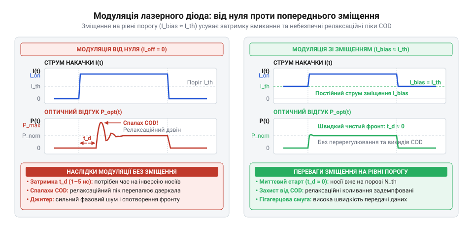
*Порівняння динаміки випромінювання: імпульс струму від нуля викликає затримку генерації t_d і небезпечні релаксаційні спалахи оптичної потужності, тоді як попереднє зміщення на рівні порогу забезпечує миттєвий оптичний відгук із плавним виходом на номінальний рівень.*

### Модуляція з попереднім зміщенням (bias current)

Щоб усунути затримку вмикання, придушити релаксаційні коливання та зняти термомеханічні удари, застосовують модуляцію з постійним попереднім зміщенням (від старофранцузького *biais* — скісний; англійською @@en|bias current@@, `I_bias`).

Крізь діод неперервно пропускають струм зміщення поблизу порогу генерації:

```
I_bias ≈ 0.95 ... 1.00 · I_th                       [діапазон вибору струму зміщення]
```

Активна зона постійно заповнена носіями до стану інверсії заселеностей, але випромінювання перебуває на рівні слабкого спонтанного фону. Модулювальний ключ інжектує лише додатковий імпульсний струм `I_mod`:

```
I_total = I_bias + I_mod                            [сумарний струм під час імпульсу]
```

Формула затримки набуває вигляду:

```
t_d = τ_s · ln(I_mod / (I_mod + I_bias - I_th))     [затримка за наявності зміщення]
```

За умови `I_bias = I_th` аргумент логарифма дорівнює одиниці, а затримка накопичення носіїв `t_d = 0`. Оптичний відгук виникає миттєво, визначаючись лише часом життя фотонів усередині резонатора (1–5 пс) та швидкістю перемикання ключа.

Релаксаційні коливання придушуються: оскільки в резонаторі вже підтримується порогове поле фотонів, інжекція `I_mod` не викликає лавиноподібного надлишку носіїв. Оптичний фронт монотонно повторює струмовий імпульс без перерегулювання за потужністю.

Перепад температури переходу `ΔT_j` між станами зменшується у 2.5–3 рази, оскільки він залежить лише від амплітуди `I_mod`, а не від повного струму, що рятує кристал від механічної втоми. Баланс потужностей визначається коефіцієнтом згасання (від латинського *extinctio* — згасання; англійською @@en|extinction ratio@@, `r_e`):

```
r_e = P_1 / P_0                                     [відношення потужності одиниці до потужності нуля]
```

При `I_bias ≈ 0.95 · I_th` фонова спонтанна потужність `P_0` не перевищує 50 мкВт (для випромінювача 5 мВт), забезпечуючи коефіцієнт згасання понад 100 (20 дБ), що повністю задовольняє вимоги оптичної локації та передачі даних.

> 🔧 **Навіщо це.**
> Попереднє зміщення на рівні порогу перетворює лазер із нелінійного накопичувача заряду на безінерційний перетворювач «струм — світло». Це усуває дрейф часової затримки від нагрівання та захищає дзеркала резонатора від деградації COD через релаксаційні викиди.

### Топології швидкісних імпульсних драйверів

#### Паразитна індуктивність та струмове перемикання (current steering)

Послідовне переривання струму ключем на наносекундних фронтах породжує ЕРС самоіндукції монтажу:

```
V_L = L_par · (di / dt) ≈ L_par · (ΔI / t_r)        [індуктивна ЕРС на монтажі]
```

Навіть за малої індуктивності провідників і виводів `L_par ≈ 15 нГн` та фронту `t_r = 1.0 нс` комутація струму `ΔI = 20 мА` створює сплеск `V_L = 0.30 В`. На спаді імпульсу знак швидкості зміни струму інвертується: на лазері виникає від'ємна напруга самоіндукції. Гранична зворотна напруга гетероструктури становить лише 1.5–2.0 В, тому від'ємний викид викликає лавинний пробій і деградацію p-n переходу.

Для нейтралізації цього явища застосовують струмове перемикання (англійською @@en|current steering@@) на диференціальній парі транзисторів. Генератор струму в спільних емітерах (витоках) безперервно утримує струм `I_mod`, перемикаючи його або крізь лазер, або в баластний еквівалент навантаження. Завдяки цьому струм, споживаний від шини живлення, лишається постійним у часі:

```
di_supply / dt ≈ 0                                  [умова стабільності споживання живлення]
```

Постійний струм зміщення `I_bias` підводиться паралельно через [пасивний LC-трійник зміщення (Bias Tee)](root:hw-analog/bias-tee-rf-circuits) або статичне джерело струму безпосередньо до анода діода.

#### Комбінована двоконтурна архітектура

Фіксований струм `I_bias` не вирішує проблему температурного розгону: під час нагрівання пороговий струм зростає, зміщення виявляється нижчим за новий поріг, і виникають оптична затримка `t_d` та релаксаційні піки.

Розв'язком є комбінована двоконтурна система керування:
1. **Повільний середньопотужний APC:** струм моніторного фотодіода фільтрується низькочастотним RC-ланцюгом із постійною часу в десятки мілісекунд (`f_c << f_mod`). Інтегратор повільно підлаштовує постійний струм `I_bias` під температурний дрейф порогу `I_th`, не реагуючи на високочастотні імпульси й уникаючи інтегрального насичення.
2. **Швидкісний некорегований ключ модуляції:** безпосередньо комутує струм модуляції `I_mod` за сигналами даних через схему струмового перемикання.

### Практичний розрахунок та схемний захист

Для лазерного модуля з потужністю 5 мВт і меандром модуляції `D = 0.5` на частоті 10 МГц із параметрами `I_th = 22 мА`, `I_op = 38 мА`:

**1. Струми зміщення та модуляції:**
```
I_bias = I_th = 22 мА                               [струм попереднього зміщення]
I_mod  = I_op - I_bias = 38 - 22 = 16 мА            [амплітуда струму модуляції]
```

**2. Середня потужність повільного APC:**
Під час паузи `P_0 ≈ 0 мВт`, у імпульсі `P_1 = 5 мВт`:
```
P_avg = D · P_1 + (1 - D) · P_0                     [середня потужність за період]
      = 0.5 · 5.0 + 0.5 · 0.0                       [меандр із коефіцієнтом D = 0.5]
      = 2.5 мВт                                     [розрахункова середня потужність]
```
На підтримку значення 2.5 мВт налаштовується опорний рівень повільного інтегратора APC.

**3. Схемотехнічний захист від індуктивних викидів:**
- Паралельно лазерному діоду у зворотному напрямку (катодом до анода лазера) встановлюють швидкодіючий діод Шотткі з бар'єрною ємністю менше 2 пФ. Він шунтує від'ємні викиди напруги на безпечному рівні -0.3 В, запобігаючи зворотному пробою.
- Ключовий транзистор монтують на відстані не більше 5 мм від виводів діода.
- Безпосередньо біля анода встановлюють паралельні керамічні конденсатори 0.1 мкФ (X7R) та 1000 пФ (C0G), що замикають контур високочастотного струму та знижують паразитну індуктивність монтажу до значень менше 3–5 нГн.

## Інженерні помилки проєктування, правила безпечного монтажу та діагностика деградації

Звичайний кремнієвий чи індикаторний діод витримує дво- чи трикратні імпульсні перевантаження, розсіюючи енергію у відносно масивному кристалі. Напівпровідниковий лазерний діод позбавлений такого запасу міцності. Товщина його активної зони становить частки мікрометра, а оптична густина на дзеркалах оптичного резонатора (від лат. @@la|resono@@ — відгукуюсь, лунаю) у сталому робочому режимі сягає `1...10 MW/cm²`. Сплеск струму тривалістю лічені наносекунди створює стрибок потужності, що плавить вихідні дзеркала ще до відведення тепла на корпус. Це явище називають [катастрофічним оптичним руйнуванням граней](root:ph-condensed/laser-facet-catastrophic-optical-damage) (англ. @@en|Catastrophic Optical Damage@@, COD; від грец. @@grc|katastrophe@@ — переворот, руйнація та лат. @@la|opticus@@, від грец. @@grc|optikos@@ — зоровий). Одночасно бар'єрна ємність переходу становить десятки пікофарад, а зворотна напруга пробою рідко перевищує `2...3 V`. Через це схемотехніка драйвера, правила монтажу та методики діагностики вимагають суворих інженерних запобіжників, не потрібних для звичайної низьковольтної електроніки.

### Схемотехнічні пастки: відрив контакту, обрив петлі та гаряча комутація

Підлаштовний потенціометр (від лат. @@la|potentia@@ — сила, можливість та грец. @@grc|metron@@ — міра) часто застосовують для налаштування струму накачки або опорної напруги драйвера. Його рухомий контакт (повзунок) спирається на резистивну доріжку пружиною. Під час вібрації, регулювання викруткою або через окиснення контакт зазнає мікропідстрибувань (англ. @@en|wiper bounce@@), через що перехідний опір повзунка на частки мілісекунди прямує до нескінченності.

Типова схемотехнічна помилка — ввімкнення потенціометра у вигляді двовивідного реостата у верхнє плече дільника опорної напруги або паралельно вимірювальному шунту зворотного зв'язку. Якщо повзунок відривається від доріжки:
- у колі опорної напруги підсилювач сприймає розрив як стрибок опорного потенціалу до шини живлення;
- у колі вимірювального шунта підсилювач струму фіксує зникнення падіння напруги й трактує це як нульовий струм через лазер.

В обох випадках операційний підсилювач драйвера миттєво відкриває регулювальний транзистор на максимум. Струм через кристал обмежується лише насиченням каналу та живленням, викликаючи миттєву загибель діода від COD.

Безпечне схемотехнічне рішення вимагає трьох обов'язкових заходів:
1. Закорочування повзунка з крайнім виводом: рухомий контакт потенціометра завжди з'єднують з одним із нерухомих виводів. При відриві повзунка опір вузла не розривається до нескінченності, а плавно зростає до повного номіналу доріжки.
2. Послідовний обмежувальний баласт: послідовно з потенціометром обов'язково встановлюють постійний резистор `R_min`. Навіть у положенні нульового опору струм накачки фізично не перевищить гранично допустимого `I_max`.
3. Топологія безпечної відмови (англ. @@en|fail-safe@@): дільник організовують так, щоб при повному обриві повзунка потенціал на вході регулятора стягувався до шини землі, гарантовано закриваючи регулювальний транзистор і вимикаючи лазер.

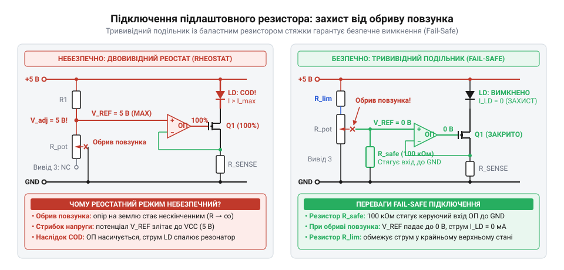
*Порівняння схем увімкнення підлаштовного резистора: двовивідне реостатне підключення при брязкоті чи зносі повзунка викликає розрив кола та фатальний стрибок струму, тоді як потенціометрична схема з підтяжкою гарантує безпечний скид струму до нуля при втраті контакту.*

> 🔧 **Навіщо це.**
> Схемотехніка безпечної відмови (@@en|fail-safe@@) унеможливлює вихід лазера з ладу під час регулювання: механічний брязкіт повзунка під викруткою оператора за неправильної схеми спалює кристал ще до завершення налаштування.

У драйверах з автоматичним регулюванням потужності (англ. @@en|Automatic Power Control@@, APC) стабільність світлового потоку підтримується від'ємним зворотним зв'язком. Вбудований у герметичний корпус моніторний фотодіод (від грец. @@grc|phos@@, родовий відмінок @@grc|photos@@ — світло та діод: грец. @@grc|di-@@ — два й @@grc|hodos@@ — шлях) уловлює частину випромінювання задньої грані резонатора і формує струм зворотного зв'язку `I_PD`, пропорційний оптичній потужності.

Петля керування безперервно порівнює `I_PD` з опорним струмом. Якщо через мікротріщину пайки або обрив шлейфа коло фотодіода розривається, `I_PD` миттєво спадає до нуля. Підсилювач помилки сприймає відсутність сигналу як повну темряву, входить у глибоке насичення по шині живлення (англ. @@en|rail saturation@@) і повністю відкриває регулювальний транзистор. Струм через лазерний кристал миттєво зростає до межі короткого замикання джерела, випаровуючи оптичні грані.

Схемотехнічний захист від обриву кола фотодіода в APC будується за двома бар'єрами:
- Апаратний струмовий кламп: керувальний сигнал APC не повинен подаватися на транзистор без жорсткого верхнього обмеження. Джерело струму виконують із фіксованим апаратним насиченням на рівні `I_clamp = 1.1...1.2 · I_op` (де `I_op` — номінальний робочий струм). При повному від'єднанні фотодіода струм упирається в заданий поріг `I_clamp` і не досягає руйнівного рівня.
- Компараторний детектор несправності (англ. @@en|fault detector@@): додатковий віконний компаратор контролює узгодженість сигналів. Якщо струм лазера перевищив поріг генерації `I_th`, а струм фотодіода залишається нульовим довше ніж `5...10 μs`, схема аварійно вимикає драйвер через лінію блокування (англ. @@en|shutdown@@).

> 🔧 **Навіщо це.**
> Жорсткий апаратний кламп струму в схемі APC гарантує живучість модуля при пошкодженні зворотного зв'язку. Якщо оптичне вікно фотодіода забрудниться, шлейф відійде чи трісне пайка датчика, модуль не вибухне імпульсом, а штатно утримає струм на безпечній межі.

Небезпека гарячого підключення (англ. @@en|hot plugging@@) полягає в під'єднанні лазерного діода через роз'єм, перемикач або тестові щупи до драйвера, на який уже подано живлення.

Коли джерело струму працює на холостому ході, регулювальний транзистор повністю відкривається, намагаючись підняти струм, а вихідний згладжувальний конденсатор (від лат. @@la|condensare@@ — згущувати, ущільнювати) `C_out` заряджається до повної напруги живлення `V_cc`.

У момент замикання контактів лазерний кристал із прямим спадом `V_f ≈ 2.0...2.4 V` підключається безпосередньо до зарядженої ємності. Розрядний струм обмежується лише сумою паразитів: ESR конденсатора, опором з'єднувальних провідників і динамічним опором відкритого діода `r_d` (сумарно `R_total ≈ 1.0 Ω`). При напрузі живлення `5.0 V` піковий струм розряду досягає:
`I_peak = (V_cap - V_f) / R_total ≈ (5.0 - 2.2) / 1.0 = 2.8 A`.

Цей сплеск у `60...90 разів` перевищує номінальний струм кристала (`30...50 mA`). Швидкість наростання петлі регулятора (англ. @@en|slew rate@@) обмежена, тому вся енергія електричного поля конденсатора розряджається в кристал за лічені наносекунди, викликаючи миттєвий COD. Прикладом незахищеної схемотехніки є найпростіший модуль [KY-008](root:cat-hw-actuators/ky-008-laser), де кристал живиться через баластний резистор і не має захисту від комутаційного брязкоту.

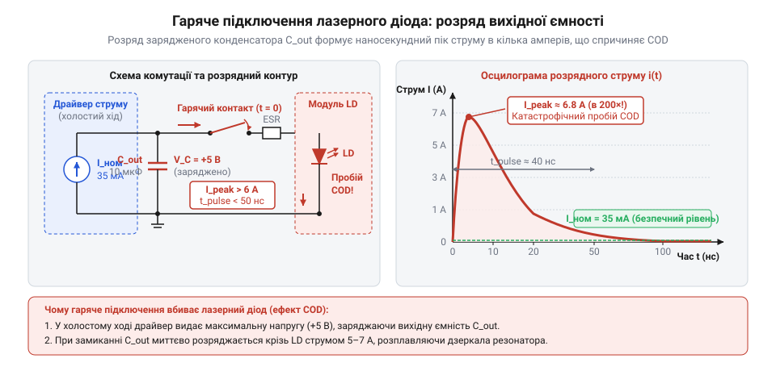
*Схема механізму відмови при гарячому підключенні (hot-plugging): попередньо заряджений до напруги живлення вихідний конденсатор розряджається в кристал короткочасним струмовим імпульсом амперного рівня, що спричиняє миттєве катастрофічне руйнування дзеркал резонатора.*

Правила запобігання комутаційним відмовам:
1. Заборона вторинної комутації: лазерний кристал має бути жорстко розпаяний на платі виходу драйвера. Вмикання виконують виключно по первинному живленню або через логічний вхід блокування (англ. @@en|Enable@@).
2. Мінімізація вихідної ємності: електролітичні та танталові конденсатори на виході прецизійного джерела струму неприпустимі. Дозволена лише високочастотна керамічна ємність до `10...47 nF`, увімкнена послідовно з демпфувальним (від нім. @@de|dämpfen@@ — глушити, пригнічувати) резистором як RC-снаббер.
3. Вихідний закорочувальний ключ: паралельно виходу драйвера встановлюють нормально замкнений польовий транзистор або реле, які шунтують контакти лазера в знеструмленому стані й розмикаються лише після стабілізації напруг через вузол плавного пуску (англ. @@en|soft-start@@).

---

### Правила безпечного монтажу: антистатика, термопрофіль та теплова розв'язка

Лазерні діоди належать до компонентів найвищого класу чутливості до [електростатичних розрядів](root:hw-components/laser-diode-esd-handling) (ESD Class 0). Через мікроскопічну площу активної зони та зворотну напругу пробою всього `2...3 V` статичний потенціал у сотні вольт спричиняє зворотний пробій за частки наносекунди, випаровуючи золоті мікродротики розварювання або пробиваючи покриття дзеркал.

Головне технологічне правило монтажу — замкнений стан виводів лазера протягом усього виробничого циклу:
- лазерний діод зберігають виключно з металевою закороткою на ніжках або в струмопровідній антистатичній губці;
- перед вийманням ніжки додатково закорочують витком тонкого лудженого мідного дроту впритул до скляного ізолятора;
- закорочувальний дріт залишають під час формувального вигинання, встановлення в плату й безпосереднього паяння жалом;
- знімати закоротку дозволяється лише після припаювання лазера до плати драйвера із захисними діодами Шотткі й TVS-супресорами за знеструмленого живлення;
- робоче місце оснащують антистатичним браслетом із резистором безпеки `1 MΩ`, заземленим килимком і станцією із заземленим жалом (потенціал на кінчику жала — не більше `2 mV`).

Корпус лазерного діода (металеві гермокорпуси TO-18 або TO-56) містить мідний субмаунт, на якому кристал зафіксовано евтектичним припоєм Au-Sn з температурою плавлення близько `280 °C`. Виводи проходять крізь основу через скляні гермовводи.

Перегрів корпусу під час паяння викликає три незворотні наслідки:
- тепловий потік крізь ніжку розм'якшує евтектику Au-Sn, зміщуючи кристал з осі лінзового коліматора й обриваючи мікродротики розварювання;
- різниця коефіцієнтів теплового розширення (КТР) між напівпровідником кристала (GaAs, InP) та мідним субмаунтом створює термомеханічні напруження, що генерують дислокаційні тріщини;
- скляні гермовводи дають мікротріщини від теплового градієнта, спричиняючи розгерметизацію корпусу та окиснення дзеркал резонатора.

Регламент безпечного паяння:
1. Температура жала: суворо не вище `250...260 °C` (безсвинцевий профіль `300...350 °C` гарантовано знищує кристал).
2. Час паяння: не більше `3...5 секунд` на один вивід.
3. Точка контакту: жало прикладають на відстані не менше `1.5...2.0 mm` від скляної основи корпусу. Паяти впритул до скла суворо заборонено.
4. Тепловий шунт: вивід між точкою паяння та корпусом перехоплюють мідним пінцетом або теплозахисним затискачем (англ. @@en|thermal shunt@@), що поглинає тепловий потік.
5. Пауза охолодження: між паянням сусідніх ніжок витримують паузу не менше `10...15 секунд`.

У лінійному драйвері надлишкова напруга живлення падає на регулювальному транзисторі: `P_trans = (V_in - V_LD) · I_LD`. При живленні `5 V`, прямому спаді `2.2 V` і струмі `40 mA` транзистор безперервно розсіює понад `110 mW` тепла. Одночасно лазерний кристал при оптичному ККД `15...20 %` перетворює решту `80...85 %` енергії на тепло в субмікронному об'ємі.

Пороговий струм генерації залежить від температури кристала за експоненційним законом:
`I_th(T) = I_th0 · exp(T / T_0)`, де `T_0` — характеристична температура матеріалу (для червоних випромінювачів AlGaInP величина `T_0 ≈ 60...90 K`). Нагрів кристала на кожні `10 °C` збільшує поріг `I_th` на `12...18 %` і пропорційно знижує нахил ват-амперної кривої.

Якщо регулювальний транзистор розмістити поруч із лазером без теплової розв'язки:
- у схемі стабілізації струму (ACC) кристал прогрівається теплом транзистора, поріг генерації перевищує робочий струм накачки, і лазер вироджується в тьмяний світлодіод;
- у схемі стабілізації потужності (APC) виникає катастрофічний тепловий розгін (англ. @@en|thermal runaway@@): коли лазер нагрівається і втрачає випромінювану потужність, петля APC збільшує струм накачки -> розсіювання на транзисторі та кристалі зростає -> кристал нагрівається ще сильніше. Процес наростає лавиною, завершуючись руйнуванням оптичних граней або тепловим пробоєм.

Конструктивні правила теплової розв'язки:
- лазер запресовують у масивний зовнішній металевий коліматор-тепловідвід, відкритий для вільної повітряної конвекції;
- друковану плату драйвера відокремлюють від корпусу лазера повітряним проміжком або теплоізоляційною шайбою;
- полігони охолодження регулювального транзистора розводять на зворотному боці плати й відокремлюють від діода наскрізними фрезерованими прорізами (тепловими бар'єрами) у склотекстоліті.

---

### Діагностика деградації: COD проти теплового та електричного пробою

Коли оптичний модуль втрачає яскравість або перестає формувати колімовану лінію, першопричину відмови (електростатичний розряд, комутаційний сплеск або перегрів) визначають зіставленням вольт-амперної характеристики (ВАХ) та оптичного спектра.

Електричні вимірювання виконують за допомогою характериографа (англ. @@en|curve tracer@@) або прецизійного джерела струму з мікроамперметром у прямому та зворотному напрямках:
1. Катастрофічне оптичне руйнування граней (COD): електричний p-n перехід залишається абсолютно цілим, адже оплавлене виключно вихідне дзеркало завтовшки в кілька нанометрів. Пряма гілка ВАХ повністю відповідає паспортній (`V_f ≈ 2.1...2.3 V` для червоного лазера), динамічний опір у нормі, а зворотний струм витоку при `V_R = 2.0 V` не перевищує `0.1 μA`. Звичайна перевірка мультиметром показує повністю справний напівпровідниковий діод.
2. Електричний пробій (ESD або перенапруга): електростатичний сплеск пробиває сам збіднений шар напівпровідника. При типовому низькоомному пробої пряма і зворотна гілки зливаються в омічну лінію опором від часток до десятків ом із нульовим прямим спадом (`V_f ≈ 0 V`) та струмом витоку вже при напрузі `0.5 V`. При надпотужному імпульсі внутрішній золотий провідник розварювання випаровується, перетворюючи прилад на повний розрив кола (`I = 0` в обох напрямках).
3. Тепловий пробій та деградація (від лат. @@la|degradatio@@, де @@la|de-@@ — рух униз та @@la|gradus@@ — крок, ступінь): тривалий перегрів викликає проростання темних ліній дислокацій (англ. @@en|Dark Line Defects@@, DLD) крізь активну зону. На прямій ВАХ коліно відкривання стає заваленим, диференціальний опір зростає через термічне пошкодження контактів металізації, а зворотний витік збільшується у сотні разів (до десятків мікроамперів).

Оптичний аналіз на вимірювачі потужності, спектроаналізаторі та матовому екрані однозначно фіксує характер руйнування:
1. Справний лазер: крива оптичної потужності від струму накачки (L-I крива) має чіткий злам у точці порогового струму `I_th` з лінійною крутизною `0.8...1.2 W/A`. Оптичний спектр (від лат. @@la|spectrum@@ — видіння, образ) являє собою надвузький монохроматичний пік (FWHM менше `0.1...0.5 nm`). Висока просторова й фазова когерентність (від лат. @@la|cohaerens@@ — зчеплений, пов'язаний) утворює на шорсткій поверхні виражену зернисту спекл-структуру (англ. @@en|speckle@@; явище просторової інтерференції, від лат. @@la|inter@@ — між та @@la|ferio@@ — вдаряю).
2. Кристал із руйнуванням граней COD: лазерний злам на L-I кривій повністю зникає, оскільки дзеркала розплавлені й резонатор зруйнований. Оптична потужність падає більш ніж на 99% (до лічених мікроватів), перетворюючи прилад на малоефективний світлодіод. Монохроматичний пік спектра заміщується широким куполом спонтанної (від лат. @@la|spontaneus@@ — самовільний, вільний) люмінесценції (від лат. @@la|lumen@@ — світло та лат. суфікса @@la|-escentia@@ — стан виникнення) завширшки `25...40 nm`, а зернистий спекл зникає, залишаючи рівномірно розмиту пляму без когерентності.
3. Теплова деградація кристала: лазерний злам L-I кривої зберігається, проте поріг `I_th` зміщується в бік більших струмів у 2–4 рази зі зниженням нахилу робочої ділянки. Центральна довжина хвилі зсувається в червоний бік спектра (зі швидкістю `+0.25 nm/°C`) через термічне звуження забороненої зони, а спекл-картина з'являється лише при надмірному струмі накачки.

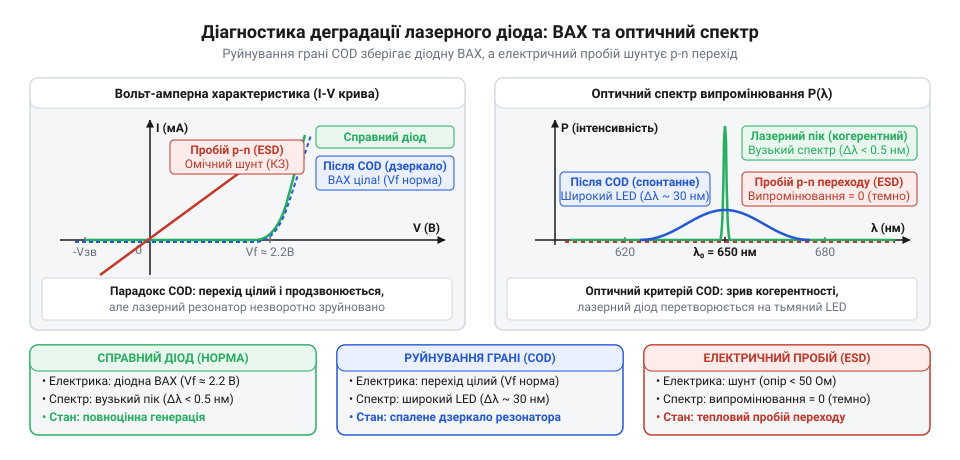
*Зіставлення ВАХ та оптичних спектрів випромінювання: при COD електричні параметри p-n переходу залишаються в нормі за повної втрати когерентності та потужності, тоді як електричний пробій перетворює перехід на омічний резистор, а перегрів спричиняє зростання зворотного витоку та зсув довжини хвилі.*

| Стан приладу | Пряма гілка ВАХ (`V_f`) | Зворотний витік (`I_R`) | Оптична потужність | Ширина спектра | Спекл-картина |
| :--- | :--- | :--- | :--- | :--- | :--- |
| **Справний лазер** | Штатна (`2.1...2.3 V`) | Норма (`< 0.1 μA`) | Номінал (`5 mW`) | Вузька (`< 0.5 nm`) | Чітка, зерниста |
| **Руйнування граней (COD)** | Штатна (`2.1...2.3 V`) | Норма (`< 0.1 μA`) | Падіння на 99% (`< 20 μW`) | Широка купольна (`25...40 nm`) | Відсутня (гладка пляма) |
| **Електричний пробій (ESD)** | Омічний опір / обрив | Стрибок до міліамперів | Нуль (випромінювання відсутнє) | Відсутній | Відсутня |
| **Теплова деградація** | Збільшений спад, м'яке коліно | Зростання у 100+ разів | Знижена, поріг `I_th` зсунуто вгору | Зсув у червоний бік (`+0.25 nm/°C`) | З'являється лише при підвищеному струмі |

> 🔧 **Навіщо це.**
> Зіставлення ВАХ та оптичного спектра однозначно виявляє джерело відмови. Якщо електричні характеристики p-n переходу ідеальні, але оптична потужність та спекл упали — кристал пошкоджений імпульсним сплеском у схемі драйвера (гаряча комутація, брязкіт повзунка або розрив кола APC). Якщо ж перехід закорочений або вигорів у розрив — причиною став електростатичний розряд (ESD) чи порушення температурного профілю під час монтажу.
