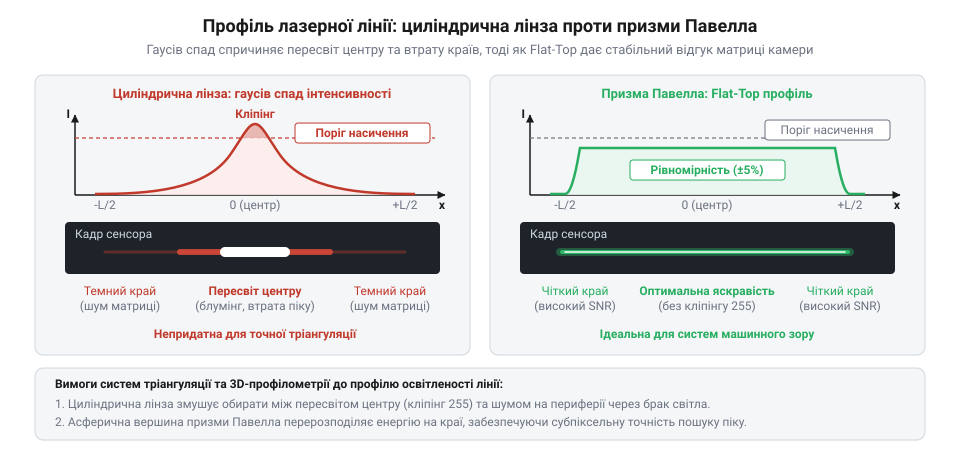
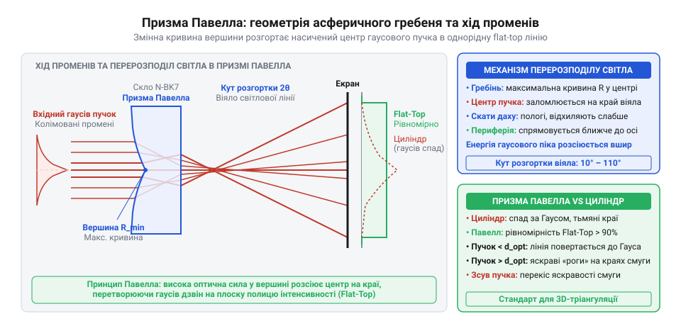
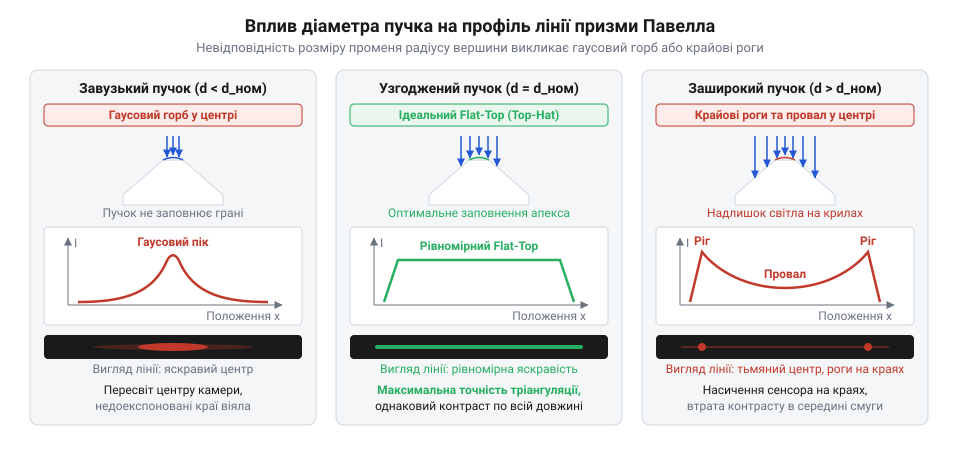
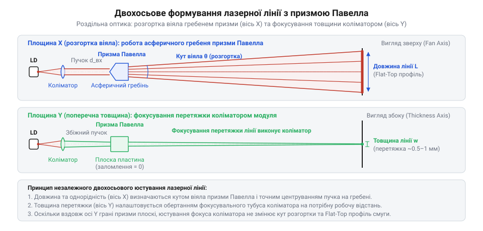
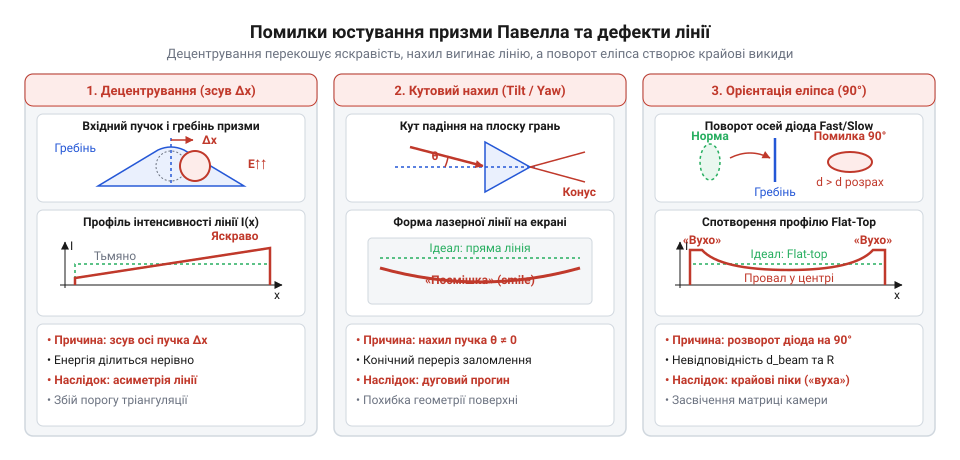
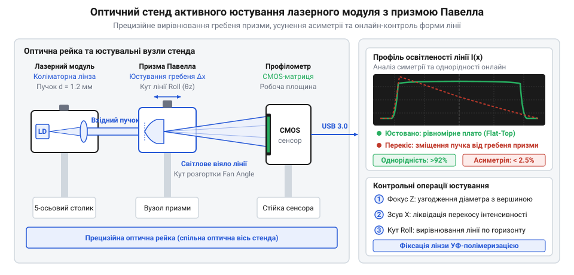
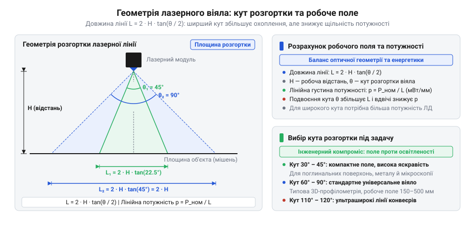

# Лазерний модуль з лінією (5 мВт, з фокусом)

<preknowlist>
- [KY-008 — лазерний модуль](root:cat-hw-actuators/ky-008-laser) — генерація лазерного випромінювання напівпровідниковим діодом, первинна колімація пучка лінзою та гаусовий розподіл інтенсивності вхідного променя
</preknowlist>

## Пастка гаусового пучка: чому циліндрична лінза непридатна для машинного зору

Для безконтактного вимірювання форми деталей, виявлення дефектів або просторового позиціонування в системах машинного зору використовують світлову смугу, спроєктовану на робочу поверхню. Знаючи кут між оптичними осями випромінювача й камери та фіксуючи зміщення лазерної лінії на рельєфі об'єкта, обчислювальний алгоритм визначає просторові координати кожної точки профілю — цей метод називають [лазерною оптичною триангуляцією](root:hw-sensing/triangulation) (триангуляція — від латинського *triangulum*, трикутник).

Типовим джерелом когерентного світла у таких завданнях є напівпровідниковий лазер (від англійської абревіатури @@en|LASER@@ — *Light Amplification by Stimulated Emission of Radiation*, підсилення світла вимушеним випромінюванням), наприклад [лазерний модуль KY-008](root:cat-hw-actuators/ky-008-laser). Проте випромінювальний модуль формує не смугу, а вузький колімований пучок (колімація — від латинського *collineare*, спрямовувати по прямій лінії) — круглу або злегка витягнуту в еліпс світлову точку.

Щоб перетворити точку на довгу лінію, найочевиднішим інженерним кроком здається встановлення циліндричної лінзи (лінза — від латинського *lens*, сочевиця; циліндр — від грецького *kylindros*, валок, качалка) або тонкої скляної палички на шляху променя. Циліндрична лінза викривлена лише в одній площині, тому заломлює світло виключно вздовж однієї осі (наприклад, осі X), зберігаючи прямолінійний хід променів в ортогональній площині Y. Проходячи крізь таку лінзу, паралельний світловий пучок розгортається у пласке віяло, утворюючи на поверхні досліджуваної деталі тонку смугу.

Утім, спроба застосувати таку просту оптичну схему для точних вимірювань заходить у глухий кут через фундаментальну природу лазерного випромінювання. Напівпровідниковий діод випромінює пучок із [гаусовим просторовим розподілом інтенсивності](root:ph-waves/gaussian-beam-optics) (названим на честь німецького математика Карла Фрідріха Гаусса). Густина енергії в перерізі такого променя розподілена за дзвоноподібним експоненційним законом:

```
I(x) = I₀ · exp(-2x² / w²)
```

де:
- `I₀` — пікова інтенсивність у центрі світлового пучка;
- `x` — просторова координата точки вздовж розгорнутої лінії;
- `w` — радіус пучка за рівнем спаду інтенсивності до величини `1/e²` (приблизно 13.5% від пікового значення `I₀`).

Звичайна циліндрична лінза має постійний радіус кривини по всій робочій апертурі (апертура — від латинського *apertura*, отвір). Вона лише відхиляє промені під кутами, пропорційними координаті їхнього входу, але не перерозподіляє просторову щільність енергії між ділянками пучка. Усі фотони, зосереджені в щільному центрі вхідного променя, потрапляють у середину сформованої лінії, тоді як розріджена периферія спрямовується на її кінці.

Як наслідок, лінія на об'єкті успадковує крутий гаусовий профіль (профіль — від італійського *profilo*, окреслення контуру): центр смуги залишається сліпуче яскравим, а освітленість країв стрімко падає до нуля. Уже на відстані `x = w` від оптичної осі яскравість падає у сім разів, а на відстані `x = 1.5w` залишається менше ніж 1.1% від енергії центру.

Коли на таку смугу дивиться камера машинного зору, виникає нерозв'язна дилема, зумовлена фізичними межами світлочутливої матриці (матриця — від латинського *matrix*, першооснова, джерело; сенсор — від латинського *sensus*, відчуття). Будь-який фотоприймач має обмежений [динамічний діапазон](root:hw-sensing/dynamic-range-noise) (@@en|dynamic range@@ — відношення максимального корисного сигналу без спотворень до рівня власних шумів). Кожен кремнієвий піксель матриці має кінцеву місткість потенціальної ями (@@en|full-well capacity@@) — граничну кількість фотоелектронів, яку він здатен накопичити за встановлений час експозиції (експозиція — від латинського *expositio*, виставлення напоказ). Якщо накопичений заряд перевищує цю ємність, вихідний сигнал аналогово-цифрового перетворювача зрізається на верхній межі (значення 255 для 8-бітного кадру), спричиняючи насичення пікселя (@@en|saturation@@, сатурація — від латинського *saturatio*, пересичення).

Спроба налаштувати час експозиції сенсора під гаусову лінію породжує взаємовиключні проблеми:

1. **Налаштування експозиції за слабкими краями.** Якщо збільшити час накопичення заряду матриці або відкрити діафрагму об'єктива, аби надійно зафіксувати темні краї смуги, пікселі в центрі кадру зазнають глибокого пересвіту. Надлишковий заряд переповнює потенційні ями кремнію та перетікає на сусідні ділянки матриці (явище блумінгу, @@en|blooming@@). Замість тонкої лінії камера фіксує широку білу пляму без вираженого максимуму. [Алгоритми субпіксельного детектування гребеня лінії](root:sf-visual/steger-line-detection) втрачають здатність знаходити центр смуги, а похибка триангуляції зростає у десятки разів.

2. **Налаштування експозиції за центром.** Якщо зменшити час експозиції, щоб зберегти центральний пік у лінійній зоні чутливості матриці, яскравість периферійних ділянок опускається нижче рівня шумів зчитування та темнового струму сенсора (@@en|noise floor@@). Краї лінії просто розчиняються в шумі й зникають із поля зору алгоритму.

Через цю невідповідність корисне поле зору системи машинного зору звужується в кілька разів: із усієї розгорнутої лінії придатним для вимірювань залишається лише центральний сегмент, що рідко перевищує третину її повної довжини. Решта світлового віяла виявляється марно згаяною енергією.


*Порівняння розгортки лазерного пучка циліндричною лінзою та оптикою рівномірного профілю: гаусовий розподіл спричиняє насичення пікселів у центрі кадру та згасання периферії в шумах матриці, тоді як профіль flat-top забезпечує стабільну яскравість по всій довжині робочого поля.*

> 🔧 **Навіщо це.**
> В оптичній триангуляції профіль поверхні та геометрію швів обчислюють за геометричним зсувом відбитої лазерної смуги на матриці камери. Алгоритми субпіксельної локалізації гребеня лінії вимагають стабільного відношення сигнал/шум уздовж усього рядка зображення. Якщо інтенсивність уздовж смуги нестабільна, система або втрачає периферійні ділянки контуру через шуми матриці, або грубо спотворює координати в центрі через розпливання пікселів у стані насичення, змушуючи штучно звужувати зону сканування конвеєра.

Щоб вийти з цього глухого кута, системі машинного зору потрібен принципово інший розподіл енергії — оптичний профіль із прямокутною формою, відомий як плаский або капелюхоподібний (@@en|flat-top@@ — пласка верхівка; @@en|top-hat@@ — циліндр-капелюх).

У профілі flat-top інтенсивність світла залишається рівномірною уздовж 80–90% довжини лінії, а на її межах відбувається різкий просторовий обрив. На матриці камери така лінія формує однаковий відгук пікселів по всьому полю зору: сенсор налаштовують на рівень приблизно 70–80% від межі насичення, що гарантує високе відношення сигнал/шум без ризику блумінгу чи цифрового кліпінгу.

Проте жодна оптична деталь із постійним радіусом кривини (ні циліндрична лінза, ні сферична поверхня) не здатна сформувати [профіль flat-top](root:ph-waves/top-hat-beam-shaping) із вхідного гаусового пучка. Для цього необхідний оптичний елемент зі змінною кривиною поверхні: у центрі, де концентрація фотонів найвища, поверхня повинна діяти як сильна негативна лінза й енергійно розсіювати промені в сторони, а на периферії — плавно випрямляти їхній хід, скеровуючи до країв віяла. Саме цю функцію виконує спеціалізований компонент з асферичним гребенем — призма Павелла.

## Будова призми Павелла та перерозподіл енергії пучка

Просте розсіювання лазерного променя в площину за допомогою класичної [циліндричної лінзи](root:ph-waves/cylindrical-lens) (лінза — від лат. *lens*, родовий *lentis* — сочевиця; циліндр — від грец. *κύλινδρος* — вал, коток) створює на мішені вкрай нерівномірну смугу. Центр такої лінії виходить сліпучо яскравим, а краї швидко тьмяніють і сходять нанівець. Причина полягає в природі самого лазерного випромінювання: після первинного коліматора випромінювача (наприклад, у напівпровідниковому [модулі KY-008](root:cat-hw-actuators/ky-008-laser)) поперечний профіль променя підпорядковується нормальному гаусовому розподілу (названому на честь Карла Фрідріха Ґаусса, @@de|Carl Friedrich Gauß@@). Густина оптичної потужності максимальна на оптичній осі й спадає до периферії за експоненційним законом (від лат. *exponere* — виставляти напоказ). Циліндрична лінза має постійний радіус кривини, тому вона відхиляє падаючі промені на кути, прямо пропорційні їхній відстані від осі. Вона лише розтягує пучок уздовж однієї координати, зберігаючи вихідний дзвоноподібний профіль густини.

Для систем комп'ютерного зору та [оптичної тріангуляції](root:hw-sensing/triangulation) (від лат. *triangulum* — трикутник) такий спад освітленості неприйнятний. Коли лінія проектується на тривимірний об'єкт, світлочутлива КМОН-матриця стикається з надлишковим перепадом яскравості: пікселі в центрі входять у глибоке нелінійне насичення (засвічення або блюмінг), що розмиває контур і руйнує субпіксельне визначення координат лінії, тоді як на краях лінії відбитий сигнал тоне у власному шумі сенсора. Зменшення потужності випромінювача рятує центр від перенасичення, але остаточно ховає периферію; збільшення експозиції чи потужності спалює середину кадру.

Щоб отримати рівномірно освітлену лінію, оптичний елемент мусить діяти за іншим принципом: не розсіювати пучок пропорційно координаті, а примусово перерозподіляти його енергію. Він повинен відібрати надлишок фотонів із перенасиченого центрального ядра пучка та спрямувати їх на максимальні кути розгортки — на периферію створюваного сектора, водночас спрямувавши слабкі крайові промені в проміжну зону. Цю оптичну схему запропонував канадський фізик Ян Павелл (@@en|Ian Powell@@) у 1987 році, створивши спеціалізований компонент — призму Павелла (призма — від грец. *πρίσμα* — розпиляне, відрізане).

Призма Павелла являє собою монолітний (від грец. *μονόλιθος*, де *μόνος* — єдиний і *λίθος* — камінь) блок оптичного скла або плавленого кварцу з двома функціональними поверхнями. Вхідна грань є пласкою полірованою площиною круглого чи квадратного перерізу, через яку колімований (від лат. *collimare*, викривлене *collineare* — спрямовувати по прямій) пучок входить без заломлення перпендикулярно до оптичної осі. Вихідна грань виконана у вигляді дахоподібного асферичного гребеня (від грец. *а-* — частка заперечення та *σφαῖρα* — куля, тобто поверхня, кривина якої відрізняється від сферичної або кругово-циліндричної). Замість гострого ребра верхівка цього «даху» плавно скруглена нелінійним циліндричним профілем.

Ключова геометрична властивість цього гребеня — змінна локальна кривина. На самій вершині (уздовж оптичної осі) кривина є максимальною, що відповідає мікроскопічному радіусу заокруглення. У міру віддалення від вершини до схилів даху поверхня плавно виположується: її кривина монотонно спадає, поступово переходячи в практично пласкі похилі грані.

Завдяки змінній кривині закон заломлення світла Снелліуса працює нелінійно по поперечному перерізу вхідного променя:
- Центральні промені гаусового пучка, які несуть найвищу густину енергії, падають на вузьку зону верхівки з максимальною кривиною. Оскільки нормаль (від лат. *normalis* — прямовисний) до поверхні тут швидко розвертається на великий кут навіть при незначному зміщенні від осі, центральний потік заломлюється найсильніше й розсіюється на максимальні кути до країв створюваного світлового віяла.
- Периферійні промені вхідного пучка мають значно меншу вихідну інтенсивність. Вони потрапляють на ділянки гребеня з малою кривиною, де нахил нормалі змінюється повільно. Відповідно, ці промені відхиляються на помірні та малі кути, заповнюючи проміжну й центральну зони світлового віяла.

У результаті інтегрального накладання відхилених променів початковий гаусовий розподіл трансформується у вихідний профіль @@en|flat-top@@ (від англ. *flat* — плаский і *top* — верх) або @@en|top-hat@@ (через подібність графіка інтенсивності до форми капелюха-циліндра). Оптична потужність на одиницю довжини залишається сталою практично на всій протяжності лінії, спадаючи майже прямовисно лише на її геометричних межах.


*Хід променів крізь асферичний гребінь призми Павелла: центральна частина гаусового пучка з найбільшою густиною енергії заломлюється вершиною максимальної кривини на крайні кути віяла, формуючи прямокутний профіль освітленості flat-top.*

> 🔧 **Навіщо це.** В оптичних профілометрах алгоритми субпіксельної локалізації центру лінії (розрахунок центра мас чи параболічна апроксимація) вимагають однакового динамічного діапазону сигналу в кожній точці вимірюваного поля. Лінія з профілем flat-top дозволяє матриці камери фіксувати точний відгук уздовж усієї довжини смуги за єдину фіксовану експозицію без засліплення центральних пікселів і без втрати країв на темних чи поглинальних поверхнях.

## Узгодження вхідного пучка та діагностика спотворень лінії

Призма Павелла не є універсальним розсіювачем, який працює однаково добре з будь-яким джерелом світла. Її асферична поверхня — це результат точного аналітичного розрахунку, виконаного під суворо визначену геометрію вхідного випромінювання. Компонент оптимізується під фіксований вхідний діаметр променя, виміряний на рівні інтенсивності `1/e²`. Ця умова називається узгодженням пучка (від англ. @@en|beam matching@@, де *beam* — промінь, пучок, і *match* — узгоджувати, добирати пару).

Рівень `1/e²` є стандартною інженерною межею гаусового пучка. У поперечному перерізі інтенсивність монохроматичної хвилі описується залежністю:
```
I(r) = I₀ · exp(-2r² / w₀²)
```
де `I₀` — пікова інтенсивність на оптичній осі, `r` — відстань від центру, а `w₀` — радіус перетяжки пучка. На відстані `r = w₀` від осі густина енергії зменшується у `e² ≈ 7.39` раза, тобто становить приблизно `13.5%` від осьового максимуму. Ширина цієї зони `d = 2w₀` визначає номінальний діаметр пучка `d_{in}`, під який розраховано конкретну призму (наприклад, 0.8 мм, 1.0 мм, 2.0 мм чи 3.0 мм).

Якщо діаметр пучка, сформованого [коліматором](root:ph-waves/laser-collimator) лазерного модуля, відхиляється від номінального значення асферики, математичний баланс розподілу енергії порушується. За формою результуючого профілю інтенсивності виникають характерні спотворення, що дозволяють точно діагностувати стан оптичної системи:

**1. Завузький пучок (`d < d_{in}`).**
Коли коліматор фокусує випромінювання у промінь, помітно менший за розрахунковий діаметр призми, світловий потік зосереджується виключно на вузькій осьовій смужці вершини гребеня. На цій ділянці радіус кривини залишається практично сталим — пучок просто не досягає бічних зон, де кривина зменшується. Унаслідок цього асферична верхівка діє як звичайна мікроциліндрична лінза постійного радіуса: центральні фотони не отримують надлишкового відхилення на периферію. На екрані знову проступає первинний гаусовий горб — яскрава «гаряча пляма» по центру з пологими затемненими хвостами по краях лінії.

**2. Узгоджений пучок (`d ≈ d_{in}`).**
Діаметр колімованого променя точно відповідає розрахунковому профілю поверхні. Зона високої густини гаусового піка падає на ділянку сильної кривини, а спадаючі краї пучка розподіляються по виположених схилах. На проекційній поверхні формується чистий профіль flat-top із рівномірністю яскравості в межах `±5...10%` уздовж робочого віяла й різкими вертикальними межами зрізу.

**3. Заширокий пучок (`d > d_{in}`).**
Якщо поперечний розмір пучка перевищує розрахунковий, значна частка світлової енергії виходить за межі криволінійної вершини гребеня та падає на його бокові схили. Ці бічні ділянки мають дуже малу кривину й геометрійно наближаються до пласких граней клину. Пласка похила площина діє як класична заломлювальна призма: вона відхиляє всі промені, що впали на неї, на один і той самий максимальний кут. Уся периферійна енергія, яка мала б плавно формувати внутрішню частину лінії, скидається в крайні кутові точки. У результаті на краях робочої лінії виникають потужні енергетичні викиди — так звані крайові роги або піки (@@en|edge horns@@), а центр лінії залишається недоосвітленим, утворюючи глибокий провал інтенсивності посередині смуги.

Окрім узгодження форми гребеня, важливу роль відіграє обмеження світлового пучка оправою призми — апертурне зрізання або кліпінг (від лат. *apertura* — отвір; від англ. @@en|clipping@@ — обрізання). Якщо вхідна апертура лінзи `D_{ap}` недостатньо велика відносно діаметра пучка, жорсткий край оправи різко обриває протяжні краї гаусового розподілу. Згідно з хвильовою оптикою, різка зміна амплітуди на межі породжує дифракцію (від лат. *diffringere* — ламати, розбивати на шматки). На лінії з'являється високочастотна просторова осциляція — дифракційна брижа (@@en|diffraction ripples@@) та інтерференційні смуги (інтерференція — від лат. *inter* — взаємно та *ferire* — вражати). Щоб усунути хвильові паразитні брижі, діаметр чистої світлової апертури призми підбирають із запасом:
```
D_{ap} ≥ 1.5 · d_{1/e²}
```
а в прецизійних вимірювальних модулях — не менше ніж `2.0 · d_{1/e²}`.


*Профілі розподілу інтенсивності лінії залежно від узгодження пучка з призмою: завузький промінь залишає гаусовий пік у центрі, узгоджений утворює прямокутну полицю flat-top, а заширокий — глибокий провал із крайовими викидами.*

> 🔧 **Навіщо це.** Розуміння фізики спотворень дозволяє юстувати коліматор лазерного модуля безпосередньо за зображенням лінії на камері. Обертаючи оправу коліматора, інженер змінює відстань між діодом і лінзою: поява центрального горба сигналізує про недостатній діаметр пучка, а виникнення крайових рогів свідчить про надмірне розширення. Досягнення рівного плато без рогів гарантує оптимальне узгодження компонентів без залучення спеціалізованих вимірювачів хвильового фронту.

## Двохосьове формування променя: розділення розгортки віяла та фокусування товщини лінії

Лазерна лінія на мішені має два цілком непорівнянні геометричні виміри: уздовж осі довжини вона розгорнута на десятки сантиметрів у широке віяло з рівномірною яскравістю, а впоперек — стиснута у вузьку смужку завширшки в частки міліметра. Якщо спробувати сформувати такий пучок звичайною сферичною чи циліндричною лінзою, оптичні властивості виявляються жорстко зв'язаними: зміна фокусування неминуче спотворює як товщину, так і довжину лінії. Модуль на основі призми Павелла позбавлений цієї взаємної залежності завдяки суворому розділенню оптичних функцій між двома взаємно перпендикулярними площинами.

### Асферичний гребінь проти нульової оптичної сили

Призма Павелла має циліндричну симетрію асферичного (грец. *a-* — без, *sphaira* — куля) профілю: її робоча поверхня викривлена виключно в одній площині, яку позначають як вісь X:

* У площині X поперечний переріз призми утворює дахоподібний гребінь зі змінним радіусом кривини. Асферична поверхня заломлює світло так, що центральна частина вхідного гаусового пучка розсіюється на периферію, розгортаючи промінь у пласке віяло з прямокутним профілем інтенсивності (англ. @@en|flat-top@@). Довжина сформованої лінії та рівномірність її освітленості визначаються виключно цією віссю.
* В ортогональній площині Y (вздовж лінії вершини гребеня) геометрія призми трансляційно незмінна — її твірна є строго прямою лінією. Поперечний зріз призми в площині Y являє собою звичайний прямокутний брусок скла з паралельними плоскими гранями. Оптична сила поверхні вздовж осі Y дорівнює нулю: призма не зводить промені до оптичної осі й не розсіює їх.


*Поширення променя у взаємно перпендикулярних площинах: асферична вісь X формує рівномірне віяло розгортки лінії, а плоска вісь Y пропускає сфокусований коліматором пучок у перетяжку без зміни кутової збіжності.*

### Поздовжній зсув фокусу плоскопаралельною пластиною

Оскільки вздовж осі Y призма не має кривини, вона поводиться як плоскопаралельна скляна пластина. Єдиний вплив, який вона чинить на промінь у площині товщини лінії, — це паралаксний поздовжній зсув точки фокусу вздовж оптичної осі Z.

Коли збіжний пучок світла входить у середовище з показником заломлення `n > 1`, кут променів до оптичної осі всередині скла зменшується за законом Снелліуса. Промені йдуть пологіше і сходяться у фокус далі, ніж це відбулося б у повітрі без призми. Величина поздовжнього зсуву `Δz` залежить від осьової товщини призми `d` та показника заломлення її скла `n`:

```
Δz = d · (1 - 1 / n)
```

Для стандартної призми зі скла N-BK7 (`n ≈ 1.517` на довжині хвилі червоного випромінювання 650 нм) товщиною `d = 5 мм` зсув фокальної площини розраховується покроково:

```
Δz = 5 · (1 - 1 / 1.517)           [закон заломлення в плоскопаралельній пластині]
   = 5 · (1 - 0.6592)              [обчислення відносного оптичного шляху]
   = 5 · 0.3408
   ≈ 1.70 мм                       [поздовжнє зміщення перетяжки вперед]
```

Цей зсув не вносить оптичних аберацій і не змінює кут сходження променів. Він лише відсуває геометричне положення перетяжки на 1.7 мм далі від випромінювача.

### Розподіл функцій: коліматор і перетяжка пучка

З нульової оптичної сили призми по осі Y випливає ключове правило побудови лазерного модуля: товщина лінії на мішені, положення її найвужчого звуження — перетяжки (англ. @@en|beam waist@@, позначається `w₀`) — та поздовжня глибина різкості взагалі не залежать від призми Павелла.

Ці характеристики повністю формує коліматор (лат. *collimare* — спрямовувати по прямій лінії) або об'єктив лазерного діода, розташований перед призмою — як у типовому випромінювачі [KY-008](root:cat-hw-actuators/ky-008-laser). Регулювання коліматора переміщує фокусувальну лінзу відносно напівпровідникового кристала діода:

1. Якщо кристал розташований точно у передньому фокусі лінзи, пучок виходить паралельним (колімованим), а лінія має помірну й майже сталу товщину на значній відстані.
2. Якщо лінзу трохи викрутити з різьбової оправи, віддаливши від діода, промінь перетворюється на збіжний. Він безперешкодно проходить крізь плоску площину Y призми Павелла й стискається у тонку перетяжку на обраній дистанції.

### Дифракційний компроміс: товщина проти довжини Релея

При оптимізації модуля виникає прагнення сфокусувати лінію якомога тонше заради високої роздільності вимірювань. Однак тут діє фундаментальне хвильове обмеження дифракції (лат. *diffringere* — ламати, розбивати на частини).

Лазерне випромінювання підпорядковується законам поширення гаусових пучків. Що сильніше коліматор стискає промінь у перетяжку радіусом `w₀` (за рівнем спаду інтенситності до `1/e²` від максимуму в центрі), то швидше він розходиться після проходження фокусу під дифракційним кутом розходження `θ`:

```
θ = λ / (π · w₀)
```

Поздовжня відстань від перетяжки, на якій радіус пучка збільшується в `√2 ≈ 1.414` разів, а площа поперечного перерізу подвоюється (що зменшує пікову яскравість смуги вдвічі), називається довжиною Релея (англ. @@en|Rayleigh length@@, на честь британського фізика Джона Вільяма Стретта, лорда Релея):

```
z_R = (π · w₀²) / λ
```

Повна глибина різкості (англ. @@en|depth of focus@@, `DOF`), у межах якої товщина лінії розширюється не більше ніж на 41% від мінімального значення, становить подвійну довжину Релея:

```
DOF = 2 · z_R = (2 · π · w₀²) / λ
```

Квадратична залежність довжини Релея від радіуса перетяжки `w₀²` ставить перед інженером жорсткий компроміс: спроба звузити лінію вдвічі зменшує допустиму глибину зони різкості в чотири рази. Порівняємо два випадки для червоного лазера з довжиною хвилі `λ = 650 нм = 0.65 мкм`:

**Прецизійне фокусування для оптичної мікроскопії.**
Повна товщина лінії в перетяжці `2 · w₀ = 20 мкм` (`w₀ = 10 мкм`):

```
z_R = (π · (10 · 10⁻⁶)²) / (0.65 · 10⁻⁶)   [розрахунок довжини Релея]
    = (3.1416 · 100 · 10⁻¹²) / (0.65 · 10⁻⁶)
    = (3.1416 · 10⁻¹⁰) / (0.65 · 10⁻⁶)
    ≈ 0.483 · 10⁻³ м ≈ 0.48 мм             [відстань дифракційного розмиття]

DOF = 2 · z_R ≈ 0.97 мм                    [робоча глибина різкості]
```

Глибина різкості становить менше одного міліметра. Якщо об'єкт у процесі сканування відхилиться по висоті хоча б на 0.5 мм, товщина лінії стрімко зросте, розмиваючи вимірювальний сигнал.

**Промислове фокусування для 3D-тріангуляції.**
Повна товщина лінії в перетяжці `2 · w₀ = 100 мкм` (`w₀ = 50 мкм`):

```
z_R = (π · (50 · 10⁻⁶)²) / (0.65 · 10⁻⁶)   [розрахунок довжини Релея]
    = (3.1416 · 2500 · 10⁻¹²) / (0.65 · 10⁻⁶)
    = (7.854 · 10⁻⁹) / (0.65 · 10⁻⁶)
    ≈ 12.08 · 10⁻³ м ≈ 12.1 мм             [довжина Релея для ширшої смуги]

DOF = 2 · z_R ≈ 24.2 мм                    [робоча глибина різкості]
```

Збільшення товщини лінії всього в 5 разів розширює робочий діапазон глибини вимірювання у 25 разів — майже до двох з половиною сантиметрів.

### Інженерна методика юстування та фокусування

Оскільки призма Павелла не керує товщиною смуги, спроби усунути розмиття лінії зміщенням чи нахилом самої призми є помилкою, яка лише спотворює рівномірність віяла. Налаштування товщини лінії завжди здійснюється виключно коліматором за двома сценаріями:

* **Фокусування на фіксовану відстань:** якщо вимірювальна система сканує плоскі об'єкти на стабільній дистанції `L` (наприклад, конвеєрна стрічка на відстані 300 мм), модуль закріплюють у штативі навпроти мішені. Повільним обертанням різьбової оправи коліматора досягають мінімальної товщини лінії на поверхні мішені, що відповідає точному суміщенню перетяжки `w₀` з робочою площиною. Після налаштування тубус коліматора контрять стопорним гвинтом або фіксатором різьби, захищаючи його від вібрацій.
* **Гіперфокальне фокусування для протяжного діапазону:** якщо скановані деталі мають значний рельєф із висотами від `Z_min` до `Z_max`, фокальну площину встановлюють у середину вимірювального об'єму. Величину перетяжки `w₀` вибирають коліматором настільки широкою, щоб подвійна довжина Релея `DOF = 2 · z_R` покривала весь діапазон висот `ΔZ = Z_max - Z_min`. У такому разі на крайніх відмітках `Z_min` та `Z_max` товщина лінії збільшується не більше ніж у `√2` разів, зберігаючи стабільну роботу алгоритмів субпіксельної локалізації смуги.

> 🔧 **Навіщо це.**
> Повний поділ функцій між двома осями дозволяє проектувати оптичний тракт системи машинного зору повністю модульно. Кут розгортки призми Павелла підбирають один раз — суто під необхідну довжину лінії та ширину поля зору камери на заданій відстані. Водночас поперечну товщину лінії та її глибину різкості налаштовують незалежно за допомогою коліматора під розмір пікселя матриці та перепад висот сканованих деталей. Якщо лінія на краях сцени розмивається, оптичний інженер знає точну причину: проблема полягає у виході за межі довжини Релея коліматора, а не в геометрії призми Павелла.

## Механічне юстування та просторова орієнтація: пастки децентрування, перекосу та еліптичності діода

Призма Павелла (@@en|Powell lens@@) на перший погляд нагадує звичайну циліндричну лінзу зі скошеною гранню, проте її внутрішня оптична геометрія висуває безкомпромісні вимоги до точності механічного складання. У звичайній циліндричній лінзі з постійним радіусом кривини поперечне зміщення вхідного променя на частки міліметра викликає лише незначний просторовий зсув сформованої смужки. Натомість призма Павелла працює за рахунок субміліметрового асферичного гребеня (апекса, латинською @@la|apex@@ — вершина, вістря), радіус кривини якого плавно змінюється від вершини до схилів. Математичний профіль цієї поверхні розраховують на суворе просторове суміщення вершини клину з енергетичним центром вхідного симетричного гаусового пучка. Будь-яке механічне відхилення положення променя руйнує симетрію заломлення, перетворюючи розрахункову рівномірну лінію на дефектний оптичний малюнок.

Центральна асферична вершина призми виконує роль симетричного дільника хвильового фронту. Промені поблизу вершини заломлюються з мінімальним відхиленням і формують центральну частину робочого сектора, тоді як криволінійні схили розводять периферійну енергію гаусового пучка до країв віяла. Коли оптична вісь колімованого променя зміщується поперек гребеня — виникає децентрування (латинською @@la|de-@@ — відокремлення, скасування, та @@la|centrum@@ — осередок кола, центр; англійською @@en|decentering@@). Зсув пучка відносно вершини навіть на 0.05–0.1 мм руйнує енергетичний баланс обох половин променя:

1. Половина пучка, що змістилася на крутий схил асферики, зазнає надмірного заломлення під граничними кутами. Світловий потік розсіюється на занадто велику кутову площу або частково перехоплюється краєм механічної апертури оправи. Відповідне крило вихідної лінії катастрофічно втрачає освітленість і стрімко згасає.
2. Протилежна половина пучка зміщується в зону вершини, де заломлювальна сила грані слабша. Замість спрямування до периферії, найщільніша центральна ділянка гаусового променя майже без відхилення виходить у вузький сектор. На протилежному кінці лінії спалахує паразитна сліпуча концентрація енергії — гаряча точка (@@en|hot spot@@).

Замість однорідного прямокутного профілю інтенсивності (@@en|flat-top@@) світлова лінія набуває вираженого клиноподібного перекосу яскравості. У системах комп'ютерного зору це призводить до одночасного прояву двох критичних дефектів: одна сторона зображення тоне в шумах нижче порогу виявлення детектора, а протилежна викликає насичення та розмиття пікселів сенсора.

Друга критична помилка складання — кутовий перекіс вхідного пучка відносно призми. Він виникає, коли колімований промінь падає на вхідну грань не під кутом 90° або розвернутий відносно площини симетрії асферичного гребеня — так званий кутовий нахил та рискання (англійською @@en|tilt@@ та @@en|yaw@@). Якщо кут падіння променя відхиляється від оптичної осі, заломлення променів на клиноподібній поверхні втрачає планарність. Відхилені промені формують у просторі не плоске віяло, а конічну світлову поверхню. Коли такий світловий конус перетинає плоску поверхню контрольованого об'єкта чи екрана, лінією їхнього перетину стає конічний переріз — парабола або гіпербола.

У результаті пряма лінія на площині прогинається в дугу. Цей оптичний дефект в інженерній практиці називають «ефектом посмішки» (@@en|smile effect@@) або дугоподібним викривленням лінії (@@en|line bowing@@). У задачах лазерної триангуляції (латинською @@la|triangulum@@ — трикутник) та 3D-профілометрії координату центру лазерної лінії на матриці камери використовують для безпосереднього розрахунку висоти рельєфу. Вигин лінії вносить систематичну квадратичну похибку: ідеально пласка поверхня вимірюється як увігнута сферична або сідловидна деформація. Програмно компенсувати таку похибку складно, оскільки геометричний прогин дуги змінюється залежно від робочої дистанції до об'єкта.


*Геометрія юстувальних спотворень призми Павелла: поперечне децентрування пучка відносно вершини гребеня викликає однобічний енергетичний перекіс із гарячою точкою, кутовий перекіс деформує планарне віяло в конічну поверхню з дугоподібним викривленням лінії («посмішкою»), а поворот еліпса випромінювання діода розмиває поперечну товщину смуги.*

Складність інтеграції призми Павелла посилюється природною асиметрією самого напівпровідникового лазера. Напівпровідниковий кристал, що лежить в основі типових лазерних модулів (як-от [KY-008](root:cat-hw-actuators/ky-008-laser)), генерує випромінювання крізь прямокутний хвилевід активного p-n переходу розміром близько 1 × 3–10 мкм. Через дифракцію на такій щілині вихідний пучок є сильно анізотропним і характеризується двома взаємно перпендикулярними осями:

1. Швидка вісь (англійською @@en|fast axis@@) спрямована перпендикулярно до площини p-n переходу. Оскільки висота випромінювальної щілини в цьому напрямку субмікронна (близько 1 мкм), дифракційна розбіжність максимальна і сягає 30°–40° повної кутової ширини.
2. Повільна вісь (англійською @@en|slow axis@@) лежить у площині p-n переходу. Ширина смужки резонатора значно більша (3–10 мкм), тому кутова розбіжність набагато менша — у межах 8°–12°.

Крім різної кутової розбіжності, лазерний діод має внутрішній астигматизм (грецькою @@gr|a-@@ — без, заперечення, та @@gr|stigma@@ — цятка, точка): уявні центри випромінювання вздовж швидкої та повільної осей просторово рознесені вздовж кристала на 5–15 мкм. Звичайна сферична лінза коліматора (латинською @@la|collimare@@ — спотворене @@la|collineare@@ — спрямовувати по прямій) перетворює випромінювання діода на паралельний пучок з вираженим еліптичним перерізом. Оскільки вздовж швидкої осі промінь розходився ширше, на поверхні коліматорної лінзи він формує велику вісь еліпса, тоді як уздовж повільної осі формується мала вісь.

Призма Павелла має дві функціонально розділені осі з різною оптичною дією:
- Вісь розгортки (перпендикулярно до гребеня) має асферичну кривину і розгортає промінь у широке кутове віяло. Радіус кривини її апекса виробник розраховує під суворо фіксований діаметр вхідного пучка `D` на рівні спаду інтенсивності 1/e² (найчастіше 1.0 мм, 1.5 мм або 2.0 мм).
- Вісь товщини лінії (вздовж гребеня) взагалі не має заломлювальної кривини — у цьому перерізі призма працює як плоскопаралельна пластинка. Товщину лінії на робочій відстані задає суто поперечне фокусування лінзи-коліматора.

Згідно з хвильовою дифракцією, розмір перетяжки сфокусованого променя у фокальній площині `w₀` обернено пропорційний поперечному діаметру пучка `D` на фокусувальній лінзі для робочої довжини хвилі `λ` та фокусної відстані `f`:

```
w₀ ≈ 2 · λ · f / (π · D)
```

Щоб отримати тонку й різку лінію (малий розмір перетяжки `w₀`), поперечна апертура пучка `D` на лінзі має бути якомога більшою. Саме тому велику вісь колімованого еліпса (сформовану швидкою віссю діода @@en|fast axis@@) необхідно орієнтувати **уздовж гребеня призми Павелла**. Це забезпечує максимальне оптичне заповнення лінзи вздовж осі фокусування і дає змогу стиснути лінію до мінімальної товщини (50–100 мкм на робочій дистанції).

Малу ж вісь еліпса (сформовану повільною віссю @@en|slow axis@@) спрямовують **поперек гребеня** в площину розгортки. Саме її діаметр узгоджують із розрахунковим діаметром апекса призми.

Помилковий розворот лазерного діода на 90° спричиняє потрійну деградацію параметрів лінії:
- Вздовж гребеня апертура пучка зменшується у 2–3 рази, тому дифракційна межа потовщує лінію на об'єкті у 2–3 рази, перетворюючи гостру смугу на розмитий шлейф.
- Поперек гребеня потрапляє заширокий пучок швидкої осі. Замість рівномірного профілю на краях лінії виникають паразитні викиди потужності (ефект крайових «рогів»), а центр лінії суттєво втрачає яскравість.
- Внутрішній астигматизм діода розводить площину фокусування найменшої товщини лінії та площину найкращої однорідності розгортки на різні робочі дистанції.

Оскільки граничний допуск на поперечне децентрування призми становить менше 0.05 мм (50 мкм), а кутовий нахил не повинен перевищувати 0.2°, призма Павелла непридатна для встановлення в прості штамповані або пластикові гільзи. Надійний оптичний модуль вимагає дотримання суворих інженерних норм:

1. Корпус модуля виготовляють із металів з високою температурною та механічною стабільністю — латуні, авіаційного алюмінію 6061-T6 або дюралюмінію Д16Т з анодуванням.
2. Посадкові поверхні для коліматора та оправи призми виконують за прецизійним циліндричним сполученням з допуском отвору `H7` та допуском циліндричної гільзи лінзи `h6` (посадка `H7/h6`). Це обмежує радіальний зазор діапазоном 5–12 мкм, повністю усуваючи паразитний радіальний люфт і перекіс оптичних осей.
3. Механізм поздовжнього зміщення лінзи-коліматора будують на різьбі з дрібним кроком (наприклад, `M9×0.5` або `M11×0.5`), що забезпечує плавне мікропереміщення для точного встановлення фокальної перетяжки променя.
4. Оправа призми передбачає вільне обертання на 360° навколо оптичної осі перед фіксацією для суміщення гребеня з еліпсом діода, а також мікрогвинтові упори для точного поперечного центрування відносно вхідного пучка.


*Схема стенда прецизійного юстування оптичного модуля: калібрований коліматорний пучок спрямовується крізь призму Павелла на ПЗЗ-профілометр для онлайн-контролю симетрії та форми вихідної світлової лінії.*

> 🔧 **Навіщо це.**
> На виробництві високоточних лазерних 3D-сканерів та вимірювальних систем машинного зору складання оптичного вузла з призмою Павелла здійснюють виключно на юстувальному стенді з активним оптичним контролем. Модуль встановлюють у багатоосьовий мікропозиціонер, подають робочий струм на лазерний діод і спрямовують вихідне віяло на вимірювальний калібратор: сенсор [профілометра пучка](root:cat-hw-instruments/beam-profiler) (@@en|beam profiler@@) без об'єктива, захищений набором нейтральних світлофільтрів, або матовий екран із прецизійною координатною сіткою.
>
> Процес юстування складається з трьох послідовних кроків:
> 1. За графіком розподілу освітленості на профілометрі контролюють симетрію: поперечним мікрозсувом призми зрівнюють рівень потужності між правим і лівим краями лінії, ліквідуючи гарячу пляму децентрування до досягнення нерівномірності менше ±3%.
> 2. Обертанням гільзи призми навколо оптичної осі виставляють лінію паралельно координатній сітці, усуваючи дугоподібний прогин («посмішку») до величини менше 0.5 пікселя по всьому полю зору камери.
> 3. Обертанням оправи коліматора налаштовують мінімальну товщину лінії на заданій робочій дистанції триангуляції.
>
> Щойно параметри досягають паспортних допусків, оптичний вузол консервують: на різьбові канали наносять анаеробний фіксатор, а фланець призми Павелла фіксують краплею оптичного клею ультрафіолетового твердіння. Це надійно захищає оптичний тракт від вібрацій промислового обладнання та теплового дрейфу під час експлуатації.

## Інженерний вибір призми Павелла: геометрія віяла, оптичний бюджет та просвітлювальні покриття

Проектування лазерного випромінювального вузла для системи машинного зору або лазерної триангуляції вимагає переходу від геометричного моделювання до суворих енергетичних і просторових розрахунків. Невідповідність параметрів призми Павелла робочій зоні камери перетворює якісний оптичний компонент на джерело шумів: надто широка лінія надмірно розсіює потужність лазера й тоне в шумах матриці, а невідповідне оптичне покриття породжує паразитні бліки, які цифрові алгоритми сприймають за хибні вимірювальні контури.

### Геометрія розгортки віяла та розрахунок робочого поля

Головний просторовий параметр призми Павелла — повний кут розгортки лазерного віяла (англ. @@en|fan angle@@, повний кут віяла позначають як `2θ`, де `θ` — напівкут розходження). Оптична індустрія випускає призми зі стандартизованим рядом кутів розгортки: 5°, 10°, 15°, 30°, 45°, 60°, 75° та 90°.

Довжина проектованої світлової лінії `L` у площині мішені залежить виключно від напівкута віяла `θ` та робочої дистанції `d` (англ. @@en|working distance@@) — відстані по нормалі від вихідної грані призми до поверхні сканування:

```
L = 2 · d · tan(θ)
```

Зі зростанням кута віяла довжина смуги зростає нелінійно через тригонометричну залежність від тангенса: при переході від кута 30° до 90° за незмінної робочої дистанції довжина лінії збільшується майже вчетверо.


*Геометрія розгортки лазерного віяла: ширина проектованої лінії прямо пропорційна тангенсу напівкута і робочій відстані, а лінійна густина оптичної потужності спадає обернено пропорційно довжині смуги.*

### Оптичний бюджет і лінійна густина потужності

Призма Павелла формує лінію з рівномірним прямокутним розподілом освітленості (англ. @@en|flat-top@@). Завдяки змінній кривині асферичного гребеня практично вся вихідна оптична потужність випромінювача `P_total` рівномірно розподіляється по всій довжині смуги `L`. Базовою метрикою для розрахунку експозиції камери виступає середня лінійна густина оптичної потужності `P_line`:

```
P_line = P_total / L
```

Збільшення кута розгортки неминуче призводить до розтягування світлового потоку на більшу довжину. Оскільки кількість відбитих фотонів, що потрапляють в об'єктив камери з кожного міліметра лінії, прямо пропорційна `P_line`, надлишково широкий кут катастрофічно знижує амплітуду корисного сигналу на світлочутливій матриці.

**Інженерний розрахунок освітленості для випромінювача потужністю 10 мВт на дистанції 500 мм:**

```
Кут 2θ = 30° (напівкут θ = 15°):
L₁ = 2 · 500 · tan(15°)
   = 1000 · 0.2679                     [обчислення тангенса кута 15°]
   = 268 мм
P_line₁ = 10 / 268
        ≈ 0.0373 мВт/мм                [37.3 мкВт на міліметр довжини]

Кут 2θ = 90° (напівкут θ = 45°):
L₂ = 2 · 500 · tan(45°)
   = 1000 · 1.0000                     [обчислення тангенса кута 45°]
   = 1000 мм
P_line₂ = 10 / 1000
        = 0.0100 мВт/мм                [10.0 мкВт на міліметр довжини]
```

Перехід від розгортки 30° до 90° зменшив густину випромінювання на об'єкті майже в 3.7 раза. Щоб компенсувати таке падіння освітленості, розробник системи змушений шукати компроміси:
- Збільшувати час експозиції камери, що пропорційно знижує граничну частоту кадрів системи та розмиває контури деталей під час сканування рухомих об'єктів на конвеєрі.
- Сильніше відкривати діафрагму об'єктива, що критично скорочує глибину різкості оптичної системи й розфокусовує краї робочого поля.
- Підвищувати електронне підсилення сигналу сенсора (коефіцієнт @@en|gain@@), що неминуче збільшує рівень теплового шуму та зернистість зображення.
- Встановлювати лазерний діод значно більшої потужності замість типових п'ятиміліватних модулів на кшталт [KY-008](root:cat-hw-actuators/ky-008-laser). Проте вихід за межу 5 мВт переводить прилад із безпечного класу Class 3R або Class 2 у потенційно небезпечний Class 3B, що вимагає апаратних кінцевиків блокування, світлозахисних кожухів та обов'язкових захисних окулярів для операторів.

> 🔧 **Навіщо це.**
> Кут розгортки віяла призми Павелла завжди узгоджують з кутовим полем зору (англ. @@en|field of view@@, FOV) об'єктива камери. Якщо лазерне віяло ширше за робочу зону камери на заданій відстані, фотони поза межами кадру витрачаються даремно, змушуючи необґрунтовано завищувати потужність випромінювача та перевантажувати температурний режим діода. Якщо кут завузький, краї матриці не отримують лазерної підсвітки, звужуючи корисний динамічний діапазон вимірювального поля. Оптимальний вибір — довжина лінії, що перекриває робоче поле камери з технологічним запасом у 5–10% для компенсації механічних похибок монтажу.

### Оптичний матеріал підкладки: N-BK7 проти плавленого кварцу

Фізичні властивості оптичного матеріалу призми визначають її стійкість до лазерного нагрівання, температурну стабільність вихідного профілю та гранично допустиму потужність пучка.

- **Оптичне скло N-BK7** (коронне боросилікатне скло, від нім. @@de|Kron@@ — корона):
  Найпопулярніший матеріал в оптичному приладобудуванні. Має високий коефіцієнт внутрішнього пропускання у видимому та ближньому інфрачервоному діапазонах (від 350 нм до 2000 нм) за відносно невисокої вартості механічної обробки. N-BK7 є стандартом для систем малої та середньої потужності (до кількох десятків міліватів). Проте скло має помітний термооптичний коефіцієнт зміни показника заломлення від температури (`dn/dT ≈ 3 · 10⁻⁶` K⁻¹) і коефіцієнт лінійного теплового розширення `α ≈ 7.1 · 10⁻⁶` K⁻¹. Під дією потужного випромінювання локальний перегрів верхівки асферичного гребеня викликає термічне лінзування, яке викривляє розрахований профіль flat-top. Крім того, на довжинах хвиль нижче 350 нм скло зазнає фотохімічної соляризації (потемніння).

- **Плавлений кварц** (англ. @@en|fused silica@@, від лат. @@la|silex@@ — кремінь, аморфний діоксид кремнію SiO₂ надвисокої чистоти):
  Застосовується у високонавантажених промислових установках із потужністю випромінювання від сотень міліватів до кількох ватів (наприклад, триангуляційне сканування розпеченого металу чи контроль деталей при потужному цеховому підсвічуванні). Коефіцієнт лінійного теплового розширення плавленого кварцу становить лише `α ≈ 0.5 · 10⁻⁶` K⁻¹, що в 14 разів менше, ніж у скла N-BK7. Матеріал демонструє надзвичайно високий поріг лазерного пробою поверхні (англ. @@en|laser-induced damage threshold@@, LIDT), не схильний до паразитної флуоресценції та зберігає прозорість у глибокому ультрафіолеті аж до 190 нм. Головні обмеження — суттєво вища собівартість заготовки та вища твердість матеріалу, яка здорожчує високоточне асферичне шліфування й полірування.

### Просвітлювальне покриття та придушення примарних ліній

Коли світловий промінь падає на межу розділу двох середовищ з різними оптичними густинами, частина електромагнітної енергії неминуче відбивається. Відповідно до формул Френеля (названих на честь французького фізика Огюстена Жана Френеля, фр. @@fr|Fresnel@@), коефіцієнт відбиття `R` при нормальному падінні світла з повітря (`n₁ ≈ 1.0`) на поверхню оптичного скла N-BK7 (`n₂ ≈ 1.517` на довжині хвилі 633 нм) становить:

```
R = ((n₂ - n₁) / (n₂ + n₁))²
  = ((1.517 - 1.0) / (1.517 + 1.0))²  [підстановка показників заломлення середовищ]
  = (0.517 / 2.517)²
  ≈ 0.0422                            [4.22% відбиття на одній поверхні розділу]
```

Оскільки призма Павелла має дві робочі межі — вхідну пласку та вихідну асферичну грань, сумарне пропускання непокритої призми без урахування внутрішнього поглинання становить:

```
T_total = (1 - R)²
        = (1 - 0.0422)²               [проходження променя крізь дві межі]
        ≈ 0.9174                      [91.7% пропускання, втрата ~8.3%]
```

Втрата понад 8% корисної потужності — не головна проблема. Справжню загрозу для метрологічних систем становлять вторинні внутрішні перевідбиття. Промінь, відбитий від вихідної пласкої грані назад у товщу скла, падає на внутрішній криволінійний дах вхідного гребеня, повторно відбивається від нього і виходить назовні під неконтрольованими кутами.

Ці паразитні пучки створюють у робочому просторі так звані «примарні лінії» (англ. @@en|ghost lines@@), яскраві бічні ореоли та дифракційні плями навколо головної смуги. Субрезолюційні цифрові алгоритми пошуку скелета лінії в машинному зорі сприймають примарну лінію як реальний оптичний відгук поверхні, породжуючи грубі артефакти та фантомні площини у результуючій 3D-хмарі точок.

Для нейтралізації бліків на обидві грані призми наносять тонкоплівкове [просвітлювальне покриття](root:ph-waves/anti-reflection-coating) (англ. @@en|anti-reflection coating@@, AR-покриття, від лат. @@la|reflectere@@ — відбивати). Завдяки явищу хвильової деструктивної інтерференції у плівках товщиною в чверть довжини хвилі відбиті від різних меж плівки пучки взаємно гасяться:

- AR-покриття знижує коефіцієнт залишкового відбиття `R` до величини менше 0.2–0.5% на кожну поверхню, підвищуючи сумарне пропускання вузла до 99%.
- Інтенсивність примарних ліній падає нижче порогу чутливості матриці камери, усуваючи помилкові спрацьовування пошукових фільтрів.
- Просвітлювальне покриття завжди проектується під конкретний спектральний діапазон лазерного випромінювача (наприклад, 405 нм фіолетовий, 520 нм зелений, 650 нм червоний або 850 нм інфрачервоний). Використання призми, оптимізованої під червоний лазер 650 нм, у парі із зеленим випромінювачем 520 нм порушує баланс оптичних шляхів у плівці: відбиття різко зростає, а рівень примарних ліній може перевищити показники скла без покриття.

### Конструктивне виконання: гола призма проти модуля в оправі

Механічна інтеграція призми Павелла в склад оптичного модуля реалізується в одному з двох конструктивних варіантів:

1. **Гола оптична призма (без оправи):**
   Елемент постачається у вигляді мініатюрного скляного бруска або циліндра з полірованими гранями (типові розміри основи від 4×4 мм до 9×9 мм). Цей варіант обирають для розробки кастомних надкомпактних сенсорних головок, мобільних лідарів чи авіаційних систем з жорсткими обмеженнями за масою й габаритами. Проте монтаж незаоправленої призми вимагає наявності чистих приміщень стандарту ISO 6 або ISO 7, застосування прецизійних п'ятиосьових мікроманіпуляторів для позиціонування гребеня відносно пучка з мікронною точністю, а також фіксації оптичним клеєм ультрафіолетового затвердіння з низьким рівнем газовиділення.

2. **Оптичний модуль у стандартизованій різьбовій оправі:**
   Призма попередньо центрується та закріплюється на заводі всередині циліндричної металевої втулки із зовнішньою різьбою M9×0.5 або M12×0.5. Ці розміри сумісні зі стандартними різьбовими тубусами лазерних діодних коліматорів.
   - Металева оправа повністю захищає крихкі оптичні грані та асферичний гребінь від ударів, відколів, осідання пилу й відбитків пальців під час сервісного обслуговування.
   - Обертання оправи вздовж різьби дає змогу легко й точно від'юстувати просторову орієнтацію лінії (виставити її строго паралельно рядкам матриці камери) без порушення співвісності оптичного каналу.
   - Після юстування положення оправа жорстко контриться різьбовим кільцем або анаеробним фіксатором різьби. Така конструкція є стандартом для серійних приладів, оскільки виключає потребу у складному оптичному юстуванні на складальній ділянці.
