# Лазерний модуль з лінією (5 мВт, з фокусом)

<preknowlist>
- [KY-008 — лазерний модуль](root:cat-hw-actuators/ky-008-laser) — базовий устрій точкового напівпровідникового лазера: випромінювальний кристал у металевій гільзі, базова збиральна лінза для колімації у сфокусовану точку та керування струмом діода.
</preknowlist>

## Механічна розгортка He-Ne лазера: обертові дзеркала та стробоскопічний глухий кут

На виробничих конвеєрах 1970-х років автоматичний контроль геометрії штампованих деталей, кузовних зазорів і зварних швів вимагав безконтактного вимірювання рельєфу в темпі виробництва. Основним методом для цього стала оптична тріангуляція (від лат. @@la|triangulum@@ — трикутник). Звичайний точковий випромінювач, знайомий за конструкцією базового модуля [KY-008](root:cat-hw-actuators/ky-008-laser), формує на поверхні лише одну світлову цятку. Щоб виміряти форму деталі такою точкою, її доводиться механічно сканувати по двох осях, що надто повільно для безперервного технологічного процесу. Натомість світлова лінія, спроєктована впоперек виробу під фіксованим кутом до осі камери, фіксує профіль цілого перерізу за один кадр: будь-який вигин, заглибина чи валик зварного шва зміщують лінію на матриці, перетворюючи зсув пікселів на координати глибини за законами тригонометрії.

> 🔧 **Навіщо це.** Світлова лінія на деталі перетворює звичайну двовимірну камеру на вимірювач просторового рельєфу: за зміщенням та вигином лінії на похилій площині алгоритм [лазерної тріангуляції](root:hw-sensing/optical-triangulation-sensors) розраховує висоту кожної точки з точністю до десятих часток міліметра. Замість покрокового сканування поверхні поодинокою лазерною точкою сенсор фіксує повний тривимірний профіль перерізу за один кадр.

Проте в 1970-х роках інженери ще не мали компактних напівпровідникових лазерних діодів. Єдиним промислово доступним джерелом когерентного світла були [газові He-Ne лазери](root:ph-quantum/gas-discharge-lasers) (гелій-неонові) — громіздкі скляні трубки з кіловольтним живленням, що випромінювали сколімований (від лат. @@la|collimare@@ — спрямовувати по прямій) точковий пучок. Щоб перетворити точку на лінію, застосовували механічне сканування: промінь спрямовували на обертове багатогранне дзеркало (полігональну призму, англ. @@en|polygon mirror@@) або дзеркало з коливальним гальванометричним приводом (названим на честь Луїджі Гальвані, італ. @@it|Luigi Galvani@@, та грец. @@el|metron@@ — міра).

Коли багатогранне дзеркало обертається мотором, кожна його плоска грань послідовно перехоплює промінь і розгортає його у площині сканування. Лазерна пляма з великою швидкістю біжить по поверхні об'єкта. Завдяки інерції людського ока на швидкостях понад 25–30 проходів на секунду таке сканування здається неперервною лінією. Однак у реальних умовах автоматизованого виробництва ця схема зазнала цілковитого краху через три фактори: механічний знос, вібраційне розкалібрування та стробоскопічний конфлікт із камерою.

Вузол механічного сканування виявився критично вразливим до умов цеху. Електродвигуни дзеркальних призм оберталися зі швидкістю від кількох тисяч до десятків тисяч обертів на хвилину. Промислові вібрації від пресів і штампів, абразивний цеховий пил та оливний туман швидко руйнували підшипники. Найменший люфт призводив до биття осі. Крім того, виготовлення дзеркального багатогранника з ідеальною паралельністю граней коштувало надзвичайно дорого: похибка нахилу граней навіть на кілька кутових мінут (пірамідальна похибка, англ. @@en|pyramidal error@@) змушувала лінію смикатися вгору та вниз під час кожного переходу на сусідню грань, спотворюючи вимірювання рельєфу.

Головним глухим кутом стала невідповідність між рухом сканованої плями та кадровою розгорткою приймача. Камери тих років на вакуумних передавальних трубках (відіконах) та перших твердотільних сенсорах накопичували світловий заряд протягом тривалості кадру (20–40 мс). Якщо обертання дзеркала не мало жорсткої фазової синхронізації з електронним затвором або кадровою розгорткою камери, рухомий промінь проходив поле зору випадкову кількість разів за кадр або встигав пройти лише частку траєкторії під час експозиції.

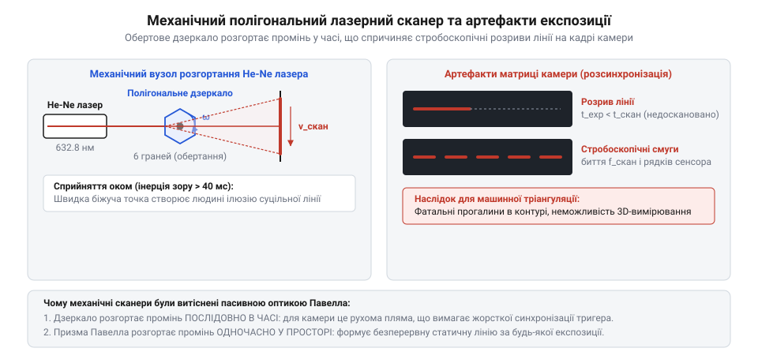
*Схема оптико-механічного розгортання променя He-Ne лазера багатогранним дзеркалом: зношування підшипників і десинхронізація обертання зі зчитуванням камери спричиняють тремтіння та стробоскопічні розриви лінії.*

У результаті на захоплених кадрах замість суцільної лінії виникали темні розриви, стробоскопічні смуги (від грец. @@el|strobos@@ — вихор та @@el|skopeo@@ — розглядаю) та різкі коливання яскравості від кадру до кадру. Комп'ютерний алгоритм сприймав прогалину у світлі як геометричну діру в деталі, спричиняючи масові помилкові бракування. До того ж півметрову скляну високовольтну трубку He-Ne лазера неможливо було змонтувати на рухомий маніпулятор зварювального робота. Постала нагальна потреба у компактній, монолітній оптиці без рухомих частин.

## Пасивна циліндрична лінза: нездоланний гаусів профіль і сліпота сенсорів

Аби усунути з оптичного тракту мотори, вали й дзеркала, оптики звернулися до пасивних скляних елементів — циліндричної лінзи (від грец. @@el|kylindros@@ — валок, коток) або прозорого скляного полірованого стрижня. На відміну від звичайної сферичної лінзи, циліндрична поверхня має радіус кривизни лише в одній площині (меридіональній, вздовж осі X), а вздовж перпендикулярної площини (сагітальної, вздовж осі Y) є абсолютно прямою.

Потрапляючи на таку лінзу, круглий промінь розщеплює свою просторову поведінку за двома вимірами. У площині без викривлення світло проходить крізь скляне тіло без оптичного заломлення, зберігаючи сколімовану товщину пучка. У площині з кривизною циліндрична поверхня діє як сильна заломлювальна лінза, розгортаючи промені у віялоподібний плоский пучок із широким кутом розкриття. Спроєктоване на поверхню деталі, це світлове віяло утворює чітку статичну лінію. Оптичний вузол став нерухомим, монолітним і стійким до вібрацій. Проте на зміну механічним негараздам прийшла фізична криза розподілу оптичної енергії.

Випромінювання лазера в фундаментальній моді TEM₀₀ має гаусів профіль інтенсивності (на честь німецького математика Карла Фрідріха Гаусса, нім. @@de|Carl Friedrich Gauss@@):

```
I(r) = I₀ · exp(-2r² / w²)
```

де `I₀` — пікова інтенсивність на оптичній осі пучка, `r` — відстань від центру, `w` — радіус пучка за спадом освітленості до рівня `1 / e²` (приблизно 13.5% від максимуму). Понад 86% енергії випромінювання сфокусовано у вузькому центральному ядрі, а до країв яскравість стрімко спадає за експонентою.

За законом заломлення Снелла (нід. @@nl|Willebrord Snellius@@) кут відхилення приосьового променя практично лінійно залежить від координати його входу на циліндричній поверхні.

Критична вада циліндричної лінзи полягає в тому, що вона не перерозподіляє енергію між пучками, а лише транслює просторовий профіль вхідного світла в кутовий сектор віяла. Відтак розподіл густини потужності вздовж розгорнутої лінії повністю зберігає вихідний гаусів закон:

```
I(x) = I₀ · exp(-2x² / w_line²)
```

Сформована лінія має надзвичайно яскравий спалах по центру й стрімко згасаючі, напівтемні краї. На відстані `x = w_line` яскравість падає у 7.4 раза, а на відстані `x = 2w_line` становить менше 0.03% від центрального піка.

Для систем машинного зору такий перепад освітленості виявився згубним через малий [динамічний діапазон](root:ph-condensed/ccd-sensor-physics) тогочасних [ПЗЗ-матриць](root:ph-condensed/ccd-sensor-physics) (приладів із зарядовим зв'язком, англ. @@en|CCD@@, charge-coupled device). Кремнієві сенсори 1970–1980-х років мали діапазон чутливості не більше 40–48 дБ (співвідношення яскравостей від 1:100 до 1:250) та 8-бітне аналогово-цифрове перетворення.

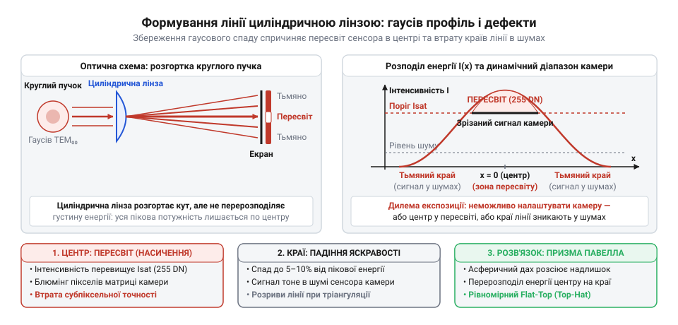
*Формування лінії скляною циліндричною лінзою: збереження гаусового профілю призводить до пересвіту центрального піка та зникнення країв лінії через вузький динамічний діапазон матриці.*

Для точного тріангуляційного вимірювання алгоритм комп'ютерного зору має знайти субпіксельний енергетичний центр лінії вздовж усієї її довжини. Це поставило розробників у безвихідь під час налаштування часу накопичення заряду матриці:

1. Якщо виставити експозицію за тьмяними краями лінії, центральна частина пучка передає пікселям у сотні разів більше фотонів, ніж може утримати ємність їхніх потенційних ям. Надлишкові електрони переповнюють кремнієві комірки й розтікаються по сусідніх пікселях матриці вздовж вертикальних шин зсуву. Виникає ефект блюмінгу (від англ. @@en|blooming@@ — розквітання, розпливання): лінія по центру роздувається у сліпучу білу пляму, координата центру спотворюється, а точність вимірювання геометрії падає до нуля.
2. Якщо зменшити експозицію, рятуючи центр матриці від насичення, яскравість на краях лінії опускається нижче порогу темнового струму та шумів зчитування. Краї лінії просто зникають на чорному тлі, а ефективна довжина контрольованої зони стискається до короткого відрізка в центрі.

Пасивна циліндрична лінза розв'язала проблему механічної надійності, але вперлася в оптичний глухий кут: щоб лінія працювала в машинному зорі, оптична система мала навчитися забирати надлишок фотонів із перенасиченого центра пучка й примусово розкидати їх на знекровлену периферію.

## Асферична призма Павелла: керована аберація проти гаусового купола

Потреба у високоточній безконтактній інспекції — контролі зварних швів, вимірюванні геометрії кузовів автомобілів та [тріангуляційному 3D-скануванні](root:sf-visual/triangulation-3d-laser-profilometry) — вимагала від оптиків проектування ідеально рівної світлової лінії. Звичайний точковий випромінювач, такий як базовий напівпровідниковий лазерний [модуль KY-008](root:cat-hw-actuators/ky-008-laser), формує симетричну круглу пляму. Якщо розгорнути такий пучок за допомогою стандартної циліндричної лінзи чи скляного стрижня, лінія утворюється, але розподіл освітленості вздовж неї повторює гаусову криву вхідного променя.

У центрі лінії виникає зона надвисокої концентрації потужності, а в напрямку країв яскравість швидко спадає за експоненціальним законом. Для матричних сенсорів машинного зору це створює безвихідь: якщо налаштувати час експозиції за яскравим центром, кінці лінії тонуть у шумах матриці й зникають; якщо ж збільшити витримку, щоб розгледіти краї, серцевина впадає у насичення. Пікселі переповнюються зарядом, виникає паразитне розтікання електронів між сусідніми комірками матриці (@@en|blooming@@), лінія штучно розширюється, а алгоритми пошуку енергетичного центру втрачають субпіксельну точність.

У 1987 році дослідник Національної дослідницької ради Канади (@@en|National Research Council of Canada@@, NRC) Ян Павелл (@@en|Ian Powell@@) запропонував розв'язок, який змінив підхід до формування пучків. Століттями класична оптика розглядала [сферичну аберацію](root:ph-waves/optical-aberrations) (латинське @@la|aberratio@@ — відхилення) як ваду, якої необхідно позбутися: промені, що проходять крізь периферію сферичної лінзи, заломлюються сильніше за центральні й не сходяться в одну точку, утворюючи розмите коло розсіювання. Оптичні конструктори витрачали роки на розрахунок багатолінзових компенсаторів для усунення цього ефекту. Павелл пішов зворотним шляхом: замість придушення сферичної аберації він вирішив внести у систему велетенську, контрольовану аберацію вздовж однієї осі та спрямувати її на користь рівномірності.

Створений ним оптичний елемент отримав назву призми Павелла (або лінзи Павелла, @@en|Powell lens@@). Це циліндричний елемент зі складною асферичною (грецьке @@el|a-@@ — заперечення та @@el|sphaira@@ — куля) передньою гранню, що має форму похилого даху з плавним закругленням на вершині гребеня. Оптична сила цієї деталі зосереджена лише в одній площині — площині розгортки віяла:

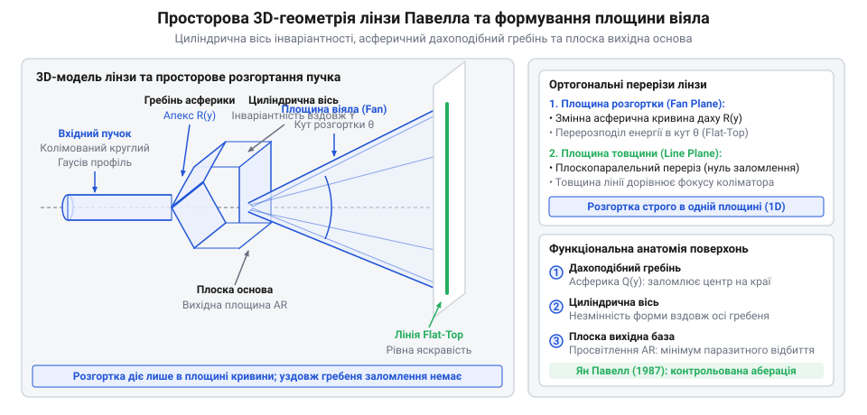
*Просторова геометрична будова лінзи Павелла: циліндрична вісь, гребінь асферичної поверхні та плоска вихідна основа пояснюють одновимірне розгортання пучка у площину віяла.*

- На оптичній осі, безпосередньо на гребені призми, поверхня майже плоска. Її локальна кривина мінімальна, тому параксіальні промені, що йдуть крізь серцевину, майже не відхиляються від початкового напрямку.
- У міру віддалення від оптичної осі до бічних схилів «даху» нахил поверхні та її локальна кривина стрімко зростають. За законом заломлення Снелла (латинське @@la|lex refractionis@@), більший кут падіння променя зумовлює відчутно різкіше заломлення.
- Промені з центральної зони вхідного гаусового пучка, які несуть основну частку світлової потужності, потрапляють на ці круті схили й силоміць відхиляються на великі кути у напрямку крайніх секторів віяла.

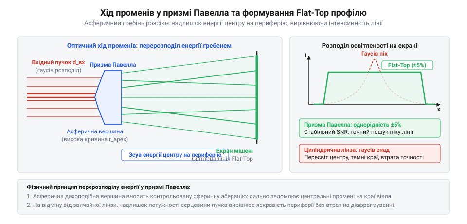
*Хід світлових променів крізь асферичну призму Павелла: заломлення на крутих асферичних схилах силоміць перерозподіляє надлишок фотонів із серцевини пучка на периферію віяла, перетворюючи гаусів купол на плоске плато яскравості (flat-top).*

Вхідний колімований пучок лазера має дзвоноподібний просторовий розподіл інтенсивності, де лінійна густина потужності `I_in(y)` на відстані `y` від оптичної осі спадає за експоненціальною залежністю:

```text
I_in(y) = I₀ · exp(-2·y² / w₀²)
```

де `I₀` — пікова інтенсивність на оптичній осі, а `w₀` — радіус пучка за рівнем спаду `1/e²` (приблизно 13.5% від максимуму). Понад 86% усієї енергії зосереджено у вузькому циліндричному ядрі радіусом `w₀`.

Щоб сформована лінія мала однакову яскравість у кожній точці робочого відрізка, кутова густина потужності у віялі розгортки `dP / dθ` мусить бути строго сталою на всьому діапазоні кутів `θ`:

```text
dP / dθ
= (dP / dy) · (dy / dθ)          [правило диференціювання складеної функції]
= I_in(y) · (1 / (dθ / dy))       [визначення лінійної густини потужності пучка]
= const                           [вимога ідеально рівномірної освітленості лінії]
```

Звідси випливає фундаментальна вимога до геометрії оптичної поверхні: похідна кута розгортки за поперечною координатою променя `dθ / dy` зобов'язана повторювати форму розподілу потужності у вхідному пучку:

```text
dθ / dy
= I_in(y) / const                 [перенесення похідної кута заломлення]
= (I₀ / const) · exp(-2·y² / w₀²) [підстановка гаусового профілю вхідного пучка]
```

Звичайна сферична циліндрична лінза має постійний радіус кривини, тому кут заломлення променів змінюється лінійно: `θ(y) ≈ y / f`, а похідна кута є константою `dθ / dy = 1 / f`. Вона неспроможна перерозподілити фотони й просто проектує вихідний гаусів купол у кутовий простір.

Асферична призма Павелла розв'язує це рівняння нелінійною формою поверхні. Її асферичний профіль розраховано так, що кут заломлення стрімко зростає від оптичної осі й виходить на плато біля країв робочого віяла (@@en|fan angle@@). Така геометрія силоміць відхиляє промені з насиченої гаусової серцевини на граничні кути, рівномірно перерозподіляючи оптичну потужність пучка.

Завдяки цьому гаусів дзвін розгортається у прямокутний профіль освітленості, відомий в оптиці як @@en|flat-top@@ («плоский дах») або @@en|top-hat@@ («циліндричний капелюх»). Уздовж робочого відрізка лінії потужність випромінювання залишається рівномірною, а на краях обривається чітким урвищем.

> 🔧 **Навіщо це.**
> Прямокутний профіль освітленості (flat-top) усуває головний конфлікт налаштування камер машинного зору між динамічним діапазоном і просторовою точністю. З гаусовою лінією інженер змушений вибирати: або збільшувати експозицію, щоб розгледіти тьмяні краї лінії (через що центр випалюється від пересвіту, а слід штучно товстішає через розтікання заряду @@en|blooming@@), або вкорочувати експозицію заради тонкого центру (втрачаючи краї у шумах сенсора). Профіль flat-top забезпечує однакове співвідношення сигнал/шум уздовж усього робочого сектора: камера фіксує контрастний слід стабільної ширини, а алгоритми пошуку енергетичного гребеня обчислюють координати профілю з постійною субпіксельною точністю (до 0.1 пікселя) на будь-якій ділянці спостереження.

Винахід Яна Павелла дозволив повністю відмовитися від рухомих механічних сканаторів — обертових дзеркальних барабанів та коливальних дзеркал. Малогабаритна скляна призма забезпечила пасивне, монолітне й довговічне формування рівномірної лазерної лінії, відкривши шлях до компактних оптичних головок для промислових вимірювальних систем.

## Від скляних He-Ne трубок до латунної гільзи: конструкція напівпровідникового лінійного модуля

Формування прямої оптичної лінії тривалий час лишалося складною лабораторною процедурою. До кінця 1980-х років основним джерелом когерентного світла для вимірювальних систем були газові гелій-неонові (He-Ne) лазери. Скляна запаяна трубка завдовжки 20–30 сантиметрів вимагала високовольтного живлення в кілька кіловольт, через що вся установка виходила громіздкою, крихкою, важкою й залежною від електромережі. Установити лазерну лінію на рухомий маніпулятор робота, вбудувати її в портативний 3D-сканер чи зібрати кишеньковий будівельний нівелір на цій елементній базі було неможливо.

Ситуація докорінно змінилася на зламі 1980-х і 1990-х років із початком масового виробництва червоних напівпровідникових лазерних діодів на основі гетероструктур алюміній-галій-індій-фосфіду (@@en|AlGaInP@@). Перші комерційні напівпровідникові лазери випромінювали на довжині хвилі близько 670 нм (темно-червоний край видимого спектра), але невдовзі технологія освоїла довжини хвиль 650 нм та 635 нм, до яких людське око чутливіше в рази. Твердотільний випромінювальний кристал мав розмір менше міліметра, живився безпечною напругою 2.5–3 В і споживав десятки міліамперів. Однак спроба використати новий напівпровідниковий випромінювач замість газової трубки натрапила на принципову оптичну перешкоду: вихідний пучок діода кардинально відрізнявся від майже ідеального круглого променя He-Ne лазера.

Кристал напівпровідникового інжекційного лазера випромінює світло крізь мікроскопічне прямокутне вікно вихідного торця — оптичний хвилевід. Товщина активної зони становить близько 1 мкм, а її ширина сягає 3–5 мкм. Через дифракцію на такій асиметричній апертурі пучок виходить у простір у вигляді стиснутого еліптичного конуса. У площині, перпендикулярній до p-n переходу (швидка вісь, @@en|fast axis@@), вихідна щілина найвужча, тому дифракційне розходження виявляється найбільшим — кут становить від 30° до 40°. У паралельній площині (повільна вісь, @@en|slow axis@@) отвір ширший, і розходження пучка значно менше — приблизно 8°–12°. До цієї асиметрії додається просторовий астигматизм (грец. @@el|ἀ-@@ — без, заперечення та @@el|στιгμή@@ — точка): через різницю хвилевідних механізмів усередині кристала уявні центри випромінювання для швидкої та повільної осей виявляються зміщеними вздовж оптичної осі на 5–15 мкм один від одного. Якщо спрямувати такий розбіжний еліптичний факел безпосередньо на формувальну оптику лінії, сформована смуга матиме розмиту серцевину, тьмяні розпливчасті кінці й неконтрольовану товщину. Щоб кінцева оптика працювала розрахунково, вихідний пучок діода спершу вимагає [колімації напівпровідникового пучка](root:ph-waves/laser-diode-collimation) (лат. @@la|collimare@@ — спрямовувати по прямій) — зведення широкого розбіжного віяла у квазіпаралельний промінь.

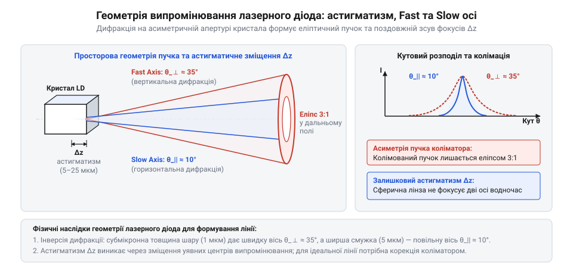
*Геометрія розходження пучка лазерного діода: різниця кутів розходження вздовж швидкої та повільної осей разом із просторовим астигматизмом утворюють еліптичний пучок, що вимагає попередньої колімації перед формувальною оптикою лінії.*

Для об'єднання кристала, збиральної оптики та розгортального елемента в міцний і компактний вузол інженери розробили уніфіковане механічне шасі — точену циліндричну гільзу із зовнішнім діаметром 12 мм (Ø12 мм). Матеріалом гільзи обрали латунь — сплав міді та цинку. Це рішення диктували дві фізичні причини:
1. Відведення тепла. Коефіцієнт корисної дії напівпровідникового лазерного діода становить лише 15–25%; решта електричної потужності безпосередньо в об'ємі мікроскопічного кристала перетворюється на тепло. Перегрів призводить до лавиноподібного падіння оптичної потужності, дрейфу довжини хвилі у довгий червоний бік (зі швидкістю близько 0.25 нм/°C) та ризику термічної деградації відбиваючих граней діода. Латунь має високий коефіцієнт теплопровідності (понад 110 Вт/(м·К)), що втричі вище за показники сталі й на кілька порядків перевищує пластмаси. Масивна латунна стінка виконує роль первинного розподіленого радіатора (лат. @@la|radiator@@ — випромінювач), поглинаючи тепловий імпульс і відводячи тепло в навколишнє середовище або у затискач верстата.
2. Точність і стабільність механіки. Латунь відмінно обробляється різанням на токарних автоматах, не дає задирок і не піддається заїданню при взаємному терті деталей із різьбою, що необхідно для мікроподач оптичних окільцьовок.
Зовнішній габарит Ø12 мм став стандартом індустрії, оскільки він дозволяє без надмірної товщини розмістити всередині стандартний металевий корпус діода TO-56 (зовнішній діаметр 5.6 мм), внутрішній різьбовий канал під лінзу та задню стабілізуючу плату керування.

Внутрішня архітектура латунного модуля вибудовується як суворий оптико-механічний тракт.

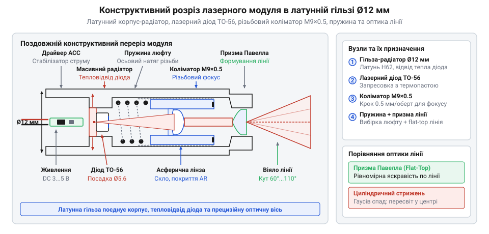
*Конструктивний розріз лазерного модуля в латунній гільзі Ø12 мм: кристал діода запресовано в масивний корпус-радіатор, коліматор переміщується різьбою M9×0.5 із пружиною вибірки люфту, а на виході встановлено формувальну оптику лінії.*

У задньому відсіку гільзи виконано прецизійне посадкове гніздо, куди із зусиллям запресовується металевий цоколь лазерного діода. Безпосередній механічний контакт забезпечує мінімальний тепловий опір між основою діода та зовнішньою гільзою. Позаду виводів діода впресовується мініатюрна кругла друкована плата стабілізуючого електронного драйвера: вона обмежує робочий струм діода або підтримує автоматичне регулювання потужності за допомогою зворотного зв'язку від вбудованого фотодіода.

Центральний канал гільзи несе дрібну метричну різь M9×0.5 (зовнішній діаметр 9 мм, крок різі 0.5 мм на повний оберт). У цей канал вкручується трубчаста оправа з короткофокусною коліматорною лінзою (асферичною скляною або литою пластиковою з фокусною відстанню 3–7 мм). Між внутрішнім уступом гнізда діода й торцем оправи коліматора встановлено сталеву пружину стиснення.

> 🔧 **Навіщо це.** Дрібний крок різі M9×0.5 разом із підтискною пружиною розв'язує проблему люфту (нім. @@de|Luft@@ — зазор, проміжок). Фокусна відстань коліматорної лінзи становить лічені міліметри, тому зміщення оптичного елемента вздовж осі всього на 30–50 мікронів кардинально змінює сходження пучка й розмиває товщину лінії на мішені в кілька разів. Технологічний зазор між витками внутрішньої та зовнішньої різі неминуче викликає осьове хитання оправи; пружина постійно обирає цей зазор, притискаючи витки оправи до одного боку витків гільзи, тому фокус не збивається під час обертання та від вібрацій працюючого обладнання.

Обертанням оправи коліматора регулюють дистанцію між випромінювальним торцем кристала діода та площиною лінзи. Коли відстань точно дорівнює фокусній відстані лінзи, на виході формується паралельний промінь із мінімальним розходженням, розрахований на роботу на великих дистанціях у кілька десятків метрів (будівельна розмітка, лазерні рівні). Якщо викрутити оправу вперед на частку міліметра, пучок після лінзи сходиться у просторову перетяжку на заданій кінцевій відстані від модуля — наприклад, 300 мм, 500 мм або 1000 мм. У точці перетяжки ширина пучка зменшується до 0.1–0.3 мм, що є критичною вимогою тріангуляційного 3D-сканування та систем високоточного машинного зору.

На відміну від найпростіших модулів точкового променя на кшталт [KY-008](root:cat-hw-actuators/ky-008-laser), де сколімований промінь одразу йде назовні у вигляді круглої точки, лінійний модуль оснащується переднім тримачем для додаткової оптичної деталі. Безпосередньо на виході колімованого променя монтується скляний циліндричний стрижень або асферична призма Павелла. Коліматор забезпечує потрібний діаметр пучка та точне фокусування в одній площині, а вихідна призма розгортає промінь у перпендикулярній площині у широке світлове віяло, утворюючи на освітленій поверхні неперервну геометрично чітку лінію.

## Від формули до серійного скла: комерціалізація Lasiris і поразка дифракційних ґраток

Теоретична схема лінзи, яку Ян Павелл оприлюднив у 1987 році, на папері бездоганно розв'язувала проблему вирівнювання лазерного пучка: математично розрахована асферична (грец. *a-* — заперечення та *sphaira* — куля) поверхня перерозподіляла надлишок гаусової потужності із центру до країв, формуючи рівномірну смугу світла з прямокутним профілем яскравості (англ. @@en|flat-top@@). Проте між публікацією розрахунку та появою перших промислових приладів постала технологічна прірва оптичного виробництва.

Традиційна оптична обробка століттями спиралася на притирання скляної заготівки до сферичної або пласкої чаші з вільним абразивом. Хаотичний коловий рух природно утворює поверхні постійної кривини — саме так дешево шліфують звичайні сферичні та циліндричні лінзи. Проте призма Павелла має форму складного даху з поперечним перерізом, кривина якого безперервно змінюється: мікроскопічний радіус на самому гребені становить частки міліметра і плавно переходить у майже пласкі схили на периферії. Будь-яка спроба відполірувати такий профіль традиційним полірувальником неминуче стирала гострий гребінь, заокруглюючи вершину. А найменше спотворення форми гребеня руйнувало точне відхилення центральних променів: лінія отримувала або глибоку темну прогалину по центру, або неконтрольований сплеск яскравості на краях.

Щоб виточити таку мікроасферику в твердому оптичному склі, знадобилася технологія алмазного мікрошліфування на прецизійних верстатах із числовим програмним керуванням. Оптичне скло є крихким матеріалом, схильним до сколювання та мікротріщин, тому його механічна обробка алмазним різцем можлива лише в так званому пластичному режимі різання. За величезного локального тиску та надмалих подач алмаз знімає шар скла завтовшки в лічені нанометри, пластично деформуючи матеріал без сколів. Кожна деталь вимагала тривалого поштучного виточування, вимірювання на лазерному інтерферометрі та фінішного доведення. Через це перші призми Павелла виявилися вкрай коштовною екзотикою: вартість одиничної скляної деталі сягала сотень доларів, що виключало їхнє масове застосування в серійних датчиках.

Прорив у комерціалізації технології здійснила канадська компанія @@en|Lasiris@@ (згодом викуплена StockerYale та Coherent). Вона налагодила серійну обробку скла Павелла й розв'язала критичне питання прецизійного механічного монтажу. На відміну від простих точкових модулів на кшталт [KY-008](root:cat-hw-actuators/ky-008-laser), де коліматор (лат. *collimo*, перекручене *collineo* — спрямовувати по прямій лінії) лише збирає промені у фокус, лінійний проєктор вимагає нанометрового вирівнювання: оптична вісь еліптичного пучка напівпровідникового діода має перетинати дахоподібний гребінь призми суворо посередині. Зсув пучка від осі всього на 10 мкм робить лінію асиметричною — один край спалахує, а інший гасне. Lasiris запатентувала жорсткі гільзи з мікрометричним юстуванням призми відносно променя діода, ставши еталоном для тріангуляційних [3D-сканерів](root:hw-sensing/laser-triangulation-sensor).

Висока ціна скляної асферики викликала сильну інженерну протидію. На початку 1990-х років бурхливий розвиток фотолітографії та мікрооптики породив рух за повну заміну складного заломлювального скла на [дифракційні оптичні елементи](root:ph-waves/diffractive-optical-element) (DOE, від англ. @@en|diffractive optical element@@; лат. *diffractio*, від *diffringere* — ламати на шматки).

Замість обробки важкої тривимірної форми прихильники DOE запропонували використовувати хвильові властивості світла. За допомогою комп'ютерної голографії розраховується періодичний або квазіперіодичний фазовий мікрорельєф — сходинки заввишки в кілька сотень нанометрів на поверхні пласкої пластинки. Проходячи крізь таку структуру, світлова хвиля затримується в одних зонах і випереджає в інших. Інтерференція цих вторинних хвиль у просторі формує потрібний кутовий віялоподібний розподіл — лазерну лінію.

Економічна привабливість DOE здавалася беззаперечною. Прецизійний мікрорельєф виготовляється на металевій або кремнієвій матриці лише один раз методом електронно-променевої літографії, після чого пластикові дифракційні пластинки можна штампувати мільйонними партіями за копійки за допомогою гарячого тиснення (англ. @@en|hot embossing@@) або лиття полімерів (полікарбонату, поліметилметакрилату) під тиском. Здавалося, що дорога скляна рефракційна (лат. *refractio* — заломлення) призма приречена поступитися штампованому пластику.

Проте спроба впровадити пластикові дифракційні решітки в точні вимірювальні системи закінчилася поразкою. Фізика хвильової дифракції у поєднанні з особливостями напівпровідникових діодів породила три непереборні вади.

Першою вадою стало хроматичне розповзання лінії через температурну нестабільність діода. У газових лазерах довжина хвилі фіксована атомними переходами, але в напівпровідниковому кристалі ширина забороненої зони залежить від температури: під час нагрівання міжатомна кристалічна ґратка розширюється, енергетична щілина зменшується, а довжина випромінюваної хвилі `λ` неминуче зміщується в довжинохвильову область. Для стандартних червоних діодів цей дрейф становить від 0.25 до 0.3 нм на кожен градус Цельсія.

Кут відхилення променів дифракційною решіткою підпорядкований умові дифракції:

```text
d · sin(θ) = m · λ
```

де `d` — просторовий період мікроструктури, `θ` — кут відхилення хвилі, `m` — цілочисловий порядок дифракції, а `λ` — довжина хвилі випромінювання.

Оскільки період решітки `d` у пластику є фіксованим, будь-який дрейф довжини хвилі `λ` призводить до пропорційної зміни синуса кута `θ`. Коли лазерний модуль нагрівається на 20 °C від власного струму живлення чи теплого середовища, довжина хвилі діода зростає на 5–6 нм. Внаслідок цього кут розкриття дифракційної лінії розширюється, а її розміри та просторове положення на об'єкті «пливуть». Для вимірювальних систем це означає руйнування калібрування: алгоритм фіксує зміну форми виробу там, де насправді змінилася температура приладу.

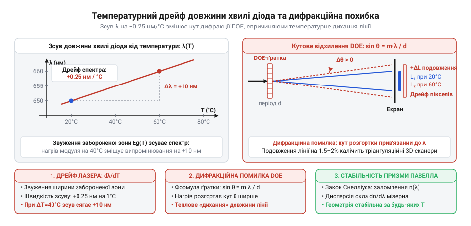
*Залежність довжини хвилі випромінювання напівпровідникового лазерного діода від температури кристала та її вплив на кутове відхилення в дифракційній решітці: температурний дрейф довжини хвилі на 0.25–0.3 нм/°C призводить до розширення кута дифракції та просторового розповзання проєктованої лінії, руйнуючи калібрування вимірювальної системи.*

Другою критичною вадою став витік нульового порядку (англ. @@en|zero-order leakage@@) та утворення сліпучої центральної точки (англ. @@en|hot spot@@). Щоб уся оптична потужність перейшла у розгорнуту лінію (ненульові дифракційні порядки), фазова решітка розраховується на повне деструктивне гасіння недифрагованого пучка нульового порядку (`m = 0`). Для цього глибина мікрорельєфу `h` повинна точно задовольняти умову протифази:

```text
h = λ / (2 · (n - 1))
```

де `n` — показник заломлення пластику.

Витримати глибину нанорельєфу `h` з абсолютною точністю при масовому литті пластику неможливо через теплову усадку полімеру та зношення пресформ. До того ж при температурному зміщенні робочої довжини хвилі `λ` ця умова негайно порушується. Якщо деструктивне гасіння порушується хоча б на 1–3 %, залишок світла проходить крізь решітку прямо, у нульовому порядку.

Оскільки корисна потужність лінії розсіюється на широкий кут (від 30° до 90°), її поверхнева освітленість є відносно низькою. Натомість недифрагований нульовий порядок залишається сфокусованим паралельним пучком із мікроскопічним діаметром перерізу. В результаті яскравість цієї центральної плями перевищує яскравість самої лінії в десятки й сотні разів.

Наслідки цього подвійні:
1. Сенсор камери у машинному зорі в цій точці миттєво перенасичується (англ. @@en|blooming@@), викликаючи паразитне розтікання заряду по сусідніх пікселях матриці, через що центральна ділянка вимірюваного контуру стає непридатною для аналізу.
2. Порушується лазерна безпека: рівномірно розподілена лінія потужністю 5 мВт є безпечною для очей (клас 1 або 2), оскільки в зіницю потрапляє лише незначна частка світла. Але концентрована центральна точка нульового порядку б'є в око повною густиною колімованого променя, повертаючи модуль до небезпечного лазерного класу 3R.

Третьою вадою стали інтерференційні паразитні порядки: неминучі бічні дифракційні лінії-привиди та виражена спекл-структура решітки, що знижували контрастність і точність розпізнавання меж об'єктів.

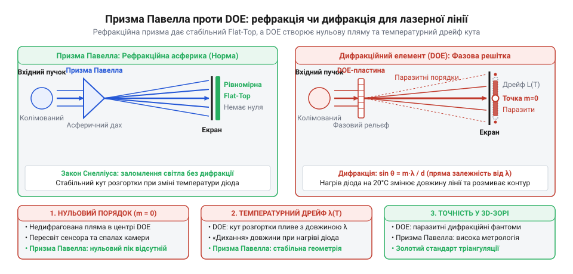
*Порівняння заломлення в лінзі Павелла та дифракції на фазовому елементі DOE: дифракційна лінія зазнає розмиття через температурний зсув довжини хвилі та містить небезпечний спалах нульового порядку, тоді як скляна асферика забезпечує кутову стабільність і рівномірне поле освітленості без центральної плями.*

> 🔧 **Навіщо це.**
> У тріангуляційному [3D-сканері](root:hw-sensing/laser-triangulation-sensor) лінія проєктора зчитується камерою під кутом для обчислення рельєфу деталі. Якщо застосувати пластиковий дифракційний елемент, концентрована точка нульового порядку засвічує матрицю камери та приховує центральну ділянку деталі, а дрейф температури діода нагріває кристал і розширює лінію, вносячи систематичну похибку глибини до кількох міліметрів. Заломлювальна призма Павелла дає гарантію, що кожен міліметр розгорнутої лінії залишається на строго фіксованому кутовому місці незалежно від нагріву модуля.

Суцільна скляна лінза Павелла позбавлена цих проблем завдяки фундаментальній природі заломлення, що описується законом Снеліуса:

```text
n₁ · sin(α) = n₂ · sin(β)
```

де `α` — кут падіння, `β` — кут заломлення, а `n₁` і `n₂` — показники заломлення середовищ.

Оптичне скло володіє мізерною хроматичною дисперсією (лат. *dispersio* — розсіювання) у вузькому вікні можливого температурного зсуву діода: коливання довжини хвилі на 5–6 нм змінює показник заломлення скла лише в четвертому знаку після коми, а власний температурний коефіцієнт скла `dn/dT` становить біля 3 × 10⁻⁶ / °C. Тому кут розкриття лінії та профіль освітленості лінзи Павелла залишаються геометрично стабільними за будь-яких виробничих перепадів температури.

Крім того, рефракція перерозподіляє світло неперервно: пучок променів безперервно відхиляється монолітною гладкою кривиною даху, а не розщеплюється на фазові квантові пелюстки. У призмі Павелла немає хвильового ділення енергії на порядки, тому в центрі лінії фізично не може виникнути недифрагований спалах чи паразитні бічні контури.

Ця фізична розбіжність визначила чіткий поділ галузі. Пластикові дифракційні елементи знайшли своє місце в побутовій техніці, іграшках, простих будівельних покажчиках та двовимірних точкових проєкторах розпізнавання жестів, де допустимі сантиметрові похибки. Проте у сфері прецизійного машинного зору, високоточного 3D-сканування деталей і дорожньої профілометрії беззаперечним стандартом залишилася монолітна скляна лінза Павелла. Попри високу ціну алмазного мікрошліфування, лише геометрична рефракція забезпечує ту фотометричну однорідність і температурну стабільність, без яких метрологічні вимірювання втрачають фізичний зміст.

## Оптичні міфи модулів лінії: дешева підміна та пастка неузгодженого пучка

У технічній документації напівпровідникові модулі лазерної лінії зазвичай виглядають привабливо та просто: виробники обіцяють тонку, яскраву смугу з чіткою геометрією розгортки. Інженер, який обирає такий модуль для розмітки різання, позиціювання заготовок чи оптичного контролю, за замовчуванням очікує рівномірно освітлену смугу з однаковим оптичним сигналом від лівого до правого краю. Проте на практиці робота з готовими модулями часто приносить розчарування: лінія має надмірно пересвічену пляму по центру й стрімко тьмяніє до країв, або навпаки — на її кінцях спалахують яскраві крапки, а посередині зяє темний провал. Причиною цих аномалій є два стійкі технічні міфи, що виникли навколо оптичних систем генерації лінії.

Перший міф полягає в переконанні, що кожен сучасний лазерний модуль оснащений асферичною призмою Павелла (асферичний, від грец. *a-* — заперечна частка та *sphaira* — куля). Реальність масового ринку диктується економікою виробництва. Справжня призма Павелла має складну геометрію вершини з мікроскопічним радіусом кривизни та плоскими бічними гранями. Її виготовлення потребує прецизійного комп'ютеризованого шліфування й полірування оптичного скла чи надточного пресування у формах. Собівартість оптичного елемента Павелла становить десятки доларів, а оснащення виробничої лінії вимагає значних капіталовкладень.

Через це приблизно у 95% бюджетних модулів вартістю кілька доларів встановлено звичайний скляний або пластиковий циліндричний стрижень — копійчаний відрізок тонкого волокна, закріплений поперек вихідного пучка коліматора (коліматор, від лат. *collineo* — спрямовую по прямій лінії). Циліндр дійсно перетворює вузьку точку на лінію завдяки заломленню світла на циліндричній поверхні. Проте він діє лише як одновимірна лінза й абсолютно не змінює поперечного розподілу густини випромінювання. Промінь після коліматора зберігає властивості [гаусового пучка](root:ph-waves/gaussian-beam) (за ім'ям німецького математика Карла Фрідріха Гауса, Carl Friedrich Gauss), де яскравість плавно спадає від оптичної осі до країв за дзвіноподібною кривою.

У результаті циліндричний стрижень відтворює ту саму оптичну ваду сорокарічної давнини: у центральних 20% смуги концентрується майже вся потужність випромінювача, а до країв лінія неминуче гасне. Для людського ока під час грубої розмітки це ще можна пробачити, але для систем вимірювання чи фотореєстрації такий перепад робить модуль практично непридатним.

Розпізнати підміну можна без приладів: під збільшувальним склом стрижень постає гладким круглим валиком, тоді як призма Павелла має характерне дахоподібне ребро. Крім того, на екрані циліндр дає лінію з розмитими тьмяними краями, а якісна призма — смугу з чітко окресленими прямокутними кінцями.

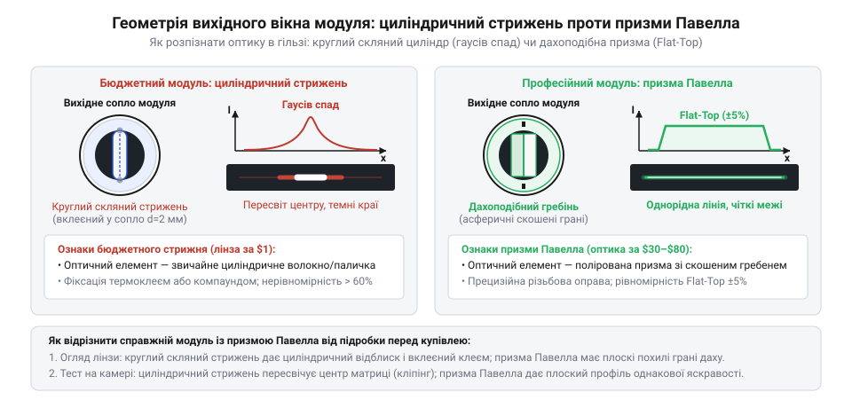
*Порівняння геометрії вихідного вікна оптичного модуля: циліндричний стрижень має гладку круглу поверхню і дає лінію з тьмяними краями, тоді як призма Павелла з гострим дахоподібним ребром перерозподіляє енергію у рівномірну смугу з чітко окресленими кінцями.*

Другий, значно тонший міф стверджує, що справжня призма Павелла є універсальним компонентом, який можна встановити на будь-який лазерний випромінювач і миттєво отримати ідеальну лінію. Конструктори нерідко купують якісну призму окремо й монтують її перед стандартним точковим модулем, наприклад [KY-008](root:cat-hw-actuators/ky-008-laser). Проте замість бездоганної смуги вони знову отримують спотворену освітленість.

Причина полягає в принципі розрахунку призми. Її асферична вершина вносить строго дозовану негативну сферичну аберацію (аберація, від лат. *aberratio* — відхилення, викривлення). Кривизна поверхні розраховується чисельно під конкретну функцію розподілу вхідної енергії, щоб відхилити надлишок променів із центру пучка до периферії та сформувати рівномірний прямокутний профіль освітленості @@en|flat-top@@ (англ. *flat-top* — пласка вершина). Цей баланс базується на одному незмінному параметрі — розрахунковому діаметрі вхідного колімованого пучка за рівнем спаду інтенсивності 1/e² (приблизно 13.5% від пікової потужності в центрі).

Будь-яка невідповідність між фактичним діаметром променя та розрахунковим номіналом призми руйнує просторову однорідність освітлення:

- **Завузький пучок (діаметр менший за розрахунковий).** Світловий потік проходить переважно крізь центральну зону призми біля самої вершини. На круті бічні схили («крила») асферики світло майже не потрапляє. Заломлення в центральній ділянці виявляється заслабким, щоб розігнати енергію на периферію. Як наслідок, лінія отримує виражений центральний гаусів горб, а краї залишаються тьмяними — переваги асферики сходять нанівець.
- **Заширокий пучок (діаметр більший за розрахунковий).** Широкі крила гаусового променя потрапляють на ділянки поверхні з максимальною крутизною. Ці круті асферичні схили спрямовують надлишок оптичної потужності на самі межі кута розгортки. У результаті на обох кінцях лінії виникають яскраві спалахи переосвітленості — так звані «собачі вуха» (@@en|dog ears@@), тоді як у центрі смуги утворюється глибока темна прогалина.
- **Узгоджений пучок (діаметр точно відповідає номіналу).** Енергія кожного радіального поясу вхідного гаусового пучка перенаправляється в строго відведений кутовий сектор, забезпечуючи рівний плоский профіль без перепадів яскравості.

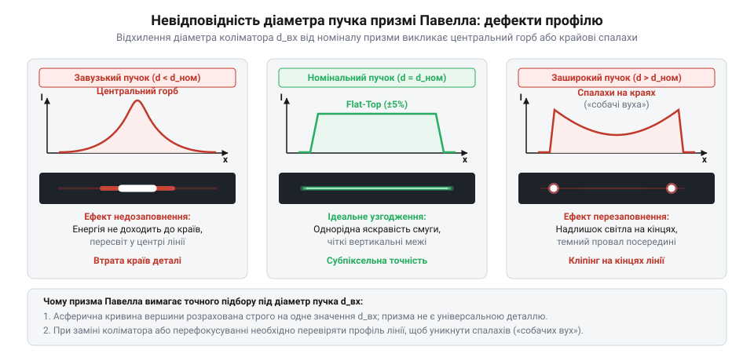
*Профілі розподілу інтенсивності лазерної лінії на виході лінзи Павелла: узгоджений пучок дає прямокутний профіль @@en|flat-top@@, завузький промінь залишає гаусів горб по центру, а заширокий — утворює крайові спалахи («собачі вуха») із глибоким центральним провалом.*

> 🔧 **Навіщо це.** У машинному зорі та системах [тріангуляційного 3D-сканування](root:sf-visual/triangulation-laser-scanner) (тріангуляція, від лат. *triangulum* — трикутник) алгоритми обчислюють рельєф поверхні за субпіксельним центром лазерної смуги на матриці камери. Пересвічений центр або крайові викиди змушують звужувати динамічний діапазон зйомки: яскраві ділянки входять у насичення сенсора й розмивають координату контуру, а тьмяні фрагменти губляться в шумах, спотворюючи обчислену карту висот.

Узгодження пучка з призмою стає особливо вибагливим через властивості напівпровідникового лазерного діода. Випромінювальна щілина діода має не симетричну форму, а прямокутний профіль перерізу. Через це випромінювання має виражений астигматизм і різну розбіжність: уздовж так званої швидкої осі кут становить 25–35°, а вздовж повільної — лише 8–10°. Після простого об'єктива пучок стає еліптичним. Якщо орієнтацію призми Павелла відносно осей еліпса вибрано неправильно, поперечний розмір пучка в площині розгортки відрізнятиметься від проектного в два-три рази, що миттєво викликає аномалії освітленості.

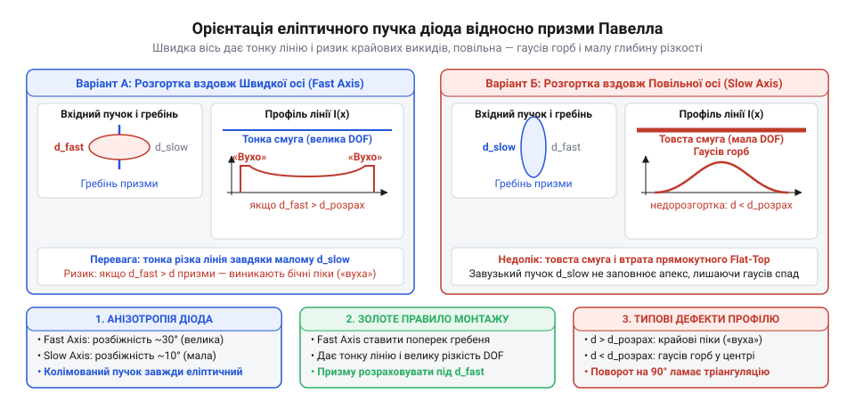
*Орієнтація еліптичного пучка лазерного діода відносно ребра лінзи Павелла: розгортка вздовж швидкої осі проти розгортки вздовж повільної осі кардинально змінює вхідний діаметр променя, тому неправильне кутове положення призводить до оптичної неузгодженості та спотворення профілю лінії.*

Крім того, у багатьох недорогих модулях коліматорна гільза має різьбове регулювання фокуса. Користувач, намагаючись зробити лінію тоншою на робочій відстані, повертає різьбову гільзу. Поздовжнє переміщення коліматора змінює відстань до перетяжки пучка і прямо змінює його діаметр у площині вхідної грані призми. Найменше підкручування фокуса виводить діаметр пучка з розрахункового діапазону призми Павелла, спричиняючи або крайові спалахи, або центральний горб. Саме тому прецизійні промислові лазерні модулі не мають вільного ручного фокусування: їхню оптичну схему юстують на стенді під конкретну робочу відстань і жорстко фіксують компаундом.
