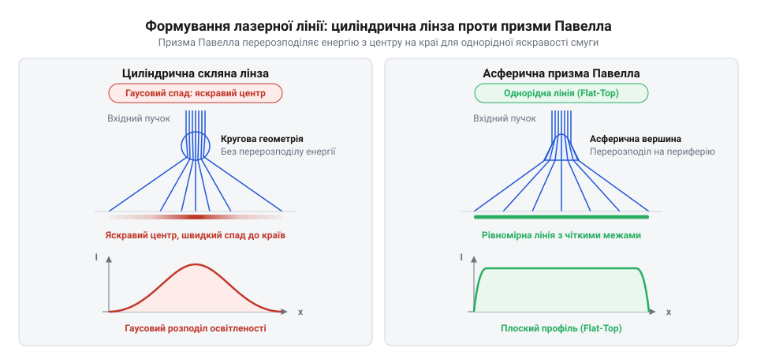
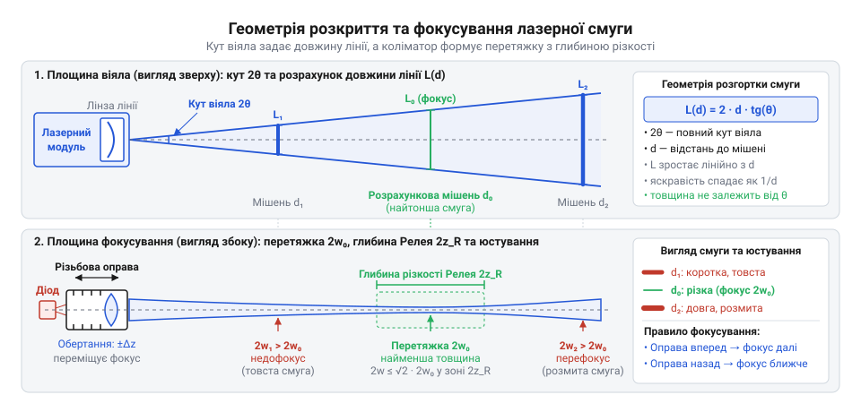
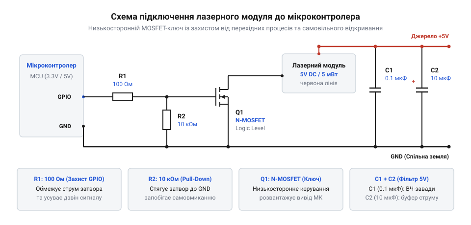
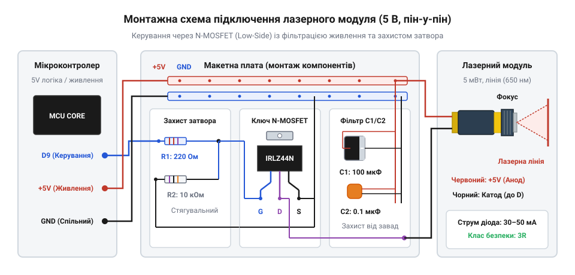
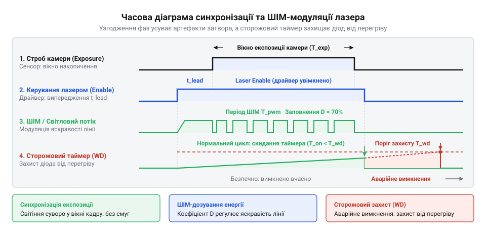
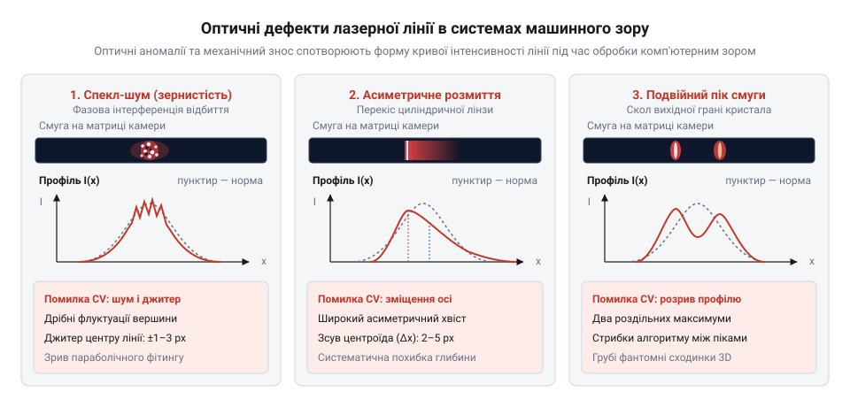

# Лазерний модуль з лінією (5 мВт, з фокусом)

<preknowlist>
- [KY-008 — лазерний модуль](root:cat-hw-actuators/ky-008-laser) — базова будова напівпровідникового лазерного випромінювача, пряме падіння напруги на лазерному діоді та ризик теплової деградації кристала при тривалому безперервному живленні
</preknowlist>

## Проблема безконтактного контролю площини та профілю: чому точкового лазера або розсіяного освітлення недостатньо

Коли автоматизована система має перевірити площинність штампованої деталі, спрямувати зварювальний пальник уздовж криволінійного стику або оцінити висотний профіль дошки на конвеєрі, постає потреба безконтактно зафіксувати геометрію рельєфу в просторі. Якщо спрямувати на поверхню звичайний точковий лазер (від англійського акроніма @@en|LASER@@, *Light Amplification by Stimulated Emission of Radiation* — підсилення світла за допомогою вимушеного випромінювання), промінь відіб'ється від однієї точки. Датчик відстані обчислить просторову координату цієї точки, але вона нічого не скаже про те, що відбувається праворуч, ліворуч чи далі вздовж деталі. Щоб отримати уявлення про площину або профіль за допомогою точкового променя, цей промінь доводиться переміщувати у двох координатах. Для цього застосовують електромеханічні сканатори: каретки з лінійними напрямними або високошвидкісні поворотні гальванометричні дзеркала.

Механічний рух дзеркал і приводів породжує непереборні обмеження. По-перше, рухомі вузли мають інерцію, через що швидкість вимірювання рідко перевищує кілька десятків точок на секунду. Якщо вимірюваний об'єкт рухається конвеєром зі швидкістю метр на секунду, точкова траєкторія спотворюється швидкістю руху деталі, утворюючи просторовий перекіс даних. По-друге, механічні дзеркала схильні до зношування, втрачають калібрування від виробничої вібрації та суттєво здорожчують усю вимірювальну установку.

Спроба замінити лазерний промінь звичайною відеокамерою та розсіяним освітленням (світлодіодними панелями чи прожекторами) зіштовхується з іншою фізичною перешкодою. На однорідних, темних, гладких або відблискуючих матеріалах — прокатному металі, чорній гумі, шліфованій деревині чи матовому пластику — розсіяне світло не створює контрастного світлотіньового рельєфу. Зображення виходить пласким, без чітких просторових орієнтирів. Будь-яка випадкова зміна зовнішнього освітлення в цеху (увімкнення сусіднього ліхтаря, відкриття воріт чи спалах дуги зварювального апарата) зміщує видимі межі тіней. Алгоритми комп'ютерного зору втрачають край деталі або сприймають плями мастила й текстурні волокна за перепади висоти, оскільки 2D-кадр містить лише яскравість пікселів і позбавлений висотної координати.

Розв'язком стає перехід від точки та розсіяного світла до структурованого освітлення (від латинського *structura* — будова, взаємне розміщення) у вигляді нерухомої світлової площини. Лазерний модуль генерує тонке віяло світла (від англійського @@en|light sheet@@). Перетин цього віяла з тривимірним об'єктом утворює на його поверхні яскраву, геометрично неперервну світлову лінію. Якщо поверхня ідеально плоска, лінія виглядає прямою; якщо на поверхні є канавка, сходинка, вигин чи зварний валик, лінія повторює форму цієї нерівності, фізично вигинаючись у просторі.

Оскільки лазер випромінює монохроматичне світло з фіксованою довжиною хвилі (найчастіше червоне 650 нм), перед об'єктивом камери встановлюють інтерференційний світлофільтр ([Вузькосмуговий оптичний інтерференційний світлофільтр](root:ph-waves/narrowband-optical-bandpass-filter)), який пропускає виключно випромінювання лазера й повністю відсікає денне світло та цехове освітлення. Камера бачить лише висококонтрастну лазерну лінію з максимальним динамічним діапазоном, незалежно від оптичних перешкод навколо.

Перетворення вигину лінії на точні висотні координати ґрунтується на методі оптичної тріангуляції (від латинського *triangulum* — трикутник, геометричний метод визначення координат вершини трикутника за відомою базовою стороною та двома прилеглими кутами, детальніше в [Оптична тріангуляція та структуроване лазерне освітлення](root:hw-sensing/laser-triangulation-profiling)). Лазерний модуль і цифрову матричну камеру жорстко закріплюють на фіксованій відстані один від одного (базова відстань або база тріангуляції) під постійним кутом тріангуляції. Лазер спрямовує площину світла на об'єкт згори, а камера дивиться на освітлену зону збоку під кутом.

Коли рельєф поверхні піднімається на висоту `Δh`, точка перетину лазерного віяла з об'єктом фізично зміщується в просторі назустріч камері. На матриці камери це зміщення фіксується як поперечний зсув піксельних координат лазерної лінії на величину `Δy`. Оскільки матриця камери складається з сотень і тисяч стовпців пікселів, один-єдиний кадр фіксує повний поперечний профіль поверхні вздовж усієї лінії одночасно. Система отримує тисячі точних просторових точок за один експозиційний зліпок без жодного рухомого механічного вузла. Інженерна реалізація такого вимірювального вузла показана в практичному профілометрі [Побудова оптичного профілометра](root:cat-hw-actuators/laser-line-module/proj-laser-triangulation-scanner.md), а шлях від громіздких газових He-Ne випромінювачів з обертовими призмами до мініатюрних статичних формувачів променя розкрито в [Еволюція формування лазерної лінії](root:cat-hw-actuators/laser-line-module/hist-line-generating-optics.md).

> 🔧 **Навіщо це.**
> У роботизованих зварювальних комплексах лазерна лінія сканує стик металевих деталей за кілька сантиметрів попереду зварювального пальника. Камера під кутом вимірює зміщення лінії, обчислює геометричний центр канавки шва та коригує положення пальника в реальному часі, компенсуючи теплове ведення металу без фізичного контакту з розжареною деталлю. На автоматичних пилорамах лазерна смуга в реальному часі показує площину майбутнього розпилу стовбура, дозволяючи програмно розрахувати оптимальний розкрій деревини для мінімізації відходів.

## Внутрішня будова та принципова схема модуля: від латунної гільзи до напівпровідникового кристала

Ззовні типовий 5 мВт лазерний модуль виглядає як монолітний металевий циліндр діаметром 12 мм і довжиною від 30 до 40 мм, із якого виходять два дроти живлення. Металевий корпус модуля виготовляють із латуні (від середньонідерландського *latoen* — сплав міді та цинку). Латунь обрана завдяки двом фізичним властивостям: вона легко піддається високоточній механічній обробці для нарізання дрібної різьби без заїдання і має високий коефіцієнт теплопровідності (близько 115 Вт/(м·К)), що дозволяє масивній гільзі слугувати безпосереднім тепловідводом для напівпровідникового випромінювача.

Усередині 12-міліметрової гільзи вздовж оптичної осі послідовно розташовані три функціональні вузли: випромінювач, плата живлення та оптичний формувач лінії.

1. **Випромінювач**: напівпровідниковий лазерний діод (від грецького *di-* — двічі та грецького *hodos* — шлях; електронний компонент із двома виводами та p-n переходом, який формує оптичний резонатор, детальніше в [Напівпровідниковий лазерний діод](root:hw-components/semiconductor-laser-diode)). Діод упакований у стандартизований металевий корпус @@en|TO-18@@ (діаметр посадкового буртика 5.6 мм). Основа корпусу TO-18 запресована з механічним натягом у внутрішню латунну перегородку гільзи. Це забезпечує прямий тепловий контакт кристала з масивним металевим корпусом.

2. **Плата керування струмом**: у хвостовій частині гільзи безпосередньо за виводами діода встановлено круглу двосторонню друковану плату (від англійського @@en|PCB@@, *Printed Circuit Board*) діаметром близько 9 мм. На ній розміщено мініатюрні пасивні або активні SMD-компоненти (від англійського @@en|SMD@@, *Surface Mount Device* — компоненти для поверхневого монтажу), які обмежують струм діода на безпечному рівні. До контактних площадок плати припаяно гнучкі вивідні провідники живлення — червоний (+VCC) та чорний (GND). Задня порожнина гільзи зазвичай герметизується епоксидним компаундом або термостійким силіконом, що захищає контакти від вібрації та вологи.

3. **Оптичний вузол**: носова частина гільзи має внутрішню різьбу з дрібним кроком (типово M9×0.5). У цю різьбу вкручено рухому латунну оправу з коліматорною лінзою (від латинського *collimare* — спрямовувати вздовж прямої лінії; лінза, що перетворює розбіжний конус випромінювання на паралельний пучок, детальніше в [Колімація та фокусування лазерного пучка](root:ph-waves/optical-collimator-systems)). Між торцем оправи коліматора та перегородкою гільзи встановлено конічну сталеву пружину стиснення. Ця пружина постійно вибирає осьовий люфт різьби: без неї оправа вільно коливалася б у зазорах гвинтової канавки від виробничої вібрації або теплового розширення, збиваючи оптичний фокус. На вихідному торці гільзи нерухомо завальцьовано або вклеєно лінійний розсіювальний елемент — циліндричну лінзу або асферичну призму Павелла ([Призма Павелла](root:cat-hw-actuators/laser-line-module/comp-powell-lens.md)).


*Пошарова будова модуля в 12-міліметровій гільзі: металевий корпус відводить тепло від кристала TO-18, пружина усуває люфт оправи коліматора, а комбінація коліматора та вихідної лінзи перетворює розбіжне випромінювання на плоску сфокусовану смугу.*

Принципова електрична схема внутрішньої плати визначається специфікою напівпровідникового лазера. На відміну від лампи розжарювання чи звичайного світлодіода, лазерний діод не можна живити від джерела нерегульованої напруги. Вольт-амперна характеристика лазера має різкий перегин біля порогового струму генерації (від англійського @@en|threshold current@@, позначення `I_th`):
- Нижче порогового струму діод працює як малоефективний світлодіод, генеруючи слабке некогерентне світло.
- Щойно струм перевищує `I_th`, починається когерентна лазерна генерація, і залежність оптичної потужності від струму стає винятково крутою: навіть мікроскопічне коливання напруги на 50 мВ спричиняє стрибок струму на десятки міліампер.

Надлишковий струм миттєво викликає катастрофічне оптичне руйнування дзеркал (від англійського @@en|Catastrophic Optical Damage@@, скорочено COD): густина світлового потоку на вихідній грані напівпровідникового кристала перевищує критичні межі матеріалу, торець резонатора плавиться, і лазер назавжди втрачає здатність генерувати когерентний пучок, перетворюючись на тьмяний світлодіод.

У бюджетних модулях потужністю 5 мВт для червоного спектра 650 нм (порівняйте з базовим точковим модулем [KY-008](root:cat-hw-actuators/ky-008-laser)) внутрішня плата містить простий струмообмежувальний баластний SMD-резистор `R_ballast`.

Розрахунок баластного опору для стандартного живлення `V_CC = 5.0 В`, типового прямого спаду напруги на червоному AlGaInP кристалі `V_F ≈ 2.2 В` та номінального струму випромінювання `I_LD = 30 мА` (0.030 А) виконується за законом Ома для ділянки кола:

```
R_ballast
= (V_CC - V_F) ÷ I_LD    [закон Ома для ділянки кола зі спадом напруги]
= (5.0 - 2.2) ÷ 0.030     [підстановка параметрів 650 нм діода при V_CC = 5 В]
= 2.8 ÷ 0.030             [різниця потенціалів на баластному резисторі]
≈ 93.3 Ом                 [розрахунковий номінал струмообмежувального резистора]
```

Виробник встановлює на плату найближчий стандартний номінал резистора — 91 Ом або 100 Ом типорозміру 0805. У дорожчих прецизійних модулях замість резистора монтують інтегральний стабілізатор постійного струму (від англійського @@en|Automatic Current Control@@, скорочено ACC) або схему автоматичного підтримання оптичної потужності (від англійського @@en|Automatic Power Control@@, скорочено APC), яка використовує зворотний зв'язок від вбудованого в корпус TO-18 фотодіода ([Драйвер лазерного діода зі стабілізацією струму](root:cat-hw-actuators/laser-line-module/comp-laser-diode-current-driver.md)).

Критична схемотехнічна пастка стандартного модуля полягає в електричному статусі металевого корпусу. Кристал діода має два робочі електроди: анод (від грецького *anodos* — рух угору; позитивний електрод) та катод (від грецького *kathodos* — рух униз; негативний електрод). У більшості червоних лазерних діодів TO-18 кристал монтується p-стороною безпосередньо на металеву основу корпусу TO-18, щоб тепло з переходу йшло найкоротшим шляхом у метал. У такій конфігурації анод діода є електрично закороченим на металеву основу корпусу TO-18.

Через те що основа TO-18 щільно запресована в 12-мм латунну гільзу:
**Увесь зовнішній латунний корпус модуля перебуває під постійним електричним потенціалом напруги живлення +VCC (+5 В)!**

Якщо закріпити такий модуль у металевий кронштейн верстата або алюмінієвий радіатор, з'єднаний зі спільною шиною заземлення або мінусом живлення (GND), виникає пряме коротке замикання лінії живлення 5 В на землю через корпус лазера. Це миттєво випалює контактні дроти модуля або перевантажує блок живлення. Повні електричні межі та розпиновку описано в [Залізний інтерфейс 5 мВт лазерного модуля](root:cat-hw-actuators/laser-line-module/api-laser-line-module-hw.md).


*Принципова схема внутрішньої плати модуля: струм кристала обмежується баластним резистором або інтегральним стабілізатором, а металевий корпус електрично з'єднаний з анодом діода, через що зовнішня латунна гільза перебуває під потенціалом живлення +VCC.*

> 🔧 **Навіщо це.**
> Інженери, які монтують лазерний модуль на станину ЧПК-верстата чи маніпулятор робота, обов'язково застосовують діелектричні затискачі (з капролону, поліацеталю або друкованого PETG) чи кронштейни з анодованого алюмінію. Це гарантує ефективне механічне утримання модуля без ризику короткого замикання між латунним корпусом під потенціалом +5 В та заземленими металевими напрямними обладнання.

## Фізика формування світлової смуги: колімація та оптичне перетворення променя

Напівпровідниковий кристал лазерного діода не є точковим джерелом світла й не створює готового паралельного пучка. Випромінювання зароджується у внутрішній активній зоні p-n переходу — мікроскопічній щілині, просторові розміри якої суттєво відрізняються по двох поперечних координатах. У типовому червоному лазерному діоді товщина активного шару становить менш як 1 мкм, тоді як його ширина вздовж площини кристала сягає 3–5 мкм.

Через хвильову природу світла на вихідній прямокутній апертурі (від латинського @@la|apertura@@ — отвір) неминуче виникає дифракція (від латинського @@la|diffringere@@ — розламувати, розсіювати). Що вужчий просторовий проміжок, крізь який проходить електромагнітна хвиля, то ширшим стає кут її розходження. Тому симетрія випромінювання порушується від самого початку:
- У площині, перпендикулярній до переходу, де випромінювальний шар найтонший (швидка вісь, англ. @@en|fast axis@@), кут розбіжності пучка сягає 25°–35°.
- У площині, паралельній до переходу (повільна вісь, англ. @@en|slow axis@@), через більшу ширину випромінювальної смужки пучок розходиться значно повільніше — під кутом 8°–12°.

У результаті вихідний промінь являє собою широкий розбіжний еліптичний конус. Крім того, випромінювання має виражений оптичний астигматизм (від грецького @@el|a-@@ — заперечна частка та @@el|stigma@@ — цятка, тобто відсутність єдиної фокусної точки): уявні точки виходу променів для швидкої та повільної осей просторово зміщені одна відносно одної на кілька мікрометрів у глибині кристала. Якщо спрямувати такий сирий промінь на поверхню без додаткової оптики, на ній утвориться тьмяна еліптична пляма з розмитими межами, абсолютно непридатна для лінійних вимірювань або розмічання.

Прямолінійна спроба встановити лінійний розсіювач безпосередньо перед кристалом не працює: промені вже мають хаотичну кутову розбіжність, і будь-яка спроба розтягнути їх у смугу лише помножить кутове розмиття, перетворивши лінію на широкий безформний сектор. Отримання чіткої світлової смуги вимагає двоетапної оптичної схеми: розділення задачі на попереднє вирівнювання пучка та його подальше одновимірне розгортання.

На першому етапі промінь проходить крізь коліматор (від латинського @@la|collimare@@ — спрямовувати по прямій лінії). Це короткофокусна скляна або пластикова лінза, встановлена так, щоб її передній головний фокус збігався з вихідною гранню лазерного кристала. Коліматор перехоплює розбіжні сферичні фронти та перетворює їх на квазіпаралельний пучок. Оскільки початкова розбіжність була еліптичною, переріз сфокусованого пучка набуває форми витягнутого еліпса, де швидка вісь формує більший діаметр, а повільна — менший. Фізику хвильового узгодження та аберації коліматорних лінз докладно розкрито в матеріалі про [колімацію та фокусування лазерного пучка](root:ph-waves/optical-collimator-systems).

На другому етапі в колімований еліптичний промінь вводять астигматичний оптичний елемент — генератор лінії. Цей елемент повинен мати оптичну силу строго в одній площині, розгортаючи промені широким віялом, і залишатися оптично нейтральним у перпендикулярній площині, щоб зберегти мінімальну товщину лінії на мішені. Для такої розгортки застосовують два принципово різні оптичні елементи: циліндричну лінзу або призму Павелла.

Найпростішим і найдешевшим генератором є плоско-циліндрична лінза (від грецького @@el|kylindros@@ — вал, коток) або мініатюрний скляний полірований циліндричний стрижень. У площині поперечного перерізу циліндра лінза має постійний радіус кривизни, тому промені, заломлюючись на криволінійній поверхні, різко відхиляються від оптичної осі й формують плоске кутове віяло. Уздовж поздовжньої осі циліндра поверхня залишається прямолінійною: у цій площині лінза не чинить жодної оптичної дії, завдяки чому промінь зберігає колімовану товщину.

Попри простоту виготовлення циліндрична лінза має критичний недолік — різку нерівномірність яскравості вздовж розгорнутої лінії. Причина криється у взаємодії оптики з формою вхідного лазерного пучка. Колімований пучок [напівпровідникового лазерного діода](root:hw-components/semiconductor-laser-diode) має гаусів розподіл інтенсивності (від імені німецького математика Карла Фрідріха Гауса): густина фотонів максимальна строго на оптичній осі пучка й експоненціально спадає до периферії.

Кругова циліндрична поверхня має сталий радіус кривизни по всій апертурі. Через це кут відхилення променів майже лінійно залежить від координати їх входження в лінзу. Циліндр просто переносить вхідний гаусів профіль у кутовий розподіл віяла. Найпотужніша центральна зона лазерного пучка потрапляє на центральну ділянку смуги, утворюючи сліпучу гарячу точку (англ. @@en|hotspot@@). Тим часом периферійні ділянки смуги формуються слабкими краями вхідного пучка й залишаються тьмяними.

Ситуація додатково погіршується при проектуванні на плоский екран через закон косинуса в кубі: промені, спрямовані на краї лінії, долають більшу геометричну відстань від модуля й падають на площину під гострим кутом. У результаті поверхнева густина потужності на краях смуги, сформованої циліндричною лінзою, падає у 8–10 разів порівняно з центром.

Щоб усунути спад яскравості, у 1987 році канадський дослідник Ян Павелл розробив спеціальний асферичний оптичний елемент — призму Павелла (англ. @@en|Powell lens@@; історичний шлях її створення висвітлено в нарисі про [еволюцію оптичних лінійних генераторів](root:cat-hw-actuators/laser-line-module/hist-line-generating-optics.md)).

Задня поверхня призми Павелла плоска, а передня являє собою асферичний циліндр із конічною вершиною на оптичній осі. Радіус кривизни поверхні призми Павелла не є сталим: на вершині він мінімальний, а в напрямку країв плавно збільшується.
- Коли щільне центральне ядро гаусового променя входить у зону вершини з малою кривизною, воно зазнає надзвичайно сильного заломлення й відкидається на великі кути — у крайні ділянки віяла.
- Менш інтенсивні бічні частини пучка проходять крізь більш пологі схили призми з великим радіусом кривизни, тому відхиляються на помірні кути й заповнюють середину лінії.

Завдяки примусовому перерозподілу енергії призма Павелла вирівнює спад освітленості. Кутова густина променів на краях віяла навмисно робиться вищою, що ідеально компенсує геометричні втрати падіння променя на плоский екран. Замість гаусового купола утворюється рівномірний п-подібний профіль (англ. @@en|flat-top@@) однакової яскравості від краю до краю з чіткими прямокутними межами лінії (внутрішню будову елемента розбирає вставка про [призму Павелла](root:cat-hw-actuators/laser-line-module/comp-powell-lens.md)).


*Оптичний хід променів крізь циліндричну лінзу та призму Павелла: циліндрична розгортка зберігає гаусів спад яскравості з пересвіченим центром і тьмяними краями, тоді як асферична призма Павелла перерозподіляє енергію на периферію для формування смуги з рівномірною освітленістю.*

> 🔧 **Навіщо це.**
> У системах комп'ютерного зору цифрова матриця камери має обмежений динамічний діапазон (зазвичай 8 або 10 бітів, тобто 256 або 1024 градації яскравості). Якщо підсвічувати деталь модулем із дешевою циліндричною лінзою, налаштування експозиції перетворюється на нерозв'язний глухий кут. Якщо підняти витримку камери так, щоб надійно розрізняти краї лінії, центр смуги засліплює сенсор: виникає пересвіт і насичення сусідніх пікселів (@@en|blooming@@), через що алгоритм не здатний визначити точний центр лазерної смуги. Якщо ж зменшити експозицію задля порятунку центру від пересвіту, краї лінії повністю губляться в шумах матриці. Призма Павелла забезпечує стабільну яскравість по всій довжині, дозволяючи сенсору однаково чітко зчитувати як центр, так і краї лінії без насичення.

## Геометрія проекції та механіка фокусування лінії

Лазерна лінія не є нескінченно тонкою світловою смугою. Будь-який лазерний пучок через дифракційні обмеження не зводиться в нульову геометричну лінію, а завжди утворює перетяжку пучка (від англійського @@en|beam waist@@ — найвужче звуження пучка) скінченної товщини на певній відстані від випромінювача, за межами якої промінь неминуче розширюється.

У тривимірному просторі лазерна смуга має два незалежні оптичні виміри:
- У площині розгортки промені безперервно розходяться під кутом віяла, і довжина лінії монотонно зростає в міру віддалення від модуля.
- У перпендикулярній площині пучок спершу сходиться коліматором у площину найменшої товщини лінії, а після проходження фокуса знову розходиться.

Геометрія лінії на робочій поверхні задається двома взаємопов'язаними оптичними параметрами: повним кутом віяла розгортки та глибиною різкості колімованої перетяжки.

Генератор лінії розгортає пучок на фіксований повний кут віяла (позначимо `θ`, англ. @@en|fan angle@@). У масових лазерних модулях кут віяла закладається геометрією вихідної лінзи й зазвичай становить 30°, 60°, 90° або 110°. Якщо модуль встановлений перпендикулярно до площини мішені на робочій відстані `D`, центральна вісь ділить кут розкриття на два прямокутні трикутники з гострим кутом `θ / 2`. Довжина проєкції лінії `L` визначається через тангенс половинного кута:
`L = 2 · D · tan(θ / 2)`

**Розрахунок довжини лазерної смуги для тріангуляційного сканера з кутом віяла 60° на робочій дистанції 300 мм:**
```
L = 2 · D · tan(θ / 2)
  = 2 · 300 · tan(60° / 2)      [підстановка робочої дистанції D = 300 мм та кута віяла θ = 60°]
  = 2 · 300 · tan(30°)          [обчислення половинного кута розкриття]
  = 2 · 300 · 0.5774           [значення тригонометричного тангенса для кута 30°]
  = 346.4                      [довжина смуги на робочій площині в міліметрах]
```
Зі збільшенням відстані `D` довжина лінії зростає строго лінійно. Проте оптична потужність модуля (5 мВт) залишається незмінною, тому при віддаленні від поверхні середня освітленість на одиницю довжини смуги падає обернено пропорційно відстані.

У площині товщини промінь поводиться як сфокусований гаусів пучок. У зоні найкращого фокусування лінія звужується до мінімального радіуса `w₀` (напівширина лінії на спаді інтенсивності до рівня `1/e²`, тобто повна товщина смуги дорівнює `2 · w₀`). Для типового червоного випромінювача з довжиною хвилі `λ = 650` нм мінімальна практично досяжна товщина смуги становить 0.3–0.5 мм.

Відстань уздовж оптичної осі, на якій ширина лінії збільшується не більш ніж у `√2 ≈ 1.414` раза порівняно з перетяжкою (а площа перерізу пучка подвоюється), задається конфокальним параметром Релея (англ. @@en|Rayleigh range@@, позначимо `z_R`, названим на честь британського фізика лорда Релея):
```
z_R = (π · w₀²) / λ
```
Повна глибина різкості фокуса (конфокальна зона) охоплює діапазон `2 · z_R` — від `-z_R` до `+z_R` обабіч площини ідеальної перетяжки. Детальні виведення просторового розподілу поля наведено у вставці про [математичний розрахунок геометрії та освітленості лазерної лінії](root:cat-hw-actuators/laser-line-module/math-laser-line-geometry-and-irradiance.md).

**Розрахунок глибини різкості для смуги з мінімальною товщиною 0.4 мм:**
Для смуги з повною товщиною `2 · w₀ = 0.4` мм радіус перетяжки дорівнює `w₀ = 0.2` мм = `200` мкм при довжині хвилі `λ = 0.65` мкм:
```
z_R = (π · w₀²) / λ
    = (3.1416 · 200²) / 0.65       [підстановка напівширини перетяжки 200 мкм та довжини хвилі 0.65 мкм]
    = (3.1416 · 40000) / 0.65      [піднесення радіуса перетяжки до квадрата]
    = 125664 / 0.65                [множення на число пі]
    = 193329                       [значення параметра Релея в мікрометрах]
    ≈ 193.3                        [переведення розрахункової довжини в міліметри]
```
Повна глибина різкості фокуса в цьому випадку становить:
```
2 · z_R = 2 · 193.3 = 386.6 мм
```
Квадратична залежність довжини Релея від радіуса перетяжки виявляє фундаментальний фізичний компроміс: якщо спробувати надмірно звузити смугу (наприклад, сфокусувати її в товщину 0.1 мм із `w₀ = 50` мкм), параметр `z_R` скоротиться до 12 мм, а загальна глибина різкості впаде до мізерних 24 мм. Будь-який вихід деталі за межі цього мікроскопічного діапазону призведе до різкого розмиття смуги. Тому в промисловому приладобудуванні лінію фокусують саме в діапазон 0.3–0.5 мм, що гарантує стійку глибину різкості в межах 200–400 мм.

Щоб розмістити площину перетяжки точно на потрібній робочій дистанції `D`, у модулі передбачено механізм різьбового фокусування. Лінза коліматора розміщена всередині рухомої латунної різьбової оправи (англ. @@en|threaded barrel@@) із дрібним кроком різьблення (найчастіше M9×0.5 мм із кроком 0.5 мм на повний оберт).

Між оправою лінзи та теплопровідною основою лазерного діода встановлено демпферну пружину вибірки люфту. Вона перебуває в постійному стисненому стані й упирається в торець оправи, притискаючи витки різьби один до одного в одному осьовому напрямку. Це повністю усуває радіальний та осьовий люфт, запобігаючи довільному тремтінню й перекосу оптичної осі лінзи.

Обертання передньої рифленої оправи змінює фізичну відстань між кристалом лазерного діода та головною площиною коліматора:
- Якщо відстань точно дорівнює фокусній відстані лінзи, промінь виходить паралельним, і зона мінімальної перетяжки відсувається далеко вперед.
- Якщо оправу трохи викрутити назовні, збільшивши дистанцію між кристалом і лінзою понад фокусну, коліматор переходить у режим збіжного пучка, наближаючи зону перетяжки мінімальної товщини до модуля.

Через значне оптичне плече осьове зміщення лінзи всього на 0.1 мм (лише п'ята частина оберту оправи з кроком 0.5 мм) переміщує зону фокуса по робочій осі на 200–400 мм.


*Геометрична схема розкриття та фокусування лазерної смуги: кут віяла визначає довжину смуги на робочій дистанції, а перетяжка пучка в межах параметра Релея задає зону мінімальної товщини, положення якої регулюється зміщенням різьбової оправи коліматора.*

Точне юстування модуля під фіксовану дистанцію сканера чи верстата здійснюється за покроковою інструкцією:
1. Механічна фіксація модуля. Лазерний модуль надійно закріплюють у штативі або кріпильному фланці на заданій конструктивній відстані від вимірювальної площини. Налаштування фокуса «з рук» категорично неприпустиме: дрібне тремтіння м'язів не дає вловити оптимум товщини, а випадковий рух може спрямувати промінь в очі оператора або колег.
2. Встановлення матового білого екрана. У робочій площині розміщують білий матовий калібрувальний екран або аркуш міліметрового паперу строго перпендикулярно до оптичної осі лазера. Використання глянцевих, дзеркальних або полірованих металевих поверхонь заборонено: вони створюють дзеркальні відблиски, які засліплюють зір і спричиняють помилкове суб'єктивне сприйняття ширини лінії через оптичне гало.
3. Одягання захисних юстувальних окулярів. Оператор обов'язково одягає спеціальні юстувальні окуляри для спектрального діапазону 650 нм (правила добору засобів захисту регламентує [класифікація лазерної безпеки та захист від випромінювання](root:sys-notary/laser-safety-classification)). Юстувальні окуляри мають помірну оптичну густину OD 1–2: вони не гасять промінь наглухо, а послаблюють його інтенсивність до безпечних часток мілівата, що знімає засліплення очей і дозволяє виразно бачити справжні просторові межі смуги.
4. Плавне обертання оправи в зоні мінімуму. Обертаючи переднє рифлене кільце оправи, спостерігають за зміною ширини смуги на екрані. Спершу лінія звужується від широкого розмитого пасма з паразитними інтерференційними смугами навколо до тонкої яскравої нитки. Необхідно плавно пройти через точку найкращої різкості до моменту, коли лінія знову почне розширюватися, а потім повернути оправу назад строго в положення мінімальної товщини (контролюючи результат за міліметровою шкалою або оптичною вимірювальною лупою).
5. Перевірка рівномірності по краях смуги. Оцінюють товщину лінії на лівому та правому краях екрана. Якщо один край помітно товщий за інший, це сигналізує про неперпендикулярність падіння променя на екран або про механічний перекіс лінзи в оправі.
6. Фіксація різьбового з'єднання. Оскільки дрібна різьба M9×0.5 схильна до зміщення під дією вібрацій від крокових двигунів і механіки верстата, після налаштування фокуса на різьбовий стик наносять мікродозу рознімного фіксатора різьби низької міцності або акуратно затискають радіальний стопорний гвинт, якщо він передбачений у конструкції кронштейна.

> 🔧 **Навіщо це.**
> В [оптичній тріангуляції та структурованому лазерному освітленні](root:hw-sensing/laser-triangulation-profiling) точність побудови 3D-профілю поверхні безпосередньо залежить від товщини лінії. Алгоритми субпіксельного виділення визначають просторове положення центру смуги на матриці камери за розрахунком енергетичного центру ваги (зваженого середнього пікселів). Якщо лінія сфокусована в товщину 0.3 мм, її зображення займає 3–4 пікселі з крутим падінням яскравості обабіч піку, що дозволяє алгоритму знаходити центр лінії з математичною точністю до 0.05 пікселя. Якщо ж модуль розфокусований і лінія розмита до 1.5–2.0 мм, проекція розмазується на 20–30 пікселів, вершина піку згладжується, а оптичний шум і мікрорельєф поверхні спотворюють обчислення центру, погіршуючи підсумкову точність вимірювання глибини у 5–10 разів.

## Електричні параметри та вразливості напівпровідникового лазера

На перший погляд лазерний модуль виглядає як звичайний світловипромінювальний діод (LED) у металевому циліндрі: два дроти живлення, фіксована полярність і робоча напруга 5 В. Проте спроба керувати ним як звичайним світлодіодом — підмикати безпосередньо до нестабілізованого джерела або регулювати яскравість реостатом — швидко призводить до повної деградації кристала. Напівпровідниковий лазерний діод (від грец. *di-* — два та *hodos* — шлях; лазер — акронім @@en|LASER@@ від @@en|Light Amplification by Stimulated Emission of Radiation@@ — підсилення світла за допомогою стимульованого випромінювання) підпорядковується принципово іншій фізиці генерації світла, де навіть мікроскопічне коливання електричного режиму спричиняє незворотні структурні руйнування.

Фундаментальна відмінність полягає у формі ват-амперної характеристики — залежності випромінюваної оптичної потужності від прямого струму (@@en|L-I curve@@). У звичайного світлодіода оптична потужність зростає практично лінійно від нуля в міру збільшення струму. У напівпровідникового лазера ця характеристика має різко виражений злам у точці порогового струму (від прасл. *porgъ*; англ. @@en|threshold current@@, `I_th`). Поки струм через p-n перехід менший за поріг (`I < I_th`), концентрація інжектованих носіїв заряду недостатня для виникнення інверсної заселеності енергетичних рівнів. Кристал працює в режимі спонтанного випромінювання: він випромінює некогерентні фотони в усіх напрямках, як надзвичайно слабкий світлодіод з оптичним ККД значно нижче 1%, віддаючи лише мікровати оптичної потужності.

Щойно прямий струм долає критичну позначку `I_th` (для червоного напівпровідникового кристала на довжині хвилі 650 нм у модулі 5 мВт цей поріг зазвичай становить 15–22 мА), оптичне підсилення в активній зоні перевищує сумарні втрати на поглинання та вихід світла крізь торцеві дзеркала внутрішнього оптичного резонатора Фабрі — Перо (від лат. *resono* — відгукуюся, лунаю). У резонаторі виникає лавиноподібна когерентна генерація: практично кожен додатковий міліампер інжектованого струму миттєво перетворюється на стимульоване когерентне випромінювання з надзвичайно високою диференціальною квантовою ефективністю. Через це робоча ділянка ват-амперної характеристики має екстремальну крутизну: якщо між 0 і 20 мА оптична потужність ледь сягає 0.2 мВт, то в інтервалі від 20 до 35 мА вона стрімко злітає до паспортних 5 мВт. Детальніше фізику зонних переходів розкрито в описі [Напівпровідниковий лазерний діод](root:hw-components/semiconductor-laser-diode).

Одночасно вольт-амперна характеристика (ВАХ) лазерного діода у робочому режимі вирізняється вкрай малим внутрішнім динамічним опором (одиниці Ом). Пряме падіння напруги на кристалі червоного лазера становить 2.1–2.4 В. Це означає, що спроба живити напівпровідниковий кристал безпосередньо від джерела стабільної напруги без струмообмежувальних ланцюгів смертельна: температурне нагрівання кристала або пульсація напруги всього на 0.05 В здатні збільшити струм на 20–30 мА, вивівши випромінювач далеко за допустимі межі. Модуль розрахований на номінальну напругу живлення 3.0–5.0 В та робочий струм 20–40 мА завдяки інтегрованій схемі узгодження: від простого балансного резистора в бюджетних версіях до повноцінного транзисторного стабілізатора постійного струму, будову якого аналізує вставка [Драйвер лазерного діода зі стабілізацією струму](root:cat-hw-actuators/laser-line-module/comp-laser-diode-current-driver.md).

> 🔧 **Навіщо це.**
> Розуміння порогової природи лазера вберігає від хибного діагностування несправностей. Коли через просідання напруги живлення модуль раптом перестає проектувати чітку лінію, а дає лише тьмяну розмиту пляму — це не дефект фокусувальної лінзи, а зниження робочого струму нижче порогового значення `I_th`. Внаслідок цього когерентна лазерна генерація зривається, і кристал повертається у слабкий некогерентний режим звичайного світлодіода.

Головна небезпека струмових перевантажень полягає не в повільному тепловому розігріві, а в явищі [катастрофічного оптичного руйнування](root:ph-condensed/catastrophic-optical-damage) (від грец. *katastrophe* — переворот, руйнація та лат. *opticus* — зоровий; англ. @@en|Catastrophic Optical Damage@@, COD). Вихідні дзеркала напівпровідникового резонатора утворені площинами природного сколювання кристала. На межі напівпровідника з навколишнім середовищем неминуче присутні дефекти кристалічної решітки й окисли, які утворюють проміжні енергетичні рівні в забороненій зоні та діють як центри безвипромінювальної рекомбінації. Оптична потужність виходить крізь вузьку апертуру активного хвилеводу перерізом усього в декілька квадратних мікрометрів. Коли локальна густина випромінювання на дзеркальній грані перевищує критичний поріг (близько 1–10 МВт/см²), поглинання світла на дефектах призводить до стрімкого розігріву грані.

У напівпровідниках ширина забороненої зони зменшується з підвищенням температури. Що більше нагрівається вихідна грань, то сильніше звужується її заборонена зона і то більшу частку лазерного випромінювання вона поглинає. За лічені наносекунди розвивається незворотний тепловий розгін: температура грані стрибає до точки плавлення напівпровідника (понад 1000 °C), спричиняючи механічне розтріскування, ерозію та локальне плавлення резонаторного дзеркала. Оптичний зворотний зв'язок зникає. Зовні модуль виглядає цілим і продовжує споживати струм, проте лазерна генерація назавжди припиняється — діод незворотно перетворюється на тьмяний звичайний світлодіод із мізерною яскравістю.

Для ініціювання COD достатньо мікросекундного сплеску напруги, викликаного індуктивністю підвідних дротів або брязкотом механічних контактів вимикача. Настільки ж згубним є електростатичний розряд (@@en|Electrostatic Discharge@@, ESD) від дотику оператора чи інструменту: високовольтний імпульс амплітудою в сотні або тисячі вольт миттєво пропалює активну зону. Крім того, напівпровідникові лазерні діоди мають надзвичайно низьку межу допустимої зворотної напруги — зворотна напруга понад 2–5 В викликає лавинний пробій тонкого гетеропереходу, тоді як звичайні випрямні діоди витримують сотні вольт зворотної напруги. Паспортні межі електричної міцності модуля деталізує вставка [Залізний інтерфейс 5 мВт лазерного модуля](root:cat-hw-actuators/laser-line-module/api-laser-line-module-hw.md).

Окремою критичною вразливістю є електричний потенціал металевого корпусу. 12-мм латунна гільза модуля відводить тепло від внутрішньої бази напівпровідникового компонента у металоскляному корпусі TO-18 (як і в базовому модулі випромінювача [KY-008](root:cat-hw-actuators/ky-008-laser)). У переважній більшості масових червоних лазерних діодів напівпровідникова підкладка кристала електрично спаяна з металевою основою корпусу і є спільним анодом (@@en|case positive@@). Оскільки основа діода запресована безпосередньо в латунну гільзу, уся зовнішня металева поверхня модуля перебуває під електричним потенціалом плюсової лінії живлення (+VCC, тобто +3.3 В або +5 В).

Якщо закріпити латунну гільзу безпосередньо в металевому затискачі або кронштейні верстата з ЧПК, 3D-принтера чи приладового шасі, які електрично з'єднані із загальною заземленою шиною живлення (GND), виникає пряме глухе коротке замикання лінії живлення +VCC на землю через металеву конструкцію. Це спричиняє вигоряння доріжок плати керування, пробій стабілізатора напруги або неконтрольовані збої системи. Механічний монтаж гільзи лазера у струмопровідні конструкції припустимий виключно через ізоляційні діелектричні перехідники — полімерні розрізні втулки, надруковані з пластику тримачі або шар термозбіжної трубки високої міцності.

**Розрахунок теплової потужності розсіювання та оптичного ККД модуля**:
Живлення модуля становить `U = 5.0 В`, робочий струм дорівнює `I = 35 мА`, а корисна випромінювана оптична потужність складає `P_opt = 5 мВт`.

```
P_el = U · I
     = 5.0 В · 0.035 А           [формула електричної потужності постійного струму]
     = 0.175 Вт = 175 мВт        [перемноження напруги живлення та струму споживання]

P_heat = P_el - P_opt
       = 175 мВт - 5 мВт         [закон збереження енергії: різниця між спожитою та оптичною потужністю]
       = 170 мВт                 [потужність, яка виділяється у вигляді тепла]

η_opt = (P_opt / P_el) · 100%
      = (5 мВт / 175 мВт) · 100% [визначення оптичного коефіцієнта корисної дії]
      ≈ 2.86%                    [відношення оптичної потужності до повної електричної]
```

Понад 97% підведеної електричної енергії (170 мВт) виділяється у вигляді тепла всередині невеликого об'єму гільзи на напівпровідниковому кристалі та баластному резисторі. За відсутності достатнього пасивного тепловідведення в навколишнє повітря температура діода зростає, пороговий струм зміщується вгору, знижуючи корисну яскравість лінії та наближаючи умови для катастрофічного оптичного руйнування дзеркал.

## Апаратна комутація: узгодження з мікроконтролером і фільтрація

Номінальний струм споживання 5 мВт лазерного модуля становить 30–40 мА, що унеможливлює його пряме підключення до ліній введення-виведення цифрових керуючих пристроїв. Безпечний струмовий ліміт одного виводу GPIO становить до 20 мА для 5-вольтових мікроконтролерів Arduino на базі ATmega328P (хоча абсолютний максимум за документацією сягає 40 мА, тривале навантаження вище 20 мА викликає неприпустиме просідання напруги та внутрішній нагрів кристала), 8–12 мА для платформ ESP32 і ESP8266 та 8–20 мА для сімейства STM32. Спроба увімкнути лазер безпосередньо від цифрового піна призведе до термічного перевантаження вихідного буфера мікроконтролера, падіння напруги живлення ядра та можливого вигоряння каналу GPIO.

Для безпечного та швидкого перемикання лазера застосовують зовнішній комутатор на базі низькостороннього ключа (@@en|low-side switch@@) на польовому транзисторі (від англ. *transfer* — переносити та *resistor* — опір; скорочення @@en|MOSFET@@ від @@en|Metal-Oxide-Semiconductor Field-Effect Transistor@@ — метал-оксид-напівпровідниковий польовий транзистор). Детально схемотехніку таких каскадів розглядає стаття [Низькосторонній транзисторний ключ для керування навантаженням](root:cat-hw-drivers/low-side-mosfet-switch). У низькосторонній конфігурації N-канальний транзистор вмикається між негативним виводом навантаження (чорним проводом модуля) і спільною шиною «землі» (GND), тоді як позитивний вивід (червоний провід) підключений безпосередньо до лінії +5 В.

Перевага низькостороннього N-канального MOSFET полягає в тому, що напруга керування прикладається між затвором і землею схеми (витоком транзистора). Це дозволяє надійно відмикати ключ логічними рівнями як 5 В, так і 3.3 В без застосування проміжних підсилювачів або зсувачів рівня. Для такої схеми обирають [польові транзистори з логічним рівнем керування](root:hw-components/logic-level-mosfet-switch) (@@en|Logic-Level N-channel MOSFET@@, наприклад 2N7000, BSS138 у малопотужних схемах або IRLML2502, IRLZ44N з великим запасом за струмом). Поріг відкривання затвора таких транзисторів `V_GS(th)` становить 1.0–1.8 В, що гарантує їхній повний перехід у режим насичення з мізерним опором відкритого каналу (менше 0.1 Ом) навіть від виводу 3.3 В контролера.


*Принципова електрична схема комутації лазерного модуля низькостороннім N-канальним MOSFET-ключем із затворним резистором 100 Ом, стяжкою 10 кОм та комбінованою фільтрацією живлення керамічним конденсатором 0.1 мкФ і електролітичним 10 мкФ: з неї видно повну конфігурацію захисних елементів від перехідних викидів напруги та самовільного відмикання ключа.*

Надійна робота комутатора вимагає обов'язкової захисної обв'язки затвора та фільтрації шини живлення лазера:

1. **Струмообмежувальний резистор у колі затвора** (`R_gate` номіналом 100–330 Ом, на схемі 100 Ом). Затвор польового транзистора ізольований найтоншим шаром діелектрика і володіє власною вхідною ємністю (@@en|input capacitance@@, `C_iss`), яка для компактних MOSFET становить 50–150 пФ. У момент формування фронту імпульсу керування розряджена ємність поводиться як коротке замикання. Без обмежувального опору миттєвий імпульсний струм перезаряджання затвора перевищує 80–100 мА, створюючи надструмовий удар по вихідних транзисторах мікроконтролера та збуджуючи високочастотний дзвін (@@en|gate ringing@@) через паразитну індуктивність доріжок. Резистор 100 Ом обмежує піковий струм на цілком безпечному рівні та демпфує високочастотні коливання.
2. **Стягувальний резистор на затворі** (`R_pull-down` номіналом 10 кОм) між виводом затвора та шиною GND. Під час увімкнення живлення, скидання мікроконтролера або виконання коду апаратного завантажувача виводи GPIO перебувають у стані високого імпедансу (від лат. *impedire* — перешкоджати; стан Hi-Z). У цей період затвор виявляється відірваним від опорного потенціалу і працює як мініатюрна антена, накопичуючи статичні заряди та електромагнітні наведення. Заряджений затвор здатний випадково відкрити транзистор або ввести його в лінійний ненасичений режим. Стягувальний резистор гарантовано утримує напругу затвора на рівні 0 В, запобігаючи неконтрольованому спалахуванню лазера в очі оператору до повної ініціалізації керуючої програми.
3. **Блокувальні фільтрувальні конденсатори** (від лат. *condensare* — згущувати, ущільнювати) паралельно шині живлення модуля. Керамічний конденсатор ємністю 0.1 мкФ (100 нФ, типу X7R) встановлюють безпосередньо біля точок підключення лазера. Він володіє наднизьким еквівалентним послідовним опором (ESR) та шунтує високочастотні імпульсні викиди й електромагнітні перешкоди. Паралельно йому встановлюють оксидний електролітичний конденсатор ємністю 10–47 мкФ (на схемі 10 мкФ, 16 В), який слугує локальним демпфером енергії: у момент різкого відкривання польового транзистора він компенсує стрибок споживання струму 35 мА, не дозволяючи просідати загальній напрузі живлення цифрової частини.


*Монтажна схема з'єднань пін-у-пін: плата мікроконтролера з виводами 5V, GND та виводом керування з'єднана монтажними провідниками з N-канальним польовим транзистором, затворним резистором 100 Ом, стягувальним резистором 10 кОм, конденсаторами фільтрації 0.1 мкФ і 10 мкФ на макетній платі та червоним і чорним проводами лазерного модуля; з неї видно фізичне розміщення кожного провідника та компонента.*

Монтаж схеми за принципом «пін-у-пін» виконується за чіткою топологією з'єднань:
- Вивід живлення 5V мікроконтролера підключається до плюсової шини живлення макетної плати.
- Спільний вивід GND мікроконтролера з'єднується з мінусовою шиною макетної плати.
- Вивід керування GPIO мікроконтролера з'єднується з першим виводом затворного резистора 100 Ом.
- Другий вивід резистора 100 Ом з'єднується із затвором (вивід Gate) польового транзистора.
- Між затвором (Gate) і мінусовою шиною GND встановлюється резистор 10 кОм.
- Витік (вивід Source) транзистора підключається безпосередньо до мінусової шини GND.
- Стік (вивід Drain) транзистора з'єднується з чорним проводом живлення лазерного модуля (GND/катод модуля).
- Червоний провід живлення лазерного модуля (+VCC) підключається до плюсової шини 5V.
- Керамічний конденсатор 0.1 мкФ та електролітичний конденсатор 10 мкФ підключаються між плюсовою шиною 5V і мінусовою шиною GND поруч із точками з'єднання проводів лазера з дотриманням полярності електроліту.

Якщо живлення лазерного модуля реалізовано від окремого зовнішнього блока живлення 5 В, спільний дріт «землі» (GND) зовнішнього джерела обов'язково об'єднується зі схемною землею (GND) мікроконтролера в одній спільній точці, інакше керуюча напруга між затвором і витоком транзистора не буде узгоджена.

**Розрахунок пікового струму перезаряджання ємності затвора та часу відкривання ключа**:
Вихід мікроконтролера працює з логічним рівнем `U_io = 3.3 В`, внутрішній динамічний опір буфера виводу GPIO складає `R_out ≈ 25 Ом`, номінал затворного резистора `R_gate = 100 Ом`, а вхідна ємність затвора польового транзистора становить `C_iss = 60 пФ`.

```
R_total = R_out + R_gate
        = 25 Ом + 100 Ом            [послідовне додавання вихідного опору піна та зовнішнього резистора]
        = 125 Ом                    [повний опір кола заряду вхідної ємності затвора]

I_gate_peak = U_io / R_total
            = 3.3 В / 125 Ом        [закон Ома для початкового стрибка струму при незарядженому конденсаторі]
            = 0.0264 А = 26.4 мА    [піковий струм перезаряджання затвора]

τ = R_total · C_iss
  = 125 Ом · (60 · 10⁻¹² Ф)         [постійна часу RC-ланцюга затвора]
  = 7.5 · 10⁻⁹ с = 7.5 нс           [тривалість релаксації заряду ємності затвора]

t_on ≈ 3 · τ
     = 3 · 7.5 нс                   [час досягнення 95% рівня напруги відкривання каналу]
     ≈ 22.5 нс                      [апаратна тривалість перемикання комутатора]
```

Піковий струм 26.4 мА триває лічені наносекунди (з постійною часу 7.5 нс) і цілком безпечний для вихідного каскаду мікроконтролера. Без затворного резистора `R_gate` піковий струм стрибнув би до `3.3 В / 25 Ом = 132 мА`, що багаторазово перевищує допустимий імпульсний максимум мікроконтролера та призводить до поступової теплової деградації напівпровідникових структур порту GPIO.

> 🔧 **Навіщо це.**
> Застосування апаратного ключа з повною захисною обв'язкою та фільтрацією перетворює примітивний випромінювач на надійний виконавчий вузол промислового рівня. Така схема дозволяє без ризику реалізовувати мікросекундне стробування у тріангуляційних сканерах машинного зору за алгоритмами проекту [Побудова оптичного профілометра](root:cat-hw-actuators/laser-line-module/proj-laser-triangulation-scanner.md), а також здійснювати високочастотне ШІМ-регулювання яскравості для оптичних систем нівелювання, як описано в проекті [Створення адаптивного лазерного нівеліра-маркера](root:cat-hw-actuators/laser-line-module/proj-strobe-laser-level-controller.md).

## Програмний драйвер: стробування, ШІМ-модуляція та таймери захисту

Постійне ввімкнення лазера в режим неперервної генерації (@@en|continuous wave@@, CW; лат. @@la|continuus@@ — неперервний) створює три проблеми: теплову деградацію напівпровідника, пересвітлення оптичного кадру та динамічне змазування лінії під час руху об'єктів. Попри скромну корисну оптичну потужність 5 мВт, модуль споживає від джерела живлення струм близько 30 мА за напруги 5 В, що створює електричну потужність:

```
P_el = U · I
     = 5 В · 0.03 А           [закон Джоуля — Ленца]
     = 0.15 Вт = 150 мВт      [повна споживана електрична потужність]
```

Оскільки коефіцієнт корисної дії напівпровідникового кристала не перевищує 3–5%, понад 145 мВт розсіюється у вигляді тепла всередині мініатюрного кристала об'ємом менше 0.01 мм³. Під час безперервної роботи температура p-n переходу швидко зростає. Це викликає тепловий дрейф довжини хвилі випромінювання (типово +0.25 нм/°C у бік інфрачервоного спектра), падіння оптичної сили через зменшення квантового виходу та прискорене старіння резонатора.

З оптичного погляду неперервне світіння руйнує точність оптичної тріангуляції ([оптична тріангуляція та структуроване лазерне освітлення](root:hw-sensing/laser-triangulation-profiling)). Коли камера експонує кадр протягом 20–50 мс, пікселі накопичують не лише відбитий сигнал смуги, а й усе розсіяне світло цеху або приміщення. Якщо сканована деталь переміщується на конвеєрі зі швидкістю 0.5 м/с, то за час стандартної експозиції 20 мс проєкція лазерної лінії змазується по поверхні на відстань:

```
Δx = v · t_exp
   = 0.5 м/с · 0.02 с         [кінематичне зміщення]
   = 0.01 м = 10 мм           [динамічне змазування проєкції смуги]
```

Розмиття шириною 10 мм унеможливлює точне вимірювання геометричного профілю.

Розв'язанням є стробування (строб, грец. @@el|strobos@@ — вихор, кружляння; англ. @@en|strobe@@): імпульсне ввімкнення лазера виключно на короткий час експозиції камери (від 50 до 500 мкс). Перехід від неперервного світіння до стробованого підсвічування кардинально змінює тепловий режим. Якщо камера працює зі швидкістю 30 кадрів на секунду (період кадру T = 33.3 мс), а тривалість строб-імпульсу становить 500 мкс, коефіцієнт заповнення (шпаруватість) дорівнює:

```
D = t_pulse / T
  = 0.5 мс / 33.3 мс          [відношення активного часу до періоду]
  ≈ 0.015                     [коефіцієнт заповнення 1.5%]
```

Середня розсіювана теплова потужність пропорційно падає:

```
P_avg = P_el · D
      = 150 мВт · 0.015       [інтегральне теплове навантаження]
      ≈ 2.25 мВт              [середня потужність розсіювання]
```

При середньому навантаженні 2.25 мВт напівпровідниковий кристал взагалі не зазнає внутрішнього перегріву, зберігаючи стабільну довжину хвилі 650 нм та вихідну потужність. Водночас коротка експозиція 500 мкс скорочує динамічне змазування на швидкості 0.5 м/с з 10 мм до всього 0.25 мм, а паразитна фонова засвітка матриці зменшується в 40–100 разів, що забезпечує максимальний контраст лінії.

Практична реалізація стробування вимагає врахування перехідних процесів лазерного модуля. Хоча сам напівпровідниковий p-n перехід переходить у стан стимульованої генерації за одиниці наносекунд, внутрішня схема модуля містить згладжувальний конденсатор та ланцюг стабілізації струму ([залізний інтерфейс 5 мВт лазерного модуля](root:cat-hw-actuators/laser-line-module/api-laser-line-module-hw.md)). Внаслідок цього модуль має кінцевий час виходу на стабільну оптичну потужність (@@en|turn-on delay@@, t_on ≈ 5–15 мкс). Якщо керуючий сигнал мікроконтролера подати одночасно з початком відкриття затвора матриці, перші кілька мікросекунд сенсор реєструватиме нестабільне тьмяне випромінювання. Тому мікроконтролер формує випереджальний строб (@@en|lead strobe@@): імпульс на затвор транзисторного комутатора ([низькосторонній транзисторний ключ для керування навантаженням](root:cat-hw-drivers/low-side-mosfet-switch)) надходить із випередженням t_lead ≈ 10 мкс до моменту активації кадрової експозиції.


*Часова діаграма синхронізації та ШІМ-модуляції: часові осі строб-імпульсу експозиції камери, імпульсу керування лазером з мікросекундним упередженням на затримку виходу діода на режим, періодів ШІМ та інтервалу спрацьовування сторожового таймера захисту.*

Коли об'єкт сканування має високу відбивну здатність (білий полірований метал або глянцевий пластик), стандартна потужність 5 мВт призводить до оптичної сатурації (лат. @@la|saturatio@@ — насичення): пікселі матриці переповнюються зарядом, а лазерна смуга на зображенні неприпустимо розширюється через бічне перетікання носіїв. Для адаптації під різні оптичні поверхні яскравість випромінювання регулюють за допомогою широтно-імпульсної модуляції (ШІМ; англ. @@en|PWM — pulse-width modulation@@).

Знижувати яскравість лазера аналоговим зменшенням постійної напруги або струму не можна. На відміну від звичайного світлодіода, лазерний кристал має суворий пороговий струм генерації (I_th ≈ 18–22 мА). Якщо знизити струм нижче цього порога, процес когерентного підсилення світла в резонаторі зривається, випромінювання вироджується у слабку розсіяну люмінесценцію, а сфокусована лінія перетворюється на тьмяну розмиту пляму. ШІМ-модуляція позбавлена цього недоліку: у відкритому стані транзисторного ключа кристал працює в оптимальному лазерному режимі з номінальним струмом 30 мА, а середня яскравість змінюється зміною відносної тривалості імпульсів.

Однак застосування ШІМ для лазерного освітлення несе приховану пастку, пов'язану з типом затвора матриці камери ([затвори матриць камер: глобальний та біжучий](root:hw-sensing/camera-sensor-shutter-modes)). Якщо в системі встановлено сенсор із глобальним затвором (англ. @@en|global shutter@@), усі пікселі експонуються одночасно. У цьому разі достатньо, щоб частота ШІМ забезпечувала проходження кількох десятків імпульсів за час одного кадру.

Якщо ж камера використовує дешевший біжучий затвор (англ. @@en|rolling shutter@@), рядки матриці відкриваються і зчитуються послідовно зі зсувом у часі. Якщо період ШІМ T_pwm співмірний із часом експозиції окремого рядка, виникає паразитний смугастий артефакт (англ. @@en|banding artifact@@): одні рядки кадру експонуються в момент, коли лазер увімкнений, а сусідні — коли лазер знеструмлений. На зображенні замість однорідної лінії з'являється переривчаста «зебра» з темними проміжками.

Щоб повністю усунути смугасті артефакти біжучого затвора, частота несучої ШІМ f_pwm повинна бути такою, щоб за час експонування одного рядка t_row вкладалося щонайменше два повних періоди модуляції:

```
f_pwm ≥ 2 / t_row
      = 2 / (30 · 10⁻⁶ с)     [для типового рядкового інтервалу 30 мкс]
      ≈ 66.7 кГц              [мінімальна несуча частота ШІМ]
```

Стандартні апаратні частоти ШІМ багатьох мікроконтролерних плат (490 Гц або 980 Гц) абсолютно непридатні для машинного зору — вони створюють важкі оптичні биття. Несуча частота таймера повинна становити від 30 до 100 кГц, або ж регулювання яскравості має реалізовуватися зміною довжини одиничного строб-імпульсу (strobe duration dimming) синхронно з кожним кадром без високочастотного ШІМ-нарізання.

> 🔧 **Навіщо це.**
> 
> Узгоджене стробування усуває оптичний конфлікт між тривалістю світіння лазера та динамічним діапазоном камери: об'єкт «заморожується» в русі без змазування, фоновий цеховий шум відсікається, а кристал захищений від перегріву й деградації довжини хвилі.

Найкритичнішим елементом керування є сторожовий таймер безпеки (англ. @@en|watchdog timer@@). У разі зависання прошивки (помилка переповнення буфера, зациклення на очікуванні відповіді датчика або збій ядра через електромагнітну заваду від сусідніх двигунів) пін мікроконтролера може залишитися зафіксованим у стані логічної 1. Відкритий MOSFET триматиме лазер під напругою необмежений час.

Безперервне випромінювання лазера потужністю 5 мВт становить пряму загрозу для очей персоналу ([класифікація лазерної безпеки та захист від випромінювання](root:sys-notary/laser-safety-classification)). Випромінювання класу 3R за нерухомого променя здатне пошкодити сітківку ока, якщо людина не встигне змигнути або відвести погляд. Крім того, нерухома лінія на нерухомій деталі може спричинити локальне теплове пошкодження полімерних поверхонь або самого лазерного модуля.

Для запобігання аваріям у системі реалізують дворівневий захист:
1. Програмний сторожовий таймер: кожен строб-імпульс або сесія світіння активуються з тайм-аутом. Якщо протягом встановленого ліміту (наприклад, 20–50 мс) головна програма не скинула таймер життєздатності (@@en|heartbeat / kick watchdog@@), переривання апаратного таймера безумовно переводить вивід керування в логічний 0 та блокує драйвер із виставленням прапорця аварії ([адаптивний лазерний нівелір-маркер](root:cat-hw-actuators/laser-line-module/proj-strobe-laser-level-controller.md)).
2. Апаратне обмеження тривалості: між піном мікроконтролера та затвором MOSFET може встановлюватися диференціювальний RC-ланцюг або моностабільний мультивібратор, який фізично не здатний утримувати затвор відкритим довше заданого проміжку часу, навіть якщо на вході присутня постійна логічна одиниця.

Нижче наведено практичну модульну реалізацію драйвера керування лазерним модулем з підтримкою мікросекундного стробування, ШІМ-регулювання яскравості та програмного сторожового захисту ([програмний C/C++ інтерфейс керування лазерним модулем](root:cat-hw-actuators/laser-line-module/api-laser-line-driver-cpp.md)).

:::tabs
:::code laser-line-module-d/c/laserlinedriver.c
:::code laser-line-module-d/c/snippet-2.c
:::

## Практична діагностика: оптичний шум, спекл-структура та тепловий дрейф

Під час практичного використання сфокусованої лазерної лінії розробник стикається з оптичними та механічними спотвореннями, які відсутні у звичайних некогерентних джерел світла. На зображенні камери реальна лазерна лінія ніколи не має ідеально гладкого одновимірного гаусового профілю. Замість цього вона розпадається на високочастотну зернисту сітку яскравих і темних плям, відому як спекл-структура (англ. @@en|speckle@@ — цятка, плямка).

Причиною утворення спеклів є висока просторова та часова когерентність (лат. @@la|cohaerens@@ — зчеплений, пов'язаний) лазерного випромінювання. Коли монохроматичний хвильовий фронт із довжиною хвилі λ = 650 нм падає на поверхню деталі, кожен мікронерівний елемент рельєфу діє як вторинне джерело розсіяних сферичних хвиль. Якщо висота мікронерівностей поверхні перевищує чверть довжини хвилі випромінювання:

```
h_crit = λ / 4
       = 650 нм / 4           [умова фазового зсуву на π радіан]
       = 162.5 нм             [порогова висота мікрошорсткості]
```

то відбиті промені набувають випадкових фазових різниць від 0 до 2π. Поширюючись у просторі, ці хвилі взаємно накладаються — інтерферують (лат. @@la|inter@@ — взаємно + @@la|ferio@@ — вдаряю). У точках простору, де фази хвиль випадково збігаються, виникає конструктивна інтерференція (інтенсивність подвоюється); там, де фази протилежні, виникає деструктивна інтерференція (інтенсивність спадає до нуля).

На матриці камери ця інтерференційна картина фіксується як хаотичний візерунок зерен різної інтенсивності. Спекли створюють серйозну перешкоду для комп'ютерного зору в системах тріангуляції ([побудова оптичного профілометра](root:cat-hw-actuators/laser-line-module/proj-laser-triangulation-scanner.md)). Положення центру лазерної лінії визначається субпіксельними алгоритмами (обчисленням енергетичного центра ваги або апроксимацією кривої Гауса). Спекл-плями створюють локальні хибні максимуми, зміщуючи обчислений центр смуги на 0.5–2 пікселі у випадковий бік. В результаті абсолютно плоска сканована деталь на відновленій 3D-моделі набуває уявної горбистої або «шумної» шорсткості.


*Профілі оптичних дефектів лазерної лінії: спекл-шум на відбитому сигналі, асиметричне розмиття смуги через перекіс або люфт лінзи та подвійний пік інтенсивності при пошкодженні кристала.*

Для боротьби зі спекл-шумом застосовують оптичні та програмні методи:
1. Оптичне декогерування: руйнування фазової синхронності променя. У промислових сканерах застосовують п'єзоактуатор або вібромотор, що механічно коливає лінзу або сам лазерний модуль із мікроамплітудою (декілька мікрометрів) на високій частоті. За час експозиції кадру 200–500 мкс інтерференційна спекл-картина швидко змінюється і змазується в усереднений плавний оптичний розподіл.
2. Просторова фільтрація об'єктивом: застосування об'єктивів із меншим діафрагмовим числом (більшою фізичною апертурою) зменшує середній просторовий розмір окремого спекла до величини, меншої за фізичний розмір пікселя матриці, внаслідок чого сусідні зерна взаємно інтегруються всередині одного пікселя.
3. Програмна фільтрація: поперечний зріз лазерної лінії не аналізують простим пошуком максимального яскравого пікселя. Застосовують одновимірне гаусове згладжування вздовж траєкторії лінії та фітинг (підбір параметрів) дзвіноподібної кривої методом найменших квадратів, що нівелює локальні інтерференційні викиди.

Другою фундаментальною проблемою є тепловий дрейф площини фокусування. Лазерний діод запресований у латунну гільзу, яка одночасно слугує тепловідводом і механічною основою для різьбового коліматора ([колімація та фокусування лазерного пучка](root:ph-waves/optical-collimator-systems)). Коефіцієнт лінійного теплового розширення латуні становить:

```
α_brass ≈ 19 · 10⁻⁶ K⁻¹
```

Під час тривалої роботи або зміни температури навколишнього середовища корпус модуля розігрівається. Якщо температура гільзи зростає на ΔT = 35 K (наприклад, від кімнатних 20 °C до робочих 55 °C), довжина різьбової частини оправи l = 12 мм збільшується на:

```
Δl = α_brass · l · ΔT
   = 19 · 10⁻⁶ K⁻¹ · 12 · 10⁻³ м · 35 K    [теплове видовження оправи]
   ≈ 7.98 · 10⁻⁶ м ≈ 8 мкм                 [осьове зміщення лінзи]
```

Осьове переміщення фокусувальної лінзи всього на 8 мкм здається незначним, проте для короткофокусних систем (фокусна відстань коліматора f ≈ 5–7 мм) воно є критичним. Зв'язок між перетяжкою пучка w_0 та глибиною різкості визначається конфокальним параметром Релея ([розрахунок геометричних та оптичних параметрів сфокусованої лазерної лінії](root:cat-hw-actuators/laser-line-module/math-laser-line-geometry-and-irradiance.md)):

```
z_R = (π · w_0²) / λ
    = (3.1416 · (30 · 10⁻⁶ м)²) / (650 · 10⁻⁹ м)    [для перетяжки товщиною 30 мкм]
    ≈ 4.35 · 10⁻³ м = 4.35 мм                       [глибина різкості перетяжки]
```

Коли лазер сфокусовано у прецизійну тонку смугу з перетяжкою 30 мкм на робочій відстані 300 мм, температурне зміщення лінзи на 8 мкм переміщує площину фокуса на десятки міліметрів. Лінія в робочій зоні розмивається від номінальних 0.3 мм до 1.5–2.0 мм, що спричиняє п'ятикратне падіння просторової роздільної здатності тріангуляційного сканера.

Крім того, різьбове з'єднання оправи M9x0.5 має технологічний зазор. Вбудована конічна пружина покликана вибирати люфт, але при циклічному нагріванні та охолодженні або під дією вібрації оправа зазнає мікрозсувів.

> 🔧 **Навіщо це.**
> 
> Контроль теплового дрейфу та спекл-шуму гарантує стабільність ширини лазерної лінії протягом усього робочого дня, запобігаючи деградації точності 3D-сканування під час прогріву обладнання.

Для усунення теплового розфокусування та апаратних збоїв дотримуються таких правил налагодження:
1. Механічна фіксація оправи: після прецизійного оптичного юстування товщини лінії на тестовому матовому екрані різьбу обов'язково контрять краплею низькоміцного анаеробного фіксатора різьби або встановлюють контргайку з фторопластовим кільцем.
2. Зовнішнє тепловідведення: стандартну 12-мм латунну гільзу не залишають у повітрі. Її монтують у масивний алюмінієвий блок-радіатор із посадковим отвором 12.0 (+0.05) мм, використовуючи тонкий шар кремнійорганічної теплопровідної пасти. Це знижує перегрів корпусу з 35 K до менш ніж 3–5 K відносно шасі.
3. Електрична діагностика пульсацій: високочастотне тремтіння або мерехтіння лінії на зображенні майже завжди викликане проникненням завад від ШІМ силових приводів по шині живлення. Осцилографом контролюють напругу живлення безпосередньо на виводах лазерного модуля. Пульсації понад 50 мВ неприпустимі й вимагають встановлення додаткового LC-фільтра або виділеного лінійного стабілізатора (LDO).

Нижче наведено зведену матрицю типових апаратних несправностей лазерного модуля лінії, їхніх фізичних причин та способів усунення:

| Симптом несправності | Фізична першопричина | Інструментальна діагностика | Спосіб усунення |
| :--- | :--- | :--- | :--- |
| **Зернистий шум і зубчасті краї смуги** | Просторова спекл-інтерференція когерентного світла на мікрорельєфі об'єкта | Аналіз поперечного профілю камери: наявність хаотичних піків замість гладкого дзвона | Програмний гаусів фітинг профілю; вібраційне декогерування; збільшення апертури об'єктива |
| **Повільне розмиття лінії після 10–15 хв роботи** | Теплове видовження латунної гільзи (Δl ≈ 8 мкм) та зміщення перетяжки пучка | Вимірювання ширини лінії на фіксованій відстані відразу після ввімкнення та через 20 хв | Монтаж у масивний радіатор із термопастою; перехід на стробований режим роботи |
| **Мерехтіння смуги та періодичні темні смуги** | Биття частоти ШІМ із біжучим затвором камери (rolling shutter); пульсації живлення | Перевірка форми напруги осцилографом; зіставлення частоти ШІМ із часом рядка t_row | Підняття частоти ШІМ вище 60 кГц; перехід на строб-імпульси; фільтрація живлення |
| **Різке падіння яскравості (тьмяне свічення)** | Катастрофічне оптичне руйнування (COD) вихідного дзеркала діода через перенапругу | Струм споживання в нормі (30 мА), але оптична потужність впала з 5 мВт до часток мВт | Заміна лазерного модуля ([напівпровідниковий лазерний діод](root:hw-components/semiconductor-laser-diode)); перевірка захисного демпфера на транзисторі |
| **Роздвоєння лінії або асиметричні ореоли** | Забруднення/відкол вихідної циліндричної лінзи чи призми Павелла; пошкодження кристала | Огляд вихідної оптичної поверхні під мікроскопом; перевірка плями без лінійної лінзи | Очищення оптики ізопропіловим спиртом безворсовою серветкою; юстування призми ([призма Павелла](root:cat-hw-actuators/laser-line-module/comp-powell-lens)) |
| **Стрибкоподібне тремтіння лінії від вібрацій** | Механічний люфт різьби M9x0.5 оправи коліматора; ослаблення внутрішньої пружини | Фізичне постукування по корпусу викликає стрибки смуги на екрані | Фіксація різьби оправи анаеробним герметиком або встановлення жорсткої пружини |

## Лазерна безпека (Клас 3R) та регламент експлуатації

Звичайна світлодіодна лампа потужністю 5 Вт рівномірно розсіює світловий потік у навколишній простір, і око спостерігача сприймає лише мізерну його частку, яка не становить жодної загрози. Лазерний модуль потужністю 5 мВт випромінює у тисячу разів менше енергії, але ця енергія сконцентрована у когерентному пучку з мізерною кутовою розбіжністю. Коли такий пучок потрапляє в зіницю спостерігача, рогівка та кришталик ока діють як збиральна оптична система: вони фокусують майже паралельні світлові хвилі у мікроскопічну пляму на сітківці (від латинського *retina*, похідного від *rete* — сітка) діаметром лише 10–20 мікрометрів. У межах цієї крихітної плями поверхнева густина оптичної потужності різко зростає в сотні тисяч разів і досягає кіловатів на квадратний сантиметр. Оскільки сітківка позбавлена больових рецепторів, людина не відчуває уколу чи печіння в момент ураження. Спостерігач фіксує лише яскравий спалах, після якого світлочутливі фоторецептори (палички й колбочки) зазнають локального термічного опіку з утворенням скотоми (від грецького *skotos* — темрява) — незворотної сліпої зони в полі зору.

За міжнародним стандартом безпеки лазерної продукції IEC 60825-1 видимі випромінювачі з довжиною хвилі від 400 до 700 нм і вихідною потужністю від 1 до 5 мВт належать до класу 3R (від латинського *classis* — розряд, клас; літера R позначає зменшені вимоги контролю порівняно з класом 3B, англійською @@en|reduced requirements@@). Детальний поділ оптичних пристроїв за категоріями небезпеки розглядає стаття [Класифікація лазерної безпеки та захист від випромінювання](root:sys-notary/laser-safety-classification). Клас 3R займає граничну позицію: випромінювання розглядається як умовно безпечне для випадкового короткочасного погляду незахищеним оком, але становить пряму загрозу при навмисній фіксації погляду на джерелі або за наявності поверхонь, що дзеркально відбивають промінь.

Людський організм має вроджений фізіологічний механізм захисту від надмірного світлового потоку — рефлекс кліпання (англ. @@en|blink reflex@@ або @@en|aversion response@@, від латинського *reflexus* — повернений назад, відбитий). Коли яскравий спалах подразнює сітківку, нервова система автоматично змикає повіки й повертає очне яблуко вбік за час, що становить приблизно 0.25 секунди (250 мілісекунд).

Коли модуль оснащено формувальною лінзою (циліндричним скляним стрижнем або асферичною призмою Павелла, див. [Призма Павелла (генератор лазерної лінії)](root:cat-hw-actuators/laser-line-module/comp-powell-lens.md)), вихідний пучок перетворюється на плоске віяло з кутом розкриття від 30° до 110°. На робочій відстані 0.5–1 м від модуля сумарна потужність 5 мВт розподіляється вздовж лінії завдовжки у десятки сантиметрів. Зіниця діаметром 7 мм у площині цього світлового віяла вловлює лише малу частку випромінювання — зазвичай менше 0.1 мВт. Крім того, лінійна смуга фокусується кришталиком не в точку, а в протяжний відрізок на сітківці, завдяки чому місцева опроміненість падає на три-чотири порядки. За час 0.25 с сумарна доза опромінення не перевищує гранично допустимого рівня (ГДР, англійською @@en|maximum permissible exposure@@, MPE). Геометрію розкриття віяла та формули освітленості смуги наведено у вставці [Розрахунок геометричних та оптичних параметрів сфокусованої лазерної лінії](root:cat-hw-actuators/laser-line-module/math-laser-line-geometry-and-irradiance.md).

Природний захисний рефлекс кліпання стає безсилим у двох практичних випадках:

1. Прямий нерозгорнутий пучок. Під час юстування зі знятою лінійною насадкою, у разі пошкодження оптики або коли коліматор викручено з оправи (див. [Колімація та фокусування лазерного пучка](root:ph-waves/optical-collimator-systems)), назовні виходить вузький колімований пучок діаметром 1–2 мм. Якщо цей пучок спрямований безпосередньо в зіницю, уся потужність 5 мВт надходить всередину ока. За час реакції 0.25 с сітківка поглинає світлову енергію:

```
E = P · t
  = 5 · 10⁻³ Вт · 0.25 с               [добуток оптичної потужності та тривалості експозиції]
  = 1.25 · 10⁻³ Дж                     [поглинута енергія випромінювання 1.25 мДж]
```

Для фокальної плями діаметром 15 мкм цієї енергії достатньо для локального теплового руйнування фоторецепторів до того, як повіка встигне опуститися.

2. Дзеркальне відбиття (англ. @@en|specular reflection@@, від латинського *speculum* — дзеркало). Коли лазерна смуга падає на шорстку матову поверхню (папір, деревину, матовий пластик), випромінювання розсіюється дифузно в усі боки за законом Ламберта, і його поверхнева яскравість падає до безпечних значень. Якщо ж на шляху смуги опиняється полірована сталь, хромований шток механізму, оптичне скло лінзи камери або глянець наручного годинника оператора, промінь зазнає дзеркального відбиття. Гладка металева поверхня відбиває вузький пучок майже без розсіювання, зберігаючи від 80% до 95% вихідної оптичної потужності. Відблиск летить у непередбачуваному напрямку, застає око зненацька під кутом і ушкоджує сітківку.

> 🔧 **Навіщо це.**
> Врахування меж рефлексу кліпання дозволяє точно розмежувати режими експлуатації: сфокусована лінія на матовій конвеєрній стрічці безпечна для персоналу на відстані понад 0.5 м, проте будь-яка полірована деталь або викручування коліматора під час налаштування миттєво перетворює установку на джерело ураження сітківки, що вимагає глухих захисних кожухів та спеціальних окулярів.


*Схема поширення лазерного випромінювання класу 3R: прямий нерозгорнутий пучок і дзеркальні відблиски несуть критичну загрозу сітківці ока, тому на їхніх траєкторіях обов'язково розміщують світлопоглинаючі пастки, а в межах оптичної зони використовують захисні окуляри з фільтрацією смуги 650 нм.*

Під час пусконалагоджувальних робіт, коли промінь ще не перекритий постійними кожухами, персонал зобов'язаний застосовувати сертифіковані лазерні захисні окуляри. Головним параметром захисного світлофільтра є оптична густина (англ. @@en|optical density@@, `OD`, від латинського *densus* — густий, щільний). Вона виражає логарифмічний ступінь ослаблення оптичного випромінювання на конкретній робочій довжині хвилі:

```
OD = -log₁₀(T)
```

де `T` — коефіцієнт світлопропускання матеріалу світлофільтра (безрозмірна величина в діапазоні від 0 до 1).

Для червоного випромінювання з довжиною хвилі `λ = 650 нм` та вхідною потужністю `P_in = 5.0 мВт` безпечний рівень опромінення ока без урахування рефлексу кліпання (верхня межа класу 1) становить `P_safe = 0.39 мВт`. Звідси розраховують мінімально допустиму оптичну густину:

```
T_req = P_safe / P_in
      = 0.39 мВт / 5.0 мВт             [відношення допустимої потужності до вхідної]
      = 0.078                          [максимально допустимий коефіцієнт світлопропускання]

OD_req = -log₁₀(T_req)
       = -log₁₀(0.078)                 [підстановка коефіцієнта пропускання]
       ≈ 1.11                          [мінімальна розрахункова оптична густина]
```

Для надійного захисту з урахуванням температурного дрейфу діода обирають окуляри з маркуванням `OD 2+` (пропускання `T ≤ 0.01`, тобто ослаблення щонайменше у 100 разів, що знижує потужність пучка 5 мВт до безпечних 0.05 мВт) або `OD 3+` (ослаблення у 1000 разів, зниження до 0.005 мВт).

Якщо для налаштування використати окуляри з надлишковим захистом `OD 6+` на довжині хвилі 650 нм, лінія стане абсолютно невидимою для оператора, і сфокусувати модуль на мішені буде неможливо. Для налагодження систем класу 3R застосовують юстувальні окуляри (англ. @@en|alignment glasses@@): їхній світлофільтр має оптичну густину в межах `OD 1.5–2.0` для довжини хвилі 650 нм. Вони пригнічують надлишок потужності до рівня тьмяного світлодіода, дозволяючи оператору бачити смугу на деталі без ризику пошкодження очей. При цьому коефіцієнт пропускання видимого світла для решти спектра (англ. @@en|visible light transmission@@, `VLT`) має становити щонайменше 30–50%. За надто низького `VLT` зіниці спостерігача рефлекторно розширюються, а загальна видимість робочого місця падає, створюючи ризик механічних травм.

Пасивний захист оптичного стенда забезпечують світлопоглинаючі пастки (англ. @@en|beam dump@@, де слово *dump* означає накопичувач або скидання). Пласький екран, пофарбований чорною фарбою, не розв'язує задачу: за формулами Френеля навіть матовий чорний барвник під кутом відбиває 4–8% світлового потоку у вигляді паразитних відблисків. Конструктивно надійна пастка являє собою порожнистий металевий конус або клин із кутом при вершині 15°–25°, виготовлений з анодованого алюмінію з глибоким матовим чорнінням. Промінь входить у пастку крізь апертуру (від латинського *apertura* — отвір) і багаторазово відбивається від звужених внутрішніх стінок. Якщо стінка поглинає 85% енергії на кожен відскок, то після чотирьох послідовних відбиттів залишкове випромінювання становить:

```
R_total = R₁ · R₂ · R₃ · R₄
        = (0.15)⁴                      [чотирикратне відбиття з залишковою часткою 15%]
        ≈ 0.0005                       [сумарний коефіцієнт відбиття 0.05%]
```

Понад 99.95% енергії лазера перетворюється на тепло всередині корпусу пастки, унеможливлюючи повернення відбитого пучка у лабораторне приміщення.

Усі промислові вимірювальні установки мають бути закриті світлонепроникними захисними кожухами з кінцевими вимикачами блокування — інтерлоками (від англійського @@en|interlock@@ — взаємне зчеплення, блокування). Поширена помилка — заводити контакти кінцевика кришки на вхідний пін GPIO мікроконтролера й вимикати комутуючий MOSFET програмно (схему керування ключем розглянуто у статті [Низькосторонній транзисторний ключ для керування навантаженням](root:cat-hw-drivers/low-side-mosfet-switch)). Якщо процесор зависне через електромагнітну заваду або програма застрягне в обробнику помилки, на затворі транзистора може зберегтися рівень логічної одиниці. Тоді при знятті кришки лазер залишиться увімкненим.

З цієї причини інтерлок реалізують виключно апаратно: кінцеві вимикачі з прямим примусовим розмиканням контактів включають безпосередньо в розрив провідника живлення `+VCC` модуля або в коло живлення обмотки реле безпеки (схемотехніку електромеханічних та напівпровідникових кіл аварійного знеструмлення лазерних модулів за сигналами захисних кінцевиків кожуха розглядає стаття [Апаратні кола лазерного блокування та реле безпеки](root:cat-hw-actuators/laser-safety-interlock-circuits)). Під час відкриття кожуха ланцюг живлення лазерного діода механічно розривається за мілісекунди без участі прошивки. Програмний рівень задіюють лише як додатковий контур моніторингу: мікроконтролер опитує допоміжну контактну групу інтерлоку, вимикає стробування для захисту алгоритму синхронізації з камерою та контролює безпеку через сторожовий таймер (програмний драйвер детально описано в [Програмний C/C++ інтерфейс керування лазерним модулем через транзисторний ключ](root:cat-hw-actuators/laser-line-module/api-laser-line-driver-cpp.md) та проєкті [Створення адаптивного лазерного нівеліра-маркера з мікроконтролерним керуванням](root:cat-hw-actuators/laser-line-module/proj-strobe-laser-level-controller.md)).

Регламент організації стенда з лазером класу 3R містить такі обов'язкові вимоги:

1. Оптична вісь модуля не повинна пролягати на висоті очей сидячої чи стоячої людини: забороненим є інтервал від 1.2 до 1.7 м від рівня підлоги. Випромінювання спрямовують зверху вниз на вимірювальну плиту або обмежують бічними захисними екранами.
2. Усі деталі кріплення, столики та напрямні в зоні поширення лінії повинні мати чорне матове анодоване або оксидне покриття. Під час налаштування операторам заборонено носити наручні годинники, кільця та браслети з полірованого металу.
3. Межі робочої зони позначають попереджувальним знаком за IEC 60825-1 у формі жовтого трикутника з піктограмою лазерного випромінювання та текстовим маркуванням: «Лазерне випромінювання. Уникайте прямого опромінення очей. Лазер класу 3R».
4. Паралельно з шиною живлення лазерного модуля після контактів інтерлоку встановлюють світлодіодний сигналізатор із написом «Лазер увімкнено». Червона світлова індикація засвічується синхронно з подачею живлення на діод, візуально інформуючи персонал про наявність оптичного випромінювання на стенді.
