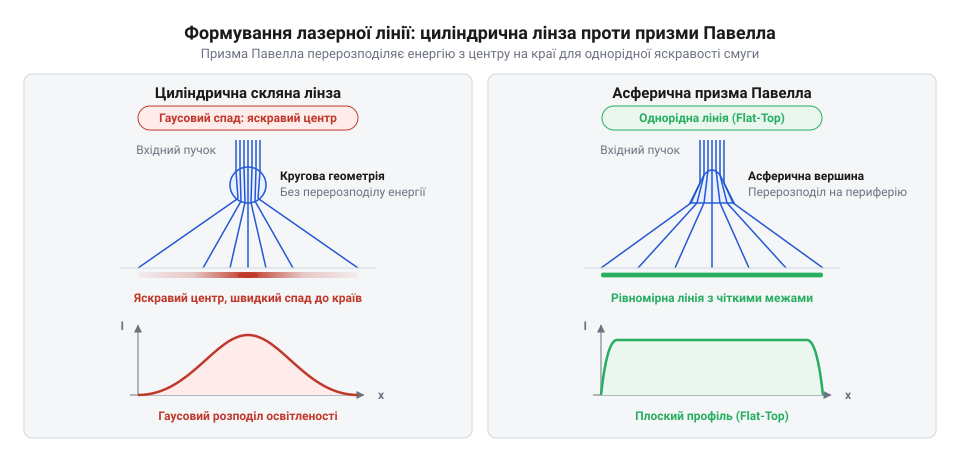
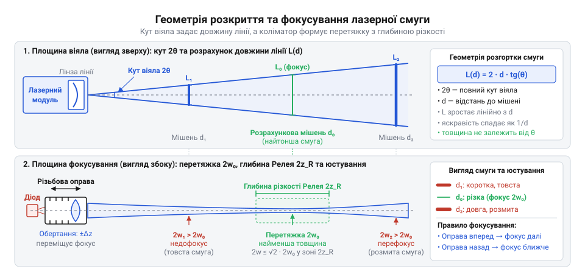
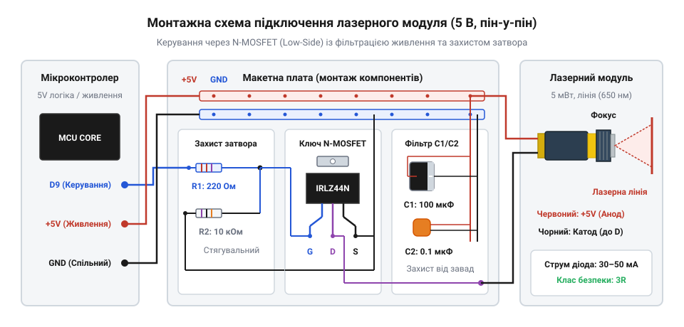

# Лазерний модуль з лінією (5 мВт, з фокусом)

<preknowlist>
- [KY-008 — лазерний модуль](root:cat-hw-actuators/ky-008-laser) — базова будова напівпровідникового лазерного випромінювача, пряме падіння напруги на лазерному діоді та ризик теплової деградації кристала при тривалому безперервному живленні
</preknowlist>

## Проблема безконтактного контролю площини та профілю: чому точкового лазера або розсіяного освітлення недостатньо

Коли автоматизована виробнича лінія має перевірити площинність штампованої деталі, спрямувати зварювальний пальник уздовж криволінійного стику листів чи зафіксувати висотний профіль дошки на конвеєрі, постає потреба безконтактно оцінити геометрію рельєфу в просторі. Якщо спрямувати на поверхню звичайний точковий лазер (від англійського акроніма @@en|LASER@@, *Light Amplification by Stimulated Emission of Radiation* — підсилення світла за допомогою стимульованого випромінювання), вихідний промінь відіб'ється від однієї-єдиної точки. Оптичний датчик виміряє точну відстань до цієї точки, проте отримана координата нічого не скаже про сусідні ділянки праворуч, ліворуч чи далі вздовж поверхні.

Щоб відтворити просторовий профіль або площину за допомогою точкового променя, цей промінь доводиться переміщувати у двох координатах. Для цього застосовують електромеханічні сканатори: каретки з лінійними напрямними або поворотні гальванометричні дзеркала. Проте механічний рух породжує непереборні обмеження. По-перше, рухомі вузли мають масу й інерцію, через що швидкість вимірювання рідко перевищує кілька десятків точок на секунду. Якщо об'єкт контролю рухається конвеєром зі швидкістю метр на секунду, точкова траєкторія змазується швидкістю деталі, утворюючи просторовий перекіс вимірювальних даних. По-друге, рухомі дзеркала схильні до механічного зношування, втрачають калібрування від виробничої вібрації та суттєво здорожчують усю вимірювальну установку.

Спроба відмовитися від лазера на користь звичайної цифрової відеокамери та розсіяного освітлення (світлодіодних панелей чи прожекторів) зіштовхується з іншою фізичною перешкодою. На однорідних, темних, гладких або відблискуючих матеріалах — прокатному металі, чорній гумі, шліфованому пластику чи вологій деревині — розсіяне світло не утворює чіткого світлотіньового рельєфу. Зображення виходить пласким, без виразних перепадів яскравості. Будь-яка випадкова зміна зовнішнього освітлення в цеху (увімкнення сусіднього світильника, відкриття воріт чи спалах дуги зварювального апарата) зміщує видимі межі деталей. Алгоритми комп'ютерного зору втрачають край деталі або сприймають плями мастила й текстурні волокна за перепади висоти, оскільки 2D-кадр містить лише яскравість пікселів і позбавлений висотної координати.

Розв'язком проблеми стає перехід від точки та розсіяного освітлення до структурованого освітлення (від латинського *structura* — будова, взаємне розміщення) у формі нерухомої світлової площини. Лазерний модуль розгортає монохроматичний пучок у тонке віяло світла (англ. @@en|light sheet@@). Перетин цього світлового віяла з тривимірним об'єктом утворює на його поверхні яскраву, геометрично неперервну світлову лінію. Якщо поверхня ідеально плоска, лінія виглядає прямою; якщо ж на поверхні є канавка, сходинка, хвиля чи зварний шов, лінія фізично вигинається в просторі, точно повторюючи форму рельєфу. Оскільки лазер випромінює монохроматичне світло з фіксованою довжиною хвилі (найчастіше червоне 650 нм), перед об'єктивом камери встановлюють оптичний інтерференційний світлофільтр, який пропускає лише випромінювання лазера й повністю відсікає денне та цехове світло. Камера бачить висококонтрастну лазерну смугу навіть за яскравого навколишнього освітлення.

Перетворення просторового вигину лінії на точні висотні координати базується на методі оптичної тріангуляції (від латинського *triangulum* — трикутник; геометричний метод обчислення положення вершини трикутника за відомою базовою стороною та двома прилеглими кутами). Лазерний модуль і цифрову матричну камеру жорстко закріплюють на спільній штанзі на фіксованій відстані один від одного (базова відстань тріангуляції) під постійним кутом. Лазер спрямовує площину світла на об'єкт згори, а камера дивиться на освітлену зону збоку під кутом. Коли рельєф поверхні піднімається на висоту Δh, точка перетину лазерного віяла з об'єктом фізично зміщується в просторі назустріч камері. На матриці камери це зміщення реєструється як поперечний зсув піксельних координат лазерної лінії на величину Δy. Оскільки матриця камери складається з сотень і тисяч стовпців пікселів, один-єдиний експозиційний зліпок фіксує повний поперечний профіль поверхні вздовж усієї лінії одночасно. Система отримує тисячі просторових точок за один кадр без жодного рухомого механічного вузла.

> 🔧 **Навіщо це.**
> У роботизованих зварювальних комплексах лазерна лінія сканує стик металевих деталей за кілька сантиметрів попереду пальника. Камера під кутом вимірює зміщення лінії, обчислює геометричний центр канавки шва та коригує положення пальника в реальному часі, компенсуючи теплове ведення металу без фізичного контакту з розжареною деталлю. На автоматичних пилорамах лазерна смуга показує площину майбутнього розпилу стовбура, дозволяючи оптимізувати розкрій деревини для мінімізації відходів.

## Внутрішня будова та принципова схема модуля: від латунної гільзи до напівпровідникового кристала

Ззовні типовий 5-міліватний модуль лазерної лінії виглядає як монолітний металевий циліндр діаметром 12 мм і довжиною від 30 до 40 мм, із якого виходять два ізольовані провідники живлення. Корпус модуля виготовляють із латуні (від середньонідерландського *latoen* — сплав міді та цинку). Латунь обрана завдяки двом технологічним властивостям: вона легко піддається високоточній токарній обробці для нарізання дрібної різьби без заїдання і має високий коефіцієнт теплопровідності (близько 115 Вт/(м·К)), що дозволяє масивній металевій гільзі працювати безпосереднім радіатором для відведення тепла від напівпровідникового кристала (порівняйте з базовим точковим модулем [KY-008 — лазерний модуль](root:cat-hw-actuators/ky-008-laser)).

Усередині 12-міліметрової гільзи вздовж оптичної осі послідовно розташовані три функціональні вузли: випромінювач, плата обмеження струму та оптичний блок фокусування.

1. **Випромінювач**: напівпровідниковий лазерний діод (від грецького *di-* — двічі та *hodos* — шлях; електронний компонент із двома виводами та p-n переходом, який утворює оптичний резонатор). Діод упаковано у стандартизований металоскляний корпус @@en|TO-18@@ із посадковим діаметром фланця 5.6 мм. Основа корпусу TO-18 запресована з механічним натягом у внутрішню латунну перегородку гільзи. Це гарантує прямий тепловий контакт кристала з масивним металевим корпусом.

2. **Внутрішня плата керування струмом**: у хвостовій порожнині гільзи безпосередньо за виводами діода встановлено круглу двосторонню друковану плату (англ. @@en|PCB@@, *Printed Circuit Board*) діаметром близько 9 мм. На ній розміщено мініатюрні SMD-компоненти (англ. @@en|SMD@@, *Surface Mount Device*), які обмежують робочий струм діода на безпечному паспортному рівні. До контактних площадок плати припаяно гнучкі вивідні дроти живлення — червоний (+VCC) та чорний (GND). Задня порожнина гільзи герметизується компаундом або термостійким силіконом, що фіксує дроти й захищає пайку від вібрації та вологи.

3. **Оптичний вузол**: передня частина гільзи має внутрішню різьбу з дрібним кроком (типово M9×0.5). У цю різьбу вкручено рухому латунну оправу з коліматорною лінзою (від латинського *collimare* — спрямовувати вздовж прямої лінії; лінза, що перетворює розбіжний конус світла на паралельний пучок). Між торцем оправи коліматора та перегородкою гільзи встановлено конічну сталеву пружину стиснення. Вона постійно притискає витки різьби один до одного в одному осьовому напрямку, вибираючи люфт: без пружини оправа вільно коливалася б у зазорах канавки від вібрації, збиваючи оптичний фокус. На вихідному торці закріплено лінійний оптичний елемент — циліндричну лінзу або призму.


*Пошарова будова модуля в 12-міліметровій гільзі: металевий корпус відводить тепло від кристала TO-18, пружина усуває люфт оправи коліматора, а комбінація коліматора та вихідної лінзи перетворює розбіжне випромінювання на плоску сфокусовану смугу.*

Схемотехніка внутрішньої плати диктується специфічною фізикою напівпровідникового лазера. На відміну від звичайного світлодіода чи лампи розжарювання, лазерний кристал не можна живити від нерегульованого джерела напруги. Вольт-амперна характеристика лазера має надзвичайно низький динамічний опір і різкий злам у точці порогового струму генерації (англ. @@en|threshold current@@, `I_th`, типово 15–22 мА для червоного випромінювача на 650 нм):
- Нижче порогового струму p-n перехід працює в неефективному режимі спонтанного випромінювання: він генерує слабке некогерентне світло з мізерним оптичним ККД.
- Щойно струм перевищує `I_th`, в оптичному резонаторі починається стимульована когерентна генерація. Залежність оптичної потужності від струму стає винятково крутою: стрибок напруги живлення всього на 50 мВ здатний збільшити прямий струм на 20–30 мА.

Спроба увімкнути кристал без обмеження струму миттєво викликає катастрофічне оптичне руйнування дзеркал (англ. @@en|Catastrophic Optical Damage@@, скорочено COD). Оптична потужність виходить крізь вузьку апертуру активного шару перерізом у кілька квадратних мікрометрів. Коли локальна густина випромінювання на дзеркальній грані кристала перевищує критичну межу матеріалу (1–10 МВт/см²), поглинання фотонів на мікродефектах грані викликає локальне нагрівання. Ширина забороненої зони напівпровідника з нагріванням зменшується, поглинання світла лавиноподібно зростає, і торець резонатора плавиться за лічені наносекунди. Лазер незворотно деградує: діод продовжує споживати струм, але генерація зникає, перетворюючи його на тьмяне джерело розсіяного світла.

У бюджетних модулях потужністю 5 мВт для червоного спектра 650 нм внутрішня плата містить струмообмежувальний баластний SMD-резистор `R_ballast`. Розрахунок номіналу баластного резистора для напруги живлення `V_CC = 5.0 В`, типового прямого спаду напруги на червоному AlGaInP кристалі `V_F ≈ 2.2 В` та номінального робочого струму випромінювання `I_LD = 30 мА` (0.030 А) виконується за законом Ома для ділянки кола:

```
R_ballast = (V_CC - V_F) ÷ I_LD
          = (5.0 - 2.2) ÷ 0.030
          = 2.8 ÷ 0.030
          ≈ 93.3 Ом
```

Виробники встановлюють на плату найближчий стандартний номінал — 91 Ом або 100 Ом типорозміру 0805. У дорожчих промислових модулях замість пасивного резистора застосовують інтегральний лінійний стабілізатор постійного струму (англ. @@en|Automatic Current Control@@, ACC) або схему автоматичного регулювання потужності (англ. @@en|Automatic Power Control@@, APC), яка стабілізує оптичний вихід за сигналами зворотного зв'язку від фотодіода, інтегрованого в корпус TO-18.


*Принципова схема внутрішньої плати модуля: струм кристала обмежується баластним резистором або інтегральним стабілізатором, а металевий корпус електрично з'єднаний з анодом діода, через що зовнішня латунна гільза перебуває під потенціалом живлення +VCC.*

Критична схемотехнічна пастка стандартного модуля полягає в електричному статусі металевого корпусу. Напівпровідниковий кристал лазерного діода має два електроди: анод (від грецького *anodos* — рух угору; позитивний електрод) та катод (від грецького *kathodos* — рух униз; негативний електрод). У переважній більшості масових червоних діодів TO-18 кристал монтується p-підкладкою безпосередньо на масивну металеву основу корпусу (конфігурація @@en|case positive@@). Це робиться для того, щоб тепло від активного переходу відводилося в метал найкоротшим шляхом. За такої конструкції анод діода виявляється електрично закороченим на металеву основу TO-18.

Оскільки корпус TO-18 запресований безпосередньо в латунну гільзу модуля:
**Увесь зовнішній латунний корпус модуля перебуває під постійним електричним потенціалом напруги живлення +VCC (+5 В)!**

Якщо закріпити такий лазерний модуль у металевий кронштейн верстата з ЧПК, маніпулятора робота чи приладового шасі, які з'єднані зі спільною шиною «землі» або мінусом живлення (GND), виникає пряме коротке замикання лінії живлення 5 В на землю через корпус пристрою. Це миттєво випалює контактні провідники, перевантажує стабілізатор напруги або спричиняє аварійне вимкнення цифрового блоку керування. Тому монтаж модуля на струмопровідні конструкції припустимий виключно через діелектричні ізоляційні перехідники — пластикові втулки з поліацеталю чи капролону, надруковані на 3D-принтері тримачі з PETG або шар термозбіжної трубки високої міцності.

> 🔧 **Навіщо це.**
> Інженери, які інтегрують лазерний модуль у вимірювальні головки та верстати, застосовують діелектричні затискачі або кронштейни з анодованого алюмінію з діелектричною вставкою. Це гарантує надійне механічне позиціонування модуля та стабільне розсіювання тепла без небезпеки короткого замикання між латунним корпусом під потенціалом +5 В та заземленими металевими напрямними обладнання.

## Фізика формування світлової смуги: колімація та оптичне перетворення променя

Напівпровідниковий кристал лазерного діода не є точковим джерелом світла й не випромінює готового паралельного пучка. Випромінювання зароджується у внутрішній активній зоні p-n переходу — мікроскопічній прямокутній щілині, розміри якої суттєво відрізняються по двох поперечних координатах. У червоному лазерному діоді на довжині хвилі 650 нм товщина активного шару становить менш як 1 мкм, тоді як його ширина вздовж площини кристала сягає 3–5 мкм.

Через хвильову природу світла на вихідній прямокутній апертурі виникає дифракція (від латинського *diffringere* — розламувати, розсіювати). Що вужчий просторовий отвір, крізь який проходить електромагнітна хвиля, то ширшим стає кут її розходження. Тому симетрія випромінювання порушується від самого початку:
- У площині, перпендикулярній до переходу, де активний шар найтонший (швидка вісь, англ. @@en|fast axis@@), кут дифракційної розбіжності пучка сягає 25°–35°.
- У площині, паралельній до переходу (повільна вісь, англ. @@en|slow axis@@), через значно більшу ширину випромінювальної зони пучок розходиться повільніше — під кутом 8°–12°.

У результаті вихідний пучок являє собою широкий розбіжний еліптичний конус. Крім того, випромінювання володіє вираженим оптичним астигматизмом (від грецького *a-* — заперечна частка та *stigma* — цятка, тобто відсутність єдиної точки фокусування): уявні точки виходу хвильових фронтів для швидкої та повільної осей просторово зміщені одна відносно одної на кілька мікрометрів у глибині кристала. Якщо спрямувати такий промінь на поверхню без оптики, утвориться тьмяна асиметрична еліптична пляма з розмитими краями.

Прямолінійна спроба встановити лінійний розсіювач безпосередньо перед кристалом не працює: промені вже мають значну кутову розбіжність, і будь-яке розтягування в смугу лише помножить початкове розмиття, перетворивши лінію на широкий безформний сектор. Отримання чіткої світлової смуги вимагає двоетапної оптичної схеми: розділення задачі на попереднє вирівнювання пучка та його подальше одновимірне розгортання.

На першому етапі промінь проходить крізь коліматор (від латинського *collimare* — спрямовувати вздовж прямої лінії). Це короткофокусна асферична скляна або оптична пластикова лінза, встановлена так, щоб її передній головний фокус збігався з вихідною гранню лазерного кристала. Коліматор перехоплює розбіжні сферичні фронти та трансформує їх у квазіпаралельний пучок. Через початкову різницю кутів розходження переріз сфокусованого пучка набуває форми витягнутого еліпса, де швидка вісь формує більший діаметр, а повільна — менший.

На другому етапі в колімований еліптичний пучок вводять лінійний формувальний елемент — генератор смуги. Цей елемент повинен мати оптичну силу строго в одній площині, розгортаючи промені широким віялом, і залишатися оптично нейтральним у перпендикулярній площині, щоб зберегти мінімальну товщину лінії. Для такої розгортки застосовують два принципово різні оптичні елементи: циліндричну лінзу або асферичну призму Павелла.

Найпростішим формувачем є плоско-циліндрична лінза (від грецького *kylindros* — вал, коток) або мініатюрний скляний полірований циліндричний стрижень. У площині поперечного перерізу циліндра лінза має постійний радіус кривизни, завдяки чому заломлені промені віялоподібно розходяться в боки. Уздовж поздовжньої осі стрижня поверхня є прямолінійною: тут лінза не чинить оптичної дії, зберігаючи колімовану товщину променя.

Попри дешевизну циліндрична лінза має непереборну ваду — різку нерівномірність яскравості вздовж лінії. Вхідний колімований пучок діода має гаусів розподіл інтенсивності: густина світлового потоку максимальна строго на оптичній осі й експоненціально спадає до периферії. Оскільки циліндрична поверхня має сталий радіус кривизни, вона лінійно переносить вхідний гаусів профіль у кутовий розподіл віяла. Найпотужніший центр лазерного променя потрапляє в середину лінії, утворюючи сліпучу гарячу точку (англ. @@en|hotspot@@). Тим часом краї смуги формуються слабкими краями пучка. Додатково на плоскій мішені спрацьовує закон косинуса в кубі: крайові промені долають більшу геометричну дистанцію й падають під гострим кутом, через що освітленість на краях смуги циліндричної лінзи падає у 8–10 разів порівняно з центром.

Щоб сформувати рівномірну смугу, застосовують спеціальний оптичний елемент — призму Павелла (від грецького *prisma* — відпиляне; названу на честь канадського дослідника Яна Павелла, який винайшов її геометрію). Задня поверхня призми плоска, а вхідна являє собою асферичний циліндр із конічною вершиною на оптичній осі. Радіус кривизни поверхні призми Павелла змінний: на вершині він мінімальний, а в міру наближення до країв плавно зростає.
- Коли щільне центральне ядро гаусового пучка входить у вершину з малим радіусом кривизни, воно зазнає надзвичайно сильного заломлення й відкидається на великі кути — у крайні ділянки віяла.
- Менш інтенсивні бічні ділянки вхідного пучка проходять крізь пологі схили призми з великим радіусом кривизни, відхиляючись на помірні кути й заповнюючи середину лінії.

Завдяки примусовому перерозподілу фотонів призма Павелла повністю компенсує гаусів спад та кутові втрати на екрані. Замість куполоподібного спаду освітленості формується однорідний прямокутний п-подібний профіль (англ. @@en|flat-top@@) однакової яскравості від краю до краю з чіткими кінцями смуги.


*Оптичний хід променів крізь циліндричну лінзу та призму Павелла: циліндрична розгортка зберігає гаусів спад яскравості з пересвіченим центром і тьмяними краями, тоді як асферична призма Павелла перерозподіляє енергію на периферію для формування смуги з рівномірною освітленістю.*

> 🔧 **Навіщо це.**
> Матриця цифрової камери має обмежений динамічний діапазон (типово 8 або 10 бітів). Якщо підсвічувати вимірювану деталь дешевою циліндричною лінзою, налаштування експозиції заходить у глухий кут: витримка, достатня для розпізнавання тьмяних країв лінії, призводить до повного насичення пікселів у центрі (@@en|blooming@@) і втрати геометричного центру смуги. Зменшення витримки задля порятунку центру призводить до того, що краї смуги тонуть у темряві та шумах матриці. Призма Павелла забезпечує стабільну освітленість по всій довжині, дозволяючи знімати точний профіль виробу за один кадр.

## Геометрія проекції та механіка фокусування лінії

Лазерна лінія на поверхні не є геометричною прямою нульової товщини: через фундаментальні хвильові обмеження лазерний пучок завжди має скінченні просторові розміри в обох площинах. Поведінка смуги описується двома взаємопов'язаними оптичними параметрами: геометрією кутового розкриття віяла та дифракційним формуванням перетяжки пучка по товщині.

Генератор лінії розгортає колімований пучок на фіксований повний кут віяла (позначимо θ, англ. @@en|fan angle@@). У масових модулях кут віяла закладений геометрією вихідної призми чи лінзи і зазвичай становить 30°, 60°, 90° або 110°. Якщо модуль встановлений строго перпендикулярно до контрольованої площини на робочій відстані D, оптична вісь ділить кут розгортки на два симетричні прямокутні трикутники з кутом θ / 2. Повна довжина проєкції лінії L на площині розраховується за формулою:

```
L = 2 · D · tan(θ / 2)
```

Зі збільшенням відстані D довжина лінії зростає строго лінійно. Оскільки повна оптична потужність модуля (5 мВт) залишається сталою, зі збільшенням довжини лінії середня лінійна густина оптичної потужності (мВт на міліметр смуги) падає обернено пропорційно відстані.

У перпендикулярній площині (по товщині лінії) промінь поводиться як сфокусований гаусів пучок. Коліматорна лінза зводить промені у вузьку перетяжку пучка (англ. @@en|beam waist@@) радіуса w₀ (радіус на спаді інтенсивності до рівня 1/e², тобто повна фізична товщина смуги становить 2 · w₀). Для червоного випромінювача з довжиною хвилі λ = 650 нм мінімальна практично досяжна товщина смуги становить 0.3–0.5 мм.

Відстань уздовж оптичної осі від точки фокуса, на якій ширина смуги збільшується не більш ніж у √2 ≈ 1.414 раза порівняно з перетяжкою, задається конфокальним параметром Релея (англ. @@en|Rayleigh range@@, z_R):

```
z_R = (π · w₀²) / λ
```

Повна глибина різкості (конфокальна зона стійкої товщини лінії) охоплює діапазон 2 · z_R — від -z_R до +z_R обабіч площини фокусування.

Нижче наведено практичний розрахунок геометрії проекції для робочої відстані D = 300 мм, кута віяла θ = 60° та мінімальної товщини смуги 0.4 мм:

```
L = 2 · D · tan(θ / 2)
  = 2 · 300 · tan(60° / 2)        [підстановка робочої дистанції 300 мм та кута віяла 60°]
  = 2 · 300 · tan(30°)            [обчислення половини кута розкриття віяла]
  = 2 · 300 · 0.5774             [тангенс кута 30 градусів]
  ≈ 346.4 мм                     [повна довжина смуги на робочій площині]

w₀ = 0.4 мм ÷ 2 = 0.2 мм = 200 мкм [радіус перетяжки пучка]
λ = 0.65 мкм                     [довжина хвилі випромінювання]

z_R = (π · w₀²) / λ
    = (3.1416 · 200²) / 0.65     [підстановка радіуса перетяжки 200 мкм та довжини хвилі]
    = (3.1416 · 40000) / 0.65    [піднесення радіуса перетяжки до квадрата]
    = 125664 / 0.65
    ≈ 193.3 мм                   [конфокальний параметр Релея]

Глибина різкості = 2 · z_R
                 = 2 · 193.3 мм
                 ≈ 386.6 мм      [робочий діапазон глибини різкості]
```

Квадратична залежність параметра Релея від радіуса перетяжки w₀ розкриває фундаментальний компроміс оптики: якщо спробувати сфокусувати смугу в надтонку нитку товщиною 0.1 мм (w₀ = 50 мкм), глибина різкості впаде до мізерних 24 мм. Будь-яке мінімальне відхилення деталі призведе до різкого розмиття смуги. Тому для промислових вимірювань оптимум товщини лінії становить саме 0.3–0.5 мм, що забезпечує запас за глибиною різкості у 200–400 мм.

Щоб сумістити площину перетяжки з потрібною робочою дистанцією, модуль має механізм різьбового фокусування. Лінза коліматора закріплена в рухомій латунній оправі (англ. @@en|threaded barrel@@) із дрібним кроком різьби M9×0.5 (осьовий зсув 0.5 мм на повний оберт).

Між оправою лінзи та перегородкою гільзи встановлено конічну демпферну пружину вибірки люфту. Вона постійно підтискає різьбу в одному осьовому напрямку, повністю компенсуючи технологічні зазори. Обертання передньої оправи змінює фізичну дистанцію між кристалом і лінзою: зміщення лінзи всього на 0.1 мм зміщує площину фокуса вздовж робочої осі на 200–400 мм. Після оптичного налаштування положення оправи на різьбовий стик наносять краплю рознімного фіксатора різьби для захисту від збивання вібраціями верстата.


*Геометрія лазерної смуги: розгортка пучка на кут віяла θ визначає довжину лінії L на робочій відстані D, а регулювання коліматора формує мінімальну товщину перетяжки 2·w0 з глибиною різкості в межах подвійного параметра Релея 2·z_R.*

> 🔧 **Навіщо це.**
> В оптичній тріангуляції точність вимірювання глибини прямо пропорційна різкості лінії. Алгоритми знаходження енергетичного центра ваги визначають координату смуги з субпіксельною точністю до 0.05 пікселя, якщо сфокусована лінія товщиною 0.3 мм проектується на 3–4 пікселі з крутим градієнтом яскравості. Якщо ж через розфокусування товщина лінії зростає до 1.5–2.0 мм, проекція розмазується на 20–30 пікселів, вершина піку згладжується шумами, а похибка визначення рельєфу зростає в 5–10 разів.

## Апаратна комутація: узгодження з мікроконтролером і фільтрація

Номінальний струм споживання 5-міліватного модуля лазерної лінії становить від 30 до 40 мА. Це унеможливлює його пряме підключення до ліній введення-виведення цифрових мікроконтролерів. Безпечний струмовий ліміт одного виводу GPIO для платформ ATmega становить до 20 мА, а для сучасних 3.3-вольтових процесорів STM32 або ESP32 — лише 8–12 мА. Спроба увімкнути лазер безпосередньо від цифрового виводу викликає термічне перевантаження вихідних транзисторів буфера мікроконтролера, просідання напруги живлення процесорного ядра та поступову деградацію каналу GPIO.

Для безпечного та швидкодіючого перемикання лазера застосовують зовнішній комутатор на базі низькостороннього ключа (англ. @@en|low-side switch@@). N-канальний польовий транзистор (від англійського *transfer* — переносити та *resistor* — опір; скорочення @@en|MOSFET@@ від @@en|Metal-Oxide-Semiconductor Field-Effect Transistor@@) вмикається в розрив між мінусовим провідником живлення навантаження (чорним проводом модуля) та спільною шиною «землі» (GND). Позитивний провідник лазера (червоний) підключається безпосередньо до лінії живлення +5 В.

Перевага низькостороннього ключа полягає в тому, що напруга керування прикладається між затвором і землею схеми (витоком транзистора). Це дозволяє надійно відмикати ключ логічними рівнями як 5 В, так і 3.3 В без додаткових підсилювачів або мікросхем зсуву рівня. Для схеми обирають польові транзистори з логічним рівнем керування (англ. @@en|Logic-Level N-channel MOSFET@@, наприклад 2N7000, BSS138 для струмів до 100 мА або IRLML2502, IRLZ44N з великим запасом по потужності). Поріг відкривання затвора таких компонентів становить 1.0–1.8 В, що забезпечує їхній перехід у режим повного насичення з відкритим опором каналу менш як 0.1 Ом навіть від виводу 3.3 В.


*Принципова електрична схема підключення модуля до мікроконтролера через низькосторонній N-MOSFET з логічним керуванням, захисною RC-обв'язкою затвора та фільтрами живлення.*

Безвідмовна робота комутатора вимагає обов'язкової захисної обв'язки затвора та фільтрації шини живлення лазера:

1. **Струмообмежувальний резистор у колі затвора** (номінал 100 Ом). Затвор польового транзистора ізольований найтоншим шаром оксидного діелектрика і володіє власною вхідною ємністю (типово 50–150 пФ). У момент появи керуючого фронту розряджена ємність поводиться як коротке замикання. Без обмежувального опору імпульсний струм перезаряджання перевищує 80–100 мА, завдаючи струмового удару вихідному каскаду мікроконтролера та збуджуючи високочастотний дзвін (англ. @@en|gate ringing@@) через паразитну індуктивність доріжок. Резистор 100 Ом обмежує піковий струм на безпечному рівні близько 25–30 мА.

2. **Стягувальний резистор на затворі** (номінал 10 кОм) між затвором і шиною GND. Під час старту живлення, скидання мікроконтролера або прошивки завантажувача виводи GPIO перебувають у стані високого імпедансу (від латинського *impedire* — перешкоджати; стан Hi-Z). У цей час відірваний затвор працює як антена, накопичуючи статичні заряди та наведення від сусідніх кіл. Це здатне викликати випадкове відкривання транзистора. Стягувальний резистор надійно притискає затвор до 0 В, запобігаючи неконтрольованому спалахуванню лазера в очі персоналу до повної ініціалізації керуючої програми.

3. **Блокувальні фільтрувальні конденсатори** (від латинського *condensare* — згущувати, ущільнювати) паралельно шині живлення модуля. Керамічний конденсатор ємністю 0.1 мкФ з низьким еквівалентним послідовним опором (ESR) монтують безпосередньо біля точок підключення модуля: він шунтує високочастотні завади. Паралельно йому встановлюють електролітичний конденсатор ємністю 10 мкФ: він компенсує стрибок струму 35 мА у момент різкого відкривання ключа, не дозволяючи просідати загальній напрузі живлення цифрової частини.


*Монтажна схема з'єднання компонентів: вивід стоку комутує мінусовий провід модуля, а латунний циліндр під потенціалом +5 В ізолюється діелектричним кріпленням від металевих частин верстата.*

При практичному монтажі схемы дотримуються суворої топології:
- Витік (Source) транзистора підключається до спільної шини GND.
- Стік (Drain) з'єднується з чорним проводом живлення модуля (GND/катод діода).
- Червоний провід живлення модуля підключається до плюсової лінії живлення +5 В.
- Фільтрувальні конденсатори 0.1 мкФ і 10 мкФ підключаються між шиною 5 В і землею GND поруч із точками живлення модуля.
- Якщо лазер живиться від окремого блока живлення, мінусовий провід зовнішнього джерела обов'язково об'єднується зі схемною землею мікроконтролера в одній спільній точці.

Окрему увагу приділяють механічній ізоляції латунного корпусу. Оскільки внутрішній анод діода з'єднаний із гільзою, зовнішній метал модуля перебуває під постійним потенціалом +5 В. Конструкція кронштейна вимагає застосування полімерних діелектричних втулок для запобігання короткому замиканню лінії живлення на заземлену станину.

> 🔧 **Навіщо це.**
> Застосування апаратного транзисторного ключа з повноцінною обв'язкою та фільтрацією перетворює модуль на керований промисловий актуатор: схема усуває ризик апаратного зависання мікроконтролера від імпульсних завад, захищає очі персоналу від хаотичних спалахів під час перезавантаження процесора та забезпечує мікросекундну точність перемикання для систем оптичної інспекції.

## Регламент безпеки класу 3R та захист очей

Звичайна світлодіодна лампа потужністю 5 Вт розсіює світло рівномірно на всі боки, тому зіниця людини вловлює лише крихітну частку випромінювання, безпечну для зору. Натомість лазерний модуль потужністю 5 мВт випромінює в тисячу разів менше енергії, проте ця енергія сконцентрована у вузькому когерентному пучку з мізерною кутовою розбіжністю. Рогівка та кришталик ока працюють як збиральна оптична система з високим коефіцієнтом оптичного підсилення: вони фокусують майже паралельний промінь у мікроскопічну пляму на сітківці (від латинського *retina*, похідного від *rete* — сітка) діаметром лише 10–20 мкм. У цій точці густина оптичної потужності зростає в сотні тисяч разів, сягаючи кіловатів на квадратний сантиметр. Оскільки сітківка повністю позбавлена больових рецепторів, оператор не відчуває болю в момент опромінення. Людина фіксує лише сліпучий спалах, після якого на світлочутливих клітинах макули утворюється термічний опік із незворотною сліпою плямою в полі зору (скотомою).

За міжнародним стандартом IEC 60825-1 випромінювачі видимого діапазону (довжина хвилі від 400 до 700 нм) потужністю від 1 до 5 мВт класифікуються як клас 3R. Цей клас посідає граничне положення: випромінювання вважається умовно безпечним лише за умови спрацьовування природного рефлексу кліпання (від латинського *reflexus* — повернений назад; англ. @@en|blink reflex@@), який автоматично змикає повіки та відводить око за час приблизно 0.25 секунди (250 мс).

Для розгорнутої лінії, що падає на матову шорстку поверхню, рефлекс кліпання гарантує надійний захист: світловий потік 5 мВт розподіляється вздовж лінії завдовжки у десятки сантиметрів і розсіюється дифузно в усіх напрямках. Зіниця діаметром 7 мм уловлює менш як 0.1 мВт потужності, а лінія фокусується кришталиком у протяжний відрізок на сітківці, через що локальне опромінення не досягає гранично допустимого рівня.

Проте природний захист повністю безсилий у двох аварійних випадках:

1. **Прямий нерозгорнутий пучок**. Під час зняття або викручування коліматора під час юстування, а також при механічному пошкодженні вихідної лінзи випромінювання виходить назовні у вигляді вузького променя діаметром 1–2 мм. Якщо цей пучок потрапляє безпосередньо в зіницю, уся потужність 5 мВт фокусується в точку на сітківці: за 0.25 с поглинається енергія 1.25 мДж, що спричиняє миттєвий термічний опік до завершення руху повіки.

2. **Дзеркальне відбиття** (англ. @@en|specular reflection@@). Коли смуга падає на полірований метал, хромований вал, глянцеве скло чи наручний годинник оператора, промінь відбивається майже без втрат потужності (80–95%) і летить у непередбачуваному напрямку. Такий відблиск зберігає високу просторову когерентність і завдає опіку сітківці, застаючи око під кутом.

Під час пусконалагодження та калібрування стендів персонал зобов'язаний носити захисні оптичні окуляри. Головний параметр захисного світлофільтра — оптична густина (англ. @@en|optical density@@, OD, від латинського *densus* — густий), яка виражає логарифмічний ступінь ослаблення світла на довжині хвилі 650 нм: `OD = -log₁₀(T)`. Для повного захисту обирають окуляри з показником OD 2+ (ослаблення щонайменше у 100 разів, що знижує потужність пучка 5 мВт до безпечних 0.05 мВт). Для оптичного юстування товщини лінії використовують юстувальні окуляри з OD 1.5–2.0: вони послаблюють надлишок випромінювання до рівня безпечного світлодіода, дозволяючи бачити положення смуги на мішені, і мають високий коефіцієнт пропускання видимого світла (VLT 30–50%) для решти спектра.

Для пасивного глушіння паразитного випромінювання стенди обладнують світлопоглинальними пастками (англ. @@en|beam dump@@). Звичайний плоский чорний екран під гострим кутом відбиває 4–8% світла за законами Френеля. Надійна пастка являє собою порожнистий металевий конус або клин із кутом 15°–25° з анодованого алюмінію з глибоким матовим чорнінням. Завдяки багаторазовому внутрішньому відбиттю від звужених стінок пастка поглинає понад 99.9% енергії лазера, перетворюючи світловий потік на тепло.

Усі промислові вимірювальні установки закривають світлонепроникними кожухами із кінцевими вимикачами блокування — інтерлоками (від англійського @@en|interlock@@ — взаємне блокування). Критичне схемотехнічне правило безпеки: **інтерлок реалізують виключно апаратно в розрив провідника живлення +VCC модуля**. Якщо кінцевик кришки завести на пін мікроконтролера й вимикати лазер через прошивку, будь-яке зависання ядра або збій програми від електромагнітної завади залишить відкритим польовий транзистор, і при знятті захисного кожуха лазер продовжить випромінювати світло в очі людині. Апаратний розрив лінії живлення механічно знеструмлює діод за мілісекунди незалежно від стану прошивки.

Організація безпечної робочої зони вимагає виконання регламенту:
- Оптична вісь лазера не повинна пролягати в діапазоні висоти очей сидячої чи стоячої людини (заборонений інтервал 1.2–1.7 м від підлоги); випромінювання спрямовують зверху вниз.
- Усі елементи кріплення повинні мати матове чорніння; операторам заборонено працювати з полірованими інструментами або прикрасами.
- Стенд позначають знаком лазерної небезпеки класу 3R за IEC 60825-1 та світлодіодним індикатором роботи, підключеним паралельно лазерному діоду після контактів інтерлоку.

> 🔧 **Навіщо це.**
> Інженерні заходи лазерної безпеки — апаратне розмикання лінії живлення кінцевиками інтерлоку, спрямування променя зверху вниз у конічні пастки та використання юстувальних окулярів — унеможливлюють травмування сітківки персоналу під час налаштування та експлуатації промислових профілометрів, забезпечуючи відповідність обладнання стандарту IEC 60825-1.
