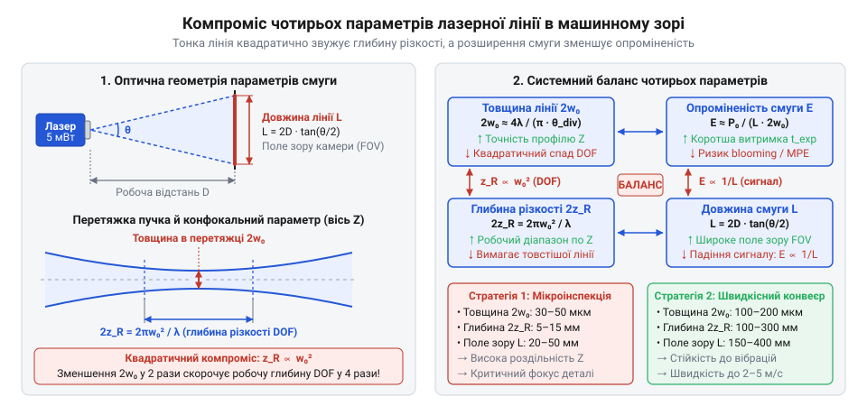
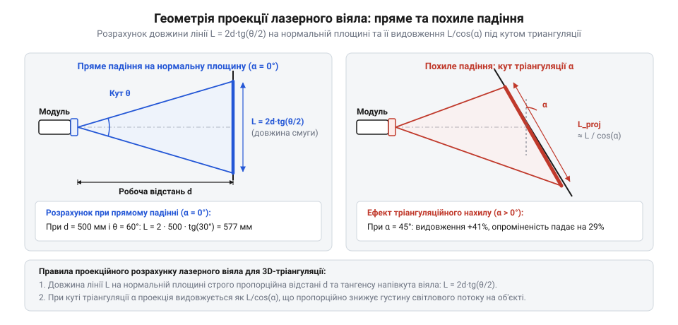
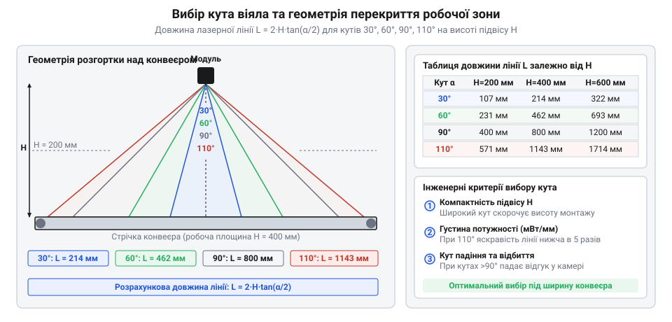
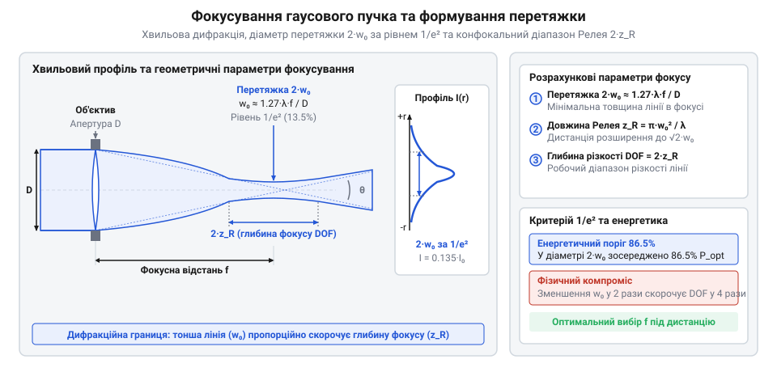
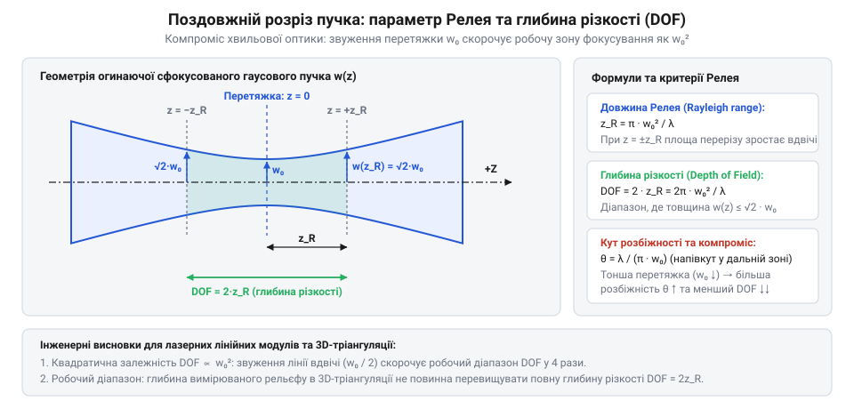
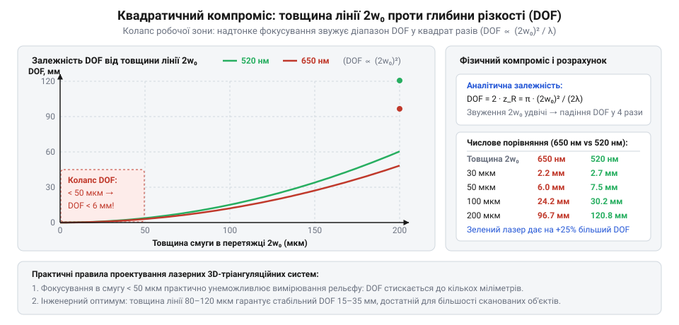
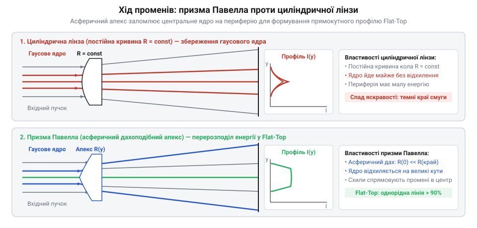
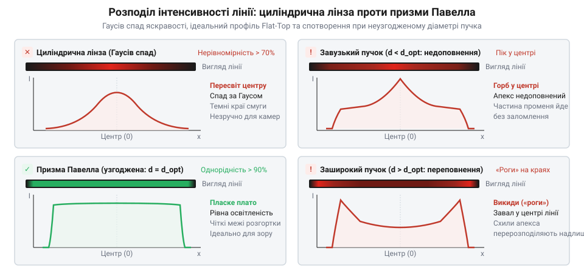
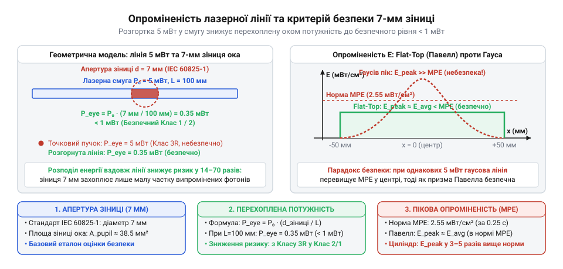
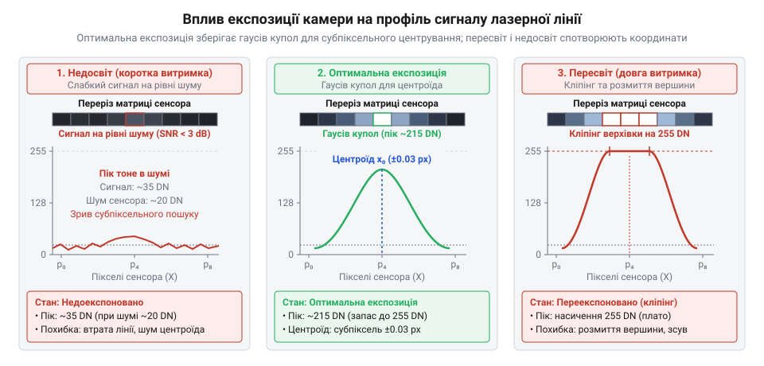

# Лазерний модуль з лінією (5 мВт, з фокусом)

<preknowlist>
- [KY-008 — лазерний модуль](root:cat-hw-actuators/ky-008-laser) — базовий принцип роботи напівпровідникового лазерного діода, поняття колімованого променя, оптична потужність 5 мВт та первинні вимоги до безпеки очей під час роботи з лазерами
</preknowlist>

## Пастка інтуїтивного підходу в лазерній тріангуляції

Тріангуляційне сканування (від латинського @@la|triangulum@@ — трикутник) тривимірного рельєфу спирається на базову оптичну схему: сфокусована світлова лінія проектується на деталь, а цифрова камера під кутом фіксує вигин цього світлового сліду на нерівностях поверхні. За зміщенням пікселів сенсора геометрично обчислюється висота кожної точки рельєфу. Коли розробник збирає перший прототип на базі звичайного точкового лазерного діода (наприклад, [KY-008](root:cat-hw-actuators/ky-008-laser)) і додає циліндричну скляну лінзу для перетворення точки на лінію, система дає збій на першому ж реальному виробі.

Перша перешкода — катастрофічна нерівномірність освітленості. Звичайна циліндрична лінза розгортає промінь нерівномірно: центральна ділянка зберігає первинну високу густину енергії вихідного гаусового пучка, тоді як на краях яскравість стрімко спадає. Коли час накопичення заряду матриці налаштовують під слабкі краї лінії, центральна область потрапляє в глибокий пересвіт. Виникає насичення кремнієвих комірок із розтіканням заряду на сусідні елементи (англ. @@en|blooming@@). Замість тонкого треку із чітким піком інтенсивності сенсор бачить широке плато з обрізаною амплітудою. Алгоритми субпіксельного детектування хребта лінії, такі як [алгоритм Штегера](root:sf-visual/stege-line-extraction), втрачають математичну можливість визначити положення максимуму з субпіксельною точністю: похибка позиціювання зростає у десятки разів. Якщо ж зменшити експозицію задля порятунку центру, фланги лінії зникають у темновому шумі матриці, позбавляючи сканер можливості вимірювати краї деталі.

Друга перешкода — втрата фокусування при найменшій зміні відстані до деталі. Прагнучи підвищити просторову роздільну здатність системи, розробник інтуїтивно намагається зробити смугу якомога тоншою. Він підкручує коліматор (від латинського @@la|collimare@@ — спотворене @@la|collineare@@, спрямовувати по прямій) і фокусує пучок у перетяжку товщиною 50 мкм. На фіксованій калібрувальній пластині лінія виглядає ідеально різкою. Проте щойно на конвеєрі з'являється деталь зі сходинкою висотою в кілька міліметрів, лінія на верхній або нижній грані розпливається у широку пляму.

Причина полягає у дифракції (від латинського @@la|diffractio@@ — розламування, огинання хвилями перешкод): фундаментальні закони хвильової оптики забороняють існування нескінченно тонких паралельних світлових пучків. Що сильніше стиснуто перетяжку, то ширшим стає кут дифракційної розбіжності променя за її межами. Ділянка вздовж осі поширення, на якій лінія зберігає прийнятну різкість — глибина різкості (англ. @@en|depth of field@@, скорочено @@en|DOF@@) — зменшується пропорційно квадрату товщини перетяжки. Затискаючи лінію до мікронних розмірів, інженер власноруч скорочує робочий діапазон глибини вимірювача до величини, меншої за рельєф деталі.

Спроби вирішити ці проблеми інтуїтивно ведуть у глухий кут:
- Підвищення оптичної потужності: заміна стандартного діода 5 мВт на випромінювач 50 або 100 мВт не вирівнює спад яскравості на краях, але різко піднімає густину фотонного потоку в центрі перетяжки. Пристрій миттєво переходить із допустимого для відкритого обладнання класу лазерної безпеки 2/3R у небезпечний клас 3B за нормативами IEC 60825-1. Навіть дифузне відбиття такого променя від полірованого металу або пластику стає прямою загрозою для зору оператора й вимагає повної герметизації зони вимірювання світлонепроникним кожухом з кінцевими блокуваннями.
- Додаткове затискання оптичної апертури (від латинського @@la|apertura@@ — отвір): спроба перекрити краї променя діафрагмою відсікає корисну енергію, посилює дифракційні шуми й катастрофічно зменшує співвідношення сигнал/шум на приймальній матриці.

> 🔧 **Навіщо це.**  
> Спроба створити оптичний сканер методом випадкового підбору компонентів марнує час: зменшення товщини лазерної лінії неминуче скорочує діапазон вимірюваних висот, а нарощування потужності засліплює матрицю та виводить прилад за межі промислової безпеки. Робочий проєкт починають із розрахунку балансу чотирьох параметрів під конкретне поле зору та допуск точності.

Побудова метрологічно точного тріангуляційного сенсора вимагає суворого узгодження чотирьох взаємопов'язаних параметрів оптичної схеми:
1. Лінійні габарити лінії: довжина розгортки смуги на робочій відстані, яка повинна перекривати задану ширину виробу без виходу світлового поля за межі поля зору об'єктива камери.
2. Дифракційна товщина смуги: ширина світлового хребта в площині перетяжки, яка задає граничну роздільну здатність системи вздовж координати профілю.
3. Глибина різкості: поздовжній робочий інтервал (конфокальний параметр Релея), у межах якого розширення пучка не перевищує розміру пікселя камери, приведеного до площини об'єкта.
4. Фотометрична опроміненість і просторовий розподіл енергії: поверхнева густина потужності вздовж усієї довжини смуги, яка забезпечує роботу світлочутливої матриці без насичення в центрі й завалу в шум на краях, укладаючись у норми безпеки незахищеного ока.


*Схема балансу чотирьох параметрів лазерної лінії: довжини віяла, дифракційної товщини, конфокального параметра глибини різкості Релея та допустимої опроміненості камери.*

## Геометрія розгортки світлового віяла та проекція смуги

Формування лазерної лінії базується на анізотропній трансформації вихідного променя: оптична система залишає пучок сфокусованим в одній площині й одночасно розгортає його в іншій. Колімований промінь лазерного діода має круглий або еліптичний поперечний переріз із радіусом близько одного міліметра. Коли цей промінь проходить крізь оптичний елемент із циліндричною або спеціальною асферичною кривиною (наприклад, призму Павелла), хвильовий фронт викривляється лише вздовж однієї осі. У площині кривини оптичні промені заломлюються під кутами, що розходяться, утворюючи плаский тривимірний світловий сектор — віяло з повним кутом розкриття `θ` (англ. @@en|fan angle@@).

При перпендикулярному падінні центрального променя на поверхню спостереження світлове віяло розсікається площиною симетрично. Нехай `d` — робоча відстань від вершини розсіювача до поверхні об'єкта вздовж оптичної осі. Оскільки віяло симетричне відносно центрального променя, бісектриса ділить повний кут `θ` на два рівні півкути `θ / 2`. Центральний промінь довжиною `d` править за катет двох прямокутних трикутників, а половини проєктованої смуги — за протилежні катети.

Довжину проекції половини лінії визначають через тангенс півкута розкриття:
```
L / 2
= d · tg(θ / 2)          [означення тангенса в прямокутному трикутнику]
L
= 2 · d · tg(θ / 2)      [множення обох частин рівності на 2]
```


*Геометрична схема розгортки лазерного віяла з кутом розкриття θ на робочій відстані d: симетрична смуга довжиною L при перпендикулярному падінні та нелінійне асиметричне видовження плечей L₁ і L₂ при похилому куті тріангуляції α.*

У [тріангуляційній вимірювальній схемі](root:hw-sensing/laser-triangulation-geometry) оптична вісь модуля рідко спрямована суворо під кутом `90°` до поверхні. Щоб камера могла реєструвати зміщення смуги, площину об'єкта або сам модуль встановлюють під кутом нахилу `α` (тріангуляційний кут між оптичною віссю променя та нормаллю до поверхні об'єкта у площині розгортки лінії). При такому падінні поверхня перетинає світлове віяло косо, через що довжина проєкції збільшується, а сама лінія стає асиметричною відносно точки падіння центрального променя.

Нехай центральний промінь долає відстань `d` до поверхні. Поверхня нахилена під кутом `α` до площини, перпендикулярної до променя. Центральний промінь ділить похилу лінію на два плеча: ближче плече `L₁`, де поверхня нахилена у бік випромінювача, і віддалене плече `L₂`, де площина віддаляється від джерела.

Розглянемо трикутник для ближчого плеча `L₁`:
- Кут при вершині оптичного випромінювача дорівнює `θ / 2`.
- Кут між центральним променем і похилою поверхнею становить `90° - α`.
- Третій кут трикутника при крайній точці смуги дорівнює `180° - (θ / 2 + 90° - α) = 90° - (θ / 2 - α)`.

Зв'язок між відрізками визначає теорема синусів:
```
L₁ / sin(θ / 2)
= d / sin(180° - (θ / 2 + 90° - α))      [сума внутрішніх кутів трикутника дорівнює 180°]
= d / sin(90° - (θ / 2 - α))             [розкриття внутрішніх дужок]
= d / cos(θ / 2 - α)                     [формула зведення sin(90° - x) = cos(x)]

L₁
= d · sin(θ / 2) / cos(θ / 2 - α)        [множення обох частин на sin(θ / 2)]
```

Для віддаленого плеча `L₂` кут між центральним променем і поверхнею становить `180° - (90° - α) = 90° + α`. Кут при протилежній вершині дорівнює `180° - (θ / 2 + 90° + α) = 90° - (θ / 2 + α)`:
```
L₂ / sin(θ / 2)
= d / sin(180° - (θ / 2 + 90° + α))      [сума внутрішніх кутів трикутника дорівнює 180°]
= d / sin(90° - (θ / 2 + α))             [розкриття внутрішніх дужок]
= d / cos(θ / 2 + α)                     [формула зведення sin(90° - x) = cos(x)]

L₂
= d · sin(θ / 2) / cos(θ / 2 + α)        [множення обох частин на sin(θ / 2)]
```

Повну довжину проєкції лінії на похилій поверхні знаходять додаванням довжин обох плечей:
```
L_proj
= L₁ + L₂                                [сума довжин несиметричних плечей]
= d · sin(θ / 2) · (1 / cos(θ / 2 - α) + 1 / cos(θ / 2 + α))   [винесення спільних множників]
```

Знаменник `cos(θ / 2 + α)` для плеча `L₂` зменшується зі зростанням кута нахилу набагато швидше, ніж змінюється `cos(θ / 2 - α)`. Це створює різку просторову асиметрію: ділянка лінії на віддаленій частині деталі витягується значно сильніше за наближену. Фізичною межею існування суцільної проєкції є умова `θ / 2 + α < 90°`. Якщо сума півкута віяла та кута нахилу досягає `90°`, крайній промінь віяла стає паралельним до площини об'єкта, знаменник прямує до нуля, а довжина лінії прямує до нескінченності: смуга зривається з деталі.

**Розрахунок проєкції лазерної лінії для робочої відстані d = 300 мм, повного кута віяла θ = 60° та кута тріангуляційного нахилу α = 30°:**
```
L_нормальне
= 2 · 300 · tg(60° / 2)                  [формула прямої проекції]
= 600 · tg(30°)                          [обчислення кута]
= 600 · 0.5774                           [значення tg(30°)]
= 346.4 мм                               [довжина смуги на перпендикулярній площині]

L₁
= 300 · sin(30°) / cos(30° - 30°)        [підстановка параметрів для наближеного плеча]
= 300 · 0.5 / cos(0°)                    [обчислення тригонометричних функцій]
= 150 / 1.0                              [значення cos(0°)]
= 150.0 мм                               [довжина плеча у бік нахилу до джерела]

L₂
= 300 · sin(30°) / cos(30° + 30°)        [підстановка параметрів для віддаленого плеча]
= 300 · 0.5 / cos(60°)                    [обчислення тригонометричних функцій]
= 150 / 0.5                              [значення cos(60°)]
= 300.0 мм                               [довжина плеча у бік віддалення від джерела]

L_proj
= L₁ + L₂                                [додавання несиметричних плечей]
= 150.0 + 300.0                          [підстановка значень]
= 450.0 мм                               [загальна довжина проєкції смуги на деталі]
```
Нахил площини на `30°` збільшив загальну довжину лінії з `346.4` мм до `450.0` мм (майже на `30%`), водночас створивши двократну асиметрію: віддалене плече `L₂ = 300.0` мм рівно вдвічі довше за наближене `L₁ = 150.0` мм. Оскільки вся оптична потужність віяла розподіляється по цій видовженій смузі, густина енергії на віддаленому плечі падає значно сильніше, ніж при нормальному падінні.

> 🔧 **Навіщо це.**  
> Знання нелінійного видовження смуги рятує від помилки вибору розсіювача: якщо обрати завеликий кут віяла «із запасом», віддалене плече смуги при тріангуляційному нахилі вийде за межі деталі й поля зору камери. Оптична потужність лазера розсіється марно, а освітленість робочої зони впаде нижче порогу чутливості сенсора.

Кут віяла обирають під геометрію сканера серед типового ряду стандартизованих оптичних насадок:
- `30°`: вузьке віяло для великих дистанцій (`d > 600...1000` мм) або вузьких зон контролю. Забезпечує максимальну концентрацію енергії на одиницю довжини та мінімальні спотворення при нахилі.
- `60°`: універсальний кут для конвеєрних систем середнього радіуса дії (`d ≈ 250...500` мм), де потрібна смуга довжиною `300...600` мм без критичного падіння яскравості на краях.
- `90°`: широке віяло для компактних сенсорів із невеликою висотою підвісу (`d ≈ 150...300` мм). Довжина нормальної лінії дорівнює подвійній відстані `L = 2 · d`, проте при нахилі `α ≥ 30°` кут `θ / 2 + α` досягає `75°`, що викликає стрімке розтягнення віддаленого краю.
- `110°` (або `120°`): ультрашироке віяло для вимірювань в обмеженому просторі впритул до деталі (`d < 150` мм). Допускає роботу лише при мінімальних кутах нахилу (`α < 15...20°`), інакше виникає оптичний зрив променя за горизонт площини.


*Діаграма перекриття робочої зони для стандартних кутів розсіювача 30°, 60°, 90° і 110° на різній висоті підвісу сенсора над конвеєром.*

## Хвильова дифракція та фокусування лінії в перетяжку

У геометричній оптиці світлові промені поширюються прямолінійно. Ідеальна збиральна лінза заломлює паралельний пучок променів і зводить його в нескінченно малу геометричну точку у фокальній площині — поперечний розмір такого фокуса дорівнює нулю. Якби це спрощене уявлення відповідало дійсності, інженерні лазерні вимірювачі не мали б фізичних обмежень точності: узявши стандартний випромінювач на зразок [лазерного модуля KY-008](root:cat-hw-actuators/ky-008-laser) та сфокусувавши його лінзою, можна було б отримати нескінченно тонку лінію. Така смуга в тріангуляційній системі давала б змогу виявляти мікротріщини завширшки в кілька нанометрів і вимірювати рельєф із довільною деталізацією.

Реальний дослід показує зовсім іншу поведінку. Якщо обертати різьбову оправу фокусувального об'єктива лінійного лазерного модуля, спроєктована лінія спочатку тоншає, досягає виразного мінімуму, але подальше закручування не робить її ще тоншою: смуга знову розмивається і розширюється. Навіть якщо взяти прецизійно виготовлену скляну лінзу без геометричних аберацій, товщина лінії в зоні фокуса ніколи не стає меншою за кілька десятків мікрометрів.

Причина криється у хвильовій природі світла. Лазерний промінь є не сукупністю незалежних траєкторій-променів, а просторово когерентною електромагнітною хвилею. Проходячи крізь світлову апертуру (лат. *apertura* — отвір) лінзи скінченного діаметра `D`, хвильовий фронт обмежується її краями й зазнає дифракції (лат. *diffractio* — розламування, огинання хвилями перешкод). Кожна точка обмеженого хвильового фронту стає джерелом вторинних сферичних хвиль, які інтерферують між собою. Ця хвильова інтерференція розмиває геометричний фокус і встановлює фундаментальну дифракційну межу, нижче якої пучок стиснути неможливо.

У монохроматичних напівпровідникових лазерних діодах просторовий розподіл амплітуди поля відповідає фундаментальній поперечній моді @@en|TEM₀₀@@ (лат. *transversus* — поперечний). Таке випромінювання називають гаусовим пучком (від імені німецького математика Карла Фрідріха Ґаусса, @@de|Carl Friedrich Gauß@@), оскільки густина оптичної потужності в його поперечному перерізі спадає від оптичної осі до периферії за плавним дзвоноподібним законом нормального розподілу:

```
I(r) = I₀ · exp(-2 · r² / w²)
```

Тут:
- `I₀` — пікова опроміненість на оптичній осі пучка при `r = 0` (Вт/м²);
- `r` — радіальна відстань від оптичної осі в площині поперечного перерізу (м);
- `w` — радіус пучка за рівнем спаду інтенсивності (м).

На відміну від різкої тіні непрозорого екрана, гаусів пучок не має чіткого фізичного краю: його інтенсивність асимптотично наближається до нуля. Загальноприйнятим оптичним стандартом ширини є радіус `w`, на якому опроміненість зменшується до рівня `1/e²` від осьового максимуму:

```
I(w) / I₀
= exp(-2 · w² / w²)      [підстановка радіуса r = w]
= exp(-2)                [скорочення радіуса]
= 1 / e² ≈ 0.1353        [значення спаду інтенсивності]
```

На відстані `r = w` інтенсивність становить приблизно 13.5% від центрального піка. Усередині пучка діаметром `2·w` зосереджено рівно `1 - e⁻² ≈ 0.8647` (86.5%) усієї оптичної енергії випромінювання. Решта 13.5% припадає на плавно згасаючі бічні «крила» розподілу.

Коли колімований гаусів пучок падає на фокусувальний об'єктив із фокусною відстанню `f` та вхідною світловою апертурою `D`, лінза трансформує плаский хвильовий фронт у збіжний сферичний. Пучок звужується вздовж напрямку поширення, утворюючи найвужче місце — перетяжку променя (англ. @@en|beam waist@@). Радіус пучка в площині перетяжки позначають як `w₀`, а повна товщина лазерної лінії дорівнює `2·w₀`.

У [гаусовій хвильовій оптиці](root:ph-waves/gaussian-beam-optics) кут сходження променів після лінзи пов'язаний із числовою апертурою (лат. *numerus* — число та *apertura* — отвір). У параксіальному наближенні числова апертура визначається відношенням половини світлового діаметра до фокусної відстані: `NA = D / (2 · f)`. З іншого боку, дифракційний напівкут розходження пучка, що виходить із перетяжки `w₀`, дорівнює `θ = λ / (π · w₀)`. Зіставлення геометричного кута сходження з дифракційним кутом розходження визначає граничну товщину сфокусованої лінії:

```
2·w₀
= 2 · (λ · f) / (π · (D / 2))    [рівність кутів сходження лінзи та дифракційного розходження]
= (4 · λ · f) / (π · D)          [спрощення дробу]
= (2 / π) · (λ / NA)             [вираження через числову апертуру NA = D / (2 · f)]
```

Тут:
- `λ` — довжина хвилі випромінювання (м);
- `f` — фокусна відстань лінзи (відстань від об'єктива до площини перетяжки, м);
- `D` — світловий діаметр апертури лінзи (м);
- `NA` — числова апертура оптичного фокусувального вузла (`NA = D / (2 · f)`).


*Оптичний хід гаусового пучка крізь фокусувальний об'єктив: хвильова дифракція на апертурі лінзи обмежує сходження променів, формуючи перетяжку скінченної ширини 2·w₀ на рівні спаду інтенсивності 1/e².*

> 🔧 **Навіщо це.** Фокусувальна лінза не здатна створити нескінченно тонку смугу: дифракційна межа визначає, яку мінімальну товщину перетяжки 2·w₀ можна отримати за заданої робочої відстані f та апертури D. Знаючи це співвідношення, інженер заздалегідь оцінює, чи дозволяє оптичний модуль досягти потрібної роздільної здатності тріангуляційного вимірювання, чи необхідно збільшувати світловий діаметр об'єктива або переходити на короткохвильовий зелений лазер.

Для оцінки фізичної межі роздільної здатності розрахуємо товщину лінії для стандартних модулів формату @@en|M12@@ (зовнішня різьба оправи @@en|M12×0.5@@, світлова апертура лінзи `D = 5.0 мм`) на типовій дистанції тріангуляційного сканування `f = 150 мм`.

Розрахунок для червоного лазерного діода з довжиною хвилі `λ = 650 нм = 650 · 10⁻⁹ м`:

```
2·w₀
= (4 · (650 · 10⁻⁹) · (150 · 10⁻³)) / (π · (5.0 · 10⁻³))    [підстановка значень червоного випромінювача]
= (3.90 · 10⁻⁷) / (1.5708 · 10⁻²)                           [перемноження чисельника та знаменника]
≈ 24.8 · 10⁻⁶ м = 24.8 мкм                                   [мінімальна товщина лінії в перетяжці]
```

Розрахунок для зеленого лазерного діода з довжиною хвилі `λ = 520 нм = 520 · 10⁻⁹ м` за тих самих параметрів оптики:

```
2·w₀
= (4 · (520 · 10⁻⁹) · (150 · 10⁻³)) / (π · (5.0 · 10⁻³))    [підстановка довжини хвилі зеленого лазера]
= (3.12 · 10⁻⁷) / (1.5708 · 10⁻²)                           [перемноження чисельника та знаменника]
≈ 19.9 · 10⁻⁶ м = 19.9 мкм                                   [мінімальна товщина лінії в перетяжці]
```

Зіставлення результатів наочно показує вплив довжини хвилі:

```
(2·w₀)_зелений / (2·w₀)_червоний
= 520 нм / 650 нм
= 0.80                                                       [зелена лінія на 20% тонша за червону]
```

За однакових габаритів лінзи та робочої дистанції зелений лазер формує на 20% тоншу смугу, пропорційно підвищуючи просторову роздільну здатність оптичної системи. Якщо ж робочу відстань сканера збільшити вдвічі (наприклад, до `f = 300 мм`), дифракційна товщина червоної смуги лінійно зросте до `49.7 мкм`: на більших відстанях без збільшення апертури лінзи `D` тонку смугу втримати неможливо.

## Поздовжній профіль пучка та глибина різкості за параметром Релея

Розрахунок мінімальної товщини перетяжки підштовхує до інженерного рішення: мінімізувати фокусну відстань `f`, розширити апертуру лінзи `D` й отримати смугу завтовшки лише 15–20 мкм. Проте в практичному [тріангуляційному 3D-скануванні](root:sf-visual/triangulation-laser-scanner) вимірювані об'єкти рідко бувають абсолютно пласкими. Під час контролю деталей зі східчастим рельєфом, глибокими пазами або виступами виникає оптична проблема: на верхній площині сходинки лінія залишається ідеально різкою й тонкою, але на нижній площині (на глибині всього 10–15 мм) вона розпливається в широку бліду смугу. [Алгоритм субпіксельного детектування центру смуги](root:sf-visual/subpixel-peak-detection) втрачає точність або видає хибні координати через розмитий профіль інтенсивності.

Причина швидкої втрати фокуса полягає в геометрії поздовжнього розширення хвильового пакета. Пучок світла, стиснутий у вузьку перетяжку `w₀`, не здатний поширюватися у просторі нескінченно довгим паралельним циліндром: висока просторова локалізація викликає миттєве дифракційне розходження хвильових фронтів. Зміна радіуса пучка `w(z)` уздовж оптичної осі `z` (де `z = 0` відповідає площині перетяжки) підпорядковується гіперболічній залежності (гіпербола, грец. *hyperbole* — перебільшення, вихід за межі):

```
w(z) = w₀ · √(1 + (z / z_R)²)
```

Тут:
- `w₀` — радіус пучка в точці найкращого фокусування при `z = 0` (м);
- `z` — координата вздовж оптичної осі поширення випромінювання (м);
- `z_R` — довжина Релея (англ. @@en|Rayleigh range@@, названа на честь англійського фізика лорда Релея, @@en|Lord Rayleigh@@, Джона Вільяма Стретта).

Довжина Релея обчислюється через радіус перетяжки та довжину хвилі:

```
z_R = (π · w₀²) / λ
```

Фізичний зміст довжини Релея полягає в тому, що на осьовому зміщенні `z = ±z_R` відносно площини перетяжки радіус пучка закономірно зростає:

```
w(±z_R)
= w₀ · √(1 + (±z_R / z_R)²)    [підстановка z = ±z_R у формулу гіперболи]
= w₀ · √(1 + 1)                [ділення однакових величин]
= w₀ · √2 ≈ 1.4142 · w₀        [збільшення радіуса на 41.4%]
```

На відстані `z_R` радіус пучка збільшується в `√2` разів (приблизно на 41.4%). Оскільки площа поперечного перерізу пропорційна квадрату радіуса (`w²`), площа світлової плями подвоюється (`(√2)² = 2`). За збереження сумарного світлового потоку це призводить до падіння пікової осьової опроміненості рівно вдвічі: `I(0, ±z_R) = I₀ / 2`.

Повний поздовжній проміжок між площинами `-z_R` та `+z_R` визначає конфокальний параметр (лат. *con-* — разом та *focus* — вогнище) або робочу глибину різкості (англ. @@en|depth of field@@, DOF):

```
DOF = 2 · z_R = (2 · π · w₀²) / λ
```

Поріг розширення у `√2` разів (~41%) є загальноприйнятим інженерним допуском у машинному зорі. У межах діапазону `2·w₀ ≤ w(z) ≤ 2·w₀ · √2` купол просторової інтенсивності залишається достатньо гострим, відношення сигналу до шуму на матриці камери утримується в робочих межах, а сусідні пікселі не спотворюють визначення координати центра смуги. За межами `|z| > z_R` лінія швидко розширюється, її контраст падає, а похибка субпіксельного вимірювання лавиноподібно зростає.


*Поздовжній розріз сфокусованого пучка: гіперболічне потовщення за довжиною Релея z_R визначає глибину різкості DOF = 2·z_R, у межах якої товщина лінії не перевищує √2·w₀.*

> 🔧 **Навіщо це.** Квадратична залежність глибини різкості від товщини перетяжки створює неминучий інженерний глухий кут: зменшення товщини лінії вдвічі скорочує робочий діапазон різкості вчетверо. Для деталей із помітним рельєфом (наприклад, перепад висот 20 мм) спроба отримати надтонку лінію призведе до її розмиття на виступах; інженер мусить розраховувати перетяжку від висоти контрольованого рельєфу, а не від теоретичної межі фокусування оптики.

Квадратичний інженерний глухий кут стає очевидним, якщо виразити глибину різкості через повну товщину смуги `2·w₀`:

```
DOF
= (2 · π · w₀²) / λ
= (π / (2 · λ)) · (2·w₀)²        [вираження через повну товщину лінії 2·w₀]
```

Порівняння двох оптичних налаштувань демонструє жорстку залежність:

```
DOF₂ / DOF₁
= ((2 · π · w₀₂²) / λ) / ((2 · π · w₀₁²) / λ)    [відношення глибин різкості]
= w₀₂² / w₀₁²                                    [скорочення сталих множників]
= (w₀₂ / w₀₁)²                                   [квадрат відношення товщин]
```

Якщо товщину перетяжки зменшити вдвічі (`w₀₂ = w₀₁ / 2`), робоча зона вимірювання скоротиться в `2² = 4` рази. Якщо спробувати зробити лінію втричі тоншою — глибина різкості зменшиться в 9 разів, а десятикратне звуження скоротить робочий діапазон у 100 разів.

Простежимо цю квадратичну залежність на прикладі червоного лазера (`λ = 650 нм = 650 · 10⁻⁹ м`):

Варіант 1: надтонка лінія для мікропрофілювання (`2·w₀ = 25 мкм`, `w₀ = 12.5 мкм`):

```
z_R
= (π · (12.5 · 10⁻⁶)²) / (650 · 10⁻⁹)      [підстановка значень у формулу параметра Релея]
= (4.9087 · 10⁻¹⁰) / (6.50 · 10⁻⁷)          [обчислення значень]
≈ 0.755 · 10⁻³ м = 0.755 мм                 [довжина Релея]

DOF
= 2 · z_R
= 2 · 0.755 мм
≈ 1.51 мм                                  [робоча глибина різкості]
```

Смуга завтовшки 25 мкм має глибину різкості лише 1.5 мм: вона підходить лише для контролю плоских пластин або фольги.

Варіант 2: збалансована лінія (`2·w₀ = 50 мкм`, `w₀ = 25.0 мкм`):

```
z_R
= (π · (25.0 · 10⁻⁶)²) / (650 · 10⁻⁹)      [подвоєння товщини перетяжки]
= (1.9635 · 10⁻⁹) / (6.50 · 10⁻⁷)          [обчислення значень]
≈ 3.02 · 10⁻³ м = 3.02 мм                  [довжина Релея зросла в 4 рази]

DOF
= 2 · z_R
= 2 · 3.02 мм
≈ 6.04 мм                                  [глибина різкості зросла в 4 рази]
```

Варіант 3: лінія зі збільшеною глибиною різкості (`2·w₀ = 100 мкм`, `w₀ = 50.0 мкм`):

```
z_R
= (π · (50.0 · 10⁻⁶)²) / (650 · 10⁻⁹)      [збільшення перетяжки до 100 мкм]
= (7.8540 · 10⁻⁹) / (6.50 · 10⁻⁷)          [обчислення значень]
≈ 12.08 · 10⁻³ м = 12.08 мм                [довжина Релея]

DOF
= 2 · z_R
= 2 · 12.08 мм
≈ 24.16 мм                                 [робоча глибина різкості досягає 24 мм]
```


*Квадратична залежність глибини різкості DOF від товщини лінії 2·w₀ для червоного (650 нм) та зеленого (520 нм) випромінювачів: звуження перетяжки нижче 40–50 мкм спричиняє стрімкий колапс робочого діапазону сканування, водночас коротша довжина хвилі зеленого лазера забезпечує помітно більшу глибину різкості за однакової товщини смуги.*

Інженерний розрахунок оптичної схеми сканера завжди ведуть у зворотному напрямку: не від бажаної надтонкої лінії, а від перепаду висот вимірюваного рельєфу `Δh`:
1. Необхідну глибину різкості прирівнюють до повної висоти нерівностей виробу: `DOF_необх ≥ Δh`.
2. За довжиною хвилі та `DOF_необх` розраховують мінімально припустимий радіус перетяжки:

```
w₀_мін = √((λ · DOF_необх) / (2 · π))
```

3. Для виробу з рельєфом глибиною `Δh = 20 мм` під час роботи з червоним лазером (`λ = 650 нм`):

```
w₀_мін
= √(((650 · 10⁻⁹) · (20 · 10⁻³)) / (2 · π))    [підстановка 20 мм діапазону глибини]
= √(1.30 · 10⁻⁸ / 6.2832)                      [обчислення підкореневого виразу]
= √(2.069 · 10⁻⁹)
≈ 45.5 · 10⁻⁶ м = 45.5 мкм                     [мінімальний радіус перетяжки]

2·w₀_мін
= 2 · 45.5 мкм
= 91.0 мкм                                    [мінімально припустима товщина лінії]
```

Спроба сфокусувати цей лазер у смугу 30 мкм на рельєфі з перепадом 20 мм призведе до того, що на крайніх площинах (`|z| = 10 мм`) товщина лінії перевищить 200 мкм, руйнуючи повторюваність сканування. Вибір перетяжки 91 мкм гарантує, що у всьому 20-міліметровому діапазоні висот ширина смуги перебуватиме в жорстких межах від 91 мкм до `91 · √2 ≈ 129 мкм`, зберігаючи стабільність субпіксельного детектування профілю.

## Просторовий розподіл оптичної потужності вздовж розгорнутої лінії: циліндрична лінза та призма Павелла

Коли сфокусований лазерний промінь розгортають у світлову лінію для тріангуляційного вимірювання форми поверхні, першою інтуїтивною вимогою є однакова яскравість смуги по всій її довжині. Якщо лінія в центрі засліплює матрицю, а на краях згасає до рівня цифрового шуму, алгоритм тріангуляції втрачає межі сканованого об'єкта. Найпростіший спосіб перетворити симетричну точку в лінію — пропустити колімований пучок крізь циліндричну лінзу (грец. *kylindros* — валок, ковзан; лат. *lens* — сочевиця). Однак на практиці звичайна циліндрична оптика створює смугу із катастрофічним спадом яскравості до країв на 80–90%.

### Математична модель циліндричного розсіювача та кутовий фактор

Циліндрична лінза має кривину лише в одній площині (наприклад, по осі `x`) і лишається пласкою у перпендикулярній площині `y`. Для параксіальних променів кут відхилення `θ` лінійно залежить від поперечної координати `x`, на якій промінь входить у лінзу:

```
θ(x) ≈ x / f
```

де `f` — фокусна відстань циліндричної поверхні.

Оскільки кутове відхилення строго пропорційне вхідній координаті, кутовий розподіл оптичної сили `dP / dθ` у розгорнутому віялі прямо копіює просторовий розподіл густини потужності вихідного пучка. Якщо на лінзу падає класичний колімований гаусів пучок від напівпровідникового лазера, як-от у модулі [KY-008](root:cat-hw-actuators/ky-008-laser), із розподілом інтенсивності (лат. *intensio* — напруження) `I(x) = I₀ · exp(-2x² / w₀²)`, то кутова густина потужності набуває такого ж гаусового профілю:

```
dP / dθ ∝ exp(-2 · (θ / θ_div)²)
```

де `θ_div` — характерний кутовий радіус розкриття віяла, що відповідає радіусу пучка `w₀` на рівні спаду `1/e²`.

Коли це світлове віяло падає на пласку поверхню спостереження, розташовану на робочій відстані `z = d` перпендикулярно до оптичної осі, виникає додаткове суто геометричне згасання освітленості. Воно зумовлене одночасно трьома геометричними причинами:
1. Відстань від точки виходу до точки спостереження зростає зі збільшенням кута як `r(θ) = d / cos(θ)`.
2. Координата точки вздовж лінії на площині дорівнює `x = d · tan(θ)`. Звідси лінійне розтягнення променів на одиницю кута становить `dx / dθ = d / cos²(θ)`, тому просторова щільність падаючих променів спадає як `dθ / dx = cos²(θ) / d`.
3. Світловий пучок падає на поверхню під похилим кутом `θ` до її нормалі, що розтягує площу проєкції ще на коефіцієнт `1 / cos(θ)`.

Поєднавши кутову розгортку та геометричне проєціювання, отримуємо локальну поверхневу опроміненість (лат. *irradiare* — опромінювати) `E(x)` на пласкій мішені:

```
E(x) = (dP / dθ) · (dθ / dx) / w_y(θ)
     = (dP / dθ) · (cos²(θ) / d) · (cos(θ) / w_y0)   [геометрія косого падіння та розгортки]
     = (dP / dθ) · cos³(θ) / (d · w_y0)             [кутовий геометричний фактор cos³(θ)]
```

де `w_y0` — товщина лінії в центрі вздовж нерозгорнутої осі.

Таким чином, підсумкова опроміненість на краях смуги визначається добутком двох спадних функцій:

```
E(θ) ∝ exp(-2 · (θ / θ_div)²) · cos³(θ)
```

**Розрахунок спаду освітленості для лінії з кутом розкриття 60°:**

Для типового модуля з повним кутом розгортки `2θ_max = 60°` крайній промінь відповідає куту `θ = 30°`. Якщо апертура (лат. *apertura* — отвір) лінзи розгортає пучок до межі `1/e²`, де гаусова складова спадає до `exp(-2) ≈ 0.1353`, то відносне значення опроміненості на краю лінії становить:

```
E(30°) / E(0°)
= exp(-2) · cos³(30°)              [кутовий розрахунок для краю смуги]
= 0.1353 · (√3 / 2)³               [значення тригонометричного множника]
= 0.1353 · 0.6495                  [перемноження гаусового та кутового спаду]
≈ 0.0879                           [результат: спад до 8.8% від центру]
```

Опроміненість на краю лінії падає більш ніж на 91%. Навіть якщо вхідний пучок штучно розширити, щоб послабити гаусів спад, кутовий множник `cos³(30°) ≈ 0.65` сам по собі забирає 35% потужності на краях.

> 🔧 **Навіщо це.**
> У системах лазерної тріангуляції [root:sf-visual/laser-triangulation-sensing] матриця камери фіксує відбиту лінію для обчислення 3D-профілю поверхні за центроїдом або субпіксельною апроксимацією гаусового піка. Динамічний діапазон типового промислового CMOS-сенсора обмежений: якщо налаштувати час експозиції за яскравим центром лінії циліндричної лінзи, краї смуги проваляться нижче за рівень шуму й пропадуть із кадру. Якщо ж збільшити експозицію задля виявлення країв, центр лінії увійде в глибоке насичення (@@en|clipping@@), пік перетвориться на плоске плато, а похибка визначення координат зросте на порядок. Рівномірний розподіл енергії вздовж лінії усуває сліпі зони сканера без пересвічування центральних пікселів.

### Принцип призми Павелла та формування плаского профілю

Щоб подолати комбінований спад гаусового ядра та кутового фактора, застосовують призму Павелла (грец. *prisma* — відпиляне; названа за ім'ям канадського оптика Ієна Павелла, англ. *Ian J. Powell*).

Призма Павелла — це асферичний (грец. *a-* — заперечна частка, *sphaira* — куля) скляний оптичний елемент, чия форма перерізу нагадує дах зі скругленим гребенем — апексом (лат. *apex* — верхівка). На відміну від циліндричної лінзи з постійним радіусом кривини, радіус апекса призми змінюється неперервно:
- На оптичній осі (`x = 0`) гребінь має дуже малий радіус кривини, тобто надзвичайно високу оптичну силу заломлення.
- У міру віддалення від центру в напрямку `|x| > 0` поверхня плавно виположується і переходить у плоскі похилі грані.

За законом заломлення Снеліуса промені, які потрапляють на ділянки з більшою кривиною, зазнають сильнішого кутового відхилення. Центральні промені вхідного гаусового пучка мають найбільшу густину енергії; потрапляючи на крутий апекс, вони різко відхиляються на великі кути до периферії віяла. Натомість слабкі периферійні промені вхідного пучка потрапляють на плоскі грані даху та відхиляються помірно, заповнюючи проміжні кути.


*Хід променів крізь апекс і плоскі грані призми Павелла: на відміну від циліндричної лінзи, крутий асферичний гребінь заломлює центральне ядро пучка на периферію віяла, усуваючи провал освітленості на краях лінії.*

Асферичний профіль поверхні математично розраховують так, щоб інтегральний перерозподіл енергії формував кутову щільність потужності `dP / dθ ∝ 1 / cos³(θ)`. Після падіння на пласку поверхню цей розподіл компенсує кутове згасання і дає строго рівномірний прямокутний профіль — пласке поле (@@en|flat-top@@). Нерівномірність освітленості на 80–90% довжини лінії за використання призми Павелла зазвичай не перевищує ±5–10%.


*Розподіл інтенсивності вздовж розгорнутої лазерної лінії: монотонно спадний профіль циліндричної лінзи проти рівномірного плаского профілю призми Павелла, а також деформації лінії у вигляді центрального піка або крайових спалахів-«рогів» при відхиленні діаметра вхідного пучка від розрахункового значення.*

### Критична вимога узгодження вхідного пучка

Асферична кривина апекса призми Павелла розраховується під строго визначений діаметр вхідного колімованого гаусового пучка `d_in = 2w₀` на рівні спаду інтенсивності `1/e²`, конкретну довжину хвилі `λ` та показник заломлення скла. Якщо реальний діаметр пучка відхиляється від розрахункового значення `d_design`, енергетичний баланс перерозподілу порушується:

1. **Завузький вхідний пучок (`d_in < d_design`):**
   Енергія лазера зосереджена у надто вузькій зоні навколо осі. Промені пучка майже не досягають перехідних асферичних зон і пласких скосів призми, через що розрахунковий механізм винесення надлишку енергії на периферію не спрацьовує. У центрі розгорнутої лінії залишається надлишок світлового потоку, що створює виражений центральний пік (гарячу пляму), а краї лінії темнішають подібно до циліндричної лінзи.

2. **Заширокий вхідний пучок (`d_in > d_design`):**
   Хвости гаусового розподілу пучка виходять далеко за межі розрахункового апекса й потрапляють на плоскі грані даху. Оскільки на пласких скосах заломлення майже стале, надлишкова частка енергії з периферії пучка відхиляється у фіксовані крайні кути розкриття `±θ_max`. Це призводить до інтерференційного та геометричного накопичення потужності на самих кінцях смуги — формуються яскраві крайові спалахи-«роги» (@@en|horns@@).

**Кількісна оцінка нерівномірності та узгодження:**

Рівномірність освітленості лінії `U` у межах центральних 80% її довжини визначають як відношення мінімальної та максимальної опроміненості:

```
U = (E_min / E_max) · 100%
```

Для циліндричної лінзи з повним кутом розгортки 60° рівномірність становить:

```
U_cyl = (0.088 / 1.000) · 100% ≈ 8.8%
```

Для узгодженої призми Павелла (відхилення діаметра в межах `|d_in - d_design| / d_design ≤ 0.05`):

```
U_powell = (0.92 / 1.00) · 100% = 92%
```

Щоб досягти плаского профілю на практиці, лазерний діод оснащують регульованим коліматором [root:ph-waves/laser-beam-collimation]. Обертанням оправи об'єктива змінюють відстань від випромінювального кристала до лінзи, підганяючи поперечний розмір пучка `2w₀` на вхідній грані призми точно під паспортне значення призми (найчастіше 0.8 мм, 1.0 мм або 2.0 мм) з точністю не гірше ніж ±5%.

## Просторова густина оптичної потужності та класифікація лазерної безпеки

Колімований лазерний промінь, згенерований стандартним модулем на кшталт [KY-008](root:cat-hw-actuators/ky-008-laser), концентрує всю випромінювану потужність у вузькому пучку круглого перетину. Якщо напівпровідниковий лазерний діод випромінює потужність `P = 5 мВт` у пучок діаметром `d = 1.5 мм`, площа його поперечного перетину становить:

    A_spot = π · (d / 2)²
           = 3.1416 · (0.75 · 10⁻³)²    [площа круга]
           ≈ 1.767 · 10⁻⁶ м²            [обчислення площі в квадратних метрах]

Поверхнева густина потужності, або опроміненість (лат. @@la|irradiatio@@ — осяяння; поверхнева густина оптичного потоку, що падає на площину):

    E_spot = P / A_spot
           = 0.005 / (1.767 · 10⁻⁶)     [відношення оптичної потужності до площі плями]
           ≈ 2830 Вт/м²                 [опроміненість колімованого променя]

Майже 3 кВт/м² у пучку — небезпечна концентрація енергії. Якщо такий промінь випадково потрапляє в око людини, рогівка та кришталик фокусують майже паралельний хвильовий фронт на сітківку в дифракційну пляму діаметром усього 10–20 мкм. Локальна опроміненість на світлочутливих клітинах сітківки зростає до мегаватів на квадратний метр, спричиняючи незворотний термічний опік за мікросекунди — значно швидше, ніж людина встигає моргнути (типовий час захисного рефлексу кліпання становить 0.25 с). Через це точкові лазери потужністю 5 мВт класифікують за стандартом безпеки як небезпечний клас 3R.

Ситуація докорінно змінюється, коли той самий промінь розгортається оптичним перетворювачем (циліндричною лінзою або призмою Павелла) в лінійне віяло. На робочій відстані тріангуляції вся оптична енергія 5 мВт розподіляється вздовж лінії довжиною `L = 200 мм` (0.2 м). Товщина смуги у фокальній перетяжці дорівнює подвоєному радіусу пучка `2 · w₀ = 0.5 мм` (0.0005 м). Загальна площа світлової смуги на поверхні сканування:

    A_line = L · (2 · w₀)
           = 0.20 · 0.0005              [добуток довжини на ширину лінії]
           = 1.0 · 10⁻⁴ м²              [площа прямокутної смуги]

Середня опроміненість смуги становить:

    E_avg = P / A_line
          = 0.005 / (1.0 · 10⁻⁴)        [розподіл потужності 5 мВт по всій смузі]
          = 50 Вт/м²                    [середня просторова густина потужності]

Розтягнення пучка в лінію знизило середню густину потужності з 2830 Вт/м² до 50 Вт/м² — майже в 60 разів. А якщо лінія розгортається на більшу довжину (наприклад, 400–500 мм на робочому полі), опроміненість спадає до одиниць ват на квадратний метр, що на три-чотири порядки нижче за точковий промінь.

Однак лінія має неоднорідну густину за своєю товщиною. Упоперек лінії (по осі `y`) промінь зберігає гаусів розподіл:

    I(y) = I_peak · exp(-2 · y² / w₀²)

Якщо вздовж довжини `L` (вісь `x`) лінія сформована рівномірною призмою Павелла, сумарна потужність пов'язана з піковою опроміненістю `I_peak` інтегралом уздовж поперечної осі:

    P = L · ∫ I(y) dy
      = L · I_peak · ∫ exp(-2 · y² / w₀²) dy    [інтегрування гаусового перерізу від -∞ до +∞]
      = L · I_peak · w₀ · √(π / 2)              [використання інтеграла Пуассона]

Звідси визначаємо пікову опроміненість у центрі смуги:

    E_peak = P / (L · w₀ · √(π / 2))
           = (P / (L · 2 · w₀)) · (2 / √(π / 2))    [виділення формули середньої опроміненості E_avg]
           = E_avg · √(8 / π)                       [спрощення дробового коефіцієнта]
           ≈ 1.596 · E_avg                          [числовий зв'язок піку із середнім значенням]

За середньої опроміненості `E_avg = 50 Вт/м²` пікове значення в осьовій лінії становить `E_peak ≈ 1.596 · 50 ≈ 79.8 Вт/м²`. Навіть у найяскравішому центрі смуги густина енергії залишається в десятки разів меншою за нерозгорнутий пучок діода.


*Геометричне зіставлення площі зіниці ока зі смугою випромінювання: апертура діаметром 7 мм захоплює лише малу частку розгорнутої лінії, що радикально зменшує світлову енергію на сітківці порівняно з точковим променем.*

Оцінка безпеки для зору за міжнародним стандартом @@en|IEC 60825-1@@ базується на вимірюванні світлової енергії, яка може потрапити крізь стандартну апертуру (лат. @@la|apertura@@ — отвір) зіниці ока. Діаметр максимально адаптованої до темряви зіниці людини за стандартом фіксують величиною `d_pupil = 7 мм` (0.007 м). Площа цієї вхідної діафрагми становить:

    A_pupil = π · (d_pupil / 2)²
            = 3.1416 · (3.5 · 10⁻³)²    [площа круглої апертури діаметром 7 мм]
            ≈ 3.848 · 10⁻⁵ м²           [приблизно 38.5 мм²]

Коли око дивиться на лазерну лінію, зіниця діаметром 7 мм фізично не здатна вловити лінію цілком. Ширина лінії у перетяжці `2 · w₀ = 0.5 мм` повністю поміщається всередині зіниці (`0.5 мм < 7 мм`), але вздовж довжини смуги зіниця вирізає лише відрізок довжиною, що дорівнює її діаметру: `L_intercepted = d_pupil = 7 мм`.

Лінійна густина потужності вздовж 200-міліметрової смуги становить:

    P_lin = P / L
          = 5 мВт / 200 мм              [розподіл 5 мВт на 200 мм довжини]
          = 0.025 мВт/мм                [25 мкВт оптичної потужності на міліметр довжини]

Максимальна потужність, яка за найгірших умов (прямий погляд у площину віяла) може проникнути крізь 7-міліметрову зіницю:

    P_eye = P_lin · d_pupil
          = 0.025 · 7                   [добуток лінійної потужності на діаметр зіниці]
          = 0.175 мВт                   [175 мкВт сумарного випромінювання в оці]

Замість усіх 5.0 мВт в оптичну систему ока потрапляє лише 0.175 мВт — лише 3.5% від загальної емісії діода.

Другий фундаментальний фактор стандарту @@en|IEC 60825-1@@ — відмінність між точковим джерелом (@@en|point source@@) і протяжним джерелом (@@en|extended source@@). Коли око фокусується на лінії, зображення на сітківці формується не у вигляді мікроскопічної дифракційної плями, а у вигляді протяжної смужки. Тепло, що виділяється у пігментному епітелії сітківки під час поглинання світла, ефективно розсіюється вбік у прилеглі холодні ділянки тканини.

Для врахування цього охолодження стандарт уводить кутовий розмір джерела `α` (у мілірадіанах) та коригувальний коефіцієнт `C₆`:

    α = L / r

де `L` — видима довжина лінії, а `r` — відстань спостереження. Граничні значення стандарту становлять `α_min = 1.5 мрад` та `α_max = 100 мрад`. Якщо джерело перевищує мінімальний розмір (`α > α_min`), коефіцієнт `C₆` визначається співвідношенням:

    C₆ = α / α_min      [для α_min < α ≤ α_max]
    C₆ = α_max / α_min  [для α > α_max; 100 / 1.5 ≈ 66.7]

Гранично допустимий рівень емісії (@@en|Accessible Emission Limit@@, AEL) для безпечного спостереження безпосередньо множиться на цей коефіцієнт: `AEL_extended = AEL_point · C₆`.

Для нашого розрахункового випадку: на відстані спостереження `r = 100 мм` (0.1 м) лінія `L = 200 мм` має кутовий розмір `α = 200 / 100 = 2 рад = 2000 мрад > α_max`, тому коефіцієнт сягає верхньої межі `C₆ ≈ 66.7`. На відстані `r = 1 м` (1000 мм) кутовий розмір `α = 200 / 1000 = 0.2 рад = 200 мрад`, що також перевищує `α_max` і дає `C₆ ≈ 66.7`. Навіть на відстані `r = 3 м` кутовий розмір становить `α = 200 / 3000 ≈ 67 мрад`, що дає `C₆ = 67 / 1.5 ≈ 44.7`.

Базовий ліміт емісії для класу 1 у видимому діапазоні для точкового джерела становить 0.39 мВт. Потужність, перехоплена зіницею від лінії (0.175 мВт), уже менша за базову межу 0.39 мВт. А з урахуванням множника протяжного джерела `C₆ ≈ 66.7` допустима межа безпеки зростає до десятків міліват:

    AEL = 0.39 · C₆
        = 0.39 · 66.7                   [множення базового ліміту на коефіцієнт видовженого джерела]
        ≈ 26.0 мВт                      [допустима потужність для класу 1]

Оскільки перехоплені 0.175 мВт на два порядки менші за допустимі 26.0 мВт, лазерний модуль із лінійною оптикою переходить із небезпечного класу 3R у безумовно безпечний клас 1 (безпечний за будь-яких передбачуваних умов експлуатації) або клас 2 (безпечний завдяки природній реакції заплющування ока за 0.25 с).

> 🔧 **Навіщо це.**
> Розрахунок лазерної безпеки за геометричним фактором розгортки променя дозволяє сертифікувати промислові 3D-профілометри та системи тріангуляції за безпечними класами 1 або 2 замість небезпечного 3R. Це усуває потребу в закритих захисних кожухах, автоматичних кінцевиках блокування живлення та обов'язкових захисних окулярах для оператора, даючи змогу інтегрувати лазерний датчик безпосередньо у відкриті виробничі лінії й колаборативні роботизовані комірки.

## Фотометричний розрахунок ланцюга «лазер — поверхня — сенсор»

У системах 3D-тріангуляції спроєктована на поверхню лазерна лінія реєструється матрицею камери. Точність побудови просторового профілю безпосередньо залежить від того, наскільки безпомилково алгоритми комп'ютерного зору визначають положення центру світлової смуги в кожному стовпчику або рядку пікселів.

Для субпіксельного знаходження центру (методом енергетичного центра мас або алгоритмом виділення хребтів Штегера [steger-ridge-detection](root:sf-visual/steger-ridge-detection)) оптичний сигнал на матриці повинен мати гладкий, недеформований гаусів купол. Якщо пікселі отримують забагато світла, їхні потенціальні ями переповнюються, і пік обрізається в плоске плато насичення (кліпінг). Якщо світла замало, сигнал тоне в цифрових і теплових шумах. Щоб отримати стабільну субпіксельну точність (до 0.05–0.1 пікселя), оптичний ланцюг налаштовують так, щоб сигнал у центрі смуги заповнював 70–80% динамічного діапазону пікселя.

Коли лазерна лінія з опроміненістю `E_line` (Вт/м²) падає на шорстку поверхню об'єкта, світло розсіюється дифузно за законом косинусів Ламберта. Частка відбитого випромінювання визначається коефіцієнтом дифузного відбиття, або альбедо (лат. @@la|albedo@@ — білість, від @@la|albus@@ — білий) `ρ ∈ [0, 1]`.

У реальних вимірювальних завданнях альбедо варіюється в широких межах:
- темна вулканізована гума або чорний анодований алюміній: `ρ ≈ 0.03 – 0.08` (3–8%);
- сірий метал або необроблена деревина: `ρ ≈ 0.30 – 0.50` (30–50%);
- білий матовий пластик (поліацеталь, фторопласт) або крейдований папір: `ρ ≈ 0.80 – 0.90` (80–90%).

За умови ідеального дифузного розсіяння яскравість (лат. @@la|luminantia@@ — світність) поверхні `L_surf` є однаковою в усіх напрямках півпростору:

    L_surf = (E_line · ρ) / π           [Вт/(м²·ср), яскравість дифузного відбивача]

Об'єктив камери вловлює частину цього випромінювання через свій вхідний зіничний отвір. Параметри оптичної системи визначаються такими характеристиками:
- `F` — діафрагмове число об'єктива (@@en|f-number@@, відношення фокусної відстані до діаметра вхідної зіниці `F = f / D`, наприклад F/2.8, F/4.0, F/8.0);
- `T` — коефіцієнт оптичного пропускання об'єктива (втрати на відбиття від поверхонь скла та поглинання, типово `T ≈ 0.85 – 0.95`);
- `m` — лінійний оптичний масштаб збільшення (відношення розміру зображення на сенсорі до розміру об'єкта у просторі `m = d_sensor / d_scene`).

Для скінченної робочої відстані ефективне діафрагмове число з урахуванням збільшення становить `F_eff = F · (1 + m)`. Опроміненість у площині світлочутливої матриці камери `E_sensor` обчислюється через апертурний кут конуса променів:

    E_sensor = π · L_surf · T · sin²(θ_img)
             = π · ((E_line · ρ) / π) · T · (1 / (4 · F_eff²))     [підстановка яскравості Ламберта та чисельної апертури]
             = (E_line · ρ · T) / (4 · F² · (1 + m)²)               [спрощення: константа π скорочується]

Кожен одиничний піксель світлочутливої матриці має геометричні розміри `p × p` (наприклад, для поширених промислових сенсорів розмір сторони пікселя становить `p = 3.45 мкм = 3.45 · 10⁻⁶ м`). Площа одного пікселя:

    A_pix = p²
          = (3.45 · 10⁻⁶)²              [квадрат лінійного розміру пікселя]
          ≈ 1.190 · 10⁻¹¹ м²            [площа збирального майданчика]

Оптична потужність, яка падає на один піксель у зоні піка смуги:

    P_pix = E_sensor · A_pix            [добуток опроміненості на площу пікселя]

Під дією фотонного потоку в напівпровідниковому кремнієвому переході пікселя генеруються електрон-діркові пари (дивіться [cmos-sensor-pixel-architecture](root:hw-sensing/cmos-sensor-pixel-architecture)). Енергія одного фотона лазерного випромінювання на довжині хвилі `λ = 650 нм` становить:

    E_phot = (h · c) / λ
           = (6.626 · 10⁻³⁴ · 3.0 · 10⁸) / (6.5 · 10⁻⁷)    [стала Планка, швидкість світла та довжина хвилі]
           ≈ 3.058 · 10⁻¹⁹ Дж                              [енергія одного червоного кванта, або 1.91 еВ]

Кількість фотоелектронів, які накопичуються в потенціальній ямі пікселя за час експозиції `t_exp`, залежить від квантової ефективності `QE` (@@en|quantum efficiency@@, частка поглинених квантів, що утворили вільний заряд, типово `QE ≈ 0.50 – 0.65` для 650 нм):

    N_e = (P_pix / E_phot) · t_exp · QE
        = (E_sensor · A_pix · t_exp · QE) / E_phot

Фізична місткість потенціальної ями пікселя обмежена величиною повної ємності (@@en|full-well capacity@@, FWC). Для сучасних промислових CMOS-матриць із розміром пікселя 3.45 мкм типове значення становить `FWC ≈ 10 500 – 11 000 e⁻`. Цільове значення накопиченого заряду для надійної роботи алгоритмів становить `N_e_target = 0.75 · FWC` (75% ємності).

Звідси отримуємо формулу розрахунку оптимального часу витримки:

    t_exp = (0.75 · FWC · E_phot) / (E_sensor · A_pix · QE)

**Практичний розрахунок експозиції для промислового профілометра:**
- Пікова опроміненість лінії на сцені: `E_line = 80 Вт/м²`
- Матеріал деталі: білий матовий пластик з альбедо `ρ = 0.85`
- Оптика камери: діафрагма `F = 4.0`, пропускання `T = 0.90`, збільшення `m = 0.10`
- Сенсор: піксель `p = 3.45 мкм`, `FWC = 11 000 e⁻`, `QE = 0.60` на 650 нм

    E_sensor = (80 · 0.85 · 0.90) / (4 · 4.0² · (1 + 0.10)²)
             = 61.20 / (64 · 1.21)                             [піднесення до квадрата знаменника]
             = 61.20 / 77.44
             ≈ 0.790 Вт/м²                                     [опроміненість на поверхні кремнію]

    P_pix = 0.790 · (1.190 · 10⁻¹¹)
          ≈ 9.40 · 10⁻¹² Вт                                    [9.40 піковат на піксель]

    R_e = (P_pix / E_phot) · QE
        = (9.40 · 10⁻¹² / (3.058 · 10⁻¹⁹)) · 0.60              [швидкість фотогенерації електронів]
        ≈ 3.074 · 10⁷ · 0.60
        ≈ 1.844 · 10⁷ e⁻/с                                     [електронів за секунду]

    N_e_target = 0.75 · 11 000
               = 8250 e⁻                                       [75% повної ємності ями]

    t_exp = 8250 / (1.844 · 10⁷)
          ≈ 4.47 · 10⁻⁴ с
          ≈ 0.45 мс                                            [розрахунковий час експозиції 450 мкс]

Розрахований час експозиції 0.45 мс ідеально вкладається в цикл роботи швидкісної тріангуляційної камери: при частоті зйомки 1000 кадрів/с тривалість кадру становить 1.0 мс, тож витримка 0.45 мс залишає достатній часовий проміжок для зчитування рядків без змазування руху.

Якщо об'єкт сканування змінюється на темну гуму (`ρ = 0.05`), сигнал на сенсорі впаде в `0.85 / 0.05 = 17` разів (`E_sensor ≈ 0.046 Вт/м²`). За незмінної витримки 0.45 мс піксель накопичить лише `8250 / 17 ≈ 485 e⁻`. Для повернення сигналу до рівня 8250 e⁻ інженер мусить або збільшити витримку до `t_exp ≈ 7.6 мс` (що знизить максимальну частоту кадрів сканування до 130 Гц), або відкрити діафрагму до `F = 1.8` (`(4.0 / 1.8)² ≈ 4.9` раза більше світла), або пропорційно підвищити потужність лазера.


*Профілі інтенсивності сигналу в перетині лінії: за правильного балансу експозиції формується гладкий гаусів купол для точного пошуку центра мас, пересвіт зрізає верхівку в плоске плато й вносить систематичну похибку, а недосвіт топить корисний сигнал у цифрових шумах.*

Порушення оптичного балансу призводить до двох діаметрально протилежних спотворень вимірювального сигналу:

**Наслідки пересвіту та насичення (кліпінгу):**
Коли кількість фотоелектронів перевищує ємність ями `FWC`, аналогово-цифровий перетворювач (АЦП) камери видає граничний цифровий код (наприклад, 255 для 8-бітного або 4095 для 12-бітного сигналу).
1. Верхівка гаусового купола зрізається, утворюючи плоске плато. Алгоритм розрахунку центроїда:
   ```
   y_c = ∑ (y_i · I_i) / ∑ I_i
   ```
   спирається на симетрію спадання інтенсивності навколо максимуму. За наявності горизонтального плато центральні пікселі втрачають ваговий внесок кривини. Будь-яка природна асиметрія відбиття (нахил мікронерівностей поверхні деталі) зсуває межі плато, спричиняючи систематичну похибку розрахунку центру в 0.5–2.0 пікселя замість паспортної точності 0.05 пікселя.
2. В алгоритмах на основі другої похідної профілю (метод Штегера [steger-ridge-detection](root:sf-visual/steger-ridge-detection)) на ділянці плато друга похідна перетворюється на нуль (`∂²I/∂y² = 0`). Алгоритм або взагалі втрачає лінію, або фіксує два помилкові розщеплені ребра на краях плато.
3. За сильного перевищення заряду виникає ефект розтікання електронів (@@en|blooming@@): надлишковий заряд переливається через потенційні бар'єри в сусідні пікселі матриці, штучно розширюючи ширину лінії та безповоротно руйнуючи поперечну роздільну здатність системи.

**Наслідки недосвіту та шумів:**
Коли накопичений заряд занадто малий (`N_e < 100 e⁻`), корисний оптичний відгук стає сумірним із фундаментальними шумами сенсора:
- шумом зчитування вихідного каскаду пікселя (`σ_read ≈ 2–4 e⁻`);
- темновим струмом термічної генерації заряду;
- квантовим дробовим шумом надходження фотонів (@@en|shot noise@@), який підпорядковується закону Пуассона і має середньоквадратичне відхилення `σ_shot = √N_e`.

Співвідношення сигнал/шум (@@en|Signal-to-Noise Ratio@@, SNR) становить:

    SNR = N_e / √(N_e + σ_read²)

Якщо піковий заряд становить лише `N_e = 64 e⁻`, `SNR ≈ 64 / √(64 + 3.0²) = 64 / √73 ≈ 7.5` (менше 18 дБ). За такого співвідношення випадкові шумові флуктуації в окремих пікселях хаотично зсувають розрахований центроїд від кадру до кадру. Виникає тремтіння (@@en|jitter@@) виміряних 3D-координат, що унеможливлює прецизійний контроль шорсткості або геометрії.

Навпаки, робота в діапазоні 70–80% FWC забезпечує `SNR ≈ 8250 / √(8250 + 9) ≈ 90.8` (понад 39 дБ) і водночас залишає запас у 20–25% ями для запобігання кліпінгу на локальних спекулярних мікробліках.

> 🔧 **Навіщо це.**
> Фотометричний розрахунок ланцюга усуває здогадки під час налаштування 3D-сканера під деталі зі змінною відбивною здатністю — наприклад, електронні плати, де темний текстоліт сусідить із дзеркальними мідними доріжками та припоєм. Точний вибір діафрагми та витримки в межах 70–80% ємності пікселя запобігає як зрізанню піка лінії, що руйнує субпіксельну точність вимірювання глибини, так і провалу слабкого відбиття в тепловий шум сенсора.
