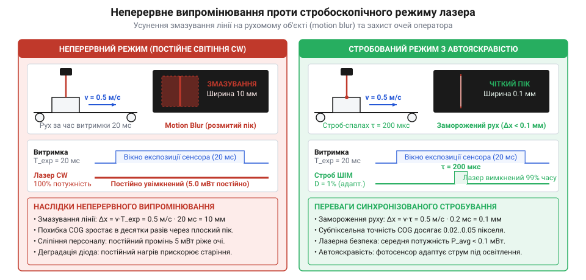
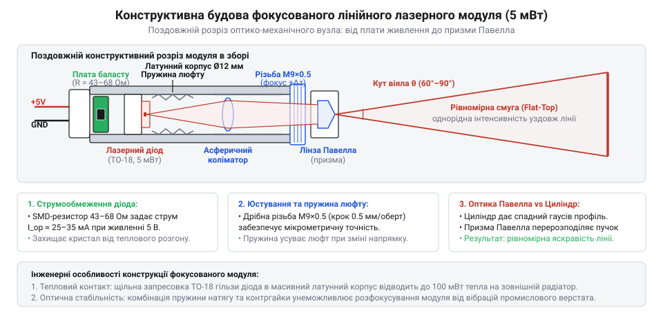
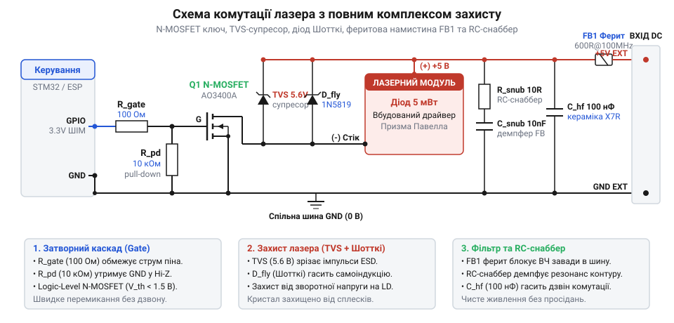
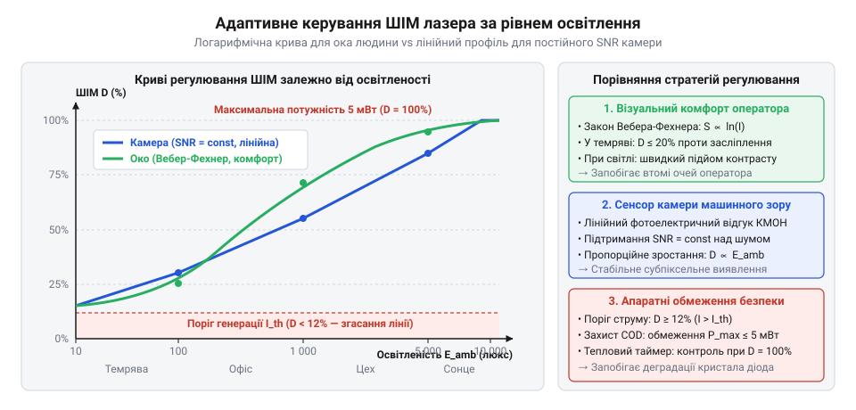
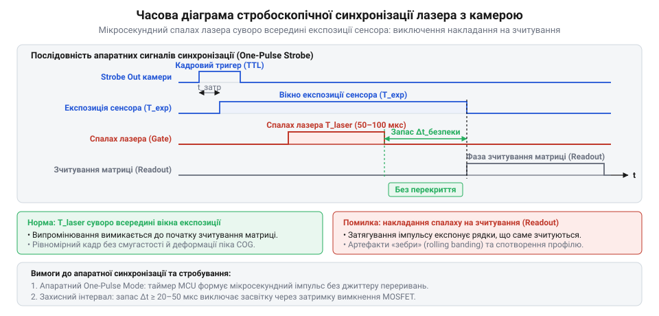
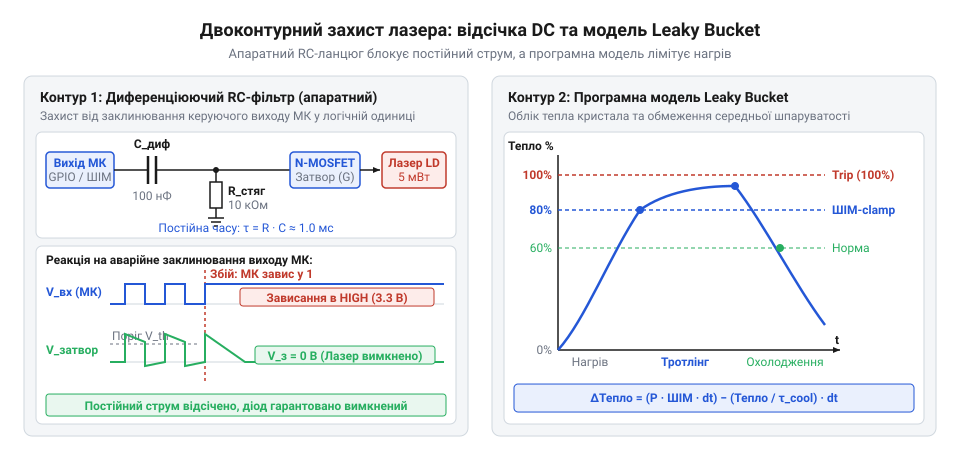
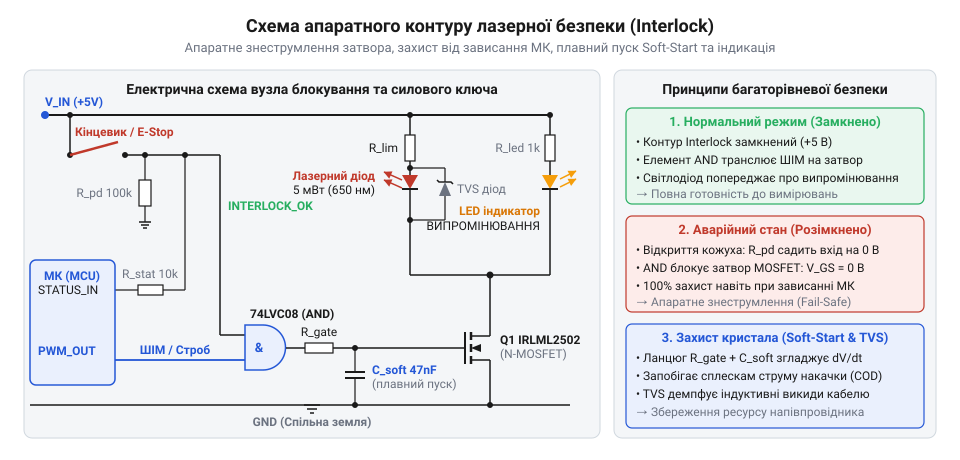
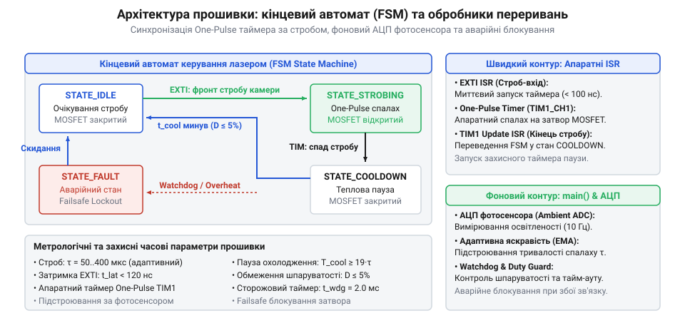
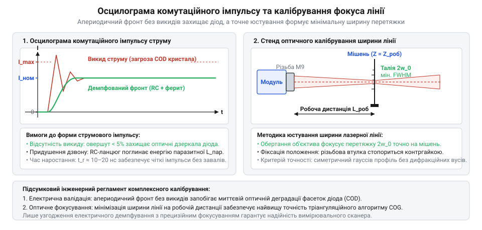
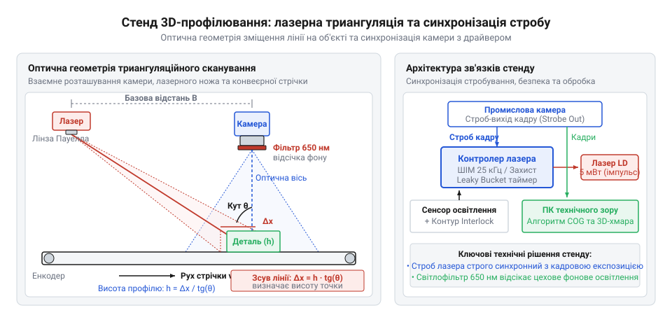

# Лазерний модуль з лінією (5 мВт, з фокусом)

<preknowlist>
- [KY-008 — лазерний модуль](root:cat-hw-actuators/ky-008-laser) — базові електричні характеристики напівпровідникового лазерного діода, необхідність струмообмеження, чутливість кристала до переполюсовки та електростатичного розряду (ESD).
</preknowlist>

## Фізичні та експлуатаційні обмеження неперервного лазерного випромінювання

Стандартний підхід до використання малопотужних лазерних модулів — підключення випромінювача безпосередньо до шини живлення 3.3 В або 5 В через найпростіший баластний резистор чи тумблер — виправдовує себе лише у примітивних лазерних указках. У реальних інженерних задачах розмітки, високоточного нівелювання та особливо у системах тріангуляційного машинного зору постійне (неперервне) свічення лазерного діода стикається з фундаментальними оптичними, динамічними та напівпровідниковими обмеженнями.

Перший бар'єр криється в колосальному динамічному діапазоні навколишньої освітленості. У польових умовах або у виробничих цехах з потужним світлодіодним освітленням рівень фонового світла коливається від 200–500 лк у глибині приміщення до 10 000–50 000 лк біля цехових воріт, а під прямим сонячним промінням сягає 100 000 лк. Статична лазерна лінія потужністю 5 мВт на яскравому сонці повністю розчиняється у фоновому потоці квантів. Оптичний сенсор відеокамери або око оператора фіксує мізерне відношення сигнал/шум (SNR), через що субпіксельні алгоритми пошуку лінії не здатні виділити корисний пік випромінювання на текстурованій поверхні. Навпаки, у сутінках чи в затемнених виробничих зонах (50–100 лк) та сама статична потужність спричиняє інтенсивне сліпіння (glare), утворює паразитні відблиски на металевих гранях об'єктів контролю та створює неприйнятний ризик вторинного пошкодження сітківки персоналу за стандартом IEC 60825-1.

Друга критична вада виникає під час спроби застосувати неперервний лазерний лінійний профіль для 3D-сканування або контролю геометрії рухомих виробів на промисловому конвеєрі. Якщо деталі переміщуються зі швидкістю від 0.5 до 2 м/с, а затвор відеокамери перебуває у стандартній експозиції 10–20 мс, за час накопичення заряду матриці контрольована деталь встигає зміститися на відстань від 5 до 40 мм. Тонка лазерна площина на поверхні деталі розмазується у широку світлову смугу (ефект динамічного змазування — motion blur). Просторовий профіль інтенсивності втрачає крутизну фронтів, центр лазерної лінії деградує, а відновлення тривимірної геометрії виробу за методом світлового перерізу зазнає повної відмови.



Третя загроза має електротеплову природу і вражає безпосередньо сам напівпровідниковий гетероструктурний кристал діода. Лазерні діоди червоного спектра (650 нм) мають дуже низький ККД перетворення електричної енергії на когерентне світло — понад 75–85% споживаної потужності перетворюється на тепло безпосередньо у мікроскопічній смузі p-n переходу об'ємом менше кількох кубічних мікрометрів. За неперервної генерації (CW, Continuous Wave) кристал швидко прогрівається вище 50–60 °C. Зі зростанням температури стрімко зростає пороговий струм генерації, падає диференціальна квантова ефективність, довжина хвилі зміщується в інфрачервоний бік із коефіцієнтом близько 0.25 нм/°C, а ресурс напрацювання діода скорочується у десятки разів через прискорену дифузію дефектів у кристалічних ґратках. При локальному перегріві торцевих напівпрозорих граней резонатора виникає явище катастрофічного оптичного пошкодження дзеркал (Catastrophic Optical Damage, COD), коли кристал миттєво і безповоротно руйнується оптичною густиною власного ж випромінювання.

Виходом із цього глухого кута є відмова від статичного живлення на користь стробоскопічного імпульсного контролера. Замість постійного горіння лазер активується надкороткими мікросекундними спалахами, які суворо синхронізовані з відкриттям апаратного затвора відеокамери (Global Shutter). Це дає змогу одночасно «заморозити» рух конвеєра до субміліметрових часток, безпечно підвищити миттєву пікову потужність спалаху без теплового перевантаження кристала, а у періоди між експозиціями або у сутінках — адаптивно модулювати середню яскравість за допомогою високочастотного ШІМ та оптичного зворотного зв'язку.

## Оптична архітектура та механіка фокусування лінійного модуля

Щоб правильно побудувати електронну схему керування та оптичну вісь приладу, необхідно детально розібрати внутрішню анатомію промислового 5-міліватного лінійного лазерного модуля. Типовий модуль конструктивно виконаний у вигляді циліндричної латунної гільзи (найчастіше зовнішнім діаметром 12 мм і довжиною 35–40 мм). Вибір латуні обумовлений двома вимогами: високою теплопровідністю для відведення тепла від напівпровідникового кристала та механічною стабільністю прецизійного різьбового з'єднання оптики.

Всередині гільзи розміщено послідовний ланцюг оптико-електронних компонентів:
1. Напівпровідниковий лазерний кристал, герметизований у металевому корпусі TO-18 (діаметр бази 5.6 мм), щільно запресований у латунну перегородку модуля.
2. Вбудована субмініатюрна друкована плата стабілізації струму, припаяна безпосередньо до виводів корпусу TO-18.
3. Різьбовий тубус коліматора (різьба М9×0.5) з вбудованою асферичною лінзою та компенсаційною конічною пружиною проти люфту.
4. Спеціалізована лінійна розсіювальна лінза Павелла (або циліндрична паличкова лінза), закріплена у вихідній захисній гайці модуля.



Формування тонкої та чіткої світлової лінії розпочинається з усунення природної асиметрії випромінювання напівпровідникового кристала. Лазерний резонатор діода формується смуговою квантовою ямою, розміри якої кардинально відрізняються за двома осями: товщина активного шару становить частки мікрометра, тоді як ширина становить 3–5 мкм. Внаслідок хвильової дифракції на такій щілиноподібній вихідній апертурі пучок на виході голого кристала має виражену еліптичну розбіжність: кут розкриття за вертикальною «швидкою віссю» (fast axis, перпендикулярно шарам) становить 25–35°, а за горизонтальною «повільною віссю» (slow axis) — лише 8–12°.

Для перетворення цього розбіжного еліптичного конуса на паралельний пучок використовується перша оптична ланка — асферичний коліматор з просвітленого скла або оптичного полімеру. Коліматор розташовується на фокусній відстані від емітера (типово 4–7 мм) і збирає промені у вузький пучок із круглою або слабко овальною перетяжкою.

Друга оптична ланка відповідає за розгортання сфокусованого пучка у світлову площину (лінію). У дешевих аматорських модулях для цього встановлюють звичайний скляний циліндр (циліндричну лінзу). Така лінза розсіює промінь лише в одній площині, проте повністю зберігає вихідний гауссівський профіль розподілу інтенсивності світла: у центрі лінії утворюється сліпуча пересвічена пляма, а до країв яскравість спадає за експоненційним законом Гаусса. На дистанції 1–2 метри краї такої лінії виявляються майже невидимими, що неприпустимо для розмітки та технічного зору.

У професійних модулях замість звичайного циліндра встановлюють лінзу Павелла (Powell lens). Лінза Павелла є призматичним оптичним елементом з особливою асферичною циліндричною вершиною. Її нелінійний оптичний профіль заломлює центральні найпотужніші промені пучка під максимальними кутами, спрямовуючи енергію до периферії віяла, тоді як крайові промені спрямовуються ближче до центру. Завдяки цьому формується плоский світловий сектор із заданим кутом розкриття (fan angle, типово 60°, 90° або 110°) та практично прямокутним рівномірним розподілом інтенсивності (flat-top профіль). Сформована лінія має однакову яскравість і товщину як у центрі, так і на краях.

Механіка юстування модуля забезпечується осьовим переміщенням тубуса коліматора по різьбі М9×0.5. Обертання передньої рифленої гайки зміщує коліматор ближче або далі від випромінюючого кристала:
- Якщо відстань менша за фокусну, пучок на виході розходиться, і лінія на стіні розширюється до кількох міліметрів.
- Якщо відстань більша за фокусну, пучок сходиться передчасно, фокусується у повітрі й далі знову розширюється.
- При точній настройці положення коліматора перетяжка пучка накладається на цільову площину вимірювання (наприклад, рівно на дистанцію 1 м або 3 м), де товщина лазерної лінії звужується до мінімальних 0.5–0.8 мм.

Встановлена всередині латунної гільзи туга пружина постійно вибирає технологічний люфт різьби М9, запобігаючи довільному зсуву фокусу під впливом вібрацій від роботи електродвигунів конвеєра чи будівельних інструментів.

Ширина лінії L на цільовій площині залежить від дистанції D до об'єкта та кута розкриття лінзи Павелла θ за прямою тригонометричною залежністю:
```
L = 2 · D · tan(θ / 2)
```
Для стандартної лінзи з кутом розкриття 90° (tan(45°) = 1) ширина лінії точно дорівнює подвоєній дистанції: на відстані 1.5 м розмах лінії становить 3.0 м.

З електричного погляду лазерний кристал вимагає жорсткої стабілізації струму, оскільки після досягнення напруги відмикання p-n переходу (близько 1.9–2.2 В для кристалів AlGaInP довжиною хвилі 650 нм) його внутрішній диференційний опір падає до одиниць Ом. Вбудована друкована плата 5-міліватного модуля зазвичай містить пасивний баластний струмообмежувач (прецизійний SMD-резистор опором від 47 до 91 Ом при напрузі живлення 5 В) або компактний лінійний стабілізатор струму. Такий вбудований захист гарантує, що при постійній напрузі живлення струм крізь діод утримується в паспортному діапазоні 20–35 мА. Проте ця внутрішня плата не захищає діод від комутаційних індуктивних викидів при зовнішній імпульсній комутації польовим транзистором — це завдання повністю покладається на зовнішній електронний драйвер контролера.

## Схемотехніка силового комутатора та захист від перехідних процесів

Напівпровідниковий лазерний кристал є одним із найбільш чутливих до електричного перевантаження електронних компонентів. На відміну від звичайного світлодіода чи обмотки реле, лазерний діод не пробачає навіть наносекундних перенапруг. Товщина його активної області становить частки мікрометра, а локальна оптична густина енергії на напівпрозорих дзеркальних гранях резонатора під час генерації сягає десятків мегават на квадратний сантиметр. Будь-який короткочасний сплеск струму викликає миттєве локальне теплове руйнування дзеркал — катастрофічне оптичне пошкодження (COD), після якого когерентна генерація назавжди зникає, а дорогий модуль перетворюється на тьмяний світлодіод із деградованим p-n переходом.

Головним джерелом небезпеки при імпульсній комутації є паразитна індуктивність з'єднувальних провідників. Навіть коротка пара дротів завдовжки 15–20 см, що з'єднує плату контролера з латунною гільзою модуля, має власну індуктивність порядку 150–250 нГн. Під час швидкого закриття силового транзистора швидкість спаду струму di/dt у контурі легко сягає 30 мА за 10 нс, тобто 3 000 000 А/с. Згідно із законом електромагнітної індукції Фарадея (V = -L · di/dt), ця паразитна індуктивність генерує зворотний імпульс ЕРС самоіндукції амплітудою в десятки вольт. Враховуючи, що гранично допустима зворотна напруга для лазерних діодів червоного спектра становить лише 2–3 В, неізольований кристал виходить з ладу в перші ж мікросекунди роботи.



Для безпечного та високошвидкісного керування модулем застосовується низькостороння схема комутації (Low-Side Switch) на базі польового N-канального транзистора з логічним рівнем керування (Logic-Level MOSFET, наприклад IRLML2502, AO3400 або BSS138). Такий транзистор повністю відмикається за напруги на затворі 2.5–3.3 В, має опір відкритого каналу менше 0.05–0.1 Ом і вхідну ємність не більше 200–400 пФ, що усуває потребу у важких високовольтних драйверах затвора.

Схема комутації проєктується як багаторівневий захисний комплекс:

1. **Затворні кола транзистора**. Між виводом мікроконтролера та затвором встановлюється послідовний резистор Rg номіналом 47–100 Ом. Він обмежує піковий струм перезарядки затворної ємності на рівні безпечних 20–30 мА та формує аперіодичний RC-фільтр, який запобігає виникненню високочастотного паразитного дзвону (ringings) на фронтах комутації. Паралельно затвору до шини GND обов'язково підключається стягуючий резистор R_pull-down номіналом 100 кОм. Він гарантує надійне закриття транзистора під час апаратного перезавантаження мікроконтролера, доки виводи GPIO перебувають у високоімпедансному стані (Hi-Z), виключаючи мимовільні неконтрольовані спалахи лазера при старті системи.

2. **Захист від зворотного пробою (діод Шотткі)**. Безпосередньо на виводах підключення лазерного модуля встановлюється швидкодіючий діод Шотткі (наприклад, BAT54 або SS14), увімкнений антипаралельно навантаженню: його анод з'єднаний зі стоком MOSFET (мінусом модуля), а катод — із шиною живлення +5 В. У момент закриття транзистора, коли струм в індуктивності дротів намагається змінити полярність потенціалу на стоці, діод Шотткі миттєво відкривається і замикає струм самоіндукції через шину живлення, обмежуючи негативний потенціал на рівні свого прямого спаду напруги 0.3–0.4 В. Це повністю виключає прикладання зворотної напруги до кристала.

3. **Захист від перенапруг та електростатики (TVS-діод)**. Паралельно ланцюгу лазера встановлюється надшвидкий супресорний діод (TVS, наприклад ESD5Z5.0 або SMAJ5.0A). Час реакції TVS-діода становить частки пікосекунди, що дозволяє поглинати як імпульсні кидки напруги в лінії живлення, так і високовольтні розряди статичної електрики (ESD) до 15 кВ при випадковому дотику оператора до латунного корпусу приладу.

4. **Демпфування високочастотного дзвону (RC-снаббер)**. Для усунення затухаючих коливань на стоці польового транзистора, викликаних резонансом індуктивності дротів та вихідної ємності сток-витік Coss, паралельно ключу вводиться RC-ланцюг (R_snub = 22 Ом, C_snub = 2.2–4.7 нФ). Снаббер поглинає енергію високочастотних коливальних процесів і перетворює її на тепло, забезпечуючи аперіодичний прямокутний профіль імпульсу струму без викидів.

5. **Фільтрація живильної шини (Ferrite Bead)**. У плюсову лінію живлення встановлюється феритова намистина (Ferrite Bead) з імпедансом 120–220 Ом на частоті 100 МГц (наприклад, типорозміру 0805) разом із танталовим конденсатором ємністю 10–22 мкФ та керамічним блокувальним конденсатором 0.1 мкФ. Цей П-подібний фільтр ізолює комутаційні струми лазера від аналогової частини мікроконтролера та запобігає випромінюванню радіозавад силовими лініями.

## Адаптивне регулювання яскравості під фонове освітлення

Статична потужність лазерного променя є джерелом постійного компромісу з незадовільним результатом: випромінювання, достатнє для контрастної видимості лінії на яскравому сонячному світлі (понад 10 000 лк), у темному приміщенні викликає нестерпне зорове сліпіння, паразитичні відблиски та повне перенасичення (blooming) сенсорів технічного зору. Навпаки, безпечна для сутінків потужність стає невидимою навіть за помірного кімнатного освітлення. Для вирішення цієї проблеми контролер реалізує контур замкненого адаптивного керування, який вимірює освітленість зовнішнього середовища і динамічно масштабує яскравість лінії за допомогою апаратного ШІМ.

Першим інженерним викликом є вибір робочої частоти широтно-імпульсної модуляції. Застосування стандартних низьких частот ШІМ (наприклад, 490 Гц або 1 кГц), поширених у простих бібліотеках, неприпустиме з двох фундаментальних причин:
- По-перше, частоти в діапазоні 1–10 кГц потрапляють у зону максимальної чутливості людського вуха. Внаслідок електрострикції керамічних конденсаторів та магнітострикції феритових елементів плата приладу генерує дратуючий акустичний писк.
- По-друге, при фіксації лазерної лінії відеокамерою машинного зору з короткою експозицією (наприклад, 1–2 мс) низькочастотний ШІМ призводить до стробоскопічного конфлікту: під час експозиції сенсора лазер встигає ввімкнутися і вимкнутися лише один раз, що створює смугасті артефакти або хаотичні перепади яскравості між сусідніми кадрами.

З огляду на це апаратний таймер мікроконтролера конфігурується на ультразвукову частоту ШІМ у діапазоні 25–35 кГц (типово 25 000 Гц). Ця частота лежить вище порогу чутності людини, повністю виключає акустичні шуми та гарантує, що навіть за мінімальної експозиції камери 500 мкс на сенсор надійде понад 12 повних періодів імпульсів, забезпечуючи рівномірне інтегрування заряду матриці без жодних смуг.



Для оцінки фонового освітлення використовується оптичний сенсор — аналоговий фотодіод/фототранзистор, підключений до каналу АЦП мікроконтролера, або цифровий I2C-люксметр (наприклад, BH1750 чи OPT3001). Оскільки напруга з аналогового фотодетектора піддається впливу пульсацій від штучних джерел світла (пульсації 100 Гц від люмінесцентних світильників та мережі 50 Гц), сирий сигнал АЦП пропускається через цифровий ковзний медіанний фільтр 5-го порядку (функція median_filter_5). Медіанний фільтр ефективно відкидає поодинокі імпульсні сплески завад без фазового запізнення, після чого значення згладжується експоненційним фільтром (EMA) для запобігання різким стрибкам яскравості при випадковому перетинанні датчика тінню.

Отримане значення освітленості транслюється у коефіцієнт заповнення ШІМ відповідно до обраного режиму використання системи:

1. **Режим візуальної розмітки (людський зір)**. Людське сприйняття оптичної інтенсивності підпорядковується психофізичному закону Вебера-Фехнера: суб'єктивне відчуття яскравості зростає пропорційно логарифму потужності подразника. Якщо регулювати яскравість лазера лінійно, у зоні низької освітленості людське око бачитиме грубі стрибки, тоді як на яскравому сонці збільшення потужності сприйматиметься як незначне. Для забезпечення рівномірного візуального комфорту контролер використовує нелінійну логарифмічну передавальну характеристику (реалізовану у вигляді таблиці підстановки LUT з інтерполяцією):
```
Duty = a · ln(Lux / Lux_min) + Duty_min
```
При освітленості менше 50 лк коефіцієнт заповнення автоматично обмежується безпечними 10–15% (знижуючи навантаження на зір і батарею), а при досягненні 20 000–50 000 лк плавно зростає до 100%.

2. **Режим машинного зору (камера з фотосенсором)**. На відміну від ока, кремнієві пікселі CMOS-матриці мають лінійний фотоелектричний відгук на інтегральний квантовий потік. Щоб алгоритм тріангуляції надійно виділяв субпіксельний максимум лазерної лінії на фоні деталей, необхідно підтримувати постійне відношення сигнал/шум (SNR). Для цього контролер перемикається на лінійну передавальну функцію: потужність лазера зростає прямо пропорційно рівню фонового засвічення сенсора. Це запобігає пересвіту пікселів лінії в темряві та компенсує фоновий шум на яскравому світлі, забезпечуючи незмінну якість 3D-профілювання.

## Стробоскопічна синхронізація спалахів із кадровими імпульсами камери

У задачах тривимірного лазерного профілювання, оптичної інспекції та високошвидкісного сортування продукції контрольовані об'єкти безперервно переміщуються конвеєрною стрічкою зі швидкостями від 0.5 до 2.0 м/с. За таких умов стандартна експозиція камери у кілька мілісекунд неминуче перетворює тонку сфокусовану лазерну лінію на розмите дифракційне полотно. Наприклад, за лінійної швидкості виробу v = 1.0 м/с (1.0 мм за 1 мс) та стандартної витримки промислового сенсора 4 мс оптична проекція лінії розмивається на 4.0 мм. Це повністю нівелює оптичні переваги лінзи Павелла та унеможливлює субпіксельне визначення координат профілю світлового перерізу.

Єдиним фізичним рішенням цієї проблеми є оптичне стробування: лазер активується надкоротким імпульсом лише в той момент, коли матриця готова прийняти квантовий потік, а його тривалість стискається до часток мілісекунди (типово 50–300 мкс). За тривалості спалаху 100 мкс зміщення об'єкта зі швидкістю 1 м/с становить лише 0.1 мм, що вкладається в зону допустимої субпіксельної дискретизації оптичної системи. При цьому локальна оптична інтенсивність світла у спалаху може бути максимальною (100% потужності кристала), що забезпечує високе відношення сигнал/шум (SNR) на пікселях матриці, тоді як інтегральна середня потужність випромінювача залишається мізерною (шпаруватість менше 1%), виключаючи деградацію напівпровідника.

Реалізація прецизійного стробування вимагає жорсткої апаратної синхронізації з сенсором відеокамери. Камери промислового класу (наприклад, лінійок Basler ace, FLIR Blackfly або IDS Ensenso) оснащуються спеціалізованим виходом апаратного стробу (Strobe Out / Flash Output). Сигнал Strobe Out формується внутрішнім логічним автоматом камери строго у фазі повної експозиції сенсора. Оскільки в промисловому середовищі кабель між камерою та контролером може мати довжину в кілька метрів і проходити поруч із силовими кабелями приводів конвеєра, пряме підключення виходу камери до виводу GPIO мікроконтролера неприпустиме через ризик індуктивних завад та земляних петель.

Вхідний каскад контролера будується з обов'язковою оптичною ізоляцією (гальванічною розв'язкою). Для збереження субмікросекундної точності застосовується швидкісний цифровий оптрон із тригером Шмітта на виході (наприклад, 6N137 або FOD260L) із затримкою поширення сигналу не більше 50–75 нс. Світлодіод оптрона підключається до виходу камери через послідовний резистор (для узгодження з промисловим рівнем 24 В або 5 В TTL) та шунтується зворотним діодом для захисту від переполюсовки, а вихідний фототранзисторний каскад живиться від внутрішньої шини 3.3 В контролера з підтяжкою 1 кОм до живлення.

Фундаментальною вимогою до оптичного тракту є використання камери виключно з глобальним затвором (Global Shutter). На відміну від матриць із ковзним затвором (Rolling Shutter), де рядки експонуються послідовно зі зсувом у часі, у сенсорах Global Shutter накопичення заряду всіма пікселями матриці розпочинається і закінчується одночасно. Спроба подати надкороткий лазерний спалах на сенсор Rolling Shutter призведе до артефакту часткової експозиції (partial exposure), коли лазер освітить лише кілька десятків рядків матриці, які збіглися зі спалахом у часі, тоді як решта кадру залишиться чорною.


*Часова діаграма апаратної синхронізації стробування: узгодження імпульсу Strobe Out промислової камери, вікна повної експозиції Global Shutter та апаратного One-Pulse спалаху таймера.*

Як видно з часової діаграми, спалах лазера повинен гарантовано укладатися у вікно повної експозиції пікселів (Full Exposure Window). Він не повинен зачіпати фази скидання пікселів (Pixel Reset) перед експозицією та фази послідовного зчитування заряду матриці (Readout Phase), щоб уникнути неоднорідності шуму темного струму між рядками.

Типова помилка початківців при реалізації стробування — запуск імпульсу через програмне переривання: вхідний строб заводиться на лінію зовнішнього переривання (EXTI), в обробнику ISR процесор перемикає вивід GPIO у high, запускає програмну затримку або затримку таймера, після чого гасить пін. Такий шлях неминуче породжує фазовий джитер (jitter) амплітудою в кілька мікросекунд:
- Час реакції процесорного ядра ARM Cortex-M на переривання становить мінімум 12 тактових циклів на збереження регістрів у стек.
- Якщо в момент приходу імпульсу стробу ядра виконувало інше переривання або критичну секцію з тимчасово забороненими перериваннями (наприклад, розрахунок контрольної суми чи запис Flash/DMA), затримка входу зростає до десятків мікросекунд.
- Загальний джитер стає випадковою величиною, через що спалах лазера може «вилазити» за межі вікна експозиції камери, призводячи до хаотичного мерехтіння яскравості на відеокадрах.

Для повного усунення програмного джитера синхронізація реалізується повністю на апаратному рівні за допомогою режиму таймера One-Pulse Mode (OPM) із тригерним керуванням (Slave Mode Trigger). У цьому режимі вихід оптичного ізолятора підключається безпосередньо до вхідного каналу таймера TI1 (пін TI1FP1). Таймер конфігурується так, що перепад на вході TI1FP1 апаратно активує лічильник і піднімає вихідний сигнал на каналі OC1 без будь-якої участі центрального процесора.

:::code proj-strobe-laser-level-controller/c/laser_driver.c 91-126

Механізм апаратного стробування працює наступним чином:
1. Тактова частота таймера (наприклад, 84 МГц для шини APB2 у мікроконтролерах STM32) переддільником PSC понижується до 1 МГц, забезпечуючи точну роздільну здатність 1 мкс на кожен відлік лічильника CNT.
2. Регістр CCR1 визначає активну тривалість імпульсу лазера у мікросекундах. Регістр ARR встановлюється на значення CCR1 + 2 мкс, що задає тривалість повного циклу імпульсу з невеликим захисним інтервалом.
3. Канал конфігурується в режим ШІМ-1 (PWM Mode 1): доки поточний лічильник CNT менший за CCR1, вихід OC1 утримується на високому рівні (+3.3 В на затворі транзистора). Як тільки CNT досягає значення CCR1, апаратна схема порівняння перемикає вихід у нуль, вимикаючи лазерний діод.
4. На наступному кроці, коли CNT досягає значення ARR, біт OPM (One-Pulse Mode) у регістрі CR1 автоматично скидає прапорець CEN (Counter Enable) в нуль. Таймер миттєво зупиняється і переходить у режим очікування наступного кадрового фронту від камери.

Апаратна затримка запуску імпульсу лазера від фронту сигналу камери в режимі Slave Trigger визначається виключно цифровою фільтрацією вхідного піна та внутрішньою синхронізацією шини таймера, становлячи стабільні 2–3 такти процесорної шини (25–35 нс). Джитер імпульсу практично дорівнює нулю. Центральний процесор під час цього процесу повністю розвантажений і не витрачає час на обслуговування таймінгу експозиції.

У високорівневій архітектурі C++ керування стробуванням капсулюється класом StrobeController. Він відповідає за динамічне оновлення тривалості імпульсу, контроль активного стану та передачу поточної адаптивної шпаруватості у виконавчий драйвер LaserOutput:

:::code proj-strobe-laser-level-controller/cpp/strobe_controller.hpp 51-76

Завдяки відокремленню тригерного механізму від генерації вихідного сигналу контролер дозволяє гнучко підстроювати параметри під камери з різною роздільною здатністю та швидкістю експозиції.


## Розрахунок теплового бюджету лазерного діода та алгоритм захисту за шпаруватістю

Напівпровідниковий кристал лазерного діода є мікроскопічною гетероструктурою, об'єм активної області якої вимірюється кубічними мікрометрами. При споживанні номінального електричного струму 25–35 мА за прямої напруги 2.2 В кристал поглинає близько 65–75 мВт електричної потужності. Оскільки коефіцієнт корисної дії перетворення електричної енергії на когерентне оптичне випромінювання для червоних діодів довжиною хвилі 650 нм рідко перевищує 7–10%, понад 90% споживаної енергії безпосередньо трансформується у теплоту в зоні p-n переходу.

У неперервному режимі або за високої частоти стробування температура кристала стрімко наростає. Тепловий опір між активним шаром кристала та металевим корпусом TO-18 (R_th, j-c) становить 30–50 °C/Вт, а тепловий опір від латунної гільзи у навколишнє повітря (R_th, c-a) без додаткового масивного тепловідводу перевищує 120–150 °C/Вт. Зі зростанням внутрішньої температури кристала вище 45–50 °C різко збільшується пороговий струм генерації, падає оптична потужність, довжина хвилі зміщується в довшохвильову область зі швидкістю близько 0.25 нм/°C, а локальний градієнт температур на торцевих дзеркалах призводить до їх термічного руйнування (COD).

Особлива небезпека виникає при експлуатації стробоскопічного контролера у виробничих лініях. У разі аварійного зависання сигналу камери, обриву зворотного дроту або збою мікроконтролера вхідний керуючий сигнал на затворі силового MOSFET-транзистора може застрягти у постійному високому рівні («1»). Якщо лазер розрахований на імпульсну роботу з короткими циклами охолодження, безперервне протікання максимального струму виведе діод з ладу протягом кількох секунд.

Для забезпечення абсолютної безаварійності приладу реалізується ешелонована багаторівнева система захисту: поєднання апаратного AC-фільтра відсічки постійного струму та програмного алгоритму контролю теплового бюджету Leaky Bucket.


*Архітектура багаторівневого теплового захисту: апаратна RC-відсічка постійного рівня при зависанні лінії керування та алгоритм «leaky bucket» для контролю середньої шпаруватості.*

Першим контуром захисту є апаратний диференціюючий RC-ланцюг (High-Pass AC Coupling), розміщений безпосередньо між виходом мікроконтролера і затвором польового транзистора. У розрив лінії сигналу встановлюється керамічний конденсатор C_ac (100–220 нФ), а після нього паралельно входу затвора підключається резистор розряду R_gate_dc (10 кОм):
- Змінний стробоскопічний імпульс (перепад 0 -> 3.3 В) безперешкодно проходить крізь конденсатор, миттєво заряджаючи ємність затвора польового ключа.
- Якщо мікроконтролер зависне або лінія керування через програмний збій залишиться під потенціалом 3.3 В, конденсатор C_ac повністю зарядиться струмом витоку через постійну часу tau = R_gate_dc · C_ac (приблизно 1.0–2.2 мс).
- Щойно конденсатор заряджається, струм через нього припиняється, напруга на резисторі R_gate_dc спадає до нуля, і потенціал затвора падає значно нижче порогової напруги відмикання MOSFET (V_gs(th) = 1.5–2.0 В).
- Транзистор гарантовано закривається, знеструмлюючи лазерний модуль навіть за мертво завислого ядра процесора або апаратного короткого замикання на шині GPIO. Постійний струм фізично не здатний подолати бар'єр діелектрика конденсатора.

Другим контуром захисту виступає програмний сторожовий алгоритм динамічного контролю шпаруватості за моделлю «дірявого відра» (Leaky Bucket). Якщо апаратний RC-ланцюг захищає від довготривалого залипання постійного рівня, то Leaky Bucket контролює середню інтегральну теплову потужність при високочастотних серіях спалахів (наприклад, при раптовому зростанні частоти кадрів камери до 150–200 FPS).

Фізичний зміст моделі полягає у симуляції теплоємності латунного корпусу та теплового розсіювання в довкілля:
1. Віртуальне «відро» має максимальну місткість Capacity (наприклад, 100 000 умовних одиниць тепла), що відповідає критичному перегріву корпусу до 50 °C.
2. Кожен виконаний лазерний імпульс додає у відро порцію тепла delta_Q, пропорційну його тривалості та поточній шпаруватості ШІМ:
```
delta_Q = (duration_us · duty_permille) / 1000
```
3. Одночасно тепло безперервно «витікає» з відра зі швидкістю розсіювання радіатора LeakRate (наприклад, 20 000 одиниць за секунду), пропорційно минулому часу:
```
Q_leaked = (CoolingRate · delta_t_ms) / 1000
```

У C++ платформі лазерного контролера ця математична модель реалізована у вигляді автономного класу ThermalGuard:

:::code proj-strobe-laser-level-controller/cpp/thermal_guard.hpp 30-78

Алгоритм керування реалізує дворівневу реакцію на тепловий стан:
- **Фаза тротлінгу (поріг 80% заповнення)**. Коли сумарне теплове навантаження перевищує 80% допустимого бюджету, алгоритм активує м'який тротлінг: метод clamp_duty() обмежує максимальну шпаруватість імпульсів до безпечних 40% (400 проміле). Це дозволяє не переривати роботу конвеєра та продовжувати зйомку без аварійної зупинки, даючи корпусу можливість охолоджуватися у проміжках між спалахами.
- **Фаза аварійного блокування (поріг 100% заповнення)**. Якщо частота спалахів не знижується і теплове відро наповнюється повністю, ThermalGuard повідомляє про критичний стан методом is_critical_overheat(). Головний супервізор SafetySupervisor негайно переводить систему в аварійний стан FAULT, знеструмлює силовий ключ та генерує код помилки SafetyFault::ThermalShutdown.

Комбінація апаратного конденсаторного бар'єра та програмного лічильника Leaky Bucket створює надійний захист класу Defense in Depth: контролер гарантовано захищений як від миттєвих апаратних збоїв логіки, так і від накопичувального термічного вигорання при нештатних режимах експлуатації.

## Контур лазерної безпеки за стандартом IEC 60825-1 та вузол плавного пуску

Проєктування електронних пристроїв із лазерними випромінювачами принципово відрізняється від роботи зі звичайними світлодіодами: напівпровідниковий лазер формує когерентний просторовий пучок із високою спектральною густиною потужності. За стандартом міжнародної електротехнічної комісії IEC 60825-1 («Safety of laser products») 5-міліватний лазер червоного спектра (довжина хвилі 650 нм) у стані прямої колімації належить до небезпечного Класу 3R. Для цього класу природний рефлекс моргання людського ока (захисна реакція за час близько 0.25 с) вже не гарантує повного запобігання термічному пошкодженню сітківки. Оптична система ока фокусує паралельний лазерний пучок на очному дні у пляму діаметром усього 10–20 мкм, концентруючи енергію у мільйони разів і викликаючи локальну термічну коагуляцію фоторецепторів сітківки з утворенням невиліковної сліпої плями (скотоми).

У лінійному лазерному модулі асферична циліндрична лінза Павелла розгортає промінь у плоский віяловий сектор із кутом розкриття 60°–110°. На відстані більше 20–30 см від вихідної апертури потужність розсіюється у просторі, і частка випромінювання, здатна одночасно потрапити в зіницю ока діаметром 7 мм, падає нижче 1 мВт, що відповідає безпечнішому Класу 2. Проте безпосередньо біля вихідного скла модуля та в зоні оптичної перетяжки густина енергії залишається гранично високою. Крім того, при випадковому відкручуванні або пошкодженні розсіювальної лінзи випромінювач миттєво перетворюється на небезпечний сфокусований пучок.

Тому інженерний дизайн пристрою вимагає суворого дотримання нормативів лазерної безпеки:
1. Повна неприпустимість покладання функцій аварійного захисту виключно на програмне забезпечення мікроконтролера. Зависання ядра, збій тактування, переповнення стека або пробій керуючого піна GPIO не повинні створювати ситуацію неконтрольованого світіння.
2. Наявність фізичного апаратного розриву кола безпеки (Interlock Loop), що діє на електромеханічному рівні в обхід мікроконтролера.
3. Обов'язкова помітна світлова індикація «Laser Active», увімкнена паралельно лінії випромінювання.
4. Вузол плавного наростання струму (soft-start), що запобігає імпульсному перевантаженню та деградації кристала при включенні живлення.


*Апаратний контур безпеки за стандартом IEC 60825-1: електромеханічний інтерлок знеструмлення затвора, індикація активності випромінювача та вузол плавного пуску soft-start.*

Апаратний контур безпеки Interlock реалізується у вигляді замкненого послідовного ланцюга нормально розімкнених або нормально замкнених електромеханічних вимикачів:
- Кінцевого мікроперемикача захисного кожуха чи кришки оптичного відсіку (якщо корпус розкрито або модуль знято з оснастки — контур фізично розривається).
- Грибоподібної кнопки аварійної зупинки приладу (Emergency Stop).
- Зовнішнього промислового клемника дистанційного інтерлоку (Remote Interlock Connector) для підключення захисних бар'єрів, штор безпеки або контактів реле аварійної зупинки виробничої лінії.

Фізична дія інтерлоку реалізується двома паралельними шляхами:
1. **Пряме апаратне блокування ключа MOSFET**. Сигнал затвора силового комутатора шунтується на шину GND через допоміжний біполярний NPN-транзистор (або N-MOSFET). Доки контур Interlock замкнено, на базу блокуючого транзистора подається замикаючий потенціал. Як тільки інтерлок розривається, шунтуючий транзистор миттєво закорочує затвор силового MOSFET на землю, унеможливлюючи його відкриття незалежно від того, які сигнали генерує вивід таймера мікроконтролера.
2. **Діагностичне опитування мікроконтролером**. Точка контролю контуру інтерлоку через дільник напруги заводиться на окремий цифровий пін GPIO (INTERLOCK_SENSE). Це дозволяє кінцевому автомату прошивки миттєво детектувати розрив ланцюга, програмно зупинити генерацію таймера та виставити статус блокування.

Паралельно живленню лазерного діода встановлюється яскравий індикаторний світлодіод червоного кольору з підписом «Laser Active». На відміну від звичайних світлодіодів стану системи, індикатор активності лазера підключається так, щоб він засвічувався безпосередньо від струму, що подається на лазерну головку. Це гарантує візуальне попередження персоналу навіть у тому випадку, коли лінія спрямована у темну поглинальну пастку або закрита непрозорим екраном.

Окрему небезпеку для довговічності лазерного діода становить процес початкового підключення джерела живлення. Під час вмикання тумблера або підключення мережевого адаптера перехідні процеси у блоці живлення та зарядка вихідних конденсаторів генерують різкий стрибок напруги з крутим фронтом (dV/dt). Цей стрибок через паразитні ємності здатний викликати короткочасний сплеск струму крізь діод, що перевищує паспортний ліміт у кілька разів і спричиняє катастрофічне руйнування торцевих дзеркал кристала (COD).

Для усунення пускових кидків у шину живлення +5 В вводиться вузол плавного пуску (soft-start). Вузол будується на базі P-канального польового транзистора (наприклад, AO3401 або IRLML6402), встановленого у верхнє плече живлення лазерного модуля. Між витоком (+5 В) та затвором P-MOSFET встановлюється зарядний резистор R_soft1 (47–100 кОм), а між затвором та землею — конденсатор плавного пуску C_soft (2.2–10 мкФ) через резистор розряду. При подачі напруги живлення потенціал на затворі транзистора знижується плавно за експоненційним законом із постійною часу tau = R_soft1 · C_soft (10–50 мс). Транзистор відкривається плавно, обмежуючи швидкість наростання струму накачки лазера та повністю виключаючи коливальні перенапруги.

У C++ архітектурі платформи стан апаратного контуру Interlock контролюється класом SafetySupervisor:

:::code proj-strobe-laser-level-controller/cpp/safety_supervisor.hpp 38-89

Супервізор поєднує моніторинг фізичного контуру блокування, контроль напруги живлення драйвера діода та інтегральну теплову оцінку кристала, формуючи замкнений контур безаварійної експлуатації відповідно до норм функціональної безпеки IEC 60825-1.


## Архітектура вбудованого програмного забезпечення на базі скінченного автомата

Керування стробоскопічним лазерним контролером вимагає одночасного розв'язання кількох суперечливих завдань: формування надкоротких мікросекундних імпульсів із жорстким детермінізмом та нульовим фазовим джитером, періодичної аналогової фільтрації сигналів фотодетектора зовнішньої освітленості, теплового розрахунку інтегральної шпаруватості та гарантованого безаварійного знеструмлення випромінювача при розмиканні інтерлоку чи перегріві.

Спроба реалізувати таку поведінку класичним лінійним кодом із блокуючими затримками (наприклад, викликами delay_ms) призводить до втрати контролю над системою: під час виконання паузи мікроконтролер не здатен зреагувати на аварійне розмикання контуру захисту чи перегрів кристала.

Надійна прошивка контролера будується на базі трьох чітко розмежованих рівнів виконання з фіксованими пріоритетами реального часу:
1. **Апаратний рівень таймера (Hardware Plane)**. Працює автономно від ядра центрального процесора. Вхідний кадровий імпульс камери через пін TI1FP1 апаратно перезавантажує та активує лічильник таймера у режимі One-Pulse Mode. Спалах лазера заданої тривалості (наприклад, 150 мкс) генерується на вихідному каналі OC1 з апаратною точністю та нульовим процесорним джитером (менше 25 нс).
2. **Рівень переривань високого пріоритету (ISR Plane)**. Обробник зовнішнього переривання EXTI реєструє факт надходження кадрового стробу, інкрементує лічильник спалахів та переводить стан автомата у фазу стробування без виконання важких обчислень.
3. **Фоновий рівень суперциклу (Superloop Plane)**. Працює у неблокувальному головному циклі з фіксованим квантом часу (період виклику 1–5 мс). На цьому рівні виконується кінцевий автомат (Finite State Machine, FSM), цифрова медіанна фільтрація АЦП-відліків фотосенсора і терморезистора, розрахунок кривої адаптивної яскравості та крок теплової моделі leaky bucket.


*Архітектура вбудованого програмного забезпечення: взаємодія кінцевого автомата (FSM), високопріоритетних переривань EXTI/One-Pulse таймера та фонових контурів моніторингу.*

Серцем керування є скінченний автомат, стани якого суворо регламентують поведінку апаратної периферії:

:::code proj-strobe-laser-level-controller/c/laser_driver.h 26-45

Стани автомата та логіка їх перемикання визначаються наступними правилами:
- **LASER_STATE_DISABLED (Вимкнено)**: початковий стан після скидання мікроконтролера або стан після розриву контуру Interlock. Вихід таймера примусово деактивовано (CC1E = 0), затвор силового транзистора притягнуто до нуля. Перехід у стан готовності READY дозволяється лише тоді, коли зовнішній контур безпеки замкнено, а в системі відсутні активні коди аварій (ault_code == LASER_FAULT_NONE).
- **LASER_STATE_READY (Готовий до спалаху)**: апаратний таймер One-Pulse налаштовано, вхід тригера дозволено, система очікує надходження кадрового стробу від камери або команду на запуск неперервного ШІМ.
- **LASER_STATE_STROBING (Активне стробування)**: таймер генерує імпульс. Одночасно запускається програмний сторожовий лічильник (watchdog timer). Якщо через апаратний збій таймер не скинув біт CEN протягом допустимого інтервалу watchdog_timeout_ms (типово 25 мс), FSM негайно ініціює аварійне відключення LASER_FAULT_WATCHDOG_TIMEOUT. Після штатного завершення мікросекундного імпульсу та автоматичного скидання CEN автомат повертається у стан READY.
- **LASER_STATE_CONTINUOUS (Неперервний ШІМ)**: режим для візуального нівелювання та юстування оптики. Таймер безперервно генерує ультразвуковий ШІМ (25 кГц), шпаруватість якого динамічно оновлюється за показниками фотосенсора. Безпека контролюється обмеженням максимального інтервалу неперервного світіння.
- **LASER_STATE_FAULT (Аварійне блокування)**: термінове вимкнення затвора ключа, блокування виходу таймера (CC1E = 0, CCR1 = 0, CEN = 0) та виставлення коду відмови. Перехід у FAULT є безумовним і відбувається миттєво з будь-якого стану при виявленні небезпечного фактора.

Реалізація кроку кінцевого автомата мовою C є повністю неблокувальною:

:::code proj-strobe-laser-level-controller/c/laser_driver.c 226-297

Кожен виклик laser_driver_process_fsm() розпочинається з безумовної перевірки критичних параметрів безпеки:
1. Контроль контуру інтерлоку: якщо ланцюг розімкнено, драйвер негайно викликає laser_driver_emergency_shutdown(dev, LASER_FAULT_INTERLOCK_OPEN).
2. Контроль термічного режиму: якщо відфільтрована температура терморезистора перевищує аварійний поріг max_temp_celsius (типово +48 °C), випромінювач блокується з помилкою LASER_FAULT_OVERTEMP.
3. Захист від катастрофічного оптичного пошкодження дзеркал (COD): сигнал із вбудованого фотодіода оптичного зворотного зв'язку постійно порівнюється з порогом max_photodiode_raw. У разі раптового викиду оптичної потужності лазер вимикається менш ніж за один цикл FSM.

Скидання стану FAULT через функцію laser_driver_reset_fault() можливе лише тоді, коли всі фізичні аварійні умови ліквідовано: інтерлок замкнено, а показники температури та оптичної густини повернулися у безпечний паспортний коридор.

Завдяки відокремленню прецизійного таймінгу спалаху на апаратний рівень таймера та перенесенню повільних обчислень у детермінований неблокувальний FSM, архітектура гарантує відсутність взаємного блокування завдань, субмікросекундну точність оптичної синхронізації та безаварійну роботу обладнання в промислових умовах.

## Практичний монтаж, трасування друкованої плати та осцилографічне калібрування

Надійність роботи стробоскопічного лазерного контролера у реальних умовах визначається не лише коректністю схемотехніки та алгоритмів, але й топологією друкованої плати (PCB Layout). Комутація лазерного діода супроводжується крутими фронтами струму: швидкість зміни струму di/dt під час перемикання N-MOSFET транзистора легко досягає 30 мА за 10 нс, що еквівалентно швидкості 3 000 000 А/с. За таких швидкостей кожен міліметр друкованої доріжки з питомою паразитною індуктивністю близько 1 нГн/мм перетворюється на небажане джерело електромагнітних завад та стрибків напруги самоіндукції V = L · di/dt.

Для усунення паразитного зв'язку та забезпечення стабільності аналогових вимірювань під час розведення друкованої плати застосовується комплекс правил:

1. **Розділення силової та сигнальної землі (Star Ground)**. На платі проєктуються два повністю відокремлені земляні контури:
   - *Силова земля (Power GND)*: контур, через який замикаються імпульсні комутаційні струми витоку польового транзистора, катода діода Шотткі, TVS-супресора та накопичувальних конденсаторів фільтра живлення. Цей полігон виконується масивною мідною заливкою з мінімальною довжиною доріжок.
   - *Сигнальна земля (Signal GND)*: контур для чутливих аналогових кіл мікроконтролера — опорної напруги АЦП, аналогового фотодіода, термістора NTC та виводів фільтрації живлення ядра МК.
   - Обидва земляні полігони з'єднуються суворо в одній фізичній точці за схемою «зірка» (Star Point) безпосередньо біля мінусового контакту вхідного роз'єму живлення. Таке трасування унеможливлює протікання імпульсних комутаційних струмів лазера через земляні шини АЦП, запобігаючи стрибкам показань фотосенсора.

2. **Мінімізація площі контуру затвора (Gate Loop)**. Доріжка керування від виводу таймера МК до затвора польового транзистора трасується мінімальною довжиною (не більше 10–15 мм) безпосередньо над суцільним земляним шаром зворотного боку плати. Затворний резистор Rg (47–100 Ом) розміщується впритул до виводу Gate транзистора. Це мінімізує площу електромагнітної петлі та зсуває паразитний резонанс LC-контуру затвора у гігагерцову область, повністю виключаючи виникнення високочастотного дзвону (ringing) та помилкових відмикань ключа.

3. **Розміщення захисних елементів**. Захисний діод Шотткі BAT54, супресорний TVS-діод та RC-снаббер монтуються на мінімальній відстані від стоку MOSFET і клем підключення кабелю лазерного модуля. Будь-яке подовження доріжок між ключем і захисними діодами зводить нанівець їхню швидкодію через додаткову паразитну індуктивність.


*Осцилограма комутаційного струму лазера з демпфуванням викидів та геометрична схема прецизійного юстування фокуса на мішені.*

Після складання плати проводиться обов'язкова інструментальна верифікація форми комутаційних сигналів за допомогою двоканального цифрового осцилографа зі смугою пропускання не менше 100 МГц:
- **Методика вимірювання струму**: підключення стандартних струмових кліщів або розрив ланцюга довгими щупами спотворює фронти сигналу через власну індуктивність. Для достовірного зняття осцилограми у розрив між витоком MOSFET і силовою землею тимчасово впаюється прецизійний безіндуктивний SMD-шунт номіналом R_shunt = 0.1–1.0 Ом (типорозмір 0805 або 1206).
- **Підключення щупа**: щуп осцилографа з дільником 1:10 підключається безпосередньо до виводів шунта за допомогою пружинного заземлювального адаптера (Ground Spring) замість довгого гнучкого затискача-«крокодила», петля якого вловлює паразитні наведення перемикання.
- **Критерії оцінки**:
  - Передній фронт імпульсу струму лазера повинен мати плавне експоненційне наростання з часом 15–35 нс без перерегулювання (overshoot).
  - На спаді імпульсу струму викид напруги на стоці MOSFET не повинен перевищувати напругу шини живлення більше ніж на величину прямого спаду діода Шотткі (не більше +5.4 В).
  - Завдяки RC-снабберу залишковий коливальний процес («дзвін») повинен повністю затухати менш ніж за 40–50 нс.

Завершальним етапом є оптичне юстування перетяжки лінії. На цільовій робочій відстані (наприклад, 1.5 м для нівеліра або 0.5 м для стенду конвеєра) встановлюється калібрувальна мішень із міліметровою координатною сіткою. Плавним обертанням різьбового тубуса коліматора М9×0.5 регулюється відстань між випромінюючим кристалом лазерного діода та асферичною лінзою:
- Якщо коліматор занадто наближений до діода, промені після виходу з лінзи Павелла утворюють розбіжний пучок, і ширина лінії на мішені перевищує 1.5–2.0 мм із розмитими краями.
- Якщо коліматор висунуто занадто далеко, перетяжка формується передчасно у повітрі перед мішенню, а на самій мішені лінія знову розширюється.
- При досягненні оптимуму точка фокальної перетяжки лягає строго у площину калібрувальної мішені: товщина лінії в центрі та на периферії звужується до мінімальних 0.5–0.7 мм із максимальною крутизною поперечного градієнта яскравості.

Після закінчення юстування різьбове з'єднання коліматора фіксується краплею термостійкого фіксатора різьби або стопорною гайкою, що виключає самовільне розфокусування від виробничих вібрацій.


## Інтеграційні випробування у промислових застосуваннях та аналіз типових збоїв

Створений стробоскопічний контролер є універсальним ядром для широкого спектра прикладних задач — від високоточного будівельного розмічального інструменту до оптичних вузлів роботизованих конвеєрних ліній.

У складі автономного лазерного автонівеліра контролер вирішує задачу динамічного балансу між контрастною видимістю та енергоефективністю. Прилад оснащується фотосенсором зовнішньої освітленості та Li-ion акумулятором 18650 ємністю 2600 мА·год:
- У затемнених приміщеннях (до 100 лк) контролер за логарифмічною кривою Вебера-Фехнера автоматично знижує шпаруватість ШІМ до 10–15%. При цьому суб'єктивна яскравість лінії для ока оператора зменшується лише вдвічі, повністю зникає сліпуче відблискування на полірованій плитці чи металі, а струм споживання приладу падає з номінальних 35 мА до 4–5 мА. Час безперервної автономної роботи нівеліра від одного заряду зростає з 10 годин до вражаючих 50–60 годин.
- При винесенні приладу на відкритий будмайданчик під яскраве сонце (понад 20 000 лк) шпаруватість плавно піднімається до 90–95%, підтримуючи граничну видимість розмітки.
- Додатковий режим енергозбереження (Auto-Sleep) аналізує сигнал вбудованого MEMS-акселерометра: якщо нівелір залишається нерухомим понад 3 хвилини, контролер переходить у черговий режим із короткими маяковими спалахами тривалістю 10 мс раз на 2 секунди, зберігаючи заряд батареї під час технологічних пауз робітників.


*Схема інтеграції контролера у промисловий випробувальний стенд: взаємодія з лінійним лазером, камерою та рухомим конвеєром.*

Другим ключовим сценарієм використання є система тріангуляційного 3D-профілювання деталей на конвеєрі машинного зору. У лабораторному випробувальному стенді контролер об'єднано з промисловою CMOS-камерою з глобальним затвором (Global Shutter, роздільна здатність 1920×1200 пікселів, 60 FPS) та стрічковим транспортером, що переміщує деталі зі швидкістю 1.2 м/с.

Порівняльні тести яскраво демонструють перевагу стробоскопічного режиму над неперервним світінням:
1. *Неперервне випромінювання (Continuous Wave)*: при стандартній витримці камери 4 мс деталь під час зйомки зміщується на 4.8 мм. Лазерна смуга на поверхні рухомої деталі розмазується у широку нечітку пляму. Алгоритм пошуку субпіксельного максимуму (Center of Gravity) втрачає локалізацію лінії, генеруючи випадковий шум координати висоти Z з похибкою до ±1.8 мм.
2. *Стробоскопічна синхронізація (One-Pulse Strobe)*: мікроконтролер формує імпульс спалаху тривалістю всього 100 мкс, синхронізований із сигналом Strobe Out камери. За час спалаху деталь переміщується лише на 0.12 мм, що відповідає ширині одного пікселя матриці. Отриманий лазерний профіль зберігає граничну чіткість, а похибка відновлення 3D-геометрії деталі зменшується до субміліметрових ±0.03 мм.

Програмна взаємодія під час тестового циклу стробування та калібрування наведена в демонстраційному додатку:

:::code proj-strobe-laser-level-controller/c/main.c 80-116

Під час експлуатації лазерних контролерів на виробництві сервісні інженери стикаються з типовими неполадками, діагностика яких базується на аналізі телеметрії та станів кінцевого автомата:

| Симптом несправності | Ймовірна першопричина | Інженерний метод локалізації та усунення |
| :--- | :--- | :--- |
| **Лазер взагалі не активується**, стан FSM перебуває у DISABLED | Розірвано коло безпеки Interlock або відсутня підтяжка на піні INTERLOCK_SENSE | Перевірити тестером замикання кінцевиків захисного кожуха та кнопки аварійної зупинки. Виміряти напругу на діагностичному піні МК (має бути 3.3 В). |
| **Стрибки яскравості або смуги** на зображенні камери | Використання сенсора з Rolling Shutter або фазове накладання спалаху на фазу Readout | Переконатися, що камера підтримує режим Global Shutter. Зменшити тривалість спалаху у StrobeController і збільшити затримку trigger_delay_us для попадання у середину вікна експозиції. |
| **Спрацьовує аварія перегріву** (LASER_FAULT_OVERTEMP або тротлінг) | Недостатній тепловідвід латунної гільзи при високій частоті стробів (> 80 FPS) | Встановити лазерний модуль у додатковий алюмінієвий радіатор із теплопровідною пастою. Знизити коефіцієнт заповнення або тривалість імпульсу в налаштуваннях ThermalGuard. |
| **Миттєве блокування за кодом** LASER_FAULT_OVERPOWER_COD | Пробій силового MOSFET-ключа або сплеск завад на аналоговому вході фотодіода | Перевірити цілісність демпфуючого RC-снаббера та діода Шотткі осцилографом. Перевірити надійність контакту сигнальної землі фотодетектора. |

Подальший розвиток та масштабування архітектури контролера лежить у переході від пасивного баластного струмообмеження до інтелектуального джерела постійного струму на базі швидкісного операційного підсилювача та струмового дзеркала, що дозволить зберігати стабільну оптичну віддачу діода навіть при суттєвій температурній деградації кристала. Для інтеграції у промислові середовища Industry 4.0 перспективним кроком є додавання стека польової шини CANopen або інтерфейсу IO-Link, що забезпечить передачу повної телеметрії приладу (години напрацювання, робоча температура, запас теплового бюджету) на центральний ПЛК виробничої лінії.
