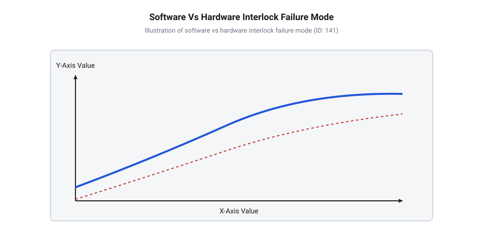
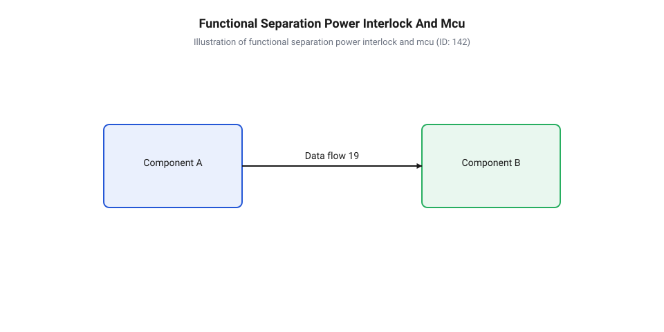
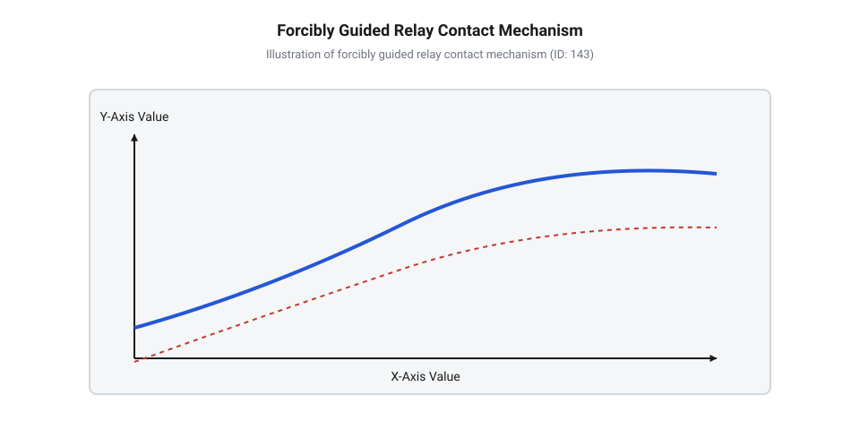
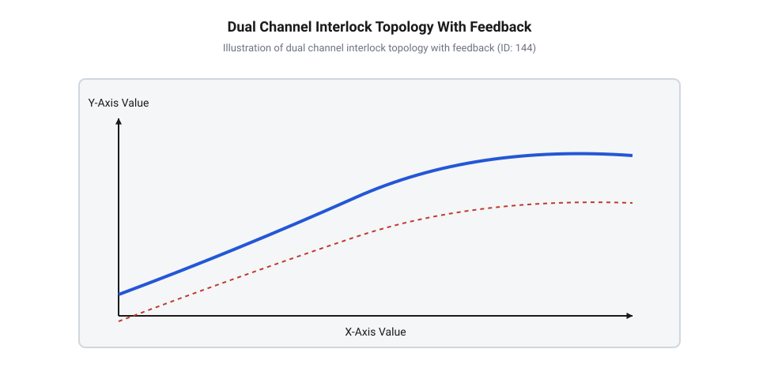
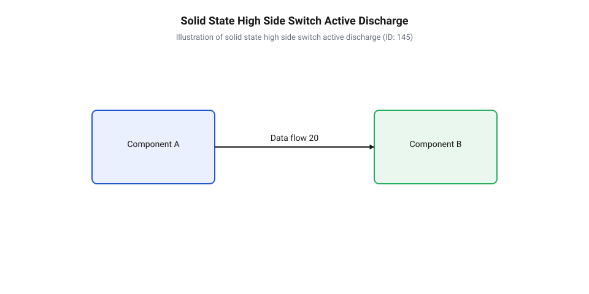
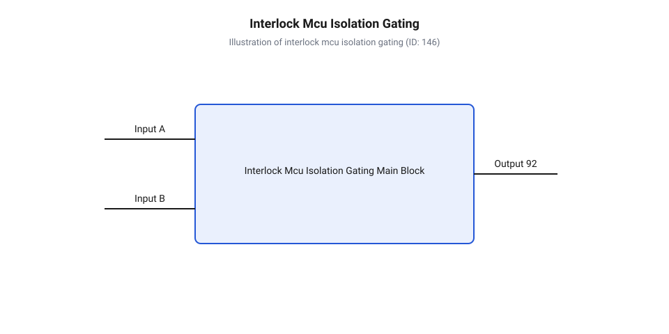

# Апаратні кола лазерного блокування та реле безпеки

<preknowlist>
- [KY-008 — лазерний модуль](root:cat-hw-actuators/ky-008-laser) — базові електричні характеристики малопотужних лазерних модулів, параметри живлення VCC та вхідного керуючого сигналу
- [Лазерний модуль з лінією (5 мВт, з фокусом)](root:cat-hw-actuators/laser-line-module) — особливості побудови силових кіл живлення лазерних модулів прямої проекції та вимоги до стабільності напруги VCC
</preknowlist>

## Чому програмне знеструмлення лазера є небезпечним

Уявіть ситуацію на високотехнологічному виробництві або в оптичній лабораторії: оператор відкриває захисний кожух технологічної лазерної установки або натискає червону кнопку аварійної зупинки. Очікування абсолютно однозначне — когерентне випромінювання має миттєво зникнути, запобігаючи важким опікам шкіри та незворотному ураженню сітківки ока. Проте лазер продовжує випромінювати світло. Оператор у паніці повторно натискає кнопку, але лазерний модуль залишається під напругою. Причина цієї смертельно небезпечної відмови полягає в тому, що розробник системи доручив функцію відключення живлення програмному забезпеченню мікроконтролера, з'єднавши аварійну кнопку з цифровим входом `GPIO`, а лазерний драйвер — із вихідним сигналом керування.

Коли команда вимкнення проходить крізь програмний стек, вона потрапляє в залежність від фізичного стану обчислювального ядра, цілісності оперативної пам'яті та порядку виконання інструкцій у процесорі. У реальних промислових умовах потужне оптичне випромінювання та комутація високих струмів супроводжуються сильними електромагнітними перешкодами (@@en|EMI@@; англ. *Electromagnetic Interference*, від *electro-* — електричний, *magnetic* — магнітний, та *interference* — перешкода). Достатньо одного високовольтного сплеску на шині живлення, щоб викликати збій у роботі фазового підстроювання частоти (@@en|PLL@@) або пробити буфер оперативної пам'яті. У цей момент мікроконтролер входить у стан неконтрольованого зависання (@@en|lockup@@). Якщо вихідна ніжка керування лазером у момент збою перебувала в логічній одиниці `1`, внутрішній регістр виводу залишається зафіксованим у цьому стані до фізичного зняття живлення з самого мікроконтролера.

Навіть якщо процесор не завис повністю, програмне керування створює критичні затримки, недопустимі для засобів захисту. Розробники часто сподіваються на обробку аварійних подій через апаратні переривання (@@en|IRQ@@; англ. *Interrupt Request*, від *interrupt* — переривати, та *request* — запит). Проте в реальній прошивці існує безліч ситуацій, коли обробник переривання не може виконатися негайно:
- Виконання атомарних операцій та критичних секцій коду з тимчасово вимкненими перериваннями (команди `cli` або `__disable_irq()`). - Конфлікти пріоритетів, коли процесор вже обробляє інше високопріоритетне переривання (наприклад, обмін даними по шині `DMA` або таймер генерації піднесучої). - Заблоковані цикли всередині системних драйверів (наприклад, очікування відповіді від периферійного датчика по шині `I2C`).

Затримка спрацьовування програмного переривання може зростати від мікросекунд до десятків або сотень мілісекунд. Для лазерного випромінювання першого чи другого класу небезпеки затримка в 100 мс є критичною, оскільки фототермічна реакція тканин ока відбувається за частки мілісекунди.

Окрему загрозу становить функціонування сторожового таймера (@@en|watchdog timer@@; англ. *watchdog timer*, від *watchdog* — вартовий собака, та *timer* — вимірювач часу). Поширене уявлення про те, що сторожовий таймер гарантує безпеку при зависанні прошивки, є небезпечною ілюзією. Коли сторожовий таймер фіксує відсутність скидання та ініціює перезавантаження процесора, виникає часове вікно апаратного скидання (@@en|reset window@@). Під час апаратного скидання всі виводи `GPIO` мікроконтролера переходять у високоімпедансний стан (@@en|high-impedance state@@; High-Z) або стан внутрішнього підтягування (@@en|pull-up@@). Якщо внутрішня схема драйвера лазера має активний низький рівень увімкнення або інтерпретує плаваючий потенціал як логічну одиницю, лазерний модуль самочинно вмикається на повну потужність протягом усього часу перезавантаження процесора — від кількох мілісекунд до десятків мілісекунд, поки програмний код ініціалізації не налаштує напрямок роботи регістрів `GPIO`.


*Порівняння часових затримок та шляхів поширення сигналу вимкнення при програмній обробці аварії та прямому апаратному розмиканні силового кола.*

Історичний шлях розвитку апаратного захисту лазерних установок демонструє поступовий перехід від простих одноканальних вимикачів до складних двоканальних систем із реле безпеки примусового спрямування контактів та стандартизованими рівнями продуктивності (@@en|Performance Level@@; PL за стандартом ISO 13849-1). У ранніх промислових системах вимкнення живлення нерідко довіряли програмним алгоритмам або керуючим кнопкам, однак серія важких виробничих інцидентів, спричинених зависанням процесорів і зварюванням контактів комутаторів, змусила міжнародні технічні комітети кардинально переглянути підходи до безпеки. Впровадження стандартів ISO 13849 та IEC 61508 законодавчо закріпило вимогу: захисний контур аварійного відключення не повинен залежати від програмного забезпечення та працездатності керуючого мікроконтролера. Відмова від звичайних кнопок на користь спеціалізованих вимикачів із примусовим розмиканням контактів стала прямим наслідком аналізу відмов, у яких програмний код виявлявся неспроможним зупинити випромінювання в критичний момент. Це остаточно сформувало базовий принцип: програмне забезпечення ніколи не розглядається як первинний бар'єр безпеки.

З огляду на зазначені фактори, системна архітектура будь-якої установки з лазерним випромінювачем повинна будуватися на суворому розподілі функцій. Первинний бар'єр захисту — це повністю апаратний силовий контур знеструмлення (@@en|hardware interlock circuit@@; від англ. *interlock* — взаємне блокування), який безпосередньо розмикає фізичну лінію живлення `VCC` або розриває силову лінію заземлення `GND` лазерного драйвера. Мікроконтролер у такій архітектурі виконує виключно роль допоміжного контуру моніторингу та діагностики (@@en|auxiliary monitoring loop@@). Він зчитує стан апаратного блокування через гальванічно розв'язані оптичні розв'язки (@@en|optocoupler@@; від грец. *optikos* — зоровий, та англ. *coupler* — з'єднувач), виводить інформацію оператору на дисплей та блокує видачу керуючих сигналів `PWM`, проте позбавлений можливості увімкнути лазер, якщо апаратний контур безпеки розімкнений.


*Структурний розподіл повноважень між прямим силовим контуром апаратного розмикання живлення та гальванічно розв'язаним мікроконтролерним контуром діагностики.*

Незалежно від того, чи використовуєте ви [базовий лазерний модуль](root:cat-hw-actuators/ky-008-laser) малої потужності, чи інтегруєте [потужний лінійний модуль](root:cat-hw-actuators/laser-line-module), силова лінія `VCC` повинна контролюватися апаратними комутаційними елементами. Мікроконтролер отримує сигнальний статус про стан блокування лише для виконання діагностичних процедур та індикації, як це розкрито у [довіднику моніторингу інтерлоку](root:cat-hw-actuators/laser-safety-interlock-circuits/api-laser-interlock-mcu-monitoring.md), що регламентує програмну взаємодію з апаратними колами без передачі їм функцій первинного захисту.

Нижче наведено приклад коду для мікроконтролера, який демонструє правильний пасивний моніторинг апаратного інтерлоку. Зверніть увагу: програма лише опитує стан захисного контуру та адаптує свій внутрішній стан, але фізичне знеструмлення лазера здійснюється апаратно і не залежить від виконання цього коду.

:::tabs
:::code laser-safety-interlock-circuits-d/cpp/arduino/interlockisr.cpp

:::code laser-safety-interlock-circuits-d/c/esp-idf/interlock-gpio-isr-handler.c
:::

## Механіка електромеханічних кінцевиків та реле безпеки

Усвідомивши неприпустимість програмного керування в контурах захисту, розробник постає перед питанням побудови надійного апаратного ланцюга аварійного знеструмлення. Найпростішим схемотехнічним рішенням здається послідовне включення звичайного електромеханічного тумблера або мікровимикача в силове коло живлення лазера `VCC`. Проте в реальних умовах експлуатації звичайні комутаційні елементи володіють прихованою фізичною уразливістю, яка може повністю звести нанівець їхні захисні властивості. Мова йде про явище термічного зварювання контактів (@@en|contact welding@@; англ. *contact welding*, від *contact* — дотик, та *welding* — зварювання).

Під час комутації силових кіл лазерних драйверів, які мають на вході значні згладжувальні та фільтруючі ємності, у момент замикання виникає потужний пусковий струм (@@en|inrush current@@). Цей струм створює мікроскопічну електричну дугу (@@en|electric arc@@) між поверхнями контактних подушечок. Срібний або мідний сплав контактів локально розплавляється. Коли контакти стискаються під дією внутрішньої пружини, розплавлений метал кристалізується, утворюючи міцний суцільнометалевий місток. Коли оператор відкриває захисні двері й механічний штовхач кінцевого вимикача відпускає важіль, зворотна пружина звичайного вимикача створює зусилля всього у кілька грамів або десятків грамів. Цього зусилля абсолютно недостатньо для розриву звареного металевого містка. У результаті кнопка зовні виглядає натиснутою або відпущеною, але її внутрішні електричні контакти залишаються замкненими, і напруга `VCC` продовжує безперешкодно надходити на лазерний модуль.

Для усунення цієї небезпеки в колах лазерного блокування застосовують спеціалізовані кінцеві вимикачі з примусовим розмиканням контактів (@@en|direct opening action@@; англ. *direct opening action* — дія прямого розмикання; згідно зі стандартом IEC 60947-5-1, Додаток K). На відміну від стандартних мікровимикачів, де розмикання розмикаючої групи (@@en|NC contact@@; Normally Closed) здійснюється виключно за рахунок пружності внутрішньої пружини, у вимикачах із примусовим розмиканням існує жорсткий механічний зв'язок між зовнішнім актуатором (штовхачем) та рухомим контактом. Коли зовнішня сила діє на штовхач (наприклад, при відкритті захисної кришки), механічна жорстка перемичка безпосередньо прикладає це зусилля до розмикаючої контактної групи, примусово зрізаючи та розриваючи зварений металевий місток із зусиллям у десятки ньютонів. Маркування таких пристроїв на принципових схемах та корпусах містить обов'язковий міжнародний знак — стрілку в колі.

Аналогічна проблема існує і при використанні комутаційних реле. Звичайне загальнопромислове реле не може використовуватися в захисному контурі безпеки. Розглянемо фізичну причину цього обмеження. Стандартне реле має кілька контактних груп, підключених до спільного якоря через гнучкі пружинні елементи. Припустимо, ми використовуємо одну замикаючу групу (@@en|NO contact@@; Normally Open) для подачі силового живлення `VCC` на лазер, а одну розмикаючу групу (`NC`) — для зворотного зв'язку з мікроконтролером. Якщо силова група `NO` приварилася через пусковий струм лазерного драйвера, то при знятті напруги з котушки реле якір намагається повернутися у початковий стан під дією поворотної пружини. Проте приварений `NO` контакт утримує якір у проміжному стані. Через пружну деформацію контактних пластин розмикаючий `NC` контакт встигає зімкнутися, тоді як силова `NO` група залишається замкненою! Мікроконтролер, зчитуючи стан замкненого `NC` контакта, робить хибний висновок про те, що реле успішно знеструмило лазер, хоча насправді лазер продовжує випромінювати світло під повною робочою напругою.

Вирішенням цієї фундаментальної проблеми стало створення реле безпеки з примусово керованими контактами (@@en|forcibly guided contacts@@; англ. *forcibly guided contacts* — примусово спрямовані контакти, також відомі як реле типу A за стандартом EN 50205 / IEC 61810-3).


*Кінематичний механізм блокування допоміжних розмикаючих контактів жорсткою напрямною планкою при виникненні термічного зварювання силової замикаючої групи реле безпеки.*

У реле безпеки з примусово керованими контактами всі контактні групи механічно зв'язані між собою єдиною жорсткою недеформованою пластиковою напрямною планкою (@@en|guide bar@@). Така конструкція забезпечує два суворі кінематичні закони:
1. Якщо хоча б один замикаючий контакт `NO` зварюється або приліпає у замкненому стані, при знеструмленні котушки реле жорстка напрямна планка фізично блокує переміщення всіх розмикаючих контактів `NC`. Жоден `NC` контакт не зможе зімкнутися, залишаючись у розімкненому стані з гарантованим зазором не менше 0.5 мм. 2. Якщо хоча б один розмикаючий контакт `NC` приварився, при подачі напруги на котушку жорстка планка не дозволить зімкнутися жодному замикаючому контакту `NO`.

Завдяки цьому механізму стан допоміжного `NC` контакта стає 100% детермінованим відображенням стану силового `NO` контакта. Зчитуючи стан `NC` контакта, діагностична схема або реле моніторингу миттєво виявляє приварювання силових контактів та блокує повторний пуск лазерного випромінювача.

Проте навіть застосування реле безпеки з примусово керованими контактами не захищає від відмови в разі пошкодження кабельних ліній або виникнення одиночного пробою одного з вимикачів. Для досягнення високих категорій безпеки (Категорія 3 або 4, рівень PL d / PL e за ISO 13849-1) побудова контуру інтерлоку виконується за двоканальною резервованою топологією (@@en|dual-channel interlock topology@@).


*Двоканальна топологія апаратного інтерлоку з джерелом стимуляції ліній, контролем перехресних замикань та петлею зворотного зв'язку моніторингу зовнішніх реле (EDM).*

У двоканальній схемі застосовуються два независимі кінцеві вимикачі (Канал A та Канал B), встановлені на захисному кожусі. Силовий ланцюг живлення лазера комутується двома послідовно з'єднаними контактами двох незалежних реле безпеки K1 та K2. Якщо один із контактів привалюється або один із вимикачів ламається, другий канал гарантовано розриває лінію живлення `VCC`.

Для виявлення прихованих замикань між провідниками кабелю (наприклад, при затисканні джгута металевими дверима верстата) модуль реле безпеки використовує функцію контролю перехресних замикань (@@en|cross-fault monitoring@@). Модуль подає на Канал A імпульсний або позитивний потенціал, а на Канал B — протилежний потенціал або зміщені по фазі діагностичні імпульси. Якщо між провідниками Каналу A і Каналу B виникає коротке замикання, струм виходу Каналу A надходить на вхід Каналу B, що викликає негайне спрацьовування внутрішнього апаратного захисту модуля та блокування силових реле K1 і K2.

Важливим елементом резервованої системи є петля зворотного зв'язку EDM (@@en|External Device Monitoring@@; англ. *External Device Monitoring* — моніторинг зовнішнього пристрою). Розмикаючі контакти `NC` усіх внутрішніх та зовнішніх силових контакторів з'єднуються послідовно у ланцюг дозволу скидання/пуску модуля безпеки. Модуль безпеки дозволяє повторне замикання силових контактів K1 і K2 тільки в тому випадку, якщо перед пуском лінія EDM є замкненою. Якщо хоча б одне реле в минулому циклі приварилося й не розімкнуло свої `NO` контакти, його `NC` контакт у лінії EDM залишається розімкненим, унеможливлюючи повторне увімкнення лазерної установки.

Електричні параметри захисних кілець, трасування сигнальних ліній та конфігурація клемних блоків докладніше розглянуті в [описі схемотехнічного інтерфейсу](root:cat-hw-actuators/laser-safety-interlock-circuits/api-laser-interlock-hw-interface.md), де наведено деталізовані вимоги до ізоляції та вибору перерізу провідників. Покроковий розрахунок та схемна розводка практичного модуля наведені в [проєкті двоканального блокування](root:cat-hw-actuators/laser-safety-interlock-circuits/proj-dual-channel-laser-interlock.md), де інтегровано два силові контактні ланцюги з автоматичною діагностикою. При цьому динамічні затримки спрацьовування пружинних механізмів та гасіння електричної дуги розраховуються відповідно до правил, описаних у [динаміці аварійного знеструмлення](root:cat-hw-actuators/laser-safety-interlock-circuits/math-interlock-discharge-timing.md), що визначає сумарний час розмикання кола з урахуванням ємностей лазерного драйвера.

## Принципи побудови двоканальних резервованих ліній інтерлоку

У попередніх розділах було розглянуто фізику термічного зварювання контактів та кінематичний механізм реле безпеки з примусово керованими контактами. Проте навіть найдосконаліше реле не здатне захистити лазерну установку, якщо небезпечний збій виникає поза його корпусом — у сигнальному джгуті або в механізмі кінцевого вимикача. Уявіть ситуацію: під час роботи промислового лазерного верстата гнучкий кабель захисних дверей перетирається об металеву станину або затискається механізмом. Заземлений екран кабелю замикає сигнальну лінію аварійного вимикача безпосередньо на корпус. У такій одноканальній системі відкриття захисних дверей нічого не змінить: струм котушки реле безпеки продовжує текти через аварійний замикач на корпус, і лазерний випромінювач залишається під повною робочою напругою `VCC`.

Для усунення небезпеки поодинокої відмови лінії розмикання захисний контур будують за принципом двоканальної резервованої топології (@@en|dual-channel topology@@; від англ. *dual* — подвійний, *channel* — канал, та грец. *topos* — місце). У такій схемі захисна огорожа або двері лазерного модуля оснащуються не одним, а двома незалежними кінцевими вимикачами з примусовим розмиканням контактів. Перший вимикач комутує Канал S1, а другий — Канал S2. Обидва канали підключаються до спеціалізованого модуля реле безпеки, вихідні силові контакти якого `NO1` та `NO2` ввімкнені послідовно в лінію живлення `VCC`.

Якщо в одного з вимикачів заклинить механічний штовхач або перетреться провідник Каналу S1, другий незалежний Канал S2 при відкритті дверей гарантовано знеструмить свою котушку, і другий силовий контакт розірве лінію `VCC`. Щоб уникнути ситуації, коли обидва вимикачі виходять з ладу через одну й ту саму зовнішню причину — так звану відмову за спільною причиною (@@en|Common Cause Failure@@; CCF, від англ. *common* — спільний, *cause* — причина, та *failure* — відмова), — кінцеві вимикачі розносять фізично або застосовують пристрої з різним принципом дії (наприклад, один працює на механічний натиск, а інший — на магнітно-герконове розмикання чи шарнірне повертання).

Справжнім викликом для двоканальних систем є виявлення прихованого перехресного замикання між провідниками двох каналів (@@en|cross-fault@@). Якщо провідник Каналу S1 електрично зімкнеться з провідником Каналу S2 (наприклад, при пробої ізоляції всередині спільного джгута), одноканальний вимикач S1 виявиться зашунтованим потенціалом Каналу S2. Якщо система не вміє розпізнавати такі замикання, вона продовжуватиме працювати, втративши резервування, поки друга відмова не призведе до аварії.

Для розпізнавання цієї прихованої відмови модуль реле безпеки реалізує виявлення перехресного замикання (@@en|cross-fault monitoring@@; від англ. *cross* — перехресний, *fault* — замикання, та *monitoring* — відстеження). Принцип дії полягає в тому, що джерело живлення кіл безпеки подає на Канал S1 та Канал S2 неевівалентні потенціали або діагностичні імпульси (@@en|diagnostic pulses@@). Наприклад, на вхід Каналу S1 подається позитивна напруга +24 В, а на вхід Каналу S2 — напруга 0 В (або діагностичний прямокутний меандр із зсувом по фазі). Внутрішній порівнювач (@@en|comparator@@) модуля безпеки безперервно вимірює рівні струмів та різницю потенціалів між каналами. Якщо між провідниками S1 та S2 виникає електричний контакт, струм з Каналу S1 перетікає в Канал S2. Порівнювач негайно фіксує аномальний баланс струмів, відключає обидва вихідних реле K1 і K2 та переводить систему в режим апаратної аварії, знеструмлюючи лазерний випромінювач за мілісекунди.

Окрім моніторингу входів S1 та S2, будь-яка надійна система лазерного блокування повинна перевіряти власний вихідний силовий контур перед кожним повторним увімкненням. Для цього в схему вводиться петля зворотного зв'язку (@@en|External Device Monitoring@@; EDM, від англ. *external* — зовнішній, *device* — пристрій, та *monitoring* — моніторинг). Всі розмикаючі допоміжні контакти `NC1` та `NC2` силових контакторів або зовнішніх реле комутації `VCC` з'єднуються послідовно у ланцюг дозволу скидання модуля безпеки.

Алгоритм функціонування петлі @@en|EDM@@ підпорядковується суворій детермінованій послідовності станів:

```
[Початковий стан: Двері зачинені, лазер вимкнено]
  ├── Входи S1 та S2: Замкнені (Огорожа зачинена)
  ├── Силові контакти NO1 та NO2: Розімкнені (VCC знято з лазера)
  └── Допоміжні контакти NC1 та NC2: Замкнені (Петля EDM суцільна)

[Крок 1: Натискання кнопки Ручного Скидання (Reset)]
  ├── Модуль безпеки опитує стан петлі EDM
  ├── Перевірка: Якщо NC1 та NC2 замкнені → Скидання дозволено
  └── Модуль подає струм на котушки реле K1 та K2

[Крок 2: Активний робочий стан]
  ├── Силові контакти NO1 та NO2: Замикаються (VCC подано на лазер)
  └── Допоміжні контакти NC1 та NC2: Примусово розмикаються (Петля EDM розривається)

[Крок 3: Аварійне відкриття дверей / Розмикання S1 чи S2]
  ├── Знеструмлення котушок K1 та K2
  ├── Силові контакти NO1 та NO2: Розмикаються під дією пружин
  └── Допоміжні контакти NC1 та NC2: Замикаються (Петля EDM відновлюється)

[Аномальний стан: Зварювання контакту NO1]
  ├── Напрямна планка (guide bar) утримує NC1 у розімкненому стані
  ├── Петля EDM залишається розімкненою
  └── Наступне натискання Reset БЛОКУЄТЬСЯ → Повторний пуск неможливий!
```

Як видно з алгоритму, якщо силова група `NO1` привариться під дією пускових струмів, жорстка напрямна планка (@@en|guide bar@@) реле з примусово керованими контактами не дозволить зімкнутися допоміжному контакту `NC1`. Петля @@en|EDM@@ залишиться розімкненою. Коли оператор зачинить двері й натисне кнопку `Reset`, модуль безпеки виявить відсутність замкненого ланцюга @@en|EDM@@ і відмовиться подавати напругу на котушки реле, запобігаючи роботі з пошкодженим контуром захисту.

Оцінка надійності побудованого контуру опирається на міжнародний стандарт ISO 13849-1, який визначає класифікацію категорій безпеки (Категорії B, 1, 2, 3, 4) та рівнів продуктивності (@@en|Performance Level@@; PL від a до e). - **Категорія 3 (Category 3):** Вимагає обов'язкової двоканальної резервованої структури. Поодинока відмова в будь-якому з елементів не повинна призводити до втрати функції безпеки. Проте в Категорії 3 частина прихованих відмов може не виявлятися до наступного тестування. - **Категорія 4 (Category 4):** Найвищий рівень архітектурної стійкості. Двоканальна структура поєднується з високим діагностичним охопленням (@@en|Diagnostic Coverage@@; DC > 99%). Будь-яка поодинока відмова розпізнається негайно — у момент її виникнення або під час наступного спробу увімкнення, блокуючи повторний пуск.

Розрахунок підсумкового рівня продуктивності @@en|Performance Level@@ базується на комбінації трьох фундаментальних кількісних параметрів:
1. Середній час до небезпечної відмови (@@en|Mean Time to Dangerous Failure@@; `MTTF_d`). 2. Рівень діагностичного охоплення (@@en|Diagnostic Coverage@@; `DC`). 3. Стійкість до відмов за спільною причиною (@@en|Common Cause Failure@@; `CCF`).

Для промислових технологічних лазерів класи небезпеки Class 3B та Class 4 вимоги нормативів IEC 60825-1 регламентують використання контурів блокування з рівнем безпеки не нижче **PL d** або **PL e**.

Для практичного проектування топології підключення клемних колодок, розведення сигнальних провідників та вибору типів вимикачів звертайтеся до [схемотехнічного залізного інтерфейсу](root:cat-hw-actuators/laser-safety-interlock-circuits/api-laser-interlock-hw-interface.md). Повна принципова електрична схема готового блоку з розводкою ліній S1, S2, запірними реле та ланцюгом @@en|EDM@@ наведена у [практичному проєкті двоканального інтерлоку](root:cat-hw-actuators/laser-safety-interlock-circuits/proj-dual-channel-laser-interlock.md), який розрахований на роботу з промисловими напругами живлення 12 В та 24 В.

## Напівпровідникові ключі аварійного знеструмлення та розряду

Незважаючи на високу надійність та абсолютну гальванічну розв'язку електромеханічних реле безпеки, вони мають фізичне обмеження — швидкість спрацьовування. Механічний час розмикання пружинного якоря силового реле становить від 10 до 50 мілісекунд. Для малопотужних систем це прийнятно, але у високошвидкісному технологічному обладнанні або під час роботи з лазерними модулями прямої проекції виникає інша прихована проблема.

Плати керування та силові драйвери лазерних випромінювачів містять на вхідній лінії живлення `VCC` значні згладжувальні ємності накопичувальних конденсаторів `C_{in}` (від десятків до тисяч мікрофарад). Коли електромеханічне реле розмикає фізичну лінію живлення, накопичений у конденсаторах електричний заряд `Q` продовжує живити лазерний діод. Напруга на ємності спадає поступово, і лазерний модуль продовжує випромінювати світло ще десятки або навіть сотні мілісекунд після повного розмикання контактів реле. У ситуаціях, де вимагається миттєве знеструмлення за частки мілісекунди, електромеханічний контур необхідно доповнювати високошвидкісним напівпровідниковим аварійним ключем з активним розрядом.

Побудова високошвидкісного напівпровідникового ключа аварійного знеструмлення вимагає суворого дотримання схемотехнічних правил. Перше правило свідчить: знеструмлення лазерного модуля має здійснюватися виключно у високосторонній лінії живлення `VCC` (@@en|high-side switching@@; від англ. *high* — високий, *side* — сторона, та *switching* — комутація).

Для цього у високосторонню лінію `VCC` вмикається силовий P-канальний польовий транзистор (@@en|P-channel MOSFET switch@@). Застосування N-канального транзистора у низькосторонній лінії `GND` (Low-Side switching) є грубою помилкою проектування кіл безпеки. Якщо розірвати лінію `GND`, лазерний модуль переходить у стан плаваючого заземлення (@@en|floating ground@@). У цьому випадку струм витоку драйвера може знайти альтернативний шлях на земляний потенціал через екрани сигнальних кабелів, підтягувальні резистори інтерфейсів `PWM` або `I2C`. Це створює загрозу неконтрольованого спонтанного увімкнення лазера або випалювання сигнальних портів керуючого мікроконтролера.

Схема керування затвором високостороннього P-канального транзистора вимагає використання зміщувача рівня напруги (@@en|level shifter@@). Оскільки напруга живлення лазера `VCC` (наприклад, +12 В або +24 В) перевищує рівні сигнальної логіки (3.3 В або 5 В), затвор P-канального транзистора підтягується до `VCC` через резистор `R_{pull-up}` (від 4.7 кОм до 10 кОм), що забезпечує надійне закриття транзистора за відсутності керуючого сигналу. Для відкриття P-канального ключа використовується малий N-канальний MOSFET або NPN-транзистор, який притягує затвор P-канального ключа до землі `GND`, створюючи необхідну від'ємну напругу затвор-витік `V_{GS} = -V_{CC}`.

Другим обов'язковим елементом напівпровідникового вузла аварійного захисту є коло активного розряду (@@en|active discharge circuit@@). Просте закриття P-канального транзистора залишає вхідну ємність лазерного модуля `C_{in}` зарядженою. Для примусового скидання цього заряду паралельно виходу живлення лазера та землі `GND` вмикається додатковий розрядний N-канальний MOSFET `Q_{discharge}` із послідовно включеним потужним керамічним або дротовим резистором `R_{discharge}` (від 5.1 Ом до 22 Ом).

Робота розрядного вузла будується за комплементарним принципом:
- У штатному режимі, коли силовий P-канальний ключ `Q_{main}` відкритий і подає `VCC` на лазер, розрядний N-канальний ключ `Q_{discharge}` надійно закритий негативним потенціалом на затворі. - У момент аварійного спрацьовування затвор P-канального ключа `Q_{main}` миттєво підтягується до `VCC` (ключ закривається), а на затвор N-канального ключа `Q_{discharge}` надходить високий потенціал відкриття. - N-канальний ключ відкривається за лічені наносекунди, створюючи низькоомний ланцюг для примусового скидання заряду з ємностей `C_{in}` на землю `GND` через розрядний резистор `R_{discharge}`.

Часова динаміка розряду накопичувальної ємності підпорядковується експоненційному закону розряду `RC`-ланцюга. Час, за який напруга на виході спадає від робочого значення `V_{CC}` до безпечної напруги відкриття P-N переходу лазерного діода `V_{th}` (близько 0.7 В – 1.5 В), обчислюється за покроковим алгоритмом:

```
t_discharge = R_discharge × C_in × ln(V_CC ÷ V_th)
            = 10 × 470 × 10⁻⁶ × ln(24 ÷ 0.7)         [підстановка номіналів елементів]
            = 4.7 × 10⁻³ × ln(34.285)                [обчислення логарифмічного співвідношення]
            = 4.7 × 10⁻³ × 3.535                     [значення натурального логарифма]
            ≈ 16.61 × 10⁻³ s                         [підсумковий час активного розряду ємності]
```

Завдяки активному розряду час повного знеструмлення лазера скорочується від сотень мілісекунд (при природному витоку) до 15–20 мілісекунд, що унеможливлює випромінювання навіть залишкової світлової енергії. Точний математичний розрахунок теплової потужності розрядного резистора та параметрів згасання струму випромінювача дивіться у [розрахунку таймінгів аварійного знеструмлення](root:cat-hw-actuators/laser-safety-interlock-circuits/math-interlock-discharge-timing.md).

Третім фундаментальним вузлом напівпровідникового захисту є апаратний тригер блокування (@@en|latch-up@@; від англ. *latch* — засувка). Уявіть ситуацію: захисна кришка лазера короткочасно відхилилася від вібрації й відразу повернулася на місце. Якщо схема захисту не має пам'яті спрацьовування, лазер знеструмиться на частку секунди і негайно увімкнеться знову, що створює небезпечну ситуацію для оператора.

Для запобігання автоколиванням застосовують апаратний RS-тригер (@@en|RS flip-flop@@), зібраний на дискретних логічних вентилях `NAND` / `NOR` (наприклад, мікросхема 74HC00 або 4001) або на комплементарній транзисторній парі.


*Електрична принципова схема високостороннього напівпровідникового комутатора живлення на P-канальному MOSFET з апаратною фіксацією аварійного стану на RS-тригері та колом примусового розряду накопичувальних конденсаторів.*

Логіка функціонування тригерного засуву підпорядковується суворим апаратним правилам:
1. Сигнал від апаратних вимикачів інтерлоку надходить на вхід скидання `Reset` (R) тригера. 2. При першому ж розмиканні інтерлоку тригер перемикається в стан апаратного блокування `Q = 0`. 3. Вихід `Q = 0` негайно закриває силовий P-канальний MOSFET та відкриває розрядний N-канальний MOSFET. 4. Навіть якщо захисна кришка знову замкне вимикач інтерлоку, тригер залишається у заблокованому стані `Q = 0`. 5. Повторна подача живлення `VCC` на лазерний модуль можлива ТІЛЬКИ після свідомого натискання оператором фізичної кнопки «Скид / Пуск» (Manual Reset), яка подає короткий імпульс на вхід установки `Set` (S) тригера.

Практичну реалізацію повністю напівпровідникового вузла з RS-тригером та вентилями апаратної логіки для прямих керованих випромінювачів детально розібрано у [практичному проєкті напівпровідникового тригерного ключа](root:cat-hw-actuators/laser-safety-interlock-circuits/proj-solid-state-interlock-latch.md).

Зауважте: при роботі з [малопотужними лазерними модулями](root:cat-hw-actuators/ky-008-laser) струми комутації є незначними, проте використання високостороннього P-канального ключа з підтягувальними резисторами є обов'язковим для усунення плаваючих станів. При інтеграції [потужних лінійних лазерних модулів](root:cat-hw-actuators/laser-line-module) напівпровідниковий ключ активного розряду комбінують із первинним електромеханічним реле безпеки, створюючи двобар'єрний захист.

Нижче наведено приклад коду для мікроконтролера, який ілюструє взаємодію з апаратним напівпровідниковим тригером блокування. Мікроконтролер зчитує стан виходу тригера `Latch Status` та може подавати безпечний імпульс скидання `Reset Pulse` ТІЛЬКИ за умови, що апаратний двоканальний контур безпеки є повністю замкненим.

:::tabs
:::code laser-safety-interlock-circuits-d/cpp/arduino/tryhardwarereset.cpp

:::code laser-safety-interlock-circuits-d/c/esp-idf/try-hardware-reset.c
:::

## Розділення силового апаратного контуру та моніторингу

Найнебезпечніша помилка під час проектування лазерної електроніки — покладання функцій захисного вимкнення на мікроконтролер чи керувальне програмне забезпечення. Навіть найрозвиненіші мікроконтролерні системи схильні до апаратних збоїв: імпульсні завади від силових компонентів можуть викликати зависання ядра, электростатичні розряди пробивають виводи обробки переривань, а під час перезавантаження виводи загального призначення опиняються у плаваючому високоімпедансному стані. Якщо сигнал від дверного геркона або кнопкового вимикача завести безпосередньо на вхід мікроконтролера, очікуючи, що прошивка змінить стан виходу та зніме напругу з силового ключа, катастрофа стає лише питанням часу. Захист від збоїв не здатний гарантувати миттєве реагування, оскільки @@en|watchdog timer@@ (від англійського *watchdog* — сторожовий пес, та *timer* — вимірювач часу) потребує від десятків до сотень мілісекунд для виявлення заклинювання та перезапуску процесора. Упродовж цього проміжку часу лазерний модуль залишається під напругою з відкритим променем.

З цієї причини електроніка лазерної безпеки будується на фундаментальному принципі суворого розмежування ролей. Силовий апаратний контур виконує роль первинного автономного бар'єра, а мікроконтролерний контур призначений виключно для допоміжної діагностики, індикації та видачі дозвільного стробування.

@@en|interlock@@ (від англійського *inter* — між, та *lock* — замок, блокування) у своїй силовій частині діє безпосередньо на лінію живлення VCC або силовий ключ розмикання. Коли оператор відкриває захисний кожух або натискає кнопку аварійної зупинки, механічні контакти з примусовим розмиканням або електромеханічне реле безпеки фізично розривають коло живлення без участі будь-яких цифрових обчислювачів. Оцінку швидкотечності знеструмлення силових кіл розкриває [розрахунок таймінгів розряду](root:cat-hw-actuators/laser-safety-interlock-circuits/math-interlock-discharge-timing.md), який доводить, що апаратний розряд накопичувальних ємностей завершується за частки мілісекунди, що принципово недосяжно для програмної обробки.

Мікроконтролер у такій архітектурі виконує функцію спостерігача через допоміжний контур моніторингу @@en|auxiliary monitoring loop@@. Зчитування стану захисного кола здійснюється не з силового провідника, а через допоміжні сухі контакти @@en|auxiliary contact@@ (від латинського *auxiliaris* — допоміжний, та *contactus* — дотик) реле або через паралельні вимірювальні лінії. Щоб усунути проходження високовольтних наведень та запобігти утворенню замкнених земляних петель між силовим живленням лазера та чутливою цифровою платою, застосовується @@en|galvanic isolation@@ (від прізвища вченого Луїджі Гальвані, *Galvani*).

Сигнали від допоміжних контактів проходять через елементи @@en|optocoupler isolation@@ (від грецького *optikos* — зоровий, та англійського *coupler* — з'єднувач). Світлодіод оптопари живиться від лінії блокування, а її вихідний фототранзистор комутує низьковольтний сигнальний вивід мікроконтролера, підтягнутий до напруги VDD через резистор @@en|pull-up resistor@@ (від англійського *pull* — тягнути, та *up* — вгору) або резистор верхньої підтяжки.


*Схема розділення силового контуру знеструмлення лазера та гальванічно ізольованого контуру моніторингу мікроконтролера.*

Для безпечного з'єднання електричних сигналів між блоком захисту та процесорною платою розроблено [залізний інтерфейс інтерлоку](root:cat-hw-actuators/laser-safety-interlock-circuits/api-laser-interlock-hw-interface.md), який визначає стандартизоване розпінування клемних колодок, підтягувальні опори та фільтрувальні конденсатори.

Коли мікроконтролеру потрібно керувати роботою лазера в штатному режимі (наприклад, виконувати широтно-імпульсну модуляцію або вимикати промінь між технологічними операціями), він видає сигнал стробування @@en|strobe@@ (від грецького *strobos* — кружіння, швидкий рух) або дозвільний сигнал @@en|gating@@ (від англійського *gate* — ворота, затвор). Проте цей дозвільний сигнал ніколи не підключається до лазера напряму. Він подається на один із входів апаратного логічного елемента І (AND), тоді як на другий вхід подається підтверджений статус від апаратного тригера безпеки. Якщо контур @@en|interlock@@ розімкнений, на виході логічного вентиля виникає стійкий нульовий рівень, і вихідний сигнал мікроконтролера фізично блокується незалежно від того, які команди виконує програма або в якому стані завис вивід GPIO.

Таке ж правило застосовується як для силово-релейних схем, де використовується [двоканальна схема блокування](root:cat-hw-actuators/laser-safety-interlock-circuits/proj-dual-channel-laser-interlock.md), так і для повністю електронних систем, де задіяний [напівпровідниковий тригерний ключ](root:cat-hw-actuators/laser-safety-interlock-circuits/proj-solid-state-interlock-latch.md). У двох випадках керуючий мікроконтролер дізнається про розмикання блокування постфактум, зчитуючи стан оптопар.

Програмне забезпечення мікроконтролера повинно правильно інтерпретувати отримані дані. Структури даних, алгоритми опитування та регістри діагностики стандартизує [інтерфейс зчитування статусів](root:cat-hw-actuators/laser-safety-interlock-circuits/api-laser-interlock-mcu-monitoring.md). Алгоритм роботи прошивки реалізує скінченний автомат:
1. Запуск та ініціалізація: мікроконтролер тримає лінію @@en|gating@@ у низькому стані, забороняючи випромінювання. 2. Перевірка зворотного зв'язку (EDM): мікроконтролер опитує додаткові контакти реле або тригера. Якщо контур вимкнений, але сигнальний контакт показує активний стан, фіксується небезпечна відмова (зварювання контактів або пробій транзистора), і пуск блокується. 3. Очікування готовності: після замикання всіх захисних екранів та усунення аварійних чинників керуюче ПЗ очікує команду скидання (Reset). 4. Активація дозволу: мікроконтролер подає високий рівень на лінію @@en|gating@@, дозволяючи роботу апаратного вентиля. 5. Режим моніторингу: під час генерації променя мікроконтролер безперервно зчитує статус @@en|interlock@@. При апаратному розмиканні ланцюга живлення лазера (наприклад, усередині установки, де встановлено [лазерний модуль з лінією](root:cat-hw-actuators/laser-line-module) або компактний [малопотужний лазерний модуль](root:cat-hw-actuators/ky-008-laser)) мікроконтролер негайно скидає свій дозвільний сигнал, реєструє подію в журналі помилок та сповіщає оператора через інтерфейс користувача.

Нижче наведено практичну реалізацію модуля моніторингу для мікроконтролера, який здійснює неблокувальний опис стану захисного контуру та керує апаратним стробуванням з обов'язковою перевіркою зворотної лінії EDM перед розблокуванням.

:::tabs
@tab C / ESP-IDF
:::code laser-safety-interlock-circuits-d/c/esp-idf/safety-hardware-init.c

@tab C++ / Arduino
:::code laser-safety-interlock-circuits-d/cpp/arduino/safetystate.cpp
:::

Завдяки такій побудові повністю виключається людський та програмний чинники: вимикання лазерного модуля відбувається миттєво апаратним шляхом, а мікроконтролер отримує повну інформацію для коректного відображення статусів операторові та керування логікою відновлення після аварії.