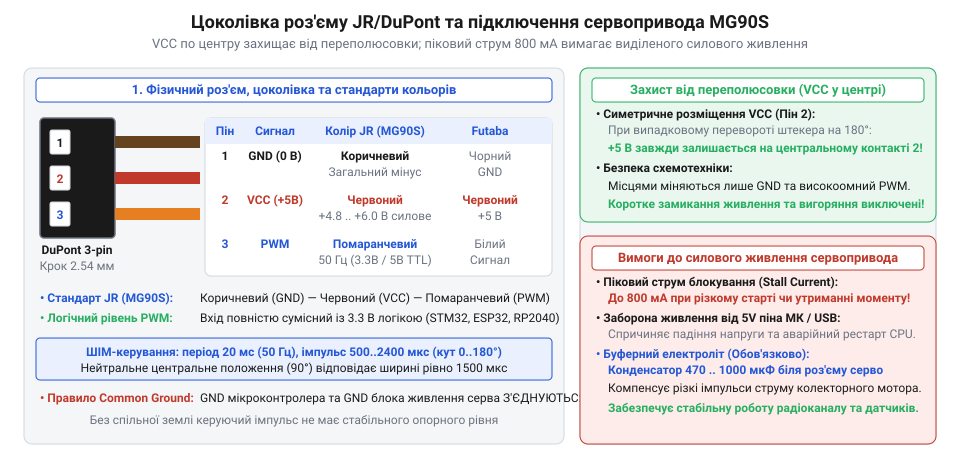
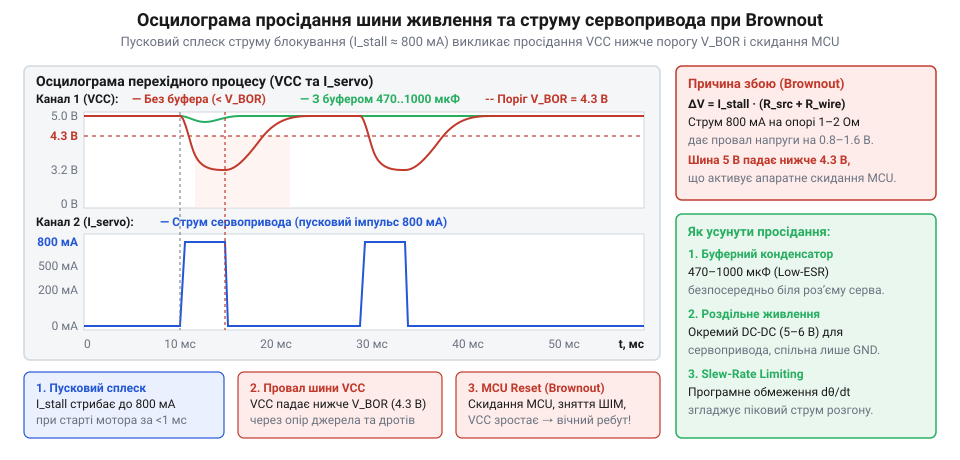
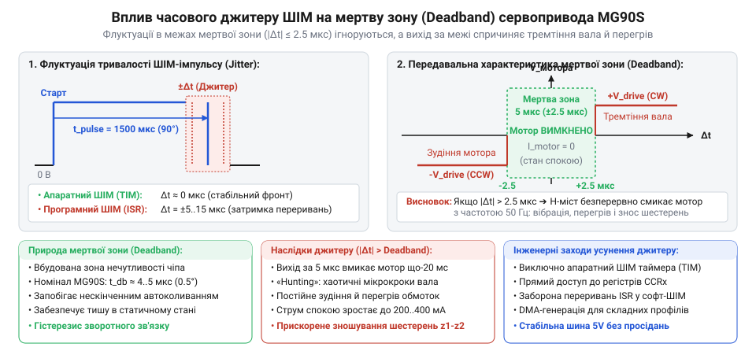
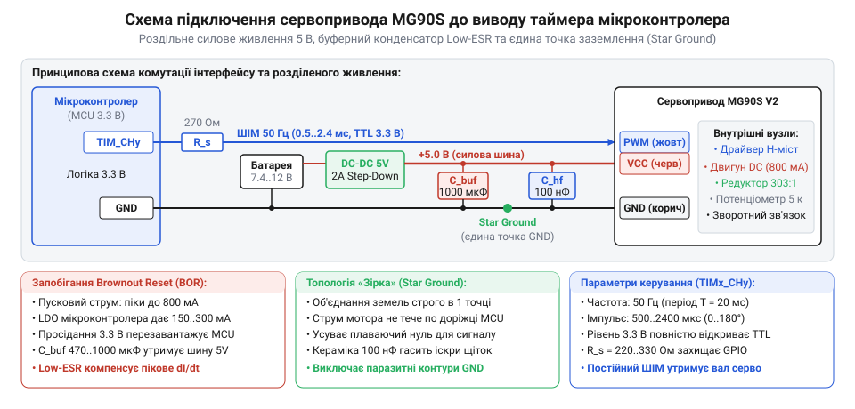

# MG90S V2 — мікросерво з металевим редуктором

<preknowlist>
- [Power HD HD-1370A](root:cat-hw-actuators/hd-1370a-servo) — Базові принципи підключення аналогових сервоприводів та керування тривалістю імпульсу.
- [Серво-роги (запасні)](root:cat-hw-actuators/servo-horns) — Стандарти шліців вихідного вала мікросервоприводів та підбір качалок.
</preknowlist>

## Фізичне підключення та цоколівка роз'єму JR/DuPont

Підключення мікросервопривода MG90S до системи керування здійснюється за допомогою трипровідного стрічкового шлейфа (@@en|ribbon cable@@) довжиною близько 250 мм. Кабель складається з трьох паралельних гнучких багатожильних мідних провідників у спільній ізоляції, опресованих стандартизованим триконтактним гніздовим роз'ємом (@@en|female connector@@) із міжцентровим кроком виводів 2.54 мм (0.1 дюйма). Цей форм-фактор успадковано з галузі радіокерованого моделізму (RC), де він за десятиліття став універсальним стандартом фізичного підключення аналогових та цифрових мікроприводів (порівняйте зі стандартним роз'ємом у статті [Tower Pro SG90](root:cat-hw-actuators/sg90-servo) або [Power HD HD-1370A](root:cat-hw-actuators/hd-1370a-servo)).

У радіомодельній індустрії історично склалися дві основні схеми колірного маркування трипровідного інтерфейсу: стандарти брендів JR/Graupner (також використовуваний Spektrum) та Futaba (також вживаний Hitec). У бюджетних мікросервоприводах MG90S та їхніх численних репліках найчастіше зустрічається розкладка JR, хоча нерідко застосовується змішана гама, де сигнальний дріт замість помаранчевого забарвлено в яскраво-жовтий колір:

| Контакт | Сигнал | Колір JR / Spektrum | Колір Futaba / Hitec | Функціональне призначення |
| :---: | :---: | :---: | :---: | :--- |
| **1** | **GND** | Коричневий (@@en|Brown@@) | Чорний (@@en|Black@@) | Спільна опорна шина (земля) для силового живлення та логіки |
| **2** | **VCC** | Червоний (@@en|Red@@) | Червоний (@@en|Red@@) | Позитивна шина живлення двигуна та внутрішньої схеми (+4.8...6.0 В) |
| **3** | **PWM** | Помаранчевий (@@en|Orange@@) / Жовтий | Білий (@@en|White@@) | Вхід керуючого ШІМ-сигналу кутового позиціонування вала |

*Цоколівка трипровідного кабелю та роз'єму сервопривода MG90S: розташування та колірне маркування ліній живлення і сигналу.*

Зверніть увагу на конструктивну архітектуру цоколівки: плюсовий контакт живлення (VCC) завжди розміщений на центральному виводі (контакт 2) в обох конкуруючих стандартах. Це фундаментальне інженерне рішення захищає сервопривід від помилки переполюсовки. Якщо інженер чи оператор у польових умовах помилково підключить роз'єм зворотною стороною (повернувши його на 180°), центральний контакт VCC залишиться підключеним до позитивної шини, а місцями поміняються лише земля (GND) та сигнальний вхід (PWM). За такого дзеркального вмикання внутрішня мікросхема драйвера не отримує зворотної напруги живлення, завдяки чому вихідний напівпровідниковий міст двигуна та вхідні ланцюги залишаються неушкодженими.

> 🔧 **Навіщо це.**
> Симетричне розташування позитивного виводу живлення в центрі колодки запобігає спаленню кристала мікросхеми при випадковому перевертанні роз'єму на 180°, оскільки напруга зворотної полярності ніколи не потрапляє між виводами живлення.

Проте механічна взаємозамінність має кілька критичних підводних каменів, про які повинен пам'ятати розробник:
- **Відсутність механічного ключа-поляризатора:** Фірмові роз'єми стандарту Futaba мають тонкий поздовжній направляючий виступ (@@en|polarizing key tab@@) на одній зі сторін пластикового корпусу, що фізично унеможливлює встромляння штекера у відповідне гніздо приймача не тим боком. Корпус роз'єму MG90S виконаний за спрощеним стандартом JR, що геометрично відповідає звичайним коннекторам DuPont. Він має форму гладкого прямокутного паралелепіпеда з ледь помітними скошеними кутами знизу (або й зовсім без них). Через це роз'єм легко вставити в будь-яку макетну плату чи штирьовий роз'єм типу PLS/PBD зі зміщенням на один крок або зворотною стороною.
- **Ризик зміщення по горизонталі:** Якщо підключати сервопривід не до спеціалізованої трирядної колодки сервоконтролера, а до гребінки з багатьма штирями, зміщення коннектора на один пін убік може подати напругу живлення +5 В безпосередньо на сигнальний вхід або закоротити вихід живлення мікроконтролера на землю.
- **Механічна втома провідників:** У кабелі MG90S використовуються тонкі багатожильні мідні дроти калібру 26–28 AWG (переріз 0.08–0.13 мм²). У рухомих з'єднаннях (наприклад, у суглобах робототехнічних маніпуляторів чи шасі) зона виходу кабелю з пластикового корпусу сервопривода зазнає постійного циклічного згину. За відсутності надійного еластичного кабельного вводу (@@en|strain relief@@) мідні жили переламуються всередині ізоляції вже після кількох тисяч циклів повороту, що викликає плаваючі відмови живлення та раптові ривки вала.

## Електричні вимоги до підсистеми живлення та динаміка струму

Мікросервопривід MG90S розрахований на роботу від джерела постійного струму з номінальною напругою 4.8–6.0 В. Цей діапазон історично відповідає напрузі чотирьох або п'яти послідовно з'єднаних нікель-кадмієвих (NiCd) чи нікель-металогідридних (NiMH) акумуляторів під навантаженням.

Зміна напруги живлення безпосередньо впливає на електромеханічні параметри привода: максимальний крутний момент і кутову швидкість відпрацювання положення:
- При напрузі **4.8 В**: статичний крутний момент блокування (@@en|stall torque@@) становить `M_бок ≈ 1.8 кг·см` (`0.177 Н·м`), а гранична кутова швидкість холостого ходу — `0.10 с / 60°` (поворот на 60 градусів за 100 мс).
- При напрузі **6.0 В**: момент зростає на 22% і досягає `M_бок ≈ 2.2 кг·см` (`0.216 Н·м`), а час повороту на 60° скорочується до `0.08 с` (80 мс).

Абсолютні допустимі межі живлення становлять від 4.5 В до 6.5 В. Зниження напруги нижче 4.2–4.5 В призводить до збоїв у роботі внутрішнього компаратора або мікроконтролера сервопривода, викликаючи тремтіння (@@en|jitter@@) та втрату сили утримання. Перевищення порогу 6.5 В неприпустиме: вихідні ключі внутрішнього Н-моста та біполярні транзистори драйвера перегріваються і зазнають теплового або лавинного пробою.

Динамічний профіль споживання струму MG90S істотно відрізняється від статичних навантажень традиційної цифрової електроніки. У роботі сервопривода чітко виділяються чотири струмові фази:
1. **Струм спокою (@@en|quiescent current@@):** Коли вал зафіксовано в заданому положенні й на нього не діє зовнішнє механічне навантаження, електродвигун знеструмлений. Струм споживають лише внутрішній потенціометр зворотного зв'язку, формувач опорної напруги та мікросхема керування. Величина струму становить лише `I_спок ≈ 5–10 мА`.
2. **Динамічний струм вільного руху (@@en|running current@@):** Під час відпрацювання кута без істотного механічного опору на важіль двигун обертається з високою швидкістю, генеруючи проти-ЕРС (@@en|back-EMF@@), яка обмежує струм обмотки якоря на рівні `I_рух ≈ 100–150 мА`.
3. **Робочий струм під навантаженням:** При подоланні тертя в шарнірах, переміщенні корисного вантажу чи протидії аеродинамічному опору тяги струм пропорційно зростає і становить `I_роб ≈ 250–450 мА`.
4. **Струм стопоріння / заклинювання (@@en|stall current@@):** Якщо вихідний важіль зупиняється через упор у механічну перешкоду або намагається зрушити вантаж, що перевищує максимальний момент редуктора, ротор мотора повністю зупиняється.

Фізична природа струму блокування обумовлена тим, що при зупиненому роторі проти-ЕРС дорівнює нулю (`E = 0`), і струм у колі обмежується виключно омічним опором мідної обмотки якоря та відкритих транзисторів комутаційного моста:

    I_stall
    = V_живл / (R_якоря + R_міст)    [закон Ома для заблокованого ротора]

Активний опір обмотки якірного мікромотора MG90S становить `R_якоря ≈ 5.5–6.5 Ом`, а сумарний опір відкритих каналів моста — близько `0.5–0.8 Ом`. Відповідно, при напрузі живлення `5.0 В`:

    I_stall
    = 5.0 / (5.6 + 0.6)
    = 5.0 / 6.2
    ≈ 0.81 А         [розрахунковий піковий струм заклинювання]

У паспортних специфікаціях струм заклинювання MG90S нормується в діапазоні `700–850 мА` при напрузі 5 В і досягає `900 мА` при напрузі 6 В. Окрім аварійного стопоріння, короткочасний сплеск струму такої ж амплітуди (до 800–900 мА тривалістю 15–30 мс) виникає під час кожного пуску двигуна з нерухомого стану або при різкій зміні напрямку обертання, доки ротор не набере робочих обертів.

Такий імпульсний характер споживання є головною причиною найпоширенішої апаратної проблеми в аматорських та навчальних розробках — спонтанного перезавантаження мікроконтролера (@@en|brownout reset@@). Спроба живити сервопривід безпосередньо від виводу 5V плати Arduino чи мікроконтролерів ESP32/STM32 або від USB-порту комп'ютера неминуче веде до збою:
- Стандартний порт USB 2.0 має апаратне обмеження вихідного струму на рівні 500 мА.
- Вбудовані лінійні стабілізатори (LDO типу AMS1117-5.0 або LP2985) мають обмежену швидкість наростання струму і при кидку 800 мА зазнають глибокого просідання вихідної напруги.
- Імпульсне просідання шини живлення нижче порогового рівня детектора низької напруги (Brown-Out Detector, типово 2.7–4.3 В залежно від архітектури MCU) викликає апаратне анулювання регістра скиду й перезапуск процесора.

Виникає замкнене автоколивальне коло збою: мікроконтролер запускається → ініціалізує таймер ШІМ → сервопривід починає рух і створює пусковий кидок струму 800 мА → напруга живлення просідає → мікроконтролер перезавантажується → сигнал ШІМ зникає → сервопривід зупиняється → напруга живлення відновлюється → мікроконтролер знову запускається. Зовні цей дефект виглядає як періодичне сіпання сервопривода з частотою 1–3 Гц та відмова програми керування.

*Осцилограма просідання напруги живлення та імпульсу струму при переході мікроконтролера в brownout: пусковий кидок струму просаджує шину живлення нижче порогу скидання MCU.*

> 🔧 **Навіщо це.**
> Електричне розділення цифрової та силової шин живлення разом зі встановленням локальних буферних ємностей гарантує безперебійну роботу процесора, усуваючи просідання напруги під час пускових струмових ударів колекторного двигуна.

Правильна інженерна організація підсистеми живлення сервоприводів вимагає дотримання таких схемотехнічних норм:
1. **Роздільне живлення:** Сервоприводи повинні живитися від окремого джерела або виділеного імпульсного DC-DC перетворювача (step-down buck converter) на 5 В чи 6 В зі струмовим запасом щонайменше 1.5–2 А на кожен активний сервопривід у системі; для живлення сервомасивів застосовують спеціалізовану [плату розподілу живлення сервоприводів](root:hw-power/servo-power-distribution-board).
2. **Спільна земля (@@en|common GND@@):** Земляний провід живлення сервопривода (GND) та земля мікроконтролера мають бути надійно з'єднані в одній спільній точці (зіркоподібне заземлення), щоб керуючий ШІМ-сигнал мав стабільний потенціал відліку без синфазних наведень від струму двигуна.
3. **Локальні буферні конденсатори:** Безпосередньо біля колодки підключення сервопривода між шинами VCC та GND необхідно встановити електролітичний конденсатор низького послідовного опору (Low ESR) ємністю `470–1000 мкФ` (на робочу напругу не менше 10–16 В). Він слугує локальним акумулятором заряду, що компенсує індуктивність живильних дротів і забезпечує необхідний імпульсний струм у перші мілісекунди пуску ротора.
4. **Високочастотна фільтрація:** Паралельно електролітичному конденсатору слід запаяти керамічний конденсатор ємністю `100 нФ` (0.1 мкФ). Він пригнічує високочастотні завади та іскріння щітково-колекторного вузла двигуна, які можуть проникати у чутливі аналогові та цифрові ланцюги мікроконтролера.

## Специфікація керуючого ШІМ-сигналу та часові межі

Позиціонування вихідного вала мікросервопривода MG90S здійснюється за допомогою стандартного аналогового імпульсного сигналу з широтно-імпульсною модуляцією (@@en|Pulse-Width Modulation@@, ШІМ). На відміну від регуляторів обертів безколекторних двигунів або схем яскравісного димування світлодіодів, де керуючою величиною є відносний коефіцієнт заповнення (@@en|duty cycle@@ у відсотках), у сервоприводах положення вала кодується **виключно абсолютною тривалістю активного високого імпульсу** `t_висок` (у мікросекундах).

Стандартна частота повторення імпульсів становить `f = 50 Гц`, що відповідає періоду проходження сигналу `T = 20 мс`:

    T
    = 1 / f
    = 1 / 50
    = 0.020 с
    = 20 мс           [період оновлення сигналу ШІМ]

Внутрішня електронна схема сервопривода містить генератор опорного імпульсу, тривалість якого задається кутовим положенням вбудованого потенціометра зворотного зв'язку. Вхідний компаратор порівнює довжину зовнішнього вхідного імпульсу `t_висок` із внутрішнім опорним сигналом і формує імпульс помилки, який через підсилювач відкриває відповідне плече H-моста двигуна, повертаючи редуктор у напрямку зменшення неузгодженості.

*Часова діаграма керуючого ШІМ-сигналу: залежність кута повороту вихідного вала від тривалості активного імпульсу.*

Діапазон робочих тривалостей імпульсу для сервопривода MG90S становить:
- **Нейтральне положення (90°):** `t_нейтр = 1500 мкс` (1.50 мс). Це універсальна точка центрування, за якої коефіцієнт заповнення становить `1.5 / 20 = 7.5%`.
- **Крайній лівий кут (0°):** у класичній радіомодельній специфікації відповідає `1000 мкс`, проте для повного використання механічного діапазону 0–180° у приводі MG90S нижня межа становить `t_мін ≈ 500–600 мкс`.
- **Крайній правий кут (180°):** у класичному стандарті дорівнює `2000 мкс`, тоді як для досягнення кута 180° імпульс розширюють до `t_макс ≈ 2400–2500 мкс`.

Залежність кута повороту `θ` (у градусах) від тривалості імпульсу `t_висок` (у мікросекундах) описується лінійною функцією:

    θ
    = (t_висок - t_мін) · 180° / (t_макс - t_мін)    [лінійна характеристика позиціонування]

Для типового діапазону `t_мін = 500 мкс` та `t_макс = 2400 мкс` розрахункова чутливість становить:

    Δt / Δθ
    = (2400 - 500) / 180
    = 1900 / 180
    ≈ 10.56 мкс / градус    [кутова роздільна здатність інтерфейсу]

Внутрішня мікросхема керування сервопривода має власну апаратну «мертву зону» (@@en|deadband@@) шириною близько `5–8 мкс`. Якщо зміна тривалості вхідного імпульсу менша за ширину мертвої зони, сервопривід не вмикає двигун. Це запобігає виснажливому автоколивальному тремтінню ротора навколо точки рівноваги під дією мікрошумів.

Вхідний сигнальний каскад MG90S побудований на базі високовольтного транзисторного буфера з логікою TTL/CMOS. Порогова напруга розпізнавання логічної одиниці становить:

    V_ih ≈ 1.8–2.0 В      [мінімальний рівень високого сигналу]

Це забезпечує повну електричну сумісність привода із сучасними 3.3-вольтовими мікроконтролерами (ESP32, STM32, RP2040, nRF52) без необхідності застосування перетворювачів логічних рівнів (@@en|logic level shifters@@). Водночас вхід витримує рівні 5.0 В стандартних плат Arduino (ATmega328P).

> 🔧 **Навіщо це.**
> Позиція сервопривода визначається абсолютною тривалістю імпульсу в мікросекундах, а не відсотками шпаруватості: зміна періоду повторення з 20 мс до 18 чи 22 мс не впливає на встановлений кут вала, допоки ширина імпульсу залишається незмінною.

Критичним фактором плавності руху сервопривода є часова стабільність фронтів сигналу ШІМ (відсутність джитеру, @@en|jitter@@; докладніше про джерела нестабільності див. [аналіз джитеру та часової стабільності ШІМ-сигналів](root:hw-arch/servo-pwm-jitter-analysis)). Якщо генерувати ШІМ програмно за допомогою таймерних переривань або затримок (bit-banging), нестабільність часу реакції ядра процесора викликає фазове тремтіння імпульсу амплітудою 5–15 мкс. Оскільки це перевищує ширину мертвої зони привода, сервопривід починає безперервно гудіти, смикати важелем та споживати підвищений струм. Для бездоганного керування необхідно використовувати виключно апаратні таймери мікроконтролера (наприклад, апаратні канали TIM у STM32 або модулі MCPWM/LEDC у ESP32) з апаратною точністю формування імпульсу не гірше 0.5–1.0 мкс.

*Вплив часового джитеру фронтів ШІМ на потрапляння в мертву зону сервопривода: коли флуктуації тривалості імпульсу перевищують ширину deadband, виникає безперервне автоколивальне тремтіння вала.*

## Механічні характеристики вихідного вала та шліцьове з'єднання

Крутний момент від внутрішнього редуктора передається на виконавчий механізм через металевий вихідний вал із зовнішнім зубчастим шліцьовим вінцем. На відміну від повністю пластикового вала базових приводів (таких як [Tower Pro SG90](root:cat-hw-actuators/sg90-servo)), вихідний вал MG90S виготовлено з монолітної легованої латуні або пресованої сталі, що багаторазово підвищує стійкість до зрізання зубців при різких ударних перевантаженнях.

Шліцьовий вузол виконаний за мікро-стандартом:
- **Кількість шліців:** рівно `20 зубців` (позначення `20T`).
- **Зовнішній діаметр по вершинах зубців:** `4.85–4.90 мм`.
- **Сумісність:** мікросервоприводи розміру 9–12 г використовують індивідуальні набори качалок (див. детальний огляд геометрії у статті [серво-роги](root:cat-hw-actuators/servo-horns)); стандартні 25-зубцеві качалки від повнорозмірних приводів Futaba (діаметром 5.9 мм) сюди не підходять.
- **Осьова фіксація:** на торці вала виконано різьбовий отвір під кріпильний гвинт M2 (довжиною 4–5 мм). Затягування центрального гвинта виключає осьове сповзання пластикового рога зі шліців під дією вібрацій.

У верхній кришці корпусу MG90S встановлено мініатюрну прецизійну кулькову вальницю кочення (@@en|ball bearing@@), яка підтримує вихідний вал. Наявність вальниці докорінно відрізняє MG90S від дешевих сервоприводів із втулками ковзання, забезпечуючи високу механічну витривалість:
- **Допустиме консольне радіальне навантаження:** до `15–20 Н` на плечі 10 мм. Вальниця утримує вал суворо перпендикулярно до площини обертання, запобігаючи крайовому перекосу шестерень та заклинюванню зубчастих пар редуктора.
- **Допустиме осьове навантаження:** до `5–8 Н` уздовж осі обертання. Надмірний осьовий тиск (наприклад, при грубому напресовуванні рога без упору) може пошкодити вальницю або вдавити кінцевий зубчастий сектор у дно редукторної камери.
- **Номінальний тривалий момент:** рекомендоване робоче навантаження не повинно перевищувати 40–50% від моменту блокування (тобто не більше `0.8–1.0 кг·см` або `0.08–0.10 Н·м`). Тривала робота на межі заклинювання веде до швидкого стирання латунних вінців проміжних блок-шестерень і перегріву двигуна.

Всередині редуктора на вихідному секторному колесі передбачено міцний механічний штифт-обмежувач, який упирається в припливи корпусу, обмежуючи кутовий хід сектора інтервалом приблизно `190°–205°`. Цей стопор захищає внутрішній вимірювальний потенціометр від провертання та зрізання його резистивного повзунка.

> 🔧 **Навіщо це.**
> Програмне обмеження тривалості імпульсу в прошивці захищає вихідний вал від удару об внутрішні механічні стопори корпусу, запобігаючи виламуванню зубців редуктора під максимальним моментом блокування.

Якщо система керування видасть занадто короткий (менше 450 мкс) або занадто довгий (понад 2450 мкс) імпульс ШІМ, внутрішній двигун спробує повернути вал далі, ніж дозволяє механічний обмежувач. Сервопривід увійде в жорсткий аварійний режим стопоріння (stall), струм підскочить до 800–900 мА, і мотор почне нагріватися зі швидкістю понад 5–10 °C за секунду. Тому в інженерній практиці програмні ліміти (@@en|soft limits@@) у коді мікроконтролера обов'язково налаштовують на безпечний інтервал (наприклад, від 550 до 2350 мкс).

Для захисту редуктора від зовнішніх динамічних ударів (наприклад, при падінні маніпулятора чи наїзді колеса керованої моделі на перешкоду) вихідний важіль рекомендується сполучати з тягою через пружний демпфер — [механічний сервосейвер](root:hw-motion/servo-saver-mechanism). Він поглинає пікові ударні імпульси сили, не дозволяючи кінетичній енергії маси навантаження зрізати зубці кінцевого триба.

## Апаратна схема типового підключення до мікроконтролера та діагностика несправностей

Надійна робота сервопривода MG90S у складі мікроконтролерної системи можлива лише за умови грамотної схемотехнічної реалізації ланцюгів живлення та проходження керуючого сигналу. Підключення сервопривода безпосередньо до шин живлення логічних контролерів неприпустиме через потужні комутаційні завади та глибокі імпульсні просідання напруги.

Типова схемотехнічна архітектура передбачає чітке розділення системи на два функціональні домени: слабкострумовий цифровий домен мікроконтролера та силовий домен виконавчого привода.

*Схема підключення сервопривода до мікроконтролера: виділений стабілізатор, спільна земля та багаторівнева фільтрація запобігають скиданню MCU.*

Електрична схема надійного інтерфейсу містить чотири обов'язкові компоненти:
1. **Виділений стабілізатор силового живлення:** Імпульсний DC-DC понижувальний стабілізатор (наприклад, на базі LM2596, MP2307 чи XL4015) або потужний лінійний стабілізатор, що видає напругу `+5.0 В` або `+6.0 В` із постійним робочим струмом не менше 1.5–2.0 А на кожен привід.
2. **Зіркоподібне заземлення (@@en|star GND@@):** Провід захисного заземлення від сервопривода і земляний вивід джерела живлення з'єднуються з шиною GND мікроконтролера в єдиній точці. Завдяки цьому зворотні імпульсні струми комутації обмотки мотора (до 800 мА) замикаються безпосередньо на стабілізатор, не створюючи паразитних падінь напруги на друкованих доріжках земляного полігону мікроконтролера.
3. **Локальний буферний фільтр:** Безпосередньо біля силових контактів живлення сервопривода встановлюється оксидно-електролітичний конденсатор низького послідовного опору (Low ESR) ємністю `C1 = 470–1000 мкФ` (на робочу напругу 10–16 В), зашунтований багатошаровим керамічним конденсатором `C2 = 100 нФ` (тип X7R). Електролітична ємність компенсує індуктивність живильних дротів під час пускових струмових сплесків, а кераміка гасить високочастотні гармоніки від іскріння колекторних щіток.
4. **Узгоджувальний демпферний резистор на лінії сигналу:** Послідовно в лінію ШІМ між виводом таймера мікроконтролера та входом сервопривода встановлюють резистор `R_демпф = 100–330 Ом`. Він виконує дві функції: обмежує струм у разі випадкового замикання або переполюсовки, а також разом із паразитною ємністю кабелю утворює фільтр низьких частот, який придушує дзвін (@@en|ringing@@) і відбиття фронтів на довгих лініях зв'язку.

> 🔧 **Навіщо це.**
> Резистор 220–330 Ом у розриві сигнальної лінії ШІМ гасить високочастотні викиди та захищає вихідний буфер порту мікроконтролера від електростатичних розрядів і сплесків напруги, індукованих по довжині кабелю.

Під час пусконалагоджувальних робіт інженер нерідко стикається з типовими апаратними симптомами несправностей. Нижче наведено зведену матрицю діагностики та методів усунення проблем:

| Симптом несправності | Фізична першопричина | Апаратний / програмний метод усунення |
| :--- | :--- | :--- |
| **Мікроконтролер перезавантажується під час руху привода** | Просідання напруги живлення (Brownout) через живлення від LDO плати або USB-порту | Перевести сервопривід на виділене джерело 5 В (≥ 2 А); встановити конденсатор 1000 мкФ біля роз'єму |
| **Сервопривід постійно гуде і тремтить у стані спокою (jitter)** | Джитер програмного ШІМ або наведення на сигнальний дріт через відсутність спільної землі | Використовувати виключно апаратний таймер ШІМ; об'єднати землі в зірку; перевірити мертву зону |
| **Вал різко повертається в упор і гуде з сильним перегрівом** | Тривалість імпульсу вийшла за межі ходу, вал уперся в механічний стопор | Обмежити тривалість імпульсу в коді (безпечний діапазон 550–2350 мкс); перевірити калібрування |
| **Сервопривід хаотично смикається при вмиканні живлення** | Плаваючий високоімпедансний стан (Hi-Z) виводу мікроконтролера до завершення завантаження | Встановити підтягуючий резистор 10 кОм до землі (pull-down) на лінію PWM для фіксації логічного нуля |
| **Вал легко провертається рукою, мотор не чинить опору** | Відсутній керуючий ШІМ-сигнал або напруга живлення нижче критичного порогу 4.2 В | Перевірити наявність імпульсів осцилографом або логічним аналізатором; виміряти напругу під навантаженням |
