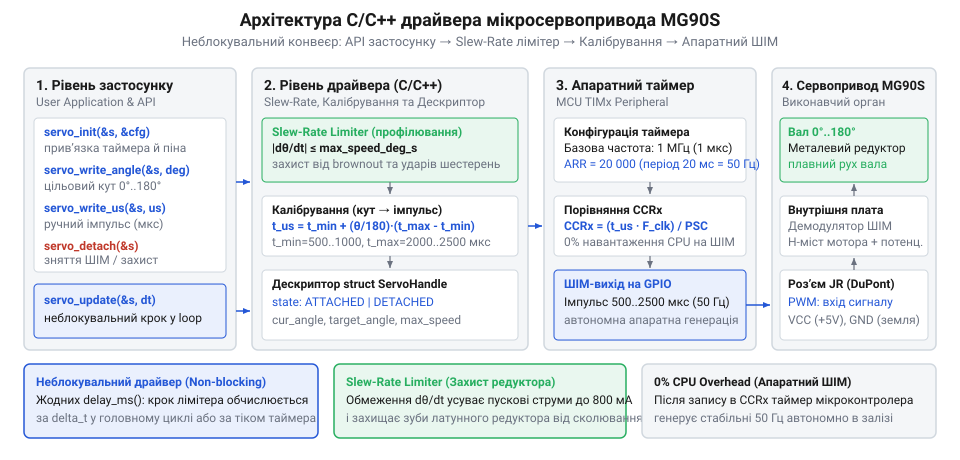
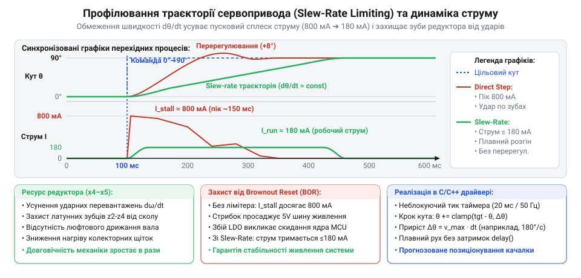

# MG90S V2 — мікросерво з металевим редуктором

<preknowlist>
- [Tower Pro SG90](root:cat-hw-actuators/sg90-servo) — Стандарт керування сервоприводами імпульсами 50 Гц.
- [Серво-роги (запасні)](root:cat-hw-actuators/servo-horns) — Механічний діапазон кутів качалок та обмеження ходу.
</preknowlist>

## Архітектурна модель драйвера та неблокуюче апаратне керування

Під час реалізації перших проектів керування сервоприводами розробники-початківці часто застосовують найпростіший, але вкрай небезпечний прийом — пряме перемикання логічного рівня виводу мікроконтролера (@@en|bit-banging@@) у поєднанні з блокуючими затримками на кшталт delayMicroseconds(). Алгоритм виглядає очевидним: виставити на ніжці високий логічний рівень, зачекати від 1000 до 2000 мікросекунд, повернути лінію в низький стан і заблокувати процесор на наступні 18–19 мілісекунд до завершення 20-мілісекундного циклу. Проте спроба перенести такий підхід у реальний вбудований проєкт із кількома периферійними інтерфейсами, перериваннями чи операційною системою реального часу (RTOS) миттєво руйнує стабільність системи. Якщо центральний процесор витрачає понад 5–10% часу на один канал суто на порожні цикли очікування, він втрачає вхідні пакети UART або SPI та не встигає опитувати давачі. Якщо ж затримку переривають зовнішні апаратні переривання (ISR), тривалість активного імпульсу починає хаотично коливатися. Виникає часовий джитер (@@en|jitter@@, від англ. *jitter* — тремтіння, нервування): розкид тривалості сигналу навіть на 10–20 мкс змушує внутрішній компаратор привода безперервно смикати ротор двигуна. Качалка починає тремтіти, шестерні металевого редуктора зазнають знакозмінних ударних перевантажень, а струм споживання в стані утримання зростає у 5–8 разів.

### Принцип апаратного формування сигналу ШІМ

Сервопривод MG90S вимагає періодичного керуючого імпульсу з несучою частотою 50 Гц (період проходження сигналу T = 20 мс = 20 000 мкс), де цільова просторова кутова координата кодується тривалістю високоактивного стану в межах 0.5–2.5 мс. Єдиним інженерно коректним рішенням для генерації такого сигналу є [апаратні таймери мікроконтролера в режимі генерації ШІМ](root:hw-arch/hardware-pwm) (@@en|hardware timer/counter@@).

Апаратний блок таймера тактується від внутрішньої системної шини через окремий дільник частоти — переддільник (@@en|prescaler@@, PSC) і функціонує повністю незалежно від ядра центрального процесора. Процесор налаштовує параметри лічби лише один раз під час запуску системи. Після цього зміна кута вала зводиться до єдиної атомарної операції запису нового числового значення в апаратний регістр порівняння захоплення (@@en|Capture/Compare Register@@, CCR). Перемикання вихідного логічного рівня виконується внутрішнім цифровим автоматом таймера з апаратною точністю до одного такту, що гарантує повну відсутність фазового тремтіння незалежно від поточної завантаженості операційної системи.

### Розрахунок часової сітки та шкали мікросекунд

Для спрощення математики драйвера та усунення зайвих перерахунків у робочому циклі часову базу таймера калібрують так, щоб один крок лічильника строго дорівнював одній мікросекунді (1 мкс = 10⁻⁶ с). Нехай базова тактова частота шини таймера становить F_timer = 84 МГц (типове значення для мікроконтролерів родини STM32F4). Для отримання лічильної частоти 1 МГц коефіцієнт переддільника PSC розраховують за співвідношенням:

`
f_cnt
= F_timer / (PSC + 1)                 [частота лічби таймера]
= 84 000 000 / (83 + 1)               [налаштування переддільника для отримання 1 МГц]
= 1 000 000 Гц                        [один такт лічильника дорівнює рівно 1 мкс]
`

Період повторення імпульсів 20 мс задається значенням регістра автоматичного перезавантаження ARR (@@en|Auto-Reload Register@@):

`
T_pwm
= (ARR + 1) / f_cnt                   [період вихідного сигналу ШІМ]
= (19 999 + 1) / 1 000 000            [розрахунок періоду 20 000 тактів лічби]
= 0.02 с = 20 мс                      [частота повторення становить строго 50 Гц]
`

За такої конфігурації значення, що записується в регістр порівняння CCR, фізично збігається з бажаною тривалістю активного імпульсу в мікросекундах: запис числа 1500 формує імпульс тривалістю рівно 1500 мкс (1.5 мс), що відповідає нейтральному положенню вала.

### Структура програмного дескриптора привода

У надійних вбудованих архітектурах відмовляються від розрізнених глобальних змінних. Стан кожного окремого сервопривода інкапсулюється в незалежний програмний дескриптор (лат. @@la|descriptor@@ — той, хто описує). Структура servo_t містить апаратні ідентифікатори, калібрувальні константи та динамічні змінні поточного положення:

`c
#include <stdint.h>
#include <stdbool.h>
#include <stddef.h>

/**
 * @brief Статуси завершення функцій драйвера сервопривода.
 */
typedef enum {
    SERVO_OK = 0,               ///< Операцію виконано успішно
    SERVO_ERR_INVALID_ARG = 1,  ///< Передано невалідний покажчик або некоректні дані
    SERVO_ERR_OUT_OF_RANGE = 2, ///< Значення виходить за допустимі межі
    SERVO_ERR_NOT_ATTACHED = 3  ///< Генерація ШІМ вимкнена (привід деактивовано)
} servo_status_t;

/**
 * @brief Дескриптор конфігурації та стану екземпляра сервопривода MG90S.
 */
typedef struct {
    // Апаратна прив'язка до таймера мікроконтролера
    void *timer_instance;       ///< Покажчик на базову адресу регістрів таймера
    uint32_t channel;           ///< Номер апаратного каналу ШІМ (наприклад, TIM_CHANNEL_1)
    
    // Калібрувальні параметри кутового діапазону
    uint16_t min_us;            ///< Тривалість імпульсу для фізичного кута 0° (типово 500-600 мкс)
    uint16_t max_us;            ///< Тривалість імпульсу для максимального кута (типово 2400-2500 мкс)
    uint16_t max_angle_deg;     ///< Максимальний робочий кутовий сектор (номінально 180°)
    
    // Поточний динамічний стан
    uint16_t current_pulse_us;  ///< Поточне значення тривалості імпульсу в регістрі порівняння
    float current_angle_deg;    ///< Поточний кут вала у градусах
    bool is_attached;           ///< Ознака активності генерації сигналу на виводі
} servo_t;
`


*Архітектурна схема взаємодії програмного дескриптора привода з апаратним ШІМ-таймером мікроконтролера: неблокуюче оновлення регістра порівняння таймера без навантаження на ядро процесора.*

Архітектура драйвера повністю розмежовує абстрактний математичний рівень розрахунку траєкторії та низькорівневий апаратний шар доступу до регістрів таймера (@@en|Hardware Abstraction Layer@@, HAL). Це дозволяє використовувати єдину бібліотеку на різних мікроконтролерних платформах (STM32, ESP32, AVR, RP2040), змінюючи лише апаратно-залежну функцію запису в регістр порівняння CCR.

> 🔧 **Навіщо це.**
> Відмова від блокуючих програмних затримок на користь апаратного ШІМ вивільняє 100% процесорного часу для прикладної логіки та повністю усуває фазовий джитер. Помилка тривалості імпульсу всього на кілька мікросекунд спричиняє постійне високочастотне сіпання ротора, що веде до прискореного зносу латунних шестерень редуктора MG90S і перегріву двигуна.

## Калібрування діапазону та функції кутового позиціонування

У популярній любительській літературі прийнято вважати, що будь-який аналоговий сервопривід підкоряється жорсткому стандарту: імпульс 1000 мкс відповідає куту 0°, 1500 мкс — нейтралі 90°, а 2000 мкс — куту 180°. Проте спроба керувати мініатюрними приводами [Tower Pro SG90](root:cat-hw-actuators/sg90-servo) або металевим MG90S за цими спрощеними числами призводить до суттєвих помилок позиціонування.

По-перше, при подачі імпульсів у діапазоні 1000–2000 мкс реальний кутовий хід сервопривода становить лише 120°–140° замість очікуваних 180°. По-друге, через технологічні допуски при виробництві мініатюрних аналогових компонентів внутрішній потенціометр зворотного зв'язку має розкид опору резистивного шару до ±15–20%. Внаслідок цього нульове положення в одного екземпляра MG90S досягається при імпульсі 540 мкс, а в іншого — при 620 мкс. Верхня межа 180° аналогічно коливається від 2380 до 2520 мкс.

### Механічний упор і ризик термічного руйнування

Вихідне зубчасте колесо редуктора MG90S має запресований сталевий або латунний обмежувальний штифт, який взаємодіє з виступом пластикового корпусу, фізично обмежуючи обертання вала в межах приблизно 190°–200°. Це зроблено для захисту внутрішнього потенціометра від механічного зламу.

Якщо керуюча програма надсилає імпульс, що вимагає повороту за межі фізичного ходу (наприклад, 400 мкс або 2650 мкс), внутрішня плата привода намагається відпрацювати неусувну помилку позиціонування. Транзистори інтегрованого H-моста відкриваються на 100%, подаючи повну напругу живлення на мотор. Вал намертво впирається в упор, кутова швидкість падає до нуля, проти-ЕРС зникає, і мотор переходить у режим блокування (@@en|stall current@@). Струм споживання стрибає до пікових 800 мА. За кілька секунд заклинювання температура мідної обмотки ротора перевищує 120 °C, викликаючи розплавлення лакової ізоляції, коротке замикання та глибоке просідання лінії живлення, що призводить до аварійного скидання мікроконтролера через [захист від brownout-скидання](root:cat-hw-actuators/brownout).

### Модель лінійного перетворення кута в мікросекунди

Щоб уникнути упорів і задіяти повні 180° ходу качалки на [серво-рогах](root:cat-hw-actuators/servo-horns), драйвер вимагає індивідуального калібрування двох граничних точок:
- min_us — мінімальна тривалість імпульсу, за якої вал виходить на кут 0° без навантаження на упор;
- max_us — максимальна тривалість імпульсу, що відповідає куту 180° (або значенню max_angle_deg).

Зв'язок між заданим кутом повороту θ та необхідною тривалістю активного сигналу T_pulse описується лінійною інтерполяцією:

`
T_pulse
= min_us + (θ · (max_us - min_us)) / max_angle_deg   [лінійне перетворення кута в час імпульсу]
`

Для оптимізації обчислень на мікроконтролерах без апаратного блоку FPU (наприклад, ядрах Cortex-M0/M3) алгоритм реалізують у цілих числах із фіксованою комою, де кут передається в сотих частках градуса (сантиградусах, 1° = 100 cdeg, від лат. *centum* — сто):

`
T_pulse
= min_us + ((uint32_t)angle_cdeg · (max_us - min_us)) / (max_angle_deg · 100)
`

Множення на різницю (max_us - min_us) виконується першим у 32-бітному акумуляторі, що запобігає втраті точності при наступному цілочисельному діленні.

### Програмна реалізація функцій позиціонування та clamping

Для запобігання пошкодженню механіки драйвер обов'язково застосовує механізм захисного насичення — обмеження діапазону (@@en|clamping@@, від англ. *clamp* — затискач, фіксатор). Будь-який вхідний сигнал, що виходить за межі каліброваного вікна, примусово обрізається до допустимого екстремуму:

`c
/**
 * @brief Допоміжна функція безпечного обмеження числа у встановлених межах.
 */
static inline uint16_t servo_clamp_u16(uint16_t val, uint16_t min_v, uint16_t max_v) {
    if (val < min_v) return min_v;
    if (val > max_v) return max_v;
    return val;
}

/**
 * @brief Безпосереднє позиціонування за тривалістю імпульсу в мікросекундах.
 * @param servo Покажчик на ініціалізований дескриптор сервопривода.
 * @param pulse_us Бажана тривалість активного імпульсу.
 * @return Код результату servo_status_t.
 */
servo_status_t servo_write_microseconds(servo_t *servo, uint16_t pulse_us) {
    if (servo == NULL) {
        return SERVO_ERR_INVALID_ARG;
    }
    if (!servo->is_attached) {
        return SERVO_ERR_NOT_ATTACHED;
    }

    // Захисне насичення: виключаємо подачу імпульсів поза каліброваним вікном
    uint16_t safe_pulse = servo_clamp_u16(pulse_us, servo->min_us, servo->max_us);

    // Запис у регістр апаратного таймера (наприклад, для CMSIS/STM32)
    // TIM_TypeDef *tim = (TIM_TypeDef *)servo->timer_instance;
    // tim->CCR1 = safe_pulse; (або відповідний канал)
    servo->current_pulse_us = safe_pulse;

    // Зворотний перерахунок поточного кута для збереження узгодженого стану
    servo->current_angle_deg = ((float)(safe_pulse - servo->min_us) * (float)servo->max_angle_deg) /
                               (float)(servo->max_us - servo->min_us);

    return SERVO_OK;
}

/**
 * @brief Встановлення кута вала сервопривода з точністю з плаваючою комою.
 * @param servo Покажчик на дескриптор сервопривода.
 * @param angle_deg Бажаний кут у діапазоні від 0 до max_angle_deg.
 * @return Код результату servo_status_t.
 */
servo_status_t servo_write_angle(servo_t *servo, float angle_deg) {
    if (servo == NULL) {
        return SERVO_ERR_INVALID_ARG;
    }
    if (!servo->is_attached) {
        return SERVO_ERR_NOT_ATTACHED;
    }

    // Обмеження кута в межах допустимого сектора
    if (angle_deg < 0.0f) {
        angle_deg = 0.0f;
    } else if (angle_deg > (float)servo->max_angle_deg) {
        angle_deg = (float)servo->max_angle_deg;
    }

    // Розрахунок тривалості імпульсу з математичним округленням до найближчого цілого
    uint16_t pulse_us = servo->min_us + (uint16_t)(
        ((angle_deg * (float)(servo->max_us - servo->min_us)) / (float)servo->max_angle_deg) + 0.5f
    );

    return servo_write_microseconds(servo, pulse_us);
}
`

Коректне калібрування параметрів min_us і max_us усуває як мертві зони на краях діапазону, так і механічні перевантаження в крайніх точках, забезпечуючи високу повторюваність кутового позиціонування під навантаженням.

> 🔧 **Навіщо це.**
> Калібрування min_us і max_us під конкретний екземпляр сервопривода гарантує повне використання 180-градусного сектору без ризику удару в механічний упор. Програмне насичення (clamping) унеможливлює аварійне заклинювання редуктора, виключаючи кидки струму до 0.8 А, які викликають перегрів ротора та просідання живлення всієї цифрової шини.

## Програмне профілювання швидкості (slew-rate limiter)

Коли керуюча програма стрибкоподібно змінює цільовий кут вала (наприклад, виконує миттєвий перехід від 10° до 170°), внутрішній аналоговий компаратор сервопривода [Tower Pro SG90](root:cat-hw-actuators/sg90-servo) або MG90S фіксує максимальну неузгодженість між поточною напругою зворотного зв'язку з потенціометра та шириною вхідного керуючого імпульсу. Інтегрована мікросхема керування негайно відкриває силові ключі H-моста на повну шпаруватість, подаючи на якір електродвигуна 100% напруги живлення.

У початковий момент часу кутова швидкість ротора дорівнює нулю. За відсутності обертання проти-ЕРС (електрорушійна сила самоіндукції, @@en|back-EMF@@) повністю відсутня. Струм якоря визначається виключно активним омічним опором мідної обмотки (близько 6–7 Ом для мікромотора MG90S). У ланцюзі живлення виникає піковий ударний струм заклинювання (струм блокування, @@en|stall current@@), амплітуда якого сягає 750–800 мА на один привід. Якщо в пристрої одночасно стартують кілька осей на [серво-рогах](root:cat-hw-actuators/servo-horns), сумарний імпульсний струм перевищує 3–4 А. Це призводить до миттєвого просідання напруги на загальній шині живлення нижче порога спрацьовування апаратного захисту мікроконтролера (BOR) і аварійного перезапуску системи.

### Механічний удар і руйнування зубчастих передач

Окрім електричної загрози, миттєве прикладання максимального крутного моменту до нерухомого редуктора породжує сильний динамічний удар — ривок (@@en|jerk@@, від англ. *jerk* — смикання, поштовх; третя похідна координати за часом, `d³θ/dt³`). Хоча сервопривод MG90S позиціонується як модель із металевим редуктором, його шестерні виготовлені з м'яких кольорових сплавів — латуні та алюмінію. При регулярних стрибкоподібних пусках зубці перших ступенів редуктора зазнають знакозмінних пластичних деформацій, що призводить до швидкого викришування металу, виникнення люфтів і заклинювання передачі. Аналогічна проблема гостро проявляється і в ультракомпактних приводах субмікро-класу, таких як [Power HD HD-1370A](root:cat-hw-actuators/hd-1370a-servo) із [родини Power HD](root:cat-hw-actuators/powerhd-family), де мініатюрні розміри механіки вимагають суворого контролю динаміки розгону.

### Математична модель slew-rate limiter

Для усунення пускових ударів у драйвер впроваджують алгоритм [обмеження швидкості наростання сигналу](root:hw-motion/slew-rate-limiting-control) (@@en|slew-rate limiter@@, від англ. *slew* — розвертати та *rate* — швидкість, темп). Метод полягає у примусовому обмеженні першої похідної кутової координати за часом фіксованою максимальною кутовою швидкістю `ω_max`:

```
|dθ/dt| ≤ ω_max
```

У цифровій системі керування з постійним періодом квантування `Δt` (який узгоджують із частотою кадрів ШІМ `T = 20 мс = 0.02 с`) неперервний процес замінюється дискретним кроком. Максимальний дозволений приріст кута за один цикл розрахунку становить:

```
Δθ_max
= ω_max · Δt                              [максимальний приріст кута за період квантування]
= 180°/с · 0.02 с                         [приклад розрахунку для швидкості 180 градусів за секунду]
= 3.6°                                    [максимальний крок переміщення за 20 мс]
```

На кожному кроці `k` алгоритм обчислює миттєву помилку неузгодженості між бажаним кутом `θ_target` і поточним фізичним положенням `θ_current`:

```
e(k) = θ_target - θ_current(k)
```

Нове значення кута на кроці `k+1` формується за кусочно-лінійним правилом:

```
θ_current(k+1)
= θ_target                                [якщо |e(k)| ≤ Δθ_max: точний вихід у ціль]
= θ_current(k) + sgn(e(k)) · Δθ_max       [якщо |e(k)| > Δθ_max: рух з обмеженою швидкістю]
```

Функція `sgn(x)` повертає напрямок руху: `+1` при розгоні вперед та `-1` при русі назад.


*Профілювання кутової швидкості (slew-rate limiter): плавний приріст кута знижує піковий пусковий струм і усуває ударні навантаження на редуктор.*

### Аналіз поведінки струму та механіки

Порівняння динамічних характеристик на графіку наочно демонструє інженерну перевагу профілювання. При стрибкоподібній зміні сигналу двигун намагається вийти на цільовий кут із нескінченно великим прискоренням. Ротор зривається з місця, споживаючи струм блокування 800 мА, а наприкінці руху виникає перерегулювання та удар у підшипники.

При увімкненому обмеженні швидкості траєкторія перетворюється на гладкий пандус (лінійну рампу, @@en|ramp profile@@). Ротор плавно набирає оберти синхронно зі зростанням завдання, створювана проти-ЕРС компенсує прикладену напругу, а робочий струм не перевищує 150–180 мА.

### Програмна реалізація алгоритму оновлення

Нижче наведено функцію періодичного оновлення координати привода з підтримкою плаваючого кроку часу `dt_ms`:

:::code api-servo-pwm-driver-cpp/c/servo-update.c

> 🔧 **Навіщо це.**
> Програмне обмеження швидкості наростання сигналу зрізає пікові струми розгону сервопривода на 75% (з 800 мА до 180 мА). Це повністю ліквідує просідання шини живлення під час одночасного маневру кількох осей та захищає латунні шестерні MG90S від сколювання зубців під дією ударного крутного моменту.

## Керування живленням та безпечне знеструмлення (servo_detach)

Традиційний підхід до роботи з сервоприводами передбачає постійну генерацію ШІМ-імпульсів на частоті 50 Гц протягом усього часу роботи пристрою. Внутрішня електроніка аналогового привода влаштована так, що поки на вході присутні імпульси, аналоговий компаратор безперервно підтримує замкнений контур регулювання положення. Будь-яке мікроскопічне відхилення потенціометра зворотного зв'язку, тепловий шум або зовнішній механічний вібраційний вплив змушує компаратор відкривати силові транзистори H-моста для відновлення рівноваги.

Внаслідок цього сервопривод постійно споживає статичний струм утримання (@@en|holding current@@, від англ. *hold* — тримати, утримувати), який для MG90S становить від 50 до 120 мА навіть за повної відсутності корисного навантаження на валу.

### Проблема перегріву та деградації при статичному утриманні

Якщо пристрій годинами перебуває в нерухомому стані (наприклад, маніпулятор чекає на команду, заслінка зафіксована у відкритому положенні або індикаторний покажчик утримує постійне значення), безперервне протікання струму утримання створює суттєві інженерні ризики:
1. **Теплове перегрівання**: Компактний пластиковий корпус MG90S не має зовнішніх тепловідводів. Постійне виділення 0.3–0.6 Вт тепла на обмотці двигуна та ключах H-моста розігріває внутрішній об'єм до 55–70 °C, спричиняючи розрідження мастила в металевому редукторі та його витікання через щілини корпусу.
2. **Знос потенціометра**: Постійні високочастотні мікровібрації щітки потенціометра в одній точці викликають фретинг-знос (мікроерозію) резистивної доріжки, що веде до втрати плавності ходу та появи «тремтіння» (jitter) вала в цій координаті.
3. **Витрата акумулятора**: У автономних вбудованих системах марне споживання 100 мА на кожен привід розряджає акумуляторну батарею за кілька годин пасивного простою.

### Апаратний механізм servo_detach

Для вирішення проблеми перегріву та нераціонального споживання енергії драйвер реалізує функцію знеструмлення — `servo_detach`. На апаратному рівні мікроконтролера ця операція полягає у повному припиненні генерації керуючих імпульсів таймера. Вихідний вивід переводиться в пасивний низький логічний рівень, а таймерний канал конфігурується у стан вимкненого виходу (наприклад, скидання біта `CCxE` в регістрі `TIM_CCER` для контролерів STM32).

Після зникнення вхідних імпульсів внутрішній детектор імпульсної послідовності аналогової плати привода переходить у стан таймауту (зазвичай через 30–60 мс відсутності фронтів). Схема повністю знімає керуючу напругу з баз силових транзисторів H-моста. Усі ключі закриваються, переводячи виходи мотора у стан високого імпедансу (@@en|high-impedance state@@, Hi-Z). Обмотка якоря виявляється розімкненою, а струм споживання привода падає до базового струму живлення логічної мікросхеми — менше 5 мА.

### Умови самовільного провертання вала (backdriving)

Зняття струму з обмоток означає, що двигун перестає створювати активний електромагнітний утримуючий момент. Здатність сервопривода зберігати заданий кут у стані `detach` повністю визначається механічними характеристиками редуктора.

Здатність редуктора передавати рух у зворотному напрямку — від вихідного вала до вала ротора двигуна — називається зворотним провертанням (@@en|backdriving@@, від англ. *back* — назад та *drive* — рухати, крутити). Редуктор MG90S має передатне число `i ≈ 250`, побудований на прямозубих циліндричних шестернях і володіє помірним коефіцієнтом корисної дії (ККД близько 60–70%). Власне тертя зачеплення та в'язкість мастила здатні компенсувати невеликі статичні моменти (до 0.2–0.3 кг·см).

Проте якщо до вихідного рога прикладено значне гравітаційне або динамічне навантаження (наприклад, вага довгої ланки маніпулятора з великим плечем сили), зовнішній момент долає силу тертя шестерень і вал починає мимовільно провертатися під власною вагою.

> ⚠️ **Правило застосування servo_detach:**
> Функцію безпечного знеструмлення привода дозволяється використовувати лише у вузлах, де зовнішнє статичне навантаження на вал відсутнє, або там, де в кінематичну схему закладено механічні самогальмівні елементи (черв'ячні передачі, куліси чи кінцеві механічні засувки).

### Безпечний алгоритм відновлення утримання (servo_attach)

Якщо після знеструмлення вал змістився під дією зовнішніх сил, спроба відновити керування викликом `servo_attach` без спеціальних заходів викличе грубий динамічний ривок (@@en|glitch@@). Якщо програма увімкне ШІМ із попереднім старим значенням тривалості імпульсу, мотор із максимальною швидкістю кинеться відпрацьовувати накопичену похибку, викликаючи черговий стрибок струму.

Безпечний протокол відновлення роботи реалізується за наступними правилами:
1. Перед увімкненням виходу таймера в регістр порівняння `CCR` записують значення тривалості імпульсу, що відповідає безпечній або поточній координаті.
2. Активують генерацію ШІМ на апаратному каналі таймера.
3. Поточну розрахункову позицію привода `current_angle_deg` узгоджують із цим значенням.
4. Будь-який наступний рух до нової робочої точки здійснюють виключно через функцію `servo_update` з увімкненим slew-rate limiter.

:::code api-servo-pwm-driver-cpp/c/servo-detach.c

> 🔧 **Навіщо це.**
> Відключення генерації ШІМ під час тривалих пауз знижує статичне споживання енергії на 95% і запобігає перегріву закритого корпусу привода. Безпечний алгоритм відновлення сигналу виключає ривок вала та стрибок струму живлення під час виходу з режиму енергозбереження.

## Повний еталонний C/C++ модуль драйвера та приклади інтеграції

Для практичного використання драйвера в комерційних вбудованих системах код оформлюють у вигляді модульної бібліотеки з повним розмежуванням інтерфейсу та апаратно-залежної реалізації (HAL). Це дозволяє запускати один і той самий перевірений алгоритм на мікроконтролерах STM32, ESP32, RP2040 чи AVR, змінюючи лише компактний адаптер доступу до апаратних регістрів ШІМ.

Нижче наведено повний еталонний виробничий модуль драйвера, що включає заголовний файл `servo_driver.h`, файл логіки `servo_driver.c` та практичний приклад інтеграції для синхронного керування групою сервоприводів робототехнічного маніпулятора.

### Заголовний файл інтерфейсу (servo_driver.h)

:::code api-servo-pwm-driver-cpp/c/snippet-3.c

### Файл реалізації алгоритмів драйвера (servo_driver.c)

:::code api-servo-pwm-driver-cpp/c/servo-clamp-u16.c

### Приклад інтеграції: синхронне керування масивом приводів

Розглянемо практичний приклад керування триосьовим робототехнічним маніпулятором (основа, плече, зап'ясток) на базі трьох сервоприводів MG90S під керуванням мікроконтролера STM32:

:::code api-servo-pwm-driver-cpp/c/mcu-timer-write-pulse.c

> 🔧 **Навіщо це.**
> Повний модуль драйвера із шаром абстракції HAL повністю ізолює прикладний код від регістрів мікроконтролера. Синхронне періодичне оновлення масиву приводів через єдину точку входу гарантує узгоджений рух складних багатоосьових кінематичних ланцюгів без ризику апаратних конфліктів і перевантаження лінії живлення.
