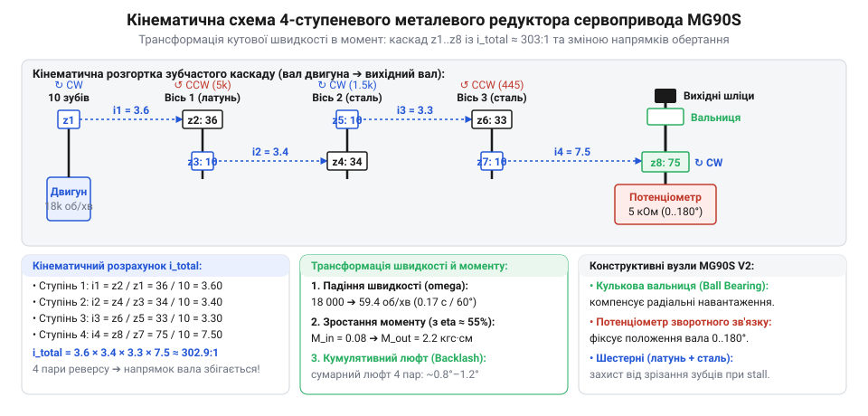
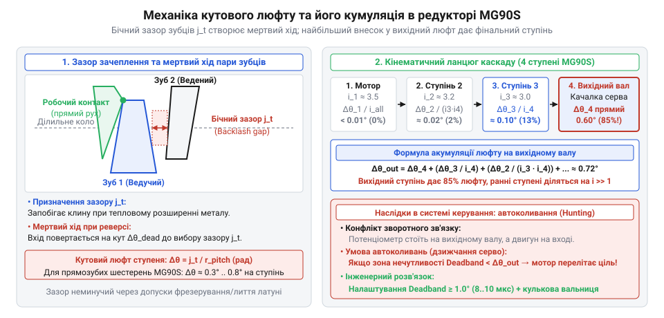
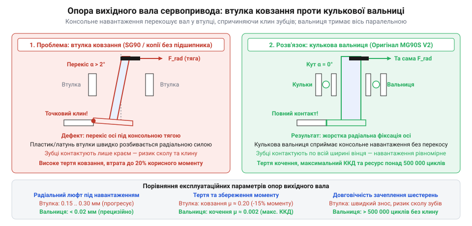
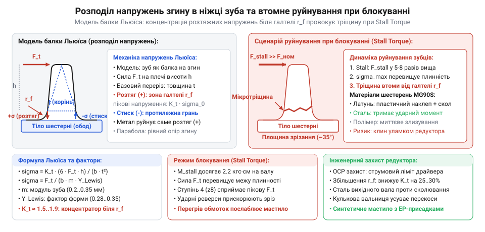

# MG90S V2 — мікросерво з металевим редуктором

<preknowlist>
- [Tower Pro SG90 — мікросерво 9g](root:cat-hw-actuators/sg90-servo) — Загальне просторове компонування мікропривода 9g, розміщення двигуна й вихідного вала та вразливість суто нейлонових шестерень до ударного навантаження
- [Серво-роги (запасні)](root:cat-hw-actuators/servo-horns) — Механічне з'єднання вихідного вала редуктора з важелем через шліци та передача згинального моменту від консольної тяги
</preknowlist>

## Фізичний парадокс малопотужного колекторного двигуна та неминучість редукції

Якщо подати живлення на мініатюрний колекторний електродвигун постійного струму масою кілька грамів, його вал миттєво розженеться до швидкості 10 000–18 000 обертів на хвилину (понад 1000–1900 рад/с). Проте достатньо торкнутися цього ротора кінчиком нігтя або аркушем паперу, щоб він повністю зупинився. Спроба змусити такий двигун безпосередньо рухати важіль механізму, маніпулятор чи кермо поворотного вузла приречена на поразку: пусковий крутний момент (@@en|stall torque@@, від англ. *stall* — зупинка, заглухання та лат. *torquere* — крутити) настільки мізерний, що становить лише частки міліньютон-метра (0.05–0.2 мН·м).

Така розбіжність між колосальною швидкістю та незначним зусиллям випливає з електромагнітної геометрії мікромотора. Електромагнітний момент прямо пропорційний магнітному потоку полюсів статора, радіусу ротора та повній силі струму в пазах обмотки. У циліндричному корпусі діаметром 10–12 мм неможливо встановити важкі магніти з потужною магнітною індукцією чи намотати товстий мідний провідник. Тонкі котушки якоря діаметром 0.05–0.08 мм витримують струм лише до 300–500 мА, а радіус плеча прикладання сили Лоренца обмежений мізерними 3–4 мм.

Виникає фундаментальний розрив механічного імпедансу між двигуном і виконавчим механізмом. Навантаженню потрібен робочий крутний момент близько 0.15–0.25 Н·м (що відповідає статичному зусиллю 1.5–2.5 кг·см на плечі 1 см) за помірної швидкості відпрацювання кута — приблизно 50–60 обертів на хвилину (поворот на 60° за 0.10–0.15 с). Якщо з'єднати вал напряму, мотор не зрушить з місця й миттєво згорить через перегрів заблокованого якоря.

Розв'язанням цієї суперечності є механічний редуктор (@@en|gearbox@@, від лат. *reducere* — відводити назад, зменшувати), який працює як погоджувальний трансформатор механічного імпедансу. Згідно із законом збереження енергії, механічна потужність обертального руху дорівнює добутку крутного моменту `M` на кутову швидкість `ω`:

    P
    = M · ω

Якщо знехтувати проміжними втратами на тертя, потужність на вході редуктора дорівнює потужності на вихідному валу. Знижуючи кутову швидкість у деяку кількість разів `i`, механічна передача пропорційно збільшує крутний момент:

    M_вих
    = M_вх · i · η    [баланс потужності з урахуванням ККД]

де `M_вх` — момент на валу колекторного мотора, `i` — загальне передавальне відношення каскаду (@@en|gear ratio@@), а `η` — сумарний коефіцієнт корисної дії зачеплень.

> 🔧 **Навіщо це.**
> Редуктор перетворює високошвидкісну кінетичну енергію легкого ротора в повільний, але невідпорний крутний момент вихідного вала, даючи змогу дешевому мікромотору переміщати важільні навантаження, які перевершують його власний прямий момент у сотні разів.

Проте збільшити крутний момент у 250–300 разів за допомогою лише однієї пари шестерень неможливо через геометричні обмеження. Якщо ведуча шестерня (триб) на валу двигуна має технологічно мінімальний діаметр 2.5–3 мм, то для забезпечення передавального числа `i = 300` діаметр веденого зубчастого колеса мусив би перевищувати:

    D_колеса
    = D_триба · i
    = 2.5 · 300
    = 750 мм          [розрахунок габариту одноступеневої пари]

Колесо розміром майже метр абсолютно несумісне з мініатюрним пристроєм (порівняйте це з пластиковою компоновкою привода в статті [Tower Pro SG90](root:cat-hw-actuators/sg90-servo)). Єдиний спосіб вписати передавальне число понад 250:1 у корпус об'ємом менше 10 см³ — розділити процес редукції на кілька послідовних компактних ступенів прямозубого циліндричного зачеплення.

## Геометрія прямозубого зачеплення та кінематичний розрахунок каскаду

Основою циліндричного редуктора є евольвентне прямозубе зачеплення. Його базовий масштабний параметр — модуль зачеплення `m` (від лат. *modulus* — міра). Модуль пов'язує коловий крок зубців `p` (відстань між однойменними точками сусідніх зубців по ділильному колу) з числом `π`:

    m
    = p / π           [означення модуля зачеплення]

У мікроприводах застосовують мініатюрні модулі від `0.2` до `0.4 мм` (найчастіше `m = 0.25 мм` або `m = 0.3 мм`). Ділильний діаметр шестерні `d`, по якому котяться умовні контактні циліндри пари без сковзування, однозначно визначається модулем та кількістю зубців `z`:

    d
    = m · z           [ділильний діаметр колеса]

Міжосьова відстань `a` між двома паралельними валами зачеплення залежить лише від суми їхніх ділильних діаметрів:

    a
    = (d₁ + d₂) / 2
    = m · (z₁ + z₂) / 2    [міжосьова відстань циліндричної пари]

При виборі кількості зубців ведучого триба конструктор стикається з [явищем підрізання ніжки зуба](root:hw-motion/gear-tooth-geometry) (@@en|undercutting@@). При нарізанні прямозубих коліс стандартною рейкою з кутом зачеплення `α = 20°` вершини різального інструмента зрізають основу зуба, якщо його кількість зубців менша за граничне значення:

    z_min
    = 2 / (sin(α))²
    = 2 / (sin(20°))²
    ≈ 17.1            [теоретична межа безпідрізного зачеплення]

Підрізання катастрофічно послаблює корінь зуба на злам. Тому на проміжних ступенях використовують `z ≥ 10–14`, застосовуючи висотну корекцію (зміщення нейтрального контуру рейки), яка потовщує основу зуба і зберігає міцність у мікрогабаритах.

Щоб мінімізувати габарити та кількість осей, редуктор будують на основі блок-шестерень (@@en|compound gears@@). Блок-шестерня — це суцільна деталь, на якій совісно виконані дві шестерні різного діаметра: велике ведене колесо та малий ведучий триб. Блок-шестерні вільно обертаються на нерухомих полірованих сталевих осях, закріплених у гніздах корпусу.


*Кінематична схема багатоступеневого редуктора: передача обертання від триба двигуна через блок-шестерні до вихідного вала зі зниженням швидкості та пропорційним зростанням крутного моменту.*

Розглянемо покроковий кінематичний розрахунок типового чотириступеневого каскаду мікропривода:

1. **Вал двигуна (триб 0) → Блок 1 (колесо 1):**
   Вхідний триб має `z₀ = 10` зубців. Він приводить у рух велике колесо першого блока з `z₁_вел = 38` зубцями:
   ```
   i₁
   = z₁_вел / z₀
   = 38 / 10
   = 3.80
   ```

2. **Блок 1 (триб 1) → Блок 2 (колесо 2):**
   Триб першого блока `z₁_мал = 10` передає рух на велике колесо другого блока `z₂_вел = 35`:
   ```
   i₂
   = z₂_вел / z₁_мал
   = 35 / 10
   = 3.50
   ```

3. **Блок 2 (триб 2) → Блок 3 (колесо 3):**
   Триб другого блока `z₂_мал = 10` зачіпляється з колесом третього блока `z₃_вел = 32`:
   ```
   i₃
   = z₃_вел / z₂_мал
   = 32 / 10
   = 3.20
   ```

4. **Блок 3 (триб 3) → Вихідний вал (колесо 4):**
   Триб третього блока `z₃_мал = 10` обертає кінцеве секторне зубчасте колесо вихідного вала з `z₄_вих = 68`:
   ```
   i₄
   = z₄_вих / z₃_мал
   = 68 / 10
   = 6.80
   ```

Загальне передавальне відношення кінематичного ланцюга обчислюється як добуток передавальних чисел усіх послідовних ступенів:

    i_заг
    = i₁ · i₂ · i₃ · i₄
    = 3.80 · 3.50 · 3.20 · 6.80
    = 289.856
    ≈ 290:1           [сумарна редукція каскаду]

Коли двигун обертається з типовою швидкістю `n_мотора = 14 500 об/хв` (`ω_мотора ≈ 1518 рад/с`), вихідний вал отримує швидкість:

    ω_вих
    = ω_мотора / i_заг
    = 1518 / 289.856
    ≈ 5.24 рад/с      [вихідна кутова швидкість]

У перерахунку на звичну частоту це дає `n_вих ≈ 50 об/хв`. Робочий кутовий сектор у 60 градусів (`Δθ = π / 3 ≈ 1.047 рад`), що типово для відпрацювання сервомеханізму, долається за час:

    t_60
    = Δθ / ω_вих
    = 1.047 / 5.24
    ≈ 0.20 с          [час повороту на 60° під навантаженням]

Зверніть увагу на чергування напрямків обертання: кожна пара шестерень зовнішнього зачеплення змінює напрямок на протилежний. Оскільки каскад містить парну кількість зачеплень (чотири ступені), вихідний вал обертається в той самий бік, що й вал самого двигуна. Це спрощує узгодження механічної кінематики з датчиком зворотного зв'язку та керуючою електронікою.

## Матеріалознавство мікрошестерень: компроміс між міцністю, тертям та інерцією

У багатоступеневому редукторі навантаження на зубчасті пари розподілене вкрай нерівномірно. На вхідному ступені, де триб мотора обертається зі швидкістю до 18 000 обертів на хвилину, лінійна швидкість сковзування профілів сягає 1.5–2.5 м/с, проте колові зусилля на зубцях становлять менше однієї десятої ньютона. На вихідному ж ступені кутова швидкість падає у сотні разів, натомість тангенціальна сила взаємодії зубців зростає до 20–40 Н. Якщо на вхідному трибі головним викликом є динамічне тертя, перегрів і шум, то на кінцевих шестернях домінують екстремальні напруження згину в основах зубців і контактний тиск.

Через це вибір матеріалу шестерень завжди є компромісом між трьома суперечливими факторами: межею міцності на злам, коефіцієнтом тертя та моментом інерції. У конструкціях мікроприводів конкурують чотири основні класи матеріалів:

1. **Інженерні термопласти (поліамід PA66 / нейлон, поліацеталь POM / Delrin):**
   Мають найнижчу густину (`ρ ≈ 1.14–1.41 г/см³`), що мінімізує власний момент інерції деталей. Завдяки низькому сухому коефіцієнту тертя (`μ ≈ 0.15–0.25` по сталі) та високій внутрішній пружності полімери самозмащуються, ефективно гасять акустичні шуми та поглинають високочастотні вібрації. Проте їхня межа міцності на згин невелика (`σ_згин ≈ 60–90 МПа`), а низька теплопровідність спричиняє локальний перегрів вінця. Під дією ударного або блокувального навантаження пластикові зубці легко зрізаються (що є головною вразливістю базових приводів, таких як [Tower Pro SG90](root:cat-hw-actuators/sg90-servo)).

2. **Оброблювана латунь (сплави типу CuZn39Pb3, ЛС59-1):**
   Класичний матеріал приладобудування. Має відмінні антифрикційні властивості у контакті зі сталлю, високу корозійну стійкість і легко піддається високоточній механічній обробці зубофрезеруванням на автоматах поздовжнього точіння. Межа міцності латуні на згин (`σ_згин ≈ 350–450 МПа`) у 4–5 разів вища за міцність найкращих термопластів. Її головні недоліки — висока густина (`ρ ≈ 8.4–8.7 г/см³`) і порівняно м'яка кристалічна решітка: під дією абразивних часток чи сухого тертя латунні зубці зазнають поступового пластичного стирання.

3. **Загартована конструкційна та легована сталь (марки 40Х, 65Г, AISI 1045 / 4140):**
   Забезпечує найвищу механічну витривалість. Після поверхневого або об'ємного термозміцнення (гартування з низьким відпуском до твердості HRC 45–55) межа міцності на згин перевищує `800–1200 МПа`. Сталеві шестерні практично невразливі до втомного сколювання зубців під час короткочасних ударних перевантажень. Однак сталь має високий коефіцієнт тертя при ковзанні по сталі (`μ ≈ 0.6–0.8` без змащування) та схильність до мікрозварювання поверхонь і задирів (@@en|galling@@) у разі вичерпання мастильної плівки.

4. **Високоміцні алюмінієві сплави (авіаційний дюраль 7075-T6, Д16Т):**
   Поєднують помірну густину (`ρ ≈ 2.7–2.8 г/см³`) з високою міцністю на розрив (`σ_згин ≈ 450–550 МПа`). Вони легші за латунь і сталь, що зменшує загальну масу рухомих частин. Проте необроблений алюміній має незадовільні трибологічні характеристики: він схильний до інтенсивного схоплювання. Його надійне застосування можливе лише після глибокого твердого анодування (@@en|hard anodizing@@), яке формує на поверхні зубців мікрошар оксиду алюмінію корундової твердості товщиною 20–30 мкм.

> 🔧 **Навіщо це.**
> Розуміння матеріалознавчого балансу дає змогу виявити «слабку ланку» редуктора: металеві шестерні гарантують збереження передачі під час пікових блокувань вала, тоді як пластикові елементи ставлять там, де критичні швидкість розгону та акустичний комфорт.

У сучасних якісних мікроприводах домінує гібридна архітектура каскаду:
- Вхідний триб двигуна виготовляють із м'якої латуні або зносостійкого термопласту POM, що захищає вал мотора від зайвого моменту інерції та знижує високочастотний писк зачеплення.
- Проміжні блок-шестерні штампують або пресують методом [порошкової металургії та MIM-формування](root:hw-motion/metal-injection-molding) з латуні чи легованої сталі.
- Кінцевий сектор вихідного вала, який сприймає найбільший момент і прямі удари від важеля ([серво-рога](root:cat-hw-actuators/servo-horns)), виконують виключно з термозміцненої сталі або монолітної легованої латуні збільшеної ширини вінця.

## Механіка накопичення люфту та кутова похибка редуктора

Жодна зубчаста передача не може працювати з нульовим геометричним зазором між сполученими профілями зубців. Якщо виготовити шестерні так, щоб їхні зуби торкалися обома боками одночасно, редуктор негайно заклинить від найменшої похибки міжосьової відстані, радіального биття осей чи термічного розширення металу під час нагрівання.

Між неробочими поверхнями зубців завжди закладають бічний зазор (@@en|backlash@@, від англ. *back* — назад та *lash* — удар, зазор). Він вимірюється вздовж лінії зачеплення (нормальний зазор `j_n`) або по дузі ділильного кола (коловий зазор `j_t`):

    j_t
    = j_n / cos(α)    [зв'язок колового й нормального зазорів]

де `α` — кут профілю зачеплення (стандартно `20°`).

Коловий зазор перетворюється на вільний кутовий холостий хід шестерні `Δθ_ступ`: допоки ведучий зуб переміщується від переднього профілю веденого зуба до заднього, вихідне колесо не рухається. Кутовий люфт окремого зачеплення обчислюється через його радіус ділильного кола `r = d / 2`:

    Δθ_ступ
    = j_t / r
    = 2 · j_t / d     [кутовий люфт одиничного ступеня]


*Механіка накопичення кутового люфту: бічний зазор між зубцями у кожному зачепленні та його вплив на сумарний люфт вихідного вала з урахуванням передавальних чисел.*

Коли редуктор складається з кількох послідовних ступенів, виникає питання: як сумуються люфти окремих пар на кінцевому вихідному валу?

Нехай каскад має чотири ступені з власними кутовими зазорами `Δθ₁`, `Δθ₂`, `Δθ₃`, `Δθ₄` та покроковими передавальними числами `i₁`, `i₂`, `i₃`, `i₄`. При зміні напрямку руху вихідний вал не зрушить з місця, доки не вибереться зазор у кожній парі ланцюга. Проте люфт кожного проміжного ступеня передається на вихід крізь наступні передавальні ступені, а отже — масштабується у зворотному напрямку:

    Δθ_вих
    = Δθ₄ + (Δθ₃ / i₄) + (Δθ₂ / (i₃ · i₄)) + (Δθ₁ / (i₂ · i₃ · i₄))    [формула кумулятивного люфту каскаду]

Розглянемо числовий приклад розрахунку для типового редуктора мікропривода, де кожна пара через технологічні допуски литва та зубонарізання має власний кутовий люфт `Δθ = 1.2°` (`0.021 рад`), а ступені мають передавальні відношення `i₁ = 3.8`, `i₂ = 3.5`, `i₃ = 3.2`, `i₄ = 6.8`:

1. Внесок 4-го (вихідного) ступеня:
   ```
   Δθ_вих_4
   = Δθ₄
   = 1.200°
   ```

2. Внесок 3-го ступеня:
   ```
   Δθ_вих_3
   = Δθ₃ / i₄
   = 1.2° / 6.8
   ≈ 0.176°
   ```

3. Внесок 2-го ступеня:
   ```
   Δθ_вих_2
   = Δθ₂ / (i₃ · i₄)
   = 1.2° / (3.2 · 6.8)
   = 1.2° / 21.76
   ≈ 0.055°
   ```

4. Внесок 1-го (вхідного) ступеня:
   ```
   Δθ_вих_1
   = Δθ₁ / (i₂ · i₃ · i₄)
   = 1.2° / (3.5 · 3.2 · 6.8)
   = 1.2° / 76.16
   ≈ 0.016°
   ```

Підсумуємо частки всіх ступенів:

    Δθ_вих_заг
    = 1.200° + 0.176° + 0.055° + 0.016°
    = 1.447°
    ≈ 1.45°           [повний кутовий люфт на вихідному валу]

Цей розрахунок демонструє фундаментальний закон редукторних кінематичних ланцюгів: **понад 80–85% сумарного люфту на вихідному валу припадає на останній ступінь зачеплення**, ще 12–15% додає передостанній ступінь, тоді як похибки перших високошвидкісних шестерень практично повністю придушуються редукцією.

Кутовий люфт `Δθ_вих` безпосередньо впливає на динамічну стійкість замкненої системи керування. Потенціометр або магнітний енкодер зворотного зв'язку встановлений на вихідному валу. Коли мотор змінює полярність живлення для корекції малого відхилення, він повинен спочатку повернутися на величину кумулятивного люфту `Δθ_вх = Δθ_вих · i_заг` (у нашому випадку `1.45° · 290 ≈ 420°` обертів ротора мотора!), перш ніж вихідний вал взагалі почне рухатися.

У межах цього інтервалу система керування перебуває в режимі розімкненого контуру: струм через мотор уже тече, а сигнал зворотного зв'язку не змінюється. Якщо електронна ширина мертвої зони регулятора (@@en|deadband@@) буде меншою за механічний люфт `Δθ_вих`, привід потрапить у режим безперервних автоколивань: мотор буде нескінченно перекидати зазор з упору в упор, марно споживаючи струм і викришуючи зубці. Тому в інженерній практиці апаратну мертву зону контролера завжди обирають ширшою за паспортний люфт редуктора щонайменше у 1.5–2 рази.

## Опорні вузли вихідного ступеня та компенсація консольних навантажень

Вихідний вал редуктора піддається значно складнішому навантаженню, ніж суто крутильний момент. Механічний важіль ([серво-рог](root:cat-hw-actuators/servo-horns)), прикріплений до вихідного шліцьового кінця вала, передає зусилля на зовнішню тягу. Оскільки лінія тяги рідко лежить у площині внутрішнього зубчастого зачеплення, на вихідний вал діє консольна радіальна сила `F_рад` на плечі `L` відносно точки опори в корпусі. Ця сила створює позаосьовий згинальний момент:

    M_згин
    = F_рад · L       [консольний згинальний момент]

У простих бюджетних приводах вал спирається на звичайну втулку ковзання (@@en|sleeve bushing@@) з латуні чи пористої бронзи або просто обертається безпосередньо в циліндричному отворі пластикового корпусу. Така опора має неминучий початковий радіальний зазор (`0.05–0.10 мм`), необхідний для ковзання без заїдання.

Під дією згинального моменту `M_згин` вихідний вал перекошується всередині втулки на кут `γ`. Навіть мікроскопічний перекіс у частки градуса є руйнівним для прямозубого зачеплення:
- Контактна лінія між зубами перетворюється на точкову зону на самому краю вінця (крайове навантаження, @@en|edge loading@@).
- Локальні контактні напруження зростають у 3–5 разів, спричиняючи пластичну деформацію та викришування металу.
- Зростає ризик механічного розклинювання зубів у зачепленні, коли верхівка одного зуба впирається в перекошену ніжку сусіднього.
- Радіальна сила різко збільшує момент сухого тертя у втулці (`M_тертя = μ · F_рад · r_вала`), що відбирає до 15–20% корисної потужності двигуна та розбиває пластикове гніздо корпусу в овал.


*Порівняння опор вихідного вала: кулькова вальниця компенсує консольні радіальні сили, запобігаючи перекосу шестерень та заклинюванню зачеплення.*

Розв'язанням цієї інженерної проблеми є інтеграція у верхню кришку корпусу радіальної кулькової вальниці кочення (@@en|ball bearing@@, від англ. *ball* — кулька та *bearing* — опора).

Заміна втулки ковзання на прецизійну кулькову вальницю докорінно змінює механіку вихідного вузла:
1. **Зниження коефіцієнта тертя:** Коефіцієнт тертя кочення становить `μ_коч ≈ 0.001–0.003`, що майже на два порядки нижче за коефіцієнт тертя ковзання латуні по сталі (`μ_ковз ≈ 0.15–0.20`). Редуктор зберігає високий механічний ККД навіть під максимальним бічним натягом тяги.
2. **Нульовий робочий люфт опори:** Радіальний зазор якісної кулькової вальниці не перевищує кількох мікрометрів (`0.005–0.010 мм`). Вал утримується суворо перпендикулярно до площини обертання шестерень.
3. **Збереження лінії контакту:** Завдяки відсутності перекосу (`γ ≈ 0`) робочі профілі зубців вихідного сектора та триба контактують по всій ширині вінця `b`. Навантаження розподіляється рівномірно, усуваючи крайові піки напружень та запобігаючи заклинюванню передачі.
4. **Довговічність корпусу:** Радіальне навантаження передається через сталеве зовнішнє кільце вальниці на широку площу опорного бурта кришки, унеможливлюючи еліптичне розбивання пластику під час тривалої вібрації.

## Трибологія мікропередач, мастильні матеріали та динаміка зносу

Прямозубе евольвентне зачеплення поєднує в собі два різні види відносного руху: кочення та сковзування профілів. Чисте кочення поверхонь відбувається лише в одній точці — полюсі зачеплення на ділильному колі. У міру віддалення від полюса до верхівки чи основи зуба швидкість відносного сковзування зростає, досягаючи максимуму на ніжці зуба. Одночасно контактні поверхні зазнають величезного питомого тиску Герца, який у металевих мікропередачах сягає `300–600 МПа`.

Безперервна робота сухого контакту метал-по-металу в таких умовах неприпустима. Без захисної розділової плівки мікронерівності сталевих та латунних зубців вступають у прямий фрикційний контакт. Висока температура в мікроконтактах призводить до локального термодифузійного зварювання поверхонь та їхнього подальшого виривання — виникають катастрофічні задири (@@en|scuffing@@ або @@en|galling@@), що знищують геометрію зуба за лічені хвилини.

Для надійної та довговічної роботи редуктора застосовують спеціалізовані консистентні мікромастила. Вибір мастила підпорядкований суворим трибологічним критеріям:

- **Сумісність із конструкційними матеріалами:** Якщо редуктор гібридний і містить пластикові шестерні (POM, нейлон), мастило не повинно містити мінеральних олій з ароматичними вуглеводнями чи естерами, які викликають розтріскування під напругою (@@en|environmental stress cracking@@) та набрякання полімерів. Застосовують синтетичні поліальфаолефінові (ПАО) або кремнійорганічні (силіконові) основи.
- **В'язкість і клас консистенції за NLGI:** Застосування звичайних автомобільних мастил класу NLGI 2 чи NLGI 3 (густі пасти типу Літол-24) є грубою помилкою. У мікроредукторі швидкісний триб мотора просто вириє у густому мастилі порожнечу (ефект тунелювання), після чого працюватиме насухо, а високий гідродинамічний опір густої субстанції відбере до половини потужності мікромотора. Для мікропередач використовують напіврідкі мастила класів NLGI 00, NLGI 0 або NLGI 1.
- **Антизадирні присадки (EP / Extreme Pressure):** Найкращі результати для важконавантажених металевих пар демонструють синтетичні мастила з колоїдним дисульфідом молібдену (MoS₂) або мікропорошком політетрафторетилену (PTFE / тефлон). Частинки PTFE розміром 0.5–1 мкм заповнюють мікротріщини металу, знижуючи граничний коефіцієнт тертя до `μ ≈ 0.04–0.08`.

Під час тривалої експлуатації редуктора розвиваються два основні механізми динамічного зносу:

1. **Втомне викришування (піттінг, @@en|pitting@@, від англ. *pit* — ямка):**
   Під дією циклічного змінного контактного тиску в підповерхневому шарі металу на ніжці зуба зароджуються мікроскопічні втомні тріщини. Під високим гідродинамічним тиском мастило запресовується всередину тріщин, розклинюючи їх. З часом поверхневі мікрочастки металу сколюються, утворюючи кратери викришування. З появою піттінгу зуб втрачає евольвентну форму, зростають шум і вібрація, а процес руйнування лавиноподібно прискорюється.

2. **Трибокорозія та знос посадкових осей:**
   Проміжні блок-шестерні вільно обертаються на нерухомих сталевих осях діаметром 1.0–1.2 мм. Під впливом пульсуючого радіального зусилля зачеплення у зоні контакту осі та втулки шестерні виникає мікровібраційне тертя (@@en|fretting@@). За нестачі мастила сталева вісь зношується з утворенням чорного абразивного шламу (оксидів заліза), внутрішній отвір шестерні розбивається, збільшується міжосьова відстань `a`, що викликає перекіс вінців і небезпечне зменшення площі контакту зубців.

## Граничні навантаження, напруження згину за Льюїсом та захист від руйнування

Найбільш небезпечним режимом для редуктора є не тривала рівномірна робота, а перехідні пікові навантаження. Серед них критичними є два сценарії:
- **Аварійне стопоріння вихідного вала (@@en|stall condition@@):** Коли механізм зустрічає непереборну механічну перешкоду, вихідний вал зупиняється, а керуюча електроніка подає на електродвигун повну напругу живлення. Мотор переходить у режим короткого замикання, розвиваючи максимальний пусковий крутний момент, який редуктор примножує у сотні разів.
- **Зворотний динамічний удар (@@en|backdrive shock@@):** При падінні керованої моделі чи ударі колеса об перешкоду кінетична енергія удару спрямовується ззовні безпосередньо у важіль привода. Оскільки масивний сталевий вихідний вал має значний момент інерції, а висока редукція у зворотному напрямку працює як мультиплікатор із величезним опором розгону ротора двигуна, імпульс сили не встигає провернути редуктор і викликає миттєвий сплеск напружень зрізу.

Для розрахунку міцності зубців мікрошестерень на злам застосовують інженерний метод Вілфреда Льюїса (@@en|Lewis formula@@). У моделі Льюїса окремий зуб розглядається як консольна балка, навантажена повною тангенціальною силою `F_t` біля своєї верхівки. Максимальні напруження розтягу-згину виникають у перехідній кривій біля основи зуба (в його ніжці):

    σ_згин
    = F_t / (b · m · Y)    [формула Льюїса для напружень згину]

де `F_t` — колова тангенціальна сила зачеплення на ділильному колі, `b` — робоча осьова ширина зубчастого вінця, `m` — модуль зачеплення, а `Y` — безрозмірний коефіцієнт форми зуба (@@en|Lewis form factor@@), що залежить виключно від кількості зубців `z` та кута профілю рейки `α`.


*Розподіл напружень згину за формулою Льюїса: концентрація напружень у ніжці зуба під піковим моментом блокування вала призводить до втомного сколювання та зрізання зубців.*

Розглянемо числовий розрахунок навантаження для визначення «найслабшої ланки» каскаду при блокуванні привода з крутним моментом `M_вих = 0.22 Н·м`:

1. **Визначення тангенціальної сили на вихідному ступені:**
   Кінцеве зубчасте колесо має радіус ділильного кола `r_вих = 7.0 мм` (`0.007 м`). Сила взаємодії між трибом третього блока та вихідним колесом становить:
   ```
   F_t
   = M_вих / r_вих
   = 0.22 / 0.007
   ≈ 31.43 Н
   ```

2. **Оцінка напружень згину в ніжці малого триба:**
   Триб, що передає цей момент, має малу кількість зубців (`z = 10`), модуль `m = 0.3 мм` (`0.0003 м`), ширину вінця `b = 1.2 мм` (`0.0012 м`) та коефіцієнт форми Льюїса `Y ≈ 0.23`:
   ```
   σ_згин
   = F_t / (b · m · Y)
   = 31.43 / (0.0012 · 0.0003 · 0.23)
   = 31.43 / 0.0000000828
   ≈ 379.6 МПа
   ```

Якщо цей триб виготовити зі звичайного інженерного пластику (поліацеталь POM із межею міцності `σ_границя ≈ 65–75 МПа`), напруження перевищать границю міцності майже в 5 разів — зуби зріже при першому ж стопорінні вала. Якщо застосувати латунь (`σ_границя ≈ 380–420 МПа`), запас міцності буде на небезпечній грані руйнування (`n ≈ 1.0–1.1`). Лише застосування термозміцненої сталі (`σ_границя ≈ 900–1100 МПа`) забезпечує триразовий надійний коефіцієнт запасу міцності `n ≈ 2.5–2.9`.

Щоб унеможливити аварійне руйнування редуктора, в конструкціях застосовують комплекс інженерних захисних заходів:
- **Диференціація ширини вінця:** Ширину шестерень кінцевих ступенів роблять у 1.5–2 рази більшою, ніж на вхідних парах (`b = 1.8–2.2 мм` проти `1.0 мм`), що пропорційно знижує згинальні напруження `σ_згин` за формулою Льюїса.
- **Електронне обмеження струму (@@en|current limiting@@):** Драйвер мотора в мікросхемі керування обмежує струм стопоріння, не дозволяючи двигуну генерувати руйнівний пусковий момент при тривалому блокуванні.
- **[Механічні сервосейвери](root:hw-motion/servo-saver-mechanism) (@@en|servo saver@@):** Пружні пружинні компенсатори, інтегровані у тяги або корпус важеля, які поглинають енергію зовнішніх кінетичних ударів перш, ніж вони досягнуть зубчастого вінця.
- **Програмні обмеження кута (@@en|soft limits@@):** Калібрування крайніх робочих положень у прошивці мікроконтролера запобігає силовому удару обмежувача вихідного вала об жорсткий механічний стопор корпусу під час повного ходу.
