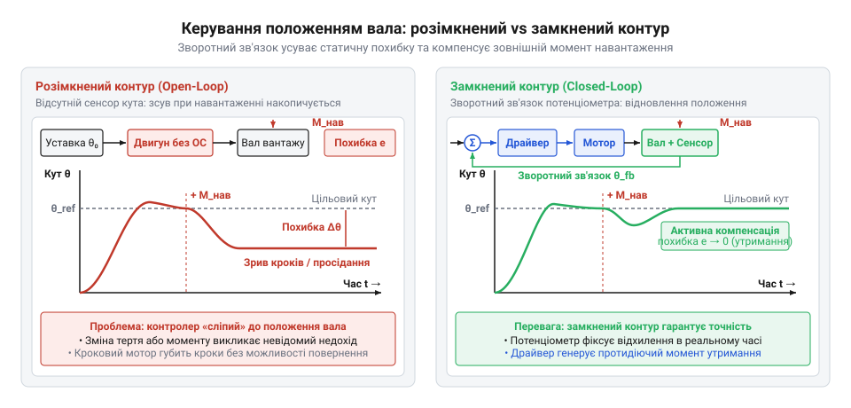
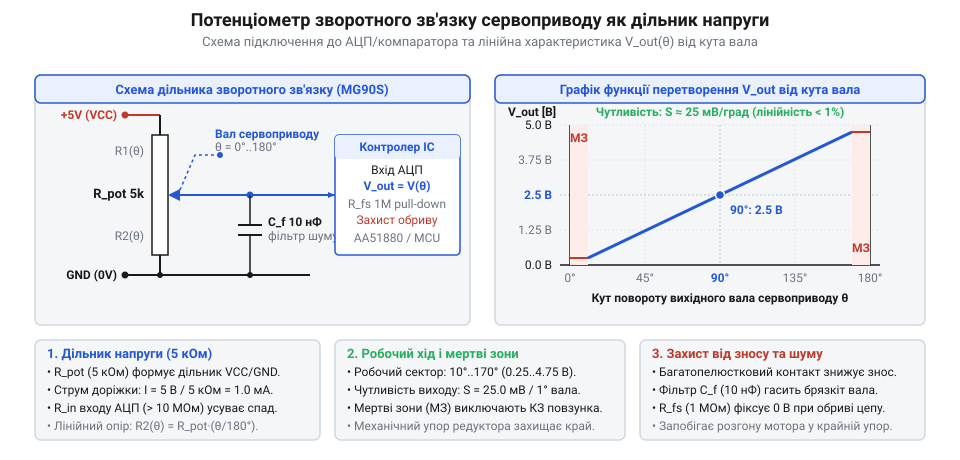
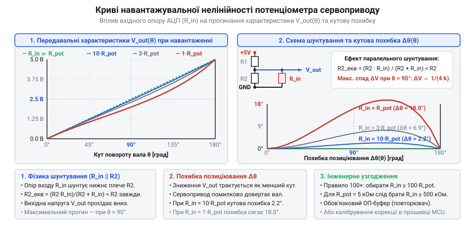
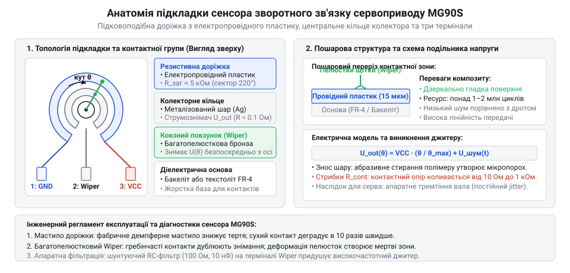
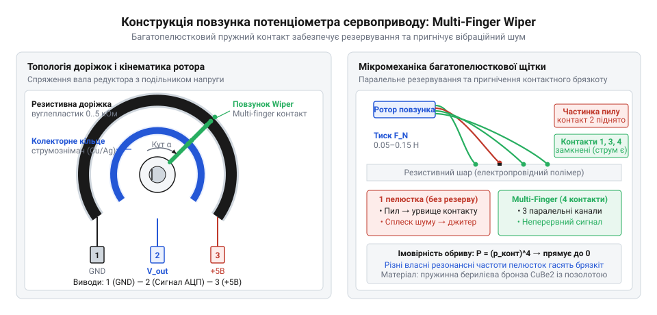
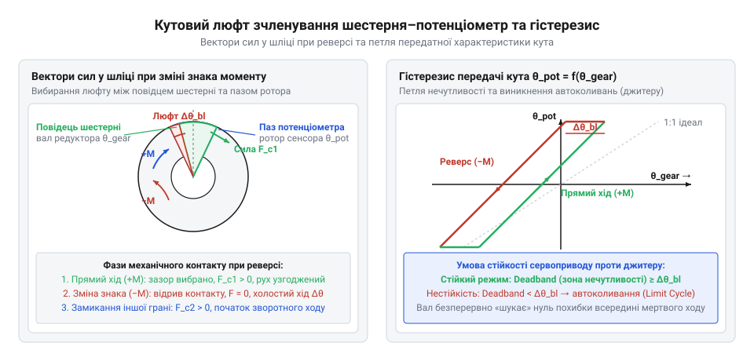
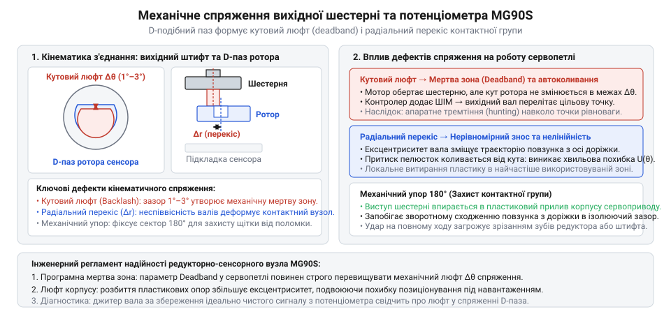
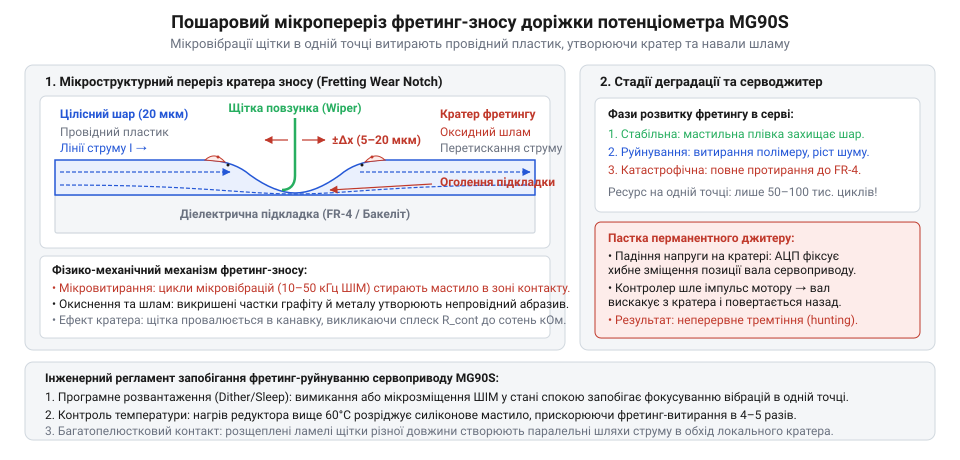
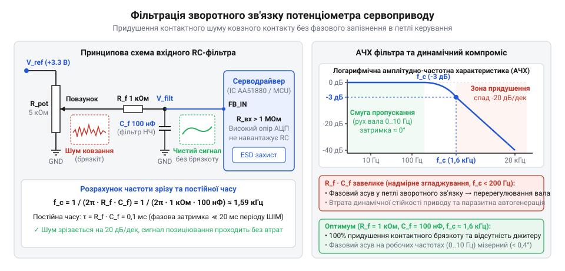
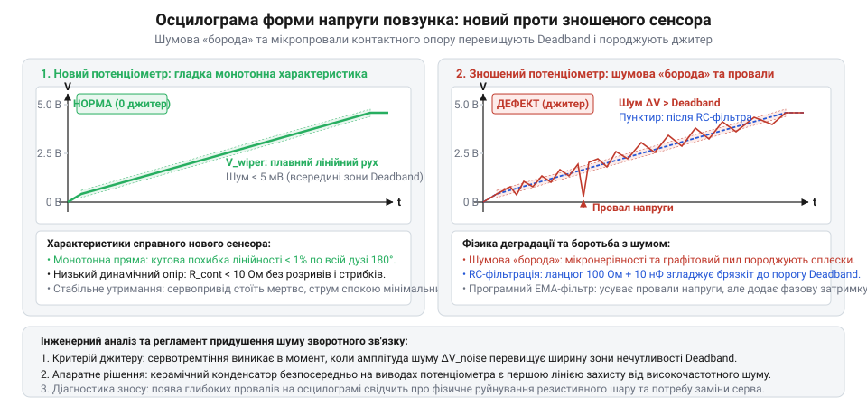

# MG90S V2 — мікросерво з металевим редуктором

<preknowlist>
- [Tower Pro SG90 — мікросерво 9g](root:cat-hw-actuators/sg90-servo) — Загальна будова мікросервопривода: наявність електродвигуна постійного струму, редуктора, плати керування та потреба в утриманні заданого кута вихідного вала
</preknowlist>

## Сліпе позиціювання: чому розімкнений привід не тримає кут

Звичайний колекторний електродвигун постійного струму, підключений до механічного редуктора (латин. *reductor* — той, що відводить назад), уміє лише перетворювати електричну потужність на обертальний момент. Якщо подати на клеми двигуна напругу живлення, якір почне обертатися зі швидкістю, зумовленою балансом напруги, проти-ЕРС та моменту навантаження. Напруга не задає положення у просторі: вона визначає лише швидкість. Кут повороту вихідного вала `θ(t)` є неперервним інтегралом швидкості `ω(t)` за часом:

```
θ(t)
= ∫ ω(t) dt                           [інтегрування кутової швидкості за часом]
```

Щоб повернути вал механізму на заданий кут — наприклад, на 45° — у розімкненому приводі (@@en|open-loop drive@@) доводиться подавати напругу на розрахований час `Δt`. На практиці цей підхід зазнає краху через реальні фізичні збурення:

1. **Змінне навантаження.** Підіймаючи вантаж проти сили тяжіння, двигун сповільнюється; опускаючи — гравітація його прискорює. За однакової тривалості імпульсу кут повороту щоразу інший.
2. **Температурний дрейф і тертя в редукторі.** Мастило в зубчастих зачепленнях змінює в'язкість залежно від температури навколишнього середовища та тривалості безперервної роботи. Зі зносом зубів механічний опір вузла змінюється нелінійно в межах навіть одного оберту вала.
3. **Просідання напруги живлення.** Під час розряду акумулятора або стрибків струму інших споживачів напруга живлення падає, зменшуючи кутову швидкість привода за незмінного розрахункового часу вмикання.
4. **Інерційний вибіг вала.** Після зняття напруги ротор і шестерні редуктора не зупиняються миттєво, за інерцією провертаючи вал на додатковий неконтрольований кут.

У результаті привід не доходить до цілі або пролітає повз неї. Спроба обмежити робочий діапазон механічними упорами перетворює помилку на ударне навантаження: двигун б'є у стопор на повній швидкості, струм якоря стрибає до значення блокування, що швидко зрізає пластикові або латунні зуби редуктора (як це часто буває в [Tower Pro SG90](root:cat-hw-actuators/sg90-servo)) або спалює обмотки ротора.

Корінь проблеми в тому, що схема керування діє наосліп: вона надсилає енергію у виконавчий вузол, але не має зворотного сигналу про його фактичний стан. Щоб отримати стійкий сервопривід (латин. *servus* — слуга, раб), контур керування необхідно замкнути зворотним зв'язком (латин. *retro* — назад, *agere* — діяти; @@en|feedback@@). Електроніка повинна безперервно порівнювати цільовий кут із реальним положенням вихідного вала, регулюючи швидкість і гальмування за величиною миттєвої різниці (похибки неузгодженості).

Для компактного сервопривода це формує жорсткі первинні вимоги до датчика зворотного зв'язку:
- **Абсолютний відлік.** Датчик зобов'язаний видавати дійсний кут вала одразу під час подачі живлення, без попереднього пошуку початкової нульової точки (@@en|homing@@).
- **Нульова затримка.** Перетворення кута в електричну величину має відбуватися миттєво на фізичному рівні, щоб фазовий зсув контуру керування не провокував автоколивання.
- **Гранична мініатюрність.** Сенсор повинен монтуватися безпосередньо всередину редуктора, вимірюючи кут кінцевого вихідного вала, а не проміжних шестерень, щоб усунути накопичений люфт передачі.


*Порівняння перехідних процесів позиціонування вала в розімкненому та замкненому контурах: зворотний зв'язок усуває статичну похибку під змінним навантаженням.*

> 🔧 **Навіщо це.**
> Замкнений контур [позиціювання](root:hw-motion/servo) робить кінцеву кутову позицію вала незалежною від тертя шестерень, напруги батареї та ваги корисного навантаження. Поки сигнал зворотного зв'язку відрізняється від сигналу завдання, контролер продовжує подавати живлення на двигун, зупиняючи його лише тоді, коли різниця падає до нуля.

## Електричний принцип вимірювання: кутовий потенціометр як подільник напруги

Найпростішим і найнадійнішим фізичним способом перетворити механічний кут на аналоговий електричний сигнал без обчислювальної затримки є регульований подільник напруги на базі кутового потенціометра (латин. *potentia* — сила, можливість, та грец. *метрон* — міра, вимірювання; @@en|potentiometer@@).

Конструктивно такий сенсор складається з нерухомої дугоподібної резистивної доріжки та рухомого контакту — повзунка (@@en|wiper@@), жорстко зафіксованого на осі вихідного вала привода. Крайні виводи резистивної смуги підключаються до стабільного джерела опорної напруги: один кінець — до шини живлення `V_CC`, другий — до нульового потенціалу `GND` (0 В). Повна довжина активного сектора резистивного шару визначає максимальний електричний кут перетворення `θ_total`, а матеріал доріжки формує загальний опір `R_total`.

Коли вихідний вал повертається на кут `θ`, повзунок ковзає поверхнею резистивного шару і ділить повну доріжку на два послідовно з'єднані резистивні плеча:
- нижнє плече `R₁(θ)` — між клемою `GND` та повзунком;
- верхнє плече `R₂(θ)` — між повзунком та клемою живлення `V_CC`.

Оскільки резистивна смуга має однорідну питому провідність і сталий поперечний переріз по всій довжині дуги, електричний опір кожної ділянки строго пропорційний пройденому механічному куту:

```
R₁(θ) = R_total · (θ / θ_total)
R₂(θ) = R_total · (1 - (θ / θ_total))
```

Якщо до повзунка підключено вимірювальний прилад з ідеально нескінченним внутрішнім опором, через контакт повзунка струм не відбирається. У такому ненавантаженому режимі напруга `V_out(θ)` розраховується за класичним правилом подільника напруги:

```
V_out(θ)
= V_CC · (R₁(θ) / (R₁(θ) + R₂(θ)))              [правило подільника напруги]
= V_CC · ((R_total · (θ / θ_total)) / R_total)   [підстановка опорів ділянок кола]
= V_CC · (θ / θ_total)                          [скорочення загального опору]
```

Отримана залежність є ідеально лінійною функцією: напруга на виході сенсора строго прямо пропорційна куту повороту вала. На початку резистивної зони (`θ = 0`) напруга дорівнює 0 В, а в кінцевій точці (`θ = θ_total`) досягає повного рівня живлення `V_CC`.

Ключовим параметром такого сенсора є крутизна перетворення (чутливість) `S`, яка визначає приріст напруги на один градус кутового переміщення:

```
S = dV_out / dθ = V_CC / θ_total
```

**Розрахунок крутизни перетворення сенсора**
Для мікропривода з напругою живлення внутрішньої логіки `V_CC = 5.0 В` та повним кутом резистивної доріжки `θ_total = 220°`:
```
V_CC = 5.0 В = 5000 мВ
θ_total = 220°

S
= V_CC / θ_total                      [означення крутизни лінійного перетворення]
= 5000 мВ / 220°                      [підстановка напруги живлення та робочого кута]
≈ 22.73 мВ/°                          [обчислення чутливості]
```

**Розрахунок вихідного потенціалу для проміжного положення вала**
Для цільового кута повороту вала `θ = 45°`:
```
V_out(45°)
= V_CC · (θ / θ_total)                [лінійна передавальна функція]
= 5.0 В · (45° / 220°)                [підстановка кута в градусах]
= 5.0 В · 0.2045                      [розрахунок відносного кута]
≈ 1.023 В                             [напруга зворотного зв'язку]
```

Отриманий потенціал 1.023 В є однозначним і миттєвим електричним еквівалентом просторового кута 45°.


*Електрична схема кутового потенціометричного подільника напруги та графік лінійної залежності вихідної напруги V_out від кута повороту повзунка θ за відсутності струму навантаження.*

### Вплив вхідного імпедансу вимірювального каскаду

У реальній електронній схемі повзунок потенціометра підключається до вхідного каскаду підсилювача, компаратора або аналого-цифрового перетворювача (АЦП). Будь-який реальний вимірювач має скінченний вхідний імпеданс (латин. *impedire* — перешкоджати, заважати; @@en|input impedance@@) `R_in` і споживає струм вимірювання.

Цей вхідний опір `R_in` підключається паралельно до нижнього плеча потенціометра `R₁(θ)`, формуючи еквівалентний опір `R₁_eq(θ)`:

```
R₁_eq(θ) = (R₁(θ) · R_in) / (R₁(θ) + R_in)
```

Через шунтування опір нижнього плеча зменшується (`R₁_eq(θ) < R₁(θ)`). Відповідно, напруга навантаженого подільника стає меншою за ідеальне теоретичне значення:

```
V_out_loaded(θ)
= V_CC · (R₁_eq(θ) / (R₁_eq(θ) + R₂(θ)))        [формула навантаженого подільника]
```

Найнебезпечнішим наслідком є те, що ступінь шунтування змінюється нелінійно в процесі руху повзунка. На краях діапазону похибка прямує до нуля:
- при `θ = 0` опір `R₁ = 0`, і шунтування відсутнє;
- при `θ = θ_total` опір `R₂ = 0`, повзунок напряму закорочений на шину `V_CC`, тому вихідна напруга дорівнює `V_CC` незалежно від `R_in`.

Проте у проміжних точках (найбільше — у верхній третині шкали, де опір `R₁` порівнянний із `R_in`) характеристика відчутно прогинається вниз. Пряма лінія перетворюється на криву, спричиняючи систематичну нелінійність позиціювання.

**Розрахунок похибки навантаження за недостатнього вхідного імпедансу**
Нехай опір потенціометра становить `R_total = 10 кΩ`, кут відповідає середині шкали `θ = 110°` (`R₁ = 5 кΩ`, `R₂ = 5 кΩ`), а вхідний імпеданс вимірювача занижений до `R_in = 50 кΩ`:
```
R₁_eq
= (R₁ · R_in) / (R₁ + R_in)           [формула паралельного з'єднання]
≈ 4.545 кΩ                            [еквівалентний опір нижнього плеча]

V_out_loaded
= V_CC · (R₁_eq / (R₁_eq + R₂))       [подільник з еквівалентним опором]
≈ 2.381 В                             [фактична вихідна напруга]
```

Ідеальне значення мало становити `2.500 В`. Абсолютна похибка за напругою становить:
`ΔV = 2.500 В - 2.381 В = 0.119 В = 119 мВ`.

Враховуючи крутизну перетворення `S ≈ 22.73 мВ/°`, ця напругова похибка спричиняє відчутну кутову похибку вимірювання положення:
```
Δθ
= ΔV / S                              [зв'язок похибки напруги та кута]
= 119 мВ / 22.73 мВ/°                 [підстановка значень]
≈ 5.23°                               [кутове відхилення позиціювання]
```

Похибка понад 5° повністю руйнує точність позиціювання. Щоб виключити вплив навантаження, вхідний каскад зобов'язаний мати вхідний імпеданс, щонайменше у 100–1000 разів вищий за номінал потенціометра (`R_in ≥ 100 · R_total`). Наприклад, при підключенні через [буферний повторювач напруги](root:hw-analog/voltage-follower) на польових транзисторах з `R_in = 10 МΩ`, еквівалентний опір становить `4.9975 кΩ`, а напруга `V_out_loaded ≈ 2.4994 В`. Похибка падає до 0.6 мВ (менше 0.03° кута), що гарантує збереження лінійності контуру.


*Вплив вхідного імпедансу вимірювального каскаду на лінійність потенціометра: шунтування нижнього плеча спотворює передавальну функцію та спричиняє систематичну кутову похибку.*

### Електричні межі робочого діапазону

Конструкція кутового потенціометра розділяє повний механічний кут обертання `θ_mech` та активний електричний кут `θ_total` (або `θ_elec`).

Резистивний шар не може замикатися в повне кільце на 360°, оскільки між початком і кінцем доріжки виникло б коротке замикання між `V_CC` та `GND`. Зазвичай резистивна підкова займає сектор від 210° до 260°. По краях доріжки нанесені низькоомні металізовані контактні площадки (ламелі), до яких припаюються виводи живлення.

Коли повзунок виходить за межі активного сектора резистивного шару на кінцеві металізовані ділянки, крутизна перетворення спадає до нуля: напруга жорстко фіксується на рівні 0 В або `V_CC` і більше не несе інформації про переміщення вала. Якщо ж конструкція допускає подальший хід повзунка за межі площадок, контакт потрапляє на ізоляційну підкладку. Виникає мертва зона (@@en|dead band@@) з повним розривом електричного кола, через що вхід вимірювача переходить у високоімпедансний плаваючий стан і ловить паразитні наведення.

З цієї причини корисний кутовий хід сервопривода (зазвичай 180° або 90°–180°) завжди проєктується вужчим за електричний сектор потенціометра `θ_total`. Крайові зони шириною 10°–20° з обох боків залишають у ролі захисного запасу, запобігаючи виходу повзунка на нелінійні ділянки ламелей та в мертву зону розриву.

> 🔧 **Навіщо це.**
> Узгодження вхідного імпедансу вимірювача з опором сенсора захищає сервопривід від нелінійного спотворення передавальної функції, а відступ від країв резистивної доріжки усуває втрату керованості на граничних кутах повороту.

## Внутрішня будова резистивного вузла: підкладка, доріжка з електропровідного пластику та колекторне кільце

Щоб замкнений контур керування сервопривода міг повернути вал на заданий кут, системі потрібен датчик, який миттєво перетворює кутове положення на електричну напругу. Найпростіший шлях для цього — [подільник напруги](root:hw-analog/voltage-divider) (латиною *divisio* — поділ), де напруга на виході прямо пропорційна куту повороту рухомого контакта. Проте коли цю математичну схему намагаються втілити всередині мініатюрного механізму сервопривода, виникає жорстке фізичне обмеження матеріалів.

Традиційні типи змінних резисторів для таких сервоприводів непридатні. У дротяних потенціометрах перестрибування контакту між витками мікропроводу створює ступінчастий вихід напруги, роблячи сенсор «сліпим» до зміщень у межах окремого витка. Якщо заданий кут припадає між витками, контролер потрапляє в нескінченний цикл корекції: намагаючись підігнати напругу, він безперервно штовхає мотор вперед і назад, спричиняючи механічне тремтіння вала, а сам тонкий дріт швидко перетирається від тертя.

Звичайні вуглецеві шари (@@en|carbon film@@), знайомі за регуляторами гучності аудіотехніки, також швидко виходять з ладу. Їх виготовляють нанесенням суміші сажі та смоляного зв'язувального на бакелітову чи паперову основу без глибокої термічної полімеризації під тиском. Структура такого шару залишається крихкою та пористою. В аудіоприладах ручку повертають від сили десятки разів на добу. Натомість у редукторі сервопривода вал постійно тремтить під навантаженням, здійснюючи сотні дрібних коригувальних рухів щосекунди. Під такою вібрацією крихкі мікрочастинки вуглецю викришуються, перетворюючись на абразивний порошок. Доріжка проорюється до голої підкладки вже за 10 000 – 50 000 рухів, що призводить до втрати сигналу.

Розв'язком цієї проблеми став електропровідний пластик (@@en|conductive plastic@@; від латинського *resisto* — опиратися, та грецького *plastikos* — придатний для ліплення). Це композитний матеріал, у якому дрібнодисперсні наночастинки графіту та сажі рівномірно розподілені всередині термореактивної полімерної матриці — зазвичай на основі епоксидних смол або поліімідів.

Таку пасту наносять на підкладку (латиною *substratum* — підстилка, основа) з термостійкого армованого склотекстоліту FR-4 або монолітного термостійкого полімеру (наприклад, поліфеніленсульфіду) і піддають гарячому пресуванню під високим гідравлічним тиском. Під час спільної термічної полімеризації смола розтікається й застигає, утворюючи монолітний шар з оптично гладкою дзеркальною поверхнею, де висота мікронерівностей не перевищує часток мікрометра:

```
R_a < 0.1 мкм      [середнє арифметичне відхилення профілю поверхні]
```

Завдяки відсутності кристалічних зерен і пор електропровідний пластик дає три фундаментальні переваги:
1. Неперервний градієнт потенціалу: провідні частинки розподілені на молекулярному рівні, тому напруга вздовж доріжки спадає строго монотонно, а роздільна здатність сенсора є практично безперервною (субмікронною) і обмежується лише тепловими шумами ланцюга.
2. Мінімальний коефіцієнт сухого тертя: гладка полімерна матриця працює як тверде мастило, тому ковзний контакт не дряпає поверхню.
3. Екстремальний механічний ресурс: композитна доріжка витримує від 2 до 10 мільйонів робочих циклів без помітної зміни базового опору.

Друга інженерна проблема вузла — як зняти вихідну напругу з рухомого елемента, що обертається разом із валом. Якщо припаяти до рухомого контакту гнучкий провід, то внаслідок циклічних знакозмінних деформацій мідні жили зазнають втоми металу й ламаються вже після кількох сотень повних обертів. Крім того, скручування дроту створює паразитичний пружний момент, який заважає мотору точно виставляти кут.

Тому топологію резистивного вузла роблять дводоріжковою та коаксіальною:


*Підкладка сенсора кута: коаксіальне розташування зовнішньої резистивної підкови й внутрішнього суцільного колектора усуває потребу в рухомих дротах і забезпечує безперервне зняття вихідного потенціалу.*

Зовнішня доріжка має форму розімкненої підкови. Вона виготовлена з електропровідного пластику й має фіксований повний опір (зазвичай 1–5 кОм). Її краї виведені на два крайні термінали живлення: початковий термінал під'єднують до шини землі (GND), а кінцевий — до стабілізованого опорного живлення (Vcc).

Концентрично всередині підкови, відокремлене діелектричним проміжком, розташоване суцільне внутрішнє колекторне кільце (від латинського *collector* — збирач, від *colligere* — збирати). Це низькоомний металізований або сріблонаповнений провідник, який виходить на центральний термінал сенсора. Рухомий контакт виконує роль пружного струмопровідного містка: один його кінець торкається резистивної підкови, а інший — колекторного кільця. Сигнал передається з резистивного шару на колектор виключно через ковзання металу по металу й пластику, без жодного рухомого дроту.

> 🔧 **Навіщо це.**
> Розуміння топології підкладки рятує від грубих помилок під час діагностики та ремонту сервоприводів. Якщо під час розбирання зафіксовано обрив між центральним терміналом і повзунком, першопричиною часто є не стирання резистивної підкови, а окиснення чи забруднення саме внутрішнього колекторного кільця. Очищення колектора ізопропіловим спиртом без пошкодження пластику відновлює зворотний зв'язок без заміни всього редуктора.

## Конструкція рухомого контакту: багатопелюстковий пружинний повзунок (multi-finger wiper)

Підкладка з резистивною та колекторною смугами утворює лише нерухому частину вимірювальної системи. Електричне замикання між ними здійснює рухомий елемент — повзунок (@@en|wiper@@; від англійського *wipe* — витирати, ковзати по поверхні), закріплений на обертовому пластиковому роторі. Ротор механічно зчеплений із валом вихідної шестерні. Хоча принцип ковзного знімання струму видається найпростішим із можливих, усередині активного сервопривода він працює у вкрай агресивному динамічному режимі.

Якщо виконати контакт у вигляді монолітної голки або цільного пружного штифта, вузол руйнується майже миттєво з двох фізичних причин:

По-перше, виникає руйнівний абразивний знос за принципом різця. Навіть коли загальне притискне зусилля пружини здається невеликим (наприклад, `F_прит = 0.2 Н`), площа контакту вістря голки з пластиком є мікроскопічною (`A ≈ 10⁻¹⁰ м²`). Локальний механічний тиск під голкою досягає руйнівних значень:

```
P
= F_прит ÷ A      [механічний тиск у точці контакту]
= 0.2 ÷ 10⁻¹⁰
= 2 × 10⁹ Па = 2000 МПа      [тиск перевищує межу плинності полімеру]
```

Тиск у сотні й тисячі мегапаскалів перевищує міцність полімерної матриці. Вістря працює як мікроструг: воно зриває верхній шар і проорює глибоку колію. Оскільки товщина плівки електропровідного пластику становить усього 10–25 мкм, голка за лічені тисячі циклів прорізає шар до діелектричної основи, повністю розриваючи електричне коло.

По-друге, виникає контактний відрив під дією вібрації. Електродвигун сервопривода обертається зі швидкістю 10 000–20 000 обертів на хвилину, а зуби шестерень створюють постійні високочастотні ударні імпульси. Однопелюстковий пружний важіль масою `m` і жорсткістю `k` має єдину власну резонансну частоту коливань:

```
f_0
= 1 ÷ (2 · π) · √(k ÷ m)      [власна частота коливань пружної балки]
```

Коли зовнішня вібрація потрапляє в зону резонансу або коли вертикальне прискорення корпусу перевищує силу притискання, вістря голки на мікросекунди відривається від поверхні доріжки. У цей момент електричне коло розривається. Вхідний каскад підсилювача сервопривода бачить раптовий обрив як миттєве стрибкоподібне падіння напруги до нуля або стрибок до шини живлення. Контролер сприймає це як колосальну раптову помилку кута вала й подає на двигун граничний коригувальний струм. Вал різко смикається, викликаючи новий механічний удар, через який контакт підстрибує знову. Виникає незгасаючий [апаратний джитер](root:hw-sensing/potentiometer-angle-sensor) (@@en|jitter@@) — хаотичне високочастотне сіпання вала, перегрів H-моста та зрізання зубів редуктора.

Розв'язанням обох проблем є багатопелюстковий пружний повзунок (@@en|multi-finger wiper@@; ламель від латинського *lamella* — тонка пластинка).


*Конструкція ротора з багатопелюстковим контактом: подвійний міст із берилієвої бронзи з незалежними пружними ламелями замикає резистивну доріжку на колекторне кільце й виключає розриви кола під час вібрацій.*

Основу контакту виготовляють із високопружного сплаву — [берилієвої бронзи](root:hw-components/spring-contact-alloys) CuBe2 (берилій від грецького *beryllos* — мінерал берил) або фосфористої бронзи завтовшки 0.05–0.1 мм методом прецизійного фотохімічного травлення чи штампування. Берилієва бронза має виняткову границю пружності (до 1200–1300 МПа) і практично не зазнає релаксації напружень: повзунок зберігає постійне притискне зусилля впродовж мільйонів циклів без просідання металу.

Поверхню бронзи покривають підшаром нікелю та фінішним шаром благородного металу — золота чи паладію (товщиною 0.5–2 мкм). Золото й паладій не утворюють непровідних оксидних плівок на повітрі, тому перехідний опір залишається стабільним, а контакт не піддається фретинг-корозії під час мікропереміщень.

Конструктивно контактну пластину розділяють на дві зустрічні гребінки, кожна з яких складається з 3–6 незалежних паралельних ламелей-пелюсток. Кінці ламелей загнуті у вигляді гладких полозів або сферичних лиж.

Багатопелюсткова геометрія докорінно змінює фізику взаємодії з доріжкою:

1. Розподіл тиску та збереження доріжки: сумарне притискне зусилля (близько 0.1–0.15 Н) ділиться порівну між пелюстками. Кожна окрема ламель тисне на пластик із мікрозусиллям усього 15–25 мН:

```
F_лам
= F_заг ÷ n      [розподіл притискного зусилля між незалежними пелюстками]
```

Заокруглений гладкий полоз за такого зусилля ковзає в режимі пружного контакту без пластичної деформації полімеру. Замість зрізання матеріалу відбувається лише повільне полірування мікрорельєфу.

2. Механічна надлишковість проти вібрацій: оскільки пелюстки мають різну ефективну довжину та геометрію вигину, їхні індивідуальні резонансні частоти не збігаються. Якщо механічний поштовх або мікронерівність підкидає одну пелюстку, решта сусідніх ламелей у цей же момент щільно притиснуті до доріжки. Імовірність одночасного відриву всіх пелюсток падає за степеневим законом:

```
P_відриву
= pⁿ      [імовірність одночасного розриву кола n незалежними ламелями]
```

Якщо ймовірність підстрибування однієї пелюстки становить `p = 0.01` (1%), то для гребінки з чотирьох пелюсток імовірність повного розриву кола падає до `0.01⁴ = 10⁻⁸` — явище відриву стає практично неможливим.

3. Зниження та стабілізація перехідного опору: електричний струм у ковзному контакті протікає через мікроплями торкання (плями стрикції). Паралельне підключення кількох контактних точок багаторазово знижує сумарний перехідний опір:

```
R_перех
= R_лам ÷ n      [еквівалентний опір n паралельних контактних ламелей]
```

Крім того, якщо під одну з пелюсток потрапляє мікропорошинка або продукт зносу, вона підіймає лише цю окрему пелюстку, тоді як решта продовжують проводити струм без появи імпульсного шуму напруги.

> 🔧 **Навіщо це.**
> Стан ламелей повзунка — перший індикатор якості сервопривода. У дешевих підробках замість багатопелюсткової гребінки з берилієвої бронзи ставлять суцільний латунний штампований язичок із двома грубими зубцями. Такий контакт швидко вигинається, втрачає пружність і починає вібрувати, спричиняючи сіпання вала сервопривода вже після кількох годин роботи. Під час ревізії вузла форму ламелей контролюють під лупою: вони мають бути строго паралельними, без перегинів і слідів зім'яття.

## Механічне спряження ротора сенсора з вихідним валом редуктора: передача руху, люфти й центрування

У замкненому контурі сервопривода вихідний вал редуктора виконує дві протилежні за механічними вимогами функції. Верхній кінець вала несе зовнішній шліцьовий повідець, на який монтують робочий важіль — [серво-ріг](root:cat-hw-actuators/servo-horns), що зазнає ударних радіальних зусиль та осьового тиску з боку керованого механізму. Нижній кінець того самого вала передає інформацію про кут повороту на вимірювальний елемент — вхідну маточину мініатюрного потенціометра. Жорстке напресовування крихкого повзунка на вихідний вал зруйнувало б сенсор від осьового навантаження на важіль. Тому передачу кута організовують через роздільне механічне зчленування: поворотний ротор (від лат. *rotare* — обертатися) сенсора виконують у вигляді окремої втулки з формованим пазом, у який вільно входить нижній штифт вихідної шестерні (як у конструкціях [мікросервоприводів](root:cat-hw-actuators/sg90-servo)).

Найпоширенішими формами цього спряження є D-подібний паз (циліндричний отвір із поздовжньою площиною — лискою) та шліцьовий паз (прямокутний або хрестоподібний паз під вилку). Таке зчленування забезпечує осьову розв'язку: шестерня може зміщуватися вздовж своєї осі без створення тиску на сенсор, проте кутовий рух навколо осі має передаватися з якнайвищою точністю.

Будь-які виробничі допуски при литті шестерні та ротора, а також експлуатаційний знос бічних граней зчленування неминуче створюють кутовий люфт (від нім. *Luft* — проміжок, зазор) посадки `δ_люфт`. Якщо між штифтом шестерні та пазом ротора існує зазор, виникає механічна зона нечутливості зворотного зв'язку. Коли під дією моменту двигуна або зовнішнього навантаження вихідна шестерня починає повертатися, штифт долає вільний хід усередині паза:

- поки кутове відхилення шестерні `Δθ_вал` менше за половину зазору `δ_люфт / 2`, ротор потенціометра залишається абсолютно нерухомим;
- рухомий повзунок сенсора не зміщується відносно резистивної доріжки, і вихідна напруга подільника залишається незмінною (`ΔV_вих = 0`);
- контур регулювання серводрайвера вважає, що вал перебуває у цільовій точці, тому сигнал похибки дорівнює нулю (`e = 0`).

Коли зовнішнє зусилля провертає шестерню далі, штифт вибирає зазор, вдаряє у стінку паза і нарешті зрушує ротор потенціометра. Напруга на сигнальній лінії стрибкоподібно змінюється, контролер фіксує появу похибки й подає струм на двигун для повернення вала. Але щойно шестерня рушає у зворотний бік, штифт знову потрапляє в порожнечу люфту.

У цьому вільному проміжку редуктор не відчуває опору тертя контактних пелюсток потенціометра. Ротор двигуна та шестерні встигають накопичити кінетичну енергію, причому зведена до вала інерція пропорційна квадрату передавального числа редуктора. Шестерня на великій швидкості перетинає кутовий люфт і з розгону б'є у протилежну стінку паза ротора. Повзунок різко перелітає цільове положення — виникає динамічне перерегулювання. Контролер виявляє похибку протилежного знака, реверсує полярність живлення двигуна через H-міст, і штифт шестерні знову летить крізь зазор у зворотний бік.

Система потрапляє в режим незагасаючих автоколивань пошуку рівноваги — @@en|hunting@@ (від англ. *hunting* — полювання, нишпорення; детальніше про явище [автоколивань та втрати стійкості сервоприводів](root:hw-motion/servo-hunting-instability)). Привод починає дзижчати й вібрувати на частотах у кілька герц чи десятків герц, споживаючи підвищений струм холостого ходу та розігріваючи вихідні ключі драйвера, хоча зовнішній важіль стоїть практично на місці.


*Кінематика кутового люфту в зчленуванні редуктора з потенціометром: наявність мертвого ходу призводить до затримки передачі положення та автоколивань вала (hunting).*


*Механічне спряження нижнього штифта шестерні з D-пазом ротора: кутовий зазор у зчленуванні породжує зону нечутливості зворотного зв'язку, а радіальне биття та перекіс осей деформують контактні ламелі.*

Окрім тангенціального люфту, вирішальне значення має точність центрування осей. Вихідний вал редуктора обертається у підшипниках або латунних втулках верхньої та проміжної частин корпусу сервопривода, тоді як основа потенціометра закріплена на нижній кришці або впаяна в друковану плату. Похибки взаємного розташування цих опорних поверхонь породжують просторову невідцентрованість:

1. Радіальний ексцентриситет (від лат. *ex* — поза та *centrum* — центр): геометричні осі вала шестерні та ротора сенсора зміщені паралельно на величину `e_рад`. Під час обертання точка контакту штифта з пазом описує складну траєкторію, через що передача кута стає нелінійною:
   `θ_сенс(θ_вал) = θ_вал + (e_рад / R_спряж) · sin(θ_вал)`
   де `R_спряж` — ефективний радіус контакту штифта в пазу. Навіть якщо сама резистивна доріжка відкалібрована лазером до ідеальної лінійності, зворотний зв'язок передає викривлений синусоїдальний профіль.
2. Кутовий перекіс: осі перетинаються під кутом `α_перекіс`. Перекіс викликає асиметричне навантаження на ротор сенсора, намагаючись вивернути його з площини обертання.

Контактний вузол ротора складається з тонких пружинних пелюсток — ламелей (від лат. *lamella* — тонка пластинка), виштампуваних із пружної берилієвої бронзи або нейзильберу. Нормальне зусилля їхнього притиску до струмопровідного пластику розраховане точно: надмірний тиск здирає полімер, а недостатній веде до втрати контакту.

Коли вісь ротора зазнає радіального зміщення або перекосу, ламелі деформуються нерівномірно. На одному боці робочого сектора тиск різко зростає, спричиняючи прискорене абразивне зношування пластику. На протилежному боці дуги контактне зусилля падає, ламелі починають резонувати від вібрацій двигуна й викликають мікророзриви ланцюга подільника напруги.

> 🔧 **Навіщо це.**
> Діагностика механічного спряження шестерня-сенсор дозволяє розрізнити джерело автоколивань привода. Якщо сервопривод тремтить під час позиціювання, заміна прошивки або коригування коефіцієнтів PID-регулятора не дадуть стабільності, якщо в D-пазу ротора утворився кутовий зазор понад 0.5°. Контроль радіального биття вала при виборі сервоприводів гарантує, що резистивний шар не буде протертий до дірок за перші десятки годин роботи через перекіс контактних ламелей.

## Фізика деградації резистивного вузла: абразивне стирання, вибоїни у робочій точці та мікроіскріння

У класичних резисторах ручного регулювання повзунок повертається зрідка й здебільшого на значні кути. У сервоприводах зворотного зв'язку (наприклад, у сервоприводах [родини Power HD](root:cat-hw-actuators/powerhd-family)) режим експлуатації має принципово інший характер. У більшості практичних завдань привід годинами утримує фіксовану цільову координату проти постійного навантаження — аеродинамічного моменту на кермі літального апарата, сили тяжіння ланки маніпулятора чи зусилля притиску захвату.

У режимі статичного утримання положення контур керування безперервно коригує відхилення: широтно-імпульсна модуляція на обмотках двигуна, пульсації моменту комутації та вібрації механізму породжують дрібні коливання вала. Пружинні ламелі повзунка безперервно здійснюють мікропереміщення з амплітудою в частки градуса й частотою в десятки або сотні герц. Розгортається класичний процес фретингу (від англ. @@en|fretting@@ — мікровібраційне стирання поверхонь; детальніше в [fretting-contact-wear](root:hw-components/fretting-corrosion)).

Резистивний елемент сенсора формують із шару електропровідного пластику — композиту термореактивної смоли (полііміду чи епоксиду), густо наповненого графітом і сажевими наночастками. Товщина цієї струмопровідної плівки на діелектричній підкладці становить усього 10–20 мкм. Гострі мікровиступи на вістрях металевих ламелей діють як мікрорізці:

1. Мільйони циклів знакозмінних мікропереміщень у вузькому кутовому діапазоні стирають пластичну полімерну матрицю швидше, ніж вона встигає релаксувати.
2. На робочій ділянці утворюється локальне поглиблення — ерозійна вибоїна (канавка зносу).
3. З часом глибина вибоїни досягає повної товщини резистивного шару, оголюючи непровідний субстрат (від лат. *substratum* — підкладка, основа) — фенольний текстоліт або склотекстолітову основу.

Одночасно графітовий пил змішується з діелектричним демпферним мастилом доріжки, утворюючи струмопровідний шлам із випадковим розподілом електричного опору.


*Мікромеханіка фретинг-зносу потенціометра: локальне стирання провідного пластику мікровібраціями щітки оголює діелектричну підкладку та викликає перманентний джитер вала.*

Коли ламель ковзає крізь такий шлам, прямий контакт метал-пластик порушується, а опір хаотично стрибає — виникає [варіація контактного опору](root:hw-components/potentiometer), або @@en|contact resistance variation@@ (CRV). Повний опір між виводом повзунка та землею стає сумою розрахункового значення подільника та шуму:
R_повз(θ, t) = R_ном(θ) + R_crv(θ, t)
де R_crv(θ, t) набуває форми голчастих високочастотних сплесків із розмахом від десятків ом до десятків кілоомів.


*Контактний шум (CRV) на зношеній ділянці доріжки: стрибки перехідного опору викликають різкі імпульси струму двигуна та хаотичний джитер вала сервоприводу.*

Коли вал починає швидкий рух і повзунок вилітає з вибоїни, пружна ламель підскакує на мікронерівностях краю канавки або потрапляє на оголену ділянку підкладки. У цей момент виникає повний електричний розрив кола подільника. Оскільки через контакт протікає постійний струм зчитування, розмикання кола з наявною індуктивністю провідників і мікроємністю монтажу супроводжується електричними мікродугами — мікроіскрінням. Температура мікроіскри перевищує 1000 °C, що викликає піролітичне обвуглювання навколишнього полімеру, збільшуючи шорсткість країв і прискорюючи катавасію руйнування.

Під час такого мікрообриву напруга на виводі повзунка миттєво просідає до нульового рівня (або підтягується до напруги живлення через внутрішні витоки вхідного каскаду). Вхідний компаратор чи аналого-цифровий перетворювач серводрайвера сприймає провал сигналу як катастрофічну помилку позиціювання величезної величини `e(t) = V_завд - 0 В`. Контролер миттєво відкриває ключі силового H-моста на 100% заповнення ШІМ.

Двигун отримує потужний імпульс струму заблокованого ротора, вал різко сіпається вперед. Повзунок перелітає ділянку дефекту, контакт відновлюється, контролер бачить перерегулювання і різко реверсує міст. Виникає нестримний апаратний джитер (від англ. @@en|jitter@@ — тремтіння, сіпання) — високочастотне спонтанне смикання вала з характерним тріском редуктора, яке не зникає навіть без зовнішнього сигналу керування.

Для боротьби з комутаційним відгуком на короткі сплески CRV та [придушення електромагнітних завад колекторних двигунів](root:hw-motion/motor-brush-emi-suppression) вихід повзунка підключають до мікроконтролера чи мікросхеми серводрайвера не напряму, а через інтегрувальний пасивний RC-фільтр низьких частот.

```
Повзунок ───[ R_f ]───┬─── До входу АЦП / компаратора
                      │
                     === C_f
                      │
                     GND
```

Частота зрізу цього фільтра визначає межу між корисним сигналом переміщення вала та высокочастотним контактним шумом:
```
f_c = 1 / (2 · π · R_f · C_f)
```

Візьмемо типові для мініатюрних сервоприводів номінали захисного кола: резистор `R_f = 4.7 кОм` та керамічний конденсатор `C_f = 10 нФ`. Розрахуємо параметри придушення шуму:

```
f_c = 1 / (2 · π · R_f · C_f)
    = 1 / (2 · 3.1416 · 4700 · 10 · 10⁻⁹)    [підстановка значень R_f та C_f]
    = 1 / (2.9531 · 10⁻⁴)                     [обчислення знаменника]
    ≈ 3386 Гц                                 [частота зрізу фільтра]
```

Стала часу цього кола:
```
τ = R_f · C_f
  = 4700 · 10 · 10⁻⁹                          [підстановка R_f та C_f]
  = 4.7 · 10⁻⁵ с
  = 47 мкс                                    [стала часу фільтра]
```

Імпульсні сплески шуму тривалістю 1–5 мкс фільтр зрізає, знижуючи їхню амплітуду нижче порогу зони нечутливості драйвера. Однак збільшувати `C_f` понад міру не можна: якщо обрати конденсатор ємністю 1 мкФ, частота зрізу впаде до 34 Гц, що внесе фазове запізнення в петлю регулювання. Під час швидких маневрів сигнал зворотного зв'язку запізнюватиметься за реальним рухом вала, привод втратить запас стійкості за фазою і почне розгойдуватися вже на макрорівні.


*Схема підключення сенсора зворотного зв'язку: пасивний RC-фільтр пригнічує голчастий контактний шум на вході серводрайвера.*

Стан деградації резистивної доріжки діагностують за допомогою аналогового або цифрового осцилографа. Для цього на крайні виводи потенціометра подають чисту опорну напругу (наприклад, +5.00 В від лінійного лабораторного джерела), а щуп осцилографа в режимі закритого чи відкритого входу приєднують безпосередньо до сигнального контакту повзунка. Вал привода повільно провертають рукою від краю до краю.

Осцилограма наочно відображає ступінь зносу вузла:

- Новий справний сенсор: напруга наростає абсолютно плавно, формуючи чисту монотонну похилу лінію. Рівень шумів і мікропульсацій не перевищує 2–5 мВ, що зумовлено лише тепловим шумом опору та фоновою мікрошорсткістю полімеру.
- Сенсор із початковим зносом: монотонна лінія обростає хаотичною шумовою «бородою» амплітудою 30–80 мВ, зосередженою в зоні найчастішого перебування вала.
- Глибоко деградований сенсор: на похилій лінії з'являються глибокі голчасті провали (downward spikes) до нульового потенціалу тривалістю від десятків мікросекунд до мілісекунд, а також виникає виражений динамічний гістерезис (від грец. *hysterēsis* — відставання, запізнення) — розбіжність форми сигналу при прямому та зворотному ході вала через волочіння шламу ламелями.


*Осцилограма вихідної напруги повзунка: ідеальна лінійна характеристика справного потенціометра на противагу шумовим сплескам і глибоким провалам деградованого елемента.*

> 🔧 **Навіщо це.**
> Осцилографічний тест напруги повзунка дає змогу за лічені хвилини відрізнити механічне пошкодження редуктора (зрізані зуби шестерень) або несправність H-моста від електричного зносу контактної доріжки. Для безпілотних апаратів і робототехнічних комплексів поява шумової «бороди» напругою понад 50 мВ на осцилограмі є безумовним критерієм превентивного списання та заміни сервопривода до моменту втрати керованості в польоті.

## Електричний контактний шум (CRV) як першопричина апаратного тремтіння (джитеру) вала

В ідеальному потенціометричному сенсорі переміщення рухомого контакта створює неперервну й абсолютно гладку зміну електричного потенціалу. У новому сервоприводі перехідний опір між металевими пружними пелюстками повзунка та резистивною доріжкою з електропровідного пластику становить одиниці омів і практично не спотворює вимірювань. Проте в процесі тривалої циклічної роботи механічне тертя неминуче спричиняє абразивний знос: полімерний шар стирається, на його поверхні утворюються мікроборозни, а в зону контакту потрапляють відшаровані мікрочастинки графіту, полімерного сполучника та висохлого мастила.

Унаслідок цієї деградації опір перехідного контакту між пелюсткою і доріжкою перестає бути стабільним і знехтовно малим. Під час мікропереміщень або під впливом вібрацій від редуктора пелюстки повзунка на частки мікросекунди втрачають стабільне притискання або натрапляють на ділянки накопиченого діелектричного зносу. Перехідний опір починає хаотично стрибати від штатних одиниць омів до десятків кілоомів, викликаючи мікропровали провідності. В інженерній практиці цей феномен класифікують як контактний шум, або варіацію контактного опору (англ. @@en|Contact Resistance Variation@@, CRV, від лат. @@la|variatio@@ — зміна, відхилення).

> 🔧 **Навіщо це.**
> Розуміння природи CRV дозволяє чітко розмежувати апаратне зношення резистивного шару від збоїв прошивки або завад у лінії зв'язку: якщо витік чи джитер спричинений контактним шумом сенсора, налаштування фільтрів на вході керування не дасть результату — привід вимагає заміни потенціометра або всього вузла.

Для вимірювального каскаду серводрайвера напруга на виводі повзунка є єдиним джерелом інформації про фактичний кут повороту вихідного вала. Вхідний підсилювач похибки або аналого-цифровий перетворювач мікросхеми керування споживає певний динамічний струм — зокрема струм вибірки внутрішньої ємності вибірково-запам'ятовувального вузла чи струм зміщення компаратора. Коли контактний опір раптово збільшується на величину `ΔR_к`, напруга на вимірювальному вході драйвера отримує паразитне зміщення:

```
ΔU
= I_вх · ΔR_к                   [закон Ома для струму вхідного каскаду]
```

У схемах аналогового порівняння тривалості імпульсів навіть короткочасний мікрообрив призводить до того, що напруга повзунка під дією внутрішніх витоків миттєво злітає до шини живлення або провалюється до нуля. Схема підсилювача похибки принципово не здатна відрізнити сплеск контактного опору від реального повороту осі: стрибок напруги всього на 10–30 мВ інтерпретується регулятором як раптове кутове відхилення вихідного вала на 1–3°.

Контур негативного зворотного зв'язку зобов'язаний негайно компенсувати цю уявну похибку. Драйвер відкриває силові ключі H-моста, посилаючи в обмотки колекторного двигуна повноамплітудний імпульс струму у напрямку, протилежному до зафіксованого «відхилення». Двигун миттєво смикає вихідний вал через редуктор. Цей рух зрушує повзунок з дефектної мікроточки доріжки, контактний опір падає назад до норми, і сигнал зворотного зв'язку миттєво повертається до дійсного значення.

Проте внаслідок механічної інерції ротора й редуктора вал уже встиг фізично зміститися від заданої точки в протилежний бік. Тепер підсилювач похибки бачить реальне відхилення протилежного знака й негайно формує зустрічний імпульс максимального струму. Вихідний вал повертається назад, повзунок знову потрапляє на зношену зону доріжки з високим CRV, і цикл повторюється.

У контурі виникає нестримне автоколивальне сіпання — апаратний джитер (англ. @@en|jitter@@ — тремтіння, дрижання). Вал безперервно вібрує навколо цільової точки з частотою від десятків до кількох сотень герців. Цей стан супроводжується комплексом характерних ознак:
- Високочастотне пищання й металеве зудіння в редукторі, зумовлене високою частотою комутації обмоток двигуна.
- Швидкий та небезпечний перегрів електродвигуна й ключів драйвера: двигун безперервно працює в режимі частих реверсів та повторних пускових струмів (струмів заклинювання), розсіюючи електричну енергію у вигляді тепла без виконання механічної роботи.
- Автоколивання виникають за абсолютно нерухомого, чистого й стабільного вхідного сигналу PWM керування (наприклад, за постійної тривалості імпульсу 1500 мкс).

### Діагностичне відокремлення шуму сенсора від суміжних завад

На практиці тремтіння вала сервопривода може виникати через дефекти лінії керування, дефіцит живлення або зношення сенсора. Для локалізації несправності застосовують послідовну діагностику за допомогою осцилографа:

| Об'єкт перевірки | Точка підключення осцилографа та методика | Ознаки несправності на осцилограмі | Локалізована першопричина |
| :--- | :--- | :--- | :--- |
| **Сигнал керування PWM** | Щуп на вхідній лінії керування біля корпусу; синхронізація за переднім фронтом, перевірка заднього фронту в режимі фосфорного накопичення | Ширина імпульсу плаває більш ніж на 1–2 мкс або на фронтах присутні викиди від зовнішніх силових кіл | Нестабільність таймера мікроконтролера чи електромагнітні наведення на сигнальний кабель (якщо сигнал чистий — джерело всередині привода) |
| **Просідання живлення (brownout)** | Щуп у режимі закритого входу (AC-зв'язок) паралельно шинам `V_CC` і `GND` безпосередньо на платі привода | Пульсації та просідання напруги під час пуску мотора перевищують 0.3–0.5 В | Падіння напруги на паразитному опорі тонких або задовгих дротів живлення; збій опорної напруги компаратора |
| **Контактний шум CRV** | Щуп на виводі повзунка при відключеному двигуні (відпаяно дріт або вимкнено H-міст); плавне ручне обертання вала | Хаотичні голчасті викиди («трава») амплітудою десятки–сотні мілівольтів та мікропровали (особливо біля 90°); норма — монотонна пряма | Абразивний знос резистивного шару, локальні стрибки перехідного опору контакту; потрібна заміна сенсора або привода |

Робота сервопривода в зоні активного джитеру через CRV є передаварійним станом: механічні удари в зубах шестерень руйнують редуктор, а хронічний струмовий перегрів обмоток якоря призводить до термічного руйнування ізоляції емальпроводу та короткого замикання двигуна.

## Схемотехнічне підключення та апаратне придушення шуму в контурі зворотного зв'язку

Сенсор кутового положення у сервоприводах підключають за класичною трипровідною схемою потенціометричного подільника напруги (від лат. @@la|potentia@@ — сила, можливість + грец. @@el|μετρέω@@ — вимірювати). Зовнішні нерухомі виводи резистивної доріжки з'єднують із джерелом стабілізованої опорної напруги `U_ref` (якою часто слугує внутрішня шина живлення логіки серводрайвера) та аналоговою землею схеми (`GND`). Центральний рухомий вивід повзунка під'єднують до високоімпедансного входу компаратора, підсилювача похибки або мультиплексора АЦП.

За такого ввімкнення потенціал повзунка `U_зв` лінійно залежить від частки кутового повороту вала `x ∈ [0, 1]`:

```
U_зв
= x · U_ref                     [формула ідеального потенціометричного подільника]
```

> 🔧 **Навіщо це.**
> Знання нелінійності вихідного імпедансу потенціометра дозволяє правильно розрахувати параметри вхідного RC-фільтра: якщо не врахувати параболічну зміну опору з максимумом `R / 4` у центрі, фільтр або не впорається з шумами на краях діапазону, або створить надмірну фазову затримку в середній точці, спричинивши розгойдування вала.

### Нелінійність вихідного імпедансу сенсора

Хоча вихідна напруга `U_зв` змінюється лінійно від кута, електричний вихідний опір подільника з боку виводу повзунка має виражену нелінійну, параболічну залежність від положення вала.

За теоремою Тевеніна (англ. @@en|Thévenin's theorem@@), для змінного сигналу та високочастотних завад шини живлення `U_ref` і `GND` еквівалентні короткому замиканню завдяки блокувальним конденсаторам джерела живлення. Отже, вихідний імпеданс подільника `R_вих` дорівнює опору паралельного з'єднання двох ділянок резистивної доріжки — від повзунка до верхнього виводу `R₂ = (1 - x) · R` та від повзунка до нижнього виводу `R₁ = x · R`, де `R` — повний номінальний опір потенціометра:

```
R_вих
= R₁ || R₂                      [еквівалентний опір за теоремою Тевеніна]
= (R₁ · R₂) / (R₁ + R₂)         [паралельне з'єднання двох резистивних віток]
= (x · R · (1 - x) · R) / R     [підстановка плечей подільника через частку кута x]
= x · (1 - x) · R               [скорочення на повний опір доріжки R]
```

Аналіз цієї залежності показує різку зміну опору під час руху вала:
- У крайніх положеннях (`x = 0` і `x = 1`) вихідний опір прямує до нуля: `R_вих = 0 Ω`, оскільки повзунок безпосередньо контактує з низькоімпедансною шиною `GND` або `U_ref`.
- Максимального значення вихідний опір набуває рівно в електричному центрі шкали (`x = 0.5`):

```
R_вих_max
= R_вих(0.5)                    [підстановка точки середини діапазону x = 0.5]
= 0.5 · (1 - 0.5) · R           [обчислення добутку часток]
= 0.25 · R = R / 4              [максимум еквівалентного вихідного опору]
```

Для стандартного потенціометра з повним опором `R = 5 кОм` вихідний імпеданс змінюється від 0 Ом на краях робочого сектора до 1.25 кОм (1250 Ом) у нейтральному центральному положенні. Для сенсорів на 10 кОм піковий вихідний опір у середині становить уже 2.5 кОм.

### Апаратне придушення шуму інтегрувальним RC-фільтром

Щоб зрізати високочастотні голчасті сплески контактного шуму CRV та запобігти проникненню комутаційних завад від двигуна у вимірювальний каскад, у лінію повзунка вмикають інтегрувальний RC-фільтр низьких частот (від лат. @@la|integrare@@ — відновлювати, об'єднувати).

У найпростішому випадку на виході повзунка встановлюють лише шунтувальний керамічний конденсатор `C_f`, підключений до землі. У такій конфігурації роль послідовного резистора фільтра виконує сам вихідний опір потенціометра `R_вих(x)`. Це породжує пряму залежність постійної часу фільтрації `τ` від кута повороту:

```
τ(x)
= R_вих(x) · C_f                [визначення постійної часу RC-ланцюжка]
= x · (1 - x) · R · C_f         [підстановка вихідного опору подільника]
```

Частота зрізу такого фільтра `f_c(x) = 1 / (2 · π · τ(x))` стає нестабільною: у центрі (`x = 0.5`) вона мінімальна й забезпечує найбільше згладжування, проте наближаючись до країв робочого діапазону (`x → 0` або `x → 1`), вихідний опір спадає до нуля, через що `τ(x) → 0`, а частота зрізу прямує до нескінченності. На краях робочого сектора фільтрація практично повністю зникає, залишаючи вхід незахищеним від сплесків CRV.

Для стабілізації смуги пропускання перед конденсатором послідовно з лінією повзунка обов'язково встановлюють додатковий фіксований резистор `R_f`:

```
τ(x)
= (R_f + R_вих(x)) · C_f        [додавання послідовного резистора]
= (R_f + x · (1 - x) · R) · C_f [підстановка змінного вихідного опору]
```

Якщо опір `R_f` обирають помітно більшим за максимальний опір подільника (наприклад, `R_f = 10 кОм` при `R / 4 = 1.25 кОм`), відносне коливання постійної часу фільтрації по всьому діапазону руху вала скорочується до прийнятних 10–12%.

### Компроміс між фільтрацією та фазовою стійкістю контуру

Спроба агресивно згладити всі сплески шуму шляхом необґрунтованого збільшення ємності `C_f` призводить до руйнування стійкості всієї системи сервопривода. Замкнений сервопривід є динамічною системою зі значною механічною інерцією ротора, редуктора й зовнішнього навантаження.

Інтегрувальний RC-ланцюжок вносить у контур зворотного зв'язку додаткову фазову затримку (від грец. @@el|φάσις@@ — поява, вигляд), величина якої зростає з частотою:

```
φ(f)
= -arctan(2 · π · f · τ)        [фазочастотна характеристика ланки першого порядку]
```

На частоті зрізу фільтра `f_c = 1 / (2 · π · τ)` фазовий зсув становить -45°, а на вищих частотах асимптотично наближається до -90°.

У теорії автоматичного керування кожний додатковий градус фазової затримки в контурі прямо віднімається від запасу стійкості за фазою. Якщо постійна часу `τ` завелика, інформація про положення вала надходить до мікросхеми драйвера зі спізненням. Коли електродвигун розганяє редуктор до заданого положення, підсилювач похибки «бачить» точку зупинки із затримкою в кілька мілісекунд. Через накопичену кінетичну енергію вал проскакує цільовий кут (перерегулювання). Контролер фіксує переліт і вмикає реверс, проте зворотний сигнал знову відстає за фазою.

Негативний зворотний зв'язок на частоті зрізу контуру перетворюється на позитивний: сервопривід переходить у режим низькочастотних автоколивань — явище пошуку рівноваги, або нишпорення (англ. @@en|hunting@@). Вал починає безперервно розгойдуватися навколо заданої точки з частотою 5–15 Гц із великою кутовою амплітудою.

Правило інженерного вибору постійної часу RC-фільтра базується на суворому частотному рознесенні:
1. Механічна смуга пропускання контуру позиціювання мікросервопривода обмежена частотою `f_мех ≈ 10–30 Гц`.
2. Частота зрізу RC-фільтра `f_c` має обиратися щонайменше в 5–10 разів вищою за `f_мех`: орієнтовно `f_c ≈ 150–300 Гц` (що відповідає постійній часу `τ ≈ 0.5–1.0 мс`).
3. За такого вибору фільтр вносить мінімальний фазовий зсув (< 6–10°) у робочій смузі руху вала, гарантуючи збереження запасу стійкості контуру, але ефективно послаблює мікросекундні стрибки CRV та комутаційні гармоніки H-моста, що лежать в області десятків кілогерців.

### Захист сигнальної лінії від моторних завад

Окрім власного шуму контакту, на сигнальну лінію повзунка активно наводяться електромагнітні завади від електродвигуна. Під час комутації щітково-колекторного вузла двигуна утворюються потужні індуктивні викиди напруги, а силовий H-міст перемикає струми в кілька амперів із крутими фронтами на частоті ШІМ (15–25 кГц).

Високоомний вузол повзунка (особливо в середній зоні, де еквівалентний опір сягає `R / 4`) працює як антена для ємнісних та індуктивних наведень. Схемотехнічний захист реалізується комплексом заходів:
- **Розділення земель на платі:** конденсатор фільтра `C_f` підключають виключно до «чистої» аналогової сигнальної землі (`AGND`) контролера. Пряме підключення до силової землі мотора (`PGND`) неприпустиме: зворотні імпульсні струми двигуна створюють на омисному опорі силових доріжок падіння напруги (підстрибування землі / @@en|ground bounce@@), яке через конденсатор інжектується прямо на вимірювальний вхід.
- **Екранування траси повзунка:** на друкованій платі сигнальна доріжка від центрального виводу потенціометра до входу мікросхеми виконується мінімальної довжини та оточується захисними земляними провідниками (guard rings / guard traces), які з'єднані з `AGND`.
- **Фільтрація в джерелі завад:** іскріння щіток колектора гасять безпосередньо на виводах мотора, встановлюючи керамічний конденсатор ємністю 100 нФ паралельно щіткам та два конденсатори по 10 нФ від кожного контакту на металевий корпус електродвигуна.

## Практична діагностика стану сенсора за формою сигналу на осцилографі

Коли сервопривод у механічному вузлі починає неконтрольовано дрижати, пищати в точці спокою, смикатися до крайнього положення або надмірно нагріватися без зовнішнього навантаження на валу, причину нерідко шукають у нестабільності шини живлення чи спотвореннях сигналу керування. Проте якщо живильна лінія чиста, першоджерелом збою майже завжди є фізична деградація зворотного зв'язку — втрата стабільного контакту або локальний знос резистивної доріжки мініатюрного потенціометра (від лат. @@la|potentia@@ — сила, спроможність та грец. @@el|metron@@ — міра), кінематично з'єднаного з вихідним валом.

Спроба оцінити працездатність такого сенсора звичайним цифровим мультиметром у режимі омметра чи вольтметра приречена на невдачу. Мультиметр виконує інтегрувальне вимірювання з періодом оновлення 200–400 мс: він усереднює показники й фізично не здатний зафіксувати мікроскопічні стрибки напруги чи обриви тривалістю у частки мікросекунди. Єдиний достовірний інструментальний спосіб перевірки — реєстрація форми сигналу повзунка в динаміці за допомогою цифрового осцилографа (від лат. @@la|oscillo@@ — гойдаюся, коливаюсь та грец. @@el|grapho@@ — пишу).

### Підготовка вимірювального стенда та узгодження щупа

Для зняття достовірної осцилограми сенсор не обов'язково демонтувати з корпусу сервопривода, однак необхідно повністю виключити перешкоди від колектора електродвигуна:

1. **Знеструмлення силового контуру.** Живлення сервопривода вимикають або тимчасово відпаюють один із дротів живлення внутрішнього мотора постійного струму. Якщо цього не зробити, індуктивні комутаційні викиди від обертання ротора та іскріння щіток потраплять на аналогову доріжку через спільну земляну шину і спотворять картину зносу.
2. **Подавання опорної напруги.** На крайні виводи резистивної доріжки потенціометра подають стабільну постійну напругу `V_ref` величиною 3.3 В або 5.0 В від лінійного лабораторного джерела живлення. Імпульсні перетворювачі використовувати не слід, оскільки їхні власні високочастотні пульсації маскують контактний шум.
3. **Підключення щупа осцилографа.** Земляний контактний затискач («крокодил») щупа приєднують до негативного виводу доріжки (GND), а вимірювальний наконечник — безпосередньо до виводу рухомого контакту (англ. @@en|wiper@@, повзунка).

При виборі режиму щупа обов'язково встановлюють поділ 10X (вхідний опір 10 МОм, вхідна ємність близько 10–15 пФ). Пряме підключення щупа в режимі 1X має вхідний опір лише 1 МОм і власну ємність кабелю порядку 80–120 пФ. Разом із внутрішнім вихідним опором потенціометра ця паразитна ємність створює інтегрувальний RC-фільтр низьких частот, який зрізає високочастотні піки зносу й перетворює різкі сплески на плавні, непомітні хвилі.

### Вибір режиму захоплення сигналу

Діагностика вимагає відстеження сигналу під час повільного провертання вихідного вала вручну за встановлений [серво-ріг](root:cat-hw-actuators/servo-horns). Оскільки процес займає кілька секунд, стандартну авторозгортку замінюють одним із двох режимів повільного захоплення:

* **Режим безперервного самописця (англ. @@en|Roll mode@@).** При розгортці від 100–200 мс на поділку прилад працює в [режимі самописця](root:cat-hw-instruments/oscilloscope-roll-mode), відображаючи відгук напруги в реальному часі без очікування тригера.
* **Однократний запуск (англ. @@en|Single Shot@@).** Встановлюють розгортку 500 мс на поділку й одиничний захват за порогом напруги (близько 0.2 В), записуючи повний профіль руху від упору до упору в буфер пам'яті осцилографа.

Плавне переміщення вала в обох зустрічних напрямках є обов'язковим. Воно виявляє механічний контактний гістерезис (від грец. @@el|hysteresis@@ — відставання, запізнювання) та задирання металевих пружних пелюсток під час зміни вектора тертя.

### Ознаки справного сенсора

На екрані осцилографа справний резистивний елемент формує суворо монотонну (від грец. @@el|monotonos@@ — одноманітний, незмінний) лінію напруги. При рівномірному кутовому провертанні вала характеристика є гладкою пилкоподібною або прямолінійною трасою:

```
        V
     V_ref ──┐            /│
             │           / │
             │          /  │
             │         /   │
             │        /    │
           0 └───────/─────┴──── t
                     Справний:
              гладкий лінійний нахил
```

Ключові критерії працездатності:

1. **Сувора монотонність.** Похідна напруги за часом при незмінному напрямку обертання не змінює знак: `dU / dt ≥ 0` або `dU / dt ≤ 0`. Нахил кривої змінюється лише синхронно зі швидкістю провертання вала рукою.
2. **Гладкість світлової смуги.** Товщина лінії променя на екрані визначається лише власним тепловим шумом і роздільною здатністю вхідного АЦП осцилографа. Подвійний розмах флуктуацій (`V_pp`) не повинен перевищувати 5–10 мВ.
3. **Відсутність сходинок квантування та розривів.** Лінія не містить локальних провалів, стрибків у бік нуля чи потенціалу живлення, а також плоских ділянок усередині активного робочого сектора.

### Ознаки зносу та дефектів резистивного шару

У процесі напрацювання робочих циклів тертя багатопелюсткового струмознімача об електропровідний пластик спричиняє структурні пошкодження доріжки. На осцилограмі вони відображаються у вигляді характерних артефактів (від лат. @@la|arte factum@@ — штучно зроблене):

```
        V
     V_ref ──┐       /\   ┌──┐ (dropout)
             │      /  \  │  │
             │     / ░░ \ │  │
             │    /  ░░  \│  │
             │   /  «борода» └─── (пробій/обрив)
           0 └─────────────────── t
                     Дефектний:
            шум, сплески та обриви контакту
```

* **Шумова «борода» у зоні найчастішого позиціювання.** Типовий [мікросервопривод](root:cat-hw-actuators/sg90-servo) більшу частину ресурсу працює в околиці середньої точки (90°, тривалість керівного канального імпульсу близько 1.5 мс), відпрацьовуючи дрібні коригувальні коливання. У цьому вузькому секторі композитний шар стоншується найшвидше, а в зоні контакту осідають мікрочастинки зносу, змішані з окисленим мастилом. На екрані осцилографа монотонна лінія при вході в нейтральну зону раптово розширюється у високочастотну шумову смугу амплітудою від 50 мВ до 0.5 В.
* **Голчасті імпульси (англ. @@en|glitches@@, сплески).** Поодинокі або серійні надкороткі викиди напруги тривалістю від сотень наносекунд до десятків мікросекунд. Вони виникають, коли пружні пелюстки наїжджають на локальні мікротріщини або глибокі поздовжні подряпини резистивного покриття й на частку миті підстрибують під дією пружної деформації (контактний брязкіт).
* **Провали напруги (англ. @@en|dropouts@@) та мікрообриви.** Якщо резистивний шар протертий наскрізь до склотекстолітової або поліімідної діелектричної підкладки, металевий повзунок повністю втрачає гальванічний контакт із доріжкою. Потенціал виходу миттєво падає до нуля (або пливе до напруги підтяжки вхідного каскаду). Внутрішній контур регулювання сервопривода розцінює це як миттєве відхилення в крайній кут і подає на двигун граничну напругу протилежної полярності — привід робить раптовий руйнівний ривок на максимальній швидкості.

### Діагностика механічного перекосу та зсуву осі

Окрім поверхневої ерозії матеріалу, осцилограма розкриває порушення кінематичного вузла спряження редуктора із сенсором:

* **Зсув електричного нуля.** При виставленні вихідного вала редуктора строго у центральне положення між механічними обмежувачами напруга на повзунку повинна становити половину живильної напруги: `0.5 × V_ref`. Якщо виміряна напруга зміщена (наприклад, 1.8 В або 3.1 В при опорних 5.0 В), це свідчить про провертання центральної металевої або пластикової осі шестерні в посадковому гнізді ротора потенціометра.
* **Асиметрія амплітуди.** Поворот вала на фіксований кут вліво викликає приріст напруги `ΔV₁`, а такий самий кут повороту вправо — приріст `ΔV₂`. Якщо `ΔV₁ ≠ ΔV₂`, резистивна доріжка має виражену нелінійність або контактна група встановлена з кутовим перекосом, через що контактні пелюстки змінюють точку притискання вздовж радіуса.
* **Передчасне насичення.** Якщо вихідний потенціал сягає максимального або мінімального рівня (`V_ref` або 0 В) задовго до того, як важіль упреться в механічний стопор редуктора, електричний кутовий діапазон сенсора зміщений відносно механічного сектора руху. Сервопривод повністю втратить зворотний зв'язок у крайній робочій зоні й почне неперервно тиснути редуктором на стопор, викликаючи перегрів і вигорання H-моста.

### Розрахунок гранично допустимого шуму за критерієм стійкості

Апаратний контур регулювання сервопривода має внутрішню зону нечутливості за кутом (англ. @@en|deadband@@), яка запобігає неперервним мікрорухам двигуна під час спокою. Якщо контактний шум або розмах шумової «бороди» перевищує напругу, еквівалентну зоні нечутливості, контур втрачає статичну стійкість і переходить у режим джитеру (від англ. @@en|jitter@@ — тремтіння).

Розрахуємо гранично допустиму амплітуду шуму на осцилографі для типового сервопривода з робочим кутовим діапазоном `theta_max = 180°`, опорною напругою `V_ref = 5.00 В` і власною зоною нечутливості `theta_deadband = 1.20°`:

```
K_sens
= V_ref / theta_max                     [визначення крутизни передачі сенсора]
= 5.00 В / 180.0°                       [підстановка опорної напруги та діапазону кута]
= 0.02778 В/° ≈ 27.78 мВ/°              [зміна вихідної напруги на один градус повороту]

V_deadband
= K_sens × theta_deadband               [напруга межі внутрішньої зони нечутливості]
= 27.78 мВ/° × 1.20°                    [підстановка ширини апаратної мертвої зони]
= 33.34 мВ                              [поріг початку спрацьовування компаратора]

V_noise_max
= 0.5 × V_deadband                      [критерій стійкості: запас завадостійкості 6 дБ]
= 0.5 × 33.34 мВ                        [максимальний розмах контактного шуму пік-ту-пік]
= 16.67 мВ                              [допустима верхня межа розмаху на осцилографі]
```

Якщо подвійний розмах шумової смуги `V_pp` на екрані перевищує розраховані 16.67 мВ, регулятор неминуче почне хибно смикати мотор, намагаючись скомпенсувати уявне зміщення вала.

> 🔧 **Навіщо це.**
> Експрес-діагностика форми сигналу на осцилографі займає не більше хвилини й запобігає тривалим помилковим пошукам у коді. Коли роботизований маніпулятор чи стабілізатор підвісу починає дрібно тремтіти в нейтралі, розробники часто витрачають дні на марний підбір коефіцієнтів PID-регулятора, штучне розширення [зони нечутливості сервопривода](root:hw-motion/servo-deadband-tuning) чи посилення програмної фільтрації. Прямий погляд на екран осцилографа миттєво дає однозначну відповідь: якщо на монотонній лінії видна шумова «борода» амплітудою в сотні мілівольтів або голчасті імпульси, алгоритмічні спроби безсилі — потенціометр фізично знищений і потребує заміни.

### Критерії відбракування та прийняття інженерного рішення

За результатами аналізу осцилограми приймають одне з двох рішень:

1. **Програмне калібрування (сенсор придатний до експлуатації):**
   * Крива напруги залишається суворо монотонною на всій довжині ходу.
   * Розмах шумів і флуктуацій не перевищує розрахованого порогу стійкості `V_noise_max`.
   * Єдиний дефект полягає в статичному зсуві нейтралі (англ. @@en|offset@@) або невеликій несиметрії напруги крайніх точок.
   * *Дія:* Сенсор залишають у роботі. У прошивці керівного мікроконтролера коригують таблицю перерахунку мікросекунд у кутові градуси, записуючи нові калібрувальні коефіцієнти мінімуму, центру й максимуму в незалежну пам'ять (EEPROM).
2. **Безумовне відбракування та заміна (сенсор непридатний):**
   * Виявлено хоча б одну ділянку порушення монотонності, де похідна змінює знак при односпрямованому русі вала.
   * Наявні будь-які провали напруги (dropouts) чи епізоди повного обриву контакту.
   * Розмах шумової «бороди» перевищує напругу зони нечутливості регулятора (`V_pp > V_deadband`), спричиняючи перманентний джитер і нагрів мотора під час спокою.
   * *Дія:* Потенціометр списують і замінюють новим компонентом аналогічного типорозміру або виконують блочну заміну всього сервопривода, оскільки хімічні очисники чи підгинання контактних пелюсток на протертому шарі забезпечують ресурс не більше ніж на кілька годин роботи.
