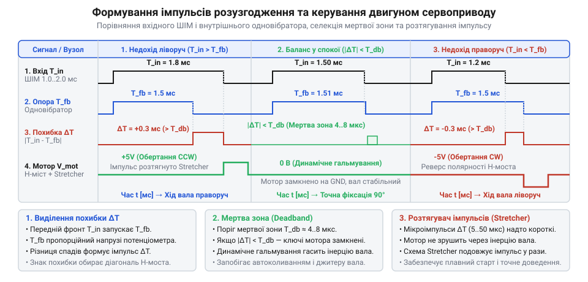
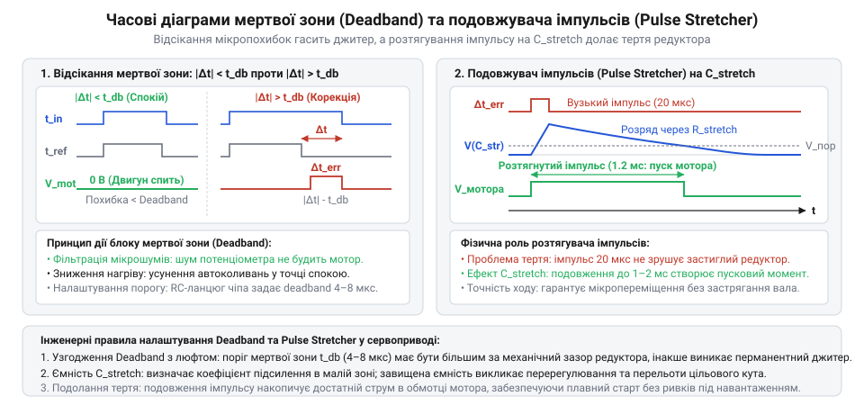
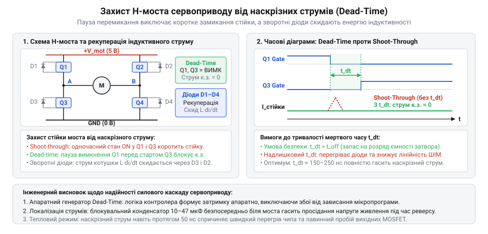
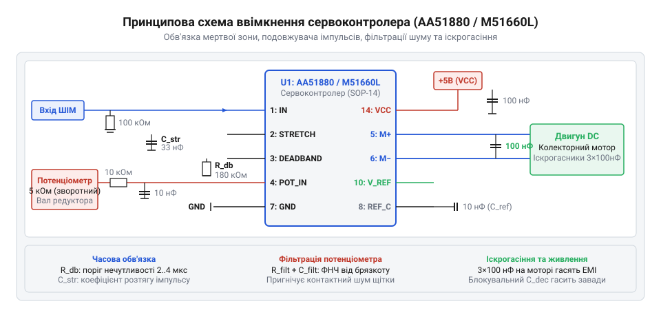
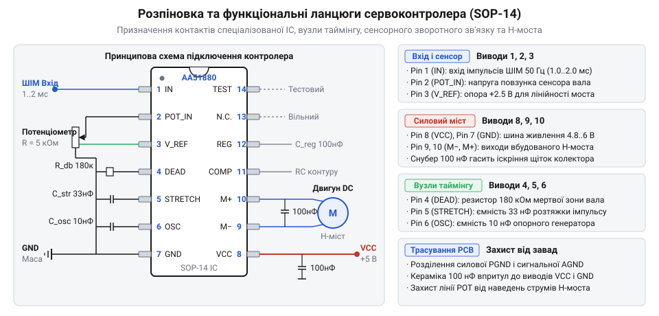
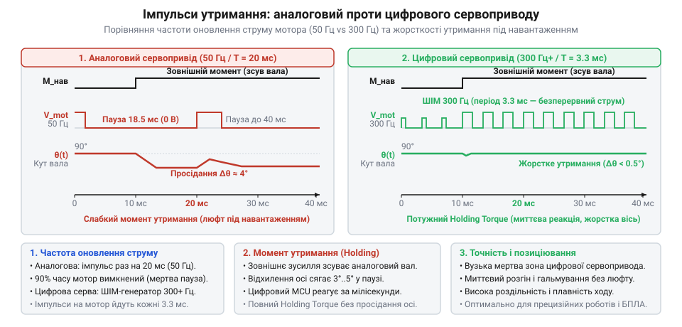
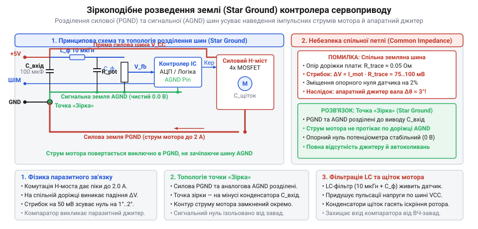

# MG90S V2 — мікросерво з металевим редуктором

<preknowlist>
- [Tower Pro SG90 — мікросерво 9g](root:cat-hw-actuators/sg90-servo) — призначення мікросервопривода, базовий формат вхідного сигналу позиціонування (період 20 мс, тривалість 1..2 мс), взаємозв'язок двигуна, редуктора та потенціометра зворотного зв'язку.
</preknowlist>

## Архітектурна роль спеціалізованого сервоконтролера: автономний замкнений контур

Кожен аматорський та робототехнічний сервопривод — від мініатюрних 9-грамових моделей на кшталт [Tower Pro SG90](root:cat-hw-actuators/sg90-servo) до пристроїв із металевим редуктором на кшталт [Power HD HD-1370A](root:cat-hw-actuators/hd-1370a-servo) — має назовні лише три провідники: лінію позитивного живлення, спільний провід (`GND`) та сигнальну лінію керування. Через цей сигнальний провід зовнішній мікроконтролер передає періодичний імпульсний сигнал. Кожні 20 мс (частота 50 Гц) надходить імпульс тривалістю від 1.0 до 2.0 мс. Ця тривалість однозначно задає кут повороту вихідного вала: 1.0 мс відповідає крайньому лівому положенню, 1.5 мс — механічному центру (нейтралі), а 2.0 мс — крайньому правому положенню.

Ззовні сервомашинка сприймається як ідеальний виконавчий механізм: мікроконтролер задає тривалість імпульсу, і вал стає в потрібну кутову позицію, жорстко утримуючи її проти зовнішніх навантажень. Проте всередині пристрою діє неперервна динамічна система. Зовнішні сили невпинно намагаються зсунути вал; тертя в редукторі та механічна інерція ротора опираються руху; а вбудований колекторний двигун розвиває обертовий момент лише тоді, коли через його якірні обмотки тече електричний струм. Щоби вал не відхилявся під вагою механізму, система мусить постійно вимірювати фактичне положення осі, порівнювати його із заданим кутом, обчислювати величину розузгодження та керувати напругою на двигуні до повного виправлення похибки.

Якщо покласти всі ці операції на центральний мікроконтролер робота, система швидко зіткнеться з нездоланними інженерними обмеженнями:

1. **Кабельний колапс і шумові завади.** Якщо винести датчик положення на зовнішній мікроконтролер, аналоговий сигнал із повзунка потенціометра кожного привода доведеться вести довгими тонкими дротами крізь рухомі зчленування маніпулятора. Колекторний двигун під час комутації щіток генерує потужні високочастотні завади та імпульсні просідання струму. Аналоговий сигнал ковзного контакту, що проходить поруч із силовими шинами живлення, неминуче спотворюється наведеною напругою, спричиняючи тремтіння вала та хаотичні смикання.
2. **Перевантаження обчислювальних таймерів та АЦП.** Для керування, наприклад, шестиногим крокуючим павуком (гексаподом) на 18 сервоприводах центральному процесору знадобилося б 18 незалежних аналогових каналів інтенсивного дискретного вимірювання та 36 апаратних ШІМ-виходів для комутації транзисторних мостів обох полярностей. Постійне опитування десятків каналів АЦП і розрахунок закону стабілізації для кожного суглоба вичерпають доступну пропускну здатність вбудованої периферії.
3. **Критичні фазові затримки в контурі.** Фізичне утримання навантаженого вала вимагає миттєвої реакції на зовнішнє збурення. Якщо центральний процесор затримається в обробці мережевого стека, перерахунку прямої кінематики або сервісному перериванні всього на 5–10 мс, жорсткість утримання вала впаде до нуля. Вал встигне просісти, а запізніле ввімкнення двигуна спричинить сильний переліт цільової точки з переходом у незгасаючі автоколивання.

Розв'язанням цієї суперечності став апаратний поділ обов'язків. Контур швидкого регулювання винесено безпосередньо в корпус сервопривода у вигляді автономної монолітної мікросхеми — спеціалізованого сервоконтролера (@@en|servo controller IC@@, від лат. *servus* — виконавець, підлеглий та фр. *contrôle* — перевірка).

> 🔧 **Навіщо це.**
> Локалізація замкненого контуру всередині корпусу привода відокремлює високорівневе планування траєкторій від миттєвої симетрії сил на валу. Центральний мікроконтролер формує лише координати з помірною частотою 50 Гц, а спеціалізований сервоконтролер забезпечує безперервне утримання точки рівноваги на фізичному рівні без затримок передачі даних та обчислювальних черг.

Всі критичні провідники між сервоконтролером, виводами потенціометра та клемами двигуна мають довжину всього декілька міліметрів і захищені спільним екрануючим кожухом. 

Внутрішня функціональна структура класичного аналогового сервоконтролера складається з кількох тісно взаємодіючих вузлів:
- **Вхідний формувач-буфер (@@en|input buffer@@):** очищує вхідний імпульс від високочастотного шуму кабельної лінії за допомогою вбудованого тригера Шмітта (від імені винахідника О. Г. Шмітта), відновлює крутизну фронтів і синхронізує внутрішні генератори.
- **Генератор опорного імпульсу:** перетворює аналогову напругу зворотного зв'язку з потенціометра в еквівалентний часовий інтервал внутрішньої тривалості.
- **Детектор розузгодження (дискримінатор помилки, від лат. *discriminare* — розрізняти, відокремлювати):** порівнює тривалість зовнішнього командного імпульсу з тривалістю внутрішнього опорного сигналу, виділяючи різницевий імпульс похибки та визначаючи необхідний напрямок обертання вала.
- **Схема мертвої зони (@@en|deadband circuit@@):** блокує подачу коригувального сигналу на двигун, якщо тривалість різницевого імпульсу нижча за мінімальний апаратний поріг, запобігаючи паразитному високочастотному тремтінню вала (@@en|jitter@@).
- **Подовжувач імпульсів (розтягувач, @@en|pulse stretcher@@):** штучно збільшує тривалість мікроімпульсів помилки, забезпечуючи передачу в обмотки мотора порції енергії, достатньої для подолання сили тертя спокою редуктора та індуктивного опору котушок.
- **Симетричний вихідний драйвер H-моста (@@en|H-bridge driver@@):** містить силові біполярні або польові транзистори для реверсивного живлення двигуна з апаратним захистом від наскрізних струмів під час перемикання плечей.


*Внутрішня архітектура аналогового сервоконтролера: інтеграція всіх вузлів зворотного зв'язку на одному кристалі перетворює сервопривод на автономний замкнений регулятор кутового положення.*

Завдяки такій побудові сервопривод миттєво розвиває максимальний протидіючий момент у разі найменшої спроби змістити вал ззовні, гарантуючи жорстке позиціонування без участі центрального процесора.

## Перетворення «кут-напруга-час»: робота внутрішнього генератора опорного імпульсу

Перед сервоконтролером стоїть завдання безпосереднього порівняння двох фізично різнорідних сигналів:
1. Задана кутова позиція надходить із сигнального дроту у вигляді часового інтервалу — тривалості високого рівня імпульсу `T_in` (від 1.0 до 2.0 мс).
2. Поточне фактичне положення вала існує у вигляді геометричного кута повороту `θ`, перетвореного вбудованим потенціометром зворотного зв'язку (від лат. *potentia* — сила, потенціал та грец. μέτρον — міра) на аналогову напругу `V_pot`.

Порівняти тривалість часового відрізка з рівнем постійної напруги безпосередньо неможливо. Щоб уникнути використання громіздких аналого-цифрових перетворювачів, цифрових регістрів і мікропроцесорних ядер, сервоконтролер здійснює витончене апаратне перетворення: він трансформує напругу `V_pot` у пропорційний часовий імпульс `T_ref`. Коли обидві величини зведені до єдиного часового базису, обчислення помилки позиціонування перетворюється на елементарну логічну операцію віднімання імпульсів.

Повний перетворювальний ланцюг має такий вигляд:
```text
Кут повороту вала (θ)
→ Напруга повзунка потенціометра (V_pot)
→ Тривалість внутрішнього опорного імпульсу (T_ref)
```

Перша ланка реалізується механічним з'єднанням: вихідний вал редуктора жорстко зафіксований на осі ковзного контакту (повзунка) прецизійного потенціометра. Крайні виводи резистивної доріжки підключені до внутрішньої стабілізованої напруги живлення `V_cc` та загального проводу. Коли вал повертається від 0° до свого максимального кута `θ_max` (зазвичай 180°), напруга на повзунку змінюється строго лінійно:

```text
V_pot(θ)
= V_min + (V_max - V_min) · (θ / θ_max)      [лінійний поділ напруги на резистивному шарі]
= V_min + k_p · θ                           [k_p — крутизна передачі потенціометра]
```

Для другої ланки — перетворення напруги `V_pot` у часовий інтервал `T_ref` — у кремнії сервоконтролера інтегровано внутрішній генератор опорного імпульсу на основі керованого напругою [моностабільного мультивібратора](root:hw-analog/monostable-multivibrator) (одновібратора, від грец. μόνος — один та лат. *stabilis* — стійкий; лат. *multum* — багато, *vibro* — коливаюся).

Моностабільний мультивібратор працює в замкненій взаємодії з вхідним сигналом за чітким циклом:
1. **Стан спокою.** До приходу вхідного сигналу внутрішній часзадавальний конденсатор `C_t` замкнений накоротко на спільний провід через відкритий розрядний транзистор. Напруга на ємності дорівнює нулю (`V_cap = 0`), а вихідний рівень генератора низький.
2. **Пуск (тригерна синхронізація).** Щойно на вхідний вивід сервоконтролера приходить передній (наростаючий) фронт імпульсу `T_in`, формувач скидає внутрішній RS-тригер. Розрядний транзистор миттєво закривається, на виході генератора встановлюється високий рівень, а конденсатор `C_t` починає лінійно заряджатися від прецизійного інтегрованого джерела постійного струму `I_ch`.
3. **Аналогове стеження.** Напруга на конденсаторі лінійно наростає з фіксованою крутизною. Швидкодіючий аналоговий компаратор (від лат. *comparare* — зіставляти, порівнювати) безперервно зіставляє зростаючу напругу `V_cap(t)` із опорною напругою `V_pot`, що подається з повзунка потенціометра.
4. **Формування зрізу та скидання.** У мить, коли зарядна напруга на конденсаторі зрівнюється з напругою потенціометра (`V_cap = V_pot`), компаратор миттєво перемикається. Цей перепад скидає RS-тригер: сигнал на виході генератора спадає до нуля, а розрядний транзистор знову відкривається, скидаючи заряд із конденсатора `C_t` до наступного такту.

Тривалість згенерованого внутрішнього імпульсу `T_ref` точно відповідає часу, який потрібен джерелу струму `I_ch` для заряджання ємності `C_t` до рівня `V_pot`:

```text
V_cap(t)
= (I_ch / C_t) · t                          [рівняння заряду ємності постійним струмом]

T_ref
= (C_t / I_ch) · V_pot                      [умова перемикання компаратора V_cap = V_pot]
= (C_t / I_ch) · (V_min + k_p · θ)          [підстановка напруги зворотного зв'язку]
= T_min + k_θ · θ                           [лінійна залежність тривалості від кута вала]
```

Значення ємності `C_t` та зарядного струму `I_ch` розраховані так, що при нейтральному положенні вала (кут 90°) тривалість опорного імпульсу становить рівно `T_ref = 1.5 мс`. При куті 0° тривалість зменшується до `T_ref = 1.0 мс`, а при куті 180° зростає до `T_ref = 2.0 мс`.

> 🔧 **Навіщо це.**
> Зведення механічного положення та командного сигналу до єдиного часового виміру безпосередньо в аналоговому домені дозволяє уникнути шуму квантування дискретних АЦП, споживання обчислювальних ядер та помилок округлення, забезпечуючи неперервну апаратну реакцію зі швидкістю поширення сигналу в кремнії.

Оскільки вхідний імпульс `T_in` та внутрішній опорний імпульс `T_ref` запускаються синхронно від одного переднього фронту, їхнє порівняння здійснюється апаратною схемою логічного віднімання:
- **Недохід вала вліво (`T_in > T_ref`):** вал повернутий на менший кут, ніж задано, тому напруга `V_pot` занизька і внутрішній імпульс закінчується раніше за зовнішній. Логічний селектор виділяє інтервал, коли вхідний сигнал ще високий, а внутрішній уже згас: `Pulse_CW = T_in ∧ ¬T_ref`. Тривалість цього імпульсу `ΔT = T_in - T_ref` задає час увімкнення двигуна за годинниковою стрілкою.
- **Недохід вала вправо (`T_in < T_ref`):** вал розташований правіше за цільову точку, тому `V_pot` зависока і внутрішній імпульс перевищує тривалість командного. Логічний селектор формує імпульс реверсу: `Pulse_CCW = ¬T_in ∧ T_ref` тривалістю `ΔT = T_ref - T_in`, відкриваючи протилежне плече силового моста для обертання проти годинникової стрілки.
- **Точка спокою (`T_in ≈ T_ref`):** вал займає задане положення, обидва імпульси завершуються одночасно, тривалість різниці `ΔT = 0`, і силове живлення двигуна вимикається.


*Часова діаграма формування імпульсу розузгодження: апаратне віднімання спадних фронтів командного та внутрішнього опорного сигналів виділяє різницевий інтервал, що безпосередньо керує полярністю та тривалістю ввімкнення двигуна.*

## Логіка віднімання тривалостей і виділення імпульсу розузгодження

Керування сервоприводом базується на періодичному прийомі імпульсів позиціонування, де інформаційним параметром є тривалість високого логічного рівня: зазвичай від 1.0 мс (крайнє ліве положення) до 2.0 мс (крайнє праве положення) із нейтральною точкою 1.5 мс при періоді повторення 20 мс. Одночасно з цим механічне положення вихідного вала через зубчастий редуктор жорстко передається на рухомий контакт потенціометра зворотного зв'язку. Напруга з цього рухомого контакту задає тривалість внутрішнього опорного імпульсу, який генерується вбудованим одновібратором (від @@en|monostable multivibrator@@).

Виникає апаратне завдання: за відсутності аналого-цифрового перетворювача (АЦП) і цифрового обчислювального ядра миттєво порівняти тривалість вхідного командного сигналу `T_in` із тривалістю опорного сигналу поточної позиції вала `T_ref`, визначити напрямок необхідного обертання та величину кутового недоходу.

Для синхронізації процесу передній фронт (перехід із 0 в 1) вхідного імпульсу `T_in` одночасно запускає внутрішній одновібратор. У результаті обидва сигнали — зовнішній командний і внутрішній опорний — переходять у стан логічної одиниці в один і той самий фізичний момент часу `t = 0`. Від цього моменту задача вимірювання різниці зводиться до визначення того, який із двох імпульсів завершиться першим.

Можливі три стани системи:

1. **Командний імпульс довший за опорний (`T_in > T_ref`).**  
   Поточне положення вала відстає від заданого у бік менших кутів. На часовій осі внутрішній одновібратор завершує формування сигналу першим: у момент `t = T_ref` сигнал `T_ref` спадає до нуля, тоді як вхідний командний сигнал `T_in` продовжує утримувати рівень логічної одиниці до моменту `t = T_in`.  
   Логічна схема виділення помилки реалізує функцію логічного множення прямого вхідного сигналу та інвертованого опорного:
   `Error_CW = T_in ∧ ¬T_ref`  
   На виході цієї ланки формується імпульс додатної полярності, тривалість якого строго дорівнює часовій різниці `Δt = T_in - T_ref`. Оскільки активний стан виник за увімкненого сигналу `T_in` після спаду `T_ref`, внутрішня схема спрямовує цей імпульс у канал обертання вперед (за годинниковою стрілкою, @@en|clockwise@@, CW).

2. **Командний імпульс коротший за опорний (`T_in < T_ref`).**  
   Вал привода розвернутий на більший кут, ніж вимагає керівний сигнал. У момент `t = T_in` вхідний імпульс завершується і спадає до нуля, тоді як сигнал внутрішнього одновібратора `T_ref` продовжує залишатися одиничним до моменту `t = T_ref`.  
   Логічна схема реалізує множення інвертованого вхідного сигналу на прямий опорний:
   `Error_CCW = ¬T_in ∧ T_ref`  
   Тривалість імпульсу на виході дорівнює різниці `Δt = T_ref - T_in`. Внутрішній комутатор направляє сигнал розузгодження в канал реверсивного обертання (проти годинникової стрілки, @@en|counter-clockwise@@, CCW).

3. **Тривалості імпульсів рівні (`T_in = T_ref`).**  
   Задана і реальна позиції вала збігаються. Спад обох імпульсів відбувається одночасно. Обидва логічні добутки дорівнюють нулю, імпульси помилки не генеруються, а силовий каскад залишається знеструмленим.

Схемотехнічно операцію віднімання виконує фазово-часовий компаратор (від лат. @@la|comparator@@ — порівнювач) розузгодження. Він побудований на прецизійних RS-тригерах або логічних вентилях збирання помилки. Коли перший із сигналів завершується, відповідний тригер фіксує спадний фронт і відкриває шлях струму через вихідний логічний ключ доти, доки не надійде спадний фронт другого сигналу.

Отримана тривалість сигналу розузгодження `Δt` прямо пропорційна кутовій відстані вала до цільової точки. Для стандартного мікросервопривода з діапазоном повороту 180° зміні сигналу на 1000 мкс (від 1000 до 2000 мкс) відповідає кутове переміщення на 180°. Це задає масштабний коефіцієнт чутливості системи:

```
S_θ
= θ_span / T_span                        [визначення кутової крутизни керування]
= 180° / 1000 μs                         [підстановка повного розмаху кута і часу]
= 0.18 °/μs                              [масштаб перетворення: 0.18 градуса на мікросекунду]
```

Якщо сервопривод утримує позицію `1500 μs` (нейтраль, 90°), а керуючий контролер подає імпульс `1550 μs` (орієнтація на 99°), виділення сигналу помилки відбувається за кроками:

```
Δt
= T_in - T_ref                           [віднімання тривалостей опорного і вхідного сигналів]
= 1550 μs - 1500 μs                      [підстановка значень часових інтервалів]
= 50 μs                                  [тривалість некоригованого імпульсу розузгодження CW]

Δθ
= Δt · S_θ                               [перерахунок часової похибки в просторовий кут]
= 50 μs · 0.18 °/μs                      [множення різниці на коефіцієнт чутливості]
= 9.0°                                   [абсолютна кутова помилка позиціонування вала]
```

Аналоговий компаратор виділяє як абсолютну величину недоходу вала (тривалість `50 μs`), так і знак помилки (активація лінії CW, оскільки `T_in` перевищив `T_ref`).

> 🔧 **Навіщо це.**  
> Апаратне віднімання часових інтервалів безпосередньо в момент надходження сигналу забезпечує нульову затримку реакції контуру (нульовий латентний час). Спеціалізованому контролеру не потрібні АЦП, тактові генератори та програмні переривання: обчислення різниці виконується самою топологією вентилів у реальному часі зі швидкістю поширення фронтів у кремнії (одиниці наносекунд).

## Чутливість контуру та апаратна мертва зона

Ідеальний часовий компаратор реагує на будь-яку ненульову різницю тривалостей: навіть якщо `Δt` становить частки мікросекунди, схема повинна подати напругу на електродвигун для усунення помилки. Проте в реальному сервоприводі контур із нескінченною чутливістю втрачає стійкість і стає непрацездатним через сукупність трьох фізичних факторів:

1. **Електричні шуми датчика положення.** Контактний повзунок потенціометра ковзає резистивною доріжкою. Мікронерівності графітового шару, вібрація та контактний брязкіт (від @@en|contact chatter@@) викликають флуктуації вихідної напруги. Додатково комутаційні сплески струму двигуна створюють пульсації на лініях живлення мікросхеми, що призводить до коливань порогу спрацьовування внутрішнього одновібратора в межах ±0.5..2 мкс навіть за абсолютно нерухомого вихідного вала.
2. **Механічний люфт редуктора.** Шестерні передавального механізму мають мікроскопічні проміжки між зубцями (люфт, від нім. @@de|Luft@@ — повітря, проміжок). Якщо вихідний вал під дією зовнішнього зусилля або власної пружності відхиляється в межах люфта, потенціометр фіксує зміщення, тоді як ротор двигуна ще перебуває в зоні вільного ходу.
3. **Кінетичний переліт (вибіг) ротора.** Обертовий якір колекторного двигуна та проміжні металеві шестерні мають момент інерції. Коли двигун повертає вал у задану точку, він не здатний зупинитися миттєво: накопичена кінетична енергія проштовхує вал далі цільового положення.

Якщо передатна характеристика контуру не має порогу відсікання, навіть шум потенціометра амплітудою в частку мікросекунди генерує коригувальний імпульс. Двигун смикається вперед, проскакує цільову точку через інерцію, породжує імпульс зворотної полярності, реверсується, проскакує точку назад — і впадає у [безперервні автоколивання та тремтіння сервопривода](root:hw-motion/servo-hunting-jitter) навколо положення рівноваги.

Таке явище має назву автоколивального тремтіння або джитера (від @@en|jitter@@; комплексні заходи розглянуто в статті [стабілізація та придушення тремтіння сервоприводів](root:hw-motion/servo-jitter-suppression)). Джитер супроводжується характерним високочастотним дзижчанням редуктора, різким зростанням струму спокою сервопривода від типових 5–10 мА до 150–300 мА, швидким перегрівом колекторного вузла мотора та прискореним стиранням зубців шестерень.

Для запобігання автоколиванням у структуру контролера інтегрують вузол апаратної мертвої зони (від @@en|deadband@@). Мертва зона встановлює часовий поріг `t_dead`: будь-які імпульси розузгодження, чия тривалість менша за `t_dead`, повністю блокуються і не надходять на силові ключі керування мотором.

Схемотехнічно [апаратна мертва зона](root:hw-analog/analog-deadband-circuits) реалізується за допомогою порогового дискримінатора тривалості на базі внутрішнього або зовнішнього RC-ланцюжка чи джерела стабільного струму й конденсатора. Вхідний некоригований імпульс розузгодження тривалістю `Δt` відкриває ключ заряду інтегруючої ємності мертвої зони `C_dead`:

- Якщо тривалість імпульсу коротка (`Δt < t_dead`), напруга на конденсаторі не встигає досягти опорного порогу спрацьовування внутрішнього компаратора `V_th`. Після завершення імпульсу заряджена ємність швидко розряджається на спільну шину. Сигнал на виході вузла залишається нульовим: шумовий сплеск придушено.
- Якщо тривалість імпульсу перевищує встановлений поріг (`Δt ≥ t_dead`), напруга на ємності досягає `V_th` у момент часу `t = t_dead`. Від цього моменту компаратор мертвої зони перемикається у високий рівень і пропускає імпульс далі. Тривалість вихідного скоригованого імпульсу помилки `t_err` зменшується рівно на ширину мертвої зони:
  `t_err = Δt - t_dead`

Ширина мертвої зони задає фундаментальний інженерний компроміс між стійкістю системи та статичною точністю позиціонування:

- **Занадто вузька мертва зона (`t_dead < 1..2 μs`).** Забезпечує високу жорсткість утримання вала та мінімальну похибку положення, але сервопривод постійно дзижчить, тремтить під навантаженням і перегрівається через реакцію на власний шум потенціометра.
- **Занадто широка мертва зона (`t_dead > 8..15 μs`).** Гарантує бездоганну тишу, низьке енергоспоживання в спокої та стійкість до сильних механічних вібрацій, однак спричиняє відчутний просторовий люфт: вихідний вал можна відхилити зовнішнім навантаженням на значний кут без будь-якого опору з боку двигуна.

Для компактних приводів з металевими шестернями класу MG90S або [Power HD HD-1370A](root:cat-hw-actuators/hd-1370a-servo) типове значення апаратної мертвої зони становить від 3 до 5 мкс. Для сервоприводів із нейлоновим редуктором, таких як [Tower Pro SG90](root:cat-hw-actuators/sg90-servo), де пружність матеріалу частково демпфує мікроудари зубців, допускається звуження зони до 2..3 мкс.

Кутова похибка нечутливості вала при типовій мертвій зоні `t_dead = 4.0 μs` розраховується через крутизну позиціонування:

```
θ_dead
= t_dead · S_θ                           [переведення часової мертвої зони в просторовий кут]
= 4.0 μs · 0.18 °/μs                     [множення граничного часу на крутизну]
= 0.72°                                  [кутова півширина зони нечутливості]
```

Повний діапазон вільного люфту вала в обидва боки становить `±0.72°` (сумарно `1.44°`). Будь-яке зовнішнє або задане кутове відхилення всередині цього сектора не збуджує струм у двигуні, що повністю ліквідує паразитно споживану енергію та захищає редуктор від зносу.

> 🔧 **Навіщо це.**  
> Налаштування ширини мертвої зони — головний інструмент ліквідації високочастотного писку й вібрацій привода безпосередньо на платі. Підбір зовнішнього резистора мертвої зони дозволяє точно узгодити електроніку зі ступенем зносу редуктора: коли в процесі експлуатації зазори між шестернями зростають, невелике збільшення мертвої зони усуває раптово виниклий джитер без заміни механічних вузлів.

## Формувач-розтягувач імпульсів і електромеханічна інерція

Після фільтрації шуму у вузлі мертвої зони система отримує очищений імпульс помилки тривалістю `t_err = Δt - t_dead`. При незначних відхиленнях вала (наприклад, кутова похибка близько 1°, що відповідає `Δt ≈ 9.5 μs` при `t_dead = 4.0 μs`) тривалість результуючого імпульсу становить лише `5.5 μs`.

Тут виникає бар'єр електромеханічної природи. Виконавчим органом сервопривода є мікроатюрний колекторний двигун постійного струму, навантажений багатоступеневим редуктором. Поведінку такого вузла визначають дві часові константи:

1. **Електрична стала часу якірної обмотки `τ_e = L_m / R_m`.**  
   Для типового двигуна мікросервопривода індуктивність обмотки становить `L_m ≈ 100..200 μH`, а активний опір — `R_m ≈ 8..12 Ω`. Звідси електрична стала часу лежить у межах `τ_e ≈ 10..25 μs`. Якщо на обмотку подати імпульс напруги живлення тривалістю лише 5 мкс, струм через індуктивність просто не встигне нарости до значення, необхідного для створення скільки-небудь помітного магнітного потоку.
2. **Електромеханічна стала часу `τ_m` та сухе тертя спокою.**  
   Власна механічна інерція ротора двигуна разом із моментом інерції шестерень формує електромеханічну сталу порядку `τ_m ≈ 5..15 ms` (мілісекунд). Крім того, колекторні щітки, втулки валів та зубчасті зачеплення створюють значне сухе тертя спокою (від @@en|stiction@@, статичне тертя; докладніше механіку пускового тертя розкрито в статті `root:hw-motion/actuator-stiction`).

Імпульс тривалістю кілька мікросекунд не несе достатньої енергії, щоб створити пусковий момент, здатний зрушити закріплений тертям ротор з місця. До того ж наступний керуючий імпульс надійде лише через 20 мс (стандартний період кадру 50 Гц). У результаті без спеціальної обробки сервопривод виявляється абсолютно глухим і нерухомим до малих відхилень: він реагує лише на стрибки у десятки градусів, втрачаючи пропорційність і точність утримання позиції.

Для подолання цієї невідповідності до схеми контролера введено формувач-розтягувач імпульсів (від @@en|pulse stretcher@@). Його призначення — пропорційно перетворити мікросекундний сигнал розузгодження `t_err` у мілісекундний силовий імпульс керування двигуном `t_motor`, здатний подолати пускове тертя та надати ротору необхідне прискорення:
`t_motor = K_stretch · t_err`

Коефіцієнт розтягування `K_stretch` у сервоконтролерах лежить у діапазоні від 50 до 300. Завдяки цьому сигнал помилки тривалістю `5 μs` трансформується в імпульс живлення мотора тривалістю близько `1000 μs` (1.0 мс).

В аналогових сервоконтролерах розтягування реалізується за схемою двотактного інтегратора на зовнішньому конденсаторі розтягувача `C_stretch` (або `C_s`; теорію зарядо-часових перетворювачів див. у `root:hw-analog/dual-slope-integrator`):

1. **Фаза швидкого заряду (робочий такт).** Протягом дії вхідного імпульсу помилки `t_err` стабільне внутрішнє джерело струму `I_charge` заряджає конденсатор `C_stretch`. Оскільки струм заряду великий (зазвичай 1–2 мА), напруга на конденсаторі наростає крутим лінійним фронтом:
   `ΔV_C = (I_charge · t_err) / C_stretch`
2. **Фаза повільного розряду (такт силового впливу).** Як тільки імпульс `t_err` завершується, джерело заряду вимикається. Конденсатор починає лінійно розряджатися через прецизійне джерело розрядного струму малої величини `I_discharge` (або високоомний резистор розряду), де `I_discharge ≪ I_charge` (струм розряду зазвичай становить 5–15 мкА).
3. **Формування вихідного імпульсу.** Внутрішній компаратор утримує сигнал увімкнення силових транзисторів H-моста високим протягом усього часу, поки напруга на конденсаторі `V_C(t)` залишається вищою за фіксований поріг відсікання `V_cutoff`.

Оскільки кількість заряду, накопичена під час заряду, дорівнює кількості заряду, відданій під час розряду (`Q = I_charge · t_err = I_discharge · t_dis`), тривалість розряду становить:

```
t_motor
= t_dis                                  [тривалість силового імпульсу визначається часом розряду]
= t_err · (I_charge / I_discharge)       [баланс накопиченого та розрядженого електричного заряду]
= t_err · K_stretch                      [виділення пропорційного коефіцієнта розтягування]
```

При типових значеннях струмів `I_charge = 1.6 mA` та `I_discharge = 8.0 μA` перетворення короткого імпульсу помилки `t_err = 5.0 μs` виконується так:

```
K_stretch
= I_charge / I_discharge                 [розрахунок апаратного коефіцієнта посилення тривалості]
= 1.6 mA / 8.0 μA                        [підстановка номіналів внутрішніх джерел струму]
= 1600 μA / 8.0 μA                       [приведення одиниць вимірювання до мікроамперів]
= 200                                    [безрозмірний фактор часового розтягування]

t_motor
= t_err · K_stretch                      [множення вхідної помилки на масштабний фактор]
= 5.0 μs · 200                           [підстановка тривалості відфільтрованої помилки]
= 1000 μs = 1.0 ms                       [тривалість керуючого імпульсу, що надходить на H-міст]
```

Імпульс тривалістю 1.0 мс повністю перекриває електричну сталу часу обмотки (`τ_e ≈ 15 μs`). Струм у якорі встигає піднятися до встановленого максимуму, створює ударний електромагнітний момент, зриває шестерні з точки сухого спокою і провертає редуктор рівно на задану малу дискрету кута.

Такий принцип забезпечує аналогове пропорційне регулювання (P-регулятор):
- **При малому розузгодженні** конденсатор заряджається слабко, формуючи короткий мілісекундний поштовх (дозований момент без перельоту).
- **При великому розузгодженні** конденсатор заряджається до напруги насичення, розряд триває понад 15–18 мс, утримуючи ключі H-моста відкритими практично протягом усього 20-мілісекундного періоду кадру. Мотор працює з максимальним моментом і граничною кутовою швидкістю.
- **Під час наближення до цілі** розтягнуті імпульси автоматично скорочуються, що забезпечує плавне гальмування привода без вильоту за межі цільової координати.


*Часові діаграми формування мертвої зони та розтягування імпульсу розузгодження: відсікання шумів пороговим компаратором deadband та двотактне інтегрування для пуску двигуна.*

> 🔧 **Навіщо це.**  
> Ємність конденсатора розтягувача імпульсів безпосередньо визначає динамічну жорсткість привода. Якщо встановити надмірно велику ємність `C_stretch`, імпульси стануть надто довгими: навіть на найменше відхилення мотор реагуватиме надлишковим ривком, що призведе до низькочастотного перерегулювання й розгойдування вала. Зменшення цієї ємності робить привід млявим і нездатним долати механічне навантаження на малих кутах переміщення.

## Силовий H-міст, захист від наскрізних струмів та інтегральне ввімкнення контролера

Керуючі імпульси, що виходять зі схем порівняння та розтягування тривалості сигналу розузгодження, мають амплітуду стандартних логічних рівнів і струм у лічені мікроампери. Колекторний двигун постійного струму сервопривода вимагає зовсім іншого енергетичного масштабу: типовий струм руху становить сотні міліампер, а під час рушання з місця чи реверсу під механічним навантаженням піковий струм сягає 0.5..1.2 А. Окрім передачі значної потужності, схема комутації двигуна має вирішувати три суперечливі завдання: забезпечувати обертання в обох напрямках від єдиного однополярного джерела живлення, миттєво гасити інерцію обертання ротора в точці позиціонування та надійно захищати власні ключі від руйнівних реактивних сплесків напруги.

Для реалізації цих вимог до складу інтегрального сервоконтролера вбудовано силовий комутаційний вузол — симетричний чотириквадрантний H-міст (@@en|H-bridge@@, від англ. *bridge* — міст, названий так через графічну схожість чотирьох комутуючих ключів і центральної гілки навантаження з літерою H; принципи побудови таких схем розглядають [інтегральні драйвери силових H-мостів](root:hw-motion/h-bridge-driver)).

### Топологія H-моста та статичні режими комутації

Схема класичного [Н-моста для керування двигунами постійного струму](root:hw-motion/h-bridge) складається з двох паралельних вертикальних стійок (напівмостів), увімкнених між шиною живлення `V_CC` та спільною шиною `GND`. Кожна стійка містить два силові транзистори: верхній ключ (підключений до лінії високого потенціалу) та нижній ключ (з'єднаний із землею). Виводи якірної обмотки колекторного двигуна підключаються до середніх точок між верхнім і нижнім ключами кожної стійки.

В інтегральних сервоконтролерах силові транзистори реалізуються за двома напівпровідниковими технологіями:

1. Біполярні транзистори (BJT, @@en|bipolar junction transistor@@, від лат. *bi-* — подвійний та *polus* — полюс). Верхні ключі виконуються за структурою p-n-p, а нижні — n-p-n. У відкритому стані насичення біполярний транзистор має незмінне залишкове падіння напруги між колектором та емітером `V_CE(sat)`, яке для інтегральних силових транзисторів становить 0.25..0.40 В. Оскільки струм двигуна протікає одночасно через один верхній та один нижній ключ, сумарне спадання напруги на мості досягає 0.5..0.8 В. При типовому живленні сервопривода 4.8 В (як у мікросервоприводах класу [Tower Pro SG90](root:cat-hw-actuators/sg90-servo)) двигун отримує лише близько 4.0..4.2 В, а втрачена потужність розсіюється на кристалі мікросхеми:

```
P_loss = I_load · (V_CE(sat)_top + V_CE(sat)_bot)   [статичні втрати біполярного моста]
```

2. Польові транзистори з ізольованим затвором (MOSFET, @@en|metal-oxide-semiconductor field-effect transistor@@, від лат. *metallum* — метал, грец. *oxys* — кислий та лат. *transire* — переходити). Верхні ключі реалізуються на P-канальних транзисторах, нижні — на N-канальних. Відкритий канал польового транзистора поводиться як лінійний опір `R_DS(on)` величиною від десятків до кількох сотень міліом. Втрати напруги на ключах розраховуються за законом Ома:

```
V_drop = I_load · (R_DS(on)_top + R_DS(on)_bot)     [падіння напруги на польових ключах]
```

На малих і середніх струмах падіння напруги на польовому мості становить лічені мілівольти, що забезпечує коефіцієнт корисної дії понад 90% і передачу практично повної напруги живлення на обмотку мотора.

Комутація ключів моста забезпечує чотири робочі стани навантаження:

* Прямий рух: відкриті верхній лівий та нижній правий ключі. Струм проходить через якір двигуна зліва направо, змушуючи вал обертатися за годинниковою стрілкою.
* Зворотний рух: відкриті верхній правий та нижній лівий ключі. Полярність напруги на якорі змінюється на протилежну, струм тече справа наліво, спричиняючи реверс вала проти годинникової стрілки.
* Стан високого імпедансу (вільний вибіг, @@en|coasting@@, від англ. *coast* — рух за інерцією): усі чотири ключі закриті. Обмотка двигуна повністю від'єднана від шин живлення, і ротор продовжує обертатися виключно за рахунок накопиченої кінетичної енергії, повільно зупиняючись під дією механічного тертя шестерень редуктора.
* Динамічне гальмування (@@en|dynamic braking@@, від грец. *δύναμις* — сила): стан, коли обидва нижніх ключі відкриті одночасно, а обидва верхніх гарантовано закриті (або дзеркально — обидва верхніх відкриті при закритих нижніх).

### Механізм динамічного гальмування

Якщо після відпрацювання кута розузгодження просто вимкнути всі транзистори моста, сервопривод не зупиниться в заданій точці. Кінетична енергія масивного зубчастого редуктора та високошвидкісного ротора призведе до проскакування цільового положення (явище перебігу, або @@en|overshoot@@). Потенціометр зворотного зв'язку зафіксує помилку протилежного знака, мікросхема ввімкне зворотний хід, і сервопривод перейде в режим безперервних незгасаючих автоколивань біля точки спокою.

Динамічне гальмування усуває цей дефект без застосування додаткових механічних фрикціонів. Коли ротор продовжує обертатися за інерцією у магнітному полі статора, у провідниках його якірної обмотки за законом електромагнітної індукції Фарадея виникає протиелектрорушійна сила (проти-ЕРС, @@en|back-EMF@@, від грец. *ēlektron* — бурштин, лат. *motio* — рух):

```
E_bemf = k_e · ω                         [величина проти-ЕРС обертового якоря]
```

де `k_e` — електромагнітна конструктивна стала двигуна, а `ω` — миттєва кутова швидкість ротора.

Коли мікросхема переводить міст у стан гальмування, замикаючи обидва виводи якоря накоротко через відкриті нижні транзистори на спільну шину `GND`, проти-ЕРС породжує в утвореному замкненому колі струм гальмування:

```
I_brake = E_bemf ÷ (R_a + 2 · R_on)      [струм короткого замикання якоря]
```

де `R_a` — власний активний опір мідного дроту обмотки якоря, а `R_on` — опір відкритого стану нижніх ключів моста.

Взаємодія цього струму з постійним магнітним полем статора створює електромагнітний гальмівний момент Лоренца:

```
M_brake = -k_m · I_brake                 [гальмівний момент сили Лоренца]
```

Цей момент діє строго протилежно вектору кутової швидкості ротора. Оскільки величина гальмівного моменту прямо пропорційна швидкості обертання, найбільш інтенсивне уповільнення відбувається в перший момент початку гальмування. Кінетична енергія механічної системи практично миттєво перетворюється на тепло на внутрішньому омічному опорі обмотки. Як наслідок, обертання вала припиняється за лічені мілісекунди після завершення коригувального імпульсу, фіксуючи редуктор рівно в заданій позиції без закидання та вібрацій.

### Фізика наскрізного струму (shoot-through)

Під час швидкої зміни стану плеча моста (наприклад, при переході від прямого ходу до динамічного гальмування чи реверсу) виникає небезпека короткого замикання шини живлення. Для зміни напрямку струму через двигун нижній транзистор однієї зі стійок повинен закритися, а верхній транзистор тієї самої стійки — відкритися.

У реальних напівпровідниках процес вимикання ніколи не відбувається миттєво:

* У біполярних транзисторах (BJT), які працюють у глибокому насиченні, в області бази накопичується значний заряд надлишкових неосновних носіїв. Перш ніж колекторний струм почне зменшуватися, цей заряд має розсмоктатися внаслідок рекомбінації або витекти через базовий вивід. Інтервал розсмоктування носіїв заряду (час затримки вимикання, @@en|storage time@@, `t_s`) у силових інтегральних транзисторах становить від 150 до 800 нс.
* У польових транзисторах (MOSFET) швидкість перемикання обмежена часом розряду вхідної ємності затвора `C_iss` та перезаряду прохідної ємності Міллера `C_gd` через внутрішній вихідний опір логічного драйвера.

Якщо керуюча логіка подасть відкриваючий сигнал на верхній ключ одночасно зі зняттям сигналу з нижнього ключа, верхній транзистор почне відкриватися одразу, тоді як нижній ще залишатиметься провідним через затримку розсмоктування заряду в базі чи затворі.

У цей момент обидва транзистори однієї вертикальної стійки одночасно опиняються у відкритому стані. Виникає наскрізний струм (@@en|shoot-through@@, або поперечний струм стійки, від англ. *shoot through* — наскрізний простріл) — пряме металеве коротке замикання шини живлення `V_CC` на землю `GND`.

Величина наскрізного струму обмежується виключно паразитними опорами кремнієвих каналів і контактних провідників кристала, досягаючи значень 10..25 А. Це призводить до трьох деструктивних наслідків:

1. Локальний тепловий пробій: імпульсне виділення гігантської потужності на кристалі за кілька сотень наносекунд плавить p-n переходи, викликаючи незворотне вигорання мікросхеми.
2. Просідання напруги живлення: раптовий імпульс струму створює падіння напруги на підвідних дротах і внутрішніх шинах, спричиняючи колапс живлення вбудованого генератора опорної пилкоподібної напруги та компараторів контролера.
3. Електромагнітна завада високої інтенсивності: крутий фронт наскрізного струму збуджує паразитні коливальні контури монтажу, наводячи спотворення на високоомні лінії потенціометра зворотного зв'язку.

### Логіка мертвого часу (dead-time delay)

Щоб унеможливити виникнення наскрізних струмів, у схему формувача сигналів керування затворами інтегрують апаратний блок створення мертвого часу (@@en|dead-time delay@@, від англ. *dead time* — мертвий, пасивний інтервал).

Керування здійснюється за алгоритмом «розрив перед з'єднанням» (@@en|break-before-make@@, від англ. *break before make*). При будь-якому перемиканні напівмоста сигнал керування активним ключем знімається негайно, після чого внутрішній вузол затримки блокує появу відмикаючого сигналу на протилежному ключі протягом захисного інтервалу часу `t_dead`. Лише після того, як попередній ключ гарантовано розірве коло і повністю відновить свої запірні властивості, дозвіл передається на відкриття зустрічного транзистора.

Тривалість мертвого часу обирається з урахуванням найгірших технологічних параметрів кремнію та максимальної робочої температури кристала:

```
t_dead > t_off(max)
       = t_s(max) + t_f(max)             [для біполярного ключа: час розсмоктування та спаду]
t_dead > t_d(off) + t_f                  [для польового ключа: затримка вимкнення та спад]
```

де `t_s` — час розсмоктування носіїв заряду в базі, `t_f` — час спаду струму колектора/стоку, а `t_d(off)` — затримка вимикання затвора.

У спеціалізованих сервоконтролерах інтервал мертвого часу встановлюється в діапазоні 250..1200 нс. Занадто мала тривалість не захистить від наскрізного струму при нагріванні мікросхеми, а надмірно велика — створить паразитну фазу вільного вибігу мотора під час кожного такту ШІМ, погіршуючи плавність низькошвидкісного руху вала.


*Осцилограми комутації напівмоста в часовій області: захисний інтервал dead-time усуває наскрізні струми стійки, а зворотні діоди скидають індуктивну енергію обмотки.*

### Захист від індуктивних викидів та контури рециркуляції струму

Якірна обмотка двигуна постійного струму має значну власну індуктивність `L_a` (від 50 до 500 мкГн). Відповідно до фундаментального закону електромагнітної індукції Фарадея, при спробі миттєво перервати струм силовим транзистором на виводах обмотки генерується напруга самоіндукції:

```
V_L = -L_a · (dI ÷ dt)                   [напруга індуктивного викиду]
```

Оскільки транзистор вимикається за лічені частки мікросекунди, похідна спаду струму `dI/dt` має величезне від'ємне значення. Без спеціальних контурів гасіння амплітуда викиду зворотної напруги на виводах мотора досягає 30..60 В, що багаторазово перевищує напругу лавинного пробою інтегральних транзисторів і призводить до миттєвого руйнування кристала.

Для захисту ключів паралельно кожному транзистору H-моста встановлюють зворотні швидкодіючі діоди (@@en|flyback diodes@@, від англ. *fly back* — зворотний рух, або інтегровані діоди підкладки — @@en|body diodes@@ у структурі MOSFET). Діоди увімкнені у зворотному напрямку щодо робочої полярності живлення: аноди з'єднані з шиною `GND`, а катоди — з шиною `V_CC`.

Коли силові транзистори закриваються, струм індуктивності не може обірватися миттєво. Він продовжує текти в попередньому напрямку через обмотку двигуна, відкриваючи діагональну пару захисних діодів. У результаті енергія магнітного поля, накопичена в обмотці, повертається назад у конденсатори фільтра шини живлення. Напруга на виводах двигуна жорстко обмежується безпечними значеннями:

```
V_motor_max ≤ V_CC + V_D                 [фіксація напруги на верхній шині]
V_motor_min ≥ -V_D                       [фіксація напруги на нижній шині]
```

де `V_D` — пряме падіння напруги на захисному діоді (близько 0.7..0.9 В для дифузійних діодів або 0.3..0.4 В для діодів Шотткі).


*Схемотехніка силового H-моста з вузлом формування мертвого часу: затримка ввімкнення зустрічного ключа запобігає наскрізному пробою плеча під час розсмоктування носіїв заряду, а зворотні діоди скидають енергію індуктивних викидів обмотки назад у шину живлення.*

### Типова схема ввімкнення та інтегральна обв'язка

Щоб забезпечити стійку роботу сервосистеми, інтегральний сервоконтролер потребує правильного узгодження високоомних вимірювальних кіл із сильнострумовими лініями комутації H-моста.

Типова схема застосування сервоконтролера об'єднує п'ять функціональних вузлів:

1. Шини живлення (`V_CC` і `GND`) та блокувальні ємності. Комутація H-моста генерує високочастотні імпульси струму з крутими фронтами наростання. Довгі дроти сервокабелю володіють паразитною індуктивністю, яка під час пуску мотора створює глибокі динамічні провали напруги живлення. Для запобігання збоям внутрішнього прецизійного компаратора безпосередньо біля виводів живлення мікросхеми встановлюють два паралельні конденсатори:
   * Електролітичний або танталовий конденсатор ємністю 10..47 мкФ, що працює як локальний накопичувач заряду для покриття пускового струму мотора;
   * Багатошаровий керамічний конденсатор ємністю 0.1 мкФ (тип діелектрика X7R) з мінімальним паразитним послідовним опором (ESR) та індуктивністю (ESL) для шунтування високочастотних комутаційних сплесків.

2. Вхідний каскад командного сигналу (PWM In). Приймає імпульси тривалістю 1..2 мс із періодом повторення 20 мс. Вхід захищений від високочастотних радіозавад інтегрованим RC-фільтром низьких частот і тригером Шмітта.

3. Коло потенціометра зворотного зв'язку (Potentiometer Interface). Крайні виводи змінного резистора підключаються до внутрішнього стабілізатора опорної напруги (або шин живлення мікросхеми), а рухомий контакт (повзунок, жорстко пов'язаний з вихідним валом редуктора) заводиться на вимірювальний вхід контролера. Для усунення високочастотного шуму, спричиненого мікротріщинами та брудом на резистивній доріжці потенціометра, вивід повзунка шунтується невеликим керамічним конденсатором ємністю 1..10 нФ на спільний провід.

4. Лінії підключення колекторного двигуна (Motor+, Motor-). Виходи H-моста під'єднуються безпосередньо до щіток мотора. Безпосередньо між виводами двигуна припаюється керамічний конденсатор ємністю 10..100 нФ, який гасить іскровий високочастотний шум щітково-колекторного вузла, не дозволяючи йому випромінюватися в навколишній простір і збивати роботу вимірювальних кіл.

5. Зовнішні часозадаючі кола налаштування динаміки:
   * Ланцюг розтягувача імпульсів (@@en|pulse stretcher@@, від лат. *impulsus* — удар, поштовх та англ. *stretch* — розтягувати): зовнішній конденсатор і паралельний резистор визначають коефіцієнт подовження коротких імпульсів розузгодження. Без цього каскаду імпульс тривалістю кілька мікросекунд не зміг би зрушити ротор з місця через високий момент тертя спокою шестерень редуктора.
   * Ланцюг налаштування мертвої зони (Deadband): резистор, що визначає поріг чутливості компаратора. Він встановлює мінімальну тривалість помилки позиціонування, за якої контролер не активує силовий міст, утримуючи якір у режимі динамічного гальмування.


*Принципова схема типового ввімкнення спеціалізованого сервоконтролера: локальна фільтрація ліній живлення, розділення силових та сигнальних трас і підключення зовнішньої RC-обв'язки регулювання мертвої зони та розтягування імпульсів.*

> 🔧 **Навіщо це.**
>
> Розуміння внутрішньої схемотехніки H-моста та призначення його зовнішньої обв'язки — єдиний спосіб діагностувати несправності та надійно інтегрувати сервоприводи в складні робототехнічні комплекси.
>
> 1. Запобігання самочинному перезавантаженню системи. Якщо на платі сервопривода висихає чи відсутній електролітичний конденсатор живлення ємністю 10..47 мкФ, у момент перемикання H-моста струм розгону двигуна спричиняє імпульсне просідання напруги живлення нижче критичного рівня працездатності мікросхеми. Контролер скидає внутрішній генератор, напруга на мить відновлюється, після чого цикл повторюється. Ззовні це виглядає як неконтрольоване хаотичне сіпання вала сервопривода, яке часто помилково списують на несправність мікроконтролера керування.
>
> 2. Захист від теплового руйнування при механічному заклинюванні (stall condition). Якщо вихідний вал сервопривода заблоковано зовнішньою перешкодою, ротор двигуна зупиняється. При цьому проти-ЕРС дорівнює нулю (`E_bemf = 0`), а струм через відкриті транзистори H-моста обмежується лише малим омічним опором мідного дроту обмотки (`I_stall = V_CC ÷ R_a`). Для типового мікросервопривода з напругою живлення 5 В і опором якоря 5..8 Ом струм заклинювання досягає 0.6..1.0 А. Потужність втрат на біполярних ключах миттєво зростає до 0.5..0.8 Вт. Без масивного тепловідводу інтегральний кристал нагрівається до температури понад 150 °C за кілька секунд, що призводить до теплового пробою вихідних ключів і повного виходу сервопривода з ладу.
>
> 3. Баланс між точністю та високочастотним тремтінням (@@en|jitter@@, від англ. *jitter* — тремтіння, нервове здригання). Якщо для досягнення максимальної кутової роздільної здатності надмірно зменшити опір резистора мертвої зони, сервопривод почне реагувати на найменші контактні шуми потенціометра зворотного зв'язку. H-міст почне безперервно перемикатися навколо точки рівноваги з частотою вхідного сигналу (50 Гц). Таке високочастотне дрижання не додає корисної точності, але збільшує струм спокою сервопривода в 5–10 разів (з 5..10 мА до 100..200 мА), викликає швидкий знос колекторних щіток і викришування зубів редуктора, що нерідко трапляється при некоректній обв'язці в сервоприводах класу [Power HD HD-1370A](root:cat-hw-actuators/hd-1370a-servo).

## Цоколівка сервоконтролера, взаємодія з платою та розрахунок пасивної обв'язки

Кремнієвий кристал сервоконтролера містить у собі прецизійні аналогові компаратори, генератор внутрішнього опорного інтервалу, блок виділення сигналу розузгодження та синій польовий або біполярний H-міст. Проте сам по собі цей кристал не знає механічних властивостей системи, якою керує. Металевий редуктор привода на кшталт [Tower Pro SG90](root:cat-hw-actuators/sg90-servo) має значну масу шестерень, певний люфт зачеплення та високий коефіцієнт тертя спокою. Пластиковий редуктор легший, але має іншу пружність зубців. Колекторні двигуни відрізняються індуктивністю якірної обмотки, робочим струмом та опором.

Якщо замкнути контур керування суто внутрішніми фіксованими параметрами мікросхеми, привід або зірветься в неперервні автоколивання біля заданої точки, або не зможе зрушити вал з місця при малих похибках позиціонування. Щоб зробити кристал універсальним і адаптувати його до механіки та електрики конкретного редуктора й двигуна, ключові часові константи винесено назовні у вигляді пасивної RC-обв'язки друкованої плати.

### Функціональне призначення виводів спеціалізованого сервоконтролера

Типова мікросхема сервоконтролера випускається в компактних планарних корпусах (найчастіше на 8 або 14–16 виводів). Незалежно від конкретної топології кристала, виводи діляться на чотири чіткі функціональні групи: живлення, сигнальні інтерфейси, виходи силового драйвера та піни конфігурації часових параметрів контуру.

1. **Шина живлення та внутрішнє опорне джерело:**
   - `VDD` (або `VCC`) — головний позитивний полюс живлення. Від нього живляться силові вихідні ключі H-моста та вбудований стабілізатор напруги живлення внутрішньої логіки.
   - `GND` — спільна земля аналогової частини, компараторів та силових транзисторів.
   - `VREF` — вихід стабілізованої опорної напруги (зазвичай 2.5–3.0 В), сформованої внутрішнім лінійним регулятором. Ця напруга живить резистивну доріжку потенціометра зворотного зв'язку. Використання окремого стабілізованого виходу замість підключення потенціометра напряму до нестабільної лінії `VDD` ізолює контур вимірювання положення від просідань напруги під час пуску двигуна.

2. **Сигнальні входи:**
   - `PWM_IN` (керівний вхід) — високоомний логічний вхід, який приймає зовнішній імпульс позиціонування стандарту сервокерування (позитивний імпульс тривалістю 1.0–2.0 мс із періодом проходження близько 20 мс).
   - `POT_IN` — аналоговий вхід зворотного зв'язку. До нього під'єднується рухомий повзунок потенціометра, механічно з'єднаного з вихідним валом редуктора. Напруга на цьому контакті лінійно відображає поточний фізичний кут повороту вала.

3. **Силові виходи на двигун:**
   - `OUT1` та `OUT2` (полюси H-моста) — виходи комплементарних транзисторних напівмостів. Вони комутують напругу живлення `VDD` або землю `GND` на щітки колекторного двигуна. Внутрішня логіка мікросхеми гарантує взаємне блокування ключів: якщо верхній ключ відкрито, нижній примусово закритий, що унеможливлює наскрізний струм короткого замикання.

4. **Виводи конфігурації контуру (часові константи):**
   - `DEADBAND` (`DB_ADJ`) — вивід підключення зовнішнього RC-ланцюга, який задає часову ширину мертвої зони (зони нечутливості).
   - `STRETCH` — вивід інтегратора розтягувача імпульсів. Зовнішня ємність на цьому контакті перетворює надкороткі первинні імпульси помилки в розширені пакети струму, достатні для страгування ротора.
   - `INT` / `COMP` (фазова корекція) — вивід підключення фільтрувальної ємності зворотного зв'язку внутрішнього підсилювача розузгодження, яка пригнічує високочастотний фазовий зсув і усуває паразитний свист у статичному положенні.

Всі ці виводи з'єднуються на мініатюрній друкованій платі привода у замкнену електромеханічну систему.


*Функціональна принципова схема підключення сервоконтролера: пасивна RC-обв'язка контуру регулювання, підключення мотора, потенціометра та блокувальних конденсаторів живлення.*

### Розрахунок і вибір компонентів мертвої зони

Мертва зона (англ. @@en|deadband@@) — це мінімальна різниця між тривалістю командного вхідного імпульсу та внутрішнього імпульсу зворотного зв'язку, на яку сервоконтролер свідомо не реагує.

Якщо зробити мертву зону нульовою, будь-який тепловий шум на потенціометрі або мінімальна похибка положення змусять H-міст подати струм на мотор. Двигун почне обертати редуктор, проте через механічний люфт шестерень та інерцію металевого ротора вихідний вал неминуче проскочить цільову точку рівноваги на кілька десятих градуса. Контролер зафіксує похибку протилежного знаку й миттєво увімкне реверс. Вал знову проскочить ціль у зворотному напрямку. Виникає безперервний автоколивальний процес (явище «полювання» за точкою або тремтіння, англ. @@en|hunting@@ / @@en|jitter@@). Привід невпинно дзижчить у нейтралі, марно споживає струм і перегрівається, а зуби шестерень інтенсивно зношуються.

Мертва зона формується пороговим компаратором мікросхеми та зовнішнім RC-ланцюгом, під'єднаним до виводу `DB_ADJ`. Коли виникає розбіжність імпульсів, внутрішнє джерело струму починає заряджати зовнішній конденсатор `C_db` через резистор `R_db`. Напруга на ньому зростає за експоненційним законом:

```
V(t) = VDD · (1 - e^(-t / tau_db))
```

де стала часу визначається добутком опору й ємності:

```
tau_db = R_db · C_db
```

Внутрішній компаратор спрацьовує і дозволяє подачу керування на H-міст лише тоді, коли напруга на конденсаторі досягає фіксованого порогового значення `V_th`. У більшості аналогових сервоконтролерів поріг встановлено внутрішнім дільником на рівні половини напруги живлення:

```
V_th = 0.5 · VDD
```

Звідси покроково виводиться тривалість часового вікна мертвої зони `t_db`:

```
V_th = VDD · (1 - e^(-t_db / tau_db))
0.5 · VDD = VDD · (1 - e^(-t_db / tau_db))         [підстановка V_th = 0.5 · VDD]
0.5 = 1 - e^(-t_db / tau_db)                      [скорочення на VDD]
e^(-t_db / tau_db) = 0.5                          [перенесення компонентів]
-t_db / tau_db = ln(0.5)                          [логарифмування обох частин]
t_db = -ln(0.5) · tau_db                          [множення на -1]
t_db = ln(2) · tau_db                             [властивість логарифма: -ln(1/2) = ln(2)]
t_db ≈ 0.693 · R_db · C_db                        [підстановка чисельного значення ln(2)]
```

Для надійного демпфування коливань у приводах з металевим редуктором потрібна ширина мертвої зони в межах 3.5–5.0 мкс (для пластикових редукторів допускається 2.0–3.0 мкс завдяки меншій інерції шестерень). Розрахуємо номінали для цільової ширини `t_db = 4.0 мкс` при типовому виборі базового резистора `R_db = 56 кОм`:

```
C_db = t_db / (0.693 · R_db)
     = (4.0 · 10⁻⁶ с) / (0.693 · 56 · 10³ Ом)     [підстановка значень]
     = (4.0 · 10⁻⁶) / 38808 Ф                     [перемноження знаменника]
     ≈ 1.03 · 10⁻¹⁰ Ф                             [обчислення частки]
     ≈ 103 пФ                                     [переведення в пікофаради]
```

Обираємо найближчий стандартний керамічний конденсатор номінального ряду E24: `C_db = 100 пФ`. Перевіряємо фактичну ширину вікна нечутливості:

```
t_db = 0.693 · 56 · 10³ Ом · 100 · 10⁻¹² Ф
     = 0.693 · 5.6 · 10⁻⁶ с                       [обчислення сталої часу]
     ≈ 3.88 мкс                                   [підсумкова ширина мертвої зони]
```

Отримані 3.88 мкс ідеально лягають у безпечний діапазон: контур не реагує на мікрошуми потенціометра, повністю відсутній паразитичний дзвін шестерень, а кутова точність вала залишається в межах 0.35° (для типового ходу 1000 мкс на 90° повороту).

### Інтегратор розтягувача імпульсів для подолання стикції

Коли кутова похибка перевищує поріг мертвої зони на малу величину (наприклад, тривалість розузгодження становить лише 2–5 мкс), виникає інша фізична перешкода — стикція (англ. @@en|stiction@@, від @@en|static friction@@ — тертя спокою). 

Сила тертя спокою між металевими зубцями нерухомих шестерень редуктора та в підшипниках ковзання значно вища за силу тертя руху. Крім того, якірна обмотка мікромотора має власну індуктивність `L_m` (близько 30–80 мкГн) та активний опір `R_m` (близько 6–12 Ом). Струм через котушку не може зрости миттєво; швидкість його наростання обмежена рівнянням перехідного процесу:

```
i(t) = (VDD / R_m) · (1 - e^(-t / (L_m / R_m)))
```

Якщо на мотор подати короткий нескоригований імпульс розузгодження тривалістю 3 мкс, струм через обмотку ледь встигне досягти кількох міліамперів. Створений ротором електромагнітний момент виявиться на порядки меншим за момент сухого тертя спокою редуктора. Ротор навіть не ворухнеться. У результаті привід отримає гігантську статичну зону невизначеності: вал зупинятиметься далеко від цілі, доки помилка не зросте настільки, щоб імпульс став широким.

Щоб подолати цей ефект, у сервоконтролерах застосовують розтягувач імпульсів (англ. @@en|pulse stretcher@@).

Схема працює як нелінійний піковий інтегратор. Вхідний короткий імпульс помилки миттєво заряджає зовнішній конденсатор розтягувача `C_stretch`, підключений до однойменного виводу мікросхеми. Після закінчення імпульсу розузгодження розряд конденсатора відбувається повільно через внутрішнє джерело стабільного струму або зовнішній резистор `R_stretch`. Доки напруга на `C_stretch` залишається вищою за поріг логічного вимикання силового каскаду, вихідні транзистори H-моста залишаються відкритими.

Коефіцієнт розтягування (пропорційного подовження) `K_str` показує, у скільки разів вихідний імпульс живлення мотора `t_motor` перевищує первинний вхідний імпульс похибки `t_err`:

```
K_str = t_motor / t_err
```

У типових аналогових сервоконтролерах коефіцієнт розтягування становить `K_str ≈ 30...80`. Це означає, що мінімальний імпульс помилки тривалістю 4 мкс подовжується до:

```
t_motor = 4 мкс · 50
        = 200 мкс
```

За 200 мікросекунд струм у двигуні встигає досягти величини, достатньої для створення стартового обертального моменту. Ротор здійснює мікроудар, зриває зуби шестерень із мертвої точки тертя спокою та точно доводить вихідний вал у задану позицію. 

Номінал конденсатора розтягувача обирають у діапазоні `C_stretch = 10...47 нФ` (зазвичай 22 нФ). Збільшення цієї ємності робить сервопривод жорсткішим на малих відхиленнях, але надмірний розтяг призводить до перерегулювання (вал «перелітає» задане положення через надлишок переданої енергії).

### Демпфування комутаційних сплесків двигуна

Колекторний двигун постійного струму комутує якірні обмотки за допомогою механічних щіток, які ковзають по мідних ламелях колектора. У момент розмикання щітки й ламелі струм через індуктивність обмотки розривається за частки мікросекунди. 

Згідно із законом електромагнітної індукції, на клемах двигуна виникає імпульс ЕРС самоіндукції:

```
V_spike = -L_m · (di / dt)
```

За відсутності демпфування, при індуктивності якоря `L_m = 50 мкГн`, типовому струмі комутації `I = 0.4 А` та швидкості розмикання контактів за час `dt = 20 нс`, амплітуда комутаційного викиду теоретично сягає колосальних значень:

```
di / dt = 0.4 А / (20 · 10⁻⁹ с)
        = 2 · 10⁷ А/с                             [швидкість спадання струму]

V_spike = 50 · 10⁻⁶ Гн · 2 · 10⁷ А/с
        = 1000 В                                  [амплітуда нескомпенсованого піка]
```

На практиці напруга обмежується мікродуговим пробоєм повітряного проміжку між ламелями: виникає інтенсивне іскріння щіток. Ця іскра випромінює потужні радіочастотні завади широкого спектра (від сотень кілогерців до сотень мегагерців), які наводяться на високоомні аналогові лінії `PWM_IN` та `POT_IN`, викликаючи збій компараторів. Крім того, високовольтні імпульси зворотної полярності здатні пробити захисні діоди та вихідні транзистори H-моста мікросхеми.

Для гасіння цього явища безпосередньо до клем щіткового вузла двигуна (всередині корпусу або впритул на платі) припаюють керамічний дисковий або SMD-конденсатор `C_m` номіналом 22–47 нФ. 

Конденсатор утворює з індуктивністю двигуна коливальний контур. Енергія магнітного поля обмотки переходить в енергію електричного поля конденсатора без утворення дуги:

```
0.5 · L_m · I² = 0.5 · C_m · V_peak²
```

Визначаємо амплітуду згладженого сплеску напруги `V_peak` на затискачах двигуна з підключеним конденсатором `C_m = 47 нФ`:

```
0.5 · C_m · V_peak² = 0.5 · L_m · I²
C_m · V_peak² = L_m · I²                          [множення на 2]
V_peak² = (L_m / C_m) · I²                        [ділення на C_m]
V_peak = I · √(L_m / C_m)                         [добування квадратного кореня]
```

Підставляємо числові параметри вузла:

```
V_peak = 0.4 А · √( (50 · 10⁻⁶ Гн) / (47 · 10⁻⁹ Ф) )
       = 0.4 · √(1063.8)                          [ділення під коренем]
       ≈ 0.4 · 32.6 Ом                            [хвильовий опір утвореного контуру]
       ≈ 13.0 В                                   [пікова напруга викиду]
```

Замість кіловольтних іскор напруга сплеску обмежена безпечними 13 В, які легко поглинаються вбудованими антипаралельними діодами силових транзисторів контролера.

Чому не можна поставити на виходи двигуна конденсатор значно більшої ємності (наприклад, 1–10 мкФ)?
Тому що H-міст працює в режимі високочастотної широтно-імпульсної модуляції (ШІМ). Під час кожного перемикання полярності або відкриття ключа повністю розряджений конденсатор великої ємності є еквівалентом короткого замикання. Через силові транзистори мікросхеми піде імпульсний струм перезаряду амплітудою в десятки амперів, що призведе до швидкого теплового пробою вихідного каскаду. Межа ємності паралельно щіткам колекторного мікромотора — не більше 100 нФ.

У високоякісних приводах на додаток до міжелектродного конденсатора встановлюють ще два конденсатори ємністю по 10 нФ від кожної клеми живлення мотора на його заземлений металевий корпус статора. Це формує симетричний фільтр для придушення синфазних електромагнітних завад.

### Блокувальні конденсатори шини живлення та боротьба з просіданням

Колекторний двигун у момент пуску або при раптовому механічному блокуванні вала зупиняється, і його проти-ЕРС дорівнює нулю. Струм у цей момент обмежується виключно активним опіром мідного дроту обмотки і становить струм зупинки (англ. @@en|stall current@@):

```
I_stall = VDD / R_m
```

Для типового мікросервопривода при напрузі `VDD = 5.0 В` та опорі обмотки `R_m = 6.2 Ом`:

```
I_stall = 5.0 В / 6.2 Ом
        ≈ 0.81 А
```

Стандартний трипровідний сервокабель має довжину 15–30 см. Цей провід має активний опір `R_wire ≈ 0.1...0.2 Ом` та розподілену індуктивність `L_wire ≈ 0.2...0.4 мкГн`. При різкому відкритті ключів H-моста швидкість наростання струму `di / dt` сягає сотень тисяч амперів за секунду. 

Через індуктивний опір з'єднувального джгута джерело живлення не може миттєво наростити струм у точці підключення плати. Якщо на самій платі немає локального накопичувача енергії, напруга живлення `VDD` мікросхеми падає практично до нуля на час наростання струму в кабелі (явище просідання напруги, англ. @@en|brownout@@). Внутрішня логіка контролера перезавантажується, аналогові компаратори збоять, двигун знеструмлюється, після чого напруга відновлюється і процес повторюється. Сервопривод починає судомно смикатися або повністю зависає під навантаженням.

Для запобігання просіданню на плату встановлюють комбінований дворівневий фільтр живлення:

1. **Низькочастотний накопичувальний конденсатор (C_bulk):** електролітичний або танталовий конденсатор малої серії з низьким еквівалентним послідовним опором (Low-ESR) ємністю 47–220 мкФ. Він працює як локальний акумулятор: у перші мікросекунди після відкриття транзисторів саме він живить двигун, поки струм не встигне розігнатися по довгому дроту від основного стабілізатора.
2. **Високочастотний блокувальний конденсатор (C_hf):** багатошаровий керамічний конденсатор (MLCC) ємністю 0.1 мкФ (100 нФ), запаяний максимально близько до виводів `VDD` та `GND` мікросхеми (відстань не більше 1.5–2 мм). Він володіє мінімальною паразитною індуктивністю і гасить високочастотні піки, що виникають при перемиканні логічних каскадів.

Розрахуємо мінімальну необхідну ємність накопичувального конденсатора `C_bulk`. Допустиме просідання напруги на платі не повинно перевищувати `ΔV_drop = 0.2 В` за час реакції лінії живлення `Δt = 25 мкс` при пусковому струмі `I_stall = 0.81 А`:

```
C_bulk = (I_stall · Δt) / ΔV_drop
       = (0.81 А · 25 · 10⁻⁶ с) / 0.2 В            [підстановка параметрів]
       = (2.025 · 10⁻⁵) / 0.2 Ф                   [обчислення заряду]
       ≈ 1.01 · 10⁻⁴ Ф                            [обчислення ємності]
       ≈ 100 мкФ                                  [переведення в мікрофаради]
```

Розрахунок показує, що танталовий або твердотільний конденсатор ємністю 100 мкФ з робочою напругою 10 В є обов'язковим інженерним мінімумом для стабільної роботи контуру позиціонування під динамічним навантаженням.

> 🔧 **Навіщо це.**
> Розуміння взаємодії мікросхеми сервоконтролера з пасивними компонентами перетворює закритий пластиковий або металевий корпус сервопривода з «чорної скриньки» на гнучко керовану систему. Заміна всього двох SMD-компонентів на мініатюрній платі дозволяє вирішити складні прикладні задачі без заміни всього вузла:
> - Якщо робототехнічний маніпулятор тремтить у крайніх точках або видає неприємний писк через знос шестерень редуктора, достатньо збільшити ємність конденсатора мертвої зони `C_db` на 20–30 пФ або опір `R_db` на 10 кОм. Це розширить мертву зону на 1–1.5 мкс і повністю припинить самозбудження контуру.
> - Якщо ж потрібна максимальна точність слідування без люфту для вимірювальних систем, ємність `C_db` зменшують, одночасно збільшуючи ємність розтягувача `C_stretch`, забезпечуючи надзвичайно чутливе рушання при щонайменшому розузгодженні.
> - Якщо привід перезавантажує мікроконтролер робота під час різкого реверсу, причина криється не в прошивці, а у висиханні або недостатній ємності танталового конденсатора `C_bulk` на платі сервопривода.

### Діагностика та усунення апаратних збоїв обв'язки

Неправильний вибір номіналів, деградація ємності від вібрацій і перегріву або виробничі дефекти пасивних елементів обв'язки призводять до типових апаратних збоїв сервопривода.

| Зовнішній симптом | Апаратна першопричина в обв'язці | Осцилографічна картина | Метод локалізації та усунення |
| :--- | :--- | :--- | :--- |
| **Високочастотне тремтіння (дзижчання) у нейтралі.** Привід помітно гріється у стані спокою без механічного навантаження на валу. | Занадто вузька мертва зона: зменшився номінал `R_db` чи `C_db`, або висох конденсатор фільтра повзунка потенціометра. Контур постійно перелітає точку балансу. | На виводах двигуна `OUT1`/`OUT2` спостерігаються зустрічні пачки коротких імпульсів напруги амплітудою `VDD` навіть за стабільного сигналу на вході. | Перевірити номінал ланцюга `DB_ADJ`. Збільшити `R_db` (наприклад, з 47 до 56–68 кОм). Встановити керамічний конденсатор 1–10 нФ між виводом повзунка `POT_IN` та землею. |
| **Велика статична похибка позиціонування (люфт відгуку).** При легкому відхиленні вала рукою привід не опирається; повернення в цільову точку неточне. | Завищена мертва зона (`t_db > 10 мкс`) або занижена ємність розтягувача `C_stretch`. Енергії імпульсу недостатньо для подолання тертя спокою редуктора. | Імпульс розузгодження на внутрішніх вузлах є, але на виходах H-моста імпульси відсутні, або їхня ширина менша за 50 мкс (струм у двигуні не встигає нарости). | Зменшити опір `R_db` для звуження вікна `t_db`. Збільшити ємність конденсатора розтягувача `C_stretch` (встановити 22–33 нФ замість 10 нФ). |
| **Смикання, хаотичний зрив або перезавантаження під навантаженням.** При спробі швидко повернути вал привід втрачає утримання та скидається. | Відсутність, обрив або недостатня ємність накопичувального конденсатора `C_bulk` (47–220 мкФ). Падіння напруги живлення нижче мінімального порогу роботи логіки контролера (браунаут). | На шині живлення `VDD` мікросхеми фіксуються глибокі провали напруги (нижче 3.0 В) тривалістю 10–50 мкс у моменти старту двигуна. | Замінити накопичувальний конденсатор на якісний танталовий або полімерний Low-ESR номіналом 100–220 мкФ. Скоротити довжину кабелю живлення. |
| **Хаотичні ривки вала, спотворення форми вхідного ШІМ-імпульсу, нагрів H-моста.** | Обрив або відсутність демпфувального керамічного конденсатора `C_m` (22–47 нФ) на щітках двигуна. Високовольтні іскрові викиди наводяться на вхідні ланцюги. | На виводах двигуна та земляній шині присутні затухаючі високочастотні коливальні викиди амплітудою понад 20–40 В частотою 10–50 МГц. | Припаяти керамічний SMD-конденсатор 33–47 нФ безпосередньо між виводами щіток двигуна. За необхідності додати два конденсатори по 10 нФ від щіток на металевий корпус двигуна. |

Аналіз схемотехніки та розрахунок пасивної обв'язки демонструють: надійність і плавність роботи привода визначаються не лише кремнієвим сервоконтролером, а й точним балансом часових констант зовнішніх конденсаторів та резисторів на його друкованій платі.

## Порівняння аналогових і цифрових сервоконтролерів

Коли на вихідний вал сервопривода через важіль ([серво-роги](root:cat-hw-actuators/servo-horns)) діє зовнішнє механічне навантаження, здатність пристрою опиратися зміщенню та непохитно утримувати заданий кут визначається частотою оновлення контуру регулювання. В аналоговому сервоконтролері (від лат. @@la|servus@@ — слуга, помічник та фр. @@fr|contrôle@@ — перевірка) формування імпульсів живлення двигуна жорстко прив'язане до надходження вхідних командних імпульсів. Стандартний сигнал позиціонування надходить із частотою 50 Гц, що відповідає періоду повторення кадру 20 мс за активної тривалості імпульсу від 1.0 до 2.0 мс.

Аналогова схема запускає цикл порівняння строго за фронтом вхідного імпульсу. Внутрішній генератор (від лат. @@la|generator@@ — творець, виробник) формує власний опорний імпульс, тривалість якого задається поточною напругою з повзунка потенціометра зворотного зв'язку. Прецизійний компаратор (від лат. @@la|comparare@@ — зіставляти, порівнювати) віднімає тривалості обох імпульсів. Ця різниця, що є аналоговим сигналом помилки, через блок виділення знаку безпосередньо відкриває відповідну діагональ транзисторного H-моста. Тривалість струмового імпульсу в обмотці електродвигуна строго пропорційна виявленій похибці кута.

Головне обмеження аналогового підходу полягає в тому, що після відпрацювання різниці імпульсів активний коригувальний вплив повністю припиняється. Упродовж наступних 18–19 мс періоду кадру силові ключі H-моста знеструмлені, а якір двигуна перебуває у стані вільного вибігу або замкнений накоротко для пасивного динамічного гальмування. Якщо в цьому часовому проміжку зовнішня сила зміщує вихідний вал, контролер не має жодної можливості зреагувати на збурення, оскільки аналоговий контур залишається неактивним до приходу наступного кадрового імпульсу 50 Гц. Як наслідок, сервопривод має низьку динамічну жорсткість утримання (@@en|holding torque@@, від англ. @@en|hold@@ — тримати та лат. @@la|torquere@@ — скручувати): під змінним навантаженням вал пружно просідає, з'являється небажана піддатливість вузла та відчутний динамічний люфт.

Додатковим недоліком аналогової архітектури є температурний дрейф (від нід. @@nl|drijven@@ — пливти за течією). Тривалість внутрішнього опорного імпульсу задається зовнішнім конденсатором і зарядним резистором. Напруга відкриття внутрішніх порогових транзисторів залежить від температури p-n переходу (температурний коефіцієнт становить близько −2.1 мВ/°C), а пасивні компоненти RC-ланцюжка мають власний тепловий коефіцієнт опору та ємності. Нагрівання плати контролера або підвищення температури навколишнього середовища зміщує тривалість еталонного імпульсу на кілька мікросекунд навіть за абсолютно нерухомого вала. Контролер сприймає цей зсув як просторову похибку і повертає двигун, що призводить до спонтанного відхилення нульової точки.

Цифровий сервоконтролер усуває ці обмеження завдяки переходу на мікроконтролерне ядро або цифровий сигнальний процесор (@@en|DSP@@, від англ. @@en|digital signal processor@@, де лат. @@la|digitus@@ — палець, лічба, а лат. @@la|procedere@@ — просуватися). В архітектурі цифрового чипа контур вимірювання вхідної команди повністю відокремлений від контуру керування двигуном. Вхідний ШІМ-імпульс фіксується апаратним блоком захоплення таймера (@@en|input capture@@, від англ. @@en|timer@@ та лат. @@la|captura@@ — уловлювання). Таймер із власною тактовою частотою 16–48 МГц оцифровує тривалість канального імпульсу з дискретністю до десятих часток мікросекунди без використання будь-яких час-задаючих RC-ланцюгів, що гарантує цілковиту стійкість до температурного дрейфу.

Положення вихідного вала контролюється за допомогою вбудованого швидкісного аналого-цифрового перетворювача (АЦП, від грец. @@el|analogia@@ — відповідність, пропорція). АЦП розрядністю 10–12 біт опитує потенціометр зворотного зв'язку сотні або тисячі разів на секунду. Обчислювальне ядро зіставляє оцифроване значення завдання з поточним кодом положення вала і формує керуючий вплив за допомогою цифрового алгоритму. У цифровій мікропрограмі реалізується адаптивна мертва зона (@@en|deadband@@ — смуга нечутливості): під час спокійного утримання статичної точки діапазон нечутливості програмно звужується для максимальної точності, а під час швидкого позиціонування або появи механічного резонансу редуктора — динамічно розширюється, запобігаючи перегріву двигуна та виникненню автоколивань.

Принципова різниця полягає у формуванні живлення двигуна: цифровий контролер комутує H-міст за допомогою власного локального ШІМ-генератора, абсолютно незалежного від частоти вхідних кадрів 50 Гц. У класичних цифрових мікросхемах частота локального ШІМ становить 250–300 Гц, що скорочує паузу між коригувальними імпульсами з 20 мс до 3–4 мс. У сучасних високоточних приводах застосовується надзвукова ШІМ-комутація на частотах 16–20 кГц. Така частота виходить за межі звукового сприйняття людини, усуваючи характерний акустичний писк редуктора, та суттєво знижує пульсації струму в індуктивності обмоток ротора.

Завдяки високій частоті локального ШІМ цифровий сервоконтролер миттєво реагує на будь-яке зовнішнє зусилля. Якщо зовнішній крутний момент відхиляє вал хоча б на частку градуса, ядро фіксує зміну коду АЦП за мікросекунди й негайно подає коригувальний імпульс повної амплітуди на двигун. Мотор генерує безперервний зустрічний момент утримання, завдяки чому цифровий сервопривод демонструє високу жорсткість фіксації вала, виняткову повторюваність кута та швидку реакцію на динамічні зміни траєкторії руху.


*Часові діаграми напруги живлення двигуна: висока частота локального ШІМ у цифровому контролері забезпечує безперервне утримання моменту проти зовнішнього збурення, на відміну від тривалих пауз в аналоговій схемі.*

> 🔧 **Навіщо це.**
> Вибір між аналоговим і цифровим контролером визначається компромісом між динамічною жорсткістю та енергоефективністю. У вузлах робототехнічних кінцівок, сервопідвісах камер та автоматах перекосу, де вал зазнає постійних пульсуючих механічних навантажень, застосування цифрових пристроїв на зразок [Power HD HD-1370A](root:cat-hw-actuators/hd-1370a-servo) або систем, де працюють [безколекторні інтегральні сервоконтролери](root:cat-hw-actuators/bldc-servo-controller), є безальтернативним: цифровий контур безперервно підтримує номінальний утримувальний момент. Проте висока частота опитування та миттєва реакція на мікрозміщення призводять до підвищеного споживання струму в стані спокою через постійні мікрокорекції двигуна. Для простих поворотних заслінок чи рульових приводів легких радіокерованих моделей з батарейним живленням, де допустиме невелике механічне підкочування вала, класичні аналогові рішення залишаються більш ощадливими та споживають у рази менший струм спокою.

## Граничні режими, типові збої та методи діагностики

Сервопривод функціонує в умовах жорстких електромеханічних навантажень, де поєднуються високі пікові струми, вібрації, тертя та високочастотні електромагнітні завади. Найбільш руйнівним граничним станом для плати сервоконтролера є режим блокування вихідного вала (@@en|stall@@, від англ. @@en|stall@@ — глушити, зупиняти). За нормального обертання якоря в його обмотках індукується проти-ЕРС (протиелектрорушійна сила, @@en|back-EMF@@, від англ. @@en|electromotive force@@), спрямована зустрічно до напруги живлення. Проти-ЕРС обмежує робочий струм двигуна на рівні кількох десятків або сотень міліампер.

У разі заклинювання редуктора стороннім предметом або перевищення максимального механічного навантаження частота обертання ротора падає до нуля, і проти-ЕРС повністю зникає. У цей момент споживаний струм обмежується виключно омічним опором мідного дроту обмоток якоря та опором відкритих каналів польових транзисторів H-моста. Струм блокування (@@en|stall current@@) зростає стрибком у 5–10 разів: наприклад, у мікроприводах типу [Tower Pro SG90](root:cat-hw-actuators/sg90-servo) або силових модулях [родини Power HD](root:cat-hw-actuators/powerhd-family) струм короткого замикання двигуна може перевищувати 0.8–1.5 А за номінального струму холостого ходу 50–100 мА.

Інтегрований у мікросхему H-міст має кінцевий опір відкритого стану, через що на вихідних ключах виділяється значна теплова потужність. Оскільки кристал контролера в мініатюрному корпусі без металевого тепловідводу має високий тепловий опір кристал-довкілля, температура напівпровідникових переходів стрімко зростає.

**Розрахунок теплового навантаження вихідного каскаду H-моста при заклинюванні двигуна:**
```
P_diss
= I_stall² · R_on              [закон Джоуля — Ленца]
= 0.8² · 1.2                  [підстановка струму блокування та опору ключів моста]
= 0.768 Вт                    [розсіювана на кристалі теплова потужність]
```
```
ΔT
= P_diss · R_th_ja            [формула теплового перегріву]
= 0.768 · 150                 [множення на тепловий опір корпусу SOIC-8]
= 115.2 °C                    [перегрів кристала відносно навколишнього середовища]
```
```
T_j
= T_amb + ΔT                  [температура напівпровідникового переходу]
= 25 + 115.2                  [підсумовування з нормальною кімнатною температурою]
= 140.2 °C                    [наближення до критичної межі руйнування кристала 150 °C]
```
За умов тривалого блокування вала температура кристала вже за 5–10 секунд перевищує поріг 150 °C. Виникає незворотний [тепловий пробій H-моста](root:hw-power/h-bridge-thermal-protection), ключі вихідного каскаду сплавляються в коротке замикання або перегорають із повним обривом живлення двигуна.

Другим типовим джерелом несправностей є деградація (від лат. @@la|degradatio@@ — зниження якості, від @@la|gradus@@ — ступінь, крок) потенціометра зворотного зв'язку. Механічний повзунок датчика безперервно переміщується по резистивній доріжці з електропровідного пластику або металокераміки. У процесі тривалої експлуатації, особливо в зоні нейтрального положення, шар стирається, вкривається мікротріщинами та струмопровідним пилом. Це породжує [варіацію контактного опору](root:hw-sensing/potentiometer-contact-noise) (@@en|CRV@@, @@en|contact resistance variation@@) — хаотичні стрибки опору в точці контакту повзунка.

Для аналогового або цифрового контролера стрибок опору виглядає як миттєве хибне відхилення вала на значний кут. Контур реагує потужним коригувальним імпульсом, мотор різко смикає редуктор, вибиваючи повзунок з дефектної зони. Після цього сигнал помилки змінює знак на протилежний, спричиняючи відкат вала назад. Виникає стійкий режим автоколивань (@@en|hunting@@ — безперервне нишпорення навколо точки рівноваги), що супроводжується вібрацією вала, перегрівом двигуна та швидким зносом зубців редуктора. При повному механічному перетиранні резистивного шару або втраті контакту повзунка напруга на вході контролера падає до нуля або підтягується до напруги живлення; схема розпізнає це як граничну похибку і безперервно крутить двигун в один бік на максимальній швидкості, що призводить до зрізання зубців шестерень об механічні обмежувачі.

Серйозні збої в роботі електроніки спричиняє і сам колекторний двигун. Під час обертання якірних секцій металеві щітки безперервно розривають контакт із пластинами колектора (комутація, від лат. @@la|commutatio@@ — зміна, перемикання). У моменти розриву струму за рахунок явища самоіндукції виникають індуктивні викиди напруги зі швидкістю наростання di/dt, що досягають десятків вольт за тривалості в кілька наносекунд, супроводжуючись іскрінням щіткового вузла, для чого потрібне ефективне [придушення електромагнітних завад колекторного двигуна](root:hw-motion/dc-motor-emi-suppression). Ці високочастотні імпульсні завади поширюються провідниками плати та через паразитні ємності проникають на лінії вхідного сигналу і опорну напругу потенціометра, викликаючи помилкові спрацьовування аналогових компараторів або зависання цифрових таймерів.

При різкому старті двигуна високий пусковий струм спричиняє значне падіння напруги на опорі підвідних провідників живлення. Якщо напруга шини живлення просідає нижче критичного рівня функціонування контролера, виникає апаратне скидання за низькою напругою (@@en|brown-out reset@@, від англ. @@en|brown-out@@ — зниження напруги). Контролер перезавантажується, відновлює виходи, знову намагається подати напругу на мотор, що спричиняє новий провал напруги живлення. Система потрапляє в циклічне перезавантаження, виявляючи себе судомними посмикуваннями вала та повною втратою керованості.

Для запобігання цим збоям і забезпечення стабільності сервоконтролера на рівні топології плати та електричної схеми застосовують суворі правила розв'язки:
- **Зіркове заземлення** (@@en|star grounding@@): силова земля двигуна та нижніх ключів H-моста відокремлюється від слабкострумової сигнальної землі контролера та потенціометра. Обидва провідники з'єднуються виключно в одній точці — безпосередньо біля вхідного роз'єму живлення плати, що унеможливлює модуляцію сигнальних потенціалів амперними силовими струмами.
- **Багаторівнева конденсаторна розв'язка**: безпосередньо біля виводів живлення мікросхеми встановлюють керамічний конденсатор ємністю 0.1 мкФ з мінімальним імпедансом (від лат. @@la|impedire@@ — перешкоджати) для шунтування високочастотних комутаційних сплесків. Паралельно розміщують електролітичний або танталовий конденсатор ємністю 10–47 мкФ, що виконує роль локального буфера енергії при стрибках пускового струму.
- **Придушення іскріння на двигуні**: безпосередньо на виводи щіткового вузла мотора монтують керамічні SMD-конденсатори номіналом 10–100 нФ, які реалізують [пригнічення комутаційних завад](root:hw-motion/brush-motor-noise-suppression), замикаючи індуктивні струмові викиди безпосередньо в контурі колектора.
- **RC-фільтрація вимірювальних кіл**: лінію живлення потенціометра захищають окремим низькочастотним RC-фільтром (резистор 10–47 Ом та керамічний конденсатор 0.1–1.0 мкФ), що унеможливлює спотворення шкали АЦП під час просідання силового живлення двигуна.

Діагностика несправностей плати сервопривода здійснюється за таким покроковим алгоритмом:
1. **Перевірка струму споживання**: увімкнення привода через послідовний амперметр без механічного навантаження. Струм спокою справного контролера становить 5–15 мА. Струм понад 200–500 мА за нерухомого вала свідчить про наскрізне замикання ключів H-моста або механічний клин редуктора.
2. **Осцилографічний контроль шини живлення**: підключення щупа осцилографа безпосередньо до виводів живлення мікросхеми під час швидких реверсів вала. Провали напруги понад 0.5–0.8 В свідчать про деградацію буферних конденсаторів або надмірний опір з'єднувального кабелю.
3. **Діагностика лінійності потенціометра**: за знеструмленої схеми напруга на середньому виводі потенціометра контролюється осцилографом при плавному ручному обертанні вала сервопривода. Плавна монотонна лінія свідчить про справність датчика; наявність шумів, сплесків або розривів сигналу однозначно вказує на знос резистивного шару.
4. **Аналіз вхідного сигналу**: перевірка форми фронтів та амплітуди командного ШІМ-сигналу безпосередньо на вході мікросхеми. Завалені фронти або зниження амплітуди нижче 2.5 В для 5-вольтових схем пояснюють збої захоплення таймера чи нестійку роботу компаратора.


*Топологія розділення силових і сигнальних ланцюгів: зіркове заземлення та фільтрація живлення усувають проникнення комутаційних завад двигуна в чутливі вимірювальні ланцюги.*

> 🔧 **Навіщо це.**
> Грамотне розділення силових і сигнальних контурів живлення є критичним для уникнення каскадних відмов у багатоосьових роботах та БПЛА. Коли десяток сервоприводів живиться від спільної шини без індивідуальних буферних ємностей, одночасний пуск кількох двигунів здатний просадити напругу всієї системи нижче порогу brown-out польотного чи центрального контролера, спричиняючи аварійне перезавантаження всієї машини. Розуміння фізики струмів блокування та комутаційних завад дозволяє інженеру правильно обирати переріз проводів, розраховувати необхідну ємність сиfilter і встановлювати запобіжні захисні ланцюги ще на етапі проектування загальної архітектури живлення.
