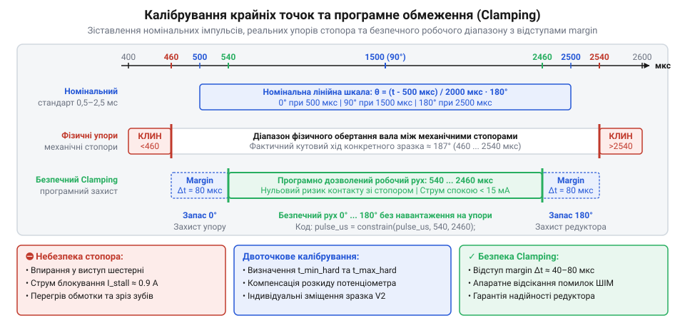

# MG90S V2 — мікросерво з металевим редуктором

<preknowlist>
- [Tower Pro SG90 — мікросерво 9g](root:cat-hw-actuators/sg90-servo) — будова 9-грамового мікросервопривода, кінематика редуктора з потенціометром зворотного зв'язку та наявність механічного упору вихідного вала
</preknowlist>

## Невідповідність звичайного ШІМ і часові рамки керівного сигналу: чому коефіцієнт заповнення ламає сервопривід

Під час першої спроби керувати сервоприводом за допомогою мікроконтролера типовою інтуїтивною дією стає підключення лінії керування до звичайного апаратного ШІМ-виходу, налаштованого як для регулювання яскравості світлодіода чи обертів двигуна. У світлодіоді збільшення коефіцієнта заповнення від 0% до 100% плавно нарощує яскравість. Але коли сигнал із заповненням 50% чи 80% надходить на сигнальний вхід сервопривода MG90S, вал із сухим тріском врізається в корпусний механічний обмежувач, мотор починає гудіти, плата миттєво розігрівається, а струм у колі перевищує 800 мА. Якщо живлення не зняти негайно, металеві шестерні зрізають зуби, або перегорають вихідні ключі внутрішнього Н-моста.

Ця руйнівна поведінка викликана принциповою різницею між двома абсолютно різними призначеннями одного й того самого фізичного коливання. Звичайна широтно-імпульсна модуляція (англ. @@en|Pulse-Width Modulation@@, PWM; від лат. @@la|modulatio@@ — розмірність, узгодженість частин) призначена для дозування середньої електричної потужності. Фізичні об'єкти з тепловою чи електромагнітною інерцією — нитки розжарення, спіралі нагрівачів, обмотки колекторних двигунів або кристал світлодіода — інтегрують енергію в часі. Для них важлива лише безрозмірна відносна частка увімкненого стану в межах одного циклу коливань. Ця частка визначається як коефіцієнт заповнення (англ. @@en|duty cycle@@; від лат. @@la|coefficiens@@ — той, що сприяє разом):

```
D = (t_high / T) · 100%
```

де `t_high` — тривалість високого логічного рівня, а `T` — загальний період повторення імпульсів. Зворотне відношення тривалості повного періоду до тривалості активного стану називають шпаруватістю (нім. @@de|Tastverhältnis@@; від давньоукраїнського «шпара» — вузький проміжок, щілина):

```
S = T / t_high
```

Апаратні таймери мікроконтролерів для регулювання яскравості чи обертів за замовчуванням генерують ШІМ на частотах від 490 Гц до десятків кілогерців. За частоти 500 Гц період повторення становить `T = 1 / 500 = 0.002 с = 2 мс`. Якщо змінити частоту таймера на базові для сервоприводів 50 Гц (період `T = 20 мс`), але спробувати керувати кутом за допомогою звичного коефіцієнта заповнення `D`, виникає небезпечна невідповідність тривалостей:

```
t_high(D = 50%)
= 20 мс · 0.50                                     [обчислення 50% від повного періоду]
= 10 мс (10 000 мкс)                               [отримана тривалість активного імпульсу]

t_high(D = 80%)
= 20 мс · 0.80                                     [обчислення 80% від повного періоду]
= 16 мс (16 000 мкс)                               [отримана тривалість активного імпульсу]
```

Сервопривід (англ. @@en|servomotor@@; від лат. @@la|servus@@ — слуга, виконавець) — це не енергетичний споживач, а замкнена електромеханічна система слідкувального позиціювання. Його сигнальний дріт є суто інформаційною шиною, де напруга не живить силовий двигун. Усередині MG90S встановлено контролер слідкування, пов'язаний із внутрішнім датчиком положення — потенціометром зворотного зв'язку, закріпленим безпосередньо на осі вихідного вала, за кінематичною схемою, аналогічною до [Tower Pro SG90](root:cat-hw-actuators/sg90-servo).

Внутрішній генератор сервопривода формує власний опорний часовий імпульс, тривалість якого змінюється залежно від положення повзунка потенціометра суворо в діапазоні від 0.5 мс до 2.5 мс. Внутрішній компаратор зіставляє передній і задній фронти вхідного сигналу з фронтами опорного імпульсу. Якщо на вхід надходить імпульс тривалістю 10 мс (при коефіцієнті заповнення 50%), компаратор виявляє колосальну додатну похибку: вхідний сигнал у чотири рази перевищує фізичну межу крайнього правого положення вала.

Компаратор повністю відкриває силові транзистори внутрішнього моста, змушуючи двигун обертатися з максимальною кутовою швидкістю праворуч, намагаючись скомпенсувати неузгодженість. Вал миттєво пролітає робочий сектор 180° і на повному ходу вдаряється в нерухомий механічний упор корпусу. Оскільки імпульс тривалістю 10 мс продовжує надходити, керувальна напруга з двигуна не знімається. Вал примусово зупиняється упертим стопором, викликаючи струм блокування вала (англ. @@en|stall current@@). Для мікросервопривода MG90S за напруги живлення 5 В цей струм перевищує 800 мА, тоді як струм ненавантаженого холостого ходу становить лише 80–120 мА. Стрибок струму призводить до миттєвого розігріву обмоток крихітного якоря двигуна, створює глибоку просадку напруги в колі живлення контролера та навантажує зубці редуктора критичним зрізувальним зусиллям.

Вихід із цієї проблеми полягає в цілковитому переході від відносного поняття коефіцієнта заповнення у відсотках до абсолютної тривалості активного імпульсу високого рівня `T_w` (від англ. @@en|pulse width@@). Інформацію про цільовий кут кодує виключно час, протягом якого напруга на сигнальній лінії утримується на логічному рівні одиниці.

Для узгодженого керування введено [стандартизований часовий кадр](root:com-devices/pwm-servo-protocol) (англ. @@en|timing frame@@):
1. **Базовий період повторення кадру** становить `T = 20 мс`, що відповідає частоті оновлення `f = 1 / T = 50 Гц`.
2. **Робочий інтервал тривалості імпульсу** `T_w` лежить у межах від `0.5 мс` (500 мкс) до `2.5 мс` (2500 мкс):
   - `T_w = 0.5 мс` (500 мкс) — крайній кут 0°. Відносний коефіцієнт заповнення становить лише `D = (0.5 / 20) · 100% = 2.5%`.
   - `T_w = 1.5 мс` (1500 мкс) — нейтральне положення 90°. Коефіцієнт заповнення дорівнює `D = (1.5 / 20) · 100% = 7.5%`.
   - `T_w = 2.5 мс` (2500 мкс) — крайній кут 180°. Коефіцієнт заповнення дорівнює `D = (2.5 / 20) · 100% = 12.5%`.
3. **Пауза кадру** займає решту часового вікна — від `17.5 мс` до `19.5 мс` (тобто від 87.5% до 97.5% тривалості кадру). У цей період на лінії утримується рівень логічного нуля.

Період 20 мс забезпечує електромеханічній системі достатній проміжок часу для фізичного відпрацювання кутового переміщення перед надходженням наступного значення та дозволяє конденсатору внутрішнього формувача опорного сигналу повністю розрядитися. Підвищення частоти понад 200 Гц в аналогових сервоприводах призводить до накладання вимірювальних циклів, тремтіння вала та перегріву електроніки.


*Часова діаграма керівного сигналу сервопривода: кодоване положення вала від 0° до 180° визначається абсолютною шириною імпульсу від 0.5 мс до 2.5 мс усередині фіксованого 20-мілісекундного кадру.*

Діаграма демонструє, що робоча смуга керування сервоприводом займає вузький діапазон від 2.5% до 12.5% коефіцієнта заповнення. Решта 87.5% діапазону звичайного ШІМ перебуває поза межами допустимого інтервалу та є руйнівною для механіки привода.

> 🔧 **Навіщо це.**
> У програмному коді ніколи не слід задавати кут сервопривода через відсотки шпаруватості чи значення стандартних функцій типу `analogWrite()`, які розподіляють діапазон 0–255 на повний період таймера. Інтерфейси керування сервоприводами повинні приймати та встановлювати значення виключно в мікросекундах. Це унеможливлює випадкове механічне блокування двигуна та робить роботу коду незалежною від зміни базової частоти мікроконтролера.

## Математична модель кутового позиціювання: лінійна інтерполяція та коефіцієнт чутливості

Визначення крайніх тривалостей 0.5 мс для 0° та 2.5 мс для 180° формує граничні умови, проте не дає безпосередньої відповіді, як обчислити тривалість імпульсу для довільного проміжного кута повороту — наприклад, 42° чи 117.5°. Для цього будується аналітична модель прямого та зворотного зв'язку між кутовими координатами та часовими інтервалами сигналу.

Позначимо цільовий кут повороту вихідного вала символом `θ` (грецька літера тета). Простір кутових положень утворює неперервний відрізок:

```
θ ∈ [θ_min, θ_max]
```

де номінальні значення для MG90S становлять `θ_min = 0°` та `θ_max = 180°`. Якщо кут задано в радіанах, інтервал набуває вигляду `θ ∈ [0, π]`.

Простір часових тривалостей імпульсу високого рівня визначається відрізком:

```
T_w ∈ [T_min, T_max]
```

де номінальні часові межі становлять `T_min = 500 мкс` та `T_max = 2500 мкс`.

Завдяки рівномірному кроку зубчастих коліс редуктора та лінійній формі резистивної доріжки внутрішнього потенціометра зворотного зв'язку зміщення вала прямо пропорційне зміні тривалості вхідного імпульсу. Цей зв'язок описується математичним апаратом, яким є лінійна інтерполяція (від лат. @@la|interpolatio@@ — виправлення, вставка між точками; від @@la|inter@@ — між та @@la|polire@@ — згладжувати, вирівнювати).

Дві відомі точки калібрувальної прямої `(θ_min, T_min)` і `(θ_max, T_max)` однозначно визначають пряму лінію на площині `(θ, T_w)`. З умови пропорційності відносних переміщень записується рівняння прямої через дві точки:

```
(T_w - T_min) / (T_max - T_min) = (θ - θ_min) / (θ_max - θ_min)
```

Послідовне перетворення виразу дозволяє отримати аналітичну функцію прямого перерахунку:

```
T_w - T_min
= (θ - θ_min) · (T_max - T_min) / (θ_max - θ_min)     [множення обох частин на (T_max - T_min)]
T_w(θ)
= T_min + (θ - θ_min) · (T_max - T_min) / (θ_max - θ_min)   [додавання T_min до обох частин]
```

Множник біля змінної кута визначає кутовий коефіцієнт нахилу прямої. Він позначається символом `k` і є фізичним коефіцієнтом чутливості (від лат. @@en|sensibilitas@@ — здатність сприймати вплив):

```
k = ΔT / Δθ = (T_max - T_min) / (θ_max - θ_min)
```

Для номінальних характеристик сервопривода MG90S обчислення коефіцієнта чутливості дає точний числовий дріб:

```
k = (2500 мкс - 500 мкс) / (180° - 0°)
  = 2000 мкс / 180°                                    [підстановка номінальних значень]
  = 100 / 9 мкс/°                                      [скорочення дробу на спільний множник 20]
  ≈ 11.111... мкс/°                                    [десяткове наближення]
```

Фізичний зміст коефіцієнта `k` полягає в тому, що для зміни положення вихідного вала рівно на 1° тривалість активного імпульсу високого рівня повинна зрости на `11.11 мкс` (або `100 / 9 мкс`). Якщо генератор таймера мікроконтролера не здатний змінювати тривалість імпульсу з дискретністю, кратною цій величині, позиціювати привод із точністю до одного градуса неможливо.

Якщо кут повороту подано в радіанах, кутовий коефіцієнт перетворення набуває вигляду:

```
k_rad
= 2000 мкс / π                                         [ділення часового діапазону на розмах у π радіан]
≈ 636.62 мкс/рад                                       [десяткове наближення]
```

З урахуванням коефіцієнта чутливості пряма математична модель набуває компактної форми:

```
T_w(θ) = T_min + k · (θ - θ_min)
```

В інженерній практиці виникає зворотна потреба: за виміряною тривалістю імпульсу `T_w` (наприклад, при захопленні сигналу апаратним блоком input capture або калібруванні пульта) визначити дійсний кут повороту. Для цього базова формула розв'язується відносно невідомої `θ`:

```
T_w - T_min
= k · (θ - θ_min)                                      [базове рівняння інтерполяції]
θ - θ_min
= (T_w - T_min) / k                                    [ділення обох частин на k]
θ(T_w)
= θ_min + (T_w - T_min) / k                            [додавання початкового кута θ_min]
= θ_min + (T_w - T_min) · (θ_max - θ_min) / (T_max - T_min)   [розкриття коефіцієнта k]
```

Підставивши константи номінального привода MG90S (`θ_min = 0°`, `θ_max = 180°`, `T_min = 500 мкс`, `T_max = 2500 мкс`), отримуємо обернену розрахункову залежність:

```
θ(T_w)
= 0° + (T_w - 500) · 180° / 2000                       [підстановка номінальних меж]
= (T_w - 500) · 9 / 100                                [спрощення числового дробу]
= 0.09 · (T_w - 500)                                   [десяткова форма коефіцієнта]
```


*Графік лінійної залежності тривалості імпульсу від цільового кута: сталий кутовий коефіцієнт k = 11.11 мкс/° пов'язує простір поворотів [0°, 180°] із часовим діапазоном [500 мкс, 2500 мкс].*

Графік демонструє сувору монотонність і симетрію: центральна точка `(90°, 1500 мкс)` ділить діапазон на два симетричні плечі по 90°, кожне з яких відповідає зміні тривалості на 1000 мкс.

Застосування математичної моделі демонструють конкретні числові розрахунки.

**Приклад 1: Обчислення тривалості керівного імпульсу для кута повороту θ = 45°**

```
T_w(45°)
= 500 + 45 · (100 / 9)                                 [підстановка значення кута]
= 500 + (45 / 9) · 100                                 [винесення ділення вперед]
= 500 + 5 · 100                                        [скорочення 45 на 9]
= 500 + 500                                            [множення]
= 1000 мкс (1.0 мс)                                    [кінцева тривалість імпульсу]
```

**Приклад 2: Зворотне визначення кута вала за виміряним імпульсом T_w = 1750 мкс**

```
θ(1750 мкс)
= (1750 - 500) · 9 / 100                               [підстановка виміряної тривалості]
= 1250 · 9 / 100                                       [обчислення різниці]
= 12.5 · 9                                             [ділення на 100]
= 112.5°                                               [знайдений кут повороту вала]
```

Під час реалізації лінійної інтерполяції в прошивці мікроконтролера виникає питання оптимізації обчислень. Запис формули з використанням чисел із рухомою комою:

```c
float pulse_us = 500.0f + angle_deg * 11.111111f;
```

створює приховане навантаження на процесор. За відсутності апаратного модуля дійсних чисел (FPU), як у 8-бітних ядрах AVR чи 32-бітних ARM Cortex-M0/M0+, обчислення транслюються у виклики програмних емуляторів. Це розширює розмір коду на 1–2 кілобайти та займає сотні тактів процесора на кожен виклик.

Спроба перейти на [цілочисельне обчислення](root:sf-devices/integer-scaling-fixed-point) без урахування розрядності:

```c
uint16_t pulse_us = 500 + (angle_deg * 2000) / 180;
```

веде до критичної апаратної помилки, якою є переповнення цілого числа (англ. @@en|integer overflow@@; від лат. @@en|integer@@ — повний, непорушений). Якщо змінна `angle_deg` має тип `uint16_t`, максимальне число, яке може зберігати 16-бітний регістр, дорівнює `65 535`. Уже за кута `angle_deg = 33°` проміжний добуток виходить за межі типу:

```
33 · 2000 = 66 000 > 65 535
```

Старші розряди результату втрачаються, і значення обрізається за модулем `2¹⁶ = 65 536`:

```
66 000 mod 65 536 = 464
```

У результаті функція повертає спотворене значення:

```
pulse_us = 500 + 464 / 180 = 500 + 2 = 502 мкс
```

Замість повороту на 33° сервопривід несподівано відкидає вал у крайнє нульове положення (500 мкс). Переповнення триває аж до кута `65°`, після чого графік формує серію пилкоподібних стрибків.

Коректна цілочисельна реалізація розв'язується двома шляхами:
1. **Явне зведення до 32-бітного беззнакового типу**:
   `uint16_t pulse_us = 500 + ((uint32_t)angle_deg * 2000) / 180;`
   Діапазон типу `uint32_t` перевищує 4 мільярди, що з запасом вміщує максимальний добуток `180 · 2000 = 360 000`.
2. **Факторизація розрахункового дробу**: скорочення відношення `2000 / 180` на 20 дає чисельник 100 і знаменник 9.
   Максимальний проміжний добуток для 180° складає `180 · 100 = 18 000`, що гарантовано вкладається в базовий 16-бітний діапазон `uint16_t` без переповнення:

```c
uint16_t pulse_us = 500 + ((uint16_t)angle_deg * 100 + 4) / 9;
```

Додавання половини знаменника (`+ 4`) перед діленням на 9 реалізує коректне математичне округлення до найближчого цілого значення замість простого відкидання залишку.

Перед установкою механічних деталей на вал сервопривід необхідно програмно перевести в нейтральне математичне положення `T_w = 1500 мкс` (90°). Тільки після цього на зубчастий вихідний шліц надягають [серво-роги](root:cat-hw-actuators/servo-horns), закріплюючи їх перпендикулярно до корпусу, що гарантує симетричний сектор механічного ходу по 90° в кожен бік.

> 🔧 **Навіщо це.**
> Лінійна інтерполяційна модель з аналітичним розрахунком чутливості позбавляє прошивку від жорстко зашитих «магічних чисел» та громіздких таблиць перерахунку. Вона дозволяє динамічно підлаштовувати коефіцієнти під індивідуальні фізичні калібрування екземпляра сервопривода, забезпечуючи максимальну точність позиціювання при мінімальних витратах обчислювальних ресурсів мікроконтролера.

## Двоточкове калібрування екстремумів та програмне обмеження (clamping) для механічного захисту

Спроба встановити вихідний вал сервопривода в граничні кутові положення за теоретичними паспортними значеннями тривалості імпульсу — 500 мкс для 0° та 2500 мкс для 180° — на практиці нерідко закінчується аварійною зупинкою системи. Пристрій замість плавного виходу на крайню позицію раптово починає видавати глухий гул, корпус у зоні електродвигуна швидко нагрівається, а напруга на спільній шині живлення просідає настільки глибоко, що викликає спонтанне перезавантаження мікроконтролера.

Причина цієї поведінки криється в кінематиці сервоприводів серії [SG90](root:cat-hw-actuators/sg90-servo) та MG90S. Механічний редуктор передає обертання від колекторного двигуна на вихідний вал, із яким жорстко сполучений повзунок потенціометра (від лат. @@la|potentia@@ — сила та грец. @@el|metron@@ — міра) внутрішнього зворотного зв'язку. Щоб рухомий контакт потенціометра не зіскочив із резистивної доріжки й не пошкодив струмознімальні контакти, на вихідній металевій шестерні виготовлено механічний упор — сталевий або латунний штифт, який при досягненні конструктивної межі повороту (зазвичай близько 190°–205°) фізично впирається у виступ на внутрішній стінці корпусу.

У масовому виробництві кожен компонент має технологічний розкид:
1. **Потенціометр зворотного зв'язку.** Резистивний шар має технологічний допуск опору в межах ±10–20%, а кутова похибка механічної посадки шестерні на вісь резистора навіть на частку міліметра зміщує електричний нуль відносно фізичного корпусу.
2. **Внутрішній генератор опорного часу.** Тривалість імпульсу розкодовується аналоговою або цифровою мікросхемою привода через внутрішній RC-ланцюг або керамічний резонатор. Допуски номіналів резисторів і конденсаторів створюють похибку декодування ширини імпульсу до ±5–8%.
3. **Механічний люфт (від нім. @@de|Luft@@ — проміжок, повітря).** Кутові зазори між зубами зубчастих передач та посадковими отворами валів додають накопичувану кутову невизначеність між положенням ротора й упором.

Унаслідок цього сумарного розкиду фізичний упор конкретного екземпляра привода може настати раніше, ніж сигнал досягне номінальних меж: наприклад, механічний рух зупиняється на позначці 540 мкс замість 500 мкс, або на 2440 мкс замість 2500 мкс.

Коли мікроконтролер подає сигнал тривалістю 500 мкс, внутрішня схема порівняння привода фіксує похибку: фактична напруга з потенціометра відповідає лише 540 мкс, тоді як задано 500 мкс. Контур регулювання сприймає цю різницю як недохід до цілі й подає через внутрішній H-міст максимальну напругу на обмотки двигуна. Проте вал фізично заблокований механічним стопором. Двигун переходить у стан блокування ротора (@@en|stall@@), що спричиняє комплексні руйнівні наслідки:
- **Стрибок [струму блокування](root:hw-motion/servo-stall-current-protection) (від англ. @@en|stall current@@).** Споживання струму зростає від струму спокою 15–25 мА (або 120–180 мА під робочим динамічним навантаженням) до аварійних 800–1200 мА при живленні 5 В.
- **Джоулеве саморозігрівання обмоток.** Густина струму в тонкому мідному дроті якоря перевищує допустимі межі; температура ротора за лічені секунди сягає понад 100 °C, спричиняючи руйнування лакової ізоляції, міжвиткове замикання й незворотне вигоряння транзисторів вихідного каскаду драйвера.
- **Просідання шини живлення (@@en|brown-out@@).** Різкий струмовий сплеск перевищує навантажувальну здатність лінійного стабілізатора або кабельної лінії, напруга живлення мікроконтролера падає нижче порогу скидання (Brown-Out Reset, BOR), що призводить до циклічного перезавантаження керуючої плати.
- **Зрізання зубів редуктора.** Попри наявність металевих шестерень у сервоприводі MG90S, крутний момент заблокованого двигуна, помножений передатним числом редуктора, створює колосальне напруження зсуву. Маломодульні зуби проміжних трибів або шліци з'єднання з віссю потенціометра зминаються або повністю зрізаються.

> 🔧 **Навіщо це.**
> Індивідуальне калібрування екстремумів та програмне обмеження сигналів гарантують, що привод ні за яких умов не досягне внутрішнього механічного стопора. Це зберігає цілісність зубчастих передач, усуває теплове руйнування двигуна та унеможливлює раптові перезавантаження системи живлення робототехнічного комплексу.

### Методика експериментального двоточкового калібрування

Для захисту привода необхідно замінити паспортні екстремуми реальними безпечними межами, виміряними безпосередньо на конкретному примірнику. Калібрування (від фр. @@fr|calibrer@@ — вимірювати калібр) полягає в емпіричному знаходженні мінімального `T_cal_min` та максимального `T_cal_max` безпечних імпульсів керування для екстремумів (від лат. @@la|extremum@@ — крайній) робочого діапазону.

Вимірювання проводять на спеціальному стенді або безпосередньо в системі з підключеним амперметром у колі живлення сервопривода та можливістю плавної зміни тривалості імпульсу з кроком 5–10 мкс:

1. **Вихід у безпечну точку.** На привод подають сигнал нейтрального положення 1500 мкс (90°). Це гарантує, що вал перебуває посередині робочого сектора й віддалений від будь-яких упорів.
2. **Пошук нижньої фізичної межі `T_phys_min`.**
   - Зменшують тривалість імпульсу з кроком 5–10 мкс, роблячи паузу 50–100 мс після кожного кроку для завершення механічного переміщення.
   - Відстежують покази струму та звук роботи редуктора.
   - У момент, коли вал перестає повертатися, а струм споживання різко стрибає від спокійного значення (15–20 мА) до понад 300–400 мА одночасно з появою виразного високочастотного гудіння, пошук негайно зупиняють. Ця точка є фізичною межею упору `T_phys_min`.
3. **Пошук верхньої фізичної межі `T_phys_max`.**
   - Повертають сигнал у нейтраль (1500 мкс).
   - Збільшують тривалість імпульсу кроками по 5–10 мкс у напрямку 2500 мкс.
   - Фіксують точку зупинки руху вала зі стрибком струму — фізичну межу верхнього упору `T_phys_max`.

Фізичні межі `T_phys_min` та `T_phys_max` не можна використовувати як робочі крайні точки через зовнішні дестабілізуючі фактори:
- **Температурний дрейф.** При зміні температури середовища або розігріванні компонентів опір резистивної доріжки та параметри RC-ланцюга зміщуються на кілька мікросекунд.
- **Динамічний переліт (@@en|overshoot@@).** Під час швидкого переходу на максимальній швидкості механічна інерція ротора й редуктора зумовлює короткочасний вибіг вала за точку стабілізації.
- **Пульсації напруги живлення.** Зниження напруги під навантаженням спотворює пороги спрацьовування внутрішніх аналогових компараторів привода.

Через це від знайдених фізичних меж відступають усередину безпечного сектора на захисний запас (@@en|safety margin@@) `ΔT_margin`, який стандартно обирають у діапазоні 10–20 мкс:

```
T_cal_min = T_phys_min + ΔT_margin
T_cal_max = T_phys_max - ΔT_margin
```


*Зіставлення номінальної часової шкали керування з реальними фізичними межами вала: програмне обмеження убезпечує сервопривід від перевантаження в зонах механічного упору.*

На графіку чітко розмежовано діапазони:
- **Заборонені зони механічного упору** ліворуч від `T_phys_min` та праворуч від `T_phys_max`, де струм стрибає вище 800 мА через заклинювання вала.
- **Буферні смуги захисного запасу** шириною `ΔT_margin`, що запобігають випадковому контакту зі стопором при динамічних коливаннях.
- **Робочий відкалібрований діапазон** `[T_cal_min, T_cal_max]`, у межах якого вал вільно переміщується з номінальним енергоспоживанням.

### Перерахунок коефіцієнта лінійної інтерполяції

Оскільки відкалібрований інтервал `[T_cal_min, T_cal_max]` відрізняється від номінальних 500–2500 мкс, пряме використання теоретичного коефіцієнта нахилу `k = 11.111 мкс/°` призведе до систематичної кутової похибки позиціювання. Необхідно перерахувати робочий калібрувальний коефіцієнт нахилу `k_cal` для зв'язку між кутовим сектором `[θ_min, θ_max]` (зазвичай від 0° до 180°) та виміряними часовими екстремумами.

Коефіцієнт нахилу визначає відношення приросту тривалості імпульсу до приросту кута повороту:

```
k_cal = (T_cal_max - T_cal_min) / (θ_max - θ_min)
```

Маючи коефіцієнт `k_cal`, теоретичну тривалість імпульсу для будь-якого бажаного кута `θ` знаходять лінійною інтерполяцією від нижньої точки калібрування:

```
T_raw(θ) = T_cal_min + k_cal · (θ - θ_min)
```

Зворотне перетворення — обчислення фактичного кута вала за заданим значенням імпульсу `T` — виконують за дзеркальною формулою:

```
θ(T) = θ_min + (T - T_cal_min) / k_cal
```

**Практичний розрахунок параметрів для реального екземпляра.**
Нехай експериментальне вимірювання конкретного привода MG90S виявило фізичні упори на відмітках `T_phys_min = 535 мкс` та `T_phys_max = 2445 мкс`. Захисний інтервал обрано рівним `ΔT_margin = 15 мкс`. Робочий кутовий сектор становить `θ_min = 0°`, `θ_max = 180°`.

Обчислюємо безпечні калібрувальні екстремуми:
```
T_cal_min
= 535 + 15                       [додавання захисного запасу до нижнього упору]
= 550 мкс                        [нижня калібрована межа]

T_cal_max
= 2445 - 15                      [віднімання захисного запасу від верхнього упору]
= 2430 мкс                       [верхня калібрована межа]
```

Визначаємо робочий коефієнт нахилу `k_cal`:
```
k_cal
= (2430 - 550) / (180 - 0)       [підстановка каліброваних значень у формулу нахилу]
= 1880 / 180                     [обчислення різниці робочого діапазону імпульсів]
≈ 10.444 мкс/°                   [робочий калібрувальний коефіцієнт]
```

Обчислюємо тривалість імпульсу для цільового кута `θ = 45°`:
```
T_raw(45°)
= 550 + 10.444 · (45 - 0)        [підстановка кута 45° у рівняння прямої]
= 550 + 470                      [добуток коефіцієнта нахилу на заданий кут]
= 1020 мкс                       [розрахункова тривалість імпульсу]
```

Якби в цьому випадку використовувався паспортний коефіцієнт `11.111 мкс/°` зі зміщенням 500 мкс, сигнал склав би `500 + 11.111 · 45 = 1000 мкс`. Відхилення у 20 мкс зумовило б похибку позиціювання вихідного вала майже на 2°, а в граничних точках призвело б до жорсткого заклинювання вала на упорах.

### Програмне обмеження (clamping)

Навіть за точного розрахунку коефіцієнта `k_cal` зовнішній код або алгоритм зворотного зв'язку (наприклад, регулятор положення маніпулятора) може сформувати помилкове завдання — від'ємний кут або значення, що перевищує 180°. Якщо передати таку величину безпосередньо в регістр генератора ШІМ, сигнал вийде за калібровані межі й спричинить механічну аварію.

Для гарантованого захисту застосовують математичну операцію програмного насичення або обмеження — клампінг (від англ. @@en|clamping@@ — затискання, утримання в межах). Функція обмеження жорстко замикає аргумент у заданий числовий коридор `[min, max]`:

```
clamp(x, min, max) = min, якщо x < min
                   = max, якщо x > max
                   = x,   якщо min ≤ x ≤ max
```

У системі керування приводом захист організовують за дворівневим принципом:
1. **Первинне кутове обмеження.** Вхідний кут обрізають до допустимого діапазону `[θ_min, θ_max]`:
   ```
   θ_safe = clamp(θ, θ_min, θ_max)
   ```
2. **Вторинне апаратне часове обмеження.** Після лінійного перетворення розраховану тривалість імпульсу повторно затискають у калібрувальні межі `[T_cal_min, T_cal_max]`:
   ```
   T_safe = clamp(T_raw(θ_safe), T_cal_min, T_cal_max)
   ```

Другий рівень — це безкомпромісний бар'єр безпосередньо перед записом значення в регістр порівняння апаратного таймера. Навіть якщо в математичних обчисленнях трапиться помилка округлення чи переповнення типу даних, тривалість вихідного електричного імпульсу гарантовано залишиться в межах безпечної зони.

Наведений нижче програмний модуль реалізує повний життєвий цикл калібрування: [збереження індивідуальних параметрів у структурі](root:embedded-ultra/servo-eeprom-calibration-storage), автоматичний розрахунок коефіцієнта нахилу та безпечне перетворення цільового кута в тривалість імпульсу із застосуванням дворівневого клампінгу.

:::tabs
:::code math-servo-pwm-timing-interpolation/c/clampf.c
:::code math-servo-pwm-timing-interpolation/cpp/servocalibrator.cpp
:::

Використання подібного модуля ізолює редуктор привода від будь-яких помилок програмного забезпечення верхнього рівня: навіть за некоректної логіки керування чи випадкових збоїв сенсорів, вихідний ШІМ-імпульс ні за яких умов не перетне межу безпечного сектора.

## Дискретизація апаратного таймера мікроконтролера та розрахунок кутової роздільності

Неперервна математична модель описує тривалість керуючого імпульсу дійсним числом `T_w(θ) = T_min + k · θ`. Для номінального робочого сектора кутів повороту від 0° до 180° та стандартного інтервалу тривалостей від 500 мкс (0.5 мс) до 2500 мкс (2.5 мс) коефіцієнт крутизни становить `k = (2500 - 500) / 180 ≈ 11.111 мкс/°`. Проте цифровий мікроконтролер фізично не оперує континуумом дійсного часу. Часові інтервали генерує апаратний [периферійний блок — таймер-лічильник](root:hw-arch/hardware-pwm), який підраховує виключно дискретні машинні такти (тіки) базового тактового генератора.

Заміна неперервної часової величини ступінчастою послідовністю фіксованих машинних відліків є квантуванням часу (від латинського *quantum* — скільки). Тривалість одного такого апаратного кванта задає мінімально можливу зміну тривалості вихідного імпульсу, а отже, і теоретичну межу кутової роздільності сервопривода.

Апаратна структура таймера мікроконтролера живиться від базової тактової частоти периферійної шини `f_clk`. Для отримання робочих часових інтервалів частоту шини знижує апаратний передподільник (англ. @@en|prescaler@@, від латинського *prae* — попереду та англійського *scale* — шкала), значення якого записується в регістр `PSC`. Вхідний дільник зменшує частоту в `(PSC + 1)` разів:

```
f_cnt
= f_clk / (PSC + 1)                 [частота лічби таймера]
```

Тривалість одного кванта лічби таймера (одного тіка) `t_tick` визначається як період отриманої частоти:

```
t_tick
= 1 / f_cnt                         [період елементарного такту лічби]
= (PSC + 1) / f_clk                 [підстановка частоти лічби]
```

Лічильник таймера інкрементує свій стан на кожному такті `t_tick`, накопичуючи значення від 0 до числа, збереженого в регістрі автоперезавантаження (англ. @@en|auto-reload register@@, `ARR`). У момент збігу значення лічильника з числом `ARR` таймер генерує подію оновлення і скидається в 0, завершуючи базовий період повторення імпульсів ШІМ:

```
T_pwm
= (ARR + 1) · t_tick                [період повного циклу лічби]
```

Для сервопривода MG90S стандартний період повторення становить `T_pwm = 20 мс = 0.02 с` (частота 50 Гц). Звідси виводиться необхідне цілочисельне значення порогу автоперезавантаження `ARR`:

```
ARR + 1
= T_pwm / t_tick                    [кількість тактів у періоді кадру 20 мс]

ARR
= (0.02 / t_tick) - 1               [значення регістра автоперезавантаження]
```

Формування активної частини імпульсу здійснює регістр захоплення й порівняння каналу (англ. @@en|capture/compare register@@, `CCR`). Поки значення лічильника менше за `CCR`, апаратний вивід таймера утримує активний високий логічний рівень. У момент рівності лічильника та `CCR` вихід скидається в низький логічний рівень. Значення регістра `CCR(θ)` для цільового кута повороту `θ` є цілочисельним округленням відношення тривалості імпульсу до тривалості одного тіка:

```
CCR(θ)
= round(T_w(θ) / t_tick)            [дискретизація аналогової тривалості]
```


*Часова діаграма квантування лічильника апаратного таймера: лінійне накопичення тактів t_tick, формування тривалості імпульсу за порогом CCR та скидання кадру 20 мс при досягненні ARR.*

Мінімальна зміна тривалості імпульсу, якою здатний керувати мікроконтролер, дорівнює одному апаратному кроку таймера: `ΔT_min = t_tick`. Теоретична кутова роздільність `Δθ_timer` — це мінімальний кутовий крок вала, що відповідає зміні значення регістра `CCR` на одиницю:

```
Δθ_timer
= ΔT_min / k                        [диференціал функції кутової інтерполяції]
= t_tick / k                        [підстановка тривалості такту таймера]
= t_tick · (θ_max / (T_max - T_min)) [розгортання коефіцієнта крутизни k]
```

Загальна кількість дискретних кутових градацій `N_steps` у робочому діапазоні від `T_min = 500 мкс` до `T_max = 2500 мкс` дорівнює:

```
N_steps
= (T_max - T_min) / t_tick          [кількість квантів у робочому діапазоні]
```

> 🔧 **Навіщо це.**
> Знання аналітичного зв'язку між `f_clk`, `PSC` та `ARR` дозволяє точно налаштувати периферійний таймер мікроконтролера під будь-яку базову частоту шини без використання емпіричних «магічних чисел». Правильний вибір коефіцієнта `PSC` максимізує число робочих квантів у діапазоні 500–2500 мкс, забезпечуючи плавний поворот привода без ступінчастих ривків.

Порівняльний інженерний розрахунок демонструє критичність вибору параметрів дискретизації:

**1. 8-бітний таймер або грубий передподільник.**
У 8-бітному лічильнику максимальне число станів обмежене величиною `ARR ≤ 255`. Для формування кадру тривалістю 20 мс мінімальна тривалість одного такту повинна становити:
```
t_tick
= 0.02 с / 256
≈ 78.125 мкс                         [тривалість такту 8-бітного таймера]
```
У робочий інтервал імпульсу `ΔT = 2000 мкс` укладається лише:
```
N_steps
= 2000 мкс / 78.125 мкс
≈ 25.6                               [число градацій у діапазоні 180°]
```
Кутова роздільність при цьому становить:
```
Δθ_timer
= 180° / 25.6
≈ 7.03°                              [кутовий стрибок на один такт CCR]
```
Спроба керувати сервоприводом за допомогою такого таймера перетворює рух вала на грубі стрибки по 7 градусів, що робить точне позиціювання неможливим.

Аналогічно, якщо у 16-бітному таймері обрано завищений передподільник із тактом лічби `t_tick = 4 мкс`:
```
N_steps
= 2000 мкс / 4 мкс
= 500                                [число градацій на сектор 180°]
```
Кутова роздільність становить:
```
Δθ_timer
= 4 мкс / 11.111 мкс/°
= 0.36°                              [дискретність кутового кроку]
```
Вал здійснює помітні сходинки по третині градуса, що неприйнятно для оптичних сканерів чи прецизійних маніпуляторів.

**2. 16-бітний таймер із тактом 1 мкс.**
При тактовій частоті шини `f_clk = 16 МГц` встановлюємо передподільник `PSC = 15`:
```
t_tick
= (15 + 1) / 16 000 000
= 1 мкс                              [тривалість кванта часу]
```
Поріг автоперезавантаження для кадру 20 мс:
```
ARR
= (0.02 / 0.000001) - 1
= 19999                              [значення вміщується в 16 біт: 19999 < 65535]
```
Робочий діапазон регістра `CCR` охоплює відліки від 500 до 2500, забезпечуючи `N_steps = 2000` градацій. Теоретична кутова роздільність становить:
```
Δθ_timer
= 1 мкс / 11.111 мкс/°
= 0.09°                              [плавний рух вала]
```

**3. 16-бітний таймер із тактом 0.5 мкс.**
При тактовій частоті шини `f_clk = 16 МГц` встановлюємо `PSC = 7`, а при `f_clk = 72 МГц` обираємо `PSC = 35`:
```
t_tick
= (7 + 1) / 16 000 000
= 0.5 мкс                            [субмікросекундний крок таймера]
```
Поріг автоперезавантаження:
```
ARR
= (0.02 / 0.0000005) - 1
= 39999                              [вміщується в 16 біт: 39999 < 65535]
```
Кількість градацій подвоюється до `N_steps = 4000`, що дає кутову роздільність:
```
Δθ_timer
= 0.5 мкс / 11.111 мкс/°
= 0.045°                             [високоточне кутове квантування]
```
Конфігурація периферійного таймера на рівні `t_tick = 0.5–1 мкс` є еталоном цифрового керування приводом MG90S, оскільки надає цифрову роздільність, що з запасом перекриває можливості внутрішніх механічних вузлів.

## Зона нечутливості (deadband) внутрішнього компаратора та критерії безперервної стабільності без тремтіння

Збільшення тактової частоти таймера дозволяє отримати субмікросекундні кванти часу `t_tick = 0.1 мкс` або навіть `0.01 мкс`, що формально відповідає кутовій дискретності менше ніж 0.001°. Проте в реальному сервоприводі MG90S настільки малі зміни керування не дають очікуваної плавності. На практиці виникають два взаємопов'язані дефекти:
1. Привід повністю ігнорує поодинокі мікрозміни тривалості імпульсу в межах кількох мікросекунд — вал залишається нерухомим.
2. При частих мікрокорекціях або при утриманні цільового кута в умовах цифрового шуму вал починає безперервно дзижчати, вібрувати й перегріватися — розвивається паразитичне високочастотне тремтіння (англ. @@en|hunting@@ — рискання, пошук рівноваги, та @@en|jitter@@ — тремтіння).

Причина криється в схемотехніці внутрішнього контуру керування сервопривода. Модель MG90S, подібно до спорідненого мікросервопривода з пластиковим редуктором [Tower Pro SG90 — мікросерво 9g](root:cat-hw-actuators/sg90-servo), побудована на базі [аналогової мікросхеми сервопідсилювача](root:cat-hw-drivers/servo-analog-driver-ic) (типово класу AA5188, KC0032 чи функціональних аналогів).

Внутрішній контур зворотного зв'язку містить потенціометр, механічно з'єднаний із вихідним валом через редуктор, внутрішній генератор опорного імпульсу та компаратор похибки (від латинського *comparare* — порівнювати, зіставляти). Внутрішній генератор формує еталонний часовий імпульс `T_pot`, тривалість якого лінійно залежить від поточного положення ковзного контакту потенціометра. Аналоговий компаратор обчислює часову похибку позиціювання:

```
ε_T
= T_w - T_pot                       [часова похибка узгодження]
```

У реальній електромеханічній системі ковзний контакт потенціометра має контактний мікрошум, щітки колекторного двигуна створюють іскрові комутаційні завади, а на лініях живлення виникають імпульсні просідання напруги. Якби компаратор реагував на будь-яку ненульову похибку `|ε_T| > 0`, силовий H-міст був би змушений безперервно перемикати полярність струму двигуна на кожному кадрі ШІМ, намагаючись скомпенсувати шумові флуктуації.

Щоб запобігти хаотичному перемиканню транзисторів, в архітектуру аналогового компаратора введено симетричне вікно нечутливості — зону нечутливості (англ. @@en|deadband@@ або @@en|dead zone@@, від англійських слів *dead* — мертвий та *band* — смуга) шириною `±T_db`:
- Якщо похибка лежить усередині вікна `|ε_T| ≤ T_db`, вихідна напруга компаратора дорівнює нулю (`U_mot = 0`). Силові ключі H-моста розімкнені, обмотки двигуна знеструмлені.
- Якщо `ε_T > +T_db`, компаратор відкриває ключі прямого напрямку, подаючи на двигун напругу `+U_supply` для обертання вала в бік зменшення похибки.
- Якщо `ε_T < -T_db`, відкриваються ключі зворотного напрямку, прикладаючи зворотну напругу `-U_supply`.

Повна ширина апаратної зони нечутливості становить:

```
T_deadband
= 2 · T_db                          [повна ширина симетричного вікна]
```

Для сервоприводів MG90S ширина зони нечутливості становить від 1 до 5 мкс (типово 2–4 мкс залежно від екземпляра мікросхеми та робочої температури).

![Передатна характеристика внутрішнього компаратора сервопривода з вікном зони нечутливості (deadband): залежність напруги керування двигуном від похибки положення, що показує нульову зону без струму в діапазоні [-T_db, +T_db] та пояснює фізичну межу мінімального кутового кроку й причину виникнення автоколивань (hunting).](img/comparator-deadband-transfer-characteristic.svg)
*Передатна характеристика внутрішнього аналогового компаратора: струм двигуна вимкнено всередині зони нечутливості T_deadband, що блокує реакцію на мікрошуми, але обмежує мінімальний фізичний крок і провокує автоколивання при надлишковому вибігу ротора.*

Оскільки всередині смуги `T_deadband` напруга на двигун не подається, виникає фундаментальна фізична межа кутового відгуку сервопривода `Δθ_phys`. Це мінімальний кут повороту вала, на який привід здатний фізично зреагувати:

```
Δθ_phys
= T_deadband / k                    [фізична межа кутового відгуку]
= T_deadband · (θ_max / (T_max - T_min)) [зв'язок із крутизною інтерполяції]
```

При крутизні `k ≈ 11.111 мкс/°` фізична кутова дискретність сервопривода MG90S набуває значень:
- Для екземплярів із вузьким вікном `T_deadband = 1 мкс`:
```
Δθ_phys
= 1 мкс / 11.111 мкс/°
≈ 0.09°                              [фізична роздільність для T_db = 1 мкс]
```
- Для типового привода з `T_deadband = 4 мкс`:
```
Δθ_phys
= 4 мкс / 11.111 мкс/°
≈ 0.36°                              [фізична роздільність для T_db = 4 мкс]
```
- При розкиді параметрів до `T_deadband = 5 мкс`:
```
Δθ_phys
= 5 мкс / 11.111 мкс/°
≈ 0.45°                              [фізична роздільність для T_db = 5 мкс]
```

Звідси випливає фундаментальне обмеження: формувати на мікроконтролері крок зміни імпульсу, менший за `T_deadband` (і відповідно крок кута, менший за `Δθ_phys`), фізично беззмістовно. Сервопривід є релейною системою з зоною нечутливості: він ігнорує малі одиничні цифрові прирости і здійснює механічний рух лише тоді, коли сумарна похибка перевищить апаратний поріг `T_db`.

Механізм виникнення паразитного автоколивання (@@en|hunting@@) обумовлений взаємодією зони нечутливості з механічною інерцією:
1. Коли часова похибка перевищує поріг `|ε_T| > T_db`, компаратор підключає обмотки двигуна до живлення.
2. Ротор розганяється, накопичуючи кінетичну енергію, і через металевий редуктор рухає вихідний вал із важелем (серво-рогом, порівн. [Серво-роги (запасні)](root:cat-hw-actuators/servo-horns)).
3. У момент входу похибки всередину зони нечутливості компаратор знімає напругу з двигуна. Проте за рахунок моменту інерції ротора та кінематичного люфту шестерень вал не зупиняється миттєво, а продовжує рух за інерцією (динамічний вибіг).
4. Якщо величина цього вибігу перевищує повну ширину зони нечутливості `T_deadband`, потенціометр пролітає все вікно спокою наскрізь і виходить за протилежний поріг (наприклад, похибка була `+3 мкс`, а стала `-3 мкс`).
5. Компаратор фіксує похибку протилежного знака та вмикає реверс двигуна. Рухаючись назад, ротор знову пролітає зону спокою за інерцією.

Виникають стійкі незагасаючі автоколивання на частоті кадрової розгортки або резонансної частоти редуктора. Їхні наслідки є руйнівними:
- Струм споживання стрибає від 5–10 мА в статичному стані до пікових пускових значень 0.5–0.8 А.
- Транзистори H-моста та колекторний вузол двигуна зазнають постійного теплового перевантаження.
- Зубці металевого редуктора піддаються знакозмінним ударним навантаженням, що спричиняє прискорене стирання металу та викришування шестерень.
- Виникає характерне акустичне дзижчання та високочастотне механічне тремтіння (@@en|jitter@@) виконавчого органа.

> 🔧 **Навіщо це.**
> Розуміння фізичної природи зони нечутливості дозволяє уникнути двох типових помилок: спроби отримати від аналогового сервопривода роздільність, вищу за `Δθ_phys`, та передачі в привід зашумленого сигналу керування, флуктуації якого навколо порогу компаратора викликають саморозігрів і механічне руйнування шестерень.

Для забезпечення безперервної стабільності позиціювання без тремтіння застосовують три інженерні критерії:

**1. Узгодження роздільності таймера.**
Крок таймера `t_tick` обирають у 2–4 рази меншим за паспортне значення `T_deadband` (наприклад, `t_tick = 0.5–1 мкс` при `T_deadband = 2–4 мкс`). Це дозволяє апаратно розмістити кілька цифрових квантів усередині вікна нечутливості, запобігаючи виникненню похибки округлення на межі спрацьовування компаратора. При цьому алгоритми верхнього рівня не повинні намагатися коригувати позицію порціями, меншими за `Δθ_phys`.

**2. Програмне вікно нечутливості (гістерезисний фільтр).**
Якщо цільове значення кута надходить від зашумленого джерела — ручного потенціометра через АЦП, оптичного сенсора або фільтра орієнтації, — молодші розряди даних неминуче флуктують. Якщо передавати ці коливання безпосередньо в регістр `CCR`, імпульс постійно змінюватиметься на `±1–3 мкс`, змушуючи компаратор щомиті вмикати реверс.

Програмний драйвер зобов'язаний оновлювати апаратний регістр таймера лише тоді, коли абсолютна зміна заданої тривалості імпульсу перевищує захисний поріг гістерезису `T_hyst`:
```
|T_target - T_current| ≥ T_hyst,    де T_hyst ≥ T_deadband
```

**3. Електрична фільтрація шини живлення.**
Пусковий струм колекторного двигуна викликає різке падіння напруги живлення на опорі з'єднувальних дротів. Оскільки опорна напруга генератора імпульсів усередині сервопривода прив'язана до шини живлення, просідання спотворює величину опорного сигналу `T_pot`. Це породжує хибну часову похибку навіть при нерухомому валі, переводячи привід у режим тремтіння. Безпосередньо біля роз'єму сервопривода необхідно встановлювати буферний електролітичний конденсатор ємністю 100–470 мкФ паралельно з керамічним конденсатором 0.1 мкФ.

Практична реалізація програмного фільтра зони нечутливості, що блокує паразитичні мікроколивання керування, наведена нижче.

:::tabs
:::code math-servo-pwm-timing-interpolation/c/servo-filter-init.c
:::code math-servo-pwm-timing-interpolation/cpp/servodeadbandfilter.cpp
:::
