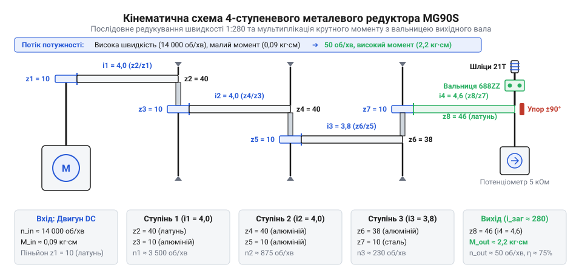
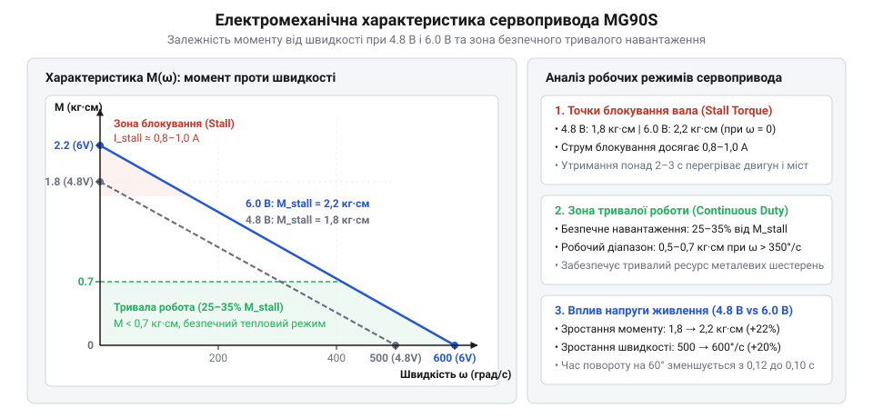
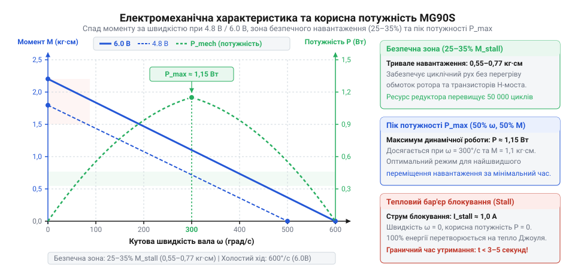
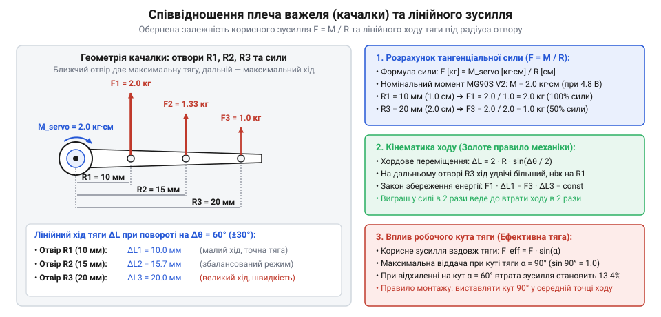
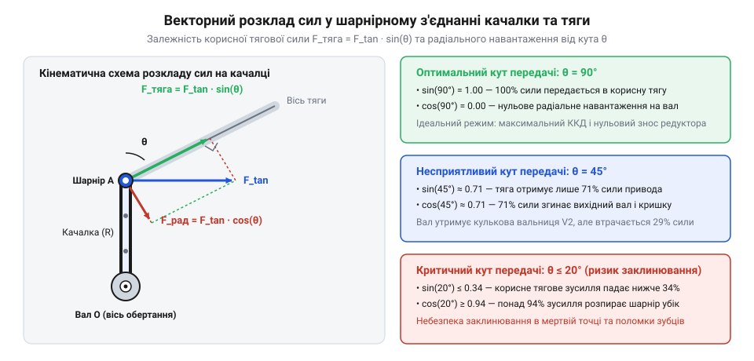
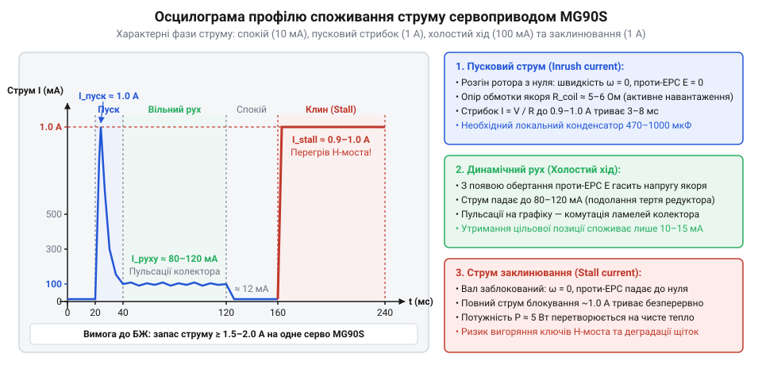
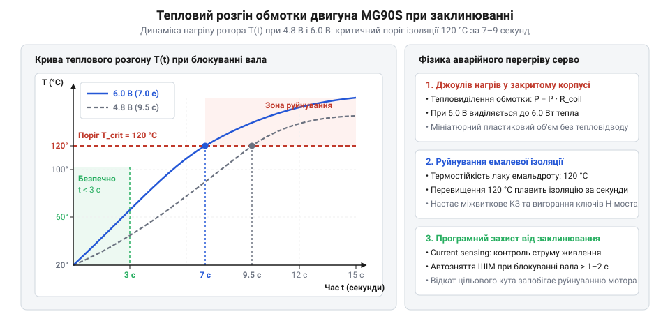
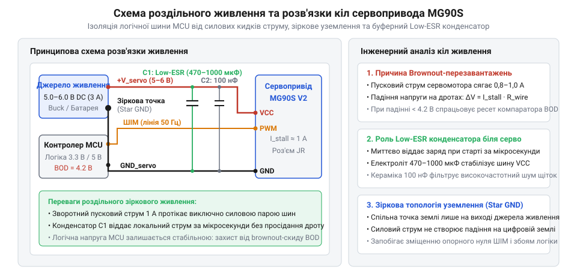

# MG90S V2 — мікросерво з металевим редуктором

<preknowlist>
- [Tower Pro SG90 — мікросерво 9g](root:cat-hw-actuators/sg90-servo) — архітектура мікросервопривода 9g (двигун, редуктор, потенціометр), спосіб керування стандартним ШІМ-сигналом позиціонування (імпульси 1–2 мс із періодом 20 мс) та обмеження пластикових нейлонових шестерень
- [Серво-роги (запасні)](root:cat-hw-actuators/servo-horns) — конструкція шліцьової посадки на вихідний вал і стандартні конфігурації качалок із монтажними отворами для передачі зусилля на шарнірні тяги
</preknowlist>

## Пастка паспортного моменту: чому навантажений вузол зупиняється

Під час складання рухомого вузла робота — маніпулятора, поворотного захоплювача чи кермової тяги — розробник зазвичай спирається на паспортний крутний момент сервопривода MG90S: 1.8 кг·см при напрузі живлення 4.8 В або 2.2 кг·см при 6.0 В. Складається оманливе враження, що мініатюрний механізм масою лише 14 грамів здатен без зусиль штовхати або піднімати вантажі масою до двох кілограмів. Проте варто зібрати вузол і подати сигнал, як виникає ланцюг неприємних збоїв: привід раптово зупиняється на середині робочого ходу під навантаженням усього 200 грамів, електродвигун за лічені секунди розігрівається до критичної температури, а керівний мікроконтролер циклічно перезавантажується в момент кожної спроби рушити з місця.

Цей збій виникає не через заводський брак привода, а через відсутність системного інженерного розрахунку. Паспортний крутний момент плутають із лінійною штовхальною силою, геометричні пропорції важеля кардинально змінюють доступне зусилля, траєкторія руху тяги спотворює передачу моменту, а динамічні пускові струми викликають аварійне просідання напруги на живильній шині.

### Різниця між крутним моментом і лінійною силою

Головна помилка полягає в ототожненні крутного моменту з вагою або лінійною силою. Крутний момент @@en|torque@@ (від лат. *torquere* — скручувати, крутити) — це міра обертальної дії сили на тверде тіло відносно осі обертання. Він визначається як добуток лінійної сили на найкоротшу відстань від осі обертання до лінії дії цієї сили (плече важеля).

Паспортна одиниця `кг·см` (кілограм-сила-сантиметр) вказує, яке тангенціальне зусилля привід здатен розвинути на радіусі рівно 1 см від центру обертання вихідного вала:

```
F_лін
= M / R                              [визначення лінійної сили з крутного моменту]
```

Якщо на вихідний вал сервопривода встановлено стандартну одноплечу качалку з каталогу [серво-рогів](root:cat-hw-actuators/servo-horns), точка кріплення тяги найчастіше розташовується не на відстані 1 см, а значно далі — на крайніх отворах радіусом 2.5–3.0 см задля досягнення великої лінійної амплітуди переміщення. Зі збільшенням плеча важеля `R` вихідне зусилля падає обернено пропорційно:

```
F_лін(R = 3.0 см)
= (1.8 кг·см) / 3.0 см               [підстановка моменту та довжини плеча]
= 0.6 кгс                            [вихідне зусилля на крайньому отворі]
≈ 5.89 Н                             [переведення в систему SI: 0.6 · 9.80665]
```

Замість очікуваних 1.8 кг штовхального зусилля важіль отримує лише 600 грамів. Якщо ж на кінці цього важеля шарнірно закріплено додаткову ланку маніпулятора, плече навантаження зростає ще більше, і доступна сила падає нижче опору тертя в шарнірах.

### Геометричний капкан змінного кута передачі

Сервопривод обертає качалку по колу, тоді як виконавчий шток або важіль зазвичай рухається по лінійній напрямній чи навколо власного шарніра. Через це кут передачі зусилля між віссю качалки та передавальною тягою безперервно змінюється під час руху.

Прямий кут 90° між плечем качалки й тягою забезпечує максимальну передачу сили вздовж осі тяги. Проте під час повороту вала на кути ±45° чи ±60° напрямок дії тангенціальної сили відхиляється від осі тяги на змінний кут `θ` (тета). Корисна сила, що передається вздовж тяги, визначається проекцією:

```
F_корисна
= F_танг · sin θ                     [тригонометрична проекція сили на вісь тяги]
```

Коли кут `θ` зменшується до 30°, корисна тяга зменшується вдвічі (`sin 30° = 0.5`). Уся решта зусилля перетворюється на паразитну нормальну силу `F_норм = F_танг · cos θ`, яка не штовхає механізм, а згинає сталеву тягу, перекошує наконечники шарнірів і створює колосальне радіальне навантаження на підшипник вихідного вала привода. У крайніх положеннях важіль просто розпирає механізм, викликаючи його механічне заклинювання.

### Статичний глухий кут: природа моменту блокування

Паспортне значення `1.8 кг·см` — це момент статичного блокування @@en|stall torque@@ (від англ. *stall* — зупинка двигуна через надмірний опір, та лат. *torquere* — скручувати). Це граничний крутний момент, який двигун розвиває тоді, коли його вал повністю зупинений зовнішньою протидією.

У точці блокування кутова швидкість обертання дорівнює нулю (`ω = 0`). Це означає, що при навантаженні, рівному паспортному моменту, сервопривод у принципі не здатен виконувати механічну роботу або переміщувати вантаж — він може лише нерухомо протистояти зовнішній силі до моменту теплового руйнування обмоток. Для забезпечення динамічного руху з номінальною швидкістю реальне навантаження механізму не повинно перевищувати чверті від моменту блокування.

### Електричний удар і brownout-перезавантаження

Коли ротор двигуна обертається, у його обмотках індукується зворотна електрорушійна сила — проти-ЕРС @@en|back-EMF@@ (від англ. *electromotive force*), яка спрямована назустріч напрузі живлення та обмежує споживаний струм. У момент пуску привода або в стані його механічного заклинювання кутова швидкість дорівнює нулю, і проти-ЕРС повністю зникає (`E = 0`).

У цьому стані єдиним обмеженням струму залишається активний омічний опір мідного дроту обмоток ротора (`R_обм ≈ 5.5–6.5 Ом`). Згідно із законом Ома струм блокування сягає пікових значень:

```
I_stall
= U_жив / R_обм                      [закон Ома для кола постійного струму без проти-ЕРС]
= 5.0 В / 6.0 Ом                     [підстановка типових значень напруги та опору обмотки]
≈ 0.833 А                            [струм блокування ротора]
```

Стрибок струму силою майже 1 А на один мініатюрний сервопривод створює різке падіння напруги на внутрішньому опорі джерела живлення, контактних роз'ємах та з'єднувальних провідниках. Якщо плата мікроконтролера живиться від тієї самої 5-вольтової лінії без ізоляції, напруга на ній миттєво падає нижче допустимого порогу 4.2–4.5 В. Спрацьовує внутрішній супервізор живлення мікроконтролера — відбувається апаратне скидання процесора через просідання напруги @@en|brownout@@ (від англ. *brownout* — часткове затемнення, падіння напруги нижче рівня логічного живлення). Після перезавантаження контролер знову намагається запустити сервопривід, викликаючи нескінченний цикл аварійних перезапусків.

> 🔧 **Навіщо це.**
> Наскрізний розрахунок зв'язує крутний момент сервопривода з реальною геометрією виконавчого механізму та піковими струмами живлення. Без нього підбір привода перетворюється на здогадки: розробник марно купує дорожчі та важчі сервоприводи, намагаючись компенсувати невдале плече важеля або просідання напруги живлення.

## Кінематика зубчастого редуктора: узгодження швидкості та моменту

Щоб зрозуміти, звідки в мініатюрному корпусі MG90S береться момент 1.8 кг·см, необхідно розглянути його первинне джерело енергії. Всередині привода встановлено мікроскопічний колекторний електродвигун постійного струму без осердя @@en|coreless DC motor@@ (від лат. *collector* — збирач, та англ. *core* — осердя, сердечник). Відсутність масивного феромагнітного сердечника в роторі знижує його момент інерції майже до нуля, що дозволяє мотору миттєво розганятися до швидкостей понад 15 000 обертів на хвилину при напрузі 4.8 В.

Проте за високу частоту обертання доводиться платити мізерним крутним моментом ротора. Власний електромагнітний момент мікродвигуна не перевищує 0.09–0.1 мН·м (`0.0001 Н·м`). Ротор із таким моментом можна миттєво зупинити легким дотиком волосини — підключений безпосередньо до качалки, він не зрушить навіть власну пластикову насадку.

### Роль редуктора у перетворенні потужності

Для узгодження параметрів мікродвигуна з потребами реального механізму між ротором і вихідним валом розміщують зубчастий редуктор (від лат. *reductor* — той, що зменшує, повертає назад). Механічна потужність обертового руху дорівнює добутку крутного моменту `M` на кутову швидкість `ω` (омега):

```
P_мех
= M · ω                              [потужність обертального руху]
```

Знижуючи кутову швидкість обертання у сотні разів за допомогою послідовного каскаду зубчастих коліс, редуктор пропорційно збільшує вихідний крутний момент.

У приводі MG90S використовується чотириступеневий циліндричний прямозубий редуктор @@en|spur gear train@@ (від англ. *spur* — шпора, прямозубе зубчасте колесо, та англ. *train* — послідовний ряд). На відміну від молодшої моделі [Tower Pro SG90](root:cat-hw-actuators/sg90-servo), де всі шестерні відлиті з нейлонового пластику, у MG90S використано металеві шестерні з латуні та легованої сталі, а верхня опора вихідного вала оснащена кульковим підшипником @@en|ball bearing@@ (від укр. *вальниця*, *вал*; англ. *bearing* — опора). Це запобігає радіальному перекосу вихідного вала під час прикладання бічних зусиль до качалки.


*Кінематична схема 4-ступеневого металевого редуктора: передача обертального руху від триба високошвидкісного мікродвигуна через проміжні зубчасті колеса до вихідного вала на вальниці кочення.*

### Аналітичний розрахунок передавального числа каскаду

Кожен ступінь зубчастого механізму складається з ведучого триба @@en|pinion@@ (від лат. *pinna* — перо, крило, зубець) із малим числом зубців `z_від` та веденого зубчастого колеса з більшим числом зубців `z_вед`. Передавальне відношення одного ступеня дорівнює відношенню кутової швидкості вхідного вала до вихідного, що строго відповідає відношенню кількості зубців:

```
i_k
= ω_вх / ω_вих                       [кінематичне визначення передавального відношення]
= z_вед / z_від                      [вираження через кількість зубців сполучених коліс]
```

Оскільки чотири ступені з'єднані послідовно (триб попереднього ступеня жорстко закріплений на одній осі з веденим колесом наступного), загальне передавальне число редуктора `i_заг` дорівнює добутку передавальних чисел усіх його ступенів:

```
i_заг
= ∏ i_k                              [загальне передавальне число послідовного каскаду]
= i₁ · i₂ · i₃ · i₄                  [розкриття добутку для чотирьох ступенів]
```

Розглянемо параметри зубчастих вінців кінематичного ланцюга редуктора MG90S:
1. Ступінь 1: латунний триб на валу ротора має `z₁ = 8` зубців, ведене колесо першого блока — `z₂ = 32` зубці.
2. Ступінь 2: триб першого блока має `z₃ = 9` зубців, ведене колесо другого блока — `z₄ = 36` зубців.
3. Ступінь 3: триб другого блока має `z₅ = 9` зубців, ведене колесо третього блока — `z₆ = 38` зубців.
4. Ступінь 4: сталевий триб третього блока має `z₇ = 10` зубців, секторне зубчасте колесо вихідного вала — `z₈ = 44` зубці.

Обчислимо передавальне число кожного ступеня та сумарну редукцію каскаду:

```
i₁
= z₂ / z₁                            [передавальне число 1-го ступеня]
= 32 / 8                             [підстановка кількості зубців]
= 4.0                                [точно 4:1]

i₂
= z₄ / z₃                            [передавальне число 2-го ступеня]
= 36 / 9                             [підстановка кількості зубців]
= 4.0                                [точно 4:1]

i₃
= z₆ / z₅                            [передавальне число 3-го ступеня]
= 38 / 9                             [підстановка кількості зубців]
≈ 4.2222                             [періодичний дріб]

i₄
= z₈ / z₇                            [передавальне число 4-го ступеня]
= 44 / 10                            [підстановка кількості зубців]
= 4.4                                [точно 4.4:1]

i_заг
= i₁ · i₂ · i₃ · i₄                  [добуток передавальних чисел усіх ступенів]
= 4.0 · 4.0 · 4.2222 · 4.4           [підстановка обчислених значень ступенів]
= 16.0 · 18.5778                     [проміжне множення]
≈ 297.24                             [сумарне передавальне число редуктора MG90S]
```

Загальне передавальне число редуктора становить приблизно 297.2:1 (у різних модифікаціях привода залежно від нарізки зубців воно коливається в межах 295:1–305:1). Це означає, що за один повний оберт вихідного вала ротор електродвигуна встигає зробити майже 300 обертів. Більш детальний аналіз евольвентного зачеплення прямозубих коліс розглядається в теорії [механіки зубчастих передач](root:hw-motion/gears-transmission).

### Узгодження швидкостей та розрахунок часу повороту на 60 градусів

Знаючи загальне передавальне число, обчислимо частоту обертання та кутову швидкість вихідного вала при номінальній напрузі живлення 4.8 В, коли швидкість двигуна на холостому ходу становить `n_двиг = 15 000 об/хв`:

```
ω_двиг
= 2 · π · n_двиг / 60                [переведення обертів за хвилину в радіани за секунду]
= 2 · 3.14159 · 15000 / 60           [підстановка частоти 15 000 об/хв]
≈ 1570.8 рад/с                       [кутова швидкість ротора двигуна]

ω_вих
= ω_двиг / i_заг                     [зниження кутової швидкості через редукцію]
= 1570.8 / 297.24                    [підстановка значень швидкості двигуна та редукції]
≈ 5.285 рад/с                        [кутова швидкість вихідного вала привода]
```

Частота обертання вихідного вала в обертах за хвилину:

```
n_вих
= n_двиг / i_заг                     [частота обертання вихідного вала]
= 15000 / 297.24                     [підстановка частоти ротора та передавального числа]
≈ 50.46 об/хв                        [трохи менше одного оберту за секунду]
```

У технічній документації на сервоприводи швидкість позиціонування традиційно вказують як час, необхідний для повороту вихідного вала на стандартний кут 60° (що відповідає одній третині повного робочого сектора 180°).

Переведемо кут 60° у радіани:

```
Δθ
= 60° · (π / 180°)                   [переведення градусів у радіани]
= π / 3                              [точне аналітичне значення]
≈ 1.0472 рад                         [кут 60 градусів у радіанах]
```

Розрахуємо теоретичний час проходження цього сектора на холостому ходу при 4.8 В:

```
t_60°(4.8V)
= Δθ / ω_вих                         [визначення часу рівномірного кутового руху]
= 1.0472 рад / 5.285 рад/с           [ділення кута на вихідну кутову швидкість]
≈ 0.198 с                            [теоретичний час повороту без урахування розгону]
```

При напрузі живлення 6.0 В напруга на якорі зростає, швидкість холостого ходу двигуна підвищується до приблизно 18 500 об/хв (`ω_двиг ≈ 1937 рад/с`), а вихідна кутова швидкість сягає `ω_вих ≈ 6.52 рад/с`. Відповідно, час повороту зменшується:

```
t_60°(6.0V)
= 1.0472 рад / 6.52 рад/с            [обчислення часу повороту при напрузі 6.0 В]
≈ 0.161 с                            [час повороту на 60 градусів]
```

Паспортні дані MG90S заявляють час повороту на 60° у межах 0.10–0.11 с при 4.8 В та 0.08 с при 6.0 В. Така різниця пояснюється тим, що виробники проводять вимірювання на форсованих безсердечникових моторах без встановленої качалки та за мінімального тертя у свіжому мастилі, коли частота обертання розвантаженого ротора сягає 22 000–25 000 об/хв. Проте реальний час під навіть мінімальним динамічним навантаженням завжди становить 0.15–0.20 с через інерцію розгону та внутрішній опір.

> 🔧 **Навіщо це.**
> Розрахунок кінематичного передавального числа редуктора визначає фізичну межу швидкості виконавчого механізму. Якщо редуктор знижує кутову швидкість до 5 рад/с, привід не зможе повернути важіль на 60° швидше ніж за 0.12 с за будь-яких команд керування. Цей розрахунок дає точну часову межу для планування траєкторій руху в системі керування.

## Механічні втрати та коефіцієнт корисної дії металевого редуктора

В ідеальному механізмі без тертя втрати енергії відсутні, і вихідна механічна потужність строго дорівнює вхідній: `P_вих = P_вх`. За такого припущення крутний момент на вихідному валу мав би зрости рівно в `i_заг` разів:

```
M_вих,ід
= M_вх · i_заг                       [ідеальний крутний момент за умови відсутності втрат]
```

Проте реальний чотириступеневий металевий редуктор далекий від ідеальної машини. Проходження механічного потоку енергії через зубчасті зачеплення неминуче супроводжується внутрішніми втратами на тертя, які поглинають значну частку потужності ротора та розсіюють її у вигляді тепла.

### Фізична природа втрат у редукторі

Втрати енергії в прямозубому каскаді MG90S формуються трьома основними фізичними процесами:
1. Тертя ковзання між бічними робочими профілями зубців @@en|sliding friction@@ (від англ. *sliding* — ковзання, та лат. *frictio* — тертя). Під час зачеплення евольвентні профілі зубців не лише котяться один по одному, а й ковзають зі значним питомим тиском, особливо в фазах входу в зачеплення та виходу з нього.
2. Тертя в опорах обертання: радіальні та осьові сили реакції притискають проміжні зубчасті блоки до нерухомих сталевих осей, викликаючи сухе або напіврідинне тертя ковзання в латунних отворах шестерень.
3. Гідродинамічний опір мастила @@en|viscous drag@@ (від англ. *viscous* — в'язкий). Консистентне силіконове або літієве мастило, необхідне для захисту металевих вінців, створює опір в'язкого зсуву при високошвидкісному обертанні шестерень першого й другого ступенів.

Ефективність передачі механічної потужності кількісно оцінюється коефіцієнтом корисної дії (ККД) @@en|efficiency@@ (від лат. *efficere* — здійснювати, діяти), який позначають грецькою літерою `η` (ета). ККД визначає частку потужності, що доходить до веденого вала:

```
η
= P_вих / P_вх                       [визначення коефіцієнта корисної дії]
```

### Метал проти нейлону: плата за міцність

Вибір матеріалу шестерень визначає фундаментальний компроміс між механічною міцністю та енергетичною ефективністю привода. У мікросервоприводах класу [Tower Pro SG90](root:cat-hw-actuators/sg90-servo) використовуються нейлонові або поліоксиметиленові шестерні. Пластик має низький коефіцієнт тертя ковзання і володіє властивістю самозмащування, тому ККД одного пластикового ступеня сягає `η_k ≈ 0.94–0.96`. Проте пластикові зубці мають низьку границю міцності на зріз і зминання — ударне навантаження величиною понад 1.5 кг·см зрізає зубці першого або другого ступеня, миттєво виводячи привід з ладу.

Металевий редуктор MG90S побудований на комбінації латунних коліс і загартованих сталевих трибів. Латунь марки CuZn має високу ударну в'язкість і міцність на вигин, що виключає зріз зубців навіть при повному аварійному заклинюванні вала. Проте коефіцієнт тертя ковзання пари «метал-по-металу» значно вищий, ніж у пластику. Через це ККД одного прямозубого металевого ступеня в мініатюрних габаритах становить лише:

```
η_ступ ≈ 0.88 ... 0.92
```

Крім того, металевий редуктор критично залежить від якості мастила: якщо мастило висихає чи видавлюється із зони контакту зубців, коефіцієнт тертя різко зростає, виникає абразивний знос латуні, а ККД ступеня падає нижче 0.82.

### Обчислення сумарного ККД чотириступеневого редуктора

Оскільки механічна потужність передається послідовно через чотири ступені зубчастого каскаду, втрати на кожному етапі мультиплікативно накопичуються. Сумарний ККД редуктора дорівнює добутку коефіцієнтів корисної дії всіх його окремих ступенів:

```
η_заг
= ∏ η_k                              [сумарний ККД послідовного кінематичного ланцюга]
= η₁ · η₂ · η₃ · η₄                  [добуток ККД окремих чотирьох ступенів]
```

Припустимо, що редуктор якісно виготовлений і змащений, а середній ККД кожного ступеня становить `η_ступ = 0.90`. Розрахуємо сумарний коефіцієнт корисної дії:

```
η_заг
= 0.90 · 0.90 · 0.90 · 0.90          [підстановка номінального ККД металевого ступеня]
= 0.90⁴                              [піднесення до степеня кількості ступенів]
≈ 0.6561                             [сумарний ККД каскаду: близько 65.6%]
```

Якщо мастило свіже, а деталі припрацьовані (`η_ступ ≈ 0.92`):

```
η_заг,max
= 0.92⁴                              [оптимальний стан редуктора]
≈ 0.7164                             [максимальний ККД: близько 71.6%]
```

Якщо ж привід зазнав зносу чи працює за підвищеної температури зі збідненим мастилом (`η_ступ ≈ 0.88`):

```
η_заг,min
= 0.88⁴                              [погіршений стан редуктора]
≈ 0.5997                             [мінімальний ККД: близько 60.0%]
```

Таким чином, сумарний ККД редуктора MG90S коливається в межах 0.60–0.72. Це означає, що від 28% до 40% усієї корисної механічної енергії, виробленої електродвигуном, безповоротно втрачається на подолання тертя і перетворюється на тепло всередині закритого пластикового корпусу привода. Подібні кінематичні втрати характерні для більшості мікроприводів, зокрема прецизійних серв лінійки [Power HD HD-1370A](root:cat-hw-actuators/hd-1370a-servo) та інших виробів [родини Power HD](root:cat-hw-actuators/powerhd-family).

### Розрахунок реального крутного моменту та переведення одиниць

З урахуванням коефіцієнта корисної дії реальний вихідний крутний момент на валу сервопривода становить лише частину від ідеального кінематичного значення:

```
M_вих
= M_вх · i_заг · η_заг               [рівняння вихідного моменту з урахуванням механічних втрат]
```

Для правильного інженерного розрахунку необхідно коректно переводити технічні паспортні одиниці `кг·см` у міжнародну систему одиниць SI (`Н·м`).

Одиниця 1 кг·см позначає момент, створюваний силою тяжіння маси 1 кг на плечі 1 см:

```
1 кг·см
= 1 кгс · 1 см                       [визначення технічної одиниці моменту]
= (1 кг · 9.80665 м/с²) · 0.01 м     [закон тяжіння Ньютона та переведення сантиметрів у метри]
= 9.80665 Н · 0.01 м                 [сила в ньютонах на плечі в метрах]
= 0.0980665 Н·м                      [точний перевідний коефіцієнт]
≈ 0.0981 Н·м                         [інженерне наближення]
```

Зворотне переведення з `Н·м` у `кг·см`:

```
1 Н·м
= 1 / 0.0980665 кг·см                [зворотне відношення одиниць]
≈ 10.1972 кг·см                      [перевідний множник у технічну систему]
```

Тепер обчислимо реальний паспортний момент статичного блокування `M_stall` при напругах 4.8 В та 6.0 В у ньютон-метрах:

```
M_stall(4.8V)
= 1.8 кг·см · 0.0980665              [переведення паспортного значення 4.8 В у ньютон-метри]
≈ 0.1765 Н·м                         [момент блокування при 4.8 В]

M_stall(6.0V)
= 2.2 кг·см · 0.0980665              [переведення паспортного значення 6.0 В у ньютон-метри]
≈ 0.2157 Н·м                         [момент блокування при 6.0 В]
```

Знаючи вихідний момент блокування та параметри редуктора, можна знайти реальний електромагнітний момент блокування ротора мікродвигуна при 4.8 В:

```
M_двиг,stall
= M_stall / (i_заг · η_заг)          [зворотний розрахунок моменту на валу ротора]
= 0.1765 Н·м / (297.24 · 0.6561)     [підстановка значень для 4.8 В та номінального ККД]
= 0.1765 / 195.02                    [проміжний розрахунок ефективного коефіцієнта редукції]
≈ 0.000905 Н·м                       [електромагнітний момент ротора]
≈ 0.905 мН·м                         [менше одного міліньютон-метра]
```

### Електромеханічна характеристика привода та вибір робочої зони

Зв'язок між кутовою швидкістю обертання вихідного вала `ω` та корисним моментом опору навантаження `M_нав` описується спадною лінійною електромеханічною характеристикою електродвигуна постійного струму з постійними магнітами:

```
ω(M)
= ω_xx · (1 - M_нав / M_stall)       [лінійна залежність швидкості від навантажувального моменту]
```

де `ω_xx` — кутова швидкість холостого ходу (@@en|no-load speed@@) при відсутності навантаження (`M_нав = 0`), а `M_stall` — момент статичного блокування вала. Детальний вивід цієї моделі з рівнянь електричної рівноваги якоря наведено в розділі [електромеханіки двигунів постійного струму](root:hw-motion/motor-torque-speed-curve).


*Електромеханічна характеристика сервопривода при напругах живлення 4.8 В та 6.0 В: залежність кутової швидкості від корисного навантаження, точка статичного блокування вала та виділена зона безпечного довготривалого навантаження.*

На графіку наочно видно поведінку привода при обох робочих напругах:
- При зростанні навантажувального моменту швидкість обертання вихідного вала лінійно спадає від швидкості холостого ходу до повного нуля в точці `M_stall`.
- Механічна вихідна потужність `P(M) = M · ω(M)` досягає свого піка при навантаженні `M = 0.5 · M_stall`. Проте тривала робота в цій точці неприпустима: споживаний струм зростає пропорційно моменту, і втрати на нагрівання мідних обмоток за законом Джоуля-Ленца (`P_тепл = I² · R`) швидко перевищують здатність корпусу розсіювати тепло.
- У точці блокування (`M = M_stall`) уся споживана електрична потужність (близько 4–5 Вт) на 100% перетворюється на тепло всередині замкненого об'єму обмоток ротора, що спричиняє розплавлення лакової ізоляції мідного дроту менш ніж за 10–15 секунд безперервного утримання.

### Зона безпечного довготривалого навантаження

Щоб сервопривід працював надійно, без перегріву двигуна, без зрізання зубців редуктора та зі збереженням високої динаміки реакції, розрахункове довготривале навантаження має лежати в зоні 25%–35% від значення `M_stall`:

```
M_роб ≤ 0.30 · M_stall               [правило інженерного запасу моменту]
```

Розрахуємо допустимий тривалий робочий момент для MG90S:

При напрузі 4.8 В:

```
M_роб(4.8V)
= 0.30 · 1.8 кг·см                   [розрахунок 30% запасу за напруги 4.8 В]
= 0.54 кг·см                         [допустимий статичний момент у технічних одиницях]
= 0.54 · 0.0980665 Н·м               [переведення в ньютон-метри]
≈ 0.053 Н·м                          [граничний робочий крутний момент]
```

При напрузі 6.0 В:

```
M_роб(6.0V)
= 0.30 · 2.2 кг·см                   [розрахунок 30% запасу за напруги 6.0 В]
= 0.66 кг·см                         [допустимий статичний момент у технічних одиницях]
= 0.66 · 0.0980665 Н·м               [переведення в ньютон-метри]
≈ 0.065 Н·м                          [граничний робочий крутний момент]
```

Залишок у 65%–75% моменту слугує необхідним динамічним резервом: він витрачається на подолання сил інерції маси вантажу під час швидкого розгону, компенсацію тертя в шарнірних тягах і подолання пікових короткочасних навантажень без зупинки привода.

> 🔧 **Навіщо це.**
> Врахування сумарного ККД редуктора та розрахунок робочого навантаження за правилом 30% запобігають тепловому виходу сервопривода з ладу. Проєктування вузла під паспортний момент блокування неминуче призводить до перегріву або заклинювання, тоді як обмеження номінального моменту величиною 0.54 кг·см забезпечує стабільну швидкість та необмежений ресурс механізму.

## Електромеханічна характеристика при 4.8 В та 6.0 В: крутний момент і запас міцності

Паспортні характеристики сервоприводів на кшталт MG90S містять два показники крутного моменту: 1.8 кг·см за напруги живлення 4.8 В та 2.2 кг·см за напруги 6.0 В. Спроба навантажити механічний вузол цим повним зусиллям під час тривалого руху призводить до перегріву двигуна за лічені десятки секунд, різкого падіння швидкості та теплового виходу привода з ладу. Проєктування надійного виконавчого механізму вимагає розуміння фізичної природи електромагнітного моменту колекторного двигуна, зв'язку моменту з напругою та методики визначення допустимого експлуатаційного запасу.

### Фізична природа крутного моменту в колекторному двигуні

Усередині сервопривода MG90S встановлено мініатюрний колекторний двигун постійного струму (@@en|brushed DC motor@@, від французького *brosse* — щітка та латинського *motor* — рушій). Механічний обертальний момент ротора виникає завдяки дії сили Лоренца на провідники якірної обмотки зі струмом у постійному магнітному полі статора. Електромагнітний момент двигуна `M_двиг` прямо пропорційний силі якірного струму `I_я`:

```
M_двиг = k_t · I_я
```

де `k_t` — конструктивний коефіцієнт електромагнітного моменту двигуна (@@en|torque constant@@, вимірюється в Н·м / А).

Рівняння рівноваги напруг якірного кола за другим законом Кірхгофа зв'язує прикладену напругу живлення `U`, активний омічний опір мідного дроту обмоток `R_я` та проти-електрорушійну силу (@@en|back-EMF@@, від грецького *ēlektron*, латинського *motio* — рух та англійського @@en|electromotive force@@):

```
U = I_я · R_я + E_ерс
```

Проти-ЕРС індукується в обмотках ротора під час їхнього обертання в магнітному полі статора за законом Фарадея і діє назустріч прикладеній напрузі живлення:

```
E_ерс = k_e · ω_двиг
```

де `k_e` — коефіцієнт проти-ЕРС двигуна (в системі SI чисельно дорівнює `k_t`), а `ω_двиг` — кутова швидкість обертання вала ротора в радіанах за секунду (рад/с).

### Режим блокування вала та статичний момент

Коли зовнішній механічний опір повністю зупиняє вихідний вал сервопривода, ротор двигуна перебуває в стані спокою: `ω_двиг = 0`. За нульової швидкості обертання проти-ЕРС зникає:

```
E_ерс = 0
```

Уся прикладена напруга живлення `U` падає суто на активному опорі обмоток ротора `R_я`. Струм якірного кола досягає свого фізичного максимуму — струму блокування (@@en|stall current@@, від англійського @@en|stall@@ — затримка, зупинка):

```
I_stall = U / R_я
```

Відповідно, граничний статичний крутний момент самого двигуна у стані блокування дорівнює:

```
M_двиг_stall = k_t · (U / R_я)
```

Вал ротора з'єднаний із вихідним валом сервопривода через багатоступеневий редуктор із металевими шестернями, що характеризується загальним передавальним числом `i_ред` та механічним коефіцієнтом корисної дії `η`. Повний статичний крутний момент утримання (@@en|stall torque@@) на вихідному валу сервопривода становить:

```
M_stall
= η · i_ред · M_двиг_stall               [трансформація моменту редуктором]
= η · i_ред · k_t · (U / R_я)            [підстановка виразу моменту двигуна через напругу]
```

Конструктивні коефіцієнти `k_t`, `R_я`, `i_ред` та механічний ККД `η` є незмінними фізичними параметрами конструкції. Отже, вихідний статичний крутний момент блокування `M_stall` зростає строго прямо пропорційно прикладеній напрузі живлення `U`.

### Одиниці вимірювання та розрахунок характеристик при 4.8 В та 6.0 В

У паспортних таблицях сервоприводів крутний момент традиційно наводять у позасистемних одиницях — кілограм-силах на сантиметр (`кг·см` або `кгс·см`). Ця величина визначає момент сили, створюваний вагою вантажу масою 1 кг під дією стандартного земного тяжіння на плечі важеля завдовжки 1 см:

```
M_SI
= F · r                                  [означення моменту сили для перпендикулярного плеча]
= (m · g) · r                            [другий закон Ньютона: розрахунок ваги у полі тяжіння]
= (1.0 кг · 9.80665 м/с²) · 0.01 м       [підстановка: m = 1.0 кг, g = 9.80665 м/с², r = 0.01 м]
= 9.80665 Н · 0.01 м                     [обчислення сили гравітаційного тяжіння]
= 0.0980665 Н·м                          [переведення в системні одиниці ньютон-метри]
≈ 0.0981 Н·м                             [округлення до трьох значущих цифр]
```

Зв'язок одиниць становить: `1 кг·см ≈ 0.0981 Н·м` (або `1 Н·м ≈ 10.197 кг·см`).

Перерахуємо паспортні характеристики статичного моменту MG90S у системні одиниці SI:

- При напрузі живлення `U_1 = 4.8 В` паспортний момент становить `M_stall(4.8В) = 1.8 кг·см`:
  ```
  M_stall(4.8В)
  = 1.8 кг·см · 0.0980665 (Н·м) / (кг·см)       [множення на точний перевідний коефіцієнт]
  = 0.17652 Н·м                                 [розрахунок добутку]
  ≈ 0.177 Н·м                                   [округлення]
  ```

- При напрузі живлення `U_2 = 6.0 В` паспортний момент становить `M_stall(6.0В) = 2.2 кг·см`:
  ```
  M_stall(6.0В)
  = 2.2 кг·см · 0.0980665 (Н·м) / (кг·см)       [множення на точний перевідний коефіцієнт]
  = 0.21575 Н·м                                 [розрахунок добутку]
  ≈ 0.216 Н·м                                   [округлення]
  ```

Підвищення напруги живлення на `(6.0 - 4.8) / 4.8 · 100% = 25%` забезпечує зростання крутного моменту утримання на:

```
ΔM_відн
= (M_stall(6.0В) - M_stall(4.8В)) / M_stall(4.8В) · 100%   [формула відносного приросту]
= (0.216 - 0.177) / 0.177 · 100%                           [підстановка значень у Н·м]
= 0.039 / 0.177 · 100%                                     [обчислення різниці]
≈ 22.0%                                                    [остаточний відсоток зростання]
```

Відхилення фактичного приросту (22.0%) від ідеальних 25% зумовлене нелінійним падінням напруги на контактах графітово-металевих щіток колектора (близько 0.2–0.3 В) та наближенням осердя ротора до стану магнітного насичення.

Підвищення напруги також пропорційно збільшує кутову швидкість холостого ходу:
- При 4.8 В паспортний час повороту на 60° без навантаження становить `t_60(4.8В) = 0.10 с / 60°`. Кутова швидкість:
  ```
  ω_0(4.8В)
  = Δθ / t_60(4.8В)                             [означення кутової швидкості]
  = (60° · π / 180°) / 0.10 с                   [переведення кута 60 градусів у радіани]
  = 1.0472 рад / 0.10 с                         [обчислення радіанної міри кута]
  = 10.47 рад/с                                 [кутова швидкість холостого ходу (100 об/хв або 600 °/с)]
  ```

- При 6.0 В паспортний час повороту скорочується до `t_60(6.0В) = 0.08 с / 60°`. Кутова швидкість:
  ```
  ω_0(6.0В)
  = Δθ / t_60(6.0В)                             [означення кутової швидкості]
  = 1.0472 рад / 0.08 с                         [кутовий хід у радіанах поділений на час]
  = 13.09 рад/с                                 [кутова швидкість холостого ходу (125 об/хв або 750 °/с)]
  ```

Швидкість обертання холостого ходу зростає рівно на `13.09 / 10.47 = 1.25` (на 25%), оскільки кутова швидкість без навантаження визначається суто балансом напруги та проти-ЕРС: `ω_0 ≈ U / (k_e · i_ред)`.

### Динамічна електромеханічна характеристика

Під час обертання вала зі швидкістю `ω > 0` у роторі генерується проти-ЕРС, яка зменшує ефективну різницю потенціалів на обмотках: `U - E_ерс = U - k_e · i_ред · ω`. Внаслідок цього якірний струм лінійно спадає зі зростанням швидкості:

```
I_я(ω) = I_stall · (1 - ω / ω_0)
```

Відповідно, динамічний крутний момент сервопривода лінійно зменшується зі збільшенням кутової швидкості:

```
M(ω) = M_stall · (1 - ω / ω_0)
```

Корисна механічна потужність на вихідному валу дорівнює добутку динамічного моменту на поточну кутову швидкість:

```
P_мех(ω) = M(ω) · ω = M_stall · ω · (1 - ω / ω_0)
```

Максимум механічної потужності припадає на середину швидкісного діапазону при `ω = 0.5 · ω_0` та `M = 0.5 · M_stall`:

```
P_мех_max
= M(0.5 · ω_0) · (0.5 · ω_0)             [підстановка робочої точки у вираз потужності]
= (0.5 · M_stall) · (0.5 · ω_0)          [розкриття динамічного моменту]
= 0.25 · M_stall · ω_0                   [максимальна корисна механічна потужність]
```

Для напруги 6.0 В максимальна механічна потужність MG90S становить: `P_мех_max = 0.25 · 0.216 Н·м · 13.09 рад/с ≈ 0.707 Вт`. Детальний теоретичний опис динамічних процесів та характеристик двигунів постійного струму наведено в статті [Електромеханіка колекторних двигунів постійного струму](root:hw-motion/motor-torque-speed-curve).

### Експлуатаційний запас навантаження

Паспортний крутний момент `M_stall` описує критичний аварійний режим заклинювання. У стані зупиненого вала корисна механічна робота дорівнює нулю (`P_мех = 0`), а вся підведена електрична потужність перетворюється на теплоту в мідних обмотках ротора за законом Джоуля — Ленца:

```
P_тепло = I_stall² · R_я = U · I_stall
```

При напрузі 6.0 В та струмі блокування близько 0.8 А теплова потужність становить `6.0 В · 0.8 А = 4.8 Вт`. Маса мідного ротора мікромотора MG90S становить менше 5 грамів, а замкнений пластиковий корпус не має вентиляційних отворів. Температура проводу ротора зростає зі швидкістю понад 5–10 °C за секунду. За 15–25 секунд неперервного утримання заблокованого стану емалева ізоляція дроту плавиться, викликаючи міжвиткове замикання та незворотне вигорання двигуна.

Хоча шестерні редуктора MG90S виготовлені з латуні та сталі на відміну від нейлонових коліс [Tower Pro SG90](root:cat-hw-actuators/sg90-servo), тривале статичне перевантаження викликає прискорений абразивний знос зубців, овальну деформацію посадкових отворів валів та зрізання шліців вихідного вала.

Для забезпечення тривалого ресурсу роботи привід розраховують із коефіцієнтом експлуатаційного запасу (@@en|derating factor@@, від англійського @@en|de-@@ — зниження та @@en|rate@@ — номінал). Розрахункове тривале навантаження `M_трив` обирають у діапазоні 25–35% від граничного моменту `M_stall`:

- При напрузі живлення 4.8 В:
  ```
  M_трив(4.8В)
  = (0.25 ... 0.35) · 0.177 Н·м            [діапазон допустимого тривалого навантаження]
  = 0.044 ... 0.062 Н·м                    [значення в системних одиницях SI]
  = 0.45 ... 0.63 кг·см                    [значення у позасистемних одиницях]
  ```

- При напрузі живлення 6.0 В:
  ```
  M_трив(6.0В)
  = (0.25 ... 0.35) · 0.216 Н·м            [діапазон допустимого тривалого навантаження]
  = 0.054 ... 0.076 Н·м                    [значення в системних одиницях SI]
  = 0.55 ... 0.77 кг·см                    [значення у позасистемних одиницях]
  ```

Робота в межах 25–35% гарантує, що струм споживання не перевищить безпечних 200–250 мА, температура двигуна стабілізується нижче критичної позначки 60 °C, а кутова швидкість збережеться на рівні 65–75% від швидкості холостого ходу.


*Електромеханічні характеристики MG90S при 4.8 В та 6.0 В: спад моменту зі зростанням швидкості, максимум механічної потужності та зона безпечного тривалого навантаження.*

> 🔧 **Навіщо це.**
> Закладання граничного моменту блокування `stall torque` як номінального робочого навантаження — класична помилка в робототехніці, яка призводить до миттєвого перегріву сервоприводів та просідання живлення всієї схеми. Запас у 65–75% моменту необхідний не лише для теплового захисту обмоток, а й для подолання динамічних сил інерції вузла під час розгону (`M_дин = J · dω/dt`), компенсації неминучого тертя в шарнірах та гарантованого утримання заданої траєкторії без тремтіння й втрати кроків.

## Кінематика плеча качалки: трансформація крутного моменту у лінійне зусилля

Вихідний вал сервопривода створює обертальний момент навколо власної осі. Проте практичні вузли маніпуляторів, захватів, кермових стулок літальних апаратів чи важільних механізмів ніг вимагають лінійного зусилля проштовхування або втягування. Функцію перетворення обертального моменту у лінійну силу виконує серво-ріг або качалка (@@en|servo horn@@, від латинського *servus* — слуга та англійського @@en|horn@@ — ріг), яка жорстко кріпиться на шліцьовому валу привода (див. [Серво-роги (запасні)](root:cat-hw-actuators/servo-horns)). Геометрія плеча качалки безпосередньо визначає кінематичний компроміс між доступною штовхальною силою та лінійним переміщенням тяги.

### Закон важеля для плеча качалки

Качалка є важелем першого роду, що обертається навколо нерухомої осі `O`. Монтажні отвори розташовані на різних радіальних відстанях від осі обертання.

Якщо вихідний вал розвиває крутний момент `M`, то в монтажному отворі, розташованому на відстані `R` (радіус плеча сили), виникає тангенціальна сила `F_танг`, напрямлена по дотичній до колової траєкторії руху отвору (суворо перпендикулярно до радіус-вектора `R`):

```
M = F_танг · R
```

Звідси лінійна тангенціальна сила визначається основним законом важеля:

```
F_танг = M / R
```

### Кінематичний розмін сили на лінійний хід

Під час повороту вихідного вала на кут `Δθ` (виражений у радіанах):
1. Довжина дуги, яку описує монтажний отвір, становить `s = R · Δθ`.
2. Лінійне переміщення точки кріплення вздовж прямої (довжина хорди кола) дорівнює:
   ```
   ΔL = 2 · R · sin(Δθ / 2)
   ```
3. Лінійна тангенціальна швидкість точки становить `v = R · ω`.

Оскільки механічна потужність на валу є добутком моменту на швидкість (`P = M · ω = F_танг · v`), довжина плеча `R` діє як коефіцієнт прямого механічного розміну:
- Збільшення відстані `R` у `k` разів збільшує лінійний хід `ΔL` та швидкість переміщення тяги `v` у `k` разів.
- Збільшення відстані `R` у ті самі `k` разів зменшує доступне тангенціальне зусилля `F_танг` рівно в `k` разів.


*Схема плеча качалки сервопривода: зі збільшенням радіальної відстані монтажного отвору від осі обертання лінійне тангенціальне зусилля спадає обернено пропорційно радіусу, а лінійний хід тяги зростає пропорційно радіусу.*

### Розрахунок лінійного зусилля на монтажних отворах качалки MG90S

Типова одноплеча пластикова качалка для MG90S містить чотири монтажні отвори, центри яких розташовані на стандартних відстанях:
- Отвір 1: `R_1 = 7.5 мм = 0.0075 м`
- Отвір 2: `R_2 = 11.5 мм = 0.0115 м`
- Отвір 3: `R_3 = 15.5 мм = 0.0155 м`
- Отвір 4: `R_4 = 19.5 мм = 0.0195 м`

Розрахуємо тривале безпечне штовхальне зусилля `F_танг_трив` для напруги 6.0 В (при тривалому безпечному моменті `M_трив = 0.065 Н·м`), пікове зусилля заклинювання `F_танг_stall` (при `M_stall = 0.216 Н·м`) та лінійний хід тяги `ΔL` при робочому куті повороту сервопривода `Δθ = 60°` (`π / 3 ≈ 1.0472 рад`, для якого `sin(60° / 2) = sin(30°) = 0.5`, тому `ΔL = 2 · R · 0.5 = R`):

- Внутрішній отвір 1 (`R_1 = 7.5 мм = 0.0075 м`):
  ```
  F_танг_трив(R_1)
  = M_трив / R_1                           [закон важеля для тангенціальної сили]
  = 0.065 Н·м / 0.0075 м                   [підстановка: M_трив = 0.065 Н·м, R_1 = 0.0075 м]
  = 8.6667 Н                               [обчислення частки]
  ≈ 8.67 Н                                 [округлення до трьох значущих цифр]

  F_танг_stall(R_1)
  = M_stall / R_1                          [пікова сила в режимі блокування вала]
  = 0.216 Н·м / 0.0075 м                   [підстановка: M_stall = 0.216 Н·м, R_1 = 0.0075 м]
  = 28.80 Н                                [обчислення пікової сили (еквівалент ваги 2.94 кг)]

  ΔL_1
  = 2 · R_1 · sin(60° / 2)                 [довжина прямолінійної хорди переміщення]
  = 2 · 7.5 мм · 0.5                       [підстановка: sin(30°) = 0.5]
  = 7.5 мм                                 [лінійний хід тяги]
  ```

- Отвір 2 (`R_2 = 11.5 мм = 0.0115 м`):
  ```
  F_танг_трив(R_2)
  = M_трив / R_2                           [закон важеля для тангенціальної сили]
  = 0.065 Н·м / 0.0115 м                   [підстановка: M_трив = 0.065 Н·м, R_2 = 0.0115 м]
  = 5.6522 Н                               [обчислення частки]
  ≈ 5.65 Н                                 [округлення]

  F_танг_stall(R_2)
  = M_stall / R_2                          [пікова сила в режимі блокування вала]
  = 0.216 Н·м / 0.0115 м                   [підстановка: M_stall = 0.216 Н·м, R_2 = 0.0115 м]
  = 18.78 Н                                [обчислення пікової сили (еквівалент ваги 1.91 кг)]

  ΔL_2
  = 2 · 11.5 мм · 0.5                      [довжина прямолінійної хорди переміщення]
  = 11.5 мм                                [лінійний хід тяги]
  ```

- Отвір 3 (`R_3 = 15.5 мм = 0.0155 м`):
  ```
  F_танг_трив(R_3)
  = M_трив / R_3                           [закон важеля для тангенціальної сили]
  = 0.065 Н·м / 0.0155 м                   [підстановка: M_трив = 0.065 Н·м, R_3 = 0.0155 м]
  = 4.1935 Н                               [обчислення частки]
  ≈ 4.19 Н                                 [округлення]

  F_танг_stall(R_3)
  = M_stall / R_3                          [пікова сила в режимі блокування вала]
  = 0.216 Н·м / 0.0155 м                   [підстановка: M_stall = 0.216 Н·м, R_3 = 0.0155 м]
  = 13.94 Н                                [обчислення пікової сили (еквівалент ваги 1.42 кг)]

  ΔL_3
  = 2 · 15.5 мм · 0.5                      [довжина прямолінійної хорди переміщення]
  = 15.5 мм                                [лінійний хід тяги]
  ```

- Крайній отвір 4 (`R_4 = 19.5 мм = 0.0195 м`):
  ```
  F_танг_трив(R_4)
  = M_трив / R_4                           [закон важеля для тангенціальної сили]
  = 0.065 Н·м / 0.0195 м                   [підстановка: M_трив = 0.065 Н·м, R_4 = 0.0195 м]
  = 3.3333 Н                               [обчислення частки]
  ≈ 3.33 Н                                 [округлення]

  F_танг_stall(R_4)
  = M_stall / R_4                          [пікова сила в режимі блокування вала]
  = 0.216 Н·м / 0.0195 м                   [підстановка: M_stall = 0.216 Н·м, R_4 = 0.0195 м]
  = 11.08 Н                                [обчислення пікової сили (еквівалент ваги 1.13 кг)]

  ΔL_4
  = 2 · 19.5 мм · 0.5                      [довжина прямолінійної хорди переміщення]
  = 19.5 мм                                [лінійний хід тяги]
  ```

Порівняння результатів показує: перехід від першого отвору до четвертого збільшує лінійний хід у `19.5 / 7.5 = 2.6` раза (з 7.5 мм до 19.5 мм), проте доступне штовхальне зусилля падає рівно в 2.6 раза (з 8.67 Н до 3.33 Н). Якщо опір веденого механізму становить, наприклад, 6 Н, підключення тяги до отвору `R_4` призведе до постійного перевантаження привода, тоді як на отворах `R_1` або `R_2` сервопривід працюватиме в безпечній зоні тривалого ресурсу.

> 🔧 **Навіщо це.**
> Вибір отвору качалки — головний спосіб механічного узгодження привода з навантаженням. Інженерне правило вибору монтажної точки: обирайте отвір із мінімальним можливим радіусом `R`, який забезпечує необхідну амплітуду лінійного ходу при повному кутовому діапазоні повороту сервопривода (наприклад, 120° або 180°). Використання мінімального плеча максимізує корисне зусилля проштовхування, мінімізує струмове навантаження на силове коло та зменшує паразитний люфт механізму, зумовлений кутовим зазором у зубцях редуктора.

## Векторна геометрія тяги: робочий кут передачі та радіальні навантаження

Розрахунок лінійної сили за формулою `F_танг = M / R` описує ідеальний випадок, коли тяга в кожен момент часу орієнтована суворо перпендикулярно до осі качалки. У реальних плоских важільних передачах жорстка тяга (@@en|pushrod@@, від англійського @@en|push@@ — штовхати та @@en|rod@@ — тяга, стрижень) з'єднує качалку з веденим важелем, що обертається навколо власної незалежної осі. Під час повороту качалки кут між важелем і тягою неперервно змінюється. Будь-яке відхилення кута від 90° зменшує корисне тягове зусилля та породжує паразитну радіальну силу, яка навантажує вал та підшипникові вузли сервопривода.

### Векторний розклад сил у шарнірі тяги

Розглянемо шарнірний вузол у площині руху качалки. Нехай вектор `R` проведено від осі обертання вихідного вала до центра монтажного отвору качалки. Позначимо через `θ` кут між поздовжньою віссю плеча качалки та лінією дії тяги. Цей кут називають робочим кутом передачі (@@en|transmission angle@@, від латинського *transmissio* — передавання та *angulus* — кут).

Тангенціальна сила `F_танг` прикладена в монтажному отворі перпендикулярно до радіус-вектора плеча качалки. Розкладемо вектор `F_танг` на дві ортогональні складові:
1. Корисна осьова сила `F_корисна`, спрямована вздовж поздовжньої осі тяги:
   ```
   F_корисна = F_танг · sin(θ)
   ```
2. Паразитна нормальна (радіальна) сила `F_радіальна`, спрямована вздовж плеча качалки безпосередньо до осі вихідного вала:
   ```
   F_радіальна = F_танг · cos(θ)
   ```

Аналіз тригонометричних функцій виявляє характер поведінки зусиль:
- При перпендикулярному розташуванні (`θ = 90°`):
  `sin(90°) = 1`, `cos(90°) = 0`.
  Уся тангенціальна сила перетворюється на корисне осьове зусилля вздовж тяги: `F_корисна = F_танг`. Радіальне навантаження на вал повністю відсутнє: `F_радіальна = 0`.
- При відхиленні кута `θ` в будь-який бік від 90°:
  Значення `sin(θ)` зменшується, спричиняючи втрату корисної сили проштовхування. Одночасно абсолютна величина `cos(θ)` зростає від нуля до одиниці, перетворюючи втрачене зусилля на шкідливе радіальне навантаження.

### Механічні наслідки радіального навантаження

Паразитна складова `F_радіальна` діє вздовж лінії, що проходить безпосередньо через вісь обертання вала. Її плече відносно осі дорівнює нулю, тому вона не створює корисного крутного моменту (`M_рад = F_радіальна · 0 = 0`) і не виконує механічної роботи з переміщення вузла.

Натомість `F_радіальна` створює консольний згинальний момент на вихідному валу сервопривода:

```
M_згин = F_радіальна · h_вал
```

де `h_вал` — відстань від площини качалки до верхньої опорної вальниці вала.

У сервоприводі MG90S вихідний вал утримується латунною втулкою ковзання, розташованою у верхній кришці корпусу. Значні радіальні навантаження призводять до трьох негативних наслідків:
1. Овальне спрацювання отвору опорної латунної втулки, що викликає виникнення осьового та радіального люфту вала.
2. Кутовий перекіс вихідного зубчастого колеса відносно проміжної шестерні редуктора. Контакт зубців зміщується з усієї ширини вінця на їхні гострі кромки, що провокує локальне викришування металу зубців.
3. Різке зростання тертя в редукторі, що веде до зниження коефіцієнта корисної дії `η`, стрибка споживаного струму та ризику раптового механічного заклинювання передачі.

### Мертва точка та кінематична сингулярність

Критичний випадок виникає, коли плече качалки та тяга вишиковуються вздовж однієї прямої лінії: `θ = 0°` або `θ = 180°`. Цю конфігурацію називають мертвою точкою (@@en|dead center@@ або @@en|toggle position@@, від англійського @@en|dead@@ — мертвий та @@en|center@@ — центр).

У мертвій точці:

```
F_корисна = F_танг · sin(0°) = 0
F_радіальна = F_танг · cos(0°) = F_танг
```

Корисне зусилля проштовхування падає строго до нуля. Механізм потрапляє в стан кінематичної сингулярності: сервопривід не здатний зрушити ведену ланку з місця. Якщо контролер спробує виконати рух через мертву точку, двигун розвине граничний піковий момент блокування `M_stall`, проте 100% розвиненого зусилля спрямується на згинання вихідного вала та виламування пластикових опор редуктора.


*Векторний розклад сил у шарнірному з'єднанні: відхилення робочого кута передачі θ від 90° викликає синусоїдальне падіння корисного осьового зусилля вздовж тяги та косинусоїдальне зростання паразитної радіальної сили згину вала.*

### Покроковий розрахунок зусиль за зміною кута передачі

Проілюструємо перерозподіл сил на прикладі сервопривода MG90S при напрузі живлення 6.0 В із розрахунковим тривалим безпечним моментом `M_трив = 0.065 Н·м`. Тягу підключено до третього монтажного отвору качалки на радіусі `R = 15.5 мм = 0.0155 м`.

Базова тангенціальна сила на отворі становить:

```
F_танг
= M_трив / R                                 [закон важеля для тангенціальної сили]
= 0.065 Н·м / 0.0155 м                       [підстановка: M_трив = 0.065 Н·м, R = 0.0155 м]
= 4.1935 Н                                   [обчислення частки]
≈ 4.19 Н                                     [округлення до трьох значущих цифр]
```

Обчислимо корисну осьову силу вздовж тяги `F_корисна` та паразитну радіальну силу згину вала `F_радіальна` для чотирьох значень робочого кута передачі: 90°, 60°, 30° та 15°.

1. Оптимальна конфігурація (`θ = 90°`):
   ```
   F_корисна(90°)
   = F_танг · sin(90°)                         [проекція вектора сили на вісь тяги]
   = 4.19 Н · 1.0                              [табличне значення sin(90°) = 1.0]
   = 4.19 Н                                    [максимальне корисне зусилля (100% від F_танг)]

   F_радіальна(90°)
   = F_танг · cos(90°)                         [проекція вектора сили на плече качалки]
   = 4.19 Н · 0.0                              [табличне значення cos(90°) = 0.0]
   = 0.0 Н                                     [радіальне навантаження відсутнє]
   ```

2. Допустимий робочий діапазон (`θ = 60°` або `θ = 120°`):
   ```
   F_корисна(60°)
   = F_танг · sin(60°)                         [проекція вектора сили на вісь тяги]
   = 4.19 Н · 0.8660                           [значення sin(60°) = √3 / 2 ≈ 0.8660]
   = 3.6285 Н                                  [обчислення добутку]
   ≈ 3.63 Н                                    [корисне зусилля (втрата становить лише 13.4%)]

   F_радіальна(60°)
   = F_танг · cos(60°)                         [проекція вектора сили на плече качалки]
   = 4.19 Н · 0.5000                           [значення cos(60°) = 0.5]
   = 2.0950 Н                                  [обчислення добутку]
   ≈ 2.10 Н                                    [паразитне радіальне навантаження сягає 50% від F_танг]
   ```

3. Небезпечна зона зниженої ефективності (`θ = 30°` або `θ = 150°`):
   ```
   F_корисна(30°)
   = F_танг · sin(30°)                         [проекція вектора сили на вісь тяги]
   = 4.19 Н · 0.5000                           [значення sin(30°) = 0.5]
   = 2.0950 Н                                  [обчислення добутку]
   ≈ 2.10 Н                                    [корисне зусилля падає рівно вдвічі (втрата 50%)]

   F_радіальна(30°)
   = F_танг · cos(30°)                         [проекція вектора сили на плече качалки]
   = 4.19 Н · 0.8660                           [значення cos(30°) = √3 / 2 ≈ 0.8660]
   = 3.6285 Н                                  [обчислення добутку]
   ≈ 3.63 Н                                    [паразитне навантаження переважає корисне у 1.73 раза]
   ```

4. Зона блокування біля мертвої точки (`θ = 15°`):
   ```
   F_корисна(15°)
   = F_танг · sin(15°)                         [проекція вектора сили на вісь тяги]
   = 4.19 Н · 0.2588                           [значення sin(15°) ≈ 0.2588]
   = 1.0844 Н                                  [обчислення добутку]
   ≈ 1.08 Н                                    [корисна тяга впала на 74.2%]

   F_радіальна(15°)
   = F_танг · cos(15°)                         [проекція вектора сили на плече качалки]
   = 4.19 Н · 0.9659                           [значення cos(15°) ≈ 0.9659]
   = 4.0471 Н                                  [обчислення добутку]
   ≈ 4.05 Н                                    [майже 97% сили деформує опорну втулку вала]
   ```

### Інженерні правила проєктування важільної геометрії

Розрахунки демонструють, що в секторі кутів `60° ≤ θ ≤ 120°` падіння тягового зусилля не перевищує 13.4%, що є допустимим компромісом у машинобудуванні. Нижче позначки 45° паразитне радіальне навантаження починає домінувати над корисною силою.

Для проєктування безвідмовних важільних вузлів використовують три правила:
1. Юстування нейтралі під пікове навантаження: нульове положення качалки та просторову довжину тяги проєктують так, щоб прямий кут передачі `θ = 90°` досягався строго в точці максимального механічного опору веденого механізму (наприклад, у момент повного змикання губок робототехнічного захвату чи відхилення аеродинамічного руля на граничний кут).
2. Симетричний кутовий сектор: якщо механізм вимагає кутового відхилення качалки на `±30°` від середньої лінії, нейтральне положення важеля повинно утворювати кут `θ_0 = 90°` з тягою. За такого монтажу робочий діапазон складе від 60° до 120°, а втрати тягового зусилля на краях ходу будуть мінімальними та симетричними.
3. Обмеження мертвої точки: конструкція повинна мати механічні упори або програмні обмеження кута повороту ШІМ-сигналу, які унеможливлюють наближення кута передачі до небезпечних зон `θ < 40°` або `θ > 140°`.

Геометричний та кінематичний аналіз плоских шарнірних чотириланковиків детально розглядається в статті [Кінематика чотириланкових шарнірних механізмів](root:hw-motion/four-bar-linkage-kinematics).

> 🔧 **Навіщо це.**
> Грамотний векторний розрахунок передавального кута тяги дозволяє підвищити реальну штовхальну здатність механізму вдвічі-втричі без заміни сервопривода на потужніший. Забезпечення кута `θ ≈ 90°` у фазі максимального опору дозволяє компактному 13-грамовому MG90S надійно переміщувати навантаження, на якому 55-грамовий стандартний сервопривід спалює двигун, працюючи під невигідним кутом у 15°–20° біля мертвої точки.

## Електричні режими: струм блокування (stall current) і пускові сплески за активним опором обмоток

### Електричний контур ротора та фізика проти-ЕРС
Колекторний електродвигун постійного струму всередині мікросервопривода MG90S підключається до силової шини через інтегрований у внутрішню плату керування транзисторний міст (@@en|H-bridge@@). Вхідна електрична енергія перетворюється на механічне обертання ротора (лат. @@la|rotare@@ — обертати) у постійному магнітному полі статора (лат. @@la|stator@@ — нерухомий спостерігач, той, хто стоїть). Стан електричного кола визначається законом Ома для повного кола та другим законом Кірхгофа ([еквівалентна схема двигуна постійного струму](root:hw-motion/dc-motor-equivalent-circuit)): до якірного контуру прикладається напруга живлення `U_supply`, яка врівноважується активним омічним падінням напруги на провідниках і ключах, індуктивною складовою та генераторною проти-електрорушійною силою (проти-ЕРС; лат. @@la|electromotor@@ від грец. @@grc|elektron@@ — бурштин та лат. @@la|motor@@ — рушій; англ. @@en|back-EMF@@).

Під час обертання ротора з кутовою швидкістю `ω_m` витки мідної котушки перетинають магнітний потік статора. Згідно із законом електромагнітної індукції Фарадея, в обмотці генерується електрорушійна сила `e`, спрямована назустріч прикладеній напрузі живлення:

```
e
= k_e · ω_m                  [електрорушійна сила генерації за законом Фарадея]
```

де:
- `k_e` — конструктивна стала проти-ЕРС електродвигуна (В·с/рад);
- `ω_m` — кутова швидкість обертання вала ротора (рад/с).

Сумарний опір постійному струму `R_loop` утворюється послідовним сполученням активного опору мідного дроту обмотки ротора `R_coil` та динамічного опору відритих каналів верхнього й нижнього транзисторів H-моста драйвера `R_bridge = 2 · R_ds_on`:

```
R_loop
= R_coil + 2 · R_ds_on       [сумарний активний опір якірного силового контуру]
```

Для двигуна MG90S активний опір якірної обмотки становить приблизно `R_coil ≈ 6.2 Ом`, а опір двох увімкнених комутаційних ключів інтегрального драйвера — приблизно `2 · R_ds_on ≈ 1.3 Ом`. Відтак повний опір силового контуру дорівнює `R_loop ≈ 7.5 Ом`.

Диференціальне рівняння балансу напруг у контурі якірної обмотки ротора з урахуванням її власної індуктивності `L_coil`:

```
I(t)
= (U_supply - e(t) - L_coil · (dI/dt)) / R_loop   [вираження струму з другого закону Кірхгофа]
≈ (U_supply - e(t)) / R_loop                      [знехтування L · (dI/dt) через малу сталу часу τ_e]
```

Власна індуктивність мікрокотушки ротора становить лише `L_coil ≈ 180–220 мкГн`. Електрична стала часу кола `τ_e = L_coil / R_loop ≈ 24–29 мкс` на три порядки менша за механічну сталу часу розгону маси ротора й редуктора `τ_m ≈ 10–18 мс`. Тому електромагнітні перехідні процеси в котушці завершуються практично миттєво, а миттєвий струм навантаження однозначно визначається різницею між напругою живлення та проти-ЕРС.

### Розрахунок струму блокування вала (stall current)
Граничний електричний режим виникає тоді, коли зовнішній опір навантаження перевищує максимальний момент редуктора або коли вихідний важіль механічно заклинює. У цьому стані ротор зупиняється (`ω_m = 0`), генерація проти-ЕРС повністю припиняється (`e = 0 В`), і весь перепад напруги живлення прикладається безпосередньо до активного омічного опору мідного дроту та транзисторів. Струм стрибає до максимального фізичного рівня — струму блокування (англ. @@en|stall current@@ від староангл. @@en|stall@@ — зупиняти, застрягати):

```
I_stall
= (U_supply - 0) / R_loop    [підстановка нульової проти-ЕРС при нерухомому роторі]
= U_supply / R_loop          [закон Ома для кола з нерухомим якорем]
```

**Розрахунок струму блокування при номінальній напрузі 4.8 В:**
```
I_stall(4.8)
= 4.8 / 7.5                  [підстановка напруги живлення 4.8 В та опору 7.5 Ом]
= 0.640 А                    [ділення прикладеної напруги на опір кола]
= 640 мА                     [переведення розрахункового значення в міліампери]
```

**Розрахунок струму блокування при підвищеній напрузі 6.0 В:**
```
I_stall(6.0)
= 6.0 / 7.5                  [підстановка напруги живлення 6.0 В та опору 7.5 Ом]
= 0.800 А                    [ділення прикладеної напруги на опір кола]
= 800 мА                     [переведення розрахункового значення в міліампери]
```

З урахуванням технологічного допуску на товщину дроту та нагрівання кристала мікросхеми драйвера реальний струм блокування MG90S укладається в діапазон 550–650 мА при напрузі 4.8 В та 750–850 мА при 6.0 В.

Коли привід рухається вільно без навантаження на качалці, ротор досягає максимальної швидкості обертання, а проти-ЕРС компенсує майже всю напругу живлення. Струм споживання спадає до рівня неробочого ходу (холостий хід; англ. @@en|no-load current@@), необхідного лише для подолання тертя в підшипниках та металевих передачах: `I_no_load ≈ 90–110 мА`.

Кратність струмового перевантаження при заклинюванні:

```
k_I
= I_stall / I_no_load        [співвідношення струму блокування до холостого ходу]
= 800 / 100                  [підстановка значень струмів при напрузі 6.0 В]
= 8.0                        [кратність перевищення базового струму переміщення]
```

Струм блокування перевищує струм неробочого ходу у 6–8 разів, перетворюючи заклинений сервопривід на потужне джерело теплового й електричного навантаження на систему.

### Пускові сплески (inrush current) під час перехідних процесів позиціонування
Режим струму блокування виникає не лише в аварійних випадках. Щоразу, коли на сервопривід надходить керуючий ШІМ-імпульс із новою кутовою координатою, внутрішній компаратор фіксує помилку позиціонування між заданим сигналом і напругою на осі потенціометра. Драйвер подає на двигун повну напругу шини живлення з максимальною шпаруватістю.

Оскільки механічна система має інерційну масу спокою, ротор у початковий момент часу `t = 0` нерухомий. Відповідно, `e(0) = 0`, і в перші мілісекунди після подачі команди струм споживання стрибає до максимальної амплітуди струму блокування — утворюється пусковий сплеск (англ. @@en|inrush current@@ від англ. @@en|inrush@@ — навальний наплив).


*Осцилограма струму споживання сервопривода: короткочасний пусковий сплеск (inrush current) з амплітудою струму блокування під час старту, динамічний струм руху під робочим навантаженням та тривалий струм блокування (stall current) у разі заклинювання вала.*

Фази струму споживання на осцилограмі:
1. **Струм спокою (quiescent state, `t₀`):** привід нерухомо утримує заданий кут без зовнішнього навантаження. Мотор вимкнений або отримує вузькі імпульси в межах зони нечутливості (@@en|deadband@@); споживання становить 5–10 мА (живлення плати логіки та вимірювального потенціометра).
2. **Пусковий сплеск (`t₁`):** початок відпрацювання крокового переміщення. Ротор розганяється від стану спокою до робочої кутової швидкості впродовж 8–15 мс. Амплітуда струму сягає 640–800 мА.
3. **Динамічний рух (`t₂`):** вал переміщується до цільового кута. Проти-ЕРС зростає, знижуючи струм до стабільного рівня 180–300 мА залежно від корисного моменту тяги та сили тертя в зубцях.
4. **Гальмування та зупинка (`t₃`):** при вході в задане положення помилка спадає до нуля, драйвер знімає напругу з мотора, струм повертається до фонового рівня спокою.
5. **Аварійне заклинювання (`t₄`):** механічна перешкода блокує качалку; швидкість падає до нуля, проти-ЕРС зникає, і струм безперервно утримується на піковому рівні 800 мА.

> 🔧 **Навіщо це.**
> Пускові струми сервоприводів створюють різкі амплітудні сплески споживання навіть у справному механізмі — під час кожного позиційного кроку важеля. Якщо розраховувати переріз доріжок друкованої плати, номінал запобіжників чи вихідну потужність стабілізатора лише за середнім робочим струмом руху (200 мА), то синхронний старт вузлів викличе глибоке просідання напруги всієї системи.

## Проєктування системи живлення, фільтрація імпульсних просідань та теплове обмеження

### Теплове навантаження та динаміка нагрівання обмотки ротора
Електрична потужність, яку споживає електродвигун сервопривода від джерела живлення:

```
P_el
= U_supply · I               [споживана електрична потужність постійного струму]
```

Під час нормального обертання частина цієї енергії перетворюється на механічну роботу `P_mech = M · ω`, а решта виділяється у вигляді тепла на активному опорі. Проте в режимі механічного блокування вала кутова швидкість дорівнює нулю (`ω = 0`), тому корисна механічна потужність строго дорівнює нулю: `P_mech = M · 0 = 0 Вт`.

Згідно з першим законом термодинаміки, уся електрична потужність, підведена до заблокованого сервопривода, повністю перетворюється на джоулеве тепло (лат. @@la|calor@@ — тепло), що виділяється безпосередньо в об'ємі мідних котушок ротора:

```
P_heat
= U_supply · I_stall         [уся споживана потужність перетворюється на тепло при ω = 0]
= 6.0 · 0.80                 [підстановка напруги 6.0 В та струму блокування]
= 4.80 Вт                    [теплова потужність втрат на обмотці ротора]
```

Маса мідного дроту ротора мікродвигуна MG90S становить лише `m_cu ≈ 0.95 г = 0.00095 кг`. Питома теплоємність міді (грец. @@grc|therme@@ — тепло) дорівнює `c_cu = 385 Дж/(кг·°C)`. Оскільки тепловий контакт між рухомим якорем, мікроскопічним повітряним зазором і пластиковим корпусом має значний тепловий опір, у перші секунди після блокування тепловідведенням назовні можна знехтувати, розглядаючи процес як адіабатний (грец. @@grc|adiabatos@@ — неперехідний, замкнений).

Швидкість наростання температури мідної обмотки:

```
dT/dt
= P_heat / (m_cu · c_cu)     [швидкість адіабатного нагрівання за теплоємністю]
= 4.80 / (0.00095 · 385)     [підстановка потужності втрат, маси міді та теплоємності]
= 4.80 / 0.36575             [обчислення повної теплоємності якірної обмотки]
≈ 13.12 °C/с                 [розрахункова швидкість зростання температури]
```

**Розрахунок температури обмотки після 5 секунд утримання заклиненого вала:**
```
ΔT(5 с)
= (dT/dt) · t                [приріст температури за час утримання вала]
= 13.12 · 5                  [множення швидкості нагрівання на інтервал часу 5 с]
= 65.6 °C                    [абсолютний приріст температури мідної обмотки]
```

За вихідної температури навколишнього середовища `T_amb = 25.0 °C` температура мідної котушки через 5 секунд утримання досягає:

```
T_coil(5 с)
= T_amb + ΔT                 [результуюча температура ізоляції провідників]
= 25.0 + 65.6                [додавання початкової кімнатної температури та приросту]
= 90.6 °C                    [температура обмотки після 5 секунд блокування]
```

Якщо вал утримується в заблокованому стані довше 7–9 секунд, температура обмотки перевищує 120–140 °C. За такої температури поліуретановий або поліефірний ізоляційний лак мікродроту розм'якшується і плавиться. Це спричиняє міжвиткове коротке замикання, стрибкоподібне зменшення омічного опору котушки `R_coil`, катастрофічне зростання струму та термічне руйнування вихідних ключів драйвера H-моста.

Металевий редуктор MG90S на відміну від нейлонового аналога в пластиковому сервоприводі [Tower Pro SG90](root:cat-hw-actuators/sg90-servo) витримує високі механічні навантаження без сколювання зубців, проте шестерні не захищають колекторний двигун від електричного перегріву. Граничний безпечний час перебування вала в заблокованому стані не перевищує 2–3 секунд. Тривале робоче зусилля утримання на [серво-рогах](root:cat-hw-actuators/servo-horns) не повинно перевищувати 20–25% від максимального моменту блокування привода.


*Динаміка нагрівання обмотки заблокованого ротора: швидке лавинне зростання температури та ризик розплавлення лакової ізоляції вже на 7–9 секунді блокування вала.*

### Розрахунок джерела живлення під сумарний струм кількох приводів
У робототехнічних вузлах (наприклад, багатоосьових маніпуляторах або крокуючих шасі) кілька сервоприводів часто отримують команду на переміщення синхронно. Загальний струм, що споживається від силової шини живлення `V_SERVO` під час одночасного старту, дорівнює сумі пускових струмів усіх задіяних приводів та фонового споживання керуючої електроніки:

```
I_supply_peak
= ∑ I_stall_k + I_logic      [сумарний струм одночасного старту N приводів]
= N · I_stall + I_logic      [розрахунок для N однотипних сервоприводів]
```

**Розрахунок пікового струму для вузла з 4 сервоприводів MG90S при напрузі 6.0 В:**
```
I_supply_peak(4)
= 4 · I_stall + I_logic      [сума пікових струмів 4 приводів та плати керування]
= 4 · 0.80 + 0.05            [підстановка значень струму блокування та логіки]
= 3.20 + 0.05                [множення пікового струму на кількість приводів]
= 3.25 А                     [мінімальний піковий струм перетворювача живлення]
```

Типова інженерна помилка полягає в спробі живити сервоприводи від вбудованого лінійного стабілізатора плати мікроконтролера (наприклад, вбудованого регулятора 5 В із граничним струмом 0.5–0.8 А) або від порту USB. У момент синхронного пуску споживання 3.25 А миттєво перевантажує джерело, спричиняючи спрацьовування теплового захисту або аварійне падіння напруги.

### Механізм просідання напруги, brownout-перезавантаження та вибір буферного фільтра
Під час різкого наростання струму споживання з крутим фронтом `dI/dt` на активному опорі монтажних дротів `R_wire`, внутрішньому опорі джерела живлення `R_int` та паразитній індуктивності ліній зв'язку `L_wire` виникає імпульсне просідання напруги:

```
ΔU
= ΔI · (R_wire + R_int) + L_wire · (dI/dt)   [імпульсне просідання напруги шини живлення]
```

Якщо мікроконтролер живиться від тієї самої неізольованої лінії, амплітуда просідання `ΔU` може перевищувати 1.5–2.0 В. Напруга живлення логіки падає нижче критичного порогу детектора апаратного скидання мікроконтролера ([захист від brownout-скидання](root:hw-arch/brownout); англ. @@en|brownout reset@@, BOR; від англ. @@en|brownout@@ — спад освітлення через брак напруги). Мікроконтролер виконує апаратне перезавантаження (@@en|reset@@), скидає ШІМ-сигнали, двигуни знеструмлюються, напруга відновлюється, після чого контролер знову запускається й повторно надсилає команду на рух — система потрапляє в нескінченний цикл перезавантажень.

Для усунення збоїв застосовують розділення ліній живлення та встановлення локальних накопичувальних конденсаторів (лат. @@la|condensare@@ — згущувати, стискати).


*Принципова електрична схема підключення живлення сервопривода: фізичне розділення силової шини живлення моторів та чутливої лінії мікроконтролера, згладжувальний Low-ESR конденсатор біля роз'єму привода та єдина спільна точка заземлення (Star Ground).*

Буферний конденсатор `C_buf`, встановлений безпосередньо біля роз'єму сервопривода, бере на себе живлення мотора в перші мікросекунди розгону, компенсуючи пусковий сплеск до того, як зовнішній стабілізатор відреагує на стрибок навантаження. Необхідна ємність конденсатора визначається з умови розряду ємності імпульсним надлишковим струмом `ΔI = I_stall - I_nom` за час затримки стабілізатора `Δt_pulse` при допустимому спаді напруги `ΔU_max`:

```
C_buf
≥ (ΔI · Δt_pulse) / ΔU_max   [мінімальна буферна ємність за допустимим спадом напруги]
```

**Розрахунок ємності буферного конденсатора для одного привода MG90S:**
Приймаємо надлишковий струм розгону `ΔI = 0.80 А - 0.15 А = 0.65 А`, час реакції джерела з урахуванням індуктивності дротів `Δt_pulse = 3 мс = 0.003 с` та максимальне допустиме просідання шини `ΔU_max = 0.40 В`:

```
C_buf
= (ΔI · Δt_pulse) / ΔU_max   [формула заряду буферної ємності під час імпульсу]
= (0.65 · 0.003) / 0.40      [підстановка надлишкового струму, часу реакції та спаду]
= 0.00195 / 0.40             [обчислення імпульсного електричного заряду q = ΔI · Δt]
= 0.004875 Ф                 [розрахункове значення ємності буферного фільтра]
≈ 4875 мкФ                   [переведення розрахункового значення в мікрофаради]
```

У практичних схемах цю ємність розподіляють: на центральній шині розподілу встановлюють загальний електролітичний конденсатор ємністю 2200–4700 мкФ, а біля роз'єму кожного окремого сервопривода монтують локальний конденсатор ємністю 470–1000 мкФ.

Критичним параметром буферного конденсатора є його еквівалентний послідовний опір (англ. @@en|equivalent series resistance@@, Low-ESR; імпеданс, лат. @@la|impedire@@ — перешкоджати). Якщо використати стандартний оксидний конденсатор з ESR близько 1.0–1.5 Ом, то під час проходження пускового імпульсу `ΔI = 0.8 А` безпосередньо на внутрішньому опорі конденсатора виникне динамічне падіння напруги `ΔU_esr = 0.8 А · 1.2 Ом = 0.96 В`, що майже повністю знівелює захисну дію ємності. Фільтруючі конденсатори повинні належати до класу Low-ESR (`R_esr ≤ 0.05–0.1 Ом`) та обов'язково шунтуватися паралельними керамічними конденсаторами ємністю 0.1 мкФ (100 нФ) для придушення високочастотних іскрових завад щіткового вузла.

Земляні лінії (GND) силової шини сервоприводів та мікроконтролера об'єднують в одній спільній точці за схемою «зірка» (@@en|star ground@@), щоб потужні імпульсні зворотні струми моторів не створювали перепадів потенціалу на цифровій землі керуючої логіки.

> 🔧 **Навіщо це.**
> Збої робототехнічних систем під навантаженням здебільшого спричинені не програмними помилками, а динамічними просіданнями напруги живлення на спільній шині. Фізичне розділення силового та логічного кіл у поєднанні з Low-ESR конденсаторами біля кожного привода забезпечує стабільність мікроконтролера та запобігає спонтанним апаратним перезавантаженням при різких маневрах.
