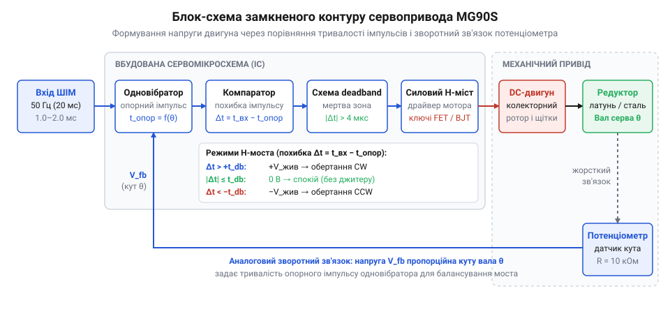
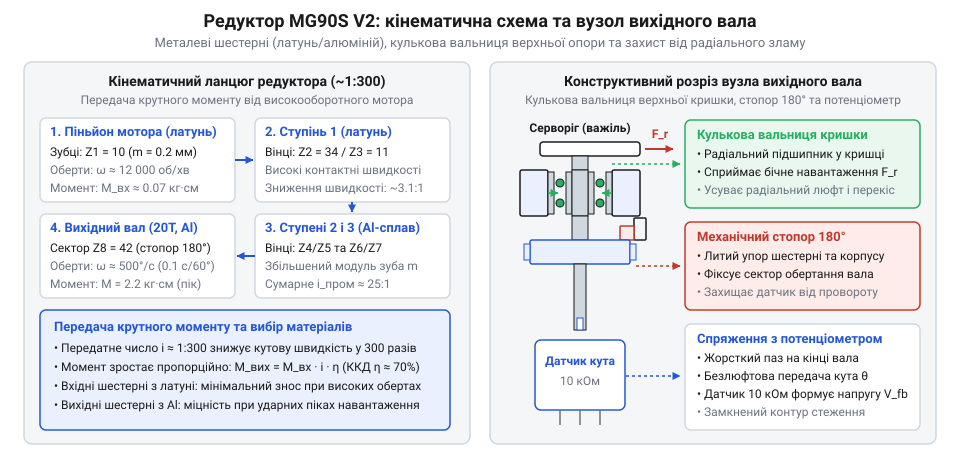
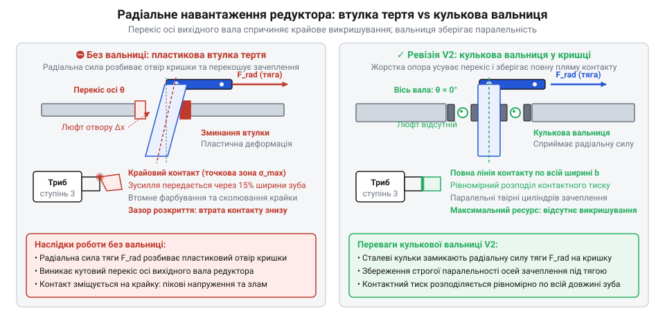
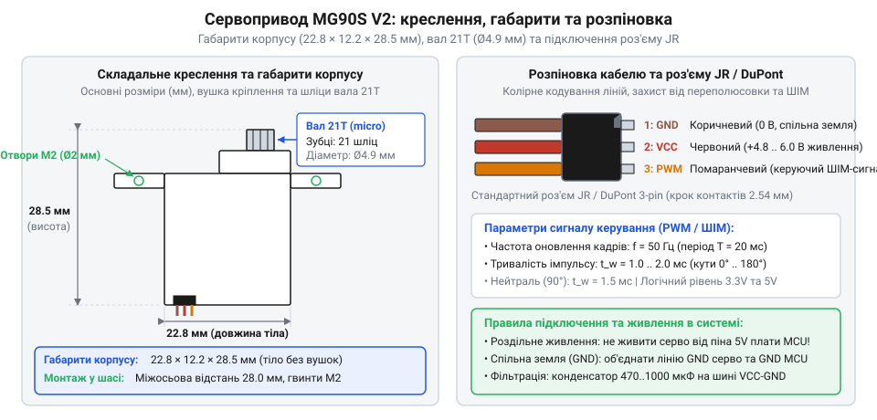
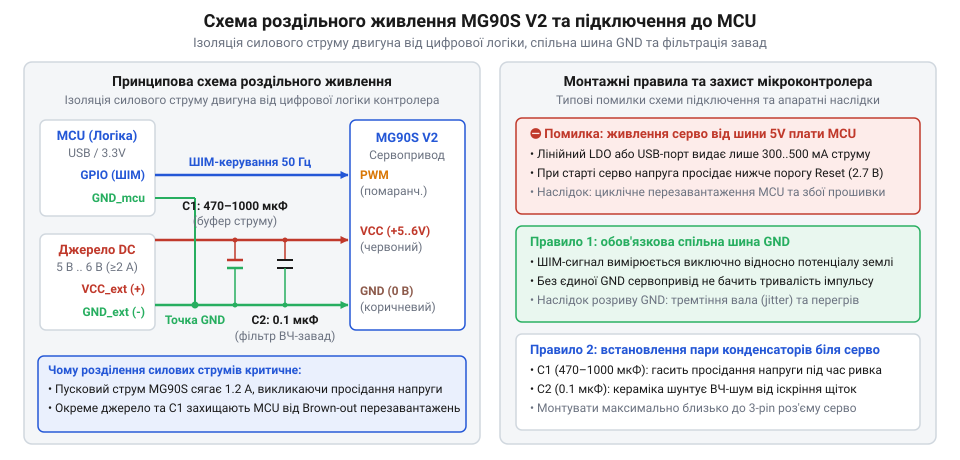
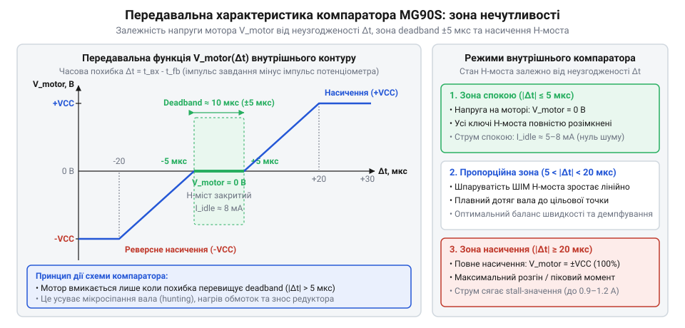
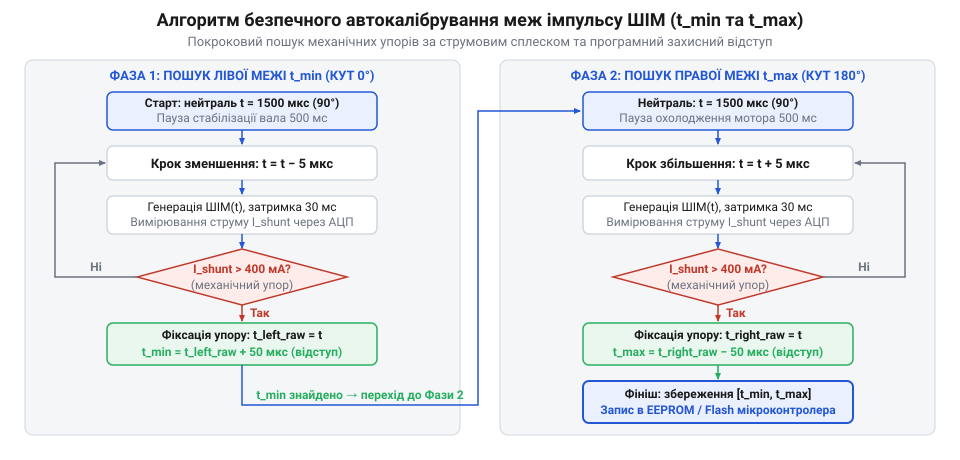
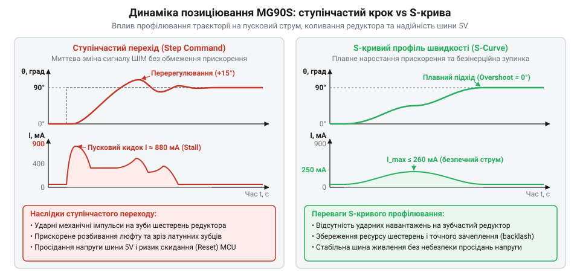
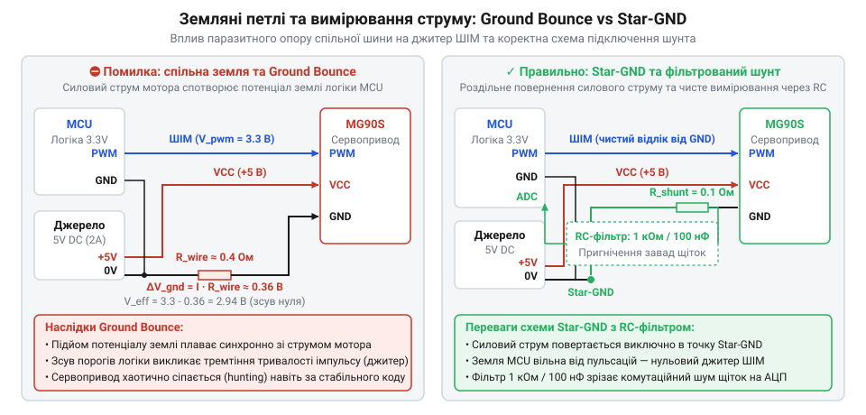

# MG90S V2 — мікросерво з металевим редуктором

<preknowlist>
- [Tower Pro SG90 — мікросерво 9g](root:cat-hw-actuators/sg90-servo) — Концепція 9-грамового мікросервопривода з трипровідним інтерфейсом та проблема вразливості нейлонових шестерень до зрізання зубів під ударними механічними навантаженнями
</preknowlist>

## Межа міцності дев'ятиграмових приводів і ніша MG90S

Коли рухомий важіль навчального маніпулятора впирається в несподівану перешкоду або поворотне колесо легкого шасі на швидкості б'ється об поріг, механічний шарнір зазнає раптового зворотного удару. У такій ситуації вихідний важіль механізму працює як важіль-мультиплікатор: зовнішня кінетична енергія удару передається на внутрішні зубчасті колеса у зворотному напрямку. У найпоширеніших дев'ятиграмових мікросервоприводах класу [Tower Pro SG90](root:cat-hw-actuators/sg90-servo) весь редуктор виготовлено з нейлону. Зуби проміжних шестерень мають товщину в частки міліметра, і під час динамічного гальмування контактні напруження в зачепленні миттєво перевищують границю міцності полімеру на зсув. Зуби зрізаються під корінь. Механізм втрачає працездатність: двигун усередині безпорадно вищить на максимальних обертах, а вихідний вал вільно прокручується вхолосту й не передає крутний момент.

Природне бажання конструктора замінити пошкоджений вузол надійним повнорозмірним приводом зі сталевими шестернями швидко стикається з фізичними обмеженнями. Стандартний металевий сервопривод важить 55–60 грамів і вчетверо більший за габаритами. У багатоланковому маніпуляторі або [двоосьовому поворотному механізмі](root:cat-hw-actuators/mg90s-servo/proj-pan-tilt-turret.md) маса зростає кумулятивно: кожен додатковий грам на кінці ланки вимагає пропорційного збільшення крутного моменту базових шарнірів, що перевантажує конструкцію. До того ж мініатюрні корпуси, тримачі оптичних далекомірів та легкі рами спроєктовані під конкретний посадковий отвір стандарту 9 грамів, куди великий пристрій фізично не поміщається.

Сервопривод (від лат. *servus* — «слуга, раб», оскільки пристрій слухняно відпрацьовує задану позицію) MG90S розв'язує цю суперечність. Він зберігає форм-фактор дев'ятиграмового привода (габарити корпусу 22.8 × 12.2 × 28.5 мм), але замінює пластиковий зубчастий каскад на суцільнометалевий. Належить цей вузол до розширеної серії мікроприводів ([лінійка 9-грамових мікросервоприводів Tower Pro](root:cat-hw-actuators/sg90-mg90-micro-servos-family)). Каскад із шестерень на основі латуні, алюмінієвих сплавів і сталі ([багатоступеневий циліндричний зубчастий редуктор](root:cat-hw-actuators/mg90s-servo/comp-miniature-metal-gearbox.md)) витримує ударні навантаження, які б гарантовано знищили пластик у разі заклинювання качалки в [роботизованому захваті](root:cat-hw-actuators/mg90s-servo/proj-robotic-gripper-current-monitor.md) чи раптової аварійної зупинки.

Металевий редуктор не є безкоштовним покращенням — він накладає три експлуатаційні компроміси:

1. Маса вузла зростає з 9 до приблизно 13.4–14 грамів. Для ультралегких літальних моделей це значний приріст (+50%), проте для наземних шасі та маніпуляторів це все ще в рази менше за важкі приводи стандартного формату.
2. Механічний люфт (від нім. *Luft* — «повітря, зазор»; в англомовній інженерній термінології — @@en|backlash@@). Метал не має пружності пластику, яка пом'якшує зачеплення шестерень. Щоб прямозубі колеса не клинило через мікроскопічні неточності лиття та теплове розширення під час нагрівання без мастильної ванни, виробник закладає збільшений бічний зазор між зубами. Кутовий люфт вихідного вала становить від 1.0° до 2.5°, тому для метрологічно точних вимірювальних систем цей вузол без коригування не підходить.
3. Підвищене тертя та струм споживання. Коефіцієнт тертя металу по металу без рідкого мастила помітно перевищує тертя самозмащувального нейлону. Двигун витрачає частину енергії на подолання власного опору редуктора, що збільшує струм холостого ходу та підвищує пікові кидки струму під час різкого розгону й реверсу ([розрахунок статичного та динамічного крутного моменту](root:cat-hw-actuators/mg90s-servo/math-servo-torque-and-linkage-kinematics.md)).

> 🔧 **Навіщо це.**
> MG90S обирають тоді, коли вузол зазнає механічних ударів, вібрацій або нештатних зупинок (рухомі колісні модулі, захвати роботів, шарніри ніг крокуючих платформ), але жорсткі обмеження за масою та габаритами не дозволяють встановити повнорозмірний сервопривод. Якщо механізм працює без ризику ударів у вільному просторі (наприклад, переміщення легкої стрілки або сервоіндикатора), дешевшого пластикового привода цілком достатньо, і він дасть меншу масу та плавніший хід без люфту.

## Анатомія привода й замкнений контур керування

Звичайний електродвигун постійного струму не знає поняття кута чи кінцевої позиції: коли на його контакти подають живлення, вал обертається нескінченно, а після зняття напруги зупиняється з випадковим вибігом через інерцію ротора. Щоб перетворити безперервне обертання на контрольований поворот вала на точно визначений кут із жорстким утриманням позиції, двигун інтегрують у замкнену систему автоматичного регулювання.

Усередині компактного корпусу MG90S взаємодіють п'ять ключових компонентів:

1. Колекторний мікроелектродвигун постійного струму ([колекторні мікроелектродвигуни постійного струму](root:hw-motion/brushed-dc-motor)). Мініатюрний циліндричний двигун із постійними магнітами на статорі та якірними обмотками на триполюсному роторі (від лат. *rotare* — «обертатися»). На холостому ході ротор розвиває від 12 000 до 16 000 обертів на хвилину, створюючи високу питому потужність, але має мізерний власний крутний момент (частки міліньютон-метра).
2. Багатоступеневий зубчастий редуктор (від лат. *reductor* — «той, що відводить назад або зменшує»; [багатоступеневий циліндричний зубчастий редуктор](root:cat-hw-actuators/mg90s-servo/comp-miniature-metal-gearbox.md)). Каскад прямозубих шестерень із загальним передавальним числом близько 1:300. Він знижує швидкість обертання вихідного вала до безпечних частот і пропорційно примножує крутний момент до 1.8–2.2 кг·см (приблизно 0.18–0.22 Н·м), перетворюючи високошвидкісний моторчик на силовий кутовий привод.
3. Потенціометр зворотного зв'язку (від лат. *potentia* — «сила, потенціал» і грец. *μέτρον* — «міра, вимірювач»; [мініатюрний резистивний сенсор кутового положення](root:cat-hw-actuators/mg90s-servo/comp-rotary-feedback-potentiometer.md)). Резистивний давач кута, вісь якого жорстко з'єднана з фінальним валом редуктора. Крайні виводи струмопровідної доріжки підключені до внутрішніх шин живлення, тому напруга на рухомому повзунку прямо пропорційна поточному фізичному куту повороту вихідного вала.
4. Внутрішня плата керування зі спеціалізованою мікросхемою ([спеціалізована мікросхема керування сервоприводом](root:cat-hw-actuators/mg90s-servo/comp-servo-controller-ic.md)). Електронний контролер, що порівнює вхідний командний сигнал із напругою зворотного зв'язку та формує коригувальний імпульс.
5. Інтегрований H-міст (в англомовній термінології — @@en|H-bridge@@; [H-міст у комутації двигунів постійного струму](root:hw-motion/h-bridge)). Чотириключовий каскад на польових або біполярних транзисторах, що дозволяє миттєво змінювати полярність струму в обмотках двигуна для реверсування напрямку обертання або замикати виводи мотора накоротко для активного електричного гальмування.

Керування приводом базується на безперервному замкненому контурі. На керуючий вхід сервопривода мікроконтролер подає прямокутні імпульси (від лат. *impulsus* — «поштовх, удар») фіксованої частоти 50 Гц (період 20 мс). Тривалість імпульсу `t_cmd` у діапазоні від 500 до 2400 мкс кодує бажаний кут повороту вала.

Коли черговий імпульс надходить на плату привода, внутрішній генератор (одновібратор) мікросхеми формує внутрішній опорний імпульс тривалістю `t_fb`, пропорційний напрузі з потенціометра. Компаратор (від лат. *comparator* — «порівнювач», від *comparare* — «порівнювати») визначає часову різницю між заданим і фактичним кутом:

```
Δt = t_cmd - t_fb
```

Різниця `Δt` визначає сигнал розузгодження — помилку позиціювання вала. Подальша робота схеми підпорядковується алгоритму:

- Якщо `|Δt| ≤ t_dead` (величина помилки перебуває в межах апаратної зони нечутливості — @@en|deadband@@, яка в MG90S становить близько 1–5 мкс), транзистори H-моста закриті. Обмотки двигуна знеструмлені, вал залишається нерухомим.
- Якщо `Δt > t_dead`, фактичний кут менший за заданий. Контролер відкриває діагональну пару транзисторів H-моста для обертання двигуна вперед. Двигун через редуктор повертає вихідний вал і вісь потенціометра. Зі зміною положення повзунка напруга зворотного зв'язку зростає, подовжуючи внутрішній опорний імпульс `t_fb` доти, доки різниця `Δt` не впаде нижче порогу зони нечутливості.
- Якщо `Δt < -t_dead`, фактичний кут більший за заданий. Контролер відкриває протилежну діагональ H-моста, перемикаючи полярність живлення двигуна. Двигун обертається у зворотному напрямку, повертаючи вал і потенціометр назад.

Ширина керуючого імпульсу, який H-міст подає на двигун, пропорційна величині розузгодження `|Δt|`. Коли вал далекий від цільового положення, двигун отримує повну напругу живлення і розвиває максимальну швидкість. У міру наближення вала до цільової точки сигнал розузгодження зменшується, живлення мотора коротшає, і вал плавно підходить до заданого кута без перерегулювання й різкого удару об механічний упор.


*Принципова блок-схема внутрішнього замкненого контуру: компаратор зіставляє вхідний ШІМ-імпульс з опорним імпульсом потенціометра і через H-міст живить двигун до зникнення помилки позиціювання.*

Завдяки постійній роботі цього контуру реалізується режим активного утримання позиції. Якщо зовнішнє зусилля (наприклад, вага утримуваного маніпулятором вантажу) намагається провернути вихідний вал, потенціометр миттєво відхиляється від положення рівноваги. Компаратор негайно фіксує виникнення `Δt`, відкриває відповідні транзистори H-моста і подає струм на двигун. Двигун створює протидіючий крутний момент, прагнучи повернути вал назад у точку рівноваги. Що сильніше зовнішнє навантаження намагається зсунути вал, то більший струм споживає привід для компенсації зовнішньої сили.

> 🔧 **Навіщо це.**
> Розуміння роботи замкненого контуру пояснює поведінку сервопривода в нештатних ситуаціях. Коли під час роботи привід безперервно дзижчить і вібрує на місці, це означає, що похибка постійно перетинає межі мертвої зони — або через шуми на лінії живлення, що спотворюють напругу на потенціометрі, або через знос контактної доріжки резистора. Так само стає зрозуміло, чому нерухомий сервопривод під навантаженням нагрівається та споживає значний струм: він не «зафіксований механічним гальмом», а активно крутить мотор проти зовнішньої сили за командами компаратора.

## Металевий редуктор і кулькова вальниця ревізії V2

Колекторний двигун постійного струму ([колекторні мікроелектродвигуни постійного струму](root:hw-motion/brushed-dc-motor)), встановлений усередині дев'ятиграмового сервопривода, ефективно генерує механічну потужність лише на високій швидкості обертання. За номінальної напруги 5 В його крихітний якір розганяється до 12 000–16 000 обертів на хвилину. Проте власний електромагнітний крутний момент такого ротора мізерний і становить частки міліньютон-метра (близько 1–2 г·см). Якщо з'єднати вал мотора безпосередньо з виконавчим механізмом — шарнірною тягою чи колесом, ротор миттєво заклинить від найменшого опору повітря чи тертя в шарнірах, а струм через нерухомий колекторний вузол стрибне до рівня короткого замикання, розплавивши щітки.

Щоб узгодити швидкісний низькомоментний якір із високим статичним опором зовнішніх механізмів, обертання перетворюють за допомогою механічного редуктора (від латинського @@la|reducere@@ — зменшувати, повертати назад). Редуктор обмінює надлишкову кутову швидкість на багаторазове збільшення крутного моменту.

У компактному просторі корпусу мікросервопривода (22.8 × 12.2 мм у плані) неможливо розмістити планетарний чи хвильовий механізм через складність виготовлення мікродеталей і високі втрати на тертя. Тому крутний момент транслюється послідовним каскадом циліндричних прямозубих шестерень (від прасл. *šestь* — шість), змонтованих на двох паралельних нерухомих сталевих осях.

На валу електродвигуна жорстко запресовано провідну шестірню — піньйон. Цей піньйон передає рух на перший проміжний блок, який складається з великого веденого колеса та монолітного з ним малого триба. Малий триб обертає велике колесо другого ступеня, повторюючи передачу зусилля вздовж ланцюга. Каскад MG90S налічує чотири послідовні ступені редукції. Кожен ступінь зменшує кутову швидкість пропорційно відношенню кількості зубів веденого колеса до ведучого триба, відповідно помножуючи крутний момент.

Повне передавальне число зубчастого редуктора `i` дорівнює добутку передавальних чисел усіх послідовних пар зачеплення:

```
i = i₁ · i₂ · i₃ · i₄
  = (z₂ / z₁) · (z₄ / z₃) · (z₆ / z₅) · (z₈ / z₇)   [добуток передавальних чисел ступенів]
```

У редукторі MG90S початковий піньйон ротора має `z₁ = 9` зубів і контактує з вінцем `z₂ = 36`. Другий ступінь утворюють шестерні `z₃ = 9` та `z₄ = 33`, третій — `z₅ = 8` та `z₆ = 32`, а фінальний триб `z₇ = 8` спряжений із зубчастим сектором вихідного вала `z₈ = 38`.

**Розрахунок загального передавального числа редуктора MG90S:**

```
i = (36 / 9) · (33 / 9) · (32 / 8) · (38 / 8)
  = 4.0 · 3.667 · 4.0 · 4.75                      [передавальні числа окремих пар зубчастих коліс]
  = 278.69                                        [загальне передавальне число каскаду]
```

Таке передавальне співвідношення знижує швидкість із 14 000 об/хв на роторі до приблизно 50 об/хв (близько 300°/с) на вихідному валу, забезпечуючи поворот вала на 60° за 0.20 секунди. Крутний момент на виході `M_out` дорівнює добутку моменту двигуна `M_motor`, передавального числа `i` та коефіцієнта корисної дії `η`. Детальний аналіз навантажень і кінематики важільних з'єднань наведено у вставці [math-servo-torque-and-linkage-kinematics](root:cat-hw-actuators/mg90s-servo/math-servo-torque-and-linkage-kinematics.md), а геометрію мікромодульних зубчастих передач розбирає вставка [comp-miniature-metal-gearbox](root:cat-hw-actuators/mg90s-servo/comp-miniature-metal-gearbox.md).

У пластикових приводах на кшталт [Tower Pro SG90](root:cat-hw-actuators/sg90-servo) шестерні відливають із поліацеталю (@@en|POM@@) чи нейлону. Під час різких гальмувань чи зіткнень важеля з перешкодою тонкі пластикові зуби швидкохідних ступенів миттєво зрізаються вздовж кореня через високі динамічні перевантаження. У приводі MG90S редуктор зібрано з металевих сплавів двох типів:
- Латунь (сплав міді та цинку): відзначається підвищеною в'язкістю, стійкістю до втомного сколювання та низьким тертям у парі зі сталевими осями. З неї виточують високообертовий піньйон мотора та найбільш навантажені проміжні триби.
- Алюмінієві сплави (анодований дюралюміній): використані для великих вінців проміжних коліс і вихідного вала, що дозволяє зменшити інерційну масу рухомого каскаду зі збереженням високої згинальної міцності зубів.

На вихідному валу відлито міцний упор — механічний стопор, який обмежує кут повороту сектором 180°–200°. Це запобігає провертанню і пошкодженню чутливого повзунка внутрішнього потенціометра зворотного зв'язку ([comp-rotary-feedback-potentiometer](root:cat-hw-actuators/mg90s-servo/comp-rotary-feedback-potentiometer.md)), якщо тільки привід не переробляють на [сервопривід постійного обертання](root:cat-hw-actuators/continuous-rotation-servo-mod) шляхом видалення стопора та заміни потенціометра постійним подільником напруги.


*Конструктивний розріз і кінематичний ланцюг редуктора MG90S V2: прямозубий каскад із латуні та алюмінієвих сплавів знижує кутову швидкість ротора у 279 разів, а мініатюрна кулькова вальниця у верхній кришці компенсує радіальне зусилля від тяги, зберігаючи незмінну міжосьову відстань зачеплення.*

Головне конструктивне оновлення ревізії V2 зосереджено у верхній кришці корпусу. У базовій версії привода вихідний вал центровано безпосередньо у пластиковому отворі кришки — це звичайна опора ковзання, або втулка тертя. Коли робочий механізм навантажує [серво-роги](root:cat-hw-actuators/servo-horns), на вихідний вал діє не лише корисний крутний момент, а й значна радіальна сила від натягу жорсткої тяги. Ця сила діє на плечі вала, створюючи потужний згинальний момент. Оскільки пластик корпусу має низьку жорсткість, отвір горловини під постійним боковим тиском розбивається в овал.

Перекіс вала руйнує нормальну роботу зубчастого зачеплення:
1. Вісь вихідного вала нахиляється відносно паралельних осей каскаду.
2. Міжосьова відстань між вихідним зубчастим сектором і провідним трибом третього ступеня збільшується.
3. Пляма контакту зміщується з повної ширини зуба на крихітну гостру крайку верхівки.
4. Локальне контактне напруження різко перевищує межу плинності металу, призводячи до викришування зубів або їхнього перескакування із заклинюванням усього привода.

У ревізії MG90S V2 у посадкове гніздо верхньої кришки запресовано прецизійну кулькову вальницю (вальницю кочення, @@en|ball bearing@@). Внутрішнє сталеве кільце вальниці охоплює вихідний вал безпосередньо під шліцами, а зовнішнє кільце жорстко зафіксоване стінками кришки. Сталеві кульки приймають на себе всі радіальні сили натягу тяг і передають їх на корпус. Завдяки цьому вісь вала зберігає сувору геометричну перпендикулярність, а міжосьова відстань у зачепленні лишається стабільною під будь-яким допустимим навантаженням.


*Деформація пластикової втулки тертя та перекіс лінії зачеплення під дією радіальної сили тяги на противагу фіксації осі кульковою вальницею: нахил вала спричиняє критичну концентрацію контактних напружень на крайках зубів, тоді як вальниця кочення утримує стабільну міжосьову відстань і запобігає викришуванню металу.*

> 🔧 **Навіщо це.** Радіальне навантаження від натягнутих тяг у маніпуляторах чи кермових механізмах сягає 300–800 г на плечі качалки. Без кулькової вальниці пластиковий отвір кришки розбивається за 10–20 годин активного руху, спричиняючи радіальний люфт вала у 3°–5° та сколювання шестерень через перекіс зубів. Кулькова вальниця у вихідній кришці MG90S V2 розвантажує редуктор від згинальних сил, гарантуючи стабільний зазор у зачепленні протягом усього ресурсу привода.

Використання металевого редуктора супроводжується трьома неминучими інженерними компромісами:

- **Збільшення власної маси.** Латунні й алюмінієві деталі разом зі сталевою вальницею збільшують масу привода з 9.0 г (у пластикового [SG90](root:cat-hw-actuators/sg90-servo)) до 13.4 г — приріст становить майже 50%. Для стаціонарних механізмів це не має значення, однак у багатоланкових маніпуляторах, де привід кожної ланки піднімає масу всіх наступних вузлів, чи в безпілотних апаратах зайві 4.4 г на кожен шарнір суттєво зменшують корисне навантаження.

- **Підвищене тертя та струм спокою.** Коефіцієнт тертя між металевими зубами у 1.5–2 рази вищий, ніж у самозмащувального пластику POM. Оскільки в мікросервоприводах немає замкненої масляної ванни, густе мастило під дією відцентрових сил швидко витісняється із зон контакту на стінки кришки. Через це механічний ККД редуктора падає до 65–70% проти 80–85% у нових пластикових передач. Двигун долає помітний внутрішній опір, тому струм холостого ходу під час вільного обертання вала сягає 80–120 мА (проти 40–60 мА у SG90). Це посилює нагрівання обмоток двигуна й вимагає ретельнішого проектування силової шини ([організація живлення сервоприводів та індуктивних навантажень](root:hw-power/servo-power-distribution-and-filtering)).

- **Технологічний люфт (мертвий хід, @@en|backlash@@).** Прямозубі шестерні з малим модулем (від латинського @@la|modulus@@ — міра) `m ≈ 0.15`–`0.2` мм вимагають обов'язкового гарантованого бічного зазору між зубами. Пружні пластикові шестерні можна монтувати з нульовим зазором завдяки податливості нейлону, проте абсолютно жорсткі металеві зуби без теплового зазору миттєво заклинять при найменшому нагріванні мотора чи похибці міжосьової відстані. Зазори всіх чотирьох ступенів каскаду підсумовуються, утворюючи на вихідному валу MG90S сумарний кутовий люфт `Δθ` від 1.0° до 2.5°.

Кутовий люфт створює відчутний вільний хід кінця качалки довжиною `L`:

```
Δx = L · sin(Δθ)
   ≈ L · Δθ · (π / 180°)     [лінійна апроксимація для малих кутів]
```

**Розрахунок вільного ходу кінця важеля при кутовому люфті 1.8°:**

За довжини плеча качалки `L = 25` мм і кутового люфту редуктора `Δθ = 1.8°`:

```
Δx = 25 · 1.8 · (3.1416 / 180)
   = 25 · 1.8 · 0.01745          [переведення кута з градусів у радіани]
   = 0.785                       [лінійний люфт у міліметрах]
```

На плечі 25 мм виникає майже 0.8 мм мертвого ходу, який виникає виключно в редукторі ще до передачі зусилля в шарнір тяги. Його неможливо компенсувати зворотним зв'язком потенціометра без спеціальних пружинних вибірок або програмних поправок ([програмна та механічна компенсація люфту в прецизійних приводах](root:hw-motion/gear-backlash-compensation)). Якщо замкнений контур керування налаштувати на занадто високу чутливість, люфт провокує автоколивальне тремтіння (джитер), коли вал починає безперервно битися зубами об протилежні грані зачеплення.

## Електричні параметри, розпіновка кабелю та струмовий бюджет

Для механічної та електричної інтеграції мікросервопривод MG90S використовує компактний трипровідний шлейф із гніздовим роз'ємом кроку 2.54 мм стандарту @@en|JR@@ (широко відомий у робототехніці також як роз'єм @@en|DuPont@@; термін «інтерфейс» походить від англ. @@en|interface@@ — взаємозв'язок, межа поділу, від лат. *inter* — між та *facies* — обличчя, зовнішній вигляд). Три провідники шлейфу мають фіксоване колірне кодування:
- **Коричневий провід** (`GND`) — спільна опорна шина нульового потенціалу (земля);
- **Червоний провід** (`VCC`) — силова лінія позитивного живлення вбудованого двигуна та схеми керування;
- **Помаранчевий провід** (`PWM`) — сигнальна лінія вхідного імпульсного керування (широтно-імпульсна модуляція, ШІМ; від лат. *pulsus* — поштовх та *modulatio* — мірність, узгодженість).

На вихідний вал привода напресовано дрібномодульний шліцьовий наконечник на 21 зуб із посадковим діаметром 4.9 мм, призначений для жорсткої посадки комплектних качалок (серво-рогів) без ковзання під навантаженням. Фізичні габарити пластикового корпусу становлять 22.8 × 12.2 × 28.5 мм за повної спорядженої маси близько 13.4 г — приріст маси порівняно з базовими 9-грамовими пластиковими аналогами обумовлений вагою латунних шестерень редуктора та кулькової вальниці.


*Конструктивні габарити корпусу, геометрія зубчастого вала та призначення ліній трипровідного кабелю стандарту JR.*

Повний перелік механічних і електричних допусків містить [специфікація апаратного інтерфейсу MG90S](root:cat-hw-actuators/mg90s-servo/api-mg90s-hardware-interface.md).

Робоча напруга привода стандартизована у діапазоні `4.8 В – 6.0 В`. Цей інтервал історично походить від акумуляторних батарей із чотирьох або п'яти нікель-кадмієвих елементів, а в сучасній мікроелектроніці відповідає рівням стабілізованих імпульсних та лінійних перетворювачів напруги. Напруга живлення прямо визначає динамічні характеристики вбудованого колекторного електродвигуна:
- При живленні **4.8 В** паспортний крутний момент (від прасл. *krǫtiti* — крутити та лат. *momentum* — рушійна сила) утримання становить `1.8 кг·см` (≈ 0.177 Н·м), а кутова швидкість переміщення ненавантаженого вала досягає `0.10 с на 60°` (еквівалент кутової швидкості 600°/с);
- При підвищенні напруги до **6.0 В** крутний момент зростає до `2.2 кг·см` (≈ 0.216 Н·м), а час повороту на 60° скорочується до `0.08 с` (кутова швидкість 750°/с).

Фізичний механізм цього зв'язку лежить у рівнянні моменту двигуна постійного струму: вища прикладена напруга створює більший струм в обмотках ротора, що підсилює електромагнітне поле й крутний момент Лоренца, а також дає змогу ротору розвивати вищу швидкість обертання до моменту вирівнювання зворотної електрорушійної сили (проти-ЕРС) із напругою живлення. Детальний перерахунок моменту на корисне тягове зусилля залежно від довжини важеля розглядає [розрахунок динамічного крутного моменту та кінематики важеля](root:cat-hw-actuators/mg90s-servo/math-servo-torque-and-linkage-kinematics.md).

> 🔧 **Навіщо це.**
> Вибір між 4.8 В та 6.0 В — це інженерний баланс між тяговою здатністю та довговічністю привода. Живлення 6.0 В забезпечує приріст крутного моменту на 22% і збільшує швидкодію на 20%, що критично для систем динамічної стабілізації та робототехнічних захватів. Водночас це підвищує теплове навантаження на ключі внутрішнього H-моста та прискорює електричну ерозію щіток [колекторного мікроелектродвигуна](root:hw-motion/brushed-dc-motor). Якщо робототехнічний вузол працює у спокійному темпі без ударних навантажень, оптимальною довготривалою напругою експлуатації є 5.0 В.

Струмове навантаження привода суттєво варіюється залежно від механічного стану та поділяється на три характерні режими:
1. **Струм спокою** (@@en|quiescent current@@): `5–12 мА`. Привод утримує задану кутову позицію, похибка за даними потенціометра не виходить за межі апаратної зони нечутливості (deadband ~5 мкс), транзистори внутрішнього H-моста закриті, а споживання енергії зумовлене роботою мікросхеми сервопідсилювача.
2. **Робочий струм динамічного переміщення** (@@en|running current@@): `100–250 мА`. Двигун обертає редуктор під час переходу між кутами без істотного зовнішнього опору або долає тертя зубчастих передач.
3. **Пусковий струм і струм повного заклинювання** (@@en|stall current@@): досягає `800–900 мА` при 5.0 В та зростає до `1.0–1.1 А` при напрузі 6.0 В.

Кидок струму до величини заклинювання виникає не лише при аварійній механічній зупинці вала, а й у перші мікросекунди кожного пуску з нерухомого стану. Коли якір двигуна ще не обертається, внутрішня проти-ЕРС дорівнює нулю (`E = 0`), тому величина струму обмежується виключно омічним опором мідного дроту обмоток якоря та щіткового вузла `R_armature`:

```
I_stall
= V_cc / R_armature            [закон Ома для нерухомого ротора при E = 0]
= 5.0 В / 5.5 Ом               [підстановка параметрів обмотки якоря MG90S]
≈ 0.91 А                       [струм повного заклинювання двигуна]
```

Відповідно, пікова електрична потужність, що миттєво перетворюється на тепло у двигуні під час блокування вала:

```
P_peak
= V_cc · I_stall               [електрична потужність постійного струму]
= 5.0 В · 0.91 А               [підстановка напруги живлення та струму заклинювання]
≈ 4.55 Вт                      [теплова потужність, що розсіюється у корпусі 23×12 мм]
```

Утримання вала в заклиненому стані понад 3–5 секунд призводить до перегріву якоря, розплавлення лакової ізоляції обмоток і виходу сервопривода з ладу.

При проєктуванні систем із кількома сервоприводами сумарний струмовий бюджет силового джерела розраховують з урахуванням пускових перевантажень:

```
I_total_peak
= N · I_stall · k_simultaneous [сумарний піковий струм масиву приводів]
= 4 · 0.90 А · 0.70            [коефіцієнт одночасності переміщення для чотирьох осей]
= 2.52 А                       [мінімальний струм лінії живлення приводу]
```

Сигнальна лінія `PWM` має високий вхідний опір (імпеданс; від лат. *impedire* — перешкоджати) вхідного каскаду внутрішньої мікросхеми сервоконтролера, що перевищує 100 кОм. Струм споживання на керуючому вході не перевищує 10 мкА. Поріг спрацьовування внутрішнього компаратора налаштовано приблизно на 1.5–1.8 В, що забезпечує стабільне розпізнавання логічної одиниці як від 5-вольтової логіки TTL (@@en|transistor-transistor logic@@), так і від мікроконтролерів із виходами 3.3 В (STM32, ESP32, RP2040) без використання перетворювачів рівнів.

## Роздільне живлення, фільтрація завад і захист від Brownout Reset

Типова помилка при підключенні сервопривода полягає у спробі заживити червоний провід `VCC` безпосередньо від контакту `5V` налагоджувальної плати мікроконтролера, що отримує живлення від порту USB або вбудованого малопотужного стабілізатора напруги (LDO, наприклад AMS1117). У стані спокою мікроконтролер функціонує нормально, проте під час першого ж сигналу на поворот вала процесор раптово зависає або потрапляє у нескінченний цикл циклічних перезавантажень (@@en|reset loop@@).

Фізична причина цієї поведінки криється у раптовому просіданні напруги живлення під час пуску двигуна. Вбудований регулятор плати розрахований на тривалий струм не більше 150–500 мА, а шина USB обмежена значенням 500 мА. У момент увімкнення H-моста якір сервопривода вимагає пусковий струм близько 900 мА. Через обмежену швидкодію стабілізатора, внутрішній опір джерела та опір з'єднувальних дротів напруга на спільній шині живлення миттєво просідає нижче 3.0–3.5 В.

Для захисту цифрової логіки в мікроконтролери вбудовано спеціальний апаратний блок — супервізор [Brownout Reset](root:hw-arch/microcontroller-brownout-reset) (BOR; термін утворено від англ. @@en|brownout@@ — спад напруги, часткове знеструмлення та @@en|reset@@ — скидання, від лат. *restituere* — відновлювати). Коли напруга на шині процесора опускається нижче порогового значення (зазвичай конфігурується у межах 2.7–4.3 В), компаратор BOR скидає мікроконтролер в апаратне перезавантаження, щоб запобігти збоям обчислень та пошкодженню даних у пам'яті Flash і EEPROM.

Розрахунок падіння напруги на тонких макетних проводах демонструє механізм виникнення просідання:

```
ΔV_line
= 2 · I_stall · R_wire         [падіння напруги на опорі прямого й зворотного провідників]
= 2 · 0.90 А · 0.45 Ом         [опір макетного проводу DuPont довжиною 30 см перерізом 28 AWG]
= 0.81 В                       [величина миттєвої втрати напруги на лінії живлення]
```

```
V_mcu_actual
= V_regulator - ΔV_line        [результуюча напруга на виводах живлення контролера]
= 5.00 В - 0.81 В              [віднімання просідання напруги від номіналу стабілізатора]
= 4.19 В                       [просідання нижче заводського порога BOR мікроконтролера 4.3 В]
```

Коли мікроконтролер скидається, його виводи GPIO перемикаються у високоімпедансний стан входу, імпульси ШІМ зникають, вбудований H-міст сервопривода відключає мотор, і струм падає до нуля. Напруга на шині живлення відновлюється до номінальних 5.0 В. Процесор починає звичайний цикл завантаження, ініціалізує периферію, знову надсилає імпульс ШІМ на поворот вала — і стрибок струму спричиняє повторне скидання.


*Осцилограма перехідного процесу під час пуску сервопривода: стрибок струму до 0.9 А просаджує шину 5 В нижче 3.0 В, що провокує скидання мікроконтролера супервізором Brownout Reset.*

Додатковим деструктивним явищем є комутаційні завади від щіткового вузла [колекторного мікроелектродвигуна](root:hw-motion/brushed-dc-motor). Під час обертання ротора механічні щітки розривають контакт із колекторними пластинами. Індуктивність обмоток `L` (від лат. *inductio* — наведення) викликає індуктивний викид напруги зворотної полярності згідно із законом Фарадея:

```
V_spike = -L · (di / dt)
```

Через наносекундні часи розриву контакту швидкість зміни струму `di/dt` є вкрай високою, що породжує на шині живлення короткі високочастотні викиди амплітудою в десятки вольт. Ці сплески проникають у цифрові ланцюги мікроконтролера, збивають тактові генератори, викликають помилкові спрацьовування апаратних переривань і спотворюють результати вимірювань АЦП.

Запобігання апаратним збоям вимагає побудови схеми роздільного силового живлення із локальною фільтрацією (від лат. *stabilis* — стійкий та пізньолат. *filtrum* — повсть). Комплексні підходи до проєктування розподілених ліній розглядає [організація живлення сервоприводів та індуктивних навантажень](root:hw-power/servo-power-distribution-and-filtering).

Надійна схема живлення сервопривода MG90S базується на трьох обов'язкових правилах:
1. **Виділене силове живлення**: лінію `VCC` сервопривода підключають до окремого силового стабілізатора або імпульсного DC-DC понижувального модуля (5.0–6.0 В із робочим струмом від 2 А), повністю відокремленого від лінії живлення мікроконтролера.
2. **Спільна шина заземлення (GND)**: силову землю джерела живлення привода та цифрову землю мікроконтролера обов'язково об'єднують в одній спільній точці (зіркоподібна топологія заземлення). Якщо землі роз'єднані, сигнал ШІМ втрачає опорний рівень відліку, що спричиняє хаотичні посмикування вала або пошкодження вхідного каскаду через плаваючий потенціал.
3. **Двокомпонентний фільтрувальний тандем**: безпосередньо біля роз'єму живлення сервопривода встановлюють пару конденсаторів (від лат. *condensare* — ущільнювати, згущувати):
   - **Електролітичний конденсатор ємністю 470–1000 мкФ** (на робочу напругу 10–16 В): виконує роль локального накопичувача енергії. Під час різкого старту двигуна він миттєво віддає накопичений заряд, компенсуючи падіння напруги на провідниках силової лінії;
   - **Керамічний конденсатор ємністю 0.1 мкФ** (100 нФ, багатошаровий типу X7R): підключається паралельно електролітичному максимально близько до клем сервопривода. Електролітичні конденсатори через помітну паразитну індуктивність рулону фольги та еквівалентний послідовний опір (@@en|ESR@@, від англ. @@en|equivalent series resistance@@) неефективні на високих частотах. Керамічний конденсатор практично позбавлений паразитної індуктивності й ефективно шунтує на землю наносекундні комутаційні сплески щіток мотора.


*Принципова електрична схема та монтажне з'єднання окремого джерела живлення, мікроконтролера та фільтрувальних конденсаторів для сервопривода MG90S.*

> 🔧 **Навіщо це.**
> Пружинні рейки безпаєчних макетних плат (@@en|breadboard@@) мають помітний контактний опір (до 0.2–0.3 Ом на з'єднання). Струм заклинювання у 1 А викликає на таких контактах катастрофічне просідання напруги навіть за наявності потужного лабораторного джерела. Тому силове підключення приводів виконують паянням або гвинтовими клемниками з використанням мідного проводу перерізом не менше 0.5 мм² (20 AWG). Дроти `VCC` та `GND` звивають у пару для мінімізації площі магнітного контуру й випромінюваних завад, а фільтрувальні конденсатори розташовують на відстані не більше 20–30 мм від роз'єму привода.

## Протокол керування ШІМ: часові параметри 50 Гц і фізика мертвої зони

Підключений до стабільного джерела живлення сервопривід залишається нерухомим: якщо подати на сигнальний дріт постійну напругу високого або низького логічного рівня, вал не зрушить з місця або вбудований контролер сприйме це як відсутність сигналу. Сервопривід очікує періодичну послідовність прямокутних імпульсів. Проте, на відміну від силового регулювання обертів колекторного двигуна чи яскравості світлодіода, кутове положення вала MG90S визначається не відношенням часу увімкнення до повного періоду, а виключно абсолютною фізичною тривалістю активного високого стану.

Широтно-імпульсна модуляція (англ. @@en|Pulse-Width Modulation@@, ШІМ; від латинського @@la|modulatio@@ — розміреність) у сервоприводах спирається на фіксовану базову частоту 50 Гц. Період повторення сигналу становить:

```
T_PWM
= 1 / f_PWM                                [визначення періоду через частоту]
= 1 / 50 Гц                                [підстановка базової частоти керування]
= 0.02 с                                   [значення періоду в секундах]
= 20 мс                                    [переведення періоду в мілісекунди]
```

У силовій електроніці шпаруватість (англ. @@en|duty cycle@@; частка часу активного стану) безпосередньо визначає середню напругу в навантаженні. Якщо базову частоту силового ШІМ змінити зі 100 Гц до 200 Гц при збереженні шпаруватості 50%, навантаження отримає ту саму середню потужність. Для кутового сервопривода ж шпаруватість у відсотках не має регулювального змісту: кутове положення вихідного вала кодується виключно абсолютною тривалістю позитивного імпульсу `t_pulse`. Якщо за незмінної тривалості імпульсу `t_pulse = 1.5 мс` павза між імпульсами скоротиться або подовжиться через коливання тактової частоти джерела з 18.5 мс до 22 мс (частота впаде з 50 Гц до 42 Гц), вихідний вал залишиться на тому самому куті 90°. Внутрішній компаратор [спеціалізованої мікросхеми керування](root:cat-hw-actuators/mg90s-servo/comp-servo-controller-ic.md) порівнює довжину вхідного імпульсу з внутрішнім опорним імпульсом одновібратора, тривалість якого задається напругою [потенціометра зворотного зв'язку](root:cat-hw-actuators/mg90s-servo/comp-rotary-feedback-potentiometer.md), і реагує лише на часову різницю між ними.

> 🔧 **Навіщо це.**
> Абсолютне часове кодування усуває чутливість кутового привода до частотних відхилень генератора або каналу зв'язку. Сервопривід зберігає точне кутове положення навіть тоді, коли мікроконтролер під навантаженням змінює загальну частоту кадрів ШІМ у межах від 40 до 60 Гц.

Історичний модельний стандарт радіокерування передбачає номінальний діапазон тривалості імпульсу від 1.0 мс до 2.0 мс:
- `1.0 мс` (1000 мкс) відповідає куту 0°;
- `1.5 мс` (1500 мкс) відповідає нейтральному центральному положенню 90°;
- `2.0 мс` (2000 мкс) відповідає куту 180°.

У компактних мікроприводах класу MG90S внутрішній сектор резистивної доріжки потенціометра та передавальне число редуктора розраховані під ширший часовий розмах. Подача стандартного модельного сигналу 1.0–2.0 мс призводить до повороту вала лише на 90°–120° замість повного розмаху. Згідно зі специфікацією [апаратного інтерфейсу MG90S](root:cat-hw-actuators/mg90s-servo/api-mg90s-hardware-interface.md), для досягнення повного паспортного сектора 180° використовується розширений діапазон: від приблизно 500 мкс (0.5 мс) для положення 0° до 2400 мкс (2.4 мс) для положення 180°. Нейтраль 90° залишається біля позначки 1450–1500 мкс.

Внутрішня схема керування безперервно відстежує помилку неузгодженості:

```
Δt = t_pulse - t_ref
```

де `t_pulse` — вхідний керівний сигнал, а `t_ref` — внутрішній опорний імпульс, пропорційний поточному положенню повзунка потенціометра. Якщо абсолютна величина помилки перевищує нуль, схема подає живлення на H-міст, примушуючи [колекторний мікродвигун](root:hw-motion/brushed-dc-motor) обертати редуктор у бік зменшення неузгодженості.

Якби схема керування реагувала на будь-яке нескінченно мале відхилення сигналу, привід ніколи б не зупинявся. Через механічний люфт латунних зубчастих коліс [мініатюрного металевого редуктора](root:cat-hw-actuators/mg90s-servo/comp-miniature-metal-gearbox.md) (що досягає 1.5°–2.5°) та шуми тертя ковзного контакту потенціометра вал постійно здійснював би мікроскопічні коливання навколо цільової точки. Двигун видавав би безперервний тріск, нагрівав обмотки ротора та споживав би значний струм у стані спокою.

Для запобігання автоколиванням компаратор (від латинського @@la|comparare@@ — порівнювати) має апаратну зону нечутливості (англ. @@en|deadband@@; ширина становить близько 5 мкс). Доки часова різниця лежить у межах `|Δt| ≤ t_deadband / 2`, H-міст вимкнено, обмотки двигуна знеструмлені, а вал нерухомо утримується опором механічної передачі.

> 🔧 **Навіщо це.**
> Зона нечутливості діє як апаратний гістерезис. Вона усуває джиттер (високочастотне тремтіння) вала під впливом шумів вимірювання та знімає струмове навантаження з мотора в зоні статичної рівноваги.


*Графік передавальної характеристики схеми компаратора із зоною нечутливості 5 мкс: нульова напруга на двигуні за малої часової похибки запобігає автоколиванням, а вихід за межі зони викликає насичення H-моста для відпрацювання неузгодженості.*

Ширина зони нечутливості 5 мкс безпосередньо визначає мінімальний фізичний крок повороту вала, доступний системі позиціювання. Обчислимо коефіцієнт кутової крутизни характеристики перетворення та поріг роздільної здатності:

**Умова:** повний робочий кут становить 180°, робочий часовий діапазон тривалості імпульсів — від 500 мкс до 2400 мкс, ширина зони нечутливості компаратора — 5 мкс.

```
Δt_span
= t_max - t_min                            [робочий розмах керівного сигналу]
= 2400 мкс - 500 мкс                       [підстановка меж тривалості імпульсів]
= 1900 мкс                                 [повний часовий інтервал керування]

k_θ
= θ_span / Δt_span                         [кутова крутизна характеристики привода]
= 180° / 1900 мкс                          [ділення кутового сектора на часовий інтервал]
≈ 0.0947° / мкс                            [кутовий приріст на одну мікросекунду імпульсу]

Δθ_deadband
= k_θ · t_deadband                         [поріг чутливості за шириною мертвої зони]
= 0.0947° / мкс · 5 мкс                    [множення крутизни на зону нечутливості]
≈ 0.474°                                   [мінімальний помітний кутовий крок привода]
```

Зміна тривалості імпульсу менш ніж на 5 мкс (що еквівалентно куту близько 0.47°) не призводить до вмикання мотора, якщо вал уже перебуває всередині мертвої зони. Зв'язок дискретності таймера мікроконтролера та параметрів лінійного масштабування наведено у [математичному аналізі часової інтерполяції ШІМ](root:cat-hw-actuators/mg90s-servo/math-servo-pwm-timing-interpolation.md). Для придушення тремтіння вала при граничних збуреннях застосовують спеціальні методи [придушення джитеру та автоколивань у сервоприводах](root:hw-motion/servo-jitter-and-hunting-suppression).


*Часова діаграма керівного ШІМ-сигналу: період повторення 20 мс (50 Гц), кодування кута повороту вала тривалістю активного рівня від 500 до 2400 мкс та масштабована зона нечутливості 5 мкс, що обмежує мінімальний крок реакції привода.*

## Програмний драйвер на апаратному таймері та безпечне калібрування

Формування ШІМ-сигналу програмними циклами затримки мікроконтролера неприпустиме в надійних пристроях. Будь-яке апаратне переривання від послідовної шини або внутрішнього системного лічильника подовжує сформований імпульс на кілька мікросекунд. Для сервопривода це спричиняє стрибки вала, вібрацію та стрибки споживання струму. Керуючий сигнал має генеруватися безпосередньо апаратними таймерами мікроконтролера без участі центрального процесора.

Апаратні таймери з каналами вихідного порівняння (англ. @@en|Output Compare@@) самостійно змінюють логічний стан фізичного виводу при досягненні лічильником заданого порогу. Таймер налаштовують так, щоб його лічильник інкрементувався з частотою 1 МГц (1 такт = 1 мкс). Для цього коефіцієнт попереднього дільника частоти (англ. @@en|prescaler@@; цифровий дільник базової тактової частоти шини таймера) розраховують за співвідношенням:

```
PSC
= (f_timer_clock / f_counter) - 1          [формула розрахунку коефіцієнта дільника]
= (16 000 000 Гц / 1 000 000 Гц) - 1       [підстановка базової частоти шини таймера 16 МГц]
= 16 - 1                                   [ділення частот для отримання кроку 1 мкс]
= 15                                       [значення регістра попереднього дільника]
```

Верхня межа підрахунку (регістр автоперезавантаження ARR або TOP) визначає базовий період сигналу 20 мс (частоту 50 Гц):

```
ARR
= (f_counter / f_PWM) - 1                  [визначення порогу автоперезавантаження]
= (1 000 000 Гц / 50 Гц) - 1               [підстановка бажаної частоти кадрів ШІМ]
= 20 000 - 1                               [обчислення кількості мікросекундних тактів]
= 19 999                                   [значення регістра періоду таймера]
```

При переповненні лічильника апаратний вивід автоматично встановлюється у високий рівень, а при збігу лічильника зі значенням у регістрі порівняння — скидається в нуль. Запис тривалості імпульсу в мікросекундах у регістр порівняння забезпечує стабільний сигнал із точністю до 1 мкс без витрат обчислювальних ресурсів процесора, як показано в описі [апаратної генерації ШІМ таймерами мікроконтролера](root:hw-arch/hardware-pwm).

Пряме надсилання крайніх значень ширини імпульсу (500 мкс або 2500 мкс) без попередньої перевірки конкретного екземпляра сервопривода становить критичну небезпеку. Усередині редуктора MG90S на вихідній шестерні розташовано механічний упор, що обмежує обертання для захисту резистивної доріжки потенціометра. Через виробничі допуски фактичне положення крайніх упорів варіюється в межах ±80 мкс між різними екземплярами привода.

Якщо надіслати імпульс 500 мкс, коли внутрішній механічний упор конкретного привода розташований на позначці 540 мкс, вихідний вал фізично заклинить у крайній точці до того, як потенціометр досягне заданого положення. Внутрішня схема зафіксує постійну неусувну помилку розузгодження і відкриє транзистори H-моста на 100%. Двигун перейде в режим глухого заклинювання (англ. @@en|stall current@@; струм блокування сягає 800–900 мА). Оскільки ротор не обертається, проти-ЕРС дорівнює нулю, і весь струм обмежується лише малим активним опором обмоток ротора. За 5–10 секунд перебування в заклиненому стані ізоляція проводу [колекторного мікродвигуна постійного струму](root:hw-motion/brushed-dc-motor) перегрівається вище 130 °C і плавиться, спричиняючи міжвиткове коротке замикання, або латунна шестерня зрізає зубці [мініатюрного металевого редуктора](root:cat-hw-actuators/mg90s-servo/comp-miniature-metal-gearbox.md). Для захисту подібних приводних вузлів від заклинювання під навантаженням використовують [моніторинг струму споживання у захваті](root:cat-hw-actuators/mg90s-servo/proj-robotic-gripper-current-monitor.md).

Для безпечної експлуатації кожен екземпляр привода проходить процедуру калібрування робочого діапазону:
1. **Вихід у безпечну нейтраль:** На сигнальний вивід подається імпульс 1500 мкс. Вал стає в центр робочого сектора без ризику упору.
2. **Визначення нижньої межі `t_min`:** Тривалість імпульсу зменшують кроками по 10 мкс із павзою 50 мс між кроками, контролюючи струм споживання привода або припинення руху вала. Як тільки вал припиняє рух, а струм різко підскакує вище рівня спокою (понад 120–150 мА) або з'являється низькочастотне гудіння мотора, зменшення негайно припиняють. До знайденої точки додають захисний запас +25 мкс:
   ```
   t_min = t_stop_low + 25 мкс
   ```
3. **Визначення верхньої межі `t_max`:** Тривалість збільшують від 1500 мкс угору кроками по 10 мкс до моменту зупинки вала та стрибка струму, після чого віднімають 25 мкс захисного запасу:
   ```
   t_max = t_stop_high - 25 мкс
   ```

Автоматизацію цієї процедури забезпечує [автономний стенд-калібратор сервоприводів](root:cat-hw-actuators/mg90s-servo/proj-servo-tester-calibrator.md).


*Блок-схема алгоритму безпечного калібрування меж ШІМ: покроковий пошук точок упору за стрибком струму із закладанням захисного запасу 25 мкс унеможливлює заклинювання редуктора та перегрів обмоток двигуна.*

Знаючи калібровані значення `t_min` та `t_max`, перерахунок цільового кута `θ ∈ [0°, 180°]` у тривалість імпульсу виконують лінійною інтерполяцією (від латинського @@la|interpolare@@ — оновлювати, вставляти між):

```
t_pulse
= t_min + (θ - θ_min) · ((t_max - t_min) / (θ_max - θ_min))  [загальна формула лінійної інтерполяції]
= t_min + θ · ((t_max - t_min) / 180°)                       [підстановка діапазону кутів 0°...180°]
= t_min + (θ · Δt_span) / 180°                               [зведення множників для швидкого обчислення]
```

На мікроконтролерах без апаратного модуля ділення чисел із рухомою комою розрахунок виконують у 32-бітній цілочисельній арифметиці з попереднім масштабуванням.

Надійний C++ драйвер привода інкапсулює калібровані часові межі, забезпечує захист від виходу за їх межі та надає функцію відключення імпульсів `detach()`.

> 🔧 **Навіщо це.**
> Функція `detach()` зупиняє генерацію ШІМ на виводі мікроконтролера. Без вхідного імпульсу схема керування повністю відключає транзистори H-моста. Це знімає нагрів обмоток мотора, усуває шум у спокої та зменшує споживання струму до часток міліампера, доки механізм утримується власним тертям редуктора.

Реалізація драйвера для платформ Arduino та STM32 наведена нижче відповідно до вимог [програмного C/C++ інтерфейсу](root:cat-hw-actuators/mg90s-servo/api-servo-pwm-driver-cpp.md):

:::tabs
:::code mg90s-servo-d/c/mg90sservo.c
:::code mg90s-servo-d/c/mg90sservo.c
:::

## Профілювання руху та усунення динамічних ударів редуктора

Позиціювання вихідного вала мікросервопривода за замовчуванням виконується східчасто: керівний мікроконтролер миттєво змінює тривалість канального ШІМ-імпульсу, наприклад із 1500 мкс (нейтральне положення 90°) до 2000 мкс (кутове положення 135°), у межах одного 20-мілісекундного кадру. У цей момент внутрішня схема керування стикається з великою розбіжністю сигналів. Внутрішній компаратор сервопідсилювача (вставка [comp-servo-controller-ic](root:cat-hw-actuators/mg90s-servo/comp-servo-controller-ic.md)) виявляє сигнал розузгодження між вхідним імпульсом та поточною напругою потенціометра зворотного зв'язку, який у сотні разів перевищує ширину зони нечутливості (мертвої зони, від @@en|deadband@@ — зона байдужості, близько 5 мкс).

Реакція аналогового драйвера на таку похибку є гранично жорсткою: H-міст повністю відкриває силові ключі, подаючи на колекторний двигун постійного струму ([brushed-dc-micromotors](root:hw-motion/brushed-dc-motor)) максимальну напругу живлення зі 100% шпаруватістю. Оскільки ротор у початковий момент нерухомий (кутова швидкість `ω = 0`), електрорушійна сила зворотної індукції (проти-ЕРС, від @@en|back-EMF@@ — протидійна напруга обмотки) дорівнює нулю. Струм якоря обмежується виключно його омічним опором, що призводить до стрибка струму споживання до рівня заклинювання 800–900 мА ([api-mg90s-hardware-interface](root:cat-hw-actuators/mg90s-servo/api-mg90s-hardware-interface.md)). Такий імпульсний сплеск спричиняє падіння напруги на провідниках живлення, провокуючи апаратне перезавантаження керівного мікроконтролера через спрацьовування детектора Brownout Reset, якщо силове коло не має виділеної розв'язки ([servo-power-distribution-and-filtering](root:hw-power/servo-power-distribution-and-filtering)).

Одночасно виникає механічний удар у зубчастій передачі. Багатоступеневий прямозубий циліндричний редуктор MG90S (вставка [comp-miniature-metal-gearbox](root:cat-hw-actuators/mg90s-servo/comp-miniature-metal-gearbox.md)) має сумарний кутовий люфт (від @@en|backlash@@ — технологічний зазор між сполученими шестернями) величиною до 2.5°. Коли двигун зривається з місця з максимальним крутним моментом, ведуча шестерня вільно розганяється в межах люфту і на високій швидкості вдаряється робочою гранню зуба в наступне зубчасте колесо. Виникає різке ударне навантаження (від @@en|shock load@@ — динамічне контактне зусилля). 

Порівняно з пластиковими аналогами (наприклад, нейлоновими шестернями класичного привода [sg90-servo](root:cat-hw-actuators/sg90-servo)), де еластичний полімер пружно деформується й частково демпфує кінетичну енергію зіткнення, металеві шестерні MG90S із латуні та алюмінієвих сплавів мають значно вищий модуль пружності. Вони не амортизують удар: кінетична енергія миттєво трансформується у високе локальне контактне напруження на гранях зубів і передається на сталеві осі та посадочні гнізда в пластиковому корпусі. Систематичні ударні ривки спричиняють втомне викришування поверхневого шару металу (пітинг), розбивають посадочні гнізда осей і форсують наростання кутового люфту.

На протилежному кінці траєкторії виникає дзеркальна динамічна проблема: перерегулювання та коливальний дзвін. Коли вихідний вал із закріпленою качалкою та інерційним вантажем підлітає до цільового кута на граничній кутовій швидкості, вузька зона лінійного гальмування внутрішнього компаратора не встигає зупинити розігнану масу. Виникає перерегулювання (від @@en|overshoot@@ — перелітання заданої координати): вал за інерцією проскакує цільову точку. Потенціометр фіксує зміну знака кутової помилки, компаратор реверсує H-міст, прикладаючи повну гальмівну напругу зворотного знака. У результаті навколо заданої точки виникають високочастотні затухаючі коливання (механічний дзвін, від @@en|ringing@@ — коливальні вібрації в зазорах редуктора). Це спричиняє додаткове нагрівання колектора двигуна та генерує брудний акустичний тріск.

> 🔧 **Навіщо це.**
> Програмне профілювання руху розбиває переміщення на контрольовані фази розгону й гальмування. Це усуває ударні ривки шестерень у зазорах люфту, знижує піковий струм споживання з 900 мА до робочих 150–250 мА, запобігає просіданню напруги живлення та ліквідує перерегулювання важкого виконавчого вузла в кінцевій точці.

Кінематичну проблему східчастого переходу вирішують формуванням траєкторії в керівному коді. Найпростіший спосіб полягає в дискретному обмеженні кутової швидкості. Оскільки привід сприймає нові координати з частотою 50 Гц (період канального імпульсу `T_pwm = 20 мс`), змінювати цільове завдання частіше ніж раз на 20 мс фізично беззмістовно: компаратор аналізує ширину імпульсу лише один раз за період повторення. 

Задавши безпечну граничну швидкість `ω_max` (у градусах за секунду, `°/с`), максимальний кутовий крок за один 20-мілісекундний інтервал таймера становить:

```
Δθ_step
= ω_max · T_pwm          [приріст координати за період дискретизації]
= ω_max · 0.020          [підстановка тривалості кадру 20 мс]
```

Для швидкості `ω_max = 60 °/с` приріст координати між сусідніми кадрами дорівнює:

```
Δθ_step
= 60 × 0.020             [множення швидкості на інтервал]
= 1.2°                   [максимальне кутове зміщення за один кадр ШІМ]
```

Проте лінійне розбиття на кроки усуває лише перерегулювання на високій швидкості, зберігаючи кінематичний удар на початку руху. При постійній швидкості прискорення на першому ж кроці стрибає від нуля до максимуму за нескінченно малий інтервал часу. Похідна прискорення за часом — ривок (від @@en|jerk@@ — швидкість наростання прискорення, `j = da/dt`):

```
j
= lim(Δt → 0) (Δa / Δt)  [похідна прискорення за часом]
= ∞                      [нескінченний ривок при східчастій зміні прискорення]
```

Нескінченний теоретичний ривок означає, що початковий удар зубів у зазорі люфту зберігається. Щоб навантаження на шестерні наростало плавно, прискорення має зростати поступово від нуля до піка й плавно повертатися до нуля під час виходу на крейсерську швидкість. Таку поведінку забезпечує S-подібний профіль швидкості (від @@en|S-curve profile@@ — траєкторія з обмеженням ривка).


*Порівняння перехідних процесів ступінчастого переходу та S-кривого профілю руху: плавний розгін і гальмування усувають пусковий стрибок струму до рівня заклинювання та ліквідують ударні перевантаження редуктора.*

Для аналітичного розрахунку S-кривої на часовому відрізку маневру тривалістю `T` використовують нормований час `τ`:

```
τ
= t / T                  [нормування поточного часу в діапазон від 0 до 1]
```

де `t ∈ [0, T]`, а `τ ∈ [0, 1]`. Щоб забезпечити нульову швидкість (`s' = 0`) та нульове прискорення (`s'' = 0`) на обох кінцях траєкторії (`τ = 0` та `τ = 1`), застосовують квінтичний сплайн 5-го степеня (поліном гладкого переходу, @@en|smoothstep polynomial@@):

```
s(τ)
= 10·τ³ - 15·τ⁴ + 6·τ⁵   [квінтичний поліном із нульовими 1-ю та 2-ю похідними на кінцях]
```

Перевіримо першу похідну (нормовану кутову швидкість):

```
s'(τ)
= 30·τ² - 60·τ³ + 30·τ⁴  [диференціювання полінома за часовим параметром τ]
= 30·τ² · (1 - τ)²       [факторизація похідної]
```

При `τ = 0` значення `s'(0) = 0`; при `τ = 1` значення `s'(1) = 0`. Швидкість на початку та наприкінці інтервалу суворо дорівнює нулю. 

Перевіримо другу похідну (нормоване кутове прискорення):

```
s''(τ)
= 60·τ - 180·τ² + 120·τ³ [диференціювання швидкості за τ]
= 60·τ · (1 - τ) · (1 - 2·τ) [факторизація прискорення]
```

На кінцях інтервалу `s''(0) = 0` та `s''(1) = 0`. Прискорення змінюється неперервно, що гарантує відсутність ударних імпульсів у шестернях. Поточний цільовий кут вала `θ(t)` у будь-який момент часу обчислюється масштабуванням нормованого фактора `s(τ)` на повний кутовий розмах:

```
θ(t)
= θ_start + (θ_target - θ_start) · s(t / T)  [перерахунок нормованого зсуву в фізичний кут]
```

Отриманий кут переводиться в мікросекунди імпульсу ШІМ за індивідуальною калібрувальною шкалою (вставка [math-servo-pwm-timing-interpolation](root:cat-hw-actuators/mg90s-servo/math-servo-pwm-timing-interpolation.md)). 

Таке згладжування критично важливе у двоосьових опорно-поворотних механізмах (вставка [proj-pan-tilt-turret](root:cat-hw-actuators/mg90s-servo/proj-pan-tilt-turret.md)), де різкі зупинки збуджують коливання кронштейна й спотворюють оптичні дані далекомірів чи камер. Розрахунок статичного та динамічного крутного моменту з урахуванням передавального числа редуктора наведено у вставці [math-servo-torque-and-linkage-kinematics](root:cat-hw-actuators/mg90s-servo/math-servo-torque-and-linkage-kinematics.md), а базові сигнатури функцій встановлення кута надає програмний драйвер [api-servo-pwm-driver-cpp](root:cat-hw-actuators/mg90s-servo/api-servo-pwm-driver-cpp.md).

Нижче наведено робочу реалізацію генератора квінтичного S-профілю для періодичного оновлення позиції вала кожні 20 мс:

:::tabs
:::code mg90s-servo-d/c/mg90smotionprofiler.c
:::code mg90s-servo-d/c/servo-set-angle-hardware.c
:::

## Граничні навантаження, теплове руйнування та діагностика тремтіння вала

Навіть за плавного профілювання швидкості сервопривід MG90S може зіткнутися з аварійними режимами роботи. Найнебезпечнішим із них є стан повного механічного заклинювання (від @@en|stall@@ — блокування ротора під навантаженням). Заклинювання трапляється у двох типових випадках: коли вихідна качалка натрапляє на нездоланну зовнішню перешкоду, або коли в коді задано кут, що перевищує фізичний хід механічних упорів редуктора ([api-mg90s-hardware-interface](root:cat-hw-actuators/mg90s-servo/api-mg90s-hardware-interface.md)).

У заклиненому стані помилка регулювання між вхідним сигналом і потенціометром залишається постійною і великою. Внутрішній компаратор тримає H-міст увімкненим на повну потужність. Оскільки якір двигуна механічно заблокований (`ω = 0`), генерація проти-ЕРС повністю зупиняється (`e = 0`). Струм через щітковий колектор визначається виключно омічним опором мідного дроту обмоток ротора `R_coil ≈ 5.5 Ом`:

```
I_stall
= U_in / R_coil          [закон Ома для кола постійного струму]
= 5.0 / 5.5              [підстановка напруги 5.0 В та активного опору якоря]
≈ 0.91 А                 [струм повного заклинювання двигуна]
```

Уся підведена електрична потужність безпосередньо трансформується в теплову енергію на якорі:

```
P_heat
= U_in · I_stall         [потужність електричного нагріву]
= 5.0 × 0.91             [множення напруги живлення на струм блокування]
≈ 4.55 Вт                [теплова потужність, що розсіюється на роторі]
```

Ротор колекторного мікродвигуна має зовнішній діаметр лише 8 мм і масу сталевого осердя з мідним дротом близько 3 грамів. Цей мініатюрний вузол замкнений у глухому пластиковому корпусі привода без вентиляційних щілин чи зовнішнього тепловідводу. За тепловиділення понад 4.5 Вт питома швидкість нагріву мідного дроту перевищує 10–12 °C за секунду. 

Уже через 10–15 секунд безперервного заклинювання температура ротора долає критичний поріг 160–180 °C. Розгортається незворотна ланцюгова деградація:
1. Поліамідний ізоляційний лак на витках обмотки розм'якшується й спікається, спричиняючи міжвиткове коротке замикання. Опір якоря різко падає, струм зростає ще сильніше, призводячи до локального перегорання дроту.
2. Тонкі пружні пелюстки колекторних щіток відпускаються від перегріву, втрачають пружність або вплавляються в пластикову основу колекторного вузла.
3. Пластикові посадочні гнізда осей шестерень у корпусі біля фланця двигуна плавляться, спричиняючи перекіс валів та остаточне заклинювання редуктора.

Якщо заблокований привід залишається під напругою понад 15–20 секунд, він виходить із ладу назавжди.

> 🔧 **Навіщо це.**
> Контроль струму споживання через низькоомний шунт дозволяє програмно виявити механічне заклинювання за перші 100–150 мс і зняти сигнал керування. Це рятує привід від розплавлення обмоток двигуна при заклинюванні виконавчого захвату або зіткненні важеля з перешкодою.

Іншим прихованим дефектом експлуатації є паразитне тремтіння вала — джитер (від @@en|jitter@@ — високочастотне нервове смикання). У цьому режимі вихідний вал не може зафіксуватися в заданій точці, здійснюючи безперервні хаотичні мікроколивання з кутовою амплітудою 0.5–2.0°. Стан супроводжується дзижчанням і підвищеним струмом спокою (200–400 мА замість номінальних 8–15 мА), що призводить до поступового нагрівання двигуна та виснаження акумулятора.

Діагностика першопричин джитеру базується на трьох фізичних механізмах:

1. **Падіння напруги на спільному земляному провіднику (відскок землі, від @@en|ground bounce@@ — імпульсний підйом потенціалу землі):**
   Виникає, коли силова земля сервопривода та сигнальна лінія заземлення мікроконтролера прокладені одним тонким проводом макетного шлейфу з паразитним омічним опором `R_wire ≈ 0.3–0.5 Ом`. Під час увімкнення H-моста стрибок струму `0.9 А` створює на цьому опорі миттєве падіння напруги:

   ```
   ΔU_gnd
   = I_pulse · R_wire       [падіння напруги на паразитному опорі провідника]
   = 0.9 × 0.4              [підстановка пікового струму та середнього опору]
   = 0.36 В                 [зсув потенціалу опорної землі привода]
   ```

   Внутрішній компаратор привода вимірює логічний рівень вхідного ШІМ-імпульсу відносно своєї внутрішньої клеми GND. Підйом опорного потенціалу на 0.36 В зсуває поріг детектування логічного переходу на фронтах імпульсу на 3–8 мкс. Оскільки ширина апаратної мертвої зони компаратора становить близько 5 мкс, схема розцінює цей стрибок як зміну заданого кута й імпульсно повертає мотор. Мотор генерує новий стрибок струму, потенціал землі знову зміщується — виникає самопідтримуваний автоколивальний процес. Лікуванням є виключно радіальна зіркова розводка силової та логічної шин із конденсаторною розв'язкою безпосередньо біля роз'єму привода ([servo-power-distribution-and-filtering](root:hw-power/servo-power-distribution-and-filtering)).

2. **Високочастотні шуми імпульсних стабілізаторів напруги:**
   Понижувальні імпульсні DC-DC перетворювачі створюють пульсації на частотах комутації 100–500 кГц амплітудою 50–150 мВ. Внутрішній аналоговий формувач еталонного імпульсу в сервочипі заряджає інтегрувальний конденсатор через потенціометр зворотного зв'язку безпосередньо від шини живлення. Пульсації напруги збивають час заряду конденсатора, модулюючи тривалість внутрішнього опорного сигналу. Компаратор фіксує неіснуючу помилку й постійно шарпає двигун. Якщо живлення від лінійного джерела чи акумулятора усуває джитер — причина криється в завадах імпульсного перетворювача.

3. **Абразивний знос резистивного шару потенціометра:**
   Датчик зворотного зв'язку (вставка [comp-rotary-feedback-potentiometer](root:cat-hw-actuators/mg90s-servo/comp-rotary-feedback-potentiometer.md)) складається з підкладки з нанесеним шаром струмопровідного графітового композиту та пелюсткового металевого повзунка. Якщо привід годинами утримує фіксовану позицію під постійною вібрацією, повзунок локально витирає графітовий шар. Утворюються мікротріщини з хаотично мінливим опором контакту. Напруга зворотного зв'язку починає плавати. Компаратор бачить шум як фізичне відхилення вала й шарпає мотор. Якщо джитер виникає лише в одній конкретній кутовій точці й не усувається чистим живленням — потенціометр зношений, привід підлягає списанню.

Для побудови надійної системи захисту від заклинювання в коло живлення привода вмикають низькоомний вимірювальний шунт `R_shunt = 0.1–0.22 Ом` (потужністю 0.5–1 Вт). Падіння напруги на шунті вимірюється вбудованим АЦП або спеціалізованим підсилювачем струмового моніторингу ([current-sensing-shunt-amplifiers](root:hw-sensing/current-monitor)):

```
U_shunt
= I_load · R_shunt       [закон Ома для струмовимірювального резистора]
= 0.9 × 0.22             [падіння напруги при струмі заклинювання]
≈ 0.198 В                [вимірювана напруга на рівні 198 мВ]
```

Алгоритм захисту спирається на часову фільтрацію: нормальний розгінний сплеск струму триває 30–60 мс, тоді як заклинювання триває безперервно. Якщо струм перевищує захисний поріг 500–600 мА довше ніж 150 мс, мікроконтролер негайно програмно припиняє генерацію ШІМ (переводить пін у низький рівень або викликає `detach`). Знеструмлений H-міст знімає напругу з мотора, запобігаючи тепловій катастрофі. Цей механізм захисту широко використовується в адаптивних роботизованих захватах (вставка [proj-robotic-gripper-current-monitor](root:cat-hw-actuators/mg90s-servo/proj-robotic-gripper-current-monitor.md)) та діагностичних стендах (вставка [proj-servo-tester-calibrator](root:cat-hw-actuators/mg90s-servo/proj-servo-tester-calibrator.md)).


*Схема паразитного опору спільного земляного провідника та правильного підключення струмовимірювального шунта з фільтром: видно механізм зсуву потенціалу землі та захисту від джитеру.*

Окрім теплових обмежень, слід суворо контролювати механічні навантаження на редуктор. Ревізія MG90S V2 оснащена верхньою кульковою вальницею кочення (від @@en|ball bearing@@ — підшипник із кульковими тілами кочення), що компенсує радіальні сили на вихідному валу ([comp-miniature-metal-gearbox](root:cat-hw-actuators/mg90s-servo/comp-miniature-metal-gearbox.md)). Проте мініатюрний типорозмір вальниці та пластиковий корпус обмежують граничні зусилля:
- Максимальне радіальне навантаження на вихідний вал не повинно перевищувати 8–10 Н (близько 0.8–1.0 кг·с на плечі стандартної качалки).
- Максимальне осьове навантаження (вздовж осі вала) — не більше 3–4 Н.
- Перевищення радіальних зусиль деформує гнізда проміжних валів редуктора, спричиняючи перекіс прямозубого зачеплення та швидке зрізання латунних зубів.

Для запобігання перегріву в циклічних роботах (безперервний реверсивний рух маніпулятора) робочий цикл привода (від @@en|duty cycle@@ — частка активного руху в часі) не повинен перевищувати 25–30%. Після 1 секунди активного руху під навантаженням механізму необхідно дати не менше 2–3 секунд паузи в ненавантаженому стані для відведення тепла через металеві компоненти в навколишнє середовище.

Нижче наведено програмну реалізацію моніторингу струму через шунт з аварійним відключенням ШІМ:

:::tabs
:::code mg90s-servo-d/c/mg90sstallguard.c
:::code mg90s-servo-d/c/servo-emergency-stop.c
:::
