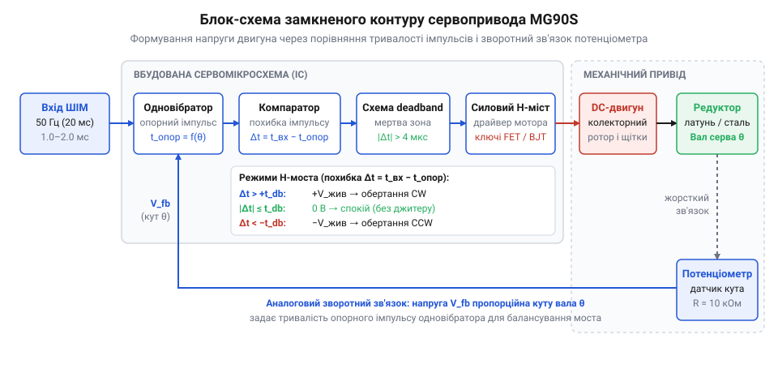
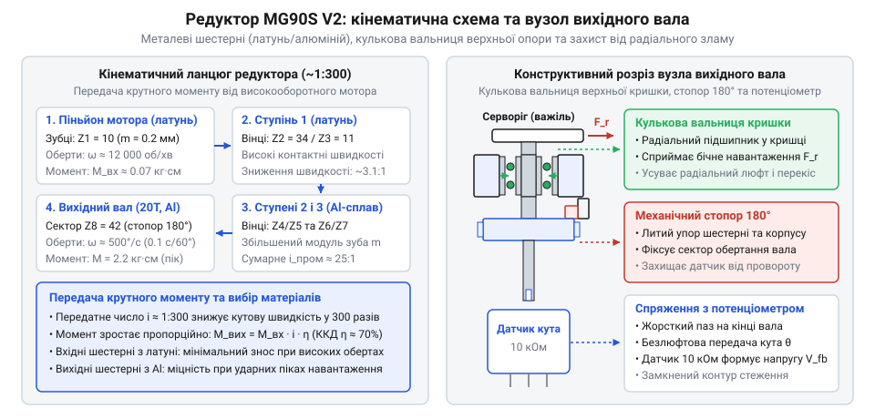
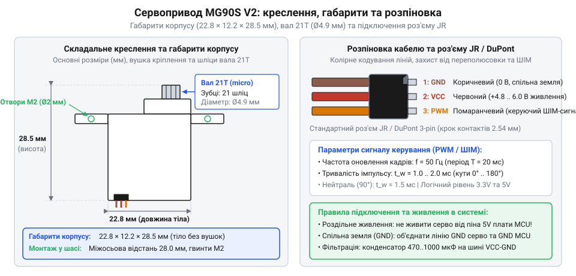

# MG90S V2 — мікросерво з металевим редуктором

<preknowlist>
- [Tower Pro SG90 — мікросерво 9g](root:cat-hw-actuators/sg90-servo) — Концепція 9-грамового мікросервопривода з трипровідним інтерфейсом та проблема вразливості нейлонових шестерень до зрізання зубів під ударними навантаженнями
</preknowlist>

## Межа міцності дев'ятиграмових приводів і ніша MG90S

Коли рухома кінцівка навчального маніпулятора впирається в несподівану механічну перешкоду або поворотне колесо колісної платформи на швидкості наїжджає на поріг, важіль зазнає раптового зворотного удару. У такій кінематичній схемі вихідна качалка працює як мультиплікатор сили: зовнішня кінетична енергія удару передається на внутрішні зубчасті колеса у зворотному напрямку. У наймасовіших дев'ятиграмових сервоприводах класу [Tower Pro SG90](root:cat-hw-actuators/sg90-servo) усі шестерні відлиті з полімеру — нейлону або поліацеталю. Зуби проміжних коліс мають товщину менше міліметра, і під час різкого гальмування контактні напруження миттєво перевищують границю міцності пластику на зсув. Зуби сколюються або зрізаються під корінь: моторчик безпорадно дзижчить на максимальних обертах, а вихідний вал вільно провертається рукою, не передаючи крутний момент.

Спроба розв'язати проблему встановленням повнорозмірного стандартного сервопривода зі сталевими шестернями швидко впирається у вагові та просторові обмеження. Стандартний металевий сервопривод важить 55–60 грамів і вчетверо більший за габаритами. У багатоланковому роботі маса кожної кінцівки накопичується кумулятивно: кожен додатковий грам на крайній ланці вимагає пропорційного збільшення потужності всіх опорних шарнірів і перевантажує конструкцію. До того ж монтажні посадочні гнізда більшості легких робототехнічних конструкцій розраховані суворо під стандарт дев'ятиграмового корпусу.

Сервопривод (від лат. *servus* — «слуга, виконавець») MG90S створювався як точкове розв'язання цієї суперечності. Пристрій повністю зберігає габарити корпусу класичного 9-грамового привода (22.8 × 12.2 × 28.5 мм), але замінює вразливий пластиковий редуктор (від лат. *reducere* — «зменшувати, повертати назад») на суцільнометалевий прямозубий каскад із латуні та алюмінієвих сплавів. Металеві зуби витримують раптові удари та аварійні заклинювання, які гарантовано знищили б пластикові шестерні.

Проте металевий зубчастий каскад накладає три неминучі інженерні компроміси:

1. **Зростання власної маси:** вага вузла зростає з 9 до 13.4 грама (+50%). Для літальних безпілотних апаратів це відчутний приріст, однак для наземних шасі та маніпуляторів це все ще вчетверо легше за стандартні сервоприводи.
2. **Технологічний люфт (від нім. *Luft* — «зазор, вільний простір», в англомовній термінології — @@en|backlash@@):** метал не має пружності термопластів, яка згладжує неточності зачеплення. Щоб жорсткі металеві шестерні не клинило при тепловому розширенні, виробник вимушений закладати збільшений бічний зазор між зубами. Сумарний кутовий люфт вихідного вала становить від 1.0° до 2.5°, через що на довгому плечі важеля виникає помітний мертвий хід.
3. **Підвищене тертя та струм споживання:** коефіцієнт тертя ковзання металу по металу без рідкої мастильної ванни помітно перевищує тертя самозмащувального нейлону. Двигун витрачає помітну частку потужності на подолання власного опору редуктора, що збільшує струм холостого ходу до 80–120 мА (проти 40–60 мА у пластику) та спричиняє сильніші пускові кидки струму.

> 🔧 **Навіщо це.**
> MG90S обирають для вузлів, де можливі випадкові удари, перешкоди або короткочасні аварійні зупинки — у шарнірах крокуючих роботів, захватах маніпуляторів та поворотних кулаках колісних шасі. Якщо ж привід рухає легку стрілку, відкриває оптичну шторку чи працює у вільному просторі без механічного опору, пластиковий привід типу [Tower Pro SG90](root:cat-hw-actuators/sg90-servo) вигідніший: він легший, дешевший і має менший люфт.

## Анатомія привода й замкнений контур керування

Звичайний електродвигун постійного струму обертається безперервно, поки до його клем прикладено напругу, а після знеструмлення зупиняється з випадковим вибігом через інерцію якоря. Він не має власного механізму вимірювання кута чи утримання позиції. Щоб перетворити швидкісний моторчик на прецизійний кутовий привод, його об'єднують в автономну замкнену систему автоматичного регулювання (@@en|closed-loop control@@).

Усередині корпусу MG90S інтегровано п'ять функціональних компонентів:

1. **Колекторний мікроелектродвигун:** високообертовий мотор постійного струму, якір якого розганяється до 12 000–16 000 об/хв на холостому ході, забезпечуючи високу питому потужність за мізерного власного моменту.
2. **Багатоступеневий металевий редуктор:** чотириступеневий зубчастий каскад із загальним передавальним числом близько 1:280, який знижує швидкість обертання ротора до приблизно 50 об/хв і помножує крутний момент до 1.8–2.2 кг·см на вихідному валу.
3. **Потенціометр зворотного зв'язку (від лат. *potentia* — «сила, потенціал» і грец. *μέτρον* — «вимір»):** мініатюрний резистивний давач кута, вісь якого жорстко зафіксована на вихідному валу редуктора. Напруга на його рухомому повзунку прямо пропорційна фактичному кутовому положенню вала.
4. **Мікросхема керування (сервопідсилювач):** спеціалізований аналоговий або змішаний чип, що порівнює зовнішній керівний сигнал із сигналом внутрішнього потенціометра.
5. **Транзисторний H-міст (@@en|H-bridge@@):** чотириключовий міст на польових або біполярних транзисторах, здатний миттєво змінювати полярність прикладеної до двигуна напруги для реверсу обертання або закорочувати виводи для динамічного гальмування.

Керування кутом вала здійснюється прямокутними імпульсами (від лат. *impulsus* — «поштовх, удар») частотою 50 Гц (період проходження 20 мс). Положення вала задається не шпаруватістю, а абсолютною тривалістю активного високого імпульсу `t_cmd`, яка зазвичай змінюється в діапазоні від 500 до 2400 мкс (де 1500 мкс відповідає нейтральному положенню 90°).

Коли черговий командний імпульс надходить на сигнальну лінію, внутрішній генератор мікросхеми формує опорний імпульс тривалістю `t_fb`, пропорційний напрузі на повзунку потенціометра. Компаратор (від лат. *comparare* — «порівнювати») зіставляє ці сигнали та визначає часову помилку позиціювання:

    Δt = t_cmd - t_fb    [сигнал розузгодження контуру]

Подальша дія схеми залежить від величини та знака знайденої різниці `Δt`:

- **Зона нечутливості (@@en|deadband@@):** якщо `|Δt| ≤ t_dead` (в MG90S поріг мертвої зони становить близько 1–5 мкс), ключі H-моста лишаються закритими. Двигун знеструмлений, а вал нерухомий. Це виключає виснажливе автоколивальне тремтіння привода навколо точки рівноваги від мікрошумів.
- **Відпрацювання помилки:** якщо величина `|Δt| > t_dead`, контролер відкриває відповідну діагональ H-моста. Полярність відкриття визначається знаком `Δt`: мотор обертається вперед або назад, провертаючи редуктор і потенціометр у бік зменшення помилки. Тривалість імпульсу живлення двигуна пропорційна величині розузгодження: чим далі вал від заданої точки, тим вища середня напруга на двигуні. У міру наближення вала до цілі імпульси коротшають, забезпечуючи плавне гальмування без проскакування позиції.


*Принципова блок-схема внутрішнього замкненого контуру: компаратор зіставляє вхідний ШІМ-імпульс з опорним імпульсом потенціометра і через H-міст живить двигун до зникнення помилки позиціювання.*

Завдяки безперервній роботі цієї схеми досягається ефект активного утримання кута під навантаженням. Коли зовнішнє зусилля (наприклад, вага утримуваного вантажу в маніпуляторі або натяг [серво-рогів](root:cat-hw-actuators/servo-horns)) намагається провернути вал, потенціометр миттєво відхиляється від точки рівноваги. Компаратор фіксує виникнення `Δt` і подає в обмотки мотора протидіючий струм. Чим сильніше навантаження зміщує вал, тим більший відновлювальний момент генерує двигун.

> 🔧 **Навіщо це.**
> Розуміння замкненого контуру пояснює, чому заблокований або навантажений сервопривод швидко нагрівається та споживає максимальний струм: він не затиснутий механічним гальмом, а безперервно крутить мотор проти зовнішнього зусилля за командами компаратора. Якщо привід безперервно дзижчить у спокої без навантаження, це свідчить про вихід пульсацій за межі мертвої зони deadband через електричні завади на шині живлення або механічне зношення струмопровідної доріжки потенціометра.

## Металевий редуктор і кулькова вальниця ревізії V2

Високообертовий колекторний електродвигун сервопривода розвиває максимальну потужність на швидкостях 12 000–16 000 об/хв, однак створює мізерний власний крутний момент — близько 0.08–0.1 кг·см. Щоб перетворити цей високошвидкісний рух ротора на тяговитий поворот важільної тяги зі швидкістю близько 50 об/хв, застосовують циліндричний зубчастий редуктор (від лат. *reducere* — «зменшувати, відводити назад»). У габаритах 9-грамового мікропривода розміщено чотириступеневий прямозубий каскад із загальним передавальним числом близько 1:280.

Кінематика (від грец. *κίνημα* — «рух») редуктора MG90S реалізує послідовне багаторазове редукування кутової швидкості через чотири пари шестерень (від нім. *Geschirr* або пол. *szesterka* — зубчасте колесо):

```
i_total
= i₁ × i₂ × i₃ × i₄       [добуток передавальних чисел окремих ступенів]
= 4.2 × 3.8 × 3.5 × 5.0   [типові значення каскаду MG90S]
≈ 280                     [сумарне кінематичне редукування швидкості]
```

Завдяки зниженню обертів вихідний крутний момент зростає пропорційно передавальному числу за вирахуванням втрат на тертя у зачепленнях та опорних осях:

```
M_out
= M_motor × i_total × η   [крутний момент на вихідному валу]
= 0.10 кг·см × 280 × 0.75 [з урахуванням ККД прямозубого зачеплення η ≈ 75%]
≈ 2.1 кг·см               [номінальний вихідний момент утримання]
```

Особливістю редуктора MG90S є диференційований підбір металів для кожного ступеня передачі. Повністю сталевий каскад шестерень був би занадто важким для мікропривода і суттєво здорожчив би прецизійну обробку мікрозубів. Натомість виробник застосував комбінацію зносостійкої латуні та легких алюмінієвих сплавів. Тягова шестірня (піньйон, від англ. @@en|pinion@@), напресована безпосередньо на сталевий вал двигуна, зазнає найбільшої кількості циклів тертя на секунду, тому виточена з міцної латуні. Проміжні колеса другого та третього ступенів виготовлені з легкого алюмінієвого сплаву — дюралюмінію (від назви німецького міста Дюрен або лат. *durus* — «твердий» і «алюміній»). Це знижує обертову інерцію всього каскаду, покращує динаміку розгону ротора та зберігає загальну масу привода в межах 13.4 грама. Фінальна вихідна шестірня четвертого ступеня, яка сприймає повний вихідний крутний момент (до 2.2 кг·см) і раптові зовнішні удари, виготовлена з масивного латунного сплаву з широким зубчастим вінцем.

Однак встановлення твердих металевих шестерень загострило вразливість першої версії (V1) привода — спосіб фіксації вихідного вала. У типових мікроприводах на кшталт [Tower Pro SG90](root:cat-hw-actuators/sg90-servo) вихідний вал просто вставлено в глухий циліндричний отвір пластикової кришки, яка виконує роль підшипника ковзання (втулки, від нім. *Buchse*). Коли закріплена на валу качалка штовхає або тягне механічну тягу, на вал діє не лише корисний крутний момент, а й значне радіальне зусилля (від лат. *radius* — «промінь, спиця»), спрямоване перпендикулярно до осі обертання.

Радіальне навантаження створює постійний згинальний момент на плечі вала. Під таким тиском м'який пластиковий отвір кришки швидко розбивається, набуваючи овальної форми, або пружно відхиляється під піковими навантаженнями. У результаті вихідний вал перекошується відносно вертикалі. У прямозубому зачепленні контакт зубів розрахований на сувору паралельність геометричних осей шестерень: зуби контактують рівномірно по всій ширині контактної лінії. Якщо ж вісь вала нахиляється бодай на 1–2°, контактна лінія перетворюється на точковий контакт на самому кутку зуба (крайове навантаження). Локальний механічний тиск на крайках металевих зубів миттєво зростає у десятки разів, перевищуючи границю плинності сплаву. Це спричиняє викришування зубів, зминання металу, катастрофічне зростання люфту та раптове заклинювання редуктора.

Ключовим конструктивним оновленням ревізії MG90S V2 стала інтеграція прецизійної кулькової вальниці кочення (від нім. *Walze* — «валок, ролик» або укр. дієслова *валяти*; в англомовній термінології — @@en|ball bearing@@) у верхню кришку корпусу. Зовнішня сталева обойма вальниці жорстко запресована в посадкове гніздо пластикової кришки, а внутрішня щільно охоплює вихідний вал. Загартовані сталеві кульки повністю сприймають радіальні сили від тяги, утримуючи вісь вала строго перпендикулярно до площини обертання шестерень навіть під максимальним зовнішнім навантаженням. Завдяки цьому зуби вихідного латунного сектора завжди контактують із зубчастим вінцем попередньої шестірні по всій ширині вінця, запобігаючи крайовому викришуванню металу й багаторазово збільшуючи робочий ресурс привода.


*Конструктивний розріз редуктора MG90S V2: прямозубий каскад із латуні та алюмінієвих сплавів і кулькова вальниця у верхній кришці, яка компенсує радіальне зусилля від тяги.*

> 🔧 **Навіщо це.**
> Кулькова вальниця ревізії V2 є принципово важливою у шарнірних вузлах, де тяга передає зусилля під кутом до площини важеля (наприклад, у кермових трапеціях колісних роботів чи поворотних тягах елеронів). Якщо безвальнична втулка за кілька десятків годин роботи розбивається і викликає перекіс шестерень із подальшим зрізанням зубів, то вальниця кочення зберігає розрахункову геометрію зачеплення впродовж усього строку служби.

## Підключення, таймінги ШІМ та вимоги до живлення

Електричне підключення сервопривода MG90S здійснюється за допомогою трипровідного плоского шлейфа з гніздовим триконтактним роз'ємом DuPont із кроком контактів 2.54 мм (стандарт JR, названий на честь виробника радіокерованих моделей @@en|Japan Remote Control@@). Провідники кабелю мають чітке колірне маркування:

1. **Коричневий (або чорний):** спільний мінус живлення (GND, 0 В).
2. **Червоний:** позитивна шина силового живлення (+Vcc, напруга 4.8–6.0 В).
3. **Помаранчевий (або жовтий):** лінія керівного сигналу ШІМ (від англ. @@en|PWM, Pulse-Width Modulation@@ — широтно-імпульсна модуляція).

Розташування плюсової лінії живлення строго на центральному контакті роз'єму становить основу інженерного захисту від помилкової переполюсовки (@@en|fool-proofing@@). Якщо монтажник помилково вставить конектор у контактну колодку зворотною стороною (з розворотом на 180°), напруга +Vcc все одно потрапить на центральний пін привода. Місцями поміняються лише лінії GND та сигналу ШІМ. Оскільки внутрішній сигнальний вхід компаратора має високий вхідний імпеданс і захищений паразитними діодами мікросхеми, підключення лінії сигналу до землі чи мінуса до сигнального піна мікроконтролера не створює струмового короткого замикання. Електроніка залишається неушкодженою: привід просто не реагує на команди, доки роз'єм не встановлять у правильне положення.

Вихідний вал редуктора має зубчасту шліцову нарізку (від нім. *Schlitz* — «щілина, паз») стандарту 21T (21 шліц, зовнішній діаметр 4.8 мм). На ці шліци напресовуються змінні пластикові або легкосплавні важелі — [серво-роги](root:cat-hw-actuators/servo-horns), які фіксуються осьовим гвинтом M2. Повний кутовий хід вала механічно обмежений виступом-штифтом на нижньому торці вихідної шестірні, який упирається у виступи на внутрішній стінці корпусу. Механічний кут повороту становить близько 180°–200°. Цей обмежувач захищає внутрішній потенціометр зворотного зв'язку від перекручування, виключаючи механічний відрив рухомого повзунка від резистивної доріжки під час монтажу чи ручного обертання важеля.

Позиціонування вала здійснюється прямокутними імпульсами ШІМ стандартної частоти 50 Гц (період проходження імпульсів `T = 20 мс`). Кут повороту однозначно кодується абсолютною тривалістю активного високого рівня імпульсу `t_pulse`:

- `t_pulse ≈ 500 мкс` відповідає куту 0° (крайнє ліве положення вала).
- `t_pulse ≈ 1500 мкс` відповідає куту 90° (нейтральне центральне положення).
- `t_pulse ≈ 2400 мкс` відповідає куту 180° (крайнє праве положення вала).

На відміну від класичного стандарту радіокерування (1000–2000 мкс, що забезпечував поворот лише на 90°–120°), контролер MG90S підтримує розширений часовий діапазон 500–2400 мкс для повного розмаху на 180°. Розрахунок тривалості імпульсу для довільного кута `θ` виконується лінійною інтерполяцією:

```
t_pulse
= t_min + (θ / 180°) × (t_max - t_min)    [лінійна інтерполяція кута в тривалість імпульсу]
= 500 мкс + (90° / 180°) × 1900 мкс       [розрахунок для центрального положення 90°]
= 500 мкс + 950 мкс
= 1450 мкс                                [номінальна тривалість імпульсу для центру]
```

Шпаруватість керівного сигналу (відношення тривалості імпульсу до періоду) залишається низькою в усьому робочому діапазоні:

```
D
= t_pulse / T               [розрахунок коефіцієнта заповнення періоду]
= 1.45 мс / 20.0 мс         [період імпульсів при частоті 50 Гц дорівнює 20 мс]
= 0.0725                    [шпаруватість становить 7.25%]
```

Вхідний каскад мікросхеми сервопривода сприймає керуючі рівні напругою від 2.0 В як логічну одиницю, тому сигнальну лінію можна підключати безпосередньо до виводів сучасних 3.3-вольтових мікроконтролерів (ESP32, STM32, RP2040) без додаткових узгоджувачів рівнів.

Профіль споживання струму MG90S є головним джерелом апаратних проблем при інтеграції. У стані спокою без навантаження на валу привід споживає лише 10–15 мА. Під час вільного руху холостого ходу струм зростає до 80–120 мА через тертя в металевому редукторі, а під помірним робочим навантаженням становить 250–400 мА. Проте в момент старту ротора з місця, під час різкої зміни напрямку руху або при механічному заклинюванні важеля струм короткочасно підскакує до струму заклинювання (@@en|stall current@@) величиною від 800 мА до 1.0 А на один привід! У цей момент якір нерухомий, проти-ЕРС самоіндукції відсутня, і струм обмежується лише низьким омічним опором мідного дроту обмоток.

Спроба живити сервопривод безпосередньо від 5-вольтової шини плати мікроконтролера (наприклад, від виходу вбудованого лінійного стабілізатора або USB-порту) неминуче спричиняє циклічне апаратне скидання процесора через просідання напруги (@@en|brownout reset@@). Стрибок струму в 1 А перевантажує стабілізатор, напруга на шині 5 В різко просідає нижче критичного порогу 4.2–4.5 В, і вбудований детектор просідання мікроконтролера (BOD, від англ. @@en|Brown-Out Detector@@) миттєво перезавантажує мікроконтролер. Після рестарту програма починає виконання спочатку, знову віддає команду сервоприводу, мотор знову створює пусковий сплеск струму — і плата зависає в нескінченному циклі рестартів.

Для надійної роботи застосовують три обов'язкові правила проектування силової частини:

1. **Фізичне розділення шин живлення:** цифрова частина мікроконтролера живиться від свого стабілізатора, а силова лінія +Vcc сервоприводів підключається до окремого імпульсного понижувального перетворювача (Step-Down Buck-конвертера) чи акумулятора з вихідним струмом щонайменше 1.5–2 А на кожен активний сервопривод.
2. **Спільне опорне уземлення:** мінусова лінія (GND) силового живлення сервоприводів та мінусова лінія мікроконтролера мають бути жорстко з'єднані в одній спільній точці (топологія зоряного уземлення, @@en|star ground@@). Без спільного уземлення опорний потенціал сигналу ШІМ зміщується, викликаючи хаотичне тремтіння та ривки вала від електромагнітних наводок.
3. **Буферні електролітичні конденсатори:** паралельно шинам +Vcc та GND безпосередньо біля роз'ємів підключення сервоприводів встановлюють електролітичний конденсатор (від лат. *condensare* — «згущувати, накопичувати») ємністю 470–1000 мкФ з низьким еквівалентним послідовним опором (@@en|low ESR@@). Конденсатор віддає накопичений заряд за мікросекунди в момент пуску двигуна, нівелюючи паразитну індуктивність живильних дротів і згладжуючи імпульсні просідання напруги.


*Конструктивні габарити корпусу, геометрія зубчастого вихідного вала та призначення ліній трипровідного кабелю стандарту JR.*

> 🔧 **Навіщо це.**
> Розділення силового живлення та встановлення буферного конденсатора є обов'язковим правилом навіть під час швидких тестів на макетній платі. Живлення сервопривода від контактів мікроконтролера під час руху важеля гарантовано призводить до спонтанних перезавантажень процесора, зависання шин зв'язку та втрати керування всім робототехнічним комплексом.
