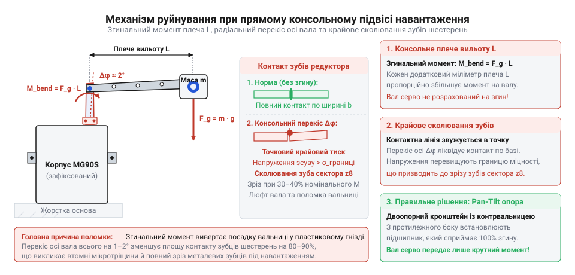
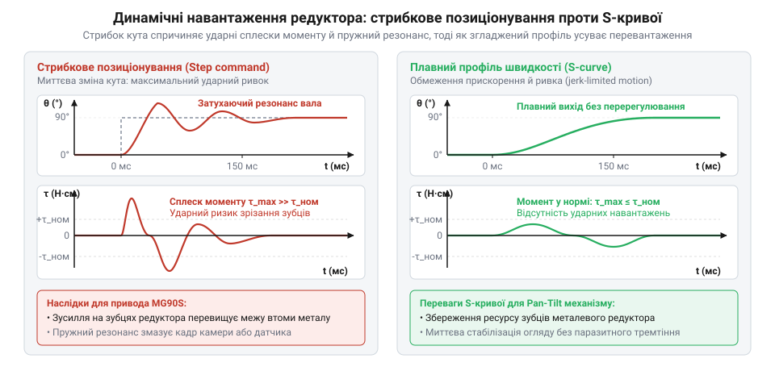
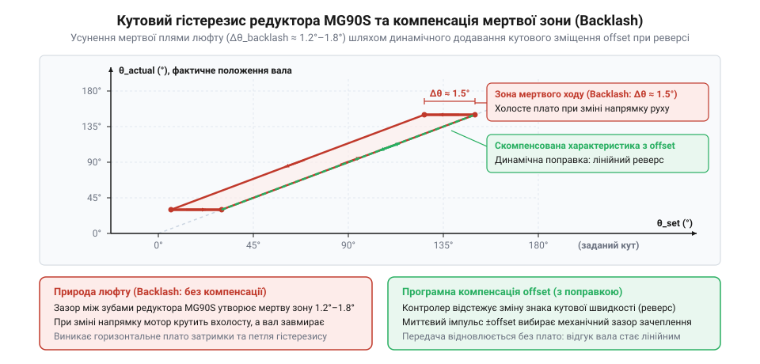
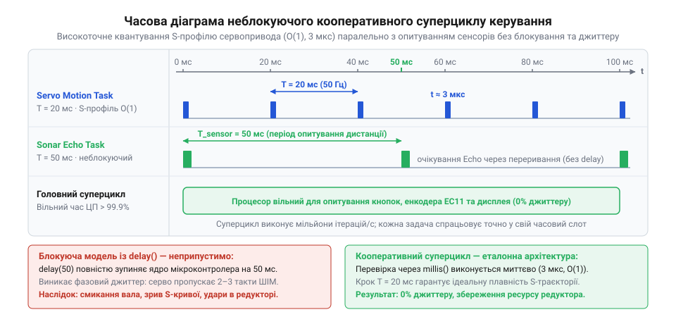

# MG90S V2 — мікросерво з металевим редуктором

<preknowlist>
- [Tower Pro SG90 — мікросерво 9g](root:cat-hw-actuators/sg90-servo) — Принцип керування кутом за допомогою 50 Гц PWM-сигналу (ширина імпульсу 1–2 мс), базове призначення трьох дротів інтерфейсу (живлення, земля, керування) та конструктивні межі навантаження мікросервоприводів 9-грамового класу.
- [Серво-роги (запасні)](root:cat-hw-actuators/servo-horns) — Геометрія шліцьової посадки мікросерво (діаметр вала, кількість зубців шліца) та способи надійного механічного закріплення пластикових качалок (рогів) на конструктивні елементи поворотного кронштейна за допомогою гвинтів.
</preknowlist>

## Механічні небезпеки консольного підвісу: фізика руйнування вихідного вала та редуктора мікросервопривода

Під час створення компактних робототехнічних систем, мобільних платформ або випробувальних стендів часто виникає потреба просторового орієнтування легкого корисного навантаження. Зазвичай це ультразвуковий далекомір HC-SR04, лазерний датчик дистанції Time-of-Flight (наприклад, VL53L0X чи VL53L1X) або мініатюрна відеокамера машинного зору (OV2640, Raspberry Pi Camera Module) загальною масою від 15 до 50 грамів. Природним інженерним імпульсом на етапі швидкого прототипування стає вибір популярного мікросервопривода класу 9 грамів — TowerPro MG90S V2. Привабливість цього вибору очевидна: низька собівартість, вбудований редуктор зі сплаву латуні й алюмінію, наявність вбудованого аналогового сервопідсилювача та стандартний інтерфейс керування імпульсами ШІМ частотою 50 Гц.

Проте типова помилка початківця полягає в спробі зібрати двоосьовий поворотний шарнір найпростішим «наївним» способом: закріпити одну сервомашинку на нерухомій станині, прикрутити до її пластикової вихідної качалки корпус другої сервомашинки, а вже безпосередньо на вихідний важіль другого приводу консольно посадити сенсор або камеру. На лабораторному столі без тривалих навантажень така конструкція здатна поворушитися кілька хвилин, демонструючи оманливу працездатність. Але вже після перших годин або навіть хвилин реальної експлуатації система зазнає катастрофічної деградації: виникає прогресуючий люфт, напрямок огляду сенсора починає хаотично тремтіти (візуальний джитер або стрибки виміряної дистанції), редуктор починає натужно гудіти, привід намертво заклинює, а корпус мікросерво розігрівається до температури термічного розм'якшення полімеру.

Причина цієї відмови криється у фундаментальному нерозумінні внутрішньої механічної будови вихідного вузла мікросервопривода та недотриманні базових канонів мехатронного проєктування.

### Анатомія опорного вузла сервопривода класу 9g (MG90S V2)

Щоб з'ясувати фізичну природу руйнування, необхідно детально проаналізувати кінематичну будову привода MG90S. Габарити його пластикового корпусу становлять усього 22.8 × 12.2 × 28.5 мм при загальній масі близько 13.4 г. Маркування «Metal Gear» дійсно гарантує наявність металевих зубчастих коліс: перша трибка на валу колекторного електродвигуна постійного струму та проміжні шестерні виконані з латуні й високоміцного алюмінієвого сплаву, а вихідне зубчасте колесо — з латуні або пресованого силуміну. Заявлений крутний момент становить від 1.8 до 2.2 кг·см (0.18–0.22 Н·м) при напрузі живлення 4.8–6.0 В.

Однак наявність металевих зубців не робить привід силовим підшипниковим вузлом. Вихідний вал сервопривода MG90S V2 згідно з конструкторським задумом є виключно каналом передачі крутного моменту обертання (Torque Transmission Shaft). Якщо зняти верхню кришку корпусу, стає видно, як організовано опорний вузол вихідного вала:
1. **Верхня опора**: вихідний вал діаметром 4.8 мм зі шліцьовим наконечником (зазвичай 20-21 зуб) спирається на одинарну тонкостінну латунну втулку ковзання (bushing), яка просто запресована у циліндричний прилив тонкої пластикової кришки корпусу. У багатьох бюджетних версіях навіть ця латунна втулка відсутня, і металевий вал обертається безпосередньо по полікарбонатному корпусу.
2. **Нижня опора**: нижній кінець вихідного зубчастого колеса має виточений глухий паз або лиску, яка безпосередньо насаджується на пластиковий поворотний шпиндель аналогового потенціометра зворотного зв'язку номіналом 5 кОм.

Відстань між центром верхньої латунної втулки та точкою спирання на вісь потенціометра — так звана конструктивна база підшипника b — становить усього від 4.0 до 5.5 мм. При цьому радіальний зазор у втулці ковзання навіть у нового сервопривода становить 0.05–0.08 мм, що необхідно для забезпечення вільного ковзання без заклинювання від теплового розширення.

### Кінематика консолі: важіль згинального моменту

Коли корисне навантаження масою m закріплюється безпосередньо на важелі сервокачалки, центр його маси неминуче виявляється винесеним відносно площини верхньої втулки на значну відстань L. Наприклад, якщо на сервокачалку встановлено модуль камери з об'єктивом та друкованою платою, консольний виліт становить L = 35–50 мм. 

Маса датчика, монтажного майданчика та сполучного дротяного джгута створює силу тяжіння:

F_g = m · g

Для навантаження масою m = 40 г (0.04 кг) сила тяжіння дорівнює:

F_g = 0.04 кг · 9.81 м/с² ≈ 0.392 Н

Ця сила діє на плечі L = 50 мм (0.05 м) перпендикулярно до осі вихідного вала при горизонтальному розташуванні качалки, утворюючи статичний згинальний момент:

M_bend = F_g · L = 0.392 Н · 0.05 м ≈ 0.0196 Н·м = 19.6 Н·мм

Звернемося до розрахунку силових реакцій усередині опорного вузла сервопривода. Оскільки вихідний вал являє собою балку на двох опорах із внутрішньою відстанню між ними b = 5.0 мм та консольним вильотом L = 50 мм, радіальна реакція на верхній опорній втулці R_bush під дією моменту перекидання становить:

R_bush = M_bend / b = (F_g · L) / b = (0.392 Н · 50 мм) / 5 мм = 3.92 Н

Цей простий розрахунок наочно демонструє руйнівний ефект консолі: радіальна сила, що виламує крихітну латунну втулку сервомашинки, рівно вдесятеро (L / b = 10) перевищує власну вагу корисного навантаження! 

Якщо ж привід здійснює активне кутове переміщення або зупиняється з високим кутовим уповільненням, до статичної ваги додається динамічна інерційна складова:

F_dyn = m · a_tan = m · ε · L

де ε — кутове прискорення вала, яке під час різкого реверсу мікросерво без застосування плавних рамп розгону може досягати 2000–5000 рад/с². У моменти таких динамічних ривків пікова радіальна сила на опорній втулці легко сягає 10–15 Н.


*Схема консольного навантаження сервопривода: дія сили тяжіння, виникнення згинального моменту та руйнівний перекіс шестерень редуктора.*

### Ланцюгова реакція деградації редуктора та електроніки

Дія надлишкового радіального згинального моменту запускає незворотний каскад механічних та електричних пошкоджень:

1. **Кутовий перекіс осі вихідного колеса**. Під дією сили R_bush = 4–15 Н вал вибирає початковий радіальний зазор у втулці та нахиляється на кут:
   γ ≈ Δ_gap / b ≈ 0.08 мм / 5.0 мм ≈ 0.016 рад ≈ 0.9–1.2°
   Для прецизійної зубчастої передачі такий перекіс є неприпустимою аварійною ситуацією.
2. **Руйнування евольвентного зачеплення та злизування зубців**. Нормальна робота прямозубої циліндричної передачі редуктора розрахована на сувору паралельність геометричних осей усіх шестерень. Контакт між зубами має відбуватися по прямолінійній контактній смузі, розподіленій по всій ширині зубчастого вінця (в MG90S ширина вінця становить усього 1.2–1.8 мм). При перекосі вала на кут близько 1° площинний контакт вироджується в точковий крайовий контакт (edge contact) на самій вершині кромки зуба. Локальні контактні напруження зростають у десятки разів, перевищуючи границю плинності латуні. Починається інтенсивна пластична деформація металу, контактна втома, втомне викришування (pitting), утворення задирок і, зрештою, повне зрізання латунних зубців вихідного сектора.
3. **Механічне заклинювання (Gear Binding) та струмовий колапс**. Через вигин вала міжосьова відстань між вихідним колесом та проміжною шестернею змінюється нерівномірно вздовж довжини зуба. В одній фазі обертання виникає неприпустимий натяг, зубці застряють один в одному, і редуктор намертво клинить. Внутрішній електродвигун сервопривода переходить у стан заблокованого ротора (stall). Струм споживання при напрузі 5 В миттєво стрибає зі штатних 80–120 мА до пікового значення 700–900 мА. Якщо живлення системи спільне з мікроконтролером, такий стрибок спричиняє глибоке просідання напруги на шині живлення, спрацьовування апаратної схеми захисту Brown-out Reset (BOR) та циклічне перезавантаження керуючого процесора.
4. **Виламування осі потенціометра та виникнення автоколивань (Jitter)**. Оскільки нижній кінець вала зафіксований на осі підрядного потенціометра, згинальний момент передає радіальне зусилля безпосередньо на його пластиковий корпус та резистивну доріжку. Вісь потенціометра відхиляється, контакти струмознімача деформуються і починають дряпати напилений графітовий шар, викликаючи мікрообриви. Вбудована аналогова мікросхема сервопідсилювача (типово AA15168 або KC9803) отримує зашумлений, спотворений сигнал кута положення. Компенсуючи уявну помилку розузгодження, підсилювач подає імпульси струму високої шпаруватості в мотор, змушуючи привід люто дрижати з частотою 10–25 Гц навіть у статичному положенні. Це явище отримало назву «мисливського ефекту» (hunting/jitter).
5. **Розбиття пластикового посадкового гнізда корпуса**. Тонка латунна втулка вихідного вала запресована в корпус із пластику ABS або полікарбонату. При знакозмінних коливаннях консольного важеля питомий тиск втулки на стінку гнізда спричиняє явище повзучості термопластів (cold flow). Посадкове гніздо розбивається в овал, формуючи незворотний кутовий люфт амплітудою 3–6°. На плечі сенсора 50 мм це означає механічне бовтання з амплітудою 3–5 мм, що повністю руйнує просторову стабільність показань датчика чи відеокамери.

### Головне правило мехатроніки приводів

Наведений аналіз дає змогу сформулювати базовий інженерний принцип, обов'язковий для будь-якого мехатронного вузла:

> **Вал сервопривода має передавати виключно обертальний крутний момент навколо своєї геометричної осі. Він категорично не повинен сприймати силу тяжіння навантаження, поперечні радіальні сили та згинальні перекидні моменти.**

Усі зовнішні вагові, інерційні та згинальні навантаження зобов'язана повністю приймати на себе зовнішня кінематична конструкція з власними підшипниковими опорами. Лише в такому разі сервопривод MG90S працюватиме в чистому режимі торсійного кручення, реалізуючи свій повний паспортний ресурс у сотні тисяч циклів без люфтів, клину та перегріву.

---

## Кінематика розвантаженої турелі Pan-Tilt: геометрія U-кронштейна, опорні підшипники та балансування центра ваги

Усвідомлення неприпустимості консольного навантаження ставить перед розробником завдання створення спеціального опорно-поворотного механізму — турелі Pan-Tilt (від англійського *Pan* — панорамування по горизонту та *Tilt* — нахил по вертикалі). Головна інженерна мета такого вузла — повне розділення механічних функцій: зовнішній жорсткий каркас із підшипниковими вузлами замикає на себе всі сили ваги, згинальні моменти та ударні вібрації, тоді як сервоприводи підключаються до рухомих ланок виключно як джерела кутового обертання без поперечних реакцій.

Щоб турель працювала плавно, детерміновано та не споживала надлишкового струму в статичному стані спокою, її конструкція повинна спиратися на три фундаментальні складові:
1. Двоопорний розвантажувальний U-подібний кронштейн для вертикальної осі нахилу Tilt.
2. Розвантажувальний опорний підшипниковий вузол для горизонтальної осі панорамування Pan.
3. Точне статичне балансування центра ваги корисного навантаження безпосередньо на осі нахилу.

### Геометрія розвантажувального U-подібного кронштейна осі Tilt

Класична схема розвантаження консолі в механіці — перетворення консольної балки з одностороннім затисненням на статично визначену балку на двох шарнірних опорах (simply supported beam). Конструктивно це реалізується за допомогою U-подібного кронштейна (вилки, або Yoke), дві паралельні щоки якого охоплюють центральний тримач корисного навантаження.

Розглянемо кінематичну будову цієї двоопорної осі:
- **Перша опора (активна приводна сторона)**: на одній щоці U-подібного кронштейна кріпиться сервопривод MG90S. Його вихідний вал оснащується стандартною нейлоновою сервокачалкою (хрестоподібною або двозбройною), яка жорстко фіксується гвинтами на бічній стінці поворотного тримача сенсора. Тут передається чистий крутний момент повороту навколо осі Tilt.
- **Друга опора (пасивна холоста сторона)**: строго співвісно з вихідним валом сервопривода, на протилежній щоці U-кронштейна, організується холоста піввісь (цапфа). Вона являє собою прецизійний гвинт M3 або M4 з гладкою циліндричною посадковою шийкою, вкручений у бічну стінку поворотного тримача навантаження.
- **Опорний підшипник кочення**: у щоку U-кронштейна запресовується мініатюрний радіальний кульковий підшипник кочення (найчастіше типорозміру 683ZZ з розмірами 3 × 7 × 3 мм або 684ZZ з розмірами 4 × 9 × 4 мм із подвійними захисними металевими шайбами). Гладка шийка холостої півосі входить у внутрішнє кільце підшипника кочення по ковзній посадці.

Розрахуємо розподіл сил у такій двоопорній системі. Нехай корисне навантаження масою m = 40 г (сила тяжіння F_g ≈ 0.392 Н) розташоване симетрично між стінками U-кронштейна шириною W = 45 мм. Тоді кожна з опор (вал сервопривода з одного боку та підшипник кочення 684ZZ з іншого боку) сприймає рівно половину ваги:

F_support1 = F_support2 = F_g / 2 = 0.392 Н / 2 = 0.196 Н

При цьому згинальний момент від консольного вильоту L = 50 мм, який у консольній схемі створював виламуючу силу R_bush = 3.92 Н на втулці сервопривода, тепер повністю нейтралізується геометрією вилки: перекидний момент замикається між двома широко рознесеними опорами кронштейна через силову пару:

F_couple = M_bend / W = (F_g · L) / W = (0.392 Н · 50 мм) / 45 мм ≈ 0.435 Н

Ця пара сил F_couple діє в горизонтальній площині: на підшипник 684ZZ та на зовнішню сервокачалку, причому сервокачалка спирається своєю площиною безпосередньо на зовнішній фланець корпусу сервопривода, а не виламує внутрішню латунну втулку. У результаті радіальне навантаження на внутрішній редуктор сервопривода падає з катастрофічних 3.92 Н до мізерних часток ньютона (зменшення більш ніж на 95%), що повністю виключає перекіс шестерень.


*Кінематична схема двоосьової турелі Pan-Tilt: U-подібний розвантажувальний кронштейн, опорні підшипники та балансування центра ваги на осі Tilt.*

### Розвантаження горизонтальної осі панорамування (Pan)

Вісь панорамування Pan обертає всю верхню конструкцію навколо вертикальної осі Z. На неї припадає сумарна гравітаційна вага всієї рухомої частини системи:
- Сервопривод осі Tilt: 13.4 г
- U-подібний кронштейн із кріпленням: 15–20 г
- Холостий підшипник 684ZZ та металовироби: 5 г
- Тримач корисного навантаження: 10 г
- Корисне навантаження (сенсор/камера): 30–40 г
- Сполучні кабелі: 5–10 г

Сумарна маса становить M_total = 75–100 г, що створює вертикальну осьову силу F_axial = M_total · g ≈ 0.75–1.0 Н. Якщо U-кронштейн просто прикрутити до качалки нижнього сервопривода Pan, ця осьова сила діятиме вздовж його вала, вдавлюючи вихідне зубчасте колесо всередину корпусу. Це призводить до осьового тертя торців шестерень об внутрішні перегородки корпусу, стискання пластикового повзунка потенціометра та різкого зростання моменту тертя холостого ходу. Крім того, будь-який бічний поштовх або нахил основи робота створює для нижньої сервомашинки колосальний згинальний момент від високої стійки турелі (плече H = 60–80 мм).

Для надійного розвантаження осі Pan застосовують опорно-поворотну основу з великим радіально-упорним або кульковим підшипником:
1. У нерухому базу турелі монтується великогабаритний кульковий підшипник тонкої серії (наприклад, 6802ZZ з внутрішнім діаметром 15 мм, зовнішнім 24 мм і шириною 5 мм) або упорне кільце ковзання з поліацеталю (POM/Delrin) чи тефлону (PTFE).
2. Поворотна платформа U-кронштейна має циліндричний хвостовик або фланець, який через цей підшипник передає всю вертикальну вагу M_total безпосередньо на станину.
3. Нижній сервопривод MG90S розташовується під платформою, а його вихідний вал з'єднується з поворотною платформою через сервокачалку. Вал сервопривода не відчуває жодного осьового тиску вниз і жодних перекидних моментів — він передає лише кутовий крутний момент для повороту турелі по азимуту.

### Балансування центра ваги на осі Tilt

Навіть за наявності ідеального двозбройного U-кронштейна з підшипником конструкція може страждати від іншої проблеми — гравітаційного дисбалансу. Розглянемо фізику моменту, необхідного для утримання камери в заданому куті нахилу.

Нехай кут нахилу Tilt відраховується від горизонтальної площини і позначається θ. Якщо центр ваги корисного навантаження разом із тримачем (Center of Gravity, CG) зміщений відносно осі обертання Tilt на радіальну відстань r_cg, сила тяжіння F_g = m · g створює перекидний гравітаційний момент утримання:

M_hold(θ) = m · g · r_cg · cos(θ)

Проаналізуємо числові значення для незбалансованого монтажу, коли плата камери масою m = 40 г встановлена на поличці кронштейна з винесенням центра ваги вперед на r_cg = 25 мм:

M_hold(0°) = 0.04 кг · 9.81 м/с² · 0.025 м · cos(0°) = 0.00981 Н·м ≈ 1.0 кг·см

Паспортний утримувальний момент сервопривода MG90S при живленні 5 В становить близько 1.8–2.0 кг·см. Це означає, що при зміщенні центра ваги всього на 25 мм сервопривод змушений постійно, 100% часу, віддавати понад 50% свого граничного крутного моменту лише для того, щоб протистояти силі тяжіння й утримувати камеру в горизонтальному положенні!

Наслідки статичного гравітаційного дисбалансу є вкрай важкими:
- **Постійний струм у стані спокою**: щоб утримувати кут, внутрішній H-міст подає в обмотки мотора постійні коригувальні імпульси. Струм споживання статичної турелі становить 250–350 мА замість номінальних 10–20 мА.
- **Термічний дрейф та перегрів**: компактний двигун MG90S, замкнений у пластиковому корпусі без примусового охолодження, розігрівається до 60–75 °C. Це спричиняє термічне розширення механізму, зміну опору потенціометра та «попливання» нульової точки калібрування.
- **Динамічна асиметрія руху**: при русі вниз сила тяжіння допомагає мотору, і турель падає занадто різко; при русі вгору мотор працює проти сили тяжіння, швидкість падає в 2–3 рази, виникають пропуски кута або зрив у режим упору.

Єдиним правильним інженерним рішенням є **статичне нейтральне балансування**: корисне навантаження розміщується в рухомому тримачі так, щоб центр його маси строго накладався на геометричну лінію осі обертання Tilt:

r_cg → 0

При досягненні умови r_cg = 0 гравітаційний момент M_hold(θ) обертається в нуль для будь-якого довільного кута нахилу θ у діапазоні від -60° до +60°:

M_hold(θ) = m · g · 0 · cos(θ) ≡ 0

Практична реалізація балансування в аматорських та напівпромислових турелях Pan-Tilt досягається такими конструктивними прийомами:
1. **Регулювальні пази (Slotted Mounts)**: замість круглих кріпильних отворів у тримачі датчика фрезеруються поздовжні пази довжиною 8–12 мм. Послабивши кріпильні гвинти, інженер зсуває плату сенсора або камери вперед/назад уздовж оптичної осі доти, доки від'єднаний від сервопривода кронштейн не перестає самовільно перекидатися під дією ваги і зберігає будь-яке задане положення нахилу (стан байдужої рівноваги).
2. **Противаги або перенесення масивних елементів**: якщо об'єктив камери важкий і висунутий вперед, позаду осі обертання розташовують плату інтерфейсу, роз'єми підключення кабелів або додатковий баластний тягарець.

У збалансованій турелі сервопривод MG90S під час руху долає виключно момент сил тертя у кулькових підшипниках та динамічний момент інерції під час прискорення:

M_motion = J · ε + M_friction

де J — момент інерції навантаження відносно осі обертання, ε — кутове прискорення. У стані спокою струм споживання привода падає до мінімальних 12–15 мА (струм живлення плати підсилювача), механізм абсолютно не нагрівається, не гуде і не створює мікроколивань качалки.

### З'єднання вала через сервокачалку: захист від гіперстатичності

Завершальний критичний нюанс стосується способу передачі обертання від вихідного вала сервопривода до U-кронштейна. Жорстке пряме закріплення вала металевою цангою або безпосереднє вклеювання неприпустиме, оскільки це створює статично невизначену систему (гіперстатичний зв'язок). Неминуча виробнича неточність 3D-друку або фрезерування кронштейна спричинить мікронеспіввісність осі сервопривода та осі протилежного підшипника 684ZZ на величину 0.1–0.3 мм. При жорсткій фіксації ця неспіввісність призведе до величезних радіальних сил самозаклинювання.

Штатне рішення полягає у використанні стандартної шліцьової сервокачалки з еластичного поліаміду (нейлону). Нейлонова качалка має високу крутильну (торсійну) жорсткість у площині обертання, але за рахунок пружності тонких плечей забезпечує необхідну радіальну та кутову піддатливість у частки міліметра. Це дозволяє шарніру функціонувати як пружна муфта, компенсуючи технологічні похибки виготовлення кронштейна без передачі згинальних паразитних сил на підшипникову втулку сервопривода.

## Внутрішня будова та фізичні обмеження актуатора MG90S V2: від мертвої зони до крихкості металевого редуктора

Для створення надійної системи керування двоосьовою туреллю недостатньо лише побудувати розвантажений підвіс — необхідно досконально розуміти внутрішню апаратну будову та фізичні межі обраного виконавчого механізму. Сервопривод TowerPro MG90S V2 часто сприймається як простий чорний ящик, який перетворює ширину ШІМ-імпульсу на кутове положення. Проте всередині його 13-грамового корпусу зосереджено складний комплекс електродинамічних, механічних та аналогових зворотних зв'язків, кожен із яких має власні скінченні допуски, похибки та характерні зони відмови.

Знання цих обмежень дає змогу інженеру заздалегідь врахувати їх у математичній моделі траєкторії, уникнути ударних руйнувань зубчастих коліс та правильно налаштувати алгоритми фільтрації кутових координат.

### Внутрішня анатомія сервопривода MG90S V2

Конструктивно корпус MG90S V2 складається з трьох пресованих полімерних частин, стягнутих двома довгими наскрізними гвинтами M2:
1. **Нижній відсік**: містить друковану плату аналогового сервопідсилювача та транзисторного H-моста.
2. **Середній відсік**: служить монтажним шасі для мініатюрного триполюсного колекторного двигуна постійного струму та ротаційного потенціометра зворотного зв'язку.
3. **Верхній відсік (кришка)**: утворює герметичну масляну ванну, де розташовано багатоступеневий редуктор та вихідний підшипниковий вузол.

Кінематика передачі крутного моменту базується на чотириступеневому прямозубому циліндричному редукторі з високим сумарним передавальним числом i ≈ 300:1 (залежно від партії від 280:1 до 320:1). Таке величезне передавальне відношення необхідне для узгодження параметрів: високообертовий мікромотор без навантаження розвиває швидкість обертання від 14 000 до 18 000 об/хв, створюючи мізерний момент близько 0.007 Н·см, тоді як на вихідному валу після редукції швидкість падає до робочих 50–60 об/хв (0.10–0.12 с на 60°), а крутний момент зростає до паспортних 1.8–2.2 кг·см (18–22 Н·см).

Матеріали шестерень редуктора підібрані за компромісним принципом:
- **Шестерня першого ступеня (на валу мотора)**: найчастіше виконується з латуні або зносостійкого технічного термопласту (поліацеталю POM) з дрібним модулем зуба m ≈ 0.15 мм для зниження високочастотного акустичного виття шестерень під час роботи мотора на 15 000 об/хв.
- **Проміжні блок-шестерні 2-го та 3-го ступенів**: виготовлені методом порошкової металургії або штампування з термообробленого алюмінієвого сплаву чи латуні.
- **Вихідне зубчасте колесо**: виконане з латуні, має впресований сталевий стопорний штифт, який при повороті на кут понад 200° впирається у пластиковий прилив корпусу, запобігаючи незворотному виламуванню потенціометра.
- **Опорний вузол**: у ревізії V2 на вихідному валу замість звичайної втулки встановлено одинарний мініатюрний кульковий підшипник кочення (найчастіше типорозміру MR85 або 685 з внутрішнім діаметром 5 мм), що значно знижує тертя при обертанні вала під осьовим натягом кріпильного гвинта качалки.

### Контур зворотного зв'язку та аналоговий серводрайвер

Керування кутом вала забезпечується повністю замкненим аналоговим контуром положення (Closed-Loop Servo System):
1. **Датчик зворотного зв'язку**: змінний резистор (потенціометр) закритого типу номіналом 5 кОм із кутом робочого ходу близько 220°. Його повзунок жорстко сполучений через внутрішній шліц із вихідним валом. Потенціометр включений як дільник опорної напруги живлення, тому напруга на його середньому виводі V_pot строго пропорційна поточному фізичному куту повороту вала.
2. **Аналоговий процесор**: спеціалізована мікросхема сервопідсилювача (типово KC9803, AA15168 або PT5003). Вона містить внутрішній генератор опорного імпульсу, тривалість якого t_ref визначається резистивним опором потенціометра та зарядним конденсатором контуру інтегрування.
3. **Компаратор тривалості**: мікросхема безперервно порівнює вхідний командний ШІМ-імпульс від контролера t_in (нормативно 1000–2000 мкс, розширений діапазон 500–2400 мкс) із внутрішнім опорним імпульсом t_ref.
4. **Формування керуючого сигналу**: за наявності розбіжності (похибки неузгодженості) Δt = t_in - t_ref мікросхема відкриває відповідне плече чотиритранзисторного H-моста, подаючи імпульс струму на обмотку електродвигуна в напрямку, що зменшує похибку Δt до нуля.

### Ширина нечутливості керування (Deadband)

Будь-яка аналогова сервосистема стикається з фундаментальною проблемою стійкості: якщо посилення замкненого контуру зробити нескінченно великим, найменший електричний шум на потенціометрі або температурний дрейф викликатиме постійні мікрокоригування двигуна. Привід почне самозбуджуватися, вібрувати та гудіти в стані спокою.

Щоб запобігти цьому, в аналоговий компаратор схемотехнічно закладається апаратна зона нечутливості (Deadband, або мертва зона). Якщо абсолютна величина розузгодження між вхідним та опорним імпульсами менша за порогову величину:

|Δt| = |t_in - t_ref| < Δt_db

вихідний підсилювач повністю блокує транзистори H-моста і струм у мотор не подається.

Для якісних зразків сервоприводів MG90S V2 паспортна ширина мертвої зони становить:

Δt_db = 1–2 мкс

У поширених на ринку бюджетних копіях та репліках цей параметр через дешеві компоненти та шумні потенціометри може досягати 3–5 мкс.

Переведемо ширину мертвої зони в кутову роздільну здатність. Стандартний кутовий діапазон 0–180° кодується зміною тривалості імпульсу від 500 до 2400 мкс (розмах імпульсу ΔT_full = 1900 мкс). Відповідно, крутизна характеристики керування становить:

K_pwm = 180° / 1900 мкс ≈ 0.0947°/мкс

При ширині мертвої зони Δt_db = 2 мкс кутова похибка нечутливості становить:

Δθ_db = K_pwm · Δt_db = 0.0947°/мкс · 2 мкс ≈ 0.189° ≈ 0.2°

Це фундаментальне фізичне обмеження: сервопривод MG90S у принципі не здатен відпрацьовувати кутові команди дискретністю менше 0.2°. Будь-які намагання мікроконтролера передавати прирости кута 0.05° або 0.1° ігноруватимуться аналоговим підсилювачем доти, доки накопичена похибка не перевищить поріг 1–2 мкс. У результаті на межі рушання рух сервопривода завжди має мікроступінчастий характер із початковим гістерезисом.

### Кутовий люфт зубчастого зачеплення (Backlash)

Другим критичним обмеженням привода є механічний люфт (Backlash, або мертвий хід) шестерень редуктора. Щоб зубчасті колеса оберталися вільно, без заклинювання від теплового розширення та технологічних похибок міжосьових відстаней, між робочими поверхнями сполучених зубців конструктивно залишається бічний зазор.

У чотириступеневому редукторі MG90S ці зазори послідовно підсумовуються від ступеня до ступеня. На вихідному валу редуктора сумарний кутовий люфт при заблокованому роторі двигуна становить:

Δθ_backlash = 1.5°–2.5° (типово 1.8°–2.0°)

Вплив люфту на функціонування турелі є асиметричним:
- **Рух в одному незмінному напрямку**: усі зубці шестерень постійно притиснуті робочими гранями, зазори вибрані під дією моменту опору, рух передається лінійно й плавно.
- **Реверс (зміна напрямку руху)**: коли мікроконтролер подає команду змінити напрямок повороту, мотор починає обертатися у зворотний бік, але вихідний вал турелі залишається абсолютно нерухомим протягом усього часу, поки шестерні редуктора вибирають вільний зазор 1.8°–2.0°. Лише після вибору зазору протилежні грані зубців стикаються, і вал відновлює рух.

Для оптичних систем (камери, лазерні далекоміри) це означає незворотну втрату калібрування при скануванні: прямий прохід зліва направо та зворотний прохід справа наліво дадуть розбіжність координат огляду рівно на величину мертвого ходу редуктора (близько 2°). Якщо на відстані 2 метри від турелі це зміщення становить лише 7 см, то на дистанції 10 метрів розбіжність перетворюється на 35 см, що робить точну триангуляцію неможливою без програмної вибірки люфту.

### Парадокс матеріалознавства: крихкість металевого редуктора під час ударів

Серед розробників-початківців побутує стійкий міф про те, що металевий редуктор MG90S у всьому перевершує повністю пластиковий редуктор базового сервопривода SG90. Проте з точки зору динамічної міцності та опору ударним навантаженням ситуація виявляється парадоксальною: пластиковий редуктор значно краще витримує різкі реверси та удари, ніж металевий.

Причина криється у фундаментальній різниці модулів пружності матеріалів:
- **Нейлонові шестерні (SG90)**: виготовлені з модифікованого поліаміду PA66. Модуль пружності Юнга для нейлону становить усього E_nylon ≈ 1.5–3.0 ГПа. Нейлон має високу пружну піддатливість та виняткову в'язкість руйнування. Під час раптового зіткнення важеля з перешкодою або різкої стрибкової команди реверсу пластикові зубці пружно вигинаються на 5–10% своєї товщини. Завдяки цьому кінетична енергія удару демпфується у матеріалі, а навантаження розподіляється одночасно на два або три сусідні зубці.
- **Металеві шестерні (MG90S)**: виготовлені з латуні та алюмінієвих сплавів із модулем Юнга E_metal ≈ 100–110 ГПа, що майже у 50 разів жорсткіше за нейлон. Пружна деформація металевого зуба до настання межі плинності не перевищує 0.2%.

Звернемося до фізики ударного реверсу. Ротор електродвигуна, що обертається зі швидкістю 15 000 об/хв, володіє значним власним моментом інерції:

E_kin = (J_rotor · ω²) / 2

Коли мікроконтролер надсилає миттєву сходинкову зміну кута (наприклад, перепад ШІМ з 1000 на 2000 мкс), серводрайвер подає максимальну зворотну полярність на обмотки мотора. Мотор намагається миттєво зупинитися і розкрутитися назад. Оскільки металеві зубці не мають пружності для плавного поглинання імпульсу, вибір люфту редуктора завершується жорстким металевим ударом зубця об зубець.

Увесь динамічний крутний момент зосереджується в мікроскопічній зоні основи одного латунного зуба модуля m = 0.15–0.2 мм, ширина якого біля кореня становить менше 0.3 мм. Локальне динамічне напруження згину σ_bend миттєво перевищує границю міцності латуні на зріз (τ_yield ≈ 250–350 МПа). Результат — раптовий крихкий зріз зуба (tooth shear fracture), після чого вибитий металевий уламок потрапляє між інші шестерні, намертво клинячи весь редуктор.

Саме тому металевий редуктор MG90S категорично заборонено піддавати сходинковим змінам положення. Його тривалий ресурс досягається виключно за умови реалізації програмного обмеження кутових швидкостей та плавної S-подібної фільтрації траєкторії з неперервною зміною прискорення.

---

## Схема роздільного силового живлення 5 В: придушення пускових струмів та захист від Brownout Reset

Після успішного монтажу жорсткого підвісу турелі більшість розробників стикаються з незрозумілою поведінкою системи: мікроконтролер справно прошивається, світлодіоди на платі світяться, але щойно в коді ініціалізується переміщення сервоприводів, плата миттєво зависає, гасне або циклічно перезавантажується (Boot Loop).

Спроба шукати проблему в помилках програмного забезпечення виявляється марною, оскільки збій має суто електрофізичну природу, пов'язану з динамікою пускових струмів електродвигунів та внутрішнім опором шин живлення.

### Фізика пускового струму колекторного двигуна

Сервопривод MG90S приводиться в рух мініатюрним колекторним мотором постійного струму. З точки зору електротехніки коло якоря такого двигуна описується класичним диференціальним рівнянням:

U_supply = I_a(t) · R_a + L_a · (dI_a / dt) + E_bemf(t)

де R_a — активний опір мідного дроту обмоток якоря, L_a — власна індуктивність обмоток, а E_bemf — зворотна електрорушійна сила (проти-ЕРС, Back-EMF), яка генерується обертанням ротора в магнітному полі статора:

E_bemf(t) = k_e · ω(t)

У сталому режимі повільного холостого обертання ротор обертається з максимальною швидкістю ω_max, проти-ЕРС майже повністю компенсує напругу живлення (E_bemf ≈ 0.85–0.90 · U_supply), а струм споживання залишається на безпечному рівні 80–120 мА.

Проте в момент початкового пуску з нерухомого стану швидкість обертання ротора дорівнює нулю:

ω(0) = 0 ⇒ E_bemf(0) = 0

Оскільки індуктивність мініатюрного мікромотора мізерна (L_a < 15 мкГн), час наростання струму становить частки мікросекунди. Відповідно, у перші 5–15 мілісекунд після подачі напруги струм через обмотку обмежується виключно її активним омічним опором R_a:

I_stall = U_supply / R_a

Вимірювання активного опору обмоток мікромотора MG90S на ламелях колектора дає значення R_a ≈ 6.2–7.2 Ом. При стандартній напрузі живлення U_supply = 5.0 В початковий пусковий струм рушання (Stall Current) сягає:

I_stall = 5.0 В / 6.5 Ом ≈ 0.77 А (770 мА)

Коли двоосьова турель починає одночасне переміщення по горизонтальній осі Pan та вертикальній осі Tilt, обидва сервоприводи рушають синхронно. У цей момент сумарний стрибок струму на спільній шині живлення становить:

I_peak = I_pan + I_tilt ≈ 0.77 А + 0.77 А ≈ 1.54 А

Якщо ж система здійснює різку зупинку або реверс напрямку руху під час активного переміщення, в момент перемикання полярності H-моста внутрішня проти-ЕРС збігається за знаком із новою напругою живлення, внаслідок чого піковий імпульс струму на шині 5 В може короткочасно підскакувати до 1.8–2.2 А.

### Механізм апаратного збою: просідання шини та Brownout Reset (BOR)

Розглянемо типову конструктивну помилку: підключення ліній живлення VCC обох сервоприводів безпосередньо до піна 5V плати мікроконтролера (наприклад, Arduino Uno/Nano, ESP32 DevKit або STM32 BluePill), що живиться від USB-порту комп'ютера або через бортовий лінійний стабілізатор типу AMS1117-5.0.

У такій схемі виникає каскад електричних обмежень:
1. **Ліміт USB-порту**: стандартний порт USB 2.0 розрахований на номінальний вихідний струм до 500 мА. При спробі пари сервоприводів спожити імпульс 1.5 А схема струмового захисту контролера USB материнської плати миттєво обмежує струм або відмикає порт, викликаючи глибокий провал напруги на кабелі USB нижче 3.2–3.5 В.
2. **Падіння напруги на провідниках та роз'ємах**: з'єднувальні монтажні дроти для макетних плат (Dupont jumpers) мають тонкі жили зі сталеалюмінію з високим питомим опором, а пружинні клеми breadboard додають значний контактний опір. Сумарний опір земляної та живильної ліній від джерела до привода легко сягає R_wire ≈ 0.4–0.8 Ом. Під час протікання імпульсу 1.5 А спад напруги на самих дротах становить:
   ΔU_drop = I_peak · R_wire = 1.5 А · 0.6 Ом = 0.9 В
   У результаті напруга живлення на мікроконтролері падає з 5.0 В до 4.1 В, а при живленні ядра 3.3 В через лінійний стабілізатор AMS1117 (який вимагає падіння dropout не менше 1.1 В) вихідна шина 3.3 В провалюється нижче 3.0 В.
3. **Спрацьовування захисту Brownout Reset (BOR)**: сучасні мікроконтролери містять апаратний блок моніторингу напруги живлення (BOD/BOR). Його завдання — негайно примусово скинути центральний процесор у стан Reset, якщо напруга живлення просідає нижче критичного порогу (наприклад, 4.3 В або 2.7 В для AVR, 2.8 В для ESP32). Це запобігає пошкодженню даних у внутрішній Flash-пам'яті та EEPROM і захищає процесорне ядро від збоїв лічильника команд (Program Counter Corruption).

У результаті система впадає в нескінченну циклічну петлю перезавантаження:
```
Запуск процесора -> Ініціалізація GPIO -> Подача імпульсу ШІМ на сервоприводи
      ↑                                                         ↓
Скидання BOR ← Провал напруги нижче порогу ← Імпульс струму мотора 1.5 А
```

### Схема роздільного силового живлення

Єдиним надійним схемотехнічним рішенням є повне розділення кіл живлення цифрової логіки та силових приводів. 

Архітектура безвідмовної схеми включає такі обов'язкові вузли:
1. **Виділене силове джерело 5 В (Power Supply)**: для живлення сервоприводів використовується окремий імпульсний понижувальний стабілізатор (DC-DC Buck Converter на мікросхемах LM2596, XL4015 або MP1584) або автономне джерело живлення 5 В з номінальним вихідним струмом не менше 2.5–3.0 А. Логічний мікроконтролер живиться від власного стабілізатора або напряму через порт USB.
2. **Зіркова топологія заземлення (GND Star-Connection)**: між мікроконтролером та сервоприводами обов'язково повинен бути спільний нульовий потенціал для передачі керуючих сигналів ШІМ. Проте категорично заборонено з'єднувати заземлення послідовним шлейфом (Daisy Chain), пропускаючи силові струми моторів через плату мікроконтролера. 
   Заземлення будується строго за схемою «зірка»: мінус силового блоку живлення, мінус мікроконтролера та мінусові дроти обох сервоприводів сходяться в одній фізичній точці — на масивному полігоні GND силової плати або колодки. Це повністю виключає синфазні перешкоди від протікання великих струмів по сигнальних земляних доріжках.
3. **Логічне узгодження рівнів ШІМ**: входи керування сервоприводів MG90S побудовані на біполярних транзисторах і впевнено відкриваються напругою від 1.8–2.0 В. Тому 3.3-вольтові виходи таймерів сучасних мікроконтролерів (ESP32, STM32, RP2040) підключаються безпосередньо до білих/помаранчевих сигнальних дротів приводів без застосування перетворювачів рівнів.

### Фільтрувально-буферний вузол: розрахунок конденсаторів

Навіть якісне імпульсне джерело живлення має скінченний час реакції контуру стабілізації (типово 50–150 мкс). Під час виникнення крутого фронту струму di/dt індуктивність з'єднувальних дротів перешкоджає миттєвій подачі енергії від джерела.

Для локальної компенсації імпульсів безпосередньо біля роз'ємів живлення сервоприводів встановлюється двоелементний фільтрувальний вузол:

#### 1. Електролітичний накопичувальний буфер (1000–2200 мкФ)
Його функція — працювати як локальний гідроакумулятор, миттєво віддаючи заряд в обмотки мотора протягом перших мілісекунд розгону, доки джерело живлення не встигне підвищити вихідний струм.

Розрахуємо мінімально необхідну ємність конденсатора C_buf. Нехай тривалість пікового струмового сплеску становить Δt = 15 мс (0.015 с), сумарний додатковий струм двох приводів ΔI = 1.5 А, а допустиме просідання напруги на силовій шині обмежене значенням ΔU = 0.25 В:

C_buf ≥ (ΔI · Δt) / ΔU = (1.5 А · 0.015 с) / 0.25 В = 0.0225 / 0.25 = 0.09 Ф = 90 000 мкФ (теоретичний ідеал для повного автономного утримання)

Оскільки джерело живлення підключається через дроти й також віддає струм, на практиці конденсатор компенсує лише перші 200–500 мкс фронту до виходу DC-DC перетворювача на повну потужність:

C_buf = (ΔI · Δt_step) / ΔU = (1.5 А · 0.0003 с) / 0.25 В = 0.0018 Ф = 1800 мкФ

Тому стандартом де-факто для пари сервоприводів MG90S є вибір алюмінієвого електролітичного конденсатора ємністю від 1000 до 2200 мкФ на робочу напругу 10 В або 16 В. 

Критично важливо застосовувати конденсатори категорії **Low-ESR** (з низьким еквівалентним послідовним опором, менше 0.03–0.05 Ом). Стандартні конденсатори загального призначення мають внутрішній опір до 0.5–1.0 Ом, через що при імпульсі струму 1.5 А падіння напруги відбудеться на самому конденсаторі, зводячи його буферний ефект нанівець.

#### 2. Керамічний високочастотний блокувальний конденсатор (0.1 мкФ)
Електролітичні конденсатори виконані у вигляді згорнутого в рулон шару алюмінієвої фольги, через що вони мають значну паразитну індуктивність (ESL) і практично втрачають ємнісні властивості на частотах вище 100 кГц.

Тим часом колекторний вузол електродвигуна є джерелом потужних високочастотних перешкод: перемикання щіток по мідних ламелях супроводжується мікроіскрінням та розривами струму індуктивності якоря, що генерує радіочастотний шум амплітудою в десятки вольт із частотним спектром від 1 до 50 МГц. Цей шум поширюється по лінії живлення, наводиться на входи АЦП мікроконтролера та може викликати паразитні переривання процесора.

Для шунтування цих перешкод паралельно електролітичному конденсатору впритул до контактів живлення приводів встановлюється багатошаровий керамічний конденсатор (MLCC) ємністю 0.1 мкФ (100 нФ) з діелектриком X7R. Кераміка має практично нульову індуктивність і надійно замикає високочастотний іскровий бруд на шину заземлення.


*Електрична принципова схема роздільного живлення 5 В: зіркова топологія заземлення та фільтрація пускових струмів конденсаторами.*

Впровадження цієї схеми повністю усуває апаратні просідання напруги, гарантує безперебійну роботу цифрового обчислювача та забезпечує сервоприводи необхідним піковим струмом для реалізації їхнього максимального динамічного моменту.

## Динаміка системи при стрибкоподібному керуванні: ударні крутні моменти, резонанс і руйнування редуктора

Після розв'язання задач механічного розвантаження осей та побудови стабільного роздільного живлення 5 В більшість розробників вважають мехатронну частину проєкту завершеною. Наступним кроком зазвичай стає написання прошивки із застосуванням стандартних базових бібліотек (наприклад, широко відомого класу Servo в екосистемах Arduino, ESP32 або STM32 HAL). Типовий демонстраційний код реалізує позиціонування за допомогою прямих команд виду:

```cpp
servo_pan.write(180);
delay(500);
servo_pan.write(0);
```

Проте перше ж випробування турелі в такому режимі приносить неприємний сюрприз: поворотна платформа переміщується з різкими агресивними ривками, у металевому редукторі MG90S чути сухе металеве брязкання та глухі клацання, а в точках зупинки сенсорний блок розгойдується з помітними затухаючими пружними вібраціями. Якщо ж задати серію частих реверсів (наприклад, швидке сканування сектору огляду вперед-назад), редуктор починає сильно грітися, а через кілька десятків циклів один із зубців зрізається, і привід безпорадно зависає з характерним верещанням розкрученого мотора.

Щоб зрозуміти причину цієї катастрофічної поведінки, необхідно проаналізувати фізичні перехідні процеси, які виникають у контурі автоматичного регулювання сервопривода при миттєвій стрибкоподібній зміні командного сигналу.

### Внутрішня динаміка аналогового контуру регулювання при сходинці ШІМ

Коли мікроконтролер викликає функцію зміни положення (наприклад, стрибок з 0° на 180°), на апаратному виводі таймера ШІМ тривалість активного імпульсу миттєво змінюється з t_in = 544 мкс на t_in = 2400 мкс у межах одного періоду оновлення 20 мс.

У цей момент всередині аналогового сервопідсилювача MG90S відбувається наступне:
1. **Колосальна похибка неузгодженості**: компаратор сервопідсилювача KC9803 порівнює новий вхідний імпульс t_in = 2400 мкс із поточним опорним імпульсом зворотного зв'язку від потенціометра t_ref = 544 мкс. Миттєва похибка регулювання становить:
   Δt = t_in - t_ref = 2400 мкс - 544 мкс = +1856 мкс
   Нагадаємо, що апаратна зона нечутливості сервопривода становить усього Δt_db ≈ 1–2 мкс. Похибка перевищує поріг нечутливості майже у тисячу разів!
2. **Стрибок напруги на якорі мотора**: аналоговий регулятор входить у стан глибокого насичення. Транзистори відповідного діагонального плеча H-моста відкриваються повністю на 100% шпаруватості без будь-якої широтно-імпульсної модуляції. До обмоток нерухомого колекторного двигуна прикладається повна напруга силової шини живлення 5.0 В.
3. **Граничний крутний момент та кутове прискорення ротора**: струм у моторі миттєво стрибає до пускового значення I_stall ≈ 770 мА, а ротор починає розвивати свій граничний пусковий крутний момент M_rotor_stall ≈ 0.007 Н·м. Оскільки власний момент інерції крихітного якоря діаметром 8 мм надзвичайно малий (J_rotor ≈ 4.5 × 10⁻⁸ кг·м²), початкове кутове прискорення ротора сягає астрономічних величин:
   ε_rotor = M_rotor_stall / J_rotor = 0.007 Н·м / (4.5 × 10⁻⁸ кг·м²) ≈ 155 000 рад/с²
   Це еквівалентно розгону ротора від 0 до 15 000 об/хв усього за 10–12 мілісекунд!

### Механічна інерція корисного навантаження та ударний момент редуктора

Поки ротор мотора розганяється з прискоренням у сотні тисяч радіан на секунду в квадраті, з протилежного боку редуктора знаходиться корисне навантаження турелі: кронштейн, підшипники, оптичний сенсор або модуль камери із сполучними кабелями загальною масою m = 40–60 г.

Обчислимо еквівалентний момент інерції корисного навантаження відносно осі обертання J_load. Для типового тримача камери з радіусом інерції r_gyr ≈ 35 мм (0.035 м) та масою m = 50 г (0.05 кг):

J_load = m · r_gyr² = 0.05 кг · (0.035 м)² ≈ 6.125 × 10⁻⁵ кг·м²

З урахуванням передавального числа редуктора i ≈ 300:1, прискорення вихідного вала при прямому пуску намагається досягти величини:

ε_out = ε_rotor / i ≈ 155 000 рад/с² / 300 ≈ 516 рад/с²

Динамічний крутний момент, необхідний для такого надшвидкого розгону інертної маси навантаження на вихідному валу, визначається за другим законом Ньютона для обертального руху:

M_dyn = J_load · ε_out = (6.125 × 10⁻⁵ кг·м²) · 516 рад/с² ≈ 0.0316 Н·м = 3.16 кг·см

Цей динамічний момент уже в 1.5 раза перевищує номінальний паспортний момент сервопривода (2.0 кг·см). Але справжня катастрофа виникає не під час старту з місця, а під час **різкого реверсу напрямку руху**.

Розглянемо фазу, коли платформа вже рухається зі сталою максимальною кутовою швидкістю ω_out ≈ 300°/с (5.24 рад/с), і мікроконтролер раптово надсилає команду реверсу у протилежний бік. Серводрайвер миттєво перемикає транзистори H-моста, подаючи повну зворотну полярність на якір мотора. 

У цей момент напруга проти-ЕРС мотора додається до напруги живлення. Але найголовніше: редуктор має кутовий люфт зачеплення (backlash) близько 2.0°. Протягом перших 3–5 мілісекунд мотор вільно розкручується у зворотний бік, вибираючи зазор між зубами. Коли зазор вибрано до нуля, ротор мотора, що вже летить назад на швидкості 10 000 об/хв, стикається через зуби шестерень із масивним навантаженням, яке за інерцією все ще продовжує обертатися вперед!

Час передачі імпульсу пружного удару в металевому зачепленні становить частки мілісекунди (Δt_impact ≈ 0.3–0.5 мс). Ударне кутове уповільнення сягає:

ε_impact = Δω / Δt_impact = (5.24 рад/с - (-5.24 рад/с)) / 0.0004 с = 10.48 / 0.0004 = 26 200 рад/с²

Піковий ударний крутний момент у зубчастому зачепленні підскакує до колосального значення:

M_impact = J_load · ε_impact = (6.125 × 10⁻⁵ кг·м²) · 26 200 рад/с² ≈ 1.60 Н·м = 16.0 кг·см!

Ударний момент у 8 разів перевищує граничний паспортний момент сервопривода MG90S! Усі 16 кг·см навантаження концентруються на одному мікроскопічному латунному зубці проміжної шестерні редуктора товщиною менше 0.3 мм. Механічне напруження зрізу миттєво перевищує границю текучості металу, що неминуче спричиняє втомний відрив зуба біля кореня.


*Порівняння реакції системи: вибуховий сплеск механічного напруження в зубах редуктора при ступінчастій зміні команди проти плавного руху.*

### Механічний резонанс та коливальний переліт позиції (Overshoot)

Другий руйнівний наслідок сходинкового керування — механічний резонанс та пружні коливання в точці зупинки. Будь-який реальний кронштейн турелі, виготовлений за допомогою 3D-друку (PLA, PETG, ABS) або вифрезерований з алюмінію, має скінченну пружність на кручення (крутильну жорсткість k_torsion, Н·м/рад).

У поєднанні з моментом інерції навантаження J_load механічна конструкція утворює класичну коливальну систему другого порядку з малим коефіцієнтом демпфування:

J_load · d²θ/dt² + b_damp · dθ/dt + k_torsion · θ = M_motor(t)

Власна резонансна частота такої конструкції зазвичай лежить у смузі низьких частот:

f_0 = (1 / 2π) · √(k_torsion / J_load) ≈ 10–25 Гц

Коли сервопривод підлітає до цільової точки на максимальній швидкості, внутрішній аналоговий компаратор вимикає мотор лише тоді, коли похибка падає нижче зони нечутливості (|Δt| < 2 мкс). Проте накопичена кінетична енергія масивного навантаження (E_kin = J_load · ω² / 2) не може зникнути миттєво.

Навантаження за інерцією пролітає задану точку (явище перельоту, або Overshoot), закручуючи пружні елементи кронштейна та вибираючи люфти шестерень у протилежний бік. Величина перельоту може досягати 2–5° понад цільову координату.

Щойно навантаження пролітає точку, потенціометр видає помилку зворотного знака. Сервопідсилювач реагує і вмикає мотор у реверс, намагаючись повернути вал назад. Виникає серія затухаючих автоколивань (Ringing) із частотою f_0, які тривають від 200 до 600 мс після кожної зупинки. 

Для системи технічного зору або лазерного далекоміра цей пружний дзвін є фатальним: відеозображення змазується в суцільну смугу, а далекомір вимірює відстань під хибним кутом, що повністю паралізує навігаційні алгоритми робота.

### Висновок динамічного аналізу

Пряма сходинкова зміна цільових кутів у сервоприводах MG90S неприпустима:
1. Вона створює руйнівні ударні моменти в зубцях редуктора (до 16 кг·см при реверсах), що зрізає металеві шестерні.
2. Вона збуджує пружні резонансні коливання кронштейна з амплітудою до 5° та часом затухання до 0.5 с.
3. Вона провокує циклічні сплески струму до 1.5–2.0 А, навантажуючи силову систему.

Єдиний інженерний вихід із цієї проблеми — вилучити функцію регулювання динаміки руху з аналогового підсилювача приводу і перенести її на рівень цифрового мікроконтролера за допомогою формування неперервних S-подібних профілів швидкості.

---

## Математичне S-профілювання швидкості (S-curve) та архітектура неблокуючого драйвера

Щоб ліквідувати ударні навантаження на редуктор і повністю виключити резонансний відскок турелі в точках зупинки, закон зміни кутової координати в часі θ(t) повинен бути гладкою функцією з обмеженими похідними.

У класичній теорії автоматичного керування та верстатобудуванні (CNC) розглядають три основні класи траєкторій позиціонування:
1. **Сходинковий профіль (Step Response)**: миттєва зміна координати. Швидкість нескінченна, прискорення нескінченне, ударне навантаження максимальне.
2. **Трапецієподібний профіль швидкості (Trapezoidal Velocity Profile)**: швидкість наростає лінійно з постійним прискоренням a = const, деякий час залишається постійною v_max = const, після чого лінійно спадає до нуля з постійним уповільненням -a = const.
   - *Недолік трапеції*: у точках зламу швидкості (початок руху, перехід на полицю та початок гальмування) прискорення змінюється стрибком. Похідна від прискорення за часом — фізична величина, що зветься **ривком (Jerk)**:
     j(t) = da(t)/dt = d³θ(t)/dt³
     У трапецієподібному профілі ривок j(t) перетворюється на нескінченні дельта-імпульси Дірака (j → ±∞). Нескінченний ривок означає, що інерційні сили прикладаються до зубців шестерень ударом, продовжуючи збуджувати резонансні вібрації платформи.
3. **S-подібний профіль руху (S-curve Profile)**: прискорення наростає не сходинкою, а плавно, досягає максимуму і плавно спадає до нуля. Графік швидкості набуває гладкої S-подібної форми (звідки й походить назва S-curve). Ривок j(t) жорстко обмежений за абсолютною величиною: |j(t)| ≤ j_max. Завдяки цьому сила інерції наростає плавно, металевий редуктор обирає технологічні люфти без звукового удару, а пружні вібрації кронштейна взагалі не збуджуються.


*Кінематичні характеристики S-профілю: плавні криві швидкості й прискорення з обмеженим ривком.*

### Квінтична інтерполяція (Smootherstep): математичний апарат

Для формування S-кривої на мікроконтролерах можна використовувати класичні кусково-лінійні 7-фазні алгоритми розрахунку ривка. Проте вони вимагають розв'язання складних систем нелінійних рівнянь та перевірки численних граничних умов при коротких переміщеннях.

Значно елегантнішим, детермінованим та обчислювально надійним методом є аналітична інтерполяція за допомогою **квінтичного полінома Перліна (Smootherstep)** — полінома 5-го степеня:

s(t) = 6t⁵ - 15t⁴ + 10t³

де t ∈ [0.0, 1.0] — нормалізований прогрес часу переміщення від початкової до кінцевої точки:

t = (current_time - start_time) / duration

Дослідимо фундаментальні математичні властивості квінтичного полінома Smootherstep:
1. **Граничні значення координати**:
   - s(0) = 6(0) - 15(0) + 10(0) = 0
   - s(1) = 6(1) - 15(1) + 10(1) = 1
   Позиція плавно змінюється від 0.0 до 1.0.
2. **Перша похідна (швидкість)**:
   s'(t) = ds/dt = 30t⁴ - 60t³ + 30t² = 30t² · (1 - t)²
   - На початку руху при t = 0: s'(0) = 0.
   - У кінці руху при t = 1: s'(1) = 0.
   - Максимум швидкості досягається строго посередині траєкторії при t = 0.5:
     s'_max = 30 · (0.5)² · (1 - 0.5)² = 30 · 0.25 · 0.25 = 1.875
   Кутова швидкість починається з нуля, досягає плавного піку та плавно повертається в нуль без жодних сходинок.
3. **Друга похідна (прискорення)**:
   s''(t) = d²s/dt² = 120t³ - 180t² + 60t = 60t · (1 - t) · (1 - 2t)
   - На початку руху при t = 0: s''(0) = 0.
   - У кінці руху при t = 1: s''(1) = 0.
   - У точці максимальної швидкості при t = 0.5: s''(0.5) = 60(0.5)(0.5)(0) = 0.
   Прискорення на початку й у кінці руху строго дорівнює нулю! Це означає, що сила, яка діє на зуби шестерень, у момент рушання й зупинки дорівнює нулю.
4. **Третя похідна (ривок Jerk)**:
   s'''(t) = d³s/dt³ = 360t² - 360t + 60 = 60 · (6t² - 6t + 1)
   Ривок є всюди неперервною функцією, що не має нескінченних сплесків. Механічний удар повністю виключений на рівні математичного закону руху.

Поточний цільовий кут вала θ(t) у довільний момент часу обчислюється за формулою:

θ(t) = θ_start + (θ_target - θ_start) · s(t)

### Дискретизація траєкторії та період оновлення 20 мс

Сервопривод MG90S очікує командні імпульси керування ШІМ зі стандартною частотою 50 Гц, тобто новий імпульс генерується рівно кожні 20 мс (Δt_step = 20 000 мкс). 

Якщо мікроконтролер перераховує координату θ(t) у кожному циклі ШІМ (або частіше — кожні 10 мс у неблокуючому циклі), приріст кута між сусідніми кроками для типового переміщення на 90° за час T = 1.0 с становить:

Δθ_step_max = (90° / 1.0 с) · s'_max · Δt_step = 90 · 1.875 · 0.02 с ≈ 3.37°

А на фазах старту та фінішу приріст становить усього 0.05°–0.2°. Такий мікроприріст відповідає зміні тривалості ШІМ-імпульсу на 1–3 мкс на кожен період 20 мс. Внутрішній аналоговий серводрайвер при цьому працює у лінійній зоні низької похибки: H-міст не входить у насичення, мотор обертається з плавно керованою швидкістю, струм споживання не перевищує 150–200 мА, а шум редуктора знижується до ледь чутного шелесту.

### Реалізація на мові C: детермінована цілочисельна арифметика Q16.16

Для вбудованих систем на базі мікроконтролерів без апаратного блоку обчислень із плаваючою комою (FPU), таких як базові ядра ARM Cortex-M0/M0+, AVR ATmega328P або RISC-V RV32EC, обчислення квінтичних поліномів у форматі float є неприпустимо повільним (виклики емуляції soft-float займають сотні тактів CPU). Крім того, використання динамічної пам'яті (`malloc`/`free`) у системах реального часу категорично заборонено через ризик фрагментації купи (Heap Fragmentation) та недетермінований час виконання.

Модуль на чистій мові C вирішує цю задачу за допомогою математики з фіксованою комою **Q16.16**:
- Цілочисельний 32-бітний тип `q16_t` (int32_t) містить 16 бітів для цілої частини зі знаком і 16 бітів для дробової частини (дискретність 1/65536 ≈ 0.000015).
- Усі змінні стану привода об'єднані в структуру `servo_s_curve_t`, яка виділяється статично або на стеку (близько 56 байтів пам'яті BSS).
- Усі операції множення та ділення реалізовані через 64-бітне цілочисельне перемноження та бітові зсуви:

:::code proj-pan-tilt-turret/c/servo_s_curve.h

Демонстраційна програма показує, як неблокуючий планувальник оновлює стан двох осей турелі у циклі реального часу з інтервалом 10 мс:

:::code proj-pan-tilt-turret/c/main.c

### Реалізація на мові C++: архітектура класу PanTiltDriver

В об'єктно-орієнтованих архітектурах керування туреллю реалізується класом `PanTiltDriver`. Він інкапсулює стан обох осей (PAN та TILT), забезпечуючи захист від типових апаратних проблем:

1. **Програмні кінцевики (Soft-Limits)**:
   Механічний редуктор MG90S має апаратний упор близько 200°. Якщо подати імпульс 2500 мкс, мотор вдарить вихідний штифт об пластиковий упор, що призведе до зрізання зубів заблокованим ротором.
   Метод `setTarget` виконує обов'язковий захисний clamping цільового кута в межах безпечного конфігурованого діапазону:
   `clamped_target = std::clamp(target_deg, cfg.min_angle_deg, cfg.max_angle_deg);`
2. **Компенсація кутового люфту редуктора (Backlash Compensation)**:
   Як встановлено під час аналізу механіки, редуктор має люфт близько 1.8°–2.0°. Метод `applyBacklashCompensation` аналізує знак зміни кута. Якщо напрямок руху реверсується порівняно з попереднім кроком, драйвер автоматично додає до розрахованого кута зміщення на половину люфту:
   `compensation_offset = (dir == POSITIVE) ? (+backlash * 0.5f) : (-backlash * 0.5f);`
   Це примушує мотор зробити випереджальний мікроповорот для негайної вибірки зазору в зубах, забезпечуючи точну відповідність оптичної осі камери заданим координатам при скануванні.

Інтерфейс класу та його ключова неблокуюча функція оновлення представлені у наведених фрагментах:

:::code proj-pan-tilt-turret/cpp/pan_tilt_driver.hpp 63-128

:::code proj-pan-tilt-turret/cpp/pan_tilt_driver.cpp 88-121

Завдяки неблокуючій структурі метод `turret.update(now_us)` виконується за лічені мікросекунди O(1), що дозволяє вільно інтегрувати керування туреллю в основний цикл `loop()` мікроконтролера паралельно з опитуванням сенсорів, передачею телеметрії по радіоканалу або обробкою кадрів комп'ютерного зору.

## Програмний драйвер двоосьової платформи: неблокуюча координація Pan-Tilt у реальному часі

Керування двоосьовою платформою Pan-Tilt здається простим завданням лише доти, доки обидва приводи розглядаються окремо, а програма складається з послідовних викликів функції бібліотечної затримки. Спроба повернути турель у просторі за допомогою примітивних інструкцій блокування процесора перетворює поворотний вузол на джерело системних аварій. Коли мікроконтролер виконує функцію очікування, обчислювальне ядро вимикається з контуру керування: сенсорний потік переривається, далекомір не здатний зафіксувати наближення перешкоди, а буфери послідовного порту переповнюються втраченими пакетами телеметрії.

Одночасне позиціонування двох осей вимагає безперервного узгодження просторових траєкторій у реальному часі. Якщо вісь панорамування має подолати 120° за 1.3 секунди, а вісь нахилу — 30° за 0.5 секунди, приводи повинні рухатися узгоджено, плавно змінюючи кутову швидкість від нуля до піку та сповільнюючись у кінцевій точці без найменшого механічного удару. Щоб надійно захистити металевий редуктор @@en|MG90S@@ від руйнівного навантаження, позбутися тремтіння платформи та гарантувати паралельну роботу сенсорних підсистем, керування приводами переносять у детермінований неблокуючий цикл.

### Пастка блокуючих затримок та асинхронна природа мехатроніки

Класична помилка початкових реалізацій полягає у використанні затримок мікроконтролера для витримування темпу руху сервопривода. Типовий алгоритм крокового переміщення з дискретним кроком в 1° містить інструкцію блокування процесора на кшталт `delay(20)`:

```text
Початок циклу -> Обчислення кута (1°) -> Передача сигналу -> Блокування CPU на 20 мс -> Повторення
```

Під час виконання блокуючої затримки лічильник команд мікроконтролера крутиться у порожньому лічильному циклі або чекає прапорця таймера. Якщо поворот на 90° триває 1.8 секунди, процесор протягом 1800 мілісекунд залишається сліпим і глухим до зовнішніх подій. Якщо платформа несе ультразвуковий далекомір, випромінений акустичний імпульс повертається від перешкоди через 5–15 мс, але ядро не фіксує перепад рівня на вході відлуння, бо зайняте очікуванням завершення затримки чергового кроку сервопривода.

Друга критична проблема блокуючого коду — неможливість незалежного керування двома ступенями вільності з різною амплітудою переміщення. Коли вісь Pan повинна повернутися на 100°, а вісь Tilt — лише на 20°, спільний блокуючий цикл змушує розраховувати штучні дрібні кроки або зупиняти вертикальний рух задовго до завершення горизонтального. Будь-яка спроба адаптувати швидкість перетворюється на громіздкий лабіринт вкладених умов.

> 🔧 **Навіщо це.** Відмова від блокуючих затримок повертає процесору реактивність: замість марного очікування завершення руху ядро обчислює математичну модель траєкторії за кілька мікросекунд і негайно переходить до опитування сенсорів, передачі телеметрії чи обробки команд зв'язку.

### Архітектура неблокуючого драйвера: квантування часу та функція update

Розв'язання проблеми полягає у переході до парадигми опитування за мітками системного часу — патерну [неблокуючого суперциклу](root:sf-devices/super-loop) з автоматами станів або періодичної диспетчеризації за апаратним таймером. Програмний драйвер не зупиняє процесор — натомість він надає метод оновлення кінематики `update()`, який викликається у кожній ітерації основного циклу або всередині періодичного таймерного переривання.

Базовим параметром алгоритму стає відносна різниця між поточним часом мікроконтролера та моментом старту руху:

```text
elapsed_us = current_time_us - start_time_us
```

Знаючи тривалість запланованого переміщення `duration_us`, алгоритм обчислює нормалізований коефіцієнт прогресу траєкторії `t ∈ [0.0, 1.0]`:

```text
t = elapsed_us / duration_us
```

За цим коефіцієнтом розраховується поліноміальна S-подібна крива, яка повертає миттєву кутову координату. Обчислювальна складність функції `update()` становить `O(1)`: вона містить фіксовану кількість арифметичних операцій і завершується за 1–5 мікросекунд. Процесор витрачає менше 0.1% своєї обчислювальної потужності на супровід руху турелі, залишаючи понад 99.9% часу для паралельних задач.

```text
Основний цикл loop():
 │
 ├── 1. Оновлення кінематики Pan-Tilt: turret.update(now_us)  [тривалість 3 мкс]
 │      ├── Розрахунок S-кривої для осі Pan
 │      ├── Розрахунок S-кривої для осі Tilt
 │      ├── Застосування корекції люфту
 │      └── Запис мікросекундних імпульсів у таймер ШІМ
 │
 ├── 2. Опитування ультразвукового сенсора далекоміра        [тривалість 15 мкс]
 ├── 3. Обробка пакетів зв'язку з послідовного порту UART    [тривалість 8 мкс]
 └── 4. Перевірка тривожних кнопок та кінцевиків             [тривалість 2 мкс]
```

### Роздільна здатність ШІМ: перехід від грубих градусів до мікросекунд

Стандартні бібліотечні інтерфейси керування сервоприводами зазвичай надають функцію позиціонування у цілих градусах, наприклад `servo.write(angle)`. Для грубої індикації стрілки цього достатньо, але для прецизійної мехатроніки з плавними S-кривими градусний інтерфейс непридатний.

Фізичний сигнал керування сервоприводом є імпульсом високого рівня тривалістю від 500 до 2400 мкс із частотою повторення 50 Гц (період 20 мс). Загальний розмах робочого діапазону складає:

```text
Δt_pulse = 2400 - 500 = 1900 мкс
```

Якщо цей інтервал розділити на 180 градусів стандартного сектору обертання, один градус відповідатиме стрибку імпульсу на величину:

```text
крок ШІМ на 1° = 1900 / 180
               ≈ 10.56 мкс
```

Коли математична функція S-кривої плавно обчислює траєкторію, координата кута змінюється неперервними дробовими частками: `45.12°`, `45.26°`, `45.41°`, `45.58°`. Якщо цей результат примусово відкидати або округлювати до найближчого цілого градуса, сервопривід отримуватиме не плавну лінію, а дискретну сходинку. Сигнал залишатиметься незмінним, доки кут не перетне межу одиниці, після чого тривалість імпульсу миттєво стрибне на 10.56 мкс.

Внутрішній потенціометр і аналоговий компаратор мікросервопривода @@en|MG90S@@ фіксують різку похибку неузгодженості в 10 мкс. Мікросхема підсилювача подає на колекторний двигун повну напругу живлення, намагаючись миттєво компенсувати розрив. У результаті замість безшумного ковзання турель рухається з постійним мікротремтінням, акустичним писком і підвищеним зношуванням зубчастих коліс.

Пряме керування тривалістю імпульсу в мікросекундах через апаратні регістри таймера або функцію `writeMicroseconds()` кардинально змінює поведінку платформи. Апаратний таймер мікроконтролера із тактовою частотою 16 МГц і дільником формує дискретність імпульсу з точністю до 0.5–1 мкс. При такій роздільній здатності один мікросекундний крок відповідає кутовому зміщенню:

```text
кутова роздільна здатність = 180° / 1900 мкс
                           ≈ 0.0947°
```

Дискретність у десяту частку градуса лежить далеко за межею зони нечутливості вбудованого контролера сервопривода (яка у якісних екземплярах MG90S складає близько 3–5 мкс). Двигун сприймає керуючий сигнал як безперервну гладку функцію, вихідний вал повертається монолітно, а механічні вібрації зникають.

Перерахунок бажаного кута в мікросекунди імпульсу здійснюється лінійною інтерполяцією з обов'язковим попереднім обмеженням:

```text
t_pulse = t_min + ((θ - θ_min) / (θ_max - θ_min)) × (t_max - t_min)
```

де `θ` — поточний кут платформи у градусах, `t_min` та `t_max` — калібровані межі імпульсу (500 та 2400 мкс), а `θ_min` та `θ_max` — програмні кутові ліміти.

### Програмні кінцевики: захист редуктора та кабель-менеджмент

Сервопривід MG90S містить внутрішній механічний упор — латунний штифт на вихідній шестерні редуктора, який конструктивно обмежує обертання вала в межах 190–200°. Якщо програма через помилку обчислень або невідкалібрований імпульс спробує повернути ротор за межі фізичного сектора, шестерня з розгону вріжеться в металевий штифт. 

У момент механічного блокування вала двигун переходить у режим короткого замикання (пусковий струм блокування сягає 800–1200 мА). Напруга на шині живлення просідає, що провокує перезавантаження мікроконтролера, а зубці тонкої латунної шестерні першого ступеня редуктора зрізаються сталевим черв'яком мотора за частки секунди.

Не менш небезпечні й зовнішні кінематичні конфлікти самої турелі:
1. **Зіткнення кронштейна:** при нахилі вниз (вісь Tilt) легка камера або далекомір можуть впертися в опорну скобу осі Pan або основу платформи. Для запобігання удару вертикальний рух обмежують діапазоном 30°..150°.
2. **Скручування та обрив кабелів:** якщо вісь панорамування Pan обертатиметься у повному секторі 0°..180° або виконуватиме багаторазові оберти в одному напрямку, джгут сигнальних дротів навісного обладнання намотається на вісь і зламає роз'єми або вирве пайки. Безпечним сектором панорамування є 15°..165°.

Для усунення цих загроз на рівні драйвера реалізуються програмні кінцевики (@@en|soft-limits@@). Жодна цільова координата не надходить у блок розрахунку кінематики без попередньої фільтрації через функцію обмеження діапазону:

```text
θ_clamped = clamp(θ_target, θ_soft_min, θ_soft_max)
```

Обмеження дублюється на рівні генерації імпульсу ШІМ: вихідний сигнал жорстко затискається в апаратному діапазоні 500..2400 мкс. Навіть якщо обчислювальна функція видасть помилковий результат, імпульс ніколи не вийде за межі безпечної зони електроніки привода.

Детальну будову пластикових та металевих гойдалок і способи їх кріплення до вала розглянуто у статті [Серво-роги (запасні)](root:cat-hw-actuators/servo-horns).

### Компенсація люфту металевого редуктора

Металевий редуктор MG90S V2 на відміну від нейлонового аналога [Tower Pro SG90](root:cat-hw-actuators/sg90-servo) витримує високі крутні моменти, але має технологічний зазор між зубами зубчастих коліс. Цей кутовий люфт (@@en|backlash@@) становить у середньому від 1.0° до 2.5° (типове значення 1.8°).

Коли сервопривід веде вал в одному напрямку, робочі грані зубців ведучих шестерень щільно притиснуті до ведених. Але в момент реверсу — зміни напрямку руху на протилежний — мотор повинен спершу повернутися на величину мертвого зазору, не переміщуючи при цьому вихідний вал турелі. 

```text
Прямий рух:   [Зуб А] -> [Зуб Б]  (контакт робочих граней, рух передається без втрат)
Реверс:       [Зуб А] <~ холостий хід у зазорі люфту 1.8° ~> [Зуб Б]
Зворотний:    [Зуб А] <- [Зуб Б]  (контакт протилежних граней)
```

Через це виникає гістерезис позиціонування: якщо задати координату 90° після руху зліва, платформа зупиниться в одній точці, а якщо після руху справа — у точці, зміщеній на 1.8°. Для оптичних сенсорів і камер це означає суттєву похибку наведення на об'єкт.

Драйвер компенсує цей ефект програмно: він відстежує вектор попереднього переміщення. Коли новий рух змінює знак відносно попереднього вектора (`current_dir != last_direction`), алгоритм автоматично додає до цільової траєкторії динамічну вибірку зазору:

```text
θ_out = θ_raw + sign(direction) × (θ_backlash / 2)
```

Привід миттєво підтягує шестерні до контакту протилежними гранями зубів, ліквідуючи мертвий хід до початку основного розрахунку траєкторії.

### Черга маршрутних точок та координація осей

Складна просторова траєкторія платформи формується послідовністю опорних точок (@@en|waypoints@@). Кожна контрольна точка визначає цільовий кут азимута (Pan), кут елевації (Tilt) та граничну швидкість переміщення.

Щоб рух виглядав гармонійним, приводи повинні стартувати одночасно й завершувати переміщення в одній спільній точці часової шкали. Якщо кутові дистанції осей відрізняються, драйвер визначає провідну вісь — ту, яка вимагає більшого часу за заданої швидкості:

```text
T_pan  = Δθ_pan / ω_pan
T_tilt = Δθ_tilt / ω_tilt
T_move = max(T_pan, T_tilt)
```

Тривалість руху веденої осі штучно подовжується до `T_move`, за рахунок чого обидві осі прискорюються і гальмують синхронно, а навісний прилад описує в просторі ідеальну плоску або просторову лінію без ламаних кутів.

Перехід до наступної точки маршруту контролюється прапорцем зайнятості `isMoving()`. Коли внутрішній лічильник часу досягає тривалості поточної траєкторії, рух завершується, статус переходить у стан очікування, і суперцикл може або витримати експозицію для заміру сенсора, або негайно завантажити чергову координатну ціль.

### Архітектура програмних модулів: інтерфейси та структури даних

Для охоплення широкого спектра мікроконтролерів програмний драйвер реалізовано у двох взаємодоповнюючих парадигмах: об'єктно-орієнтованій на C++ з апаратною абстракцією через зворотні виклики (колбеки), та детермінованій модульній архітектурі на C з [арифметикою фіксованої точки Q16.16](root:hw-arch/fixed-point).

Перший рівень абстракції визначає структури конфігурації приводів, часові параметри, змінні поточного динамічного стану та відкритий програмний контракт:

:::tabs
@tab C++
:::code proj-pan-tilt-turret/cpp/pan_tilt_driver.hpp
@tab C
:::code proj-pan-tilt-turret/c/servo_s_curve.h
:::

У C++ варіанті структура `ServoConfig` об'єднує конфігурацію GPIO-виводу, калібрувальні межі імпульсу (500..2400 мкс), кутові soft-limits (10°..170°), величину редукторного люфту (1.8°) та штатну швидкість. Структура `AxisState` зберігає поточні та цільові кути, часові мітки та прапорець руху. 

У версії на мові C контекст `servo_s_curve_t` займає лише 56 байтів статичної пам'яті в секції BSS або на стеку і повністю позбавлений динамічного виділення пам'яті (`0 байтів malloc`). Тип `q16_t` представляє дробові кути та швидкості з фіксованою комою, де молодші 16 бітів задають дискретність `1/65536 ≈ 0.000015°`. Швидкий бінарний корінь `q16_sqrt` розраховує тривалість розгону без використання блоку апаратної плаваючої коми FPU.

### Алгоритмічна реалізація: розрахунок S-кривої, вибірка люфту та генерація ШІМ

Другий шар драйвера реалізує математичне ядро: обчислення квінтичного полінома Перліна @@en|smootherstep@@, вибірку мертвого ходу шестерень при реверсі, подвійне захисне обрізання координат (clamping) та пряме перетворення цільового кута в тривалість активного імпульсу:

:::tabs
@tab C++
:::code proj-pan-tilt-turret/cpp/pan_tilt_driver.cpp
@tab C
:::code proj-pan-tilt-turret/c/servo_s_curve.c
:::

Функція `updateAxis()` на C++ та `servo_s_curve_update()` на C виконуються за строго обмежений фіксований час `O(1)`. На кожному кроці планувальника вони розраховують нормований коефіцієнт часу `tau` і положення вздовж S-траєкторії:

```text
s(tau) = 10·tau³ - 15·tau⁴ + 6·tau⁵
```

Завдяки рівності нулю першої та другої похідних на краях інтервалу (`s'(0) = s'(1) = 0` та `s''(0) = s''(1) = 0`) привід стартує з нульовим прискоренням і плавно гальмує без викидів струму та вібраційного навантаження на зубці редуктора. Функція `angleToPulseUs` гарантує передачу в апаратний ШІМ-таймер тривалості імпульсу з мікросекундною роздільною здатністю.

### Диспетчеризація в головному циклі та паралельні задачі

Третій шар об'єднує кінематичний драйвер турелі із суперциклом мікроконтролера. Завдяки неблокуючій природі ядра керування процесор здатний паралельно обслуговувати вимірювальні сенсори, підтримувати зв'язок і виконувати складні сценарії маршрутного патрулювання:

:::tabs
@tab C++
:::code proj-pan-tilt-turret/cpp/main.cpp
@tab C
:::code proj-pan-tilt-turret/c/main.c
:::

У C++ прикладі масив `route[]` задає послідовність просторових орієнтирів. Суперцикл `while` викликає `turret.update(now_us)` у кожній ітерації (час виконання ~3 мкс), а паралельна гілка `if (now_us - last_sensor_poll_us >= 50000)` здійснює опитування ультразвукового далекоміра кожні 50 мс без жодного джиттеру. 

У демонстрації на мові C робота ведеться з симуляцією апаратних регістрів порівняння таймера (`CCR1` та `CCR2`). Виклик розрахункового кроку здійснюється з фіксованим кроком квантування 10 мс (100 Гц), що ідеально відповідає виклику з переривання апаратного таймера (ISR). Контролер повертає повну телеметрію миттєвих кутів, швидкостей і тривалостей імпульсу.

### Порівняльний інженерний аналіз C++ та C реалізацій

| Інженерний критерій | C++ драйвер (`PanTiltDriver`) | C контролер (`servo_s_curve`) |
| :--- | :--- | :--- |
| **Формат представлення чисел** | `float` (IEEE 754 одинична точність) | `q16_t` (цілочисельний Q16.16) |
| **Потреба в блоці FPU** | Бажана наявність апаратного FPU | Не потрібен (чиста цілочисельна арифметика)|
| **Динамічна пам'ять (heap)** | 0 байтів `malloc` (статичні екземпляри) | 0 байтів `malloc` (56 байтів у BSS/стеку) |
| **Час розрахунку кроку update** | ~1.5–3.0 мкс (ARM Cortex-M4F 80 МГц) | ~0.9–1.8 мкс (Cortex-M0 / STM32F0 48 МГц) |
| **Безпечність виклику з ISR** | Залежить від виклику колбеків | Повністю реентерабельний і безпечний для ISR |
| **Сфера застосування** | Складні системи на ESP32, STM32F4, Pico | Бюджетні контролери AVR ATmega328, MISRA |

Обидва модулі демонструють завершений підхід до побудови мехатронних систем: відмова від блокування CPU, прецизійна мікросекундна генерація ШІМ, надійний захист редуктора програмними кінцевиками та усунення просторового гістерезису компенсацією люфту забезпечують бездоганну координацію двох сервоприводів MG90S у реальному часі.

## Калібрування нулів, компенсація люфту та налаштування динаміки під корисне навантаження

Навіть бездоганно розрахована математична S-крива та неблокуючий алгоритм керування не гарантують точності наведення, якщо реальна геометрія зібраної турелі не узгоджена з програмною моделлю. На практиці розробник стикається з трьома неминучими фізичними факторами: дискретністю шліцьової посадки вала, механічним люфтом зубчастих коліс металевого редуктора та інерційним перевантаженням від маси навісного приладу.

Без системного юстування ці фактори перетворюють високоточний механізм на джерело похибок: камера «завалює» лінію горизонту, промінь далекоміра відхиляється від оптичної осі, а при кожній зміні напрямку сканування виникає сліпа зона, в якій сервопривід гуде, але платформа не рухається. Щоб досягти стабільного позиціонування, мехатроніку турелі налаштовують у три послідовні кроки: механічне й програмне калібрування нульових точок, усунення гістерезису через алгоритм компенсації мертвого ходу та узгодження лімітів прискорення з моментом інерції конкретного сенсора.

### Проблема шліцьової посадки та двоетапне калібрування нулів

Вихідний вал сервопривода @@en|MG90S@@ має зубчастий шліц стандарту 20T або 21T (відповідно 20 або 21 поздовжній зуб по периметру кола). Кутовий крок між сусідніми зубами визначає мінімальну механічну дискретність встановлення важеля:

```text
Δθ_зуб = 360° / 21
       ≈ 17.14°
```

Надіти пластикову або алюмінієву качалку на вал строго під кутом 90° практично неможливо: через випадкове положення внутрішнього потенціометра після збирання похибка фіксації кронштейна зазвичай складає від 1° до 8.5°. Якщо закріпити деталі наосліп, вісь нахилу Tilt дивитиметься вище або нижче горизонту, а діапазон огляду зміститься вбік, створюючи загрозу передчасного удару об механічний упор.

Для отримання точного положення застосовують двоетапну процедуру юстування:

1. **Апаратне позиціонування в електричну нейтраль:** До встановлення поворотних кронштейнів обидва сервоприводи підключають до мікроконтролера та подають калібрувальний імпульс тривалістю рівно 1500 мкс. Внутрішній контур зворотного зв'язку привода виставляє двигун у центр електричного діапазону (теоретичні 90°). Тільки після цього роги насаджують на шліци вала в положенні, максимально наближеному до проєктного нуля: вісь Pan виставляють уздовж центральної лінії турелі, а вісь Tilt — строго по горизонталі. Потім роги фіксують осьовими гвинтами, як описано у статті [Серво-роги (запасні)](root:cat-hw-actuators/servo-horns).
2. **Програмне юстування зміщення (Software Offset):** Залишковий механічний перекіс у 2–6° неможливо ліквідувати перестановкою на один зуб шліца, оскільки крок у 17.14° лише посилить відхилення в інший бік. Тому відхилення компенсують програмно: за допомогою будівельного рівня або тестового наведення лазерного променя на калібрувальну сітку визначають фактичну похибку `Δθ_offset`.

> 🔧 **Навіщо це.** Розділення юстування на апаратне виставлення електричної нейтралі та програмну корекцію зміщення виключає ситуацію, коли через механічний перекос рога на шліцах привід впирається у внутрішній латунний упор на одному з країв діапазону, викликаючи струмове перевантаження та зрізання шестерень.

У конфігурації драйвера корекція вноситься через коригування граничних тривалостей імпульсу `min_pulse_us` та `max_pulse_us`, або через програмні кутові межі:

:::code proj-pan-tilt-turret/cpp/pan_tilt_driver.hpp 36-44

Якщо нейтральна точка горизонту досягається за ширини імпульсу 1540 мкс замість 1500 мкс, весь діапазон переміщення осі зміщується на відповідну дельту:

```text
t_pulse_calibrated = t_pulse_nominal + Δt_offset
```

де `Δt_offset = 1540 - 1500 = +40 мкс`.

У детермінованому модулі на мові C індивідуальні калібрувальні ліміти кожного привода встановлюються за допомогою виклику `servo_s_curve_set_limits`:

:::code proj-pan-tilt-turret/c/servo_s_curve.h 82-101

Це гарантує, що жодне цільове значення ніколи не вийде за межі відкаліброваного сектора:

:::code proj-pan-tilt-turret/c/servo_s_curve.c 4-35

### Алгоритм компенсації редукторного люфту (Backlash Compensation)

Металевий редуктор MG90S виготовляється з латунних та алюмінієвих зубчастих коліс. Між контактними поверхнями зубів обов'язково присутній тепловий і технологічний міжосьовий зазор (@@en|backlash@@), який у 9-грамових сервоприводах становить від 1.0° до 2.5° (у середньому 1.8°).

Поки платформа обертається в один бік, ведуча шестерня неперервно тисне на ведену тією самою робочою гранню зуба. Але щойно вектор руху змінюється на протилежний (реверс), мотор обертає вхідні ступені редуктора вхолосту, доки зуби не подолають зазор і не торкнуться протилежних граней:

```text
Рух уперед (+) :  [Зуб А] -> [Зуб Б]   (щільне зчеплення)
Реверс (початок): [Зуб А] ... зазор 1.8° ... [Зуб Б] (холостий хід, вал стоїть)
Рух назад (-)  :  [Зуб А] <- [Зуб Б]   (контакт відновлено)
```


*Графік кутового гістерезису редуктора при реверсі: холостий хід у зоні мертвої плями люфту та відновлення лінійної передачі після додавання компенсуючої поправки offset.*

Цей холостий інтервал формує гістерезис позиціонування: при поверненні в ту саму координатну точку з різних боків платформа зупиняється з похибкою на повну величину люфту.

Для нейтралізації цього ефекту застосовують алгоритм [компенсації мертвого ходу](root:hw-motion/backlash-compensation). Драйвер відстежує стан попереднього руху `last_direction` і напрямок нового переміщення:

:::code proj-pan-tilt-turret/cpp/pan_tilt_driver.cpp 123-145

Механізм компенсації працює за таким правилом:
1. Якщо знак нового переміщення збігається з попереднім (`current_dir == last_direction`), поправка не потрібна, оскільки зуби вже контактують потрібними гранями.
2. Якщо виявлено реверс (`current_dir != last_direction`), алгоритм негайно додає до цільової кутової координати компенсувальний зсув на половину величини люфту:

```text
θ_target_compensated = θ_target + sign(direction) × (θ_backlash / 2)
```

3. Отримана координата обов'язково проходить захисне обмеження через `std::clamp` у межах безпечного робочого сектора 0..180°, щоб поправка люфту не штовхнула ротор у крайній упор.

Завдяки цьому при зміні знака швидкості сервопривід здійснює швидкий випереджальний мікрокрок, обираючи редукторний зазор у перші ж мілісекунди руху, після чого плавно веде платформу по розрахованій S-кривій без затримок і втрати кроку.

### Лабораторна методика вимірювання люфту методом оптичного важеля

Для внесення точного значення `backlash_deg` у конфігурацію драйвера редукторний зазор необхідно виміряти експериментально на повністю зібраній турелі. Оцінка люфту «на дотик» або за паспортом шестерень ненадійна, оскільки сумарний кутовий зазор складається з допусків чотирьох послідовних ступенів редуктора, посадки вихідної шестерні на вал потенціометра та пружної деформації пластикових вух кріплення самого сервопривода.

Найпростішим і водночас високоточним способом вимірювання мікропереміщень без дорогого лабораторного обладнання є метод оптичного важеля:

```text
       ┌───────────┐      Лазерний промінь (прямий хід)
       │  Турель з │───────────────────────────────────────► [Мітка 1]
       │  лазером  │·············· (зазор Δx) ·············   ▲
       └───────────┘───────────────────────────────────────► [Мітка 2]
             │            Лазерний промінь (реверс)           │
             │◄────────────────── Відстань L = 2.0 м ────────►│
```

На рухомий кронштейн нахилу або поворотну основу панорамування жорстко кріпиться легкий лазерний діодний модуль (наприклад, вагою 2 г з живленням 3.3 В). На відстані `L = 2.0 м` від осі обертання встановлюється міліметровий калібрувальний екран або аркуш міліметрового паперу.

Оптичний важіль працює як безінерційний геометричний помножувач кута: кутове відхилення вала `θ` транслюється у лінійне зміщення світлової точки `x` на екрані за тригонометричною залежністю:

```text
x = L · tan(θ)
```

Оскільки для малих кутів (до 5°) значення тангенса в радіанах практично дорівнює самому куту (`tan(θ) ≈ θ`), лінійне зміщення пов'язане з кутом прямою пропорцією:

```text
x ≈ L · θ · (π / 180)
```

Для дистанції `L = 2000 мм` і типового люфту `θ = 1.8°` лінійне зміщення лазерного променя складе:

```text
x = 2000 · 1.8 · (3.14159 / 180)
  = 2000 · 0.031416
  ≈ 62.8 мм
```

Зміщення у майже 63 міліметри легко фіксується звичайною штангенциркульною або міліметровою шкалою з похибкою не більше 0.5 мм, що забезпечує точність визначення кутового люфту до `0.014°`.

#### Протокол вимірювання та ітераційного юстування

Вимірювання здійснюється за детермінованим чотирикроковим протоколом:

1. **Вибірка зазору в прямому напрямку:** За допомогою серіального термінала подають команду повороту осі на кут `+20°` із поточної позиції. Привід обирає зачеплення зубів у напрямку збільшення координати. На міліметровому папері олівцем точно відзначають центр лазерної плями (базова точка А).
2. **Мікрокроковий реверс:** Подають команду переміщення назад на кут `-2°`. Оскільки величина команди порівнянна з величиною люфту, спостерігається характерний ефект: двигун сервопривода видає короткий звук роботи, але світлова точка на екрані залишається нерухомою або зміщується лише на частину розрахункової відстані. Відзначають нове положення плями (точка Б).
3. **Розрахунок фактичного мертвого ходу:** Різниця між розрахунковим зміщенням і фактичним переміщенням лазерної точки визначає величину холостого ходу `Δx_idle`:

```text
θ_backlash = (Δx_idle / L) · (180 / π)
```

4. **Програмна верифікація:** Отримане числове значення вносять у поле конфігурації `cfg.backlash_deg` і повторюють випробування. При активній компенсації реверсивна команда на будь-який мікрокут повинна викликати негайне пропорційне зміщення лазерної точки на мішені без запізнення та холостої зони.

### Вплив моменту інерції корисного навантаження на параметри S-кривої

Сервопривід переміщує не просто точку в просторі, а розподілену масу з власним [моментом інерції](root:hw-motion/moment-of-inertia-tuning). Динамічний крутний момент, необхідний для розгону та гальмування вантажу, визначається основним законом динаміки обертального руху:

```text
M_dyn = J · ε
```

де `J` — момент інерції корисного навантаження відносно осі обертання (кг·м²), а `ε` — кутове прискорення вала (рад/с²).

Якщо момент інерції суттєво зростає, збереження агресивних динамічних параметрів призводить до того, що динамічний момент перевищує утримуючий момент редуктора MG90S (`M_hold ≈ 1.8–2.2 кг·см = 0.18–0.22 Н·м`). Це викликає зрізання зубців шестерень першого ступеня або зрив стеження з виникненням залишкових коливань («дзвону» турелі), які розмивають кадри камери.

Розглянемо два типові навантаження для двоосьової платформи:

#### Варіант А: Ультразвуковий далекомір HC-SR04
Модуль ультразвукового сенсора разом із текстолітовою платою важить лише `m ≈ 8.5 г = 0.0085 кг`. Центр мас розташований близько до осі гойдання нахилу на плечі `r ≈ 15 мм = 0.015 м`.

Розрахунок моменту інерції для моделі точкової маси:

```text
J_sensor = m · r²
         = 0.0085 · 0.015²
         = 0.0085 · 0.000225
         ≈ 1.91 × 10⁻⁶ кг·м²
```

За такого низького моменту інерції механічна система має високу власну резонансну частоту. Привід може працювати з максимальним прискоренням:
- Максимальна швидкість Pan: 120–150°/с
- Максимальна швидкість Tilt: 90–100°/с
- Кутове прискорення: 500–700°/с²

#### Варіант B: Камерний модуль (OV5647 / ESP32-CAM) з кронштейном та кабелем
Камерний модуль разом із регульованим об'єктивом, посиленою рамкою кронштейна та приєднаним шлейфом важить `m ≈ 32 г = 0.032 кг`. Через габарити оптики центр мас винесено вперед на плече `r ≈ 30 мм = 0.030 м`.

Розрахунок моменту інерції:

```text
J_camera = m · r²
         = 0.032 · 0.030²
         = 0.032 · 0.0009
         ≈ 2.88 × 10⁻⁵ кг·м²
```

Момент інерції зріс у 15 разів порівняно з ультразвуковим датчиком. Під дією прискорення 700°/с² динамічний момент на валу складе:

```text
ε = 700 · (π / 180) ≈ 12.22 рад/с²
M_dyn = 2.88 × 10⁻⁵ · 12.22 ≈ 0.00035 Н·м
```

Хоча сам по собі розгінний момент не перевищує межу мотора, до нього додається статичний гравітаційний перекидаючий момент від вильоту маси:

```text
M_grav = m · g · r
       = 0.032 · 9.81 · 0.030
       ≈ 0.0094 Н·м
```

Сумарне навантаження під час різкого реверсу створює ударний імпульс сили на вихідні підшипники й викликає закручування тонких латунних шестерень. Щоб усунути вібрації та розмиття зображення, параметри кінематичного профілю адаптують під збільшену масу.

У C++ драйвері базові швидкості задаються у структурі `ServoConfig`:

:::code proj-pan-tilt-turret/cpp/main.cpp 26-44

Для камери швидкість панорамування знижують до 90°/с, а нахилу — до 60°/с. У модулі C обмеження швидкості та прискорення виставляються через функцію `servo_s_curve_set_motion_profile`:

:::code proj-pan-tilt-turret/c/main.c 62-69

Зниження максимального прискорення осі Tilt до 300°/с² зменшує динамічний ривок більш ніж удвічі, повністю пригнічуючи високочастотне коливання поворотного кронштейна після зупинки.

### Покроковий протокол перевірки та введення турелі в експлуатацію

Для введення платформи в експлуатацію рекомендовано дотримуватися наступного інженерного алгоритму:

1. **Перевірка вільного ходу без живлення:** Перед подачею живлення вручну плавно поверніть кронштейни за роги. Рух має бути плавним, без заїдань, а джгут проводів сенсора не повинен натягуватися чи заламуватися на кутах 15° та 165°.
2. **Контроль напруги під навантаженням:** Підключіть вольтметр до виводів живлення сервоприводів безпосередньо біля буферного конденсатора. Запустіть тестове синхронне переміщення обох осей на максимальній швидкості. Просідання напруги 5 В не повинно перевищувати 0.2 В (мінімум 4.8 В). Якщо напруга падає нижче 4.6 В, слід збільшити ємність конденсаторів або перевірити переріз силових проводів.
3. **Вимірювання фактичного люфту:** Зафіксуйте на кронштейні лазерну указку й спрямуйте промінь на мішень на відстані 2 метрів. За описаною вище лабораторною методикою оптичного важеля визначте кутову похибку `θ_backlash` і внесіть її значення в конфігурацію драйвера.
4. **Контроль часової стабільності суперциклу:** Під час виконання складних траєкторій переконайтеся, що виклик `turret.update()` не спотворює періодичність паралельних завдань.


*Часова діаграма суперциклу: миттєве квантування траєкторії драйвером (O(1), 3 мкс) та паралельне безперервне опитування ультразвукового сенсора кожні 50 мс без виникнення джиттеру.*

5. **Тест екстреного гальмування:** Перевірте коректність роботи функції `emergencyStop()`: при надходженні сигналу зупинки рух повинен миттєво припинятися без зациклення алгоритму та без спроб досягти початкової цілі.

Точне виконання цих кроків перетворює пару бюджетних приводів MG90S на надійний прецизійний мехатронний вузол, здатний роками нести службу в системах технічного зору та роботизованого сканування простору.
