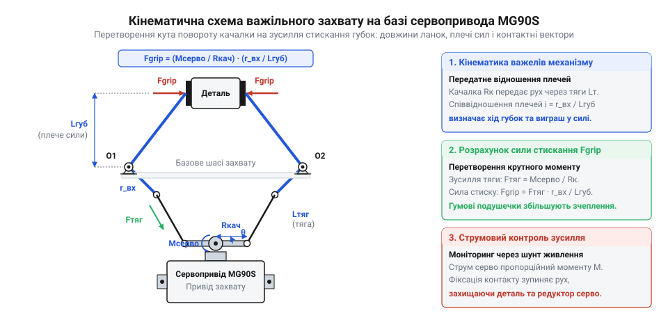
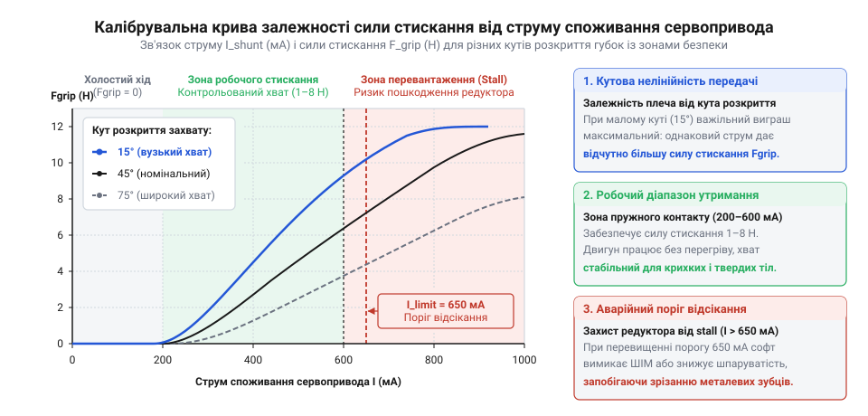
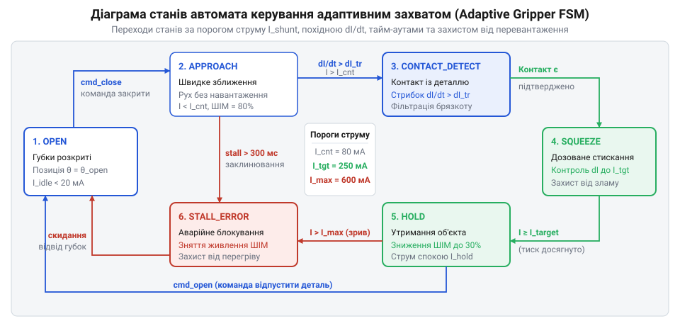

# MG90S V2 — мікросерво з металевим редуктором

<preknowlist>
- [Tower Pro SG90 — мікросерво 9g](root:cat-hw-actuators/sg90-servo) — принцип імпульсного керування модельними сервоприводами стандартним ШІМ-сигналом із періодом 20 мс та тривалістю імпульсу 1–2 мс, внутрішня будова зворотного зв'язку за потенціометром і базові електромеханічні обмеження привода класу 9 грамів.
- [Серво-роги (запасні)](root:cat-hw-actuators/servo-horns) — конструкція шліцьової посадки качалок на вихідний вал сервопривода, підбір довжини плеча качалки та надійне передавання механічного моменту на тяги захвату.
</preknowlist>

## Механічна пастка жорсткого позиціонування: аварійні режими сервопривода в захватах

У класичній схемі керування мікросервопривод класу MG90S чи [Tower Pro SG90](root:cat-hw-actuators/sg90-servo) розглядають як автономний позиційний вузол: мікроконтролер надсилає послідовність прямокутних імпульсів ШІМ із частотою 50 Гц, а внутрішня аналогова або цифрова схема привода виставляє вихідний вал на кут, пропорційний тривалості активного сигналу (від 1000 мкс для 0° до 2000 мкс для 180°). Усередині сервопривода діє власний локальний контур зворотного зв'язку за потенціометром: компаратор обчислює похибку між заданою тривалістю імпульсу та поточною напругою з бігунка датчика, формуючи напругу на колекторному двигуні через інтегральний H-міст.

Ця модель бездоганно працює в рульових поверхнях авіамоделей або поворотних турелях камер, де вал переміщується у вільному повітряному просторі й зустрічає лише помірний аеродинамічний чи гравітаційний опір. Проте в механізмі маніпуляційного захвату (@@en|gripper@@) завдання принципово інше: метою є не поворот на абстрактний градус, а контактна взаємодія з твердим або піддатливим тілом невідомих чи неідеальних розмірів.

Коли захват намагається стиснути деталь, використовуючи лише «сліпе» позиційне завдання, інженер неминуче стикається з фізичною дилемою точкового позиціонування:

1. **Недостатнє зведення губок (недохід до цілі).** Якщо керуюча програма заздалегідь розраховує кут повороту на основі номінальних креслень об'єкта й зупиняє рух у точці торкання або з невеликим запасом на відкриття, будь-яке відхилення розмірів деталі в мінус (допуск виготовлення, інша орієнтація в просторі, нерівність поверхні) призводить до того, що контактне зусилля стає нульовим або недостатнім для компенсації сили тяжіння та інерційних прискорень. При перенесенні деталь просто вислизає (@@en|slip@@) і падає.
2. **Надмірне зведення губок (спроба проникнення в матеріал).** Щоб гарантувати надійне утримання, програміст намагається дати «запас по ходу» — формує команду зведення пальців далі, ніж теоретична ширина предмета. Губки впираються в поверхню деталі, механічний рух вала повністю блокується, але потенціометр сервопривода фіксує, що поточний кут не дорівнює заданому.

У момент, коли губки торкнулися твердого тіла й зупинилися, внутрішня схема сервопривода фіксує постійну неусувну неузгодженість (похибку положення). Оскільки вбудований пропорційний регулятор прагне звести цю похибку до нуля, він повністю відкриває транзистори вихідного каскаду H-моста, подаючи на обмотки двигуна повну напругу шини живлення (5.0–6.0 В). Ротор сервопривода переходить у критичний аварійний стан — режим заклинювання (@@en|stall mode@@).

> 🔧 **Навіщо це.**
> Розуміння фізики заклинювання знімає ілюзію, що сервопривод можна надійно застосувати в захватах без зворотного зв'язку за зусиллям. У захваті будь-яке успішне утримання деталі за сліпим позиційним алгоритмом — це навмисне введення привода в режим короткого замикання ротора, де час до руйнування механіки чи електроніки вимірюється секундами.

У режимі заклинювання швидкість обертання якоря дорівнює нулю, тому проти-ЕРС (електрорушійна сила самоіндукції, що обмежує струм під час нормального обертання) повністю зникає. Єдиним чинником, який обмежує електричний струм через двигун, залишається активний омічний опір мідного дроту обмоток ротора та перехідний опір колекторно-щіткового вузла. Для мікросервоприводів серії MG90S цей опір становить усього 5.5–6.5 Ом. Відповідно до закону Ома, пусковий струм блокування сягає:

```
I_stall = V_supply / R_armature
        = 5.0 / 6.0                 [номінальна напруга та опір якоря]
        ≈ 0.83 А (830 мА)
```

За напруги 6.0 В цей струм перевищує 1.0–1.1 А. Такий стан тягне за собою три незворотні руйнівні наслідки:

* **Теплове вигорання двигуна.** Металевий редуктор MG90S упаковано в компактний пластиковий корпус розміром 22.8 × 12.2 × 28.5 мм. Сам безсердечниковий або мікроколекторний двигун має вагу менше ніж 4 грами, а маса мідного дроту в його якорі становить частки грама. Теплова потужність, яка виділяється на обмотці під час заклинювання:

```
P_heat = I_stall² · R_armature
       = 0.83² · 6.0                [струм і опір обмотки]
       ≈ 4.13 Вт
```

Для настільки крихітної теплоємності потужність понад 4 Вт еквівалентна нагріванню паяльником. За відсутності примусового обдуву температура лакової ізоляції мідного дроту за 5–8 секунд перевищує 120–140 °C. Починається піроліз лаку, виникають міжвиткові короткі замикання, які ще більше зменшують опір якоря і форсують нагрів. Одночасно деформуються пластикові тримачі вугільно-металевих щіток колектора, двигун назавжди втрачає здатність запускатися, а корпус сервопривода оплавляється.

* **Механічна деструкція редуктора та деталей.** Сервопривод MG90S розвиває пусковий крутний момент до 1.8–2.2 кг·см (0.18–0.22 Н·м). Металевий редуктор містить латунні та алюмінієві шестерні, що забезпечує значно більшу стійкість, ніж у нейлонового редуктора SG90. Проте коли кут примусово зафіксовано перешкодою, весь пусковий момент концентрується на кількох крихітних зубах вихідного вала та проміжної шестерні передостаннього ступеня редуктора (модуль зуба менше ніж 0.25 мм). У поєднанні з консольним згином осей це призводить до сколювання зубців або розбивання посадкових отворів у кришці корпусу. Якщо ж редуктор витримує удар, неконтрольоване зусилля руйнує сам об'єкт маніпуляції: тріскаються тонкостінні пластикові корпуси, деформуються електронні компоненти, роздавлюються скляні колби чи біологічні зразки.

* **Просідання живлення й перезавантаження мікроконтролера.** Стрибок струму до 800–1000 мА створює різке падіння напруги на внутрішньому опорі джерела живлення та сполучних провідниках. Якщо плата мікроконтролера та сервопривод живляться від спільної шини 5 В або від виходу USB порту комп'ютера, напруга живлення логіки провалюється нижче 4.0–4.2 В, провокуючи спрацьовування апаратної системи скидання за зниженням напруги (@@en|Brownout Reset@@, BOR). Мікроконтролер перезавантажується, знімає ШІМ-сигнал, двигун знеструмлюється, напруга повертається до норми, процесор заново починає виконувати прошивку, знову віддає команду на стискання — і система входить у нескінченний цикл перезавантажень.

Позиційне керування сервоприводом принципово не здатне розрізнити два фізично протилежні стани: деталь надійно втримана із зусиллям 2 Ньютони чи сервопривод заклинило намертво із зусиллям 15 Ньютонів і він просто зараз плавить власну ізоляцію. Кінцеві вимикачі чи оптичні оптопари не розв'язують проблему: вони дають дискретний бінарний сигнал контакту, але не вимірюють величину сили стискання.

Єдиним надійним і системним розв'язком для побудови живучого роботизованого захвату є організація зворотного зв'язку за струмом. Оскільки механічний момент колекторного електродвигуна прямо пропорційний силі струму, що протікає крізь його якір, аналогове вимірювання струму споживання сервопривода дає точну непряму оцінку зусилля на губках. Це дозволяє вчасно зупинити нарощування кута, зафіксувати досягнення цільової сили контакту, адаптуватися до деталей із варіативними габаритами та миттєво знеструмити обмотки при виявленні небезпечного заклинювання.

## Плоска важільна кінематика захвату: геометрична трансформація моменту в стискальне зусилля

Перетворення обертального руху вихідного вала сервопривода на лінійне стискальне переміщення двох зустрічних губок виконується за допомогою симетричного плоского важільного механізму (@@en|planar linkage mechanism@@). Використання важільної передачі з тягами — класичне компонувальне рішення для мікроманіпуляторів, оскільки воно дозволяє розташувати привод стаціонарно на базовій каретці або фланці робота, зводячи до мінімуму рухому масу самого захвату.

Розглянемо кінематичну схему симетричного шарнірно-важільного захвату. Механізм складається з таких ланок:

1. **Сервокачалка (ведуча ланка).** Двоплечий або одноплечий важіль, жорстко посаджений на шліцьовий вал MG90S за допомогою [серво-рога](root:cat-hw-actuators/servo-horns). Довжина робочого радіуса від осі обертання вала до шарніра кріплення тяги становить 
 (типово 10–14 мм). Кут повороту вала позначимо через θ. Відлік ведеться від положення повного розкриття захвату (θ = 0°).
2. **Тяги (проміжні шатуни).** Дві жорсткі металеві або пластикові тяги фіксованої довжини L, які сприймають поздовжнє зусилля стискання або розтягування. Верхні шарніри тяг закріплені на пальцях сервокачалки, нижні — з'єднані з плечима силових важелів губок.
3. **Пальці захвату (ведеві ланки).** Два дзеркально розташовані важелі, закріплені на нерухомих циліндричних шарнірах корпусу захвату з міжцентровою відстанню 2 · D_p. Кожен палець являє собою кутовий важіль із двома плечима: коротким плечем  (від нерухомої осі до шарніра з'єднання з тягою) та довгим робочим плечем H (від осі обертання пальця до центру пружної контактної подушечки губки).


*Геометрична схема плоского важільного механізму захвату: позначення кута качалки сервопривода, довжин ланок, плеча сили та розкладу векторів стискального зусилля на контактних подушечках губок.*

### Нелінійна передавальна функція переміщення

При повороті сервокачалки на кут θ декартові координати точки шарніра кріплення тяги відносно осі сервопривода змінюються за тригонометричним законом:

```
x_horn(θ) = r · sin(θ)
y_horn(θ) = y_servo_0 - r · cos(θ)
```

Положення кожного з пальців захвату описується кутом його власного розвороту φ(θ). Відстань між контактними площинами двох губок захвату (розкрив пальців w(θ)) визначається як різниця їхніх горизонтальних координат у точках контакту:

```
w(θ) = 2 · (D_p - H · sin(φ(θ)))
```

Зв'язок між кутом повороту сервокачалки θ та кутом пальця φ задається рівнянням замкненого кінематичного контуру через постійну довжину тяги L. З прямокутного трикутника відносної відстані між шарнірами:

```
L² = (x_finger(φ) - x_horn(θ))² + (y_finger(φ) - y_horn(θ))²
```

Оскільки це рівняння трансцендентне, пряма аналітична залежність w(θ) має виражену нелінійність: передавальне відношення швидкості dw / dθ не є константою. На початку руху (при переході з повністю відкритого положення θ ≈ 0°) лінійне переміщення губок на один градус повороту вала є максимальним. У міру наближення механізму до випрямлення тяг (положення стикання) швидкість переміщення губок уповільнюється.

### Трансформація крутного моменту в стискальне зусилля

Найпростіший і математично найстійкіший спосіб розрахунку сили стискання полягає у використанні принципу віртуальних переміщень (@@en|principle of virtual work@@). У квазістатичному наближенні (ігноруючи малі сили інерції легких пластикових деталей) віртуальна робота, виконана крутним моментом вихідного вала сервопривода M_servo, повністю переходить у роботу сили стискання F_grip, що діє на обидві губки:

```
δA = M_servo · δθ - F_grip · δw = 0
```

Звідси пряма залежність контактного зусилля від крутного моменту вала визначається через миттєве передавальне число механізму:

```
F_grip(θ) = M_servo / (dw(θ) / dθ)
```

Величина L_eff(θ) = dw(θ) / dθ називається миттєвим еквівалентним плечем сили механізму. Фізичний сенс цієї формули розкриває фундаментальну інженерну закономірність: **стискальне зусилля обернено пропорційне лінійній швидкості зведення губок**.

Розглянемо приклад числового розрахунку для типового маніпулятора з сервоприводом MG90S:

* Довжина качалки: 
 = 12 мм = 0.012 м;
* Довжина тяги: L = 28 мм = 0.028 м;
* Довжина короткого плеча пальця:  = 14 мм = 0.014 м;
* Довжина робочої частини пальця: H = 36 мм = 0.036 м;
* Крутний момент сервопривода при робочому навантаженні: M_servo = 0.15 Н·м (1.53 кг·см при напрузі 5.0 В).

Простежимо зміну зусилля на губках для двох характерних робочих конфігурацій:

1. **Широкий розкрив (кут повороту качалки θ = 20°):**
   Тяги перебувають під кутом приблизно 45° до лінії руху. Миттєва похідна переміщення:

```
dw / dθ ≈ 0.038 м/рад (0.66 мм/град)
F_grip = M_servo / (dw / dθ)
       = 0.15 / 0.038               [момент сервопривода та похідна ходу]
       ≈ 3.95 Н (0.40 кг)
```

2. **Захоплення тонкого предмета біля точки замикання (кут θ = 65°):**
   Шарнірні ланки наближаються до положення так званого «колінного замка» (@@en|toggle mechanism@@). При цьому тяга стає майже перпендикулярною до плеча губки , а приріст горизонтальної координати качалки різко падає:

```
dw / dθ ≈ 0.016 м/рад (0.28 мм/град)
F_grip = M_servo / (dw / dθ)
       = 0.15 / 0.016               [момент сервопривода та похідна ходу]
       ≈ 9.38 Н (0.96 кг)
```

При тому самому крутному моменті сервопривода (й відповідно, тому самому струмі двигуна) фактична стискальна сила на контактних подушечках губок зростає більш ніж у 2.3 раза: від 3.95 Н до 9.38 Н.

> 🔧 **Навіщо це.**
> Залежність стискального зусилля від геометрії означає, що поріг відсічення за струмом не може бути єдиною фіксованою константою. Якщо контролер зупиняє привод при фіксованому струмі 400 мА, то широкий предмет буде стиснуто із зусиллям ~2 Н, а вузький цим же струмом буде роздавлено зусиллям понад 5 Н. Алгоритм адаптивного стискання зобов'язаний динамічно нормалізувати струмовий поріг на основі поточного кута вала: I_threshold(θ) = F_target · (dw(θ) / dθ) / K_torque.

### Вплив механічного люфту металевого редуктора та шарнірів

У теоретичних розрахунках припускають, що зв'язок між кутом потенціометра сервопривода та положенням губок є абсолютно монотонним і двостороннім. На практиці в дешевих мікроприводах MG90S реальна точність обмежена механічним люфтом (@@en|backlash@@).

Металевий редуктор MG90S містить чотири ступені циліндричних прямозубих передач із сумарним передавальним числом близько 1:300. Сумарний кутовий зазор у зачепленні зубців у поєднанні з радіальними люфтами бронзових втулок вихідного вала утворює кутовий люфт вала Δθ_gear = 1.8°..3.2°. До цього додаються конструктивні зазори у чотирьох шарнірних отворах механізму захвату (осі тяг і важелів пальців, де зазвичай використовуються саморізи або шпильки M2): сумарний додатковий кутовий люфт у перерахунку на вал привода становить ще Δθ_joints ≈ 1.2°..2.0°.

Повний механічний гістерезис системи досягає:

```
Δθ_total = Δθ_gear + Δθ_joints
         = 3.0° + 1.5°              [типові зазори редуктора та шарнірів]
         = 4.5°
```

На довжині робочого плеча пальця H = 36 мм кутовий люфт 4.5° створює «мертву зону» (@@en|deadband@@) на кінчиках губок:

```
Δw_dead = 2 · H · sin(Δθ_total / 2)
        = 2 · 0.036 · sin(2.25°)
        ≈ 0.0028 м (2.8 мм)
```

Механічний люфт має вирішальне значення для алгоритму аналізу струму:

1. **Холостий хід при зміні напрямку.** Коли сервопривод реверсує рух або починає закривати захват із повністю відкритого положення, перші 3–5° повороту вала відбуваються без будь-якого механічного навантаження: двигун вибирає сумарний зазор у зубах редуктора і тягах. Протягом цього проміжку струм споживання залишається на мінімальному рівні холостого ходу (15–35 мА).
2. **М'який контакт і фаза пружної деформації.** У момент вичерпання зазорів і торкання деталей губки не зупиняються миттєво як абсолютно жорстке тіло. Спочатку стискаються еластичні силіконові або гумові накладки на губках, потім пружно згинаються тяги й консольні пластикові важелі захвату. Лише після вичерпання пружності починається стрімке наростання механічного опору й відповідний стрибок струму споживання.

Саме тому вимірювання струму дає змогу повністю відокремити зону холостого вибирання люфтів від фази реального силового навантаження, забезпечуючи надійну роботу захвату навіть на базі бюджетних механічних компонентів.

## Електромеханічна модель двигуна MG90S та фізика струмоспоживання

Внутрішнім приводом мікросервопривода MG90S є колекторний двигун постійного струму з постійними магнітами (@@en|permanent magnet DC motor@@, PMDC). Щоб використовувати струм живлення сервопривода як точний інструмент оцінки контактного зусилля на губках захвату, необхідно встановити математичний зв'язок між електричними процесами в обмотці якоря та механічним моментом на вихідному валу.

Електричний стан кола якоря описується рівнянням рівноваги напруг за другим законом Кірхгофа:

```
U_motor = E_emf + I_a · R_a + L_a · (dI_a / dt)
```

де:
* U_motor — миттєва напруга, яку внутрішній H-міст сервопривода прикладає до клем двигуна (В);
* E_emf — проти-електрорушійна сила (@@en|back-EMF@@), індукована в провідниках обмотки при обертанні якоря в магнітному полі статора (В);
* I_a — струм якоря (А);
* R_a — активний омічний опір обмотки якоря та щітково-колекторного вузла (для MG90S становить близько 5.5–6.5 Ом);
* L_a — власна індуктивність обмотки якоря (величиною порядку 40–80 мкГн).

Оскільки електрична стала часу кола якоря τ_e = L_a / R_a ≈ 10 мкс на кілька порядків менша за механічну сталу часу ротора τ_m ≈ 15–25 мс, індуктивним падінням напруги L_a · (dI_a / dt) у квазістатичних режимах руху можна знехтувати. Рівняння спрощується до алгебраїчного балансу:

```
U_motor = E_emf + I_a · R_a
```

Проти-ЕРС прямо пропорційна кутовій швидкості обертання вала двигуна ω_motor:

```
E_emf = k_e · ω_motor
```

де k_e — конструктивний коефіцієнт проти-ЕРС двигуна (В·с/рад), який залежить від кількості витків обмотки, площі полюсів та магнітної індукції неодимових або феритових магнітів статора.

Електромагнітний крутний момент M_motor, що розвивається на валу ротора, фундаментально пропорційний силі струму в обмотці:

```
M_motor = k_t · I_a
```

де k_t — коефіцієнт крутного моменту (Н·м/А). У міжнародній системі одиниць SI чисельні значення коефіцієнтів збігаються: k_t = k_e.

Вихідний вал сервопривода пов'язаний з валом колекторного двигуна через чотириступеневий металевий редуктор із передавальним числом N ≈ 300. З урахуванням механічного коефіцієнта корисної дії редуктора η_gear ≈ 0.65–0.72 (втрати на тертя кочення та ковзання в зубчастих зачепленнях та втулках), корисний крутний момент на сервокачалці M_shaft становить:

```
M_shaft = N · η_gear · M_motor
        = N · η_gear · k_t · I_a     [зв'язок моменту вала зі струмом якоря]
```

Це рівняння доводить фундаментальний факт: **електричний струм, що протікає крізь двигун, є прямою непрямою мірою механічного крутного моменту на вихідному валу**.

> 🔧 **Навіщо це.**
> Лінійний зв'язок M_shaft ~ I_a дозволяє відмовитися від крихких і дорогих тензометричних або п'єзорезистивних датчиків тиску на кінчиках пальців захвату. Увесь механізм пальців залишається чистою механікою без навісних проводів, а інформація про стискальне зусилля зчитується безпосередньо з шини живлення привода.

### Градація робочих режимів та величин струму

У процесі виконання маніпуляції захват проходить чотири чітко розмежовані динамічні фази, кожна з яких характеризується власним рівнем струмоспоживання:

1. **Струм спокою (квазістатичне утримання без навантаження): I_quiescent = 10–18 мА.**
   Коли губки захвату відкриті або перебувають у заданій позиції без зовнішнього опору, похибка за внутрішнім потенціометром нульова. H-міст закритий, напруга на двигун не подається. Струм визначається власним споживанням аналогової мікросмули драйвера сервопривода, стабілізатора та вимірювального дільника потенціометра.
2. **Струм холостого ходу (вільний рух у повітрі): I_no_load = 110–160 мА.**
   Коли сервопривод переміщує губки з відкритого положення в точку попереднього позиціонування, вал обертається з максимальною швидкістю ω_max ≈ 500–600 град/с (близько 0.10–0.12 с на 60°). При цьому проти-ЕРС досягає свого максимуму (E_emf ≈ 0.75–0.85 · U_supply), віднімаючись від напруги живлення. Струм якоря залишається невеликим і витрачається виключно на подолання тертя в редукторі та щітковому вузлі:

```
I_no_load = (U_supply - E_emf) / R_a
          = (5.0 - 4.1) / 6.0       [баланс напруг при максимальній швидкості]
          ≈ 0.15 А (150 мА)
```

3. **Струм стискання та контакту: I_work = 250–550 мА.**
   У момент зіткнення губок із предметом опір матеріалу уповільнює обертання вала. Зі зниженням швидкості ω пропорційно падає проти-ЕРС E_emf. Різниця напруг (U_supply - E_emf) зростає, спричиняючи швидке наростання струму якоря. Цей діапазон є штатним робочим вікном контрольованого утримання: струм у 300–450 мА створює на валу момент 0.08–0.12 Н·м, достатній для захоплення більшості лабораторних та промислових об'єктів.
4. **Струм повного заклинювання (аварійний режим stall): I_stall = 800–950 мА (при 5.0 В) та 1000–1150 мА (при 6.0 В).**
   Якщо деталь тверда і сервопривод намагається провернути вал далі точки контакту, швидкість вала падає до нуля: ω = 0, відповідно E_emf = 0. Вся напруга живлення падає виключно на омічному опорі якоря:

```
I_stall = U_supply / R_a
        = 5.0 / 5.8                 [напруга шини та мінімальний гарячий опір]
        ≈ 0.86 А (860 мА)
```

### Теплова інерція та часові межі деградації ізоляції

Двигун типорозміру 9 грамів має вкрай малу масу активних матеріалів. Маса мідного дроту обмоток ротора становить лише m_cu ≈ 0.35–0.40 г. Питома теплоємність міді дорівнює c_cu = 385 Дж/(кг·°C). Відповідно, теплоємність обмотки:

```
C_th = m_cu · c_cu
     = 0.00038 · 385                [маса міді та питома теплоємність]
     ≈ 0.146 Дж/°C
```

В умовах заклинювання при струмі 860 мА розсіювана потужність сягає:

```
P_heat = I_stall² · R_a
       = 0.86² · 5.8                [струм заклинювання та опір]
       ≈ 4.29 Вт
```

Через відсутність металевого контакту якоря з корпусом тепловідвід у перші секунди практично відсутній (адіабатичний нагрів). Темп наростання температури міді становить:

```
dT / dt = P_heat / C_th
        = 4.29 / 0.146              [теплова потужність і теплоємність обмотки]
        ≈ 29.4 °C/с
```

При початковій температурі навколишнього середовища 25 °C вже через 3.5–4.0 секунди безперервного заклинювання температура ізоляційного лаку перевищує 130–145 °C. Це робоча межа термостійкості емальпроводу класу ПЕВТЛ-1. Починається спікання сусідніх витків, виникають короткозамкнені секції, а розплавлені пластикові гнізда колекторних щіток спричиняють остаточне заклинювання ротора.

Звідси випливає фундаментальне правило конструювання вбудованого ПЗ: **час перебування сервопривода MG90S під максимальним струмом блокування не повинен перевищувати 200–300 мс**. За цей інтервал тепловий імпульс становить менше ніж 1.3 Дж, що підіймає температуру обмотки менш ніж на 8–9 °C і є абсолютно безпечним для привода.

---

## Схемотехніка струмовимірювання: high-side шунт та узгодження з АЦП

Для вимірювання електричного струму сервопривода мікроконтролером застосовують резистивний шунт (@@en|current-sense shunt resistor@@). Проте вибір точки включення шунта в електричний ланцюг живлення визначає стабільність роботи всієї системи керування.

### Ризики вимірювання в нижньому плечі (Low-Side Sensing)

У топології нижнього плеча вимірювальний резистор встановлюють у розрив мінусового провідника — між контактом GND сервопривода та опорною землею живлення схеми GND_mcu.

Головна перевага цієї схеми — простота: напруга на шунті вимірюється безпосередньо відносно загальної землі, що дозволяє обійтися недорогим однополярним операційним підсилювачем або навіть завести падіння напруги прямо на вхід АЦП. Проте для керування сервоприводом топологія low-side містить критичний недолік — **плаваючий потенціал землі (@@en|ground bounce@@)**.

Сервопривод підключається трьома лініями: VCC, GND та лінією керуючого сигналу ШІМ (PWM). Коли двигун споживає струм I_servo, на шунті R_shunt утворюється падіння напруги:

```
V_gnd_shift = I_servo · R_shunt
```

У результаті внутрішня земля сервопривода зміщується вгору відносно землі мікроконтролера на величину V_gnd_shift. При пускових струмах 800–1000 мА та номіналі шунта 0.2–0.5 Ом цей зсув сягає 160–500 мВ.

Для вхідного каскаду сервопривода логічні рівні сигналу ШІМ вимірюються відносно його власного зміщеного контакту GND. Якщо мікроконтролер працює з логікою 3.3 В (типово для STM32, ESP32, RP2040), амплітуда логічної одиниці, яку бачить вхідний компаратор сервопривода, зменшується:

```
V_pwm_effective = V_pwm_high - V_gnd_shift
                = 3.30 - 0.35       [напруга виводу МК мінус зсув землі]
                = 2.95 В
```

Оскільки логічний поріг перемикання багатьох мікросхем сервоприводів (розрахованих на живлення 5 В) становить близько 2.4–2.8 В, імпульсні індуктивні викиди в момент комутації щіток двигуна викликають хаотичні провали сигналу нижче порогу розпізнавання одиниці. Сервопривод починає втрачати імпульси керування, з'являється високочастотне тремтіння вала (@@en|jitter@@), довільні ривки губок та зрив позиціювання. Ба більше, якщо в маніпуляторі кілька сервоприводів мають контакт через спільне металеве шасі, виникають неконтрольовані паразитні земляні петлі (@@en|ground loops@@), здатні випалити виводи мікроконтролера.

### Переваги та схемотехніка вимірювання у верхньому плечі (High-Side Sensing)

У топології верхнього плеча вимірювальний шунт включається в розрив плюсової шини живлення +5 В перед входом VCC сервопривода. Контакт GND сервопривода з'єднується безпосередньо з шиною GND джерела живлення та мікроконтролера.

При такій конфігурації потенціал землі залишається непохитно стабільним незалежно від стрибків струму двигуна. Керуючий сигнал ШІМ повністю зберігає форму та амплітуду, виключаючи збої логіки.


*Принципова електрична схема струмовимірювання у верхньому плечі (high-side): вимірювальний шунт 0.1 Ом, спеціалізований підсилювач INA180/INA219, фільтрація та узгодження з АЦП.*

Складність high-side вимірювання полягає в тому, що слабкий корисний диференційний сигнал на шунті (десятки мілівольт) перебуває під високим синфазним потенціалом шини живлення (+5.0 В), що перевищує напругу живлення 3.3 В більшості сучасних АЦП. Для виділення цього сигналу застосовують спеціалізовані струмовимірювальні підсилювачі (@@en|Current Sense Amplifiers@@, CSA) з високим коефіцієнтом пригнічення синфазного сигналу (CMRR понад 100 дБ), наприклад **INA180** (аналоговий) або **INA219 / INA226** (цифровий з інтерфейсом I2C).

> 🔧 **Навіщо це.**
> Використання мікросхеми INA180 або INA219 замість саморобного диференційного підсилювача на звичайному ОП усуває похибку від неідеальності зовнішніх резисторів дільника. Щоб отримати CMRR на рівні 100 дБ на звичайному ОП, потрібні резистори з точністю 0.01%, тоді як спеціалізована ІМС містить лазерно підігнані резистори всередині кристала й працює з синфазною напругою до 26 В навіть при живленні самої мікросхеми від 3.3 В.

### Розрахунок номіналу шунта та динамічного діапазону

Оптимальний вибір опору шунта R_shunt — це інженерний компроміс між рівнем корисного сигналу (співвідношення сигнал/шум) та допустимою втратою напруги на навантаженні.

Оберемо прецизійний металоплівковий або фольговий резистор номіналом R_shunt = 0.10 Ом (допуск 1%, типорозмір 1206 або 2010, ТКС не гірше 100 ppm/°C).

1. **Втрата напруги на шунті.** При максимальному струмі заклинювання I_max = 1.0 А:

```
V_shunt_max = I_max · R_shunt
            = 1.0 · 0.10            [максимальний струм та опір шунта]
            = 0.10 В (100 мВ)
```

Спад напруги становить лише 2% від номіналу шини 5.0 В. Сервопривод отримує не менше 4.90 В, що не викликає помітного падіння крутного моменту або швидкості.
2. **Розсіювана потужність на шунті:**

```
P_shunt = I_max² · R_shunt
        = 1.0² · 0.10               [квадрат струму та опір шунта]
        = 0.10 Вт
```

Для резистора з паспортною потужністю 0.5–1.0 Вт запас перевищує 5 разів. Резистор практично не нагрівається, що гарантує відсутність температурного дрейфу опору.

3. **Узгодження зі шкалою АЦП (3.3 В).**
   Аналоговий підсилювач INA180 випускається у варіантах із різними фіксованими коефіцієнтами підсилення:
   * Варіант A1: Gain = 20 В/В;
   * Варіант A2: Gain = 50 В/В.

Розрахуємо вихідну напругу підсилювача для версії з Gain = 20:

```
V_out_max = V_shunt_max · Gain
          = 0.10 · 20               [напруга шунта та коефіцієнт підсилення]
          = 2.00 В
```

Напруга 2.00 В чудово вкладається в робочий діапазон АЦП з опорною напругою V_ref = 3.3 В. Запас зверху (від 2.0 до 3.3 В) гарантує, що навіть короткочасні індуктивні перехідні викиди струму до 1.5 А не викличуть насичення (кліпінгу) виходу підсилювача.

При використанні 12-бітного АЦП мікроконтролера (діапазон 0..4095) ціна одиниці молодшого розряду (LSB) за струмом становить:

```
I_lsb = V_ref / (4096 · Gain · R_shunt)
      = 3.3 / (4096 · 20 · 0.10)    [опорна напруга, розрядність, підсилення]
      ≈ 0.000402 А (0.40 мА/LSB)
```

Роздільна здатність у 0.40 мА на дискрет АЦП дозволяє легко фіксувати навіть мінімальні механічні коливання та наростання сили стискання з точністю до десятих часток Ньютона.

### Апаратна фільтрація комутаційного шуму та захист кіл

Внутрішній двигун сервопривода комутується H-мостом за допомогою локальної ШІМ із базовою частотою близько 15–25 кГц. Крім того, контакт щіток із колектором створює іскроутворення та потужний імпульсний шум широкого спектра. Без вхідної та вихідної фільтрації сигнал на АЦП перетвориться на нечитну кашу зі сплесків.

Наведена принципова електрична схема містить повний комплекс заходів фільтрації та стабілізації:

1. **Буферний конденсатор живлення C1 (470–1000 мкФ, електролітичний Low-ESR на 10–16 В).** Встановлюється безпосередньо на шині 5 В перед вимірювальним шунтом. Він компенсує індуктивність живильних проводів довжиною 20–50 см, згладжує глибокі провали напруги при старті двигуна та усуває загрозу виникнення циклічних збоїв Brownout Reset мікроконтролера.
2. **Блокувальний керамічний конденсатор C2 (100 нФ, X7R).** Розташовується в безпосередній близькості від виводу живлення VCC мікросхеми INA180 для придушення високочастотних завад по шині живлення власної логіки підсилювача.
3. **Кельвінівське підключення шунта (Kelvin connection).** Вимірювальні провідники від виводів IN+ та IN- мікросхеми підсилювача підключаються тонкими симетричними доріжками безпосередньо до внутрішніх контактних площадок резистора R1 окремо від силових полігонів живлення. Це виключає потрапляння падіння напруги на силових доріжках друкованої плати у вимірювальний сигнал.
4. **Вихідний фільтр нижніх частот RC (R2, C3).** Резистор R2 = 100 Ом та конденсатор C3 = 22 нФ, розміщені біля входу АЦП мікроконтролера, утворюють антиаліасинговий фільтр низьких частот першого порядку з частотою зрізу:

```
f_cutoff = 1 / (2 · π · R2 · C3)
         = 1 / (2 · 3.1416 · 100 · 22·10⁻⁹) [параметри RC-ланцюга]
         ≈ 72.3 кГц
```

Цей фільтр ефективно зрізає високочастотні комутаційні піки колектора та гармоніки ШІМ, одночасно захищаючи вхід АЦП від імпульсних наведень і виступаючи джерелом заряду для внутрішнього конденсатора схеми вибірки та зберігання (S&H) АЦП.

## Фізична структура струму сервопривода: спектр завад та антиаліасингова фільтрація

Розробник, який уперше підключає вихід струмовимірювального підсилювача до аналогового входу мікроконтролера, зазвичай очікує побачити гладку монотонну криву: низький струм під час руху губок у повітрі та плавне наростання струму в момент стискання деталі. Проте реальний сигнал на екрані осцилографа кардинально відрізняється від теоретичної ідилії.

Реальний струм споживання сервопривода MG90S являє собою складний нестаціонарний випадковий процес із широким спектром частотних складових. Якщо подати такий сигнал на АЦП мікроконтролера напряму без глибокого розуміння його фізичної структури, будь-який програмний алгоритм виявлення контакту буде постійно генерувати помилкові спрацьовування або пропускати аварійні режими.


*Осцилограма форми струму споживання сервопривода в часі: пусковий сплеск розгону ротора, високочастотний комутаційний шум внутрішнього ШІМ-моста, базовий рівень струму холостого ходу та стрибкоподібне наростання струму при механічному контакті губок із перешкодою.*

### Складові струмового профілю

У сигналі струму чітко розпізнаються п'ять фізичних компонентів різної природи:

1. **Високочастотні пульсації внутрішнього ШІМ-моста (15–25 кГц).** Внутрішня мікросхема драйвера MG90S регулює напругу на двигуні за допомогою власної широтно-імпульсної модуляції (ШІМ). Кожен такт перемикання силових транзисторів H-моста прикладає повну напругу шини живлення 5 В до індуктивної обмотки якоря, створюючи трикутні пульсації струму з розмахом (@@en|ripple@@) від 50 до 150 мА на частоті комутації.
2. **Комутаційний шум щітково-колекторного вузла (100 кГц — 10 МГц).** При обертанні ротора мідно-графітові щітки перемикаються між ламелями циліндричного колектора. Розрив контакту зі струмоведучою секцією обмотки з ненульовою індуктивністю викликає мікродугові розряди, іскріння та субмікросекундні сплески напруги амплітудою в кілька вольт.
3. **Пусковий сплеск струму розгону ротора (inrush current, 750–1000 мА).** Коли сервопривод отримує команду повернутися на новий кут, якір у перший момент перебуває в стані спокою: кутова швидкість `ω = 0`, тому проти-ЕРС дорівнює нулю (`E_emf = 0`). Внутрішній компаратор фіксує максимальну похибку положення та миттєво відкриває транзистори H-моста на 100% шпаруватості. Протягом перших 15–30 мс двигун споживає повний струм заклинювання, необхідний для подолання інерції власного ротора та початкового тертя спокою в редукторі, навіть коли губки рухаються абсолютно вільно у порожнечі.
4. **Струм холостого ходу (110–160 мА).** Після виходу ротора на стаціонарну кутову швидкість проти-ЕРС компенсує більшу частину напруги живлення, і струм падає до базового рівня, обумовленого механічним тертям латунних шестерень та втулок.
5. **Стрибок струму при механічному контакті (250–900 мА).** Коли губки торкаються предмета, механічний рух сповільнюється або блокується, проти-ЕРС зникає, а струм різко прямує до рівня повного заклинювання.

> 🔧 **Навіщо це.**
> Головна пастка полягає в тому, що пусковий сплеск (inrush) за своєю амплітудою абсолютно не відрізняється від аварійного заклинювання (stall): обидва сягають 800–1000 мА. Проста перевірка умови `if (I > I_threshold)` призведе до того, що захват буде вважати схопленим будь-який об'єкт у першу ж мілісекунду після старту руху губок і миттєво зависатиме.

### Запобігання аліасингу та розрахунок антиаліасингового RC-фільтра

Дискретизація аналогового сигналу за допомогою вбудованого АЦП мікроконтролера підпорядковується теоремі Котельникова-Шеннона (Найквіста): щоб уникнути ефекту накладання спектрів (@@en|aliasing@@), частота дискретизації `f_sample` повинна щонайменше вдвічі перевищувати максимальну частоту спектра корисного сигналу:

```
f_nyquist = f_sample / 2
```

Якщо мікроконтролер опитує вхід АЦП у типовому для систем керування циклі з періодом `T_sample = 2 мс` (частота вибірки `f_sample = 500 Гц`), гранична частота Найквіста становить усього `f_nyquist = 250 Гц`.

Усі високочастотні компоненти сигналу, що лежать вище 250 Гц — гармоніки ШІМ 20 кГц, іскровий комутаційний бруд 500 кГц та паразитні коливання — дзеркально відіб'ються в робочу низькочастотну смугу 0..250 Гц. АЦП почне повертати хаотичні хибні значення, оскільки момент вибірки (апертурне вікно вибірки-зберігання тривалістю менше ніж 1 мкс) випадковим чином потраплятиме то на вершину 20-кілогерцового піку, то на дно западини ШІМ. Програмно очистити такий сигнал уже неможливо: інформація про справжній квазістатичний струм незворотно спотворена.

Єдиний захист від аліасингу — апаратне придушення високочастотного спектра ще до того, як сигнал потрапить на вхід аналогового тракту АЦП. Для цього між виходом струмовимірювального підсилювача (INA180) та входом АЦП встановлюють пасивний фільтр низьких частот першого порядку (RC-фільтр).

Критерії вибору частоти зрізу `f_cutoff`:

1. Вона повинна забезпечувати придушення частоти внутрішньої ШІМ `f_pwm ≈ 20 кГц` щонайменше на 25–30 дБ.
2. Вона повинна без затримок і спотворень пропускати динаміку механічного контакту. Механічний процес зіткнення губок із предметом триває близько 10–25 мс, що відповідає частотному діапазону реакції механізму до 40–80 Гц.

Оберемо частоту зрізу фільтра `f_cutoff ≈ 350–450 Гц`.

Розрахунок компонентів RC-фільтра:

Вихідний опір струмовимірювального підсилювача малий (частки ома), але вхід схеми вибірки та зберігання (S&H) АЦП мікроконтролера потребує низького еквівалентного імпедансу джерела для швидкої зарядки внутрішнього конденсатора `C_sample` (типово 5–10 пФ). Оптимальний вибір опору резистора фільтра — `R_filter = 1.0 кОм`.

Розрахуємо необхідну ємність конденсатора `C_filter`:

```
f_cutoff = 1 / (2 · π · R_filter · C_filter)
C_filter = 1 / (2 · π · R_filter · f_cutoff)
         = 1 / (2 · 3.1416 · 1000 · 400)    [опір 1 кОм, частота зрізу 400 Гц]
         ≈ 3.98·10⁻⁷ Ф (398 нФ)
```

Обираємо стандартний номінал керамічного SMD-конденсатора `C_filter = 470 нФ` (діелектрик X7R). При цьому фактична частота зрізу становить:

```
f_cutoff = 1 / (2 · 3.1416 · 1000 · 470·10⁻⁹)
         ≈ 338.6 Гц
```

Оцінимо коефіцієнт придушення фільтра на частоті ШІМ `f_pwm = 20 кГц`:

```
Attenuation_dB = 20 · log10(f_pwm / f_cutoff)
               = 20 · log10(20000 / 338.6)   [відношення частот для фільтра 1-го порядку]
               = 20 · log10(59.07)
               ≈ 35.4 дБ
```

Придушення на 35.4 дБ означає послаблення пульсацій ШІМ у 59 разів: амплітуда перешкоди на вході АЦП зменшується з початкових 100 мВ до безпечних 1.7 мВ, що становить менше 2–3 молодших розрядів 12-бітного перетворювача.

---

## Первинна цифрова обробка сигналу: часове стробування, фільтрація та похідна dI/dt

Апаратний RC-фільтр успішно зрізає високочастотний бруд комутації, проте низькочастотні перехідні процеси — пусковий сплеск (inrush) та коливання струму від пружності редуктора — залишаються в сигналі. Їхнє розділення та виділення моменту істинного контакту з об'єктом повністю лягає на алгоритми цифрової обробки в прошивці мікроконтролера.

Конвеєр первинної обробки струму містить три послідовні програмні каскади:

```
[АЦП: I_raw] ──> [Часове стробування] ──> [Фільтр згладжування EMA] ──> [Диференціатор dI/dt]
```

### Часове стробування пускового струму (Blanking Window)

Щоб усунути хибне спрацьовування захисту від заклинювання під час старту мотора, застосовують апаратне або програмне часове стробування (@@en|blanking window@@).

Фізичний зміст методу полягає в примусовому маскуванні (ігноруванні) порогів перевищення струму на фіксований інтервал часу `T_blank` відразу після того, як сервоприводу віддано команду на зміну кута:

1. У момент запису нового значення кута в регістр таймера ШІМ (`servo_write_angle`) внутрішній таймер стробування скидається в нуль: `blanking_timer = 0`, прапорець активності стробування встановлюється: `is_blanking = true`.
2. Протягом інтервалу `T_blank = 25–35 мс` опитування АЦП продовжується для накопичення історії, проте блок порогового захисту від заклинювання деактивовано: високий пусковий струм до 1 А сприймається як нормальний стан розгону ротора.
3. Після спливу `T_blank` якір сервопривода виходить на стаціонарну швидкість, проти-ЕРС врівноважує напругу, а струм падає до рівня холостого ходу (120–150 мА). Прапорець `is_blanking` скидається в `false`, і система переходить у повноцінний режим контролю зусилля.

> 🔧 **Навіщо це.**
> Тривалість вікна стробування `T_blank` критично важлива. Якщо встановити її надто малою (наприклад, 10 мс), пусковий сплеск не встигне згаснути, і алгоритм видасть хибну тривогу. Якщо зробити її надто великою (понад 60 мс), у разі спроби закрити захват на предметі, що стоїть упритул до губок, сервопривод встигне розвинути руйнівний момент до того, як контроль увімкнеться. Для мікропривода MG90S оптимальний діапазон становить 25–30 мс.

### Експоненційне ковзне середнє (EMA)

Після відсікання пускового сплеску необхідно відфільтрувати залишкові механічні вібрації та пульсації низької частоти для точної оцінки квазістатичного струму стискання `I_filtered`.

Найбільш обчислювально ефективним фільтром для вбудованих систем без апаратного модуля плаваючої коми є рекурсивний цифровий фільтр низьких частот першого порядку — експоненційне ковзне середнє (@@en|Exponential Moving Average@@, EMA):

```
I_filtered[k] = α · I_raw[k] + (1 - α) · I_filtered[k - 1]
```

де `I_raw[k]` — поточний миттєвий відлік струму з АЦП, `I_filtered[k - 1]` — попереднє згладжене значення, `α` — ваговий коефіцієнт згладжування в діапазоні `0 < α ≤ 1`.

Зв'язок між коефіцієнтом `α`, періодом опитування `Δt` та еквівалентною сталою часу цифрового фільтра `τ_filter`:

```
α = Δt / (τ_filter + Δt)
```

Для циклу опитування з періодом `Δt = 2 мс` (500 Гц) оберемо сталу часу згладжування `τ_filter = 18 мс`. Тоді ваговий коефіцієнт:

```
α = 2 / (18 + 2)
  = 2 / 20
  = 0.10
```

Щоб реалізувати цей розрахунок на 8-бітному або 32-бітному мікроконтролері без операцій ділення з плаваючою комою, перейдемо до цілочисельної арифметики з фіксованою комою формату Q8 (масштабування на 256):

```
α_q8 = round(0.10 · 256) = 26
(1 - α)_q8 = 256 - 26 = 230
```

Тоді рекурсивна формула фільтрації набуває швидкого цілочисельного вигляду з єдиним побітовим зсувом замість ділення:

```
I_filtered_q8[k] = (26 · (I_raw[k] << 8) + 230 · I_filtered_q8[k - 1]) >> 8
```

### Динамічна похідна наростання струму (dI/dt)

Очікування моменту, коли абсолютний фільтрований струм `I_filtered` перевищить заданий поріг утримання (наприклад, 450 мА), має серйозний недолік: через постійну часу фільтра та механічну інерцію губки встигають розвинути значне статичне зусилля. При роботі з крихкими об'єктами (тонкими пластиковими трубками, склом чи електронними компонентами) цього часу достатньо для появи мікротріщин.

Для раннього виявлення факту торкання використовують аналіз швидкості зміни струму — першу похідну `dI / dt`.

Під час вільного руху губок струм споживання практично постійний (`dI/dt ≈ 0`, шум не перевищує ±3–5 мА/мс). У момент, коли еластична накладка пальця зустрічає поверхню предмета, виникає швидке гальмування ротора, що викликає крутий фронт наростання струму: похідна стрибає до значень `30–75 мА/мс`.

Для надійного обчислення похідної в умовах дискретного шуму не можна брати різницю між сусідніми вибірками `(I[k] - I[k-1])`, оскільки диференціювання підсилює високочастотний шум. Розрахунок ведуть через ковзне вікно з кількох точок за допомогою кільцевого буфера глибиною `N = 4` відліки (інтервал часу `N · Δt = 4 · 2 = 8 мс`):

```
dI_dt[k] = (I_filtered[k] - I_filtered[k - 4]) / (4 · Δt)
```

Критерій контакту формулюється комбіновано:
1. Часове вікно стробування завершилося (`is_blanking == false`);
2. Похідна перевищила динамічний поріг швидкості наростання: `dI_dt > THRESHOLD_DERIVATIVE` (типово 25–35 мА/мс);
3. Або абсолютний фільтрований струм досяг граничного значення зусилля: `I_filtered > THRESHOLD_CURRENT_MAX`.

### Програмна реалізація блоку первинної обробки

Наведемо закінчений модуль первинної цифрової обробки сигналу струму на мові C для вбудованих мікроконтролерів:

:::code proj-robotic-gripper-current-monitor/c/current-monitor-init.c

Така комбінована фільтрація забезпечує затримку виявлення контакту не більше 6–10 мс, повністю пригнічує хибні пускові спрацьовування та надає скінченному автомату керування стабільні дані для реалізації адаптивного захвату.

## Стендове калібрування: перетворення струму на фізичне зусилля

Попередньо розрахована теоретична формула зв'язку струму та сили стискання є ідеалізованою моделлю. На практиці реальний механізм захвату на базі сервопривода MG90S містить низку фізичних нелінійностей, які неможливо точно розрахувати аналітично:

1. **Змінний коефіцієнт корисної дії редуктора.** Чотири ступені прямозубих шестерень редуктора мають ККД, який не є сталою величиною. При зростанні навантаження радіальні сили розпирають вали, викликаючи мікроперекоси латунних шестерень у бронзових втулках корпусу. У результаті коефіцієнт тертя зростає, а ККД редуктора падає з 75% при холостому ході до 55–60% поблизу максимального моменту.
2. **В'язкопружні властивості контактних накладок.** Пальці захвату оснащують еластичними поліуретановими або силіконовими подушечками для збільшення коефіцієнта зчеплення з деталлю. Деформація гуми підпорядковується нелінійному закону Гука: на початку стискання матеріал м'який, але при подальшому стисненні його жорсткість стрімко зростає.
3. **Пружний згин важільного механізму.** Довгі консольні пальці та проміжні тяги захвату, надруковані на 3D-принтері або вирізані з акрилу, помітно прогинаються під навантаженням понад 3–5 Н, змінюючи фактичну геометричну конфігурацію ланок.

Єдиним способом досягти метрологічної достовірності зусилля є побудова емпіричної калібрувальної кривої на вимірювальному стенді.


*Графік калібрувальної залежності сили стискання від струму споживання: ідентифікація робочих зон та порогів безпеки.*

### Методика стендових випробувань

Для проведення калібрування збирають простий вимірювальний стенд:

* На базовій плиті жорстко закріплюють електронні ваги з тензометричною балкою або прецизійний цифровий динамометр із роздільною здатністю не гірше 0.05 Н (5 грамів сили).
* За допомогою набору каліброваних проставок фіксують різну ширину між контактними точками пальців, що відповідає трьом характерним кутам повороту качалки сервопривода: `θ = 20°` (широкий розкрив, 50 мм), `θ = 45°` (середній розкрив, 30 мм) та `θ = 65°` (вузький розкрив біля точки замикання, 15 мм).
* Сервопривод у покроковому режимі (з кроком 0.5°) притискає губку до тензодатчика, а мікроконтролер записує пари значень: згладжений струм споживання `I_filtered` (мА) та покази динамометра `F_grip` (Н).

Отримані експериментальні криві демонструють чіткий поділ на три характерні зони роботи:

* **Зона вільного руху (струм менше 160–180 мА).** Сила стискання строго дорівнює нулю. Струм споживання витрачається виключно на подолання внутрішнього тертя редуктора. Поріг `I_zero ≈ 170 мА` є базовою точкою відліку (зсувом нуля) для початку розрахунку сили.
* **Зона пружного стискання (струм від 180 до 650 мА).** Робочий лінійний або слабконелінійний діапазон. Після вичерпання зазорів сила притискання зростає практично лінійно зі збільшенням струму: для кута `θ = 45°` крутизна характеристики становить близько 0.012 Н/мА (наростання струму на 100 мА дає приріст сили на 1.2 Н).
* **Зона аварійного перевантаження (струм понад 700–750 мА).** Крива сили виходить на плато насичення: редуктор досягає межі пружного опору, магнітопровід мікромотора насичується, а подальше зростання струму веде не до зростання корисної сили, а виключно до інтенсивного теплового руйнування ізоляції та ризику зрізання зубців.

> 🔧 **Навіщо це.**
> Зверніть увагу на розбіжність калібрувальних кривих для різних кутів: струм 450 мА при куті `θ = 20°` створює зусилля всього 2.8 Н, тоді як при куті `θ = 65°` (завдяки ефекту колінного замка) цей самий струм забезпечує понад 6.5 Н. Калібрування доводить: контролювати силу виключно за струмом без урахування поточного кута вала неможливо.

### Апроксимація та кусочно-лінійна таблиця пошуку (LUT)

Для використання результатів калібрування в коді мікроконтролера застосовують кусочно-лінійну апроксимацію (@@en|piecewise linear approximation@@) або двовимірну таблицю пошуку (@@en|Look-Up Table@@, LUT).

Зв'язок між струмом `I` та силою `F` для кожного опорного кута описується рівнянням прямої з початковим зсувом:

```
F_grip(θ, I) = K_force(θ) · (I_filtered - I_offset(θ))
```

де `I_offset(θ)` — струм холостого ходу на початку контакту (160–180 мА), а `K_force(θ)` — кутовий коефіцієнт чутливості (Н/мА).

У прошивці мікроконтролера зберігають компактну масив-таблицю калібрувальних коефіцієнтів для дискретних кутів із кроком 10°:

```c
typedef struct {
    uint8_t angle_deg;       // Кут сервокачалки (градуси)
    uint16_t offset_ma;      // Струм холостого ходу (мА)
    uint16_t gain_mn_per_ma; // Коефіцієнт передачі сили (міліньютони на мА)
} CalibrationPoint;

// Калібрувальна таблиця для MG90S на шині 5.0 В
static const CalibrationPoint CALIBRATION_LUT[] = {
    { 15, 175, 8 },   // 0.008 Н/мА при розкриві 15°
    { 30, 170, 10 },  // 0.010 Н/мА при розкриві 30°
    { 45, 165, 13 },  // 0.013 Н/мА при розкриві 45°
    { 60, 160, 18 },  // 0.018 Н/мА при розкриві 60°
    { 75, 155, 25 }   // 0.025 Н/мА біля точки замикання 75°
};
```

Функція розрахунку сили знаходить два найближчі опорні вузли за кутом і виконує лінійну інтерполяцію коефіцієнта, після чого миттєво обчислює зусилля в міліньютонах без витратних трансцендентних функцій.

---

## Скінченний автомат адаптивного захвату

Усі вимірювальні та кінематичні розрахунки об'єднуються в цілісну систему за допомогою детермінованого скінченного автомата (@@en|Finite State Machine@@, FSM). Автомат гарантує безпечне, передбачуване маніпулювання об'єктами без застрягання у проміжних невизначених станах.


*Діаграма станів і переходів скінченного автомата адаптивного захвату: алгоритм безпечного дотискання та обробки аварійного заклинювання.*

### Формалізація станів та логіка переходів

Автомат реалізує шість фундаментальних станів:

1. **`STATE_OPEN` (Повне розкриття).**
   Вихідний стан готовності. Сервопривод встановлює кут розкриття губок на максимум (`θ = 0°`). Двигун знеструмлюється або залишається в режимі спокою. При отриманні зовнішньої команди на захоплення `CMD_GRASP` автомат ініціалізує таймер руху і переходить у стан `APPROACH`.
2. **`STATE_APPROACH` (Швидке зближення).**
   Губки швидко рухаються назустріч предмету з крейсерською швидкістю. Одночасно активується вікно стробування тривалістю 30 мс для ігнорування пускового струму розгону (inrush). Коли стробування завершується, автомат перемикається в стан `CONTACT_DETECT`.
3. **`STATE_CONTACT_DETECT` (Пошук контакту).**
   Губки продовжують зближуватися з помірною швидкістю. Контролер безперервно відстежує похідну струму `dI/dt`. Як тільки еластична накладка пальця торкається поверхні предмета, ротор короткочасно пригальмовує, і похідна перевищує поріг `dI/dt > 30 мА/мс`. Фіксується початковий контакт, і автомат негайно переходить у фазу керованого дотискання `SQUEEZE`. Якщо рух триває довше розрахункового тайм-ауту без виявлення контакту (предмет відсутній), губки доходять до межі та автомат повертається в `STATE_OPEN`.
4. **`STATE_SQUEEZE` (Кероване дотискання).**
   Фаза набору цільового зусилля. Привод рухається дуже повільно — покроковим приростом кута по 0.5° кожні 10 мс. На кожному кроці контролер вимірює згладжений струм `I_filtered` і розраховує за калібрувальною таблицею поточну силу `F_grip`. Щойно сила досягає заданого користувачем значення `F_target` (наприклад, 3.5 Н для крихкого пластикового стаканчика), дотискання припиняється, і автомат переходить у режим `HOLD`.
5. **`STATE_HOLD` (Енергоощадне утримання з безпечним відкатом).**
   Якщо просто залишити сервопривод у точці зупинки з повною напругою на обмотках, двигун продовжуватиме споживати струм 400–550 мА, розігріваючи якір і навантажуючи зуби редуктора постійним статичним моментом.
   Для розв'язання цієї проблеми застосовують прийом **безпечного відкату (@@en|backoff@@)**:
   * Після досягнення цільової сили цільовий кут сервопривода негайно коригується назад на невеликий кут `Δθ_backoff ≈ 0.5°–1.0°`.
   * Завдяки високому коефіцієнту редукції (1:300) та значному внутрішньому тертю прямозубих шестерень редуктор MG90S має виражену властивість самогальмування. Пружна деформація силіконових подушечок підтримує притискну силу на губках, але внутрішня похибка регулятора сервопривода зменшується.
   * Струм споживання падає з 500 мА до безпечних 150–220 мА. У такому режимі сервопривод може утримувати деталь десятками хвилин без найменшого ризику перегріву чи деградації ізоляції.
6. **`STATE_STALL_ERROR` (Аварійне заклинювання).**
   Захисний аварійний стан. Якщо в процесі руху струм несподівано перевищує критичний поріг аварійного блокування `I_stall_limit = 750 мА` або фаза дотискання триває довше граничного тайм-ауту 300 мс, спрацьовує аварійний переривник. Автомат миттєво відводить губки назад на 5° для зняття механічного напруження з шестерень, деактивує генерацію ШІМ (`servo_detach`) для знеструмлення двигуна та виставляє статусну помилку блокування.

> 🔧 **Навіщо це.**
> Режим безпечного відкату (backoff) у стані HOLD — ключовий секрет довговічності дешевих сервоприводів у промисловому циклі. Він знімає пікове механічне навантаження з крихітних зубців передостаннього ступеня редуктора в момент, коли рух уже зупинено, і зменшує тепловиділення на обмотках у 4–6 разів.

### Програмна реалізація скінченного автомата

Наведемо повну реалізацію автомата керування захватом на мові C:

:::code proj-robotic-gripper-current-monitor/c/gripper-fsm-init.c

Скінченний автомат забезпечує повний контроль над життєвим циклом захвату: виключає перегрів привода, запобігає сколюванню латунного редуктора та гарантує делікатне маніпулювання предметами довільної форми й жорсткості.

## Архітектура вбудованого ПЗ мовами C та C++

Надійна робота роботизованого захвату в реальному часі вимагає чіткого розмежування трьох незалежних часових процесів:

1. **Швидкий вимірювальний контур АЦП (період 2 мс / частота 500 Гц).** Необхідний для безперервної вибірки струму, цифрової фільтрації EMA та розрахунку динамічної похідної `dI/dt`.
2. **Контур керування сервоприводом (період 20 мс / частота 50 Гц).** Стандартний інтерфейс імпульсного сигналу тривалістю 1000–2000 мкс.
3. **Логічний контур скінченного автомата (період 10 мс / частота 100 Гц).** Прийняття рішень, перевірка порогів, обробка безпечного відкату (backoff) та моніторинг захисних тайм-аутів.

Головна вимога до архітектури прошивки — **повна відсутність блокуючих затримок**. Використання функцій на кшталт `delay_ms()` або очікування прапорців у циклі блокує процесорне ядро: контролер перестає аналізувати струм, втрачає момент стрибка навантаження і не встигає вчасно вимкнути привод до настання теплової деградації обмоток.

Архітектура будується на базі неблокуючого кооперативного суперциклу (@@en|super-loop@@) із періодичним опитуванням системного таймера або перериваннями апаратного таймера мікроконтролера.

> 🔧 **Навіщо це.**
> Розділення частот опитування АЦП (500 Гц) та оновлення позиції сервопривода (50 Гц) забезпечує високу чутливість детектування: між двома послідовними кроками механічного переміщення вала контролер встигає зняти та відфільтрувати 10 незалежних відліків струму, фіксуючи торкання ще на стадії мікродеформації накладок.

### Реалізація мовою C

Модульна реалізація для систем із чистим C (наприклад, мікроконтролери STM32 під CMSIS/HAL або AVR):

:::code proj-robotic-gripper-current-monitor/c/gripper-init.c

### Реалізація мовою C++

Об'єктно-орієнтований підхід інкапсулює апаратні залежності, стан фільтрації та логіку автомата в єдиний клас `AdaptiveGripper`:

:::code proj-robotic-gripper-current-monitor/cpp/adaptivegripper.cpp

---

## Стендова діагностика, аналіз телеметрії та усунення несправностей

Після складання механіки та завантаження керуючого коду наступає етап системного налагодження. Найбільш зручним діагностичним інструментом є передача робочих параметрів через послідовний порт UART у текстовому форматі CSV з візуалізацією за допомогою стандартного монітора графіків (Serial Plotter) на комп'ютері:

```
// Формат телеметрії: час_мс, струм_АЦП_мА, фільтрований_струм_мА, похідна_dI_dt, стан_FSM, кут_град
printf("%lu,%u,%u,%d,%d,%.1f\n", timestamp, raw_ma, filtered_ma, di_dt, state, angle);
```

### Аналіз сигнатур струму для деталей різної жорсткості

Форма стрибка струму під час контакту кардинально залежить від фізичних властивостей матеріалу об'єкта:

* **Жорсткі недеформовані тіла (метал, алюміній, текстоліт, скло).**
  При контакті губок із жорстким предметом швидкість переміщення вала падає до нуля практично миттєво. Єдиним пружним елементом залишаються тонкі силіконові накладки губок (товщиною 1–2 мм). На графіку спостерігається вибуховий сплеск похідної: `dI/dt` підіймається до 60–90 мА/мс за перші 4–6 мс. Фаза дотискання `SQUEEZE` триває не більше 15–25 мс, після чого система переходить у стан `HOLD`.
* **М'які та піддатливі тіла (поролон, каучук, пінопласт).**
  Матеріал стискається під дією пальців протягом значного кутового ходу (3°–10°). Швидкість вала сповільнюється плавно, проти-ЕРС згасає поступово. Похідна `dI/dt` залишається на невисокому рівні (12–22 мА/мс) і може не досягти фіксованого порогу 30 мА/мс. У цьому разі первинне детектування контакту спрацьовує за досягненням абсолютного порогового струму (наприклад, перевищення порогу 240 мА). Фаза `SQUEEZE` триває значно довше — до 80–150 мс.
* **Тонкостінні крихкі предмети (пластикові стаканчики, колби, сухі зразки).**
  Для таких об'єктів критично важлива мінімальна затримка реакції. Якщо алгоритм очікує повного заклинювання або порогу сили понад 4 Н, стінка виробу встигає зламатися до зупинки двигуна. Надійна робота досягається виключно за рахунок ранньої детекції за фронтом похідної `dI/dt > 30 мА/мс` із миттєвим переходом у режим `HOLD` при помірному цільовому зусиллі (1.5–2.0 Н).

> 🔧 **Навіщо це.**
> Порівняння тривалості фази `SQUEEZE` між детекцією контакту та виходом на цільове зусилля дозволяє реалізувати в прошивці функцію автоматичної класифікації жорсткості об'єкта (@@en|compliance estimation@@): якщо для набору 2 Н знадобився хід лише 0.5°, об'єкт жорсткий; якщо знадобилося 4.0° ходу — об'єкт м'який.

### Тепловий дрейф опору обмоток та температурні пастки

Типова пастка при тривалих циклічних випробуваннях — зміна поведінки привода в міру його нагрівання.

Мідь обмоток якоря двигуна має позитивний температурний коефіцієнт опору (ТКО): `α_cu = +0.00393 1/°C` (+0.39% на кожен градус нагріву). Коли захват працює в інтенсивному темпі (по 10–20 стискань на хвилину), температура якоря зростає з початкових 25 °C до 75–85 °C.

Опір обмотки якоря збільшується:

```
R_hot = R_cold · (1 + α_cu · ΔT)
      = 5.8 · (1 + 0.00393 · 55)    [нагрів на 55 °C від початкових 25 °C]
      = 5.8 · 1.216
      ≈ 7.05 Ом
```

При тій самій напрузі шини 5.0 В максимальний струм заклинювання гарячого двигуна падає:

```
I_stall_hot = U_supply / R_hot
            = 5.0 / 7.05            [струм заклинювання гарячого якоря]
            ≈ 0.71 А (710 мА)
```

Якщо інженер необачно налаштував статичний аварійний поріг відсічення на рівень `I_stall_limit = 750 мА`, розраховуючи на холодний струм 860 мА, то розігрітий сервопривод при механічному заклинюванні фізично ніколи не зможе спожити 750 мА! Аварійний захист не спрацює, привод не зніме напругу і за кілька секунд згорить.

Саме тому поріг аварійного блокування встановлюють із обов'язковим термокомпенсаційним запасом — не вище 650–700 мА, або використовують програмний захисний тайм-аут у поєднанні з безпечним відкатом.

### Діагностика механічного зношування редуктора

Постійний моніторинг струму надає унікальну можливість предиктивної діагностики технічного стану сервопривода (@@en|predictive maintenance@@) без розбирання вузла:

1. **Еталонний стан нового привода.** Струм холостого ходу нового MG90S під час переміщення губок у повітрі лежить у межах 110–140 мА.
2. **Зношування зубців та деградація мастила.** Після кількох сотень годин напрацювання в закритому корпусі накопичується дрібнодисперсний латунний пил від стирання шестерень, заводське силіконове мастило висихає, а бронзові втулки вихідного вала набувають овального зносу. Механічний опір обертанню зростає.
3. **Критерій технічного обслуговування.** Якщо телеметрія показує, що струм холостого ходу у вільному русі поступово піднявся вище 200–230 мА, або на кривій з'явилися циклічні пилкоподібні сплески при проходженні валом певного сектора зубчастого вінця, це свідчить про втомне викришування зубів або критичний знос редуктора. Привод підлягає плановій заміні до моменту повної механічної поломки в процесі виконання відповідальної операції.
