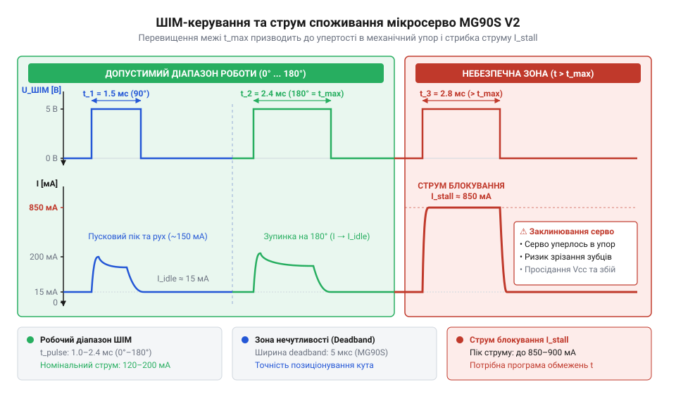
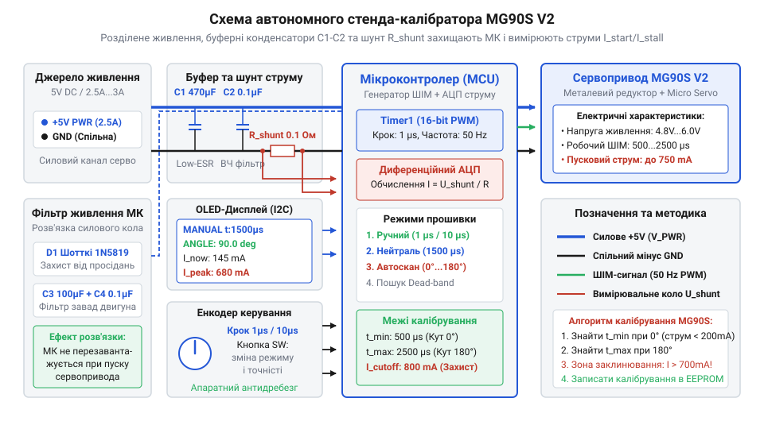

# MG90S V2 — мікросерво з металевим редуктором

<preknowlist>
- [Сервоприводи радіокерованих моделей: будова, редуктори та ШІМ-керування](root:cat-hw-actuators/rc-servo-mechanisms-and-control) — принцип ШІМ-керування 50 Гц, стандартний діапазон імпульсів 1000–2000 мкс та внутрішній потенціометричний зворотний зв'язок
- [Лінійка 9-грамових мікросервоприводів Tower Pro (SG90, SG92R, MG90S, MG90D)](root:cat-hw-actuators/sg90-mg90-micro-servos-family) — відмінності металевого редуктора MG90S від пластикових аналогів та його базові механічні характеристики
</preknowlist>

## Ризики стандартного керування сервоприводом MG90S

Під час створення робототехнічних маніпуляторів або механізмів радіокерованих моделей розробники часто застосовують стандартні бібліотечні функції керування, розраховані на усереднений діапазон тривалості імпульсів від 1000 до 2000 мкс (або розширений від 500 до 2500 мкс). Проте прямолінійне подання граничних команд на мікросервопривод MG90S V2 без попереднього випробування майже завжди призводить до механічного заклинювання, перегріву обмоток та раптових перезавантажень керувального мікроконтролера.

Причина полягає у технологічних допусках виготовлення внутрішніх вузлів. Як ми розглядали в [огляді мікросервоприводів Tower Pro](root:cat-hw-actuators/sg90-mg90-micro-servos-family), сервопривод MG90S V2 оснащений металевим редуктором, але його внутрішній потенціометр зворотного зв'язку (англ. *potentiometer*) та механічний упор (англ. *mechanical stop*, фізичний обмежувач обертання шестерень) мають заводський розкид позиціонування у межах ±5°…±10°. Якщо реальний механічний упор конкретного екземпляра відповідає імпульсу 1050 мкс, а програма подає 1000 мкс, аналоговий або цифровий драйвер сервопривода реєструє помилку розсогласування і подає повну напругу живлення (коефіцієнт заповнення ШІМ 100%) на внутрішній колекторний двигун.

Двигун намагається довернути вал, але металеві шестерні впираються в жорсткий стопор. Виникає режим аварійного блокування — @@en|stall state@@ (англ. *stall state*, від *stall* — заклинювання, зупинка та *state* — стан). У нормальному режимі плавного руху MG90S споживає струм у межах 100–180 мА. Проте у стані заклинювання струм споживання миттєво зростає до рівня струму блокування — @@en|stall current@@ (англ. *stall current*, від *stall* — заклинювання та *current* — струм), який для даної моделі становить від 650 до 800 мА при напрузі 5 В. На відміну від [базового мікросервопривода SG90](root:cat-hw-actuators/sg90-servo) із пластиковими шестернями, де зубці можуть зрізатися, металевий редуктор MG90S витримує це навантаження. У результаті вся підведена електрична потужність перетворюється на тепло всередині мікроскопічного корпусу двигуна та транзисторів H-моста.

Розрахуємо теплову потужність, яка виділяється у режимі заклинювання при напрузі живлення 5 В та струмі 750 мА:

```
P_stall = V_cc × I_stall
        = 5.0 В × 0.750 А        [закон Джоуля-Ленца P = V × I]
        = 3.75 Вт                [теплова потужність на обмотках]
```

Виділення 3.75 Вт теплової потужності у замкненому об'ємі 9-грамового привода призводить до нагрівання двигуна до температури понад 100 °C менш ніж за 15 секунд, викликаючи тепловий пробій (англ. *thermal burnout*) або пошкодження резистивного шару потенціометра.

Окрім термічного руйнування самого привода, виникає електрична проблема. Стрибок струму до 800 мА при спільному живленні сервопривода й мікроконтролера викликає глибоке просідання напруги на силовій шині — @@en|brownout@@ (англ. *brownout*, від *brown* — тьмяний, коричневий та *out* — згасання, вимкнення, просідання напруги живлення). У результаті спрацьовує схема скидання мікроконтролера за низькою напругою (BOD), програма перезапускається, знову подає той самий ШІМ-імпульс і система впадає в циклічне перезавантаження.

Важливо також розрізняти короткочасний пусковий струм — @@en|inrush current@@ (англ. *inrush current*, від *inrush* — кидок, раптовий приплив), який виникає під час розгону ротора (тривалістю 50–120 мс і амплітудою 450–550 мА), та тривале блокування (@@en|stall current@@ > 650 мА понад 200 мс).

Додатковим чинником є зона нечутливості — @@en|deadband@@ (англ. *deadband*, від *dead* — неактивний та *band* — смуга, зона нечутливості). Для MG90S вона становить 5–8 мкс. Якщо керувальний ШІМ-сигнал має часове тремтіння (@@en|jitter@@), привод постійно відпрацьовує мікрозміщення, створюючи додатковий шум та імпульсний нагрів.


*Графік залежності струму споживання від ширини керуючого імпульсу: при виході за безпечні часові межі струм стрибкоподібно зростає до рівня блокування.*

Для усунення цих ризиків необхідно відмовитися від сліпого застосування стандартних діапазонів і розробити автономний стенд-калібратор. Такий прилад дозволяє плавно змінювати ширину імпульсів, контролювати струм споживання в реальному часі та точного визначати фізичні межі `t_min` і `t_max` для конкретного екземпляра сервопривода.

## Апаратна структура та кола тестера

Для безпечного випробування мікросервоприводів принципово важливо розірвати спільне коло живлення між чутливою цифровою периферією та силовим мотором. Стенд-калібратор будується за топологією із розділеними шинами: мікроконтролер, дисплей та органи керування живляться від стабілізованої лінії 3.3 В або 5.0 В, тоді як сервопривод отримує живлення від окремого силового джерела напругою 5.0–6.0 В, здатного віддавати в піку до 2 А.

Спільним для обох частин схеми залишається лише земляний провідник (GND). Для пригнічення імпульсних завад, що виникають під час комутації обмоток DC-двигуна та реактивної зворотної ЕРС (англ. *back EMF*), паралельно силовим клемам сервопривода встановлюється буферна батарея конденсаторів: електролітичний конденсатор низького еквівалентного послідовного опору (Low-ESR) ємністю 470…1000 мкФ та керамічний конденсатор 0.1 мкФ.

Для постійного моніторингу струму в землю силового кола сервопривода вмикається вимірювальний шунт — @@en|shunt@@ (англ. *shunt*, від *shunt* — відгалужувати, вимірювальний резистор) малого опору `R_shunt = 0.1 Ом` з допустимою потужністю розсіювання 1 Вт. Падіння напруги на шунті вимірюється аналогово-цифровим перетворювачем (АЦП) мікроконтролера. Для вимірювання струму з гальванічною розв'язкою замість вимірювального шунта можна застосувати [струмовий сенсор ACS712](root:cat-hw-sensors/acs712-current-sensor-module).

Обчислимо напругу на шунті `V_shunt` при проходженні струму блокування 750 мА:

```
V_shunt = I_motor × R_shunt
        = 0.750 А × 0.100 Ом      [законом Ома V = I × R]
        = 0.075 В                  [перетворення у мілівольти]
        = 75 мВ                    [напруга на вході АЦП]
```

При використанні 12-бітного АЦП із опорною напругою `V_ref = 3.3 В` дискрета вимірювання становить `3.3 В / 4096 = 0.805 мВ/код`, що відповідає роздільній здатності за струмом `0.805 мВ / 0.1 Ом = 8.05 мА` на один відлік. Це дозволяє впевнено фіксувати як нормальний рух (150 мА = ~18.6 мВ), так і поріг заклинювання (650 мА = 65 мВ).

Інтерфейс користувача складається з квадратурного енкодера — @@en|rotary encoder@@ (англ. *rotary encoder*, від *rotate* — обертатися та *encoder* — кодувальник) із вбудованою кнопкою та графічного/символьного дисплея. Енкодер забезпечує дискретне зміщення тривалості ШІМ-імпульсу з кроком 1 мкс або 10 мкс, а кнопка перемикає режими роботи приладу.


*Електрична принципова схема випробувального стенда з ізольованим силовим колом, вимірювальним шунтом і периферією керування.*

Апаратна реалізація вимірювального каналу струму та обробка сигналів енкодера на мові C представлені у наступних модулях:

:::code proj-servo-tester-calibrator/c/include/current_adc.h
:::code proj-servo-tester-calibrator/c/include/encoder_reader.h
:::code proj-servo-tester-calibrator/c/src/current_adc.c
:::code proj-servo-tester-calibrator/c/src/encoder_reader.c

Для об'єктно-орієнтованої архітектури C++ моніторинг струму та телеметрія дисплея реалізовані у вигляді відповідних класів:

:::code proj-servo-tester-calibrator/cpp/include/current_monitor.hpp
:::code proj-servo-tester-calibrator/cpp/include/display_telemetry.hpp
:::code proj-servo-tester-calibrator/cpp/src/current_monitor.cpp
:::code proj-servo-tester-calibrator/cpp/src/display_telemetry.cpp

## Алгоритм генерації високоточного ШІМ

Генерація керуючого сигналу для сервоприводів вимагає суворої стабільності часових інтервалів. Програмне формування затримок за допомогою функцій `delayMicroseconds()` або використання 8-бітних таймерів викликає часове тремтіння імпульсу (@@en|jitter@@) через обробку системних переривань. Для сервопривода MG90S V2 це проявляється акустичним гудінням та паразитною вібрацією вала.

Стандартний керувальний сигнал має частоту 50 Гц, що відповідає періоду `T = 20000 мкс`. Для досягнення точності в 1 мкс апаратний 16-бітний таймер мікроконтролера налаштовується із відповідним дільником частоти — @@en|prescaler@@ (англ. *prescaler*, від *pre-* — попередньо та *scale* — масштабувати, дільник частоти). Якщо тактова частота таймера становить 16 МГц, регістр дільника `PSC` встановлюється у значення `16 - 1 = 15`, забезпечуючи тактування лічильника `CNT` рівно 1 мільйон разів на секунду (1 такт = 1 мкс).

Регістр автоматичного перезавантаження — @@en|auto-reload register@@ (англ. *auto-reload register*, ARR) задає повний період повторення сигналу:

```
ARR = T_period_us - 1
    = 20000 - 1              [для частоти 50 Гц / періоду 20 мкс]
    = 19999                  [значення регістра ARR]
```

Тривалість активного високого рівня визначається значенням регістра порівняння `CCR1` (англ. *capture/compare register*). Наприклад, для встановлення нейтрального положення (90°) у регістр `CCR1` записується значення `1500`.

Критично важливо увімкнути режим буферизації регістрів порівняння (Preload Enable, біт `OC1PE` у CMSIS-структурі регістрів `TIM_CCMR1` та біт `ARPE` у `TIM_CR1`). При увімкненому Preload нове значення тривалості імпульсу, записане з енкодера або алгоритму автосканування, потрапляє у тіньовий буфер і застосовується апаратно лише у момент завершення поточного періоду 20 мкс (подія оновлення Update Event). Це повністю виключає виникнення «розрізаних» або хибних коротких імпульсів при динамічній зміні параметрів.

Програмне забезпечення тестера реалізує конечний автомат безпеки з чотирма основними режимами:
1. `Disabled` — ШІМ-вихід деактивовано, сервопривод знеструмлено. 2. `Manual` — ручне встановлення позиції за допомогою енкодера з кроком 1 мкс (або 0.1°). 3. `AutoScan` — автоматичне покрокове сканування діапазону від мінімального кута до максимального для перевірки плавності ходу. 4. `EmergencyStop` — аварійне відключення ШІМ-сигналу при підтвердженні заклинювання редуктора.

Для захисту від хибних спрацьовувань алгоритм АЦП-моніторингу використовує цифрове експоненційне ковзне усереднення (EMA) та розрізняє часові інтервали. При виявленні струму понад 650 мА запускається таймер підтвердження `STALL_CONFIRMATION_TIME_MS` (250 мс). Якщо струм знижується раніше (наприклад, після закінчення пускового сплеску `INRUSH_BLANKING_TIME_MS` 120 мс), стан повертається до норми. Якщо ж перевищення струму триває понад 250 мс, конечний автомат негайно переводить прилад у стан `EmergencyStop` та вимикає ШІМ-генератор.

Низькорівневий драйвер ШІМ-таймера та головна програма тестування на мові C мають таку структуру:

:::code proj-servo-tester-calibrator/c/include/servo_pwm.h
:::code proj-servo-tester-calibrator/c/src/servo_pwm.c
:::code proj-servo-tester-calibrator/c/src/main.c

Повна реалізація класу калібратора та головний тестовий сценарій на мові C++ наведені нижче:

:::code proj-servo-tester-calibrator/cpp/include/servo_pwm.hpp
:::code proj-servo-tester-calibrator/cpp/include/servo_calibrator.hpp
:::code proj-servo-tester-calibrator/cpp/src/servo_pwm.cpp
:::code proj-servo-tester-calibrator/cpp/src/servo_calibrator.cpp
:::code proj-servo-tester-calibrator/cpp/src/main.cpp

## Процедура практичного калібрування сервопривода

Коли мікросервопривод встановлюють у механічний вузол робота або авіамоделі, стандартний діапазон імпульсів від 1000 до 2000 мкс рідко відповідає реальним фізичним межам повороту вала. Через технологічний розкид параметрів внутрішнього потенціометра та відхилення при збірці металевого редуктора привода MG90S V2 крайні кути 0° та 180° можуть досягатися при тривалостях, наприклад, 560 мкс та 2420 мкс. Якщо подати керуючий ШІМ-сигнал, який виходить за межі фізичного ходу вала, латунні та сталеві шестерні редуктора впираються у внутрішній механічний обмежувач. Двигун продовжує розвивати максимальний обертальний момент, струм споживання зростає до критичного значення @@en|stall current@@ (англ. *stall current* — струм заклинювання), а сервопривод швидко перегрівається і створює ризик просідання живлення всієї системи. Для запобігання апаратним відмовам кожен привод потребує попереднього практичного калібрування на вимірювальному стенді.

Процес експериментального пошуку часових меж починається з виставлення вала в нейтральне положення 1500 мкс (90°), спираючись на базові [принципи ШІМ-керування сервоприводами](root:cat-hw-actuators/rc-servo-mechanisms-and-control). Обертаючи ручку квадратурного енкодера, прилад-тестер змінює ширину ШІМ-імпульсу з кроком у 10 мкс або 1 мкс. Для усунення помилкових спрацьовувань від контактного брязкоту в модулі декодера застосовано цифровий фільтр із накопичувальним лічильником послідовних збігів фазових сигналів A та B:

:::code proj-servo-tester-calibrator/c/src/encoder_reader.c 43-73

Повільне зменшення тривалості імпульсу триває доти, доки ротор обертається вільно, а струм споживання не перевищує 120–180 мА. При наближенні до кута 0° шестерні редуктора торкаються упору, обертання вала зупиняється, а струм споживання стрибає вище порогового значення `STALL_CURRENT_THRESHOLD_MA`.

Під час швидкого запуску електродвигуна з нерухомого стану завжди виникає короткочасне сплескове споживання — @@en|inrush current@@ (англ. *inrush current* — пусковий струм), яке є нормальним фізичним явищем. Щоб прилад-тестер не плутав короткий запуск із заклинюванням редуктора, в алгоритмі обробки АЦП реалізовано фільтрацію @@en|moving average@@ (англ. *moving average* — ковзне середнє) та часове бланкування:

:::code proj-servo-tester-calibrator/c/src/current_adc.c 80-115

Сплески струму тривалістю менше `INRUSH_BLANKING_TIME_MS` (120 мс) позначаються статусом `ADC_STATUS_INRUSH` і не переривають тест. Якщо ж виміряний струм залишається вище 750 мА протягом часу `STALL_CONFIRMATION_TIME_MS` (250 мс), програма фіксує аварійний стан `ADC_STATUS_STALL_FAULT`, і кінцевий автомат сервокалібратора негайно вимикає ШІМ-сигнал, захищаючи механізм.

Після визначення крайньої точки 0° тривалість імпульсу збільшують на 15–20 мкс у безпечну сторону і зберігають значення як `min_pulse_us`. Аналогічно знаходять верхню межу `max_pulse_us` біля кута 180°. Додатково вимірюють ширину зони нечутливості — @@en|deadband@@ (англ. *deadband* — зона нечутливості). Змінюючи тривалість імпульсу з кроком в 1 мкс в обидва боки від нейтралі, фіксують мінімальну дельту сигналу, на яку редуктор реагує реальним зсувом вала. Для MG90S V2 ця величина становить від 4 до 8 мкс і визначається роздільною здатністю внутрішньої зворотної електронної петлі.

Усі кроки вимірювання узгоджуються у вищому програмному рівні C++, де клас `ServoCalibrator` взаємодіє з периферією та оновлює статус телеметрії:

:::code proj-servo-tester-calibrator/cpp/src/servo_calibrator.cpp 114-134

Отримані експериментальні параметри утворюють базу для побудови безпечної програмної модели керування.

## Формування конфігураційних таблиць обмежень

Виміряні фізичні граничні значення (наприклад, 540 мкс для 0° та 2460 мкс для 180°) не можна застосовувати у керуючому програмному забезпеченні безпосередньо. Через коливання температури навколишнього середовища, зміни напруги джерела живлення або мікроскопічний знос елементів редуктора вал може знову вийти за межі та спричинити заклинювання. Для гарантування надійності привода MG90S V2 відкалібровані межі коригуються на захисний інтервал — @@en|guard band@@ (англ. *guard band* — захисний інтервал). Захисні інтервали відступають від абсолютних упорів на 2°–5° (або 20–40 мкс) углиб робочого діапазону.

Перетворення бажаного кута повороту `angle_deg` у відповідну тривалість імпульсу `pulse_us` здійснюється за допомогою функції лінійного мапування. Для розрахунку тривалості імпульсу в мікросекундах спочатку визначається відносне відхилення кута від мінімального значення, яке потім масштабується на робочий діапазон імпульсів:

Ширина керуючого імпульсу обчислюється за формулою:

```
pulse_us = min_pulse_us + (angle_deg - min_angle_deg) × (max_pulse_us - min_pulse_us) ÷ (max_angle_deg - min_angle_deg)
         = min_pulse_us + (Δangle ÷ Range_angle) × Range_pulse                                                    [лінійне масштабування]
```

Де `min_pulse_us` та `max_pulse_us` — безпечні часові межі із урахуванням захисного інтервалу, а `min_angle_deg` та `max_angle_deg` — відповідні їм кутові точки позиціонування.

У реалізації на мові C++ цей алгоритм входить до складу класу `ServoPwmGenerator`. Метод `angle_to_pulse_us` забезпечує обмеження діапазону (@@en|clamping@@ (англ. *clamping* — обмеження діапазону)) вхідного кута та перетворення його у цілочисельне значення мікросекунд:

:::code proj-servo-tester-calibrator/cpp/src/servo_pwm.cpp 73-99

Оновлені параметри зберігаються в об'єкті `CalibrationLimits` і передаються в модуль керування під час ініціалізації пристрою:

:::code proj-servo-tester-calibrator/cpp/src/servo_calibrator.cpp 95-108

При побудові багатоосьових робототехнічних систем, у яких використовується кілька приводів із [родини мікросервоприводів Tower Pro](root:cat-hw-actuators/sg90-mg90-micro-servos-family), конфігураційні дані кожного привода об'єднуються у таблиці пошуку — @@en|look-up table@@ (англ. *look-up table* — таблиця пошуку). Окрім часових меж `min_pulse_us` та `max_pulse_us`, для кожного каналу задається обмеження швидкості наростання кута — @@en|slew rate@@ (англ. *slew rate* — швидкість наростання). Плавне покрокове оновлення тривалості імпульсу усуває одночасні струмові піки кількох двигунів, запобігаючи виникненню @@en|brownout@@ (англ. *brownout* — просідання напруги) на шині живлення контролера та забезпечуючи стабільну експлуатацію всієї системи. На відміну від [базового сервопривода SG90](root:cat-hw-actuators/sg90-servo) із пластиковим редуктором, металевий редуктор MG90S V2 при належному програмному обмеженні здатний витримувати тривалі динамічні навантаження на [пластикових серво-рогах](root:cat-hw-actuators/servo-horns) без ризику зрізання зубців.