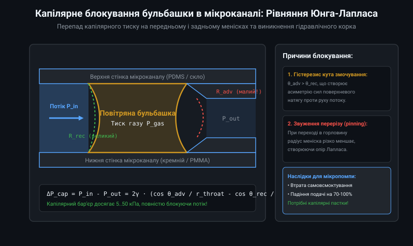
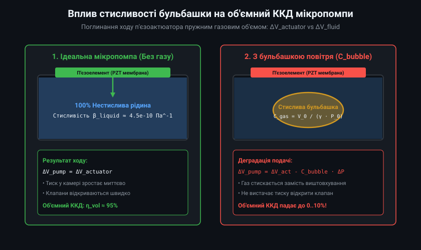
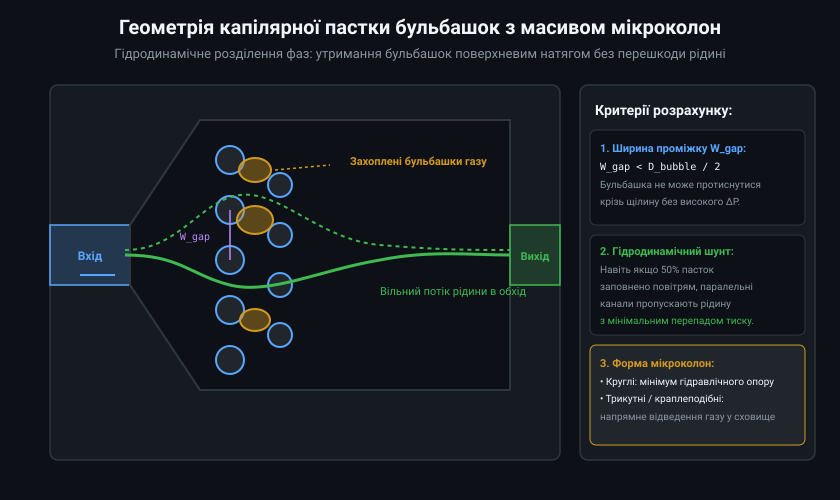
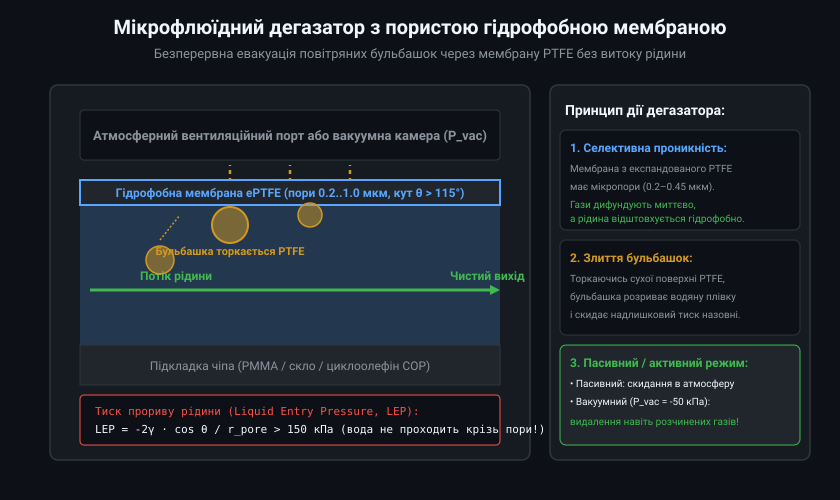
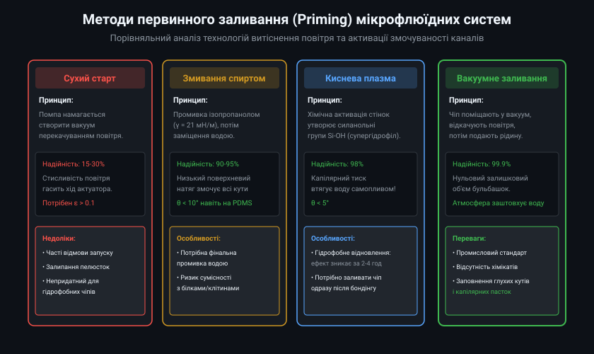

# Гідродинаміка та аналітичний розрахунок капілярних пасток і систем дегазації мікрофлюїдики

Розвиток інтегрованих мікрогідравлічних приводів для дозування ліків, охолодження мікропроцесорів та портативних медичних діагностичних комплексів вимагає забезпечення безперебійної роботи в умовах двофазного потоку. Присутність газових включень призводить до виникнення значних капілярних протитисків, різкого падіння об'ємної подачі мікропомп та кавітаційного руйнування пружних затворів.

## 1. Капілярний бар'єр та аналітика защемлення меніска в кутах мікроканалів

При русі газорідинного фронту по прямокутному мікроканалу перерізом W x H поведінка меніска описується критерієм Кона-Спенсера (Concus-Finn condition). Для каналу з прямим кутом (alpha = 90°) спонтанне заповнення кутових ділянок рідиною (капілярний біг уздовж кутів) відбувається лише за умови:
theta < 90° - alpha / 2 = 45°

Якщо статичний контактний кут змочування матеріалу перевищує 45° (як це характерно для силікону PDMS, де theta ≈ 105-110°, або поліметилметакрилату PMMA, де theta ≈ 70-75°), фронт рідини вигинається опукло, залишаючи в кожному куті сухі повітряні філаменти.

Для бульбашки, що застрягла між плоскопаралельними стінками з висотою зазору H та шириною звуження W_throat, результуючий капілярний перепад тиску, необхідний для проштовхування бульбашки, виводиться з інтегрування рівняння Юнга-Лапласа вздовж тривимірної лінії трифазного контакту:
Delta P_crit = 2 * gamma * ((cos theta_adv / W_throat) - (cos theta_rec / W_wide) + (cos theta_adv - cos theta_rec) / H)

Для типового мікрочипа з параметрами H = 50 мкм, W_throat = 40 мкм, W_wide = 200 мкм, кутами theta_adv = 85° та theta_rec = 60° у водному середовищі (gamma = 0.0728 Н/м) отримуємо:
cos(85°) = 0.0872, cos(60°) = 0.5000
Delta P_crit ≈ 2 * 0.0728 * ((0.0872 / 40e-6) - (0.5000 / 200e-6) + (0.0872 - 0.5000) / 50e-6)
Delta P_crit ≈ 0.1456 * (2180 - 2500 - 8256) ≈ -1.25 кПа

Знак «мінус» вказує на потужний опір, спрямований проти руху рідини, який вимагає надлишкового тиску понад 12.5 мбар лише для проштовхування однієї бульбашки через локальне звуження.

## 2. Модель гідравлічної піддатливості та коефіцієнт стиснення камери мікропомпи

Головним параметром стійкості мікропомпи до сухого запуску (self-priming capability) є ступінь стиснення робочої камери epsilon_comp:
epsilon_comp = Delta V_stroke / V_dead

де Delta V_stroke — максимальна об'ємна деформація приводної мембрани за один напівперіод, V_dead — залишковий «мертвий» об'єм робочої камери разом із підклапанними просторами.

Під час роботи з газом тиск усередині камери змінюється від всмоктування P_min до стиснення P_max за політропним законом:
P_max = P_0 * (1 + epsilon_comp)^k_poly
P_min = P_0 * (1 - epsilon_comp)^k_poly

де k_poly ≈ 1.2-1.4 — показник політропи повітря.

Для успішного відкриття пасивних клапанів (зворотних пелюсток або дифузорів) перепад тиску, що розвивається в камері, повинен перевищувати тиск відкриття випускного клапана Delta P_crack_out та впускного клапана Delta P_crack_in:
P_max - P_out >= Delta P_crack_out
P_in - P_min >= Delta P_crack_in

Звідси випливає критичний критерій самовсмоктування:
epsilon_comp_crit >= (Delta P_crack_out + Delta P_crack_in) / (k_poly * P_0)

Для атмосферного тиску P_0 = 100 кПа та сумарного порогу спрацьовування клапанів 10 кПа мінімальний ступінь стиснення має становити не менше epsilon_comp >= 0.08-0.10 (8-10%). У більшості п'єзоелектричних мембранних помп величина Delta V_stroke / V_dead становить лише 1-3%, тому наявність повітряного міхура робить самостійне закачування рідини фізично неможливим без попереднього примусового заливання (priming).

## 3. Гідродинамічний розрахунок та оптимізація решіток мікроколон (Pillar Arrays)

Капілярні пастки бульбашок базуються на поєднанні двох гідродинамічних механізмів:
1. Капілярне відхилення (Capillary pinning): сила поверхневого натягу перешкоджає деформації бульбашки крізь вузькі щілини між колонами.
2. Гідродинамічне відсікання потоку (Streamline partitioning): основний потік рідини обтікає пастку, тоді як бульбашки за рахунок низької щільності та інерції спрямовуються у глухі кармани.

Розрахунок гідравлічного опору решітки мікроколон діаметром D_p з кроком L_p при висоті каналу H здійснюється за модифікованою формулою Брінкмана-Дарсі:
R_hyd = (12 * mu * L_array) / (W_chamber * H^3 * (1 - phi_solid)) * (1 + 3 * sqrt(phi_solid) / (1 - phi_solid))

де mu — динамічна в'язкість рідини, L_array — поздовжня довжина масиву колон, W_chamber — ширина камери, phi_solid — коефіцієнт об'ємного заповнення колонами:
phi_solid = (pi * D_p^2) / (4 * L_p^2)

Для забезпечення балансу між високою ефективністю уловлювання бульбашок (W_gap = L_p - D_p < 30 мкм) та низьким гідравлічним опором оптимальне значення phi_solid обирають у діапазоні 0.15-0.25. Застосування краплеподібних (airfoil) колон знижує перепад тиску на 35% у порівнянні з циліндричними колонами аналогічного перерізу при збереженні того ж капілярного бар'єру.

## 4. Мембранні дегазатори: Масоперенос крізь пористий PTFE та тиск прориву

Для довготривалого відведення повітря розраховується баланс масопереносу розчиненого газу крізь пористу мембрану відповідно до закону дифузії Фіка та закону Генрі:
J_gas = (D_eff * S_Henry * (C_bulk - C_ext)) / delta_mem

де J_gas — густина потоку маси газу, D_eff — ефективний коефіцієнт дифузії в порах мембрани, S_Henry — константа Генрі розчинності газу у воді, delta_mem — товщина мембрани ePTFE (зазвичай 25-50 мкм), C_bulk та C_ext — концентрації газу в рідині та зовнішньому середовищі.

Для запобігання протіканню рідини крізь пори тиск у каналі не повинен перевищувати тиск проникнення рідини (Liquid Entry Pressure, LEP), що описується рівнянням Кельвіна-Лапласа для циліндричних пор радіусом r_pore_max:
LEP = - (2 * gamma_LV * cos theta_pore) / r_pore_max

Для гідрофобного ePTFE (theta_pore = 118°, cos theta = -0.469) і максимального розміру пор r_pore_max = 0.22 мкм (діаметр 0.45 мкм):
LEP = - (2 * 0.0728 * (-0.469)) / (0.22e-6) ≈ 3.10e5 Па = 310 кПа (3.1 бар)

Це забезпечує надійний запас міцності проти витоків, оскільки робочий тиск у мікрофлюїдних чипах рідко перевищує 50-100 кПа.

## 5. Промислові алгоритми та технологічні регламенти заливання (Priming Protocols)

Повна ліквідація газової фази на етапі запуску досягається за допомогою стандартизованих трифазних протоколів заливання, що включають хімічну підготовку поверхні та вакуумну фільтрацію.

Порівняльні характеристики промислових методів первинного заливання:

| Метод заливання | Типовий час підготовки | Залишкова частка бульбашок | Сумісність із біомолекулами | Потрібне обладнання |
| :--- | :--- | :--- | :--- | :--- |
| **Сухий самозапуск (Dry)** | 30–60 с | 40–70% (високий брак) | Повна | Не потрібне |
| **Змивання IPA/H2O** | 3–5 хв | < 2% | Обмежена (вимагає вимивання) | Ручний шприц / помпа |
| **O2-плазмова активація** | 1 хв плазми + 2 хв залив | < 1% | Висока (стерилізація) | Плазмохімічний реактор |
| **Вакуумне дегазування (N₂)** | 10–15 хв у вакуумі | < 0.1% | Повна (найвища безпека) | Вакуумна камера 1–5 кПа |

У мікроконтролерних системах керування помпами впроваджують програмний режим м'якого старту (Soft-Start Priming Sequence). На першому етапі частота збудження п'єзоактюатора знижується з робочих 500 Гц до 20-50 Гц. На низькій частоті час релаксації менісків збільшується, що дозволяє рідині поступово заповнювати кути капілярів без кавітаційного розриву струменя, після чого система автоматично переходить на робочу резонансну частоту максимального ККД.
