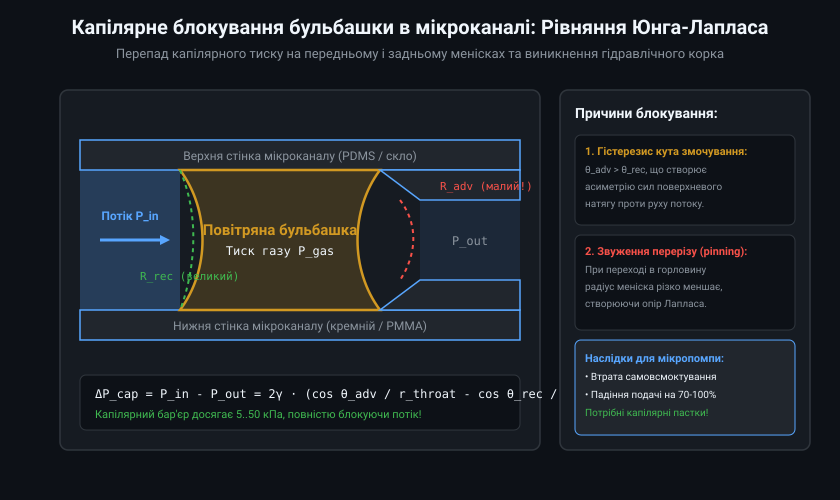
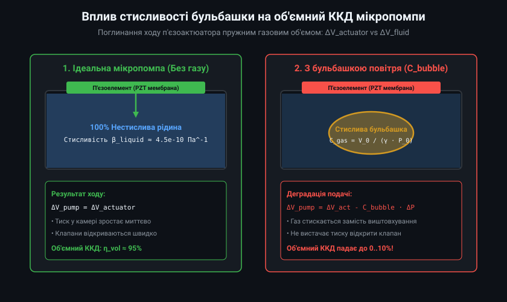
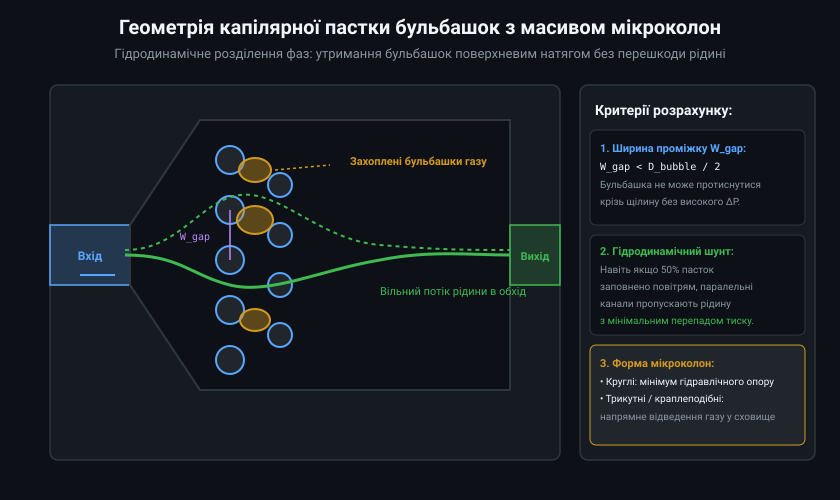
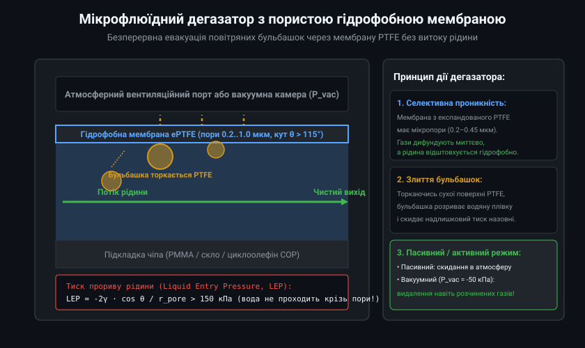
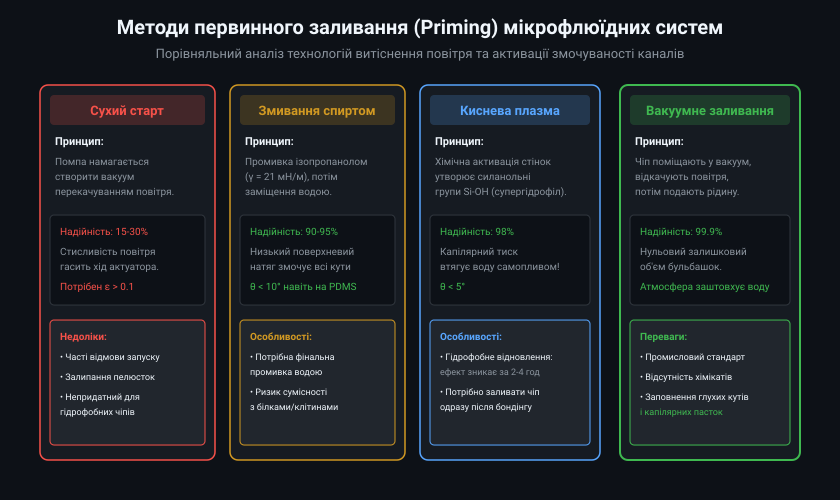

# Капілярні пастки бульбашок та методи первинного заливання мікросистем

У мікрофлюїдних приводах, п'єзоелектричних та пелюсткових мікропомпах, а також лабораторних аналітичних чипах (Lab-on-a-Chip) наявність ненавмисно захоплених повітряних бульбашок є головною причиною раптової відмови гідравлічного тракту. Бульбашка газу в мікроканалі поводиться як пружний демпфер високої піддатливості (compliance), що поглинає механічний хід актуатора, а капілярні сили Юнга-Лапласа у звуженнях створюють потужні корки, здатні повністю заблокувати перекачування рідини.

## 1. Фізика капілярного блокування та рівняння Юнга-Лапласа

Поведінка бульбашки в мікроканалах субміліметрового масштабу принципово відрізняється від макроскопічних резервуарів. Оскільки сили тяжіння нівелюються (число Бонда Bo << 1), домінуючими стають сили поверхневого натягу на межі поділу рідина-газ. 

Коли бульбашка наближається до звуження каналу або мікропори, її передній меніск змушений деформуватися, зменшуючи радіус кривини r_throat, тоді як задній меніск залишається у ширшій частині каналу з радіусом r_wide. Згідно з законом Юнга-Лапласа, тиск усередині бульбашки визначається кривиною меніска:
P_cap = 2 * gamma * cos(theta) / r

де gamma — коефіцієнт поверхневого натягу (для води ~72.8 мН/м при 20 °C), theta — контактний кут змочування.

Через різницю радіусів кривини та гістерезис кута змочування (кут натікання theta_adv більший за кут відтікання theta_rec) на бульбашці формується протидіючий перепад капілярного тиску Delta P_cap. У каналах перерізом 50-100 мкм цей перепад досягає 5-25 кПа, що значно перевищує максимальний напір багатьох типів мікропомп. У результаті потік повністю зупиняється.

## 2. Деградація подачі помпи через стисливість газу

Будь-яка мікропомпа зворотно-поступальної дії (п'єзоелектрична мембрана, електромагнітний шток або термопневматичний елемент) має обмежений робочий об'єм витискання Delta V_actuator (зазвичай від десятків нанолітрів до кількох мікролітрів за один такт).

Якщо робоча камера помпи заповнена нестисливою рідиною, деформація мембрани миттєво створює високий гідравлічний тиск, необхідний для подолання порогу відкриття випускного клапана. Проте якщо в камері залишається навіть мікроскопічна бульбашка повітря об'ємом V_bubble, її висока ізотермічна стисливість поглинає хід актуатора:
Delta V_pump = Delta V_actuator - C_bubble * Delta P

де C_bubble = V_bubble / P_0 — гідравлічна піддатливість газового об'єму за абсолютного тиску P_0.

Стискаючись і розширюючись синхронно з коливаннями мембрани, бульбашка діє як паразитний пневматичний резонатор. Тиск у камері не досягає тиску відкриття клапанів, і об'ємний коефіцієнт корисної дії мікропомпи падає практично до нуля, викликаючи сухе зависання (air locking).

## 3. Геометричні та капілярні пастки з масивом мікроколон

Для запобігання потраплянню бульбашок у робочу камеру помпи або вимірювальні оптичні кювети на вході системи встановлюють спеціальні капілярні пастки (bubble traps).

Найпоширенішою конструкцією є камера розширення з масивом мікроколон (pillar array). Мікроколони розташовуються з розрахунковим кроком W_gap, який менший за діаметр типових бульбашок, що рухаються потоком (W_gap < D_bubble / 2). Коли бульбашка наближається до решітки, капілярний бар'єр перешкоджає її проникненню крізь звуження, скеровуючи газ у тупикові бічні кишені.

Особливістю такої пастки є наявність гідродинамічного шунта: рідина вільно обтікає затримані бульбашки через сусідні відкриті канавки, завдяки чому навіть при 50-відсотковому заповненні пастки газом гідравлічний опір вузла зростає незначно (не більше ніж на 5-10%).

## 4. Пасивна дегазація через гідрофобні мембрани PTFE

Хоча пастки з мікроколонами здатні тимчасово акумулювати газ, при тривалій експлуатації їхній внутрішній об'єм переповнюється. Для безперервної автоматичної евакуації газу застосовують мікрофлюїдні дегазатори з селективно-проникними пористими мембранами.

Мембрана виготовляється з експандованого політетрафторетилену (ePTFE) з розміром пор 0.2-1.0 мкм. Оскільки PTFE є супергідрофобним матеріалом (кутова межа змочування водою theta > 115°), для проникнення рідкої фази крізь сухі пори потрібен надзвичайно високий тиск прориву (Liquid Entry Pressure, LEP > 150-200 кПа).

Газова фаза, торкаючись поверхні ePTFE, миттєво зливається з пористим середовищем і скидається назовні під дією власного надлишкового тиску або через підключення зовнішнього вакуумного порту (P_vac = -30...-50 кПа).

## 5. Технології та протоколи первинного заливання (Priming)

Первинне заповнення сухого мікрофлюїдного чипа рідиною (priming) є критичним технологічним етапом під час запуску помпи. Через шорсткість стінок і гідрофобність полімерних матеріалів (PDMS, COP, PMMA) пряме подавання води часто призводить до хаотичного защемлення сотень мікробульбашок у кутах каналів.

Для надійного безбульбашкового запуску застосовують три основні інженерні методи:
1. **Змивання розчинником із низьким поверхневим натягом:** Тракт спочатку промивають ізопропіловим спиртом (IPA, gamma = 21.7 мН/м) або сумішшю етанол/вода (50/50). Спирт повністю змочує навіть гідрофобні поверхні (theta < 10°), витісняючи всі повітряні кишені. Після цього спирт поступово заміщують робочим водним буфером.
2. **Плазмохімічна гідрофілізація (O2 plasma):** Стінки каналів PDMS піддають обробці кисневою плазмою протягом 30-60 секунд. Це формує полярні силанольні групи Si-OH і знижує кут змочування водою до theta < 5°, забезпечуючи спонтанне капілярне всмоктування.
3. **Вакуумне заливання (Vacuum-assisted priming):** Чип поміщають у герметичну вакуумну камеру з тиском 1-5 кПа для повної евакуації повітря з пор і кутів, після чого рідина подається до впускного порту і плавно заповнює канали під дією повернення до атмосферного тиску.

Комбінація плазмової підготовки стінок, капілярних пасток із мікроколонами та PTFE-дегазаторів забезпечує стабільний і безперебійний запуск мікрофлюїдних помп із гарантією збереження проектної об'ємної подачі.
