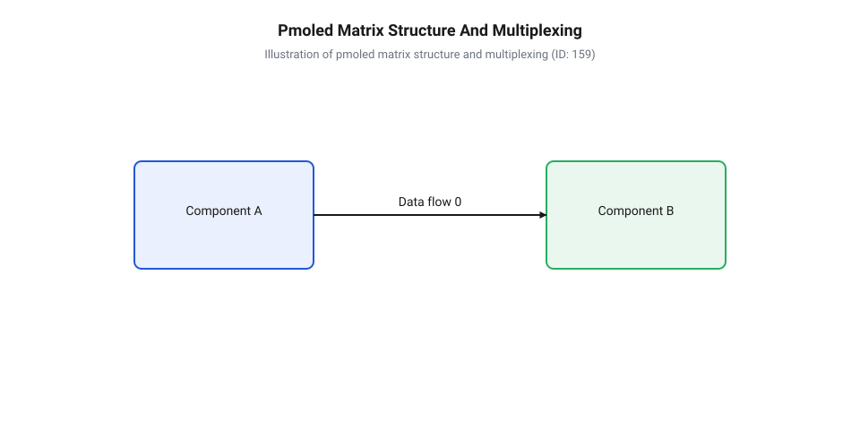
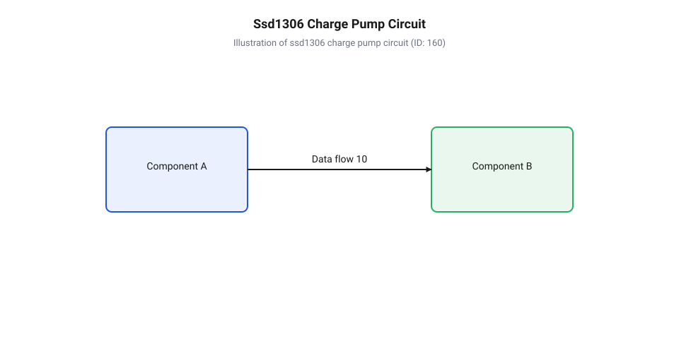
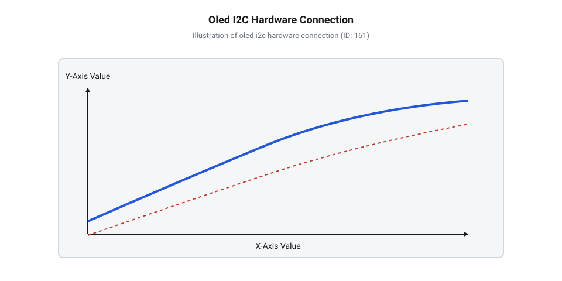
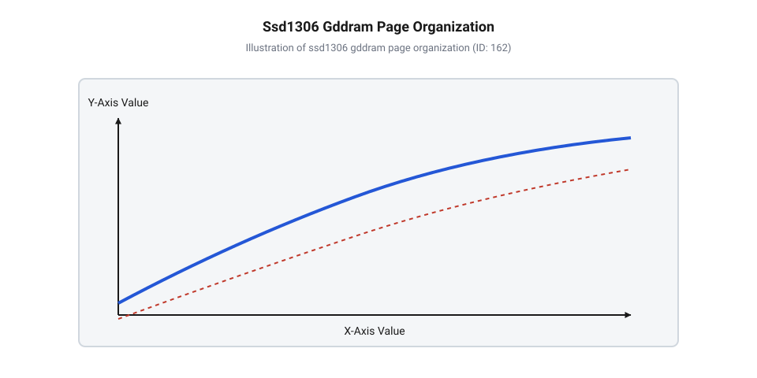
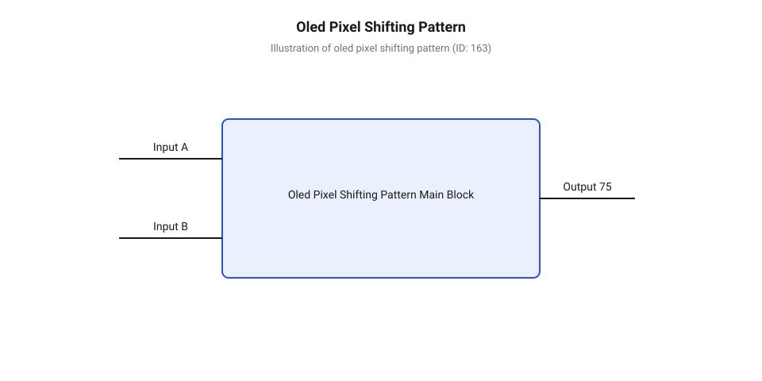

# OLED 0.91″ 128×32 (I2C)

<preknowlist>
- [I2C-адаптер для LCD 1602 (PCF8574)](root:cat-hw-actuators/i2c-lcd-adapter) — Принципи обміну даними по шині I2C, призначення ліній SDA/SCL, поняття 7-бітної адреси та використання підтягувальних резисторів.
- [OLED-дисплей 0.96″ SSD1306 (I2C, 128×64)](root:cat-hw-actuators/oled-ssd1306) — Загальні принципи побудови графічного буфера кадрової інформації та архітектурні основи контролерів SSD1306.
</preknowlist>

## Задача індикації у вузьких компактних приладах

Проєктування графічного інтерфейсу для ультракомпактних автономних пристроїв — таких як бездротові вимірювальні щупи, портативні реєстратори даних, медичні датчики чи смарт-інструменти — завжди впирається у жорсткий компроміс між геометричними габаритами та енергоефективністю. Коли розробнику необхідно вивести декілька числових параметрів, текстовий статус та графічний індикатор заряду акумулятора, вибір пристрою відображення стає критичним вузлом всієї системи. Традиційні засоби відображення інформації швидко демонструють свої фізичні обмеження у вузьких корпусах.

Класичні [символьні рідкокристалічні екрани](root:cat-hw-actuators/lcd-1602) технології @@en|LCD@@ (з англ. *Liquid Crystal Display*, від лат. *liquidus* — рідкий та англ. *crystal* — кристал) вимагають значної площі лицьової панелі через наявність широких технологічних рамок та масивного скляного підкладкового сендвіча. Навіть при застосуванні [зовнішніх шинних розширювачів](root:cat-hw-actuators/i2c-lcd-adapter) для зменшення кількості сигнальних ліній підключення, сам дисплейний модуль залишається надто громіздким. Головний фізичний недолік рідкокристалічної комірки полягає у її модуляторній природі: вона не випромінює світло самостійно, а лише керує поляризацією світлового потоку від стороннього джерела. Через це читаність екрана в умовах обмеженого освітлення повністю залежить від постійної роботи світлодіодного фонового підсвічування, яке споживає від 30 до 100 мА струму. Для портативного приладу з живильним акумулятором ємністю 100–200 мА·год подібне енергоспоживання є неприпустимим, оскільки виснажує батарею за кілька годин роботи.

Спроба замінити символьний індикатор на графічний рідкокристалічний або кольоровий тонкоплівковий транзисторний дисплей наражається на проблему товщини конструкції. Наявність фонового світловода, розсіювальних плівок та світлодіодних лінійок збільшує глибину модуля до 4–7 мм. У вузькому циліндричному чи пенальному корпусі приладу кожен міліметр товщини змушує збільшувати зовнішні розміри виробу, роблячи його зручність низькою. Крім того, жорстка сітка символьних знакоелементів обмежує гнучкість розробки: на ній неможливо побудувати плавні анімації, динамічні піктограми чи графіки вимірюваних величин.

Розв'язанням цієї інженерної суперечності є перехід до самовипромінювальних матриць, де кожен окремий @@en|піксель@@ (з англ. *pixel*, від *picture element* — елемент малюнка) є автономним мікроскопічним джерелом світла. Історичний шлях [розробки пасивних матриць](root:cat-hw-actuators/oled-091-128x32/hist-oled-display-evolution.md) показав, що відмова від фонового підсвічування дозволяє кардинально зменшити товщину дисплейного модуля до 1.2–1.5 мм і знизити струмоспоживання пропорційно кількості засвічених точок.

У контексті вузьких приладів ідеальним геометричним рішенням став модуль @@en|OLED@@ (з англ. *Organic Light-Emitting Diode* — органічний світлодіод) діагоналлю 0.91″ із роздільною здатністю 128×32 точки. Порівняно зі [стандартними двовимірними індикаторами](root:cat-hw-actuators/oled-ssd1306) формату 4:3 (наприклад, 0.96″ 128×64), даний екран має витягнуту прямокутну форму з співвідношенням сторін 4:1 та активною зоною розміром близько 22.38 мм × 5.58 мм. Така конфігурація дозволяє легко вписати екран у вузьку торцеву або бічну панель пристрою, зберігши високу щільність інформації: 128 пікселів по горизонталі вміщують довгі текстові рядки та дрібні графічні шрифти, а 32 пікселі по вертикалі дають змогу комфортно розмістити два рядки тексту або комбінацію заголовок-значення.

## Фізика органічного світіння та пасивна матриця

Фізична природа прямого випромінювання світла в матриці @@en|OLED@@ базується на явищі інжекційної електролюмінесценції тонких плівок органічних напівпровідників. На відміну від класичних неорганічних світлодіодів на основі монокристалів арсеніду галію чи нітриду галію, органічний світлодіод є багатошаровою структурою з молекулярних сполук або полімерів, нанесених вакуумним напиленням на скляну підкладку.

Типова структура випромінювального елемента складається з прозорого провідного шару оксиду індію-тину (ITO), який виконує роль анода, допоміжних дірково-транспортних шарів, центрального люмінесцентного шару та металевого катода. Коли до елемента прикладається пряма напруга зміщення, через @@el|анод@@ (з грец. *anodos* — шлях вгору) в органічну структуру інжектуються позитивні носії заряду (дірки), а через @@el|катод@@ (з грец. *kathodos* — шлях вниз) — негативні носії (електрони). Під дією зовнішнього електричного поля носії рухаються назустріч один одному і рекомбінують у випромінювальному шарі, утворюючи зв'язані нейтральні стани — екзитони. Перехід екзитонів зі збудженого стану в основний супроводжується випромінюванням фотонів видимого світла безпосередньо через прозору скляну підкладку. Оскільки світло генерується безпосередньо у тонкому шарі люмінофора товщиною в сотні нанометрів, згашений піксель взагалі не випромінює світлового потоку, що забезпечує практично нескінченну контрастність (понад 10000:1) та кути огляду, близькі до 180 градусів.

Для побудови компактного екрана без використання дорогого активного кремнієвого підкладкового шарніра застосовується пасивно-матрична технологія @@en|PMOLED@@ (з англ. *Passive-Matrix Organic Light-Emitting Diode*). У цій архітектурі органічні шари затиснуті між двома взаємно перпендикулярними системами електродів: 32 горизонтальними катодними лініями (рядками) та 128 вертикальними анодними лініями (стовпчиками).


*Взаємне перетинання 32 катодних рядків і 128 анодних стовпчиків утворює сітку з 4096 окремих світлодіодів, де активування конкретного пікселя відбувається на перетині увімкненого рядка та стовпчика.*

Управління такою матрицею здійснюється шляхом швидкого часового розгортання. В кожен конкретний момент часу драйвер контролера @@en|SSD1306@@ підключає до землі (активний низький рівень) лише один із 32 катодних рядків. Одночасно на 128 анодних стовпчиків подаються імпульси струму відповідно до стану пікселів у даному рядку. Проте кожен органічний світлодіод у сітці володіє власною @@en|паразитною ємністю@@ (від англ. *parasitic capacitance*, з грец. *parasitos* — утриманець та лат. *capacitas* — місткість) величиною у кілька пікофарад за рахунок надтонких органічних шарів між електродами. Під час швидкого перемикання рядків різка зміна напруги викликає струми перезаряду цих ємностей через неактивні p-n-переходи, що створює паразитне фонове світіння сусідніх згашених пікселів (з англ. @@en|cross-talk@@). Для усунення цього ефекту перед подачею струму в активний рядок драйвер виконує @@en|фазу попереднього перезаряду@@ (від англ. *pre-charge phase*, від *pre-* — перед та *charge* — заряд), під час якої аноди й катоди короткочасно підключаються до регульованої напруги `V_PCH`, швидким імпульсом вирівнюючи накопичені заряди на ємностях. Для надійного блокування згашених елементів усі інші 31 неактивні катодні лінії утримуються під активним @@en|зворотним зміщенням@@ (від англ. *reverse bias*, з лат. *reversus* — повернений назад) на рівні потенціалу `V_COMH`, що унеможливлює протікання прямого струму через них. Цей механізм вимагає додаткових витрат енергії на циклічне заряджання ємностей та зменшує корисний час світіння пікселя в кадровому такті; тривалість фази перезаряду регулюється регістровою командою `0xD9`, де надто коротка фаза залишає паразитні бліки на екрані, а надто тривала — зменшує усереднену яскравість матриці та збільшує динамічне струмоспоживання. Шляхом послідовного опитування всіх 32 рядків із частотою 100–150 Гц здійснюється повне @@la|мультиплексування@@ (з лат. *multiplex* — складений з багатьох частин) кадру, яке людське око сприймає як цілісне немерехтливе зображення.

Обчислимо загальну кількість окремих світловипромінювальних елементів та робочу свердловину (duty cycle) для одного катодного рядка при мультиплексуванні 32 ліній. Назвемо величини: `N_x` — кількість стовпчиків, `N_y` — кількість рядків, `N` — загальна кількість пікселів у матриці, `D` — коефіцієнт заповнення часу світіння окремого рядка.

```
N = N_x · N_y
= 128 · 32              [підстановка кількості стовпчиків та рядків]
= 4096                  [перемноження кількості елементів]

D = 1 / N_y
= 1 / 32                [підстановка кількості катодних рядків]
= 0.03125               [ділення часу кадру на кількість рядків]
```

З отриманого розрахунку видно, що кожен катодний рядок засвічується лише протягом 3.125 % від загального часу одного кадрового циклу, що вимагає подачі вищого імпульсного струму на аноди для забезпечення необхідної усередненої яскравості матриці.

Зворотним боком високої контрастності та ефективності органічного світіння є незворотна @@la|деградація@@ (з лат. *degradatio* — зниження якості, занепад), якої зазнає органічний @@la|люмінофор@@ (з лат. *lumen* — світло та грец. *phoros* — носій). Під дією високої щільності струму та локального джоулевого нагріву відбувається поступове руйнування споряджених хімічних зв'язків органічних молекул та окиснення металевого катодного інтерфейсу. Якщо певні елементи інтерфейсу (наприклад, нерухомі рамки, статичні написи чи піктограми) виводяться на екран безперервно протягом сотень годин, світлодіоди під ними вигорають швидше за сусідні пікселі фону. Це призводить до виникнення ефекту залишкового зображення (burn-in), коли згашені пікселі мають помітно меншу яскравість при подальшому засвіченні. Розуміння цього фізичного обмеження вимагає обов'язкового застосування програмних методів захисту люмінофора при розробці пристроїв із тривалим часом автономної індикації.

## Схемотехніка модуля та система підкачки заряду

Функціонування самовипромінювальної матриці @@en|PMOLED@@ висуває жорсткі та суперечливі вимоги до електричного живлення її внутрішніх вузлів. З одного боку, обчислювальна логіка контролера @@en|SSD1306@@, командний декодер та драйвери шини обміну даними побудовані за низьковольтною технологією КМОН і потребують типової напруги живлення від 1.65 В до 3.3 В. З іншого боку, інжекційна електролюмінесценція органічних світлодіодів вимагає прикладання прямого потенціалу на @@el|анод@@ величиною від 7.0 В до 9.0 В (а при встановленні максимального рівня контрастності — до 11–12 В). Таке підвищення напруги є фізично неминучим: оскільки при @@la|мультиплексуванні@@ 32 катодних рядків кожен окремий піксель світіння випромінює світло лише протягом 3.125 % часу кадрового циклу, короткі амплітудні імпульси струму крізь органічний @@la|люмінофор@@ мусять мати достатню величину для забезпечення комфортної інтегральної яскравості.

У портативних пристроях із живленням від одного літій-полімерного акумулятора або системної шини 3.3 В розробка додаткового зовнішнього високовольтного джерела живлення призвела б до невиправданого збільшення площі друкованої плати, зростання вартості компоненти та зниження загальної надійності. Для розв'язання цієї проблеми в кристал контролера @@en|SSD1306@@ інтегровано імпульсний помпувальний перетворювач напруги — систему @@en|charge pump@@ (з англ. *charge pump*, від *charge* — заряд та *pump* — помпа).

Принцип дії внутрішньої помпи підкачки заряду базується на почерговій комутації зовнішнього безіндуктивного накопичувача — так званого «літаючого» ємнісного елемента. Роль цього накопичувача виконує керамічний @@la|конденсатор@@ (з лат. *condensatus* — згущений, ущільнений) номіналом 1 мкФ, що підключається між виводами C1P та C1N інтегральної мікросхеми.


*Структура внутрішньої помпи підкачки заряду контролера SSD1306, що показує комутацію ключових транзисторів для генерування анодної напруги 7–9 В від входу 3.3 В.*

Внутрішній тактовий генератор помпи працює на частоті близько 300–400 кГц, керуючи матрицею з чотирьох потужних КМОН-ключів. Процес підвищення напруги відбувається у два послідовні фазові інтервали:

1. **Фаза накопичення (заряду):** Ключі внутрішньої схеми з'єднують вивід C1P з системною лінією живлення логіки `V_DD` (3.3 В), а вивід C1N — із системною землею `GND`. Зовнішній конденсатор швидко заряджається до різниці потенціалів 3.3 В. 2. **Фаза помпування (перенесення):** Внутрішні ключі перемикаються. Вивід C1N, на якому зберігається негативний потенціал заряду, відключається від землі та приєднується до лінії `V_DD`. Це зміщує потенціал виводу C1P вгору відносно землі на величину накопиченої напруги, створюючи на ньому потенціал `2 · V_DD`. Через внутрішній діод або синхронний ключ цей високий потенціал скидається на вихідний вивід `V_CC`.

За рахунок багатокаскадного помпування та внутрішнього регулювання контрастності схеми вихідна напруга `V_CC` стабілізується на потрібному рівні. Для згладжування високочастотних пульсацій напруги, викликаних роботою комутаційних ключів, до виводу `V_CC` відносно землі підключається зовнішній згладжувальний керамічний конденсатор з низьким еквівалентним послідовним опором (ESR) ємністю 2.2–4.7 мкФ.

Обчислимо вихідну високовольтну напругу живлення анодів `V_CC`, яку генерує внутрішня помпа підкачки при вхідній напрузі логіки 3.3 В з урахуванням падіння напруги на внутрішніх ключах. Назвемо величини: `V_DD` — напруга живлення логічного ядра, `k` — коефіцієнт помпування схеми (типово 2.5 для схеми з внутрішнім помпувальним помножувачем), `V_drop` — сумарне падіння напруги на омічному опорі відкритих каналів ключів та паразитному діоді, `V_CC` — підсумкова високовольтна напруга анодного живлення.

```
V_CC = k · V_DD - V_drop
= 2.5 · 3.3 - 0.75         [підстановка базової напруги живлення та втрат на ключах]
= 8.25 - 0.75              [перемноження коефіцієнта помпування]
= 7.5                      [обчислення підсумкової напруги анодів у вольтах]
```

Отримане значення 7.5 В повністю забезпечує номінальну яскравість світлодіодного шару без потреби у зовнішніх громіздких індуктивних DC-DC перетворювачах.

З точки зору системного проєктування, друкована плата дисплейного модуля @@en|OLED@@ 0.91″ зазвичай містить вбудований низькопадільний лінійний регулятор напруги (LDO) на 3.3 В (наприклад, XC6206), що дозволяє подавати на вхід живлення модуля `VCC/VDD` напругу в діапазоні від 3.3 В до 5.0 В. Проте при підключенні модуля до 5-вольтових мікроконтролерів (таких як класичні платформи на базі AVR) виникає проблема узгодження логічних рівнів сигнальних ліній. Оскільки гранична допустима напруга на цифрових входах контролера @@en|SSD1306@@ становить `V_DD + 0.3 В`, пряма подача 5-вольтового сигналу з виводів мікроконтролера викликає протікання паразитного струму через захисні ESD-діоди мікросхеми. Це може спричинити розігрів контролера або збої у зчитуванні команд. Щоб забезпечити надійне завадостійке підключення, рекомендується застосовувати двонапрямлені схеми узгодження рівнів на польових транзисторах або живити керуючий мікроконтролер від єдиної 3.3-вольтової шини. Докладні електричні специфікації та [розводка ніжок модуля](root:cat-hw-actuators/oled-091-128x32/api-oled-091-i2c-hardware-interface.md) детально описані у відповідному апаратному довіднику.

## Організація I2C зв'язку та струмоспоживання

Для передачі графічної інформації та конфігураційних команд від мікроконтролера до дисплейного модуля потрібен швидкісний та компактний апаратний інтерфейс. Використання паралельних шин передачі даних є недоцільним у компактних приладах через велику кількість трасувальних доріжок та високі вимоги до кількості виводів @@en|мікроконтролера@@ (з грец. *mikros* — малий та англ. *controller* — контролер). Тому в модулі @@en|OLED@@ 0.91″ основним фізичним каналом зв'язку виступає послідовна двопровідна шина @@en|I2C@@ (з англ. *Inter-Integrated Circuit* — міжінтегральна схема).

Апаратна організація інтерфейсу @@en|I2C@@ обмежується двома сигнальними лініями: лінією послідовних даних @@en|SDA@@ (з англ. *Serial Data* — послідовні дані) та лінією тактування @@en|SCL@@ (з англ. *Serial Clock* — послідовний тактовий сигнал). Обидва виводи контролера @@en|SSD1306@@ мають вихідні каскади типу @@en|відкритий витік@@ (з англ. *open drain*). Це означає, що сам контролер або мікроконтролер може лише примусово притягувати лінію до низького логічного рівня (потенціал землі `GND`), але не здатний подавати у шину високий рівень.


*Схема з'єднання ліній SDA та SCL між мікроконтролером і модулем SSD1306 з вибором адреси SA0 та підтяжками до лінії живлення 3.3 В.*

Повернення ліній SDA й SCL до високого логічного стану 3.3 В здійснюється за рахунок зовнішніх @@en|підтягувальних резисторів@@ (з англ. *pull-up resistor*, від *pull* — тягнути та *up* — вгору; лат. *resistere* — чинити опір), підключених між відповідною лінією та шиною живлення `V_DD`. Номінал цих резисторів вибирається як компроміс між швидкістю наростання фронту сигналу та величиною струму, що розсіюється при фронтальному спаді. Якщо опори надто великі (наприклад, 10 кОм при паразитовій ємності шини 150–200 пФ), постійна часу `RC` спотворює прямокутні тактові імпульси на частоті 400 кГц, що призводить до втрати бітів та помилок підтвердження (NACK). Якщо ж опір надто малий (менше 1 кОм), вихідні транзистори перевантажуються струмом при заземленні шини. Для стандартного режиму 100 кГц та швидкісного режиму 400 кГц оптимальним є значення підтягувальних резисторів у межах від 2.2 кОм до 4.7 кОм.

Контролер @@en|SSD1306@@ підтримує гнучке налаштування своєї 7-бітної апаратної адреси на шині @@en|I2C@@ за допомогою логічного рівня на апаратній ніжці `SA0` (Slave Address bit 0):

* При підключенні `SA0` до землі `GND` (логічний 0) 7-бітна адреса пристрою стає `0x3C` (у 8-бітному повному байті запису — `0x78`). * При підключенні `SA0` до напруги живлення `V_DD` (логічна 1) 7-бітна адреса змінюється на `0x3D` (у 8-бітному повному байті запису — `0x7A`).

Наявність двох перемикальних адрес дозволяє розробникові підключати два автономні графічні модулі @@en|OLED@@ 0.91″ до однієї спільної шини @@en|I2C@@ мікроконтролера, не застосовуючи додаткових мультиплексорів шини.

Кожна транзакція обміну даними по шині @@en|I2C@@ починається зі стартової умови, передачі байта адреси з прапорцем запису, та відправки байта керування (Control Byte). Байт керування містить два критичних біти: біт продовження `Co` та біт режиму `D/C#` (Data/Command). Якщо `D/C# = 0`, наступні затиснуті байти інтерпретуються внутрішнім декодером @@en|SSD1306@@ як командні інструкції налаштування (зсув сторінки, зміна яскравості, включення помпи). Якщо `D/C# = 1`, усі наступні байти записуються безпосередньо у відеопам'ять GDDRAM як графічний масив пікселів кадру.

На відміну від [рідкокристалічних індикаторних панелей](root:cat-hw-actuators/i2c-lcd-adapter), де енергоспоживання є майже константним через постійне фонове підсвічування, струмоспоживання OLED-модуля демонструє яскраво виражений динамічний характер. Кожен засвічений @@en|піксель@@ є окремим споживачем струму, тому загальний струм модуля прямо пропорційний кількості активних точок у конкретному кадрі.

Загальне струмоспоживання складається з двох компонентів:
1. **Струму спокою (`I_idle`):** Власний струм споживання цифрового ядра @@en|SSD1306@@ та генератора помпи підкачки заряду у холостому режимі (типово 1.5–2.0 мА). 2. **Анодного струму світіння (`I_pixel`):** Струм, що протікає через відкриті органічні світлодіоди. Для одного пікселя при максимальному рівні контрастності цей струм становить приблизно 0.012 мА (12 мкА).

Обчислимо підсумкове динамічне струмоспоживання `I_total` модуля @@en|OLED@@ 0.91″ для типового текстово-графічного кадру, у якому одночасно засвічено 20 % від загальної кількості 4096 пікселів екрана. Назвемо величини: `I_idle` — базовий струм спокою схеми контролера та помпи (2.0 мА), `N_total` — загальна кількість пікселів матриці (4096), `k_fill` — коефіцієнт заповнення кадру засвіченими пікселями (0.20), `N_on` — кількість активних пікселів, `I_pixel` — струм одного увімкненого пікселя (0.012 мА), `I_total` — підсумковий струм споживання модуля у міліамперах.

```
N_on = N_total · k_fill
= 4096 · 0.20             [обчислення кількості активних пікселів у кадрі]
= 819.2                   [округлення до найближчого цілого числа пікселів: 819]

I_total = I_idle + N_on · I_pixel
= 2.0 + 819 · 0.012       [підстановка базового струму та кількості засвічених точок]
= 2.0 + 9.828             [обчислення сумарного струму анодних сегментів]
= 11.828                  [обчислення підсумкового струмоспоживання у міліамперах]
```

З обчислення видно, що при відображенні типового графічного інтерфейсу струмоспоживання модуля становить близько 11.8 мА. Якщо ж вивести суцільне біле поле (100 % увімкнених пікселів, 4096 точок), струм досягає пікового значення близько 51 мА. Розуміння цієї залежності дозволяє мінімізувати споживання батареї шляхом оптимізації компоновки GUI: використання темних фонів, тонких контурних шрифтів та інверсних заставок. Математична модель [розрахунку пропускної здатності I2C](root:cat-hw-actuators/oled-091-128x32/math-oled-power-and-bandwidth-calculation.md) та оцінки енергоспоживання дає змогу точно вирахувати тривалість автономної роботи приладу від акумулятора.

## Пам'ять GDDRAM та буфер кадрової інформації

Графічне відображення довільних символів, осцилограм чи анімацій вимагає прямого керування кожним із `4096` світлодіодів матриці. Оскільки мікроконтролер не може утримувати постійний безперервний потік даних по повільній шині @@en|I2C@@ для кожного зрізу динамічної регенерації, графічний контролер @@en|SSD1306@@ містить власну внутрішню оперативну пам'ять — @@en|GDDRAM@@ (від англ. *Graphic Display Data Random Access Memory*). Вона виконує роль проміжного цифрового сховища стану матриці, де кожен біт відповідає стану одного фізичного пікселя: одиниця вмикає випромінювання органічного світлодіода на перетині відповідного анода й катода, а нуль утримує його у закритому стані.

Фізичний обсяг масиву @@en|GDDRAM@@ у контролері @@en|SSD1306@@ розрахований на максимальну матрицю `128 × 64` пікселі й становить `1024` байти. Проте для дисплейного модуля `0.91″` з роздільною здатністю `128 × 32` активною є лише половина цієї пам'яті. Розрахуємо загальний обсяг відеопам'яті `B`, необхідний для збереження одного повного кадру дисплея шириною `W` пікселів та висотою `H` пікселів при бінарному кодуванні один біт на піксель:

```
B = (W × H) ÷ 8
  = (128 × 32) ÷ 8         [підстановка роздільної здатності]
  = 4096 ÷ 8               [перемноження кількості пікселів]
  = 512                    [ділення на кількість бітів у байті]
```

Отримане значення `512` байтів показує, що для зберігання стану всіх `4096` світлодіодів монохромної матриці потрібен масив оперативної пам'яті обсягом рівно пів кілобайта. Це суттєво менше, ніж вимагають [повноколірні IPS екрани](root:cat-hw-actuators/ips-st7789), і дає змогу легко виділити кадровий буфер у мікроконтролерах із обмеженим ОЗП.


*Організація 512 байт GDDRAM у 4 сторінки по 128 стовпчиків, де кожен байт кодує вертикальну колонку з 8 пікселів.*

Архітектура @@en|GDDRAM@@ організована у вигляді вертикально-сторінкової структури. Пам'ять розділено на `4` горизонтальні сторінки (від @@en|Page 0@@ до @@en|Page 3@@), кожна з яких має висоту `8` пікселів та ширину `128` стовпчиків. Один байт пам'яті розташовується вертикально у стовпчику: молодший біт `D0` відповідає найвищому пікселю сторінки, а старший біт `D7` — найнижчому. Коли записується один байт за адресою стовпчика, зміна торкається одразу вісімки вертикальних пікселів одного стовпчика.

Контролер @@en|SSD1306@@ підтримує три режими адресування пам'яті: сторінковий (@@en|Page Addressing Mode@@), горизонтальний (@@en|Horizontal Addressing Mode@@) та вертикальний (@@en|Vertical Addressing Mode@@). У замовчуваному сторінковому режимі вказівник стовпчика автоматично інкрементується від `0` до `127` після кожного записаного байта даних. Проте після досягнення `127`-го стовпчика вказівник зупиняється або скидається на початок тієї ж сторінки, не переходь на наступну сторінку автоматично. Для переходу на нову сторінку мікроконтролер повинен надіслати окрему команду вибору сторінки. Повний перелік конфігураційних команд адресування містить [довідник системи команд](root:cat-hw-actuators/oled-091-128x32/api-ssd1306-command-set-and-gram.md), де описано регістри вибору сторінок та стовпчиків.

Щоб малювати довільні лінії, геометричні фігури чи шрифти без постійного зчитування даних із контролера екрана, у пам'яті мікроконтролера створюють локальний кадровий буфер (@@en|framebuffer@@, від англ. *frame* — кадр, *buffer* — буфер) — масив `uint8_t buffer[512]`. Всі операції малювання виконуються над цим масивом в ОЗП мікроконтролера. 

Для звернення до пікселя з координатами `x` (від `0` до `127`) та `y` (від `0` до `31`) у двовимірній декартовій системі координат застосовують математичне відображення на двовимірний масив сторінок і стовпчиків. Номер сторінки `P` обчислюється як цілочисельне ділення координати `y` на `8`, а зміщення біта `b` всередині байта дорівнює остачі від ділення:

```
P = y ÷ 8                   [номер сторінки від 0 до 3]
b = y mod 8                 [номер біта у байті від 0 до 7]
index = x + (P × 128)       [індекс байта у масиві від 0 до 511]
```

Отриманий індекс `index` визначає точне положення байта у кадровому буфері. Для встановлення пікселя у стан «увімкнено» застосовують побітове АБО з маскою зсуву, для скидання — побітове І з інвертованою маскою, а для інвертування — побітове виключне АБО.

На відміну від [символьних індикаторів LCD 1602](root:cat-hw-actuators/lcd-1602), які містять вбудований генератор символів і приймають готові коди знаків, матричний OLED вимагає передачі повного растрового масиву. Передача кадрового буфера з мікроконтролера у @@en|GDDRAM@@ дисплея відбувається через шину @@en|I2C@@. Замість побайтного відправлення з постійним перезаписом адрес доцільно надсилати весь буфер одним пакетом, встановивши горизонтальний режим адресування або послідовно перезаписуючи сторінки. Обчислимо мінімальний час `T_frame`, необхідний для передачі повного кадрового буфера розміром `B = 512` байтів разом із `1` службовим байтом адреси @@en|I2C@@ та `1` байтом префікса даних по шині у швидкісному режимі @@en|Fast Mode@@ при тактовій частоті `f_SCL = 400` кГц:

```
T_frame = (B + 2) × 9 × (1 ÷ f_SCL) × 1000
        = (512 + 2) × 9 × (1 ÷ 400000) × 1000       [підстановка параметрів: 514 байтів по 9 бітів]
        = 4626 × 0.0000025 × 1000                   [обчислення тривалості біта: 2.5 мкс]
        = 11.565                                    [переведення в мілісекунди]
```

Значення `11.565` мілісекунд відповідає теоретичній максимальній частоті оновлення екрана близько `86` кадрів на секунду. Проте на стандартній частоті `100` кГц час передачі зростає до `46.26` мілісекунд, що обмежує частоту кадрів до `21` Гц. Детальний аналіз та [розрахунки пропускної здатності](root:cat-hw-actuators/oled-091-128x32/math-oled-power-and-bandwidth-calculation.md) показують важливість вибору оптимальної частоти тактування шини. Фізичні рівні напруг та схему підключення провідників висвітлює [специфікація апаратного інтерфейсу](root:cat-hw-actuators/oled-091-128x32/api-oled-091-i2c-hardware-interface.md), де вказано необхідні значення підтягувальних резисторів.

Практична реалізація кадрового буфера та виведення даних на дисплей наводиться у прикладах нижче.

:::tabs
@tab C (ESP-IDF)
:::code oled-091-128x32-d/c/esp-idf/oled-draw-pixel.c
@tab C++ (Arduino)
:::code oled-091-128x32-d/cpp/arduino/oleddisplay.cpp
:::

Для побудови повноцінного графічного інтерфейсу з виведенням текстів, ліній та заставок слугує [розробка практичного драйвера](root:cat-hw-actuators/oled-091-128x32/proj-ssd1306-oled-driver-c.md) для мікроконтролерних систем.

## Програмні засоби захисту від випалювання

Висока контрастність та глибокий чорний колір панелей @@en|OLED@@ зумовлені відсутністю фонового підсвічування: кожен піксель є окремим органічним світлодіодом, який випромінює світло лише під час проходження електричного струму. Проте органічна природа люмінесцентного шару має фундаментальну вразливість — поступове старіння під дією струму та температури. Якщо один і той самий піксель тривалий час залишається увімкненим, його люмінофор деградує швидше за сусідні вимкнені пікселі. Це призводить до явища стаціонарного випалювання (@@en|burn-in@@, від англ. *burn* — горіти, *in* — в), коли на екрані залишаються помітні темні «привиди» нерухомих елементів інтерфейсу (годинників, значків, піктограм).

Як висвітлено в [історичному нарисі PMOLED](root:cat-hw-actuators/oled-091-128x32/hist-oled-display-evolution.md), проблема випалювання була головним бар'єром під час впровадження перших пасивно-матричних дисплеїв. Оскільки фізично зупинити хімічну деградацію люмінофора неможливо, головним інженерним завданням стає рівномірне розподілення навантаження між світлодіодами та обмеження часу їхньої безперервної роботи.

Один із найефективніших методів протидії старінню — циклічне піксельне зміщення (@@en|pixel shifting@@, від англ. *pixel shift*). Алгоритм полягає у періодичному (наприклад, раз на `1`–`5` хвилин) зсуві всієї графічної картини на екрані на `1`–`2` пікселі по горизонталі та вертикалі за замкненою траєкторією (квадрат чи коло).


*Схема циклічного просторового зміщення статичних елементів інтерфейсу у часі.*

Оскільки людське око практично не фіксує зміщення на один піксель у вузькому вікні індикатора `0.91″`, інтерфейс сприймається стабільним. Проте з точки зору фізики екрана, межеві пікселі статичних літер або рамок постійно змінюють свій стан між активним і пасивним. Це розмиває чіткі межі деградації люмінофора, перетворюючи локальне випалювання на непомітну плавну зміну яскравості по всій площі матриці.

Другий програмний рубіж захисту — керування яскравістю та енергетичним станом контролера @@en|SSD1306@@. Струм через органічний шар прямо пропорційний налаштуванню контрастності, що задається командою `0x81`. Для умов кімнатного освітлення максимальна яскравість є надлишковою і прискорює деградацію екрана у рази. Програмне зниження значення контрастності з `0xFF` до `0x33` зменшує струмоспоживання та значно подовжує ресурс люмінофора.

При тривалій відсутності дій користувача контролер переводять у режим сну. Для цього надсилають команду вимкнення підкачки заряду (`0x8D 0x10`) та команду вимкнення дисплея (`0xAE`). У цьому стані внутрішній високовольтний генератор анодної напруги (@@en|charge pump@@) вимикається, випромінювання пікселів повністю припиняється, а струмоспоживання модуля падає до часток мікроампера.

Третій метод — застосування програмної заставки (@@en|screen saver@@, від англ. *screen saver*). Якщо пристрій перебуває у режимі очікування, замість статичного тексту виводять анімований об'єкт, що рухається по всій площі екрана `128 × 32`, або періодично інвертують колір усієї матриці командою `0xA7` (інверсне відображення). При інверсії активні та неактивні пікселі міняються місцями, що вирівнює рівень зносу всіх світлодіодів. Порівняно з [дисплеями родини ST7789](root:cat-hw-actuators/st7789-family), де підсвічування працює незалежно від вмісту кадру, у @@en|OLED@@ кожна зміна режиму відображення безпосередньо впливає на термін служби матриці.

Нижче наведено приклади реалізації програмного захисту від випалювання.

:::tabs
@tab C (ESP-IDF)
:::code oled-091-128x32-d/c/esp-idf/oled-update-pixel-shift.c
@tab C++ (Arduino)
:::code oled-091-128x32-d/cpp/arduino/oledantiburnin.cpp
:::

Повний комплекс засобів висвітлюють [алгоритми захисту матриці](root:cat-hw-actuators/oled-091-128x32/proj-oled-screen-saver-anti-burnin.md), де наведено готові класи екранних заставок та динамічного рендерингу.