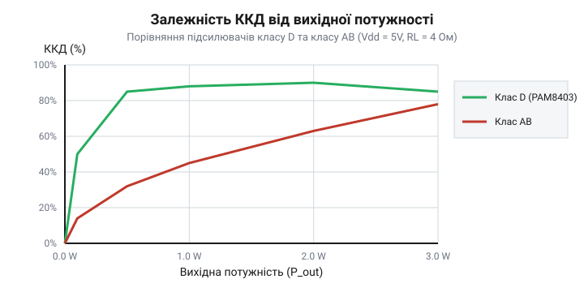
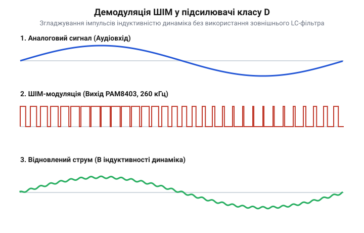
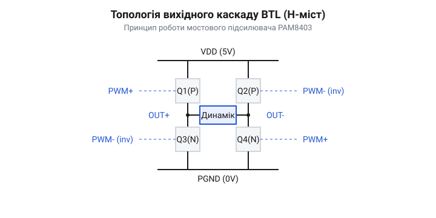
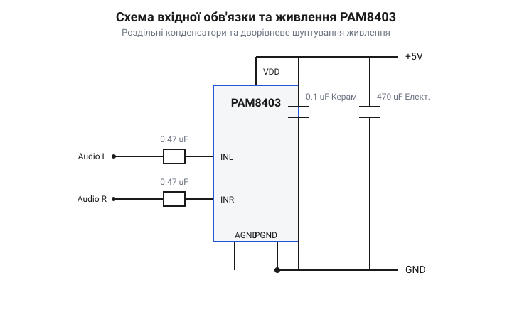
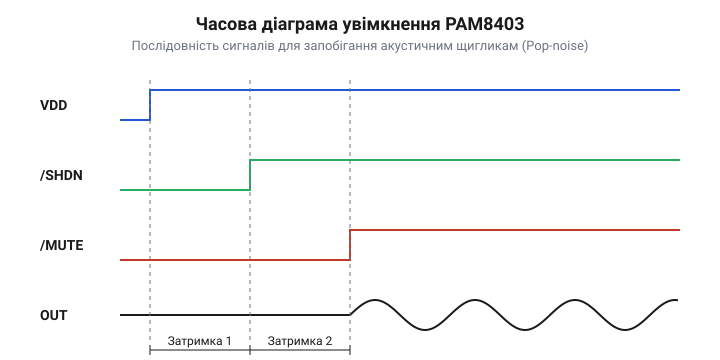

# Стереофонічний аудіопідсилювач PAM8403

<preknowlist>
- [Динаміки 5 Вт / 8 Ом](root:cat-hw-actuators/speakers-8ohm) — Принцип роботи електродинамічного головника, поняття імпедансу (4–8 Ом) та роль індуктивності звукової котушки.
- [XPT8871 — моно-підсилювач 5 Вт](root:cat-hw-actuators/audio-amp-xpt8871) — Базові принципи підсилення низькочастотних сигналів та концепція мостового вихідного каскаду (BTL).
</preknowlist>

## Обмеження підсилення за п'ятивольтового живлення

Конструювання портативної аудіосистеми з живленням від стандартного порту `@@en|USB@@` (напруга живлення `V_CC = 5.0` В) або одноелементного літієвого акумулятора впирається в проблему низької вихідної потужності та високого тепловиділення класичних аналогових схем. Якщо застосувати звичайний підсилювач класу AB (`@@en|Class AB@@`, від англ. *class* — клас або режим роботи транзистора), звуковий динамік віддає лише частки вата вихідної потужності, а корпус пристрою швидко нагрівається.

Причина полягає у фундаментальних фізичних обмеженнях амплітуди вихідної напруги та низькому коефіцієнті корисної дії (`@@en|efficiency@@`, ККД) аналогових підсилювачів. Розглянемо класичний аналоговий вихідний каскад із однополярним підключенням навантаження (`@@en|Single-Ended Output@@`), де один вивід динаміка з'єднано з виходом підсилювача через роздільний конденсатор, а інший — із загальним проводом `@@en|GND@@`. Максимальний піковий розмах синусоїдальної напруги (`@@en|peak-to-peak voltage@@`, `V_pp`) на навантаженні обмежений напругою живлення `V_CC` за вирахуванням напруг насичення відкритих вихідних транзисторів `V_sat`:

V_pp = V_CC - 2 · V_sat    [віднімання спаду напруги на двох насичених вихідних ключах]
= 5.0 - 2 · 0.3            [для типових кремнієвих транзисторів V_sat ≈ 0.3 В]
= 4.4 В                    [максимальний амплітудний розмах від піку до піку]

Оскільки пікова амплітуда синусоїдної напруги `V_p` становить половину від `V_pp`, а діюче середньоквадратичне значення (`@@en|RMS@@`, від англ. *root mean square* — середнє квадратичне) дорівнює `V_p / √2`, вихідна електрична потужність `P_out` на акустичному динаміку з опором `R_L` обчислюється так:

V_p = V_pp / 2
= 4.4 / 2
= 2.2 В                    [пікова амплітуда напруги на виході]

V_rms = V_p / √2
= 2.2 / 1.4142
= 1.5556 В                 [середньоквадратична діюча напруга]

P_out = V_rms² / R_L
= (1.5556)² / 4.0          [розрахунок для динаміка опором 4 Ом]
= 2.42 / 4.0
= 0.605 Вт                 [максимальна невикривлена вихідна потужність]

Отже, за п'ятивольтового живлення аналоговий підсилювач із single-ended виходом неспроможний віддати у навантаження 4 Ом понад 0.6 Вт звукової потужності без виникнення жорстких викривлень — кліпінгу (`@@en|clipping@@`, від англ. *clip* — зрізати, обрізати амплітуду). При підключенні [акустичних динаміків опором 8 Ом](root:cat-hw-actuators/speakers-8ohm) гранична потужність падає удвічі — до 0.3 Вт.

Друга критична перепона — низький ККД аналогового підсилювача `@@en|Class AB@@`. У лінійному режимі вихідні транзистори працюють як керовані опори, розсіюючи надлишкову напругу джерела живлення у вигляді тепла. Теоретична межа ККД для класу AB при максимальній амплітуді синусоїди становить `π / 4 ≈ 78.5%`. Проте під час відтворення реального музичного сигналу із середньою потужністю 10–20% від пікової, ККД падає до 10–30%. Решта 70–90% споживаної від джерела живлення енергії безповоротно перетворюється на тепло:

P_diss = P_in - P_out      [потужність теплових втрат на кристалі]
= (P_out / ККД) - P_out
= (0.6 / 0.2) - 0.6        [підстановка для середнього ККД 20%]
= 3.0 - 0.6
= 2.4 Вт                   [теплова потужність, що розсіюється на чипі]


*Порівняльна залежність ККД від вихідної потужності для підсилювачів класу AB та класу D при живленні 5 В.*

Графік виразно демонструє, що при зниженні гучності ККД підсилювача `@@en|Class AB@@` стрімко падає, змушуючи схему працювати як пасивний електрообігрівач. У компактному безвентиляторному корпусі це викликає швидкий перегрів кристала.

Для подолання цих обмежень у портативній аудіотехніці застосовують підсилювачі класу D (`@@en|Class D@@`). На відміну від аналогових підсилювачів, вихідні комплементарні силові транзистори `@@en|MOSFET@@` (від англ. *Metal-Oxide-Semiconductor Field-Effect Transistor* — польовий транзистор зі структурою метал-оксид-напівпровідник) у класі D працюють виключно в ключовому режимі: вони або повністю відкриті (опір каналу `R_DS(on) ≈ 0` Ом), або повністю закриті (струм через канал `I = 0` А). Завдяки цьому потужність теплових втрат на транзисторах мінімізується, а ККД досягає 85–90% у широкому діапазоні потужностей. Детальні [розрахунки енергетичних параметрів](root:cat-hw-actuators/pam8403-stereo-amp/math-pam8403-power-and-frequency-calc.md) показують, що саме ключовий режим у поєднанні з протифазним мостовим включенням дає змогу отримати вихідну потужність до 3 Вт на канал від джерела 5 В. На відміну від [одноканального підсилювача XPT8871](root:cat-hw-actuators/audio-amp-xpt8871), інтегральна мікросхема `@@en|PAM8403@@` містить два незалежні канали підсилення класу D в одному корпусі.

## Принцип функціонування безфільтрового класу D

Перехід до ключового режиму вимагає принципово іншого способу представлення аналогового аудіосигналу. Підсилювач класу D `@@en|PAM8403@@` перетворює вхідну аналогову напругу низької частоти (в діапазоні від 20 Гц до 20 кГц) у високочастотну широтно-імпульсну модуляцію (`@@en|Pulse-Width Modulation@@`, `@@en|PWM@@`, від англ. *pulse* — імпульс, *width* — ширина, *modulation* — зміна, модуляція).

Усередині мікросхеми аналоговий аудіосигнал подається на високошвидкісний компаратор, де він порівнюється з високочастотним генератором опорної трикутної напруги (`@@en|triangle wave generator@@`). Частота перемикання (`@@en|switching frequency@@`, `f_sw`) генератора в `@@en|PAM8403@@` становить `f_sw = 260` кГц. Коли миттєвий рівень аналогового звукового сигналу перевищує напругу трикутника, вихід компаратора приймає високий логічний рівень, а коли аналоговий сигнал нижчий — низький. У результаті утворюється послідовність прямокутних імпульсів постійної амплітуди `V_CC` та частоти 250 кГц, коефіцієнт заповнення (`@@en|duty cycle@@`, `D`) яких пропорційний миттєвому значенню аудіосигналу:

D = (t_on / T_sw) · 100%   [відношення часу включення імпульсу до періоду комутації]

За відсутності аудіосигналу (стан тиші) коефіцієнт заповнення становить точно 50%. Позитивна півхвиля звукового сигналу збільшує тривалість високого стану імпульсу (`D > 50%`, аж до 95%), а негативна півхвиля скорочує його (`D < 50%`, аж до 5%).


*Процес перетворення аналогового синусоїдального сигналу на імпульси широтно-імпульсної модуляції та подальше згладжування струму через індуктивність котушки динаміка.*

Традиційні підсилювачі класу D вимагають встановлення між виходом ключового каскаду та динаміком зовнішнього демодулюючого `@@en|LC-фільтра@@` низьких частот (індуктивність `L` та конденсатор `C`). Цей фільтр зрізає високочастотну несучу 250 кГц і пропускає до динаміка лише відновлену аналогову звукову хвилю. Проте зовнішні індуктивності та конденсатори є громіздкими, дорогими компонентами, які займають понад 70% площі друкованої плати.

Мікросхема `@@en|PAM8403@@` реалізує безфільтрову технологію (`@@en|Filterless Class-D@@`), яка дає змогу повністю відмовитися від зовнішніх LC-компонентів. Роль демодулюючого фільтра низьких частот виконує власна індуктивність звукової котушки динаміка `L_speaker` (типово від 10 до 100 мкГн) у поєднанні з її активним опором `R_L`. Звукова котушка разом з імпедансом навантаження утворює природний `@@en|RL-фільтр@@` першого порядку, частота зрізу якого обчислюється за формулою:

f_c = R_L / (2 · π · L_speaker)    [частота зрізу RL-фільтра котушки динаміка]
= 4.0 / (2 · 3.14159 · 50 · 10⁻⁶) [підстановка R_L = 4 Ом, L = 50 мкГн]
= 4.0 / 0.00031416
= 12732 Гц                        [частота зрізу 12.7 кГц]

Оскільки несуча частота перемикання `f_sw = 250` кГц значно перевищує граничну частоту звукового діапазону (20 кГц) та частоту зрізу котушки, реактивний опір індуктивності котушки для високочастотної гармоніки є дуже високим:

X_L = 2 · π · f_sw · L_speaker    [реактивний опір індуктивності котушки]
= 2 · 3.14159 · 250000 · 50 · 10⁻⁶
= 78.54 Ом                        [високий реактивний опір для несучої 250 кГц]

Завдяки високому реактивному опору `X_L = 78.54` Ом пульсації високочастотного струму частотою 250 кГц через котушку є мізерно малими. Водночас для звукових частот (20 Гц – 20 кГц) реактивний опір котушки малий, і через динамік безперешкодно протікає низькочастотний звуковий струм. Додатково механічна інерція рухомої системи динаміка (маса дифузора та котушки) виконує роль акустичного фільтра низьких частот: дифузор фізично не здатен коливатися з частотою 250 кГц і відтворює лише середнє значення імпульсів — вихідну звукову хвилю.

Як розкрито в [історичному нарисі розвитку імпульсної аудіотехніки](root:cat-hw-actuators/pam8403-stereo-amp/hist-class-d-filterless-evolution.md), відмова від зовнішніх фільтрів стала можлива завдяки застосуванню бестрансформаторної безіндуктивної схеми виходу та спеціального безнапрямного алгоритму модуляції. У `@@en|PAM8403@@` застосовано тернарну (трирівневу) безфільтрову модуляцію, за якої при відсутності сигналу на обидвох виводах динаміка присутні синфазні імпульси одинакової тривалості. Це зводить до нуля диференціальний високочастотний струм у стані спокою, зменшуючи струм споживання мікросхеми до 10 мА та усуваючи паразитичні радіозавади.

Програмний розрахунок коефіцієнта заповнення ШІМ для мікроконтролера при програмному синтезі звуку демонструє взаємозв'язок між аналоговим рівнем та тривалістю імпульсу:

:::tabs
@tab C
:::code pam8403-stereo-amp-d/c/calculate-pwm-duty.c
@tab C++
```cpp
#include <cstdint>
#include <algorithm>

// Ідіоматичний розрахунок коефіцієнта заповнення ШІМ для C++17
uint8_t calculate_pwm_duty_cpp(int16_t audio_sample) noexcept {
    // Нормалізація синусоїдального аудіовідліку -32768..+32767 до 0..255
    const int32_t scaled = (static_cast<int32_t>(audio_sample) + 32768) / 256;
    return static_cast<uint8_t>(std::clamp(scaled, 0, 255));
}
```
:::

## Мостовий вихід BTL та вихідні обмеження

При роботі з низьковольтними джерелами живлення 5 В (наприклад, від стандартного порту @@en|USB@@ або однобатарейного @@en|Li-Ion@@ акумулятора) класичний однотактний вихідний каскад (@@en|Single-Ended@@, SE) опиняється в жорсткому енергетичному куті. У такій схемі один вивід динаміка підключається до виходу підсилювача через масивний роздільний конденсатор, а другий — до спільної шини землі @@en|GND@@. Оскільки розмах напруги на виході не може перевищувати напругу живлення `V_DD = 5 В`, максимальна амплітуда постійної складової зміщується до `V_DD / 2 = 2.5 В`. У результаті максимальна ефективна змінна напруга @@en|RMS@@ на навантаженні становить лише близько `1.77 В`, що дає граничну звукову потужність:

```
P_SE = (V_DD / 2)^2 / (2 × R_L)
     = (5 / 2)^2 / (2 × 4)     [підстановка V_DD = 5 В, R_L = 4 Ом]
     = 6.25 / 8
     = 0.78 Вт                [гранична потужність однотактного каскаду]
```

Отримати навіть 1 Вт чистого звуку від 5 В живлення в однотактному режимі фізично неможливо без підвищувального перетворювача напруги. Для подолання цього бар'єра в мікросхемі @@en|PAM8403@@ застосовано мостову топологію виходу @@en|BTL@@ (від @@en|Bridge-Tied Load@@, англ. *bridge* — міст, *tied* — зв'язаний, *load* — навантаження). Замість заземлення одного з кінців звукової котушки, акустичний динамік вмикається безпосередньо між двома активними напівмостовими підсилювачами, які працюють у суворій протифазі.

Для кожного зі стереоканалів (лівого `OUTL` та правого `OUTR`) всередині кристала @@en|PAM8403@@ інтегровано повноцінний мостовий каскад @@en|H-bridge@@ (англ. *H-bridge* — H-подібний міст), який складається з чотирьох потужних польових транзисторів @@en|MOSFET@@ (англ. *Metal-Oxide-Semiconductor Field-Effect Transistor* — польовий транзистор зі структурою метал-оксид-напівпровідник). Верхні ключі @@en|P-channel@@ підключені до шини живлення `VDD`, а нижні @@en|N-channel@@ — до силової землі `PGND`. Коли на прямий вивід `OUT+` подається позитивний імпульс широтно-імпульсної модуляції @@en|PWM@@, верхній ключ відкриває шлях струму від `VDD` до динаміка. Одночасно інверсний вивід `OUT-` отримує протилежний сигнал: його верхній ключ закривається, а нижній відкривається, з'єднуючи другий вивід динаміка з силовою землею. 

Завдяки такій протифазній роботі двох напівмостів максимальна різниця потенціалів на затискачах динаміка подвоюється і досягає повного розмаху напруги живлення від `-V_DD` до `+V_DD` (тобто `10 В` від піку до піку). Оскільки вихідна потужність пропорційна квадрату напруги, теоретична гранична потужність зростає вчотирьох:

```
P_BTL = V_DD^2 / (2 × R_L)
      = 5^2 / (2 × 4)          [підстановка V_DD = 5 В, R_L = 4 Ом]
      = 25 / 8
      = 3.125 Вт               [теоретична пікова потужність BTL]
```

З урахуванням невеликого падіння напруги на відкритих каналах транзисторів `R_DS(on)` мікросхема @@en|PAM8403@@ впевнено віддає до 3 Вт на канал при коефіцієнті нелінійних викривлень @@en|THD+N@@ 10%, або близько 2.4 Вт у режимі високої чистоти звуку (`THD+N < 1%`). Захист від скрізних струмів комутації забезпечує внутрішній модуль керування мертвим часом @@en|Dead-time control@@ (англ. *dead time* — мертвий час), який формує коротку паузу між вимиканням одного ключа та вмиканням протилежного, запобігаючи виникненню короткого замикання @@en|Shoot-through current@@ між шинами `VDD` та `PGND`. Як показує [історія еволюції безфільтрових підсилювачів](root:cat-hw-actuators/pam8403-stereo-amp/hist-class-d-filterless-evolution.md), перехід до мостових виходів класу D (@@en|Filterless Class-D@@) дав змогу остаточно відмовитися від великогабаритних електролітичних конденсаторів та важких індуктивних фільтрів, зберігши коефіцієнт корисної дії (ККД) на рівні 85–90%. Детальні розрахунки теплових втрат та енергетики BTL наведено у матеріалі про [розрахунок вихідної потужності BTL](root:cat-hw-actuators/pam8403-stereo-amp/math-pam8403-power-and-frequency-calc.md).


*Схема мостового вихідного каскаду BTL підсилювача PAM8403: протифазне керування ключами H-моста подвоює амплітуду напруги на навантаженні без підвищення напруги живлення.*

У режимі спокою (за відсутності аудіосигналу) обома напівмостами керує синфазна широтно-імпульсна модуляція з тактовою частотою близько 260 кГц та коефіцієнтом заповнення 50%. Це означає, що на обох виходах `OUT+` та `OUT-` постійно присутня високочастотна меандрична напруга із середнім постійним потенціалом `V_DC = V_DD / 2 ≈ 2.5 В` відносно землі. Оскільки цей потенціал однаковий на обох кінцях звукової котушки, диференційна постійна напруга дорівнює нулю (`V_diff = 0 В`), і постійний струм через динамік не протікає.

Саме ця конструктивна особливість мостового виходу визначає критичні схемотехнічні застереження, порушення яких миттєво виводить мікросхему @@en|PAM8403@@ з ладу:

1. **Категорична заборона об'єднання негативних виходів:** Негативні виходи лівого та правого каналів `OUTL-` та `OUTR-` знаходяться під власною незалежною диференційною модуляцією. Об'єднання їх у спільний провід (як це робиться у стандартних трьохпровідних навушниках із заземленим контактом @@en|GND@@) створює пряме коротке замикання між силовими ключами двох різних каналів. При появі протифазних звукових сигналів між ключами виникають колосальні зрівняльні струми, що викликає термічний пробій транзисторних структур кристала або спрацьовування внутрішньої схеми термозахисту @@en|Thermal protection@@ при досягненні температури 150 °C. 2. **Заборона заземлення виходів на шину GND:** Жоден із чотирьох вихідних виводів (`OUTL+`, `OUTL-`, `OUTR+`, `OUTR-`) не можна з'єднувати із силовою або аналоговою землею. Оскільки кожен вивід поперемінно підключається внутрішнім @@en|MOSFET@@ ключем до шини `VDD`, будь-яке заземлення виходу створює пряме коротке замикання живлення через відкритий верхній транзистор із протіканням струмів понад 3–5 А.

Підключаючи [акустичні динаміки 8 Ом](root:cat-hw-actuators/speakers-8ohm) або низькоомні 4 Ом голівки, необхідно використовувати суворо чотирипровідну лінію з'єднання, де кожен динамік має свою ізольовану пару дротів. На відміну від схем, які використовує [моно-підсилювач XPT8871](root:cat-hw-actuators/audio-amp-xpt8871), де мостовий вихід обслуговує лише один канал, стереофонічний підсилювач @@en|PAM8403@@ вимагає повної гальванічної та електричної ізоляції вихідних кіл лівого і правого каналів один від одного та від загального корпусного заземлення. При використанні підсилювача для звукових сигналізаторів, таких як [пасивний зумер](root:cat-hw-actuators/ky-006-buzzer) або [активний зумер](root:cat-hw-actuators/ky-012-buzzer), слід переконатися, що їхні випромінювачі не мають внутрішнього з'єднання з загальною землею пристрою. Якщо необхідний вихід на навушники зі спільним проводом, слід застосовувати спеціальні підсилювачі зі схемою @@en|Single-Ended@@ або безконденсаторною топологією @@en|Capless@@, але не @@en|PAM8403@@.

## Організація вхідного тракту та живлення

Завдяки високому коефіцієнту підсилення (фіксоване внутрішнє підсилення становить близько 24 дБ) та високочастотному перемиканню великих струмів, мікросхема @@en|PAM8403@@ надзвичайно чутлива до якості живлення та конфігурації вхідного аналогового тракту. Імпульсні наводки від внутрішніх ключів @@en|MOSFET@@, синфазні шуми джерела звуку та паразитарні контури заземлення @@en|Ground loop@@ (англ. *ground* — земля, *loop* — петля) спроможні зіпсувати звучання фоновим гулом, тріском або навіть викликати високочастотне самозбудження підсилювача.

Вхідні аналогові виводи підсилювача (`INL` для лівого каналу та `INR` для правого) усередині мікросхеми підтягнуті до внутрішнього джерела опорної напруги `V_REF ≈ V_DD / 2 ≈ 2.5 В`. Зовнішні джерела аудіосигналу (цифро-аналогові перетворювачі @@en|DAC@@ мікроконтролерів, плати @@en|Bluetooth@@ чи виходи смартфонів) практично завжди мають власний постійний зсув напруги або нульовий потенціал землі. Пряме підключення джерела до вхідних ніжок порушить внутрішній режим постійного струму входів @@en|PAM8403@@, що призведе до симетричного обмеження сигналу @@en|Clipping@@ або виникнення постійної напруги на мостовому виході.

Щоб запобігти цьому, на входах обов'язково встановлюються вхідні роздільні конденсатори `C_in`. Вони виконують роль фільтра верхніх частот @@en|High-pass filter@@ (англ. *high* — високий, *pass* — пропускати, *filter* — фільтр), який повністю блокує постійну складову напруги, пропускаючи лише змінні акустичні коливання. Разом із внутрішнім вхідним опором мікросхеми `R_in ≈ 18 кОм` роздільний конденсатор формує @@en|RC-ланцюг@@, що визначає нижню граничну частоту зрізу звукового тракту `f_c`:

```
f_c = 1 / (2 × π × R_in × C_in)
    = 1 / (2 × 3.14159 × 18000 × 0.47 × 10^-6)   [підстановка R_in = 18 кОм, C_in = 0.47 мкФ]
    = 1 / 0.05315
    ≈ 18.8 Гц                                    [нижня гранична частота зрізу]
```

Використання керамічних або плівкових конденсаторів ємністю `C_in = 0.47 мкФ` забезпечує пропускання всього чутного басового діапазону від 18.8 Гц. Зменшення ємності до `0.1 мкФ` зміщує частоту зрізу вгору до `88.4 Гц`, що призводить до помітного зрізання низьких частот ("сухого" звучання басів). Збільшення ємності понад `1.0 мкФ` недоцільне, оскільки це збільшує час заряджання конденсаторів при ввімкненні та може викликати неприємний акустичний щиголь @@en|Pop noise@@ (англ. *pop* — хлопок, щиголь) у динаміках. Крім того, при виборі типів керамічних конденсаторів слід уникати дешевих діелектриків типу Y5V через п'єзоелектричний ефект @@en|Piezoelectric effect@@, який перетворює механічні вібрації корпусу на паразитарні електричні шуми на вході.

Не менш критичним є забезпечення чистоти лінії живлення. Під час роботи вихідних H-мостів на частоті 260 кГц струм, що споживається від шини `VDD`, має вигляд гострих імпульсів із крутими фронтами наносекундної тривалості та піковою амплітудою до 1.5 А. Паразитарна індуктивність та опір підвідних провідників друкованої плати @@en|PCB@@ перетворюють ці кидки струму на високочастотні пульсації напруги живлення. Для пригнічення завад застосовують двохрівневе шунтування @@en|Decoupling@@ (англ. *decouple* — розв'язувати, розділяти):

1. **Низькочастотний буферний конденсатор:** На вході живлення плати встановлюється електролітичний або танталовий конденсатор ємністю `100–470 мкФ`. Він працює як локальне джерело енергії, згладжуючи просідання напруги при різких басових сплесках гучності. 2. **Високочастотний Low-ESR шунт:** Безпосередньо біля виводів живлення мікросхеми `VDD` та `PGND` (на відстані не більше 2–3 мм) повинен стояти керамічний конденсатор ємністю `0.1–1.0 мкФ` з низьким еквівалентним послідовним опором @@en|Low-ESR@@ (англ. *Equivalent Series Resistance* — еквівалентний послідовний опір) типу `X7R` або `X5R`. Цей конденсатор замикає високочастотні імпульсні струми комутації безпосередньо біля кристала, не випускаючи їх у загальну шину живлення.


*Схема вхідної обв'язки та роздільного шунтування живлення PAM8403: роздільні конденсатори блокують постійний зсув, а керамічні Low-ESR конденсатори пригнічують імпульсні завади безпосередньо біля виводів.*

Для запобігання фоновому наведенню та самозбудженню важливе правильне топологічне розділення заземлювальних шин та диференційне розведення @@en|Differential routing@@ (англ. *differential* — диференційний, *routing* — трасування). Мікросхема @@en|PAM8403@@ має окремі виводи для силової землі `PGND` (через яку скидаються імпульсні струми вихідних ключів) та аналогової землі `AGND` (яка слугує опорним потенціалом для чутливих вхідних підсилювачів). Якщо імпульсні струми від `PGND` протечуть через доріжку `AGND`, вони накладуться на вхідний аудіосигнал і перетворяться на постійний високочастотний свист або гул. Доріжки `AGND` та `PGND` розводяться окремими провідниками шириною не менше 1 мм для силових ліній і об'єднуються суворо в одній точці ("зоряна земля") безпосередньо на мінусовій обкладинці основного фільтруючого конденсатора живлення.

Керування функціональними режимами підсилювача здійснюється за допомогою двох спеціалізованих дискретних входів: `SHDN` (Shutdown, вивід 12) та `MUTE` (Mute, вивід 5). Обидва входи є інверсними і мають внутрішню підтяжку до високого рівня:

- **Режим енергозбереження @@en|Shutdown@@:** При підтяжці виводу `SHDN` до низького рівня (потенціал землі `0 В`) внутрішні генератори опорних напруг та ШІМ-модулятори повністю вимикаються. Споживання струму мікросхемою падає до мікроамперного рівня (`I_SD < 1 мкА`). Цей режим є незамінним для портативних аудіопристроїв із живленням від акумуляторів під час паузи в відтворенні. - **Режим приглушення звуку @@en|Mute@@:** При подачі низького рівня `0 В` на вивід `MUTE` вихідні транзистори H-мостів переходять у високоімпедансний стан, припиняючи генерацію ШІМ-імпульсів. При цьому внутрішня аналогова частина залишається під напругою, що дає змогу миттєво вимикати та вмикати звук без найменших акустичних завад.


*Часова діаграма керуючих сигналів PAM8403: затримка зняття блокування Shutdown та Mute після подачі живлення гарантує відсутність клацань та щиглів у динаміках.*

Для запобігання перехідним клацанням при ввімкненні пристрою використовується правильна часова послідовність подачі сигналів: спочатку подається напруга живлення `VDD`, і лише після затримки 50–100 мс (необхідної для завершення заряджання вхідних конденсаторів `C_in` до напруги `V_REF`) виводи `SHDN` та `MUTE` переводяться у високий логічний рівень. Як зазначено у матеріалах про [керування режимами Mute та Shutdown](root:cat-hw-actuators/pam8403-stereo-amp/api-pam8403-control-signals.md) та в [апаратному інтерфейсі PAM8403](root:cat-hw-actuators/pam8403-stereo-amp/api-pam8403-hardware-interface.md), таку затримку можна реалізувати як програмно за допомогою мікроконтролера, так і апаратно за допомогою простих зовнішніх @@en|RC-ланцюгів@@.

Практична збірка готового аудіомодуля розглядається в проєкті [збірки портативного стереопідсилювача 2x3 Вт](root:cat-hw-actuators/pam8403-stereo-amp/proj-pam8403-portable-stereo-amp.md), а покрокові інструкції з локалізації завад та наводок наведено у посібнику про [усунення фонових завад та кліпінгу](root:cat-hw-actuators/pam8403-stereo-amp/proj-pam8403-noise-and-distortion-troubleshooting.md).

## Режими керування та оптимізація акустики

Подача живлення на аудіопідсилювач супроводжується бурхливими перехідними процесами. У момент увімкнення живлення вхідні роздільні конденсатори починають прискорено заряджатися до постійної напруги зсуву, створюючи короткий імпульс струму. Якщо вихідні ключі підсилювача активні в цей момент, виникає гучний акустичний щиглик, відомий як @@en|pop noise@@ (англ. *pop* — ляскіт, клацання). Цей стрибок напруги не лише викликає неприємне тріщання в динаміках, а й здатен пошкодити чутливу звукову котушку. Окрім того, у портативних пристроях із живленням від акумуляторів або @@en|USB@@ постійно активний підсилювач марно витрачає енергію навіть за відсутності корисного аудіосигналу. Для вирішення цих проблем мікросхема @@en|PAM8403@@ оснащена двома спеціалізованими апаратними виводами керування: @@en|Shutdown@@ (англ. *shut down* — вимикати) та @@en|Mute@@ (англ. *mute* — приглушувати).

Режим @@en|Shutdown@@ призначений для глибокого енергозбереження. При поданні низького логічного рівня (0 В) на вивід `/SHDN` внутрішнє джерело опорної напруги повністю вимикається, а всі MOSFET-ключі вихідних @@en|H-bridge@@ (від англ. *H-bridge* — міст у формі літери H) каскадів переходять у високоімпедансний стан (@@en|Hi-Z@@, від англ. *High Impedance* — високий імпеданс). У цьому стані споживання струму мікросхемою @@en|PAM8403@@ падає до значення менше ніж 1 мкА, що робить підсилювач практично невидимим для батареї. Натомість режим @@en|Mute@@ (вивід `/MUTE`) відключає аналоговий аудіосигнал від ШІМ-модулятора, але залишає активними внутрішні кола зсуву. При низькому рівні на виводі `/MUTE` вихідні ключі продовжують перемикатися з коефіцієнтом заповнення 50%. Завдяки симетрії мостової топології @@en|BTL@@ (від англ. *Bridge-Tied Load* — мостове навантаження) постійна складова напруги на обох клемах динаміка залишається однаковою, тому різниця потенціалів дорівнює нулю і динамік мовчить.

Щоб повністю ліквідувати акустичні щиглики при увімкненні та вимкненні підсилювача, керуючий мікроконтролер має чітко дотримуватися часової послідовності подачі сигналів. Під час подачі живлення @@en|VCC@@ обидва виводи `/SHDN` та `/MUTE` повинні утримуватися у стані логічного нуля (0 В). Це блокує вихідний каскад на час, поки заряджаються вхідні й шунтуючі конденсатори. Після стабілізації живлення спочатку подається високий рівень (5 В) на вивід `/SHDN`, що запускає внутрішню аналогову схему. Потім виконується пауза тривалістю близько 50 мс, необхідна для завершення перехідних процесів у вхідних фільтрах, і лише після цього у високий рівень переводиться вивід `/MUTE`. При вимкненні процедура виконується у зворотному порядку. Детальний опис часових затримок та логічних рівнів наведено у [часових діаграмах керування](root:cat-hw-actuators/pam8403-stereo-amp/api-pam8403-control-signals.md) режимами роботи.


*Послідовність подачі сигналів живлення VCC, Shutdown та Mute для приглушення щигликів.*

Для практичної реалізації безпечного алгоритму увімкнення та вимкнення @@en|PAM8403@@ використовують програмне керування виводами мікроконтролера.

:::tabs
@tab C++ | Arduino
:::code pam8403-stereo-amp-d/cpp/arduino/setup.cpp
@tab C | ESP-IDF
:::code pam8403-stereo-amp-d/c/esp-idf/app-main.c
:::

Вибір електричного опору акустичного навантаження є вирішальним чинником для досягнення балансу між потужністю, чистотою звуку та тепловим режимом підсилювача @@en|PAM8403@@. При використанні динаміків з опором 4 Ом та напрузі живлення 5 В підсилювач здатен розвивати максимальну паспортну потужність до 3 Вт на канал. Проте така потужність досягається при суттєвому зростанні коефіцієнта нелінійних викривлень @@en|THD@@ (англ. *Total Harmonic Distortion* — повний коефіцієнт гармонійних викривлень), який досягає 10%. У цьому режимі вихідний сигнал зазнає глибокого зрізання амплітудних піків — @@en|clipping@@ (англ. *clip* — зрізати, обрізати). Синусоїдальні верхівки зрізаються, перетворюючи аудіосигнал на прямокутні імпульси, що спричиняє відчутне хрипіння й хрипкий шум. Окрім спотворення звуку, @@en|clipping@@ значно збільшує середнє струмове навантаження на ключі, викликаючи прискорене нагрівання мікросхеми. Точні залежності між напругою, опором та викривленнями наведено в [математичних розрахунках потужності](root:cat-hw-actuators/pam8403-stereo-amp/math-pam8403-power-and-frequency-calc.md) та коефіцієнта викривлень.

Застосування [динаміків опором 8 Ом](root:cat-hw-actuators/speakers-8ohm) обмежує максимальну вихідну потужність на рівні приблизно 1.4 Вт на канал при 10% THD або 1 Вт у режимі високої чистоти (THD < 0.1%). Попри зменшення граничної гучності, опір 8 Ом забезпечує значні переваги: піковий струм через вихідні MOSFET-ключі зменшується вдвічі, що знижує втрати на внутрішньому опорі виводів та підвищує ККД підсилювача майже до 90%. Мікросхема працює в комфортному температурному режимі й практично не нагрівається. Якщо ж підсилювач тривалий час функціонує на навантаження 4 Ом на граничній потужності або в умовах поганої вентиляції, температура напівпровідникового кристала може досягти 150 °C. За такої температури спрацьовує внутрішній @@en|thermal shutdown@@ (англ. *thermal* — тепловий, *shut down* — вимикати) — схема теплового захисту, яка знімає керування з вихідних ключів і переводить їх у високоімпедансний стан, запобігаючи вигоранню чипа. Після охолодження кристала до 120 °C підсилювач автоматично відновлює роботу.

Для створення якісного акустичного пристрою важливо враховувати не лише параметри мікросхеми, а й чутливість акустичних головок та завадозахищеність сигнальних кіл. На відміну від монофонічних рішень, таких як [підсилювач на XPT8871](root:cat-hw-actuators/audio-amp-xpt8871), стереофонічний чип @@en|PAM8403@@ має підвищену чутливість до асиметрії вхідних дротів та спільного опору шини заземлення. Щоб запобігти виникненню фонового гулу, розриву звукової картини чи самозбудження на високих частотах, слід застосовувати [методику усунення завад](root:cat-hw-actuators/pam8403-stereo-amp/proj-pam8403-noise-and-distortion-troubleshooting.md) для оптимізації трасування друкованої плати. При розробці пристроїв, наприклад [портативного стереопідсилювача 5 В](root:cat-hw-actuators/pam8403-stereo-amp/proj-pam8403-portable-stereo-amp.md), оптимальним вибором є використання динаміків із чутливістю від 88 дБ/Вт. Це дає змогу отримати гучне звучання навіть при невеликій потужності 1 Вт, зберігаючи звук чистим та заощаджуючи заряд акумулятора. Детальні електричні характеристики та правила підключення виводів описано в [апаратному інтерфейсі підключення](root:cat-hw-actuators/pam8403-stereo-amp/api-pam8403-hardware-interface.md) даної мікросхеми.

Історично еволюція підсилювачів @@en|Class-D@@ (англ. *class D* — клас Д) супроводжувалася постійним пошуком способів зменшення габаритів без втрати ККД. Ранні версії імпульсних підсилювачів вимагали встановлення громіздких зовнішніх @@en|LC@@-фільтрів для відновлення аналогової синусоїди. Завдяки впровадженню високої частоти перемикання (260 кГц) та безфільтрової технології, у мікросхемі @@en|PAM8403@@ роль фільтра виконує власна індуктивність звукової котушки динаміка. Про еволюційний шлях від аналогових підсилювачів до сучасних безфільтрових рішень можна дізнатися в [історичному розвитку технології](root:cat-hw-actuators/pam8403-stereo-amp/hist-class-d-filterless-evolution.md), де розкрито головні віхи становлення імпульсного підсилення.