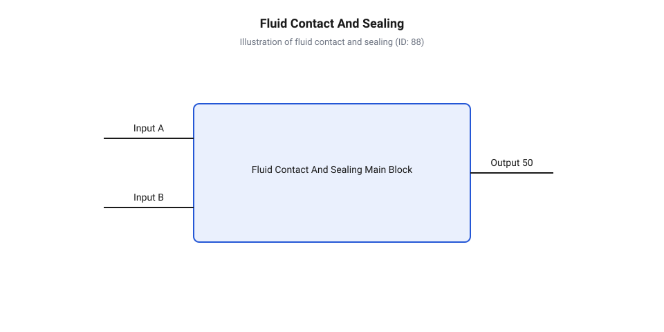
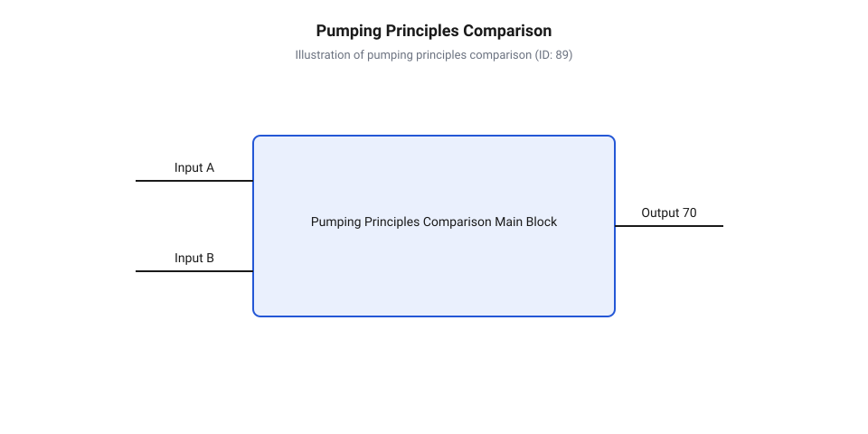
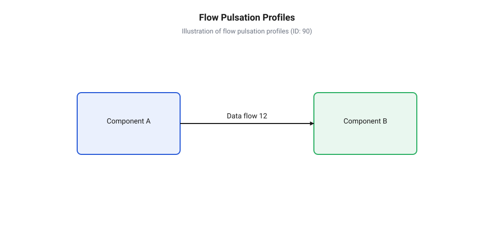
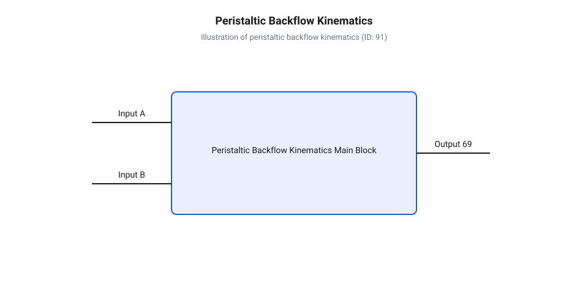
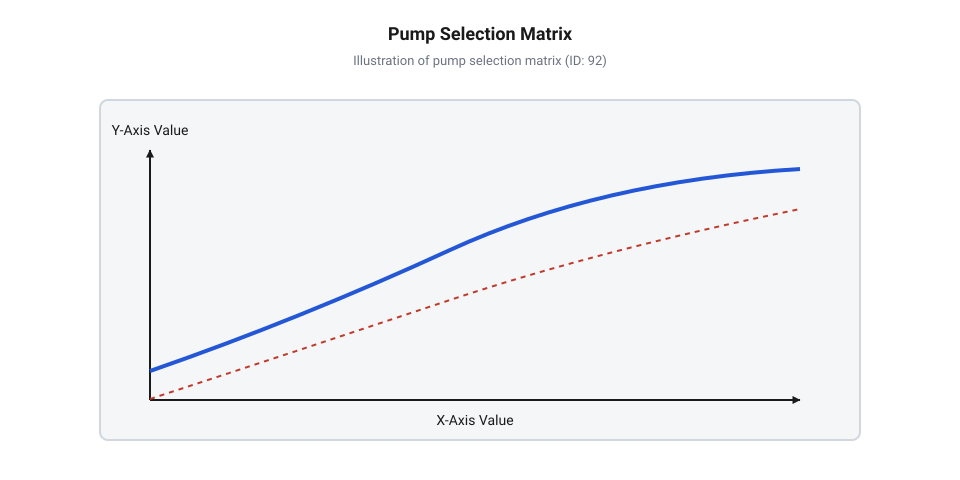
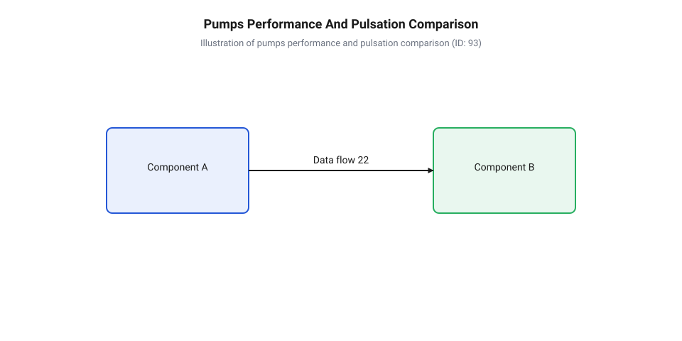
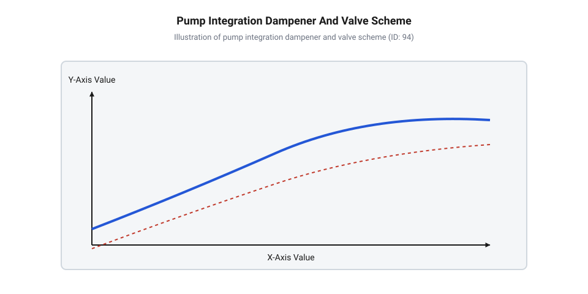

# Порівняльний аналіз перистальтичних, відцентрових та діафрагмових помп для малого габариту

<preknowlist>
- [Механізми захисту від сухого ходу та теплового перегріву мікропомп](root:cat-hw-actuators/dry-running-and-thermal-protection-of-micro-pumps) — Базові принципи виявлення критичних режимів сухого ходу та теплового перевантаження приводів.
</preknowlist>

## Критичні збої при помилковому виборі мікропомпи

Розробка вбудованої системи з гідравлічним контуром — чи то портативного медичного дозатора, чи компактного вузла рідинного охолодження — вимагає ретельного добору нагнітального вузла. На перший погляд здається, що будь-яка мікропомпа відповідного габариту та з належною напругою живлення здатна перекачувати рідину. Проте некоректний вибір фізичного принципу транспортування середовища призводить до систематичних збоїв, які неможливо компенсувати програмними алгоритмами чи збільшенням потужності приводу.

Перший типовий сценарій відмови пов'язаний із явищем втрати всмоктування при використанні відцентрових помп. Якщо розробник обирає відцентровий вузол для викачування рідини з резервуара, розташованого нижче рівня вхідного патрубка, пристрій зазнає раптового зриву подачі. На відміну від об'ємних нагнітачів, створюваний динамічний тиск прямо пропорційний густині середовища. Коли у всмоктувальну магістраль потрапляє повітряна пробка, густина якої в сотні разів менша за густину рідини, лопаті не можуть створити необхідного розрідження. Виникає @@en|заповітрювання@@, при якому помпа обертається «насухо». Працюючи без рідини, яка виконує роль мастила та тепловідводу для підшипників ковзання, пристрій швидко перегрівається. Щоб запобігти передчасному виходу з ладу, у пристрої реалізують [контроль критичних режимів](root:cat-hw-actuators/dry-running-and-thermal-protection-of-micro-pumps) для своєчасного вимкнення живлення двигуна при загрозі @@en|сухого ходу@@.

Друга пастка виникає при роботі з хімічно агресивними або кристалізованими розчинами. У більшості відцентрових та діафрагмових конструкцій перекачуване середовище безпосередньо омиває внутрішні деталі гідравлічної камери, ротор або сальникові @@de|ущільнення@@. При транспортуванні кислот, лугів або активних реагентів еластомерні сальники та мембрани втрачають еластичність, розбухають або руйнуються під дією розчинників. Це спричиняє витік рідини безпосередньо в механізм двигуна або на плату керування. Натомість @@en|перистальтична помпа@@ (грец. *peristaltikos* — той, що охоплює й стискає) повністю ізолює перекачуване середовище всередині гнучкої трубки, унеможливлюючи його контакт із рухомими металевими чи пластиковими елементами приводу.


*Схематичний розріз гідравлічних камер з підсвічуванням зон контакту середовища: повна герметичність у трубці перистальтичного вузла на відміну від сальників та клапанів інших конструкцій.*

Третій критичний збій спостерігається при спробі використати відцентрову помпу у задачах прецизійного дозування. Гідравлічна характеристика відцентрового нагнітача є похилою: будь-яке коливання протитиску в гідравлічному контурі — через часткове забивання фільтра, перегин шланга чи зміну висоти підйому — викликає різку зміну об'ємної витрати. У результаті замість фіксованої дози реагенту система видає нестабільний об'єм. На противагу цьому, позитивне @@en|об'ємне витіснення@@ в перистальтичних та діафрагмових помпах зберігає жорстку геометричну прив'язку об'єму порції до кута обертання або ходу штока, забезпечуючи стабільну витрату незалежно від опору мережі.

Четвертий фактор стосується фізичної деструкції чутливих середовищ та механічних відмов клапанних вузлів. Високочастотні зсувні напруження на кромках лопатей відцентрових помп або різкі пульсації тиску в діафрагмових камерах руйнують довгі полімерні ланцюги та біологічні клітини. Для таких застосувань критично важливі [в'язкість та зсувна чутливість](root:ph-mechanics/fluid-properties-in-embedded-hydraulics) перекачуваного середовища, які визначають допустимий рівень зсуву. Водночас наявність суспензій або твердих мікрочастинок у рідині блокує [зворотні клапани малогабаритного виконання](root:cat-hw-actuators/solenoid-valves-and-check-valves), викликаючи зворотний тік рідини та повну втрату продуктивності діафрагмової помпи.

Розуміння цих обмежень формувалося впродовж десятиліть, коли відбувалася [еволюція малогабаритних нагнітачів](root:cat-hw-actuators/peristaltic-and-centrifugal-pumps-comparison/hist-micropumps-development.md) від промислових гідромашин до прецизійних мікрофлюїдних систем.

## Фізика позитивного витіснення та динамічного нагнітання

В основі роботи будь-якої мікропомпи лежить один із двох фундаментальних фізичних принципів: позитивне об'ємне витіснення або динамічна передача кінетичної енергії. Фізика процесу визначає кінематику робочих органів, профіль тиску в часі, здатність до самовсмоктування та поведінку помпи при зміні гідравлічного опору мережі.

При @@en|позитивному об'ємному витісненні@@ рідина переміщується шляхом періодичної зміни об'єму робочої камери, яка почергово сполучається із вхідним та вихідним патрубками. У перистальтичній помпі ролики, закріплені на обертовому роторі, послідовно пережимають еластичну трубку, відсікаючи герметично замкнену дозу рідини між точками контакту. При обертанні ротора ця доза механічно проштовхується уздовж дуги корпусу до вихідного патрубка. У діафрагмовій помпі еластична @@en|діафрагма@@ (грец. *diaphragma* — перегородка) здійснює зворотньо-поступальний рух під дією ексцентрика або п'єзоелемента. На фазі збільшення об'єму камери створюється розрідження, яке відкриває вхідний @@en|зворотний клапан@@, а на фазі стискання тиск зростає, закриваючи вхідний і відкриваючи вихідний клапан.

Об'ємна витрата для помп позитивного витіснення розраховується на основі геометричного об'єму замкненої камери та частоти спрацьовування приводного механізму:

```text
Q_v = V_s · n · η_v
```

де `Q_v` — об'ємна витрата (м³/с або мл/хв), `V_s` — геометричний об'єм робочої камери (м³), `n` — частота обертання ротора або циклів деформації мембрани (с⁻¹ або хв⁻¹), а `η_v` — об'ємний коефіцієнт корисної дії (безрозмірний, `0 < η_v ≤ 1`), який враховує пружну деформацію стінок та зворотний перетік у клапанах.

З огляду на те, що об'єм `V_s` визначений геометрією камери, витрата `Q_v` прямо пропорційна частоті обертання `n`. Вплив протитиску на витрату виявляється лише через незначне зниження `η_v`, що забезпечує круту, практично вертикальну графічну характеристику залежності витрати від напору `Q(H)`.


*Порівняльна схема кінематики робочих органів: витіснення геометрично обмежених об'ємів у перистальтичних і діафрагмових помпах проти динамічного розгону рідини імпелером відцентрової помпи.*

На відміну від витіснення, @@de|відцентрова помпа@@ функціонує за принципом безперервної передачі кінетичної енергії. Обертовий @@en|імпелер@@ (англ. *impeller* від *impel* — штовхати вперед) захоплює рідину лопатками та розганяє її від центра камери до периферії під дією відцентрової сили. Вузол равлика перетворює кінетичну енергію швидкості потоку на静态чний тиск.

Динамічний тиск та напір потоку визначаються швидкістю лопатей імпелера та густиною середовища згідно з рівнянням Ейлера:

```text
P_dyn = (1 / 2) · ρ · v²
H = (u₂ · v_u₂ - u₁ · v_u₁) ÷ g
```

де `P_dyn` — динамічний тиск (Па), `ρ` — густина перекачуваної рідини (кг/м³), `v` — абсолютна швидкість потоку на виході з імпелера (м/с), `H` — гідравлічний напір (м), `u₁`, `u₂` — колові швидкості лопатей на вході та виході (м/с), `v_u₁`, `v_u₂` — тангенціальні складові швидкості рідини (м/с), а `g` — прискорення вільного падіння (м/с²).

Оскільки тиск `P_dyn` та напір `H` залежать від квадрата швидкості та густини рідини, відцентрові мікропомпи мають м'яку, похилу характеристику `Q(H)`. При зростанні протитиску в мережі витрата спадає і при досягненні граничного напору `H_max` подача повністю припиняється.

Фізика нагнітання визначає і часові профілі пульсацій тиску на виході з помпи:

- **Діафрагмова помпа**: Генерує виражені високоамплітудні пульсації з частотою ходу мембрани. У момент перемикання клапанів потік зупиняється, що створює ризик виникнення явища @@en|гідроудар@@ (англ. *water hammer*) в акустично жорстких трубопроводах. - **Перистальтична помпа**: Забезпечує помірний рівень пульсацій. У момент, коли ролик відривається від трубки, її стінки відновлюють форму, створюючи локальне розрідження і короткочасне просідання тиску. - **Відцентрова помпа**: Формує практично ламінарний потік без пульсацій, оскільки передача кінетичної енергії є безперервнимпроцесом.


*Часові профілі тиску й витрати: діафрагмова помпа формує високі амплітудні пульсації, перистальтична — локальні просідання при огинанні роликів, а відцентрова — стабільну безпульсаційну подачу.*

Здатності до самовсмоктування також випливають із фізичного принципу. Об'ємні помпи створюють високий вакуум навіть при заповненні камери повітрям, оскільки механічна зміна об'єму камери здатна знизити тиск нижче атмосферного:

```text
ΔP = P_atm - P_min
```

Отриманий перепад тиску `ΔP` достатній для підйому стовпа рідини з нижнього резервуара. У відцентровій помпі при роботі з повітрям (`ρ_air ≈ 1.2 kg/m³`) динамічний тиск `P_dyn` виявляється в 800 разів меншим, ніж при роботі з водою. Отриманий напір становить лише кілька міліметрів водяного стовпа, чого недостатньо для всмоктування, тому відцентрові помпи потребують попереднього заповнення рідиною.

Для проведення точних розрахунків витрати та втрат напору використовують [гідравлічний розрахунок об'ємної витрати](root:cat-hw-actuators/peristaltic-and-centrifugal-pumps-comparison/math-micropump-hydraulics-and-dosing.md) з урахуванням геометричних параметрів камери. У задачах прецизійного дозування малих об'ємів реалізують [дозувальний вузол на перистальтичній помпі](root:cat-hw-actuators/peristaltic-and-centrifugal-pumps-comparison/proj-dosing-peristaltic-stepper.md) із компенсацією зношування трубки. Для завдань неперервної циркуляції без пульсацій будують [контур циркуляції охолоджувача](root:cat-hw-actuators/peristaltic-and-centrifugal-pumps-comparison/proj-centrifugal-pwm-closed-loop.md) із керуванням ШІМ та зворотним зв'язком. Для розрахунку параметрів силових ключів та розводки сигналів використовують [апаратний інтерфейс підключення приводів](root:cat-hw-actuators/peristaltic-and-centrifugal-pumps-comparison/api-pump-driver-hardware.md) у схемотехніці пристрою, а логіку викликів і формат параметрів дозування описує [програмний API керування дозуванням](root:cat-hw-actuators/peristaltic-and-centrifugal-pumps-comparison/api-pump-control-software.md) у мікроконтролері. У специфічних мікросистемах із вимогами до мінімальних габаритів також застосовують [п'єзоелектричні мікропомпи](root:cat-hw-actuators/piezoelectric-micropumps-control) для надмалих витрат.

## Кінематика робочих органів та пульсації потоку

Створення стабільного потоку рідини або газу у вбудованій системі вимагає узгодження кінематики робочих органів нагнітача з динамічними властивостями гідравлічної магістралі. Залежно від того, як саме механічна енергія електродвигуна чи актуатора передається середовищу, потік на виході помпи може бути неперервним і гладким або дискретним і супроводжуватися вираженими хвилями тиску. Розуміння кінематичних циклів переміщення робочих органів дозволяє спрогнозувати рівень гідравлічних ударів, оцінити здатність пристрою затягувати рідину з порожньої лінії без попереднього заповнення та вибрати оптимальний режим керування приводом.

У перистальтичних мікропомпах нагнітання відбувається шляхом послідовного механічного деформування еластичної трубки роликами або башмаками, закріпленими на роторі. Коли ролик притискає трубку до дугоподібного треку, виникає @@en|оклюзія@@ (від лат. *occlusio* — замикання, перекриття). Оклюзована ділянка ізолює міжроликовий об'єм рідини `V_s`, перетворюючи його на герметичну дозувальну камеру, яка переміщується в напрямку обертання ротора. Проте при виході ролика з зони контакту з треком виникає специфічний гідродинамічний ефект: відпускання стиснутої трубки спричиняє її пружне розправлення. Оскільки об'єм трубки на виході раптово зростає, частина вже витиснутої рідини прагне повернутися назад у помпу. Це явище створює @@en|зворотний потік@@ (англ. *backflow*) та викликає глибокий провал тиску у вихідній лінії в момент зміни роликів.


*Кінематична схема відриву ролика від еластичної трубки показує розправлення стінок еластомеру, яке спричиняє зворотний потік рідини та локальний провал тиску у напірній лінії.*

Здатність перистальтичної помпи до сухого самовсмоктування прямо випливає з механіки @@en|пружного відновлення@@ (англ. *elastic recovery*) еластомеру. Коли ролик збігає з ділянки всмоктування, деформована стінка трубки прагне повернутися до початкового круглого перерізу під дією власних сил пружності. У герметизованій оклюзованій камері утворюється вакуум, який затягує повітря або рідину з вхідного патрубка з розрідженням до 80–90 кПа. Завдяки цьому перистальтичні нагнітачі не потребують попереднього заповнення рідиною. Для зменшення амплітуди пульсацій тиску `Δp_p` збільшують кількість роликів `N_r` на роторі. Проте цей крок зменшує корисний об'єм дози `V_s` та збільшує частоту циклічного вигину трубки.

Залежність частоти пульсацій `f_p` та об'ємної витрати `Q_v` від частоти обертання ротора `n` та кількості роликів `N_r` описується співвідношеннями:

```
f_p = N_r · n

Q_v = N_r · V_s · n · η_v
    = V_rev · n · η_v          [де V_rev — сумарний об'єм подачі за один оберт]
```

Тут `η_v` — об'ємний ККД, який враховує витечі через неповну оклюзію або пружне прогинання стінок при високому протитиску. Детальний [математичний апарат гідравліки](root:cat-hw-actuators/peristaltic-and-centrifugal-pumps-comparison/math-micropump-hydraulics-and-dosing.md) дозволяє точніше розрахувати похибку подачі при зміні динамічної в'язкості середовища.

У діафрагмових (мембранних) помпах зворотно-поступальний рух еластичної мембрани змінює робочий об'єм камери. Кінематичний цикл складається з двох послідовних фаз:
1. Такт всмоктування: мембрана прогинається назовні, об'єм камери збільшується, тиск всередині падає нижче вхідного тиску `p_in`. Вихідний клапан закривається під дією зворотного перепаду тиску, а вхідний клапан відкривається, пропускаючи середовище в камеру. 2. Такт нагнітання: приводний шток або п'єзоелемент штовхає мембрану всередину камери, зменшуючи її об'єм. Тиск зростає, вхідний клапан примусово закривається, а вихідний відкривається, виштовхуючи рідину в напірну магістраль.

Робота мембранного вузла критично залежить від швидкодії та герметичності [пасивних зворотних клапанів](root:cat-hw-actuators/solenoid-valves-and-check-valves). Оскільки потік переривається під час такту всмоктування, витрата на виході має пульсуючий характер. При швидкому закритті клапанів у довгому вихідному трубопроводі відбуваються резкі зупинки стовпа рідини, що породжує @@en|гідроудар@@. Максимальний сплеск тиску `Δp_max` розраховується за формулою Жуковського:

```
Δp_max = ρ · c · Δv
       = 1000 · 1200 · 0.45    [підстановка густини води, швидкості звуку в магістралі та зміни швидкості]
       = 540000 Па = 0.54 МПа  [амплітуда гідравлічного удару]
```

Самовсмоктування діафрагмової помпи з сухого стану обмежується співвідношенням між робочим ходом мембрани `ΔV` та її @@en|мертвим об'ємом@@ (англ. *dead volume*) `V_d` у крайньому передньому положенні. Ступінь стискання повітря в сухій камері `ε = (V_d + ΔV) / V_d` мусить забезпечувати тиск, достатній для подолання пружності вхідних і вихідних клапанів. Якщо `V_d` занадто великий, помпа заклинює в режимі заповітрювання і не може створити потрібного розрідження.

На відміну від помп позитивного об'ємного витіснення, відцентрові мікропомпи передають енергію середовищу за допомогою безперервного обертання лопатевого імпелера. Рідина захоплюється лопатками біля осі обертання, прискорюється відцентровою силою й скидається у спіральний відвід (волюту), де кінетична енергія перетворюється на статичний тиск.

Кінематика відцентрового імпелера забезпечує гладкий потік без пульсацій тиску та без гідравлічних ударів. Проте відцентровий механізм принципово позбавлений здатності до сухого самовсмоктування. Оскільки густина повітря `ρ_air ≈ 1.2 кг/м³` майже у 800 разів менша за густину води `ρ_water ≈ 1000 кг/м³`, тиск, створюваний імпелером у сухому повітрі при тій самій частоті обертання `n`, виявляється в сотні разів нижчим за гідростатичний опір сухої лінії:

```
Δp_air / Δp_water = ρ_air / ρ_water
                  = 1.2 / 1000
                  = 0.0012
```

Без попереднього заповнення камери рідиною або занурення під дзеркало середовища відцентрова помпа нездатна створити потік.

Для компенсації кінематичних пульсацій у чутливих мікрофлюїдних системах застосовують фізичне [встановлення гасників пульсацій](root:cat-hw-actuators/pulsation-dampeners-in-microfluidics) або програмне модулювання швидкості приводу. Наприклад, у [дозувальному вузолі з кроковим приводом](root:cat-hw-actuators/peristaltic-and-centrifugal-pumps-comparison/proj-dosing-peristaltic-stepper.md) мікроконтролер динамічно прискорює ротор у момент відриву ролика від трубки, компенсуючи провал тиску.

Нижче наведено приклад реалізації алгоритму програмної компенсації зворотного потоку для крокового приводу перистальтичної помпи:

:::tabs
:::code peristaltic-and-centrifugal-pumps-comparison-d/cpp/arduino/steppump.cpp
:::code peristaltic-and-centrifugal-pumps-comparison-d/c/esp-idf/pump-step-compensated.c
:::

Ці алгоритми спираються на [схеми залізних драйверів](root:cat-hw-actuators/peristaltic-and-centrifugal-pumps-comparison/api-pump-driver-hardware.md) та реалізуються через [програмний API керування](root:cat-hw-actuators/peristaltic-and-centrifugal-pumps-comparison/api-pump-control-software.md) продуктивністю.

## Хімічна сумісність та механічний ресурс вузлів

Хімічна стійкість та довговічність мікропомпи в складі пристрою визначаються ступенем ізоляції робочого середовища від механічних рухомих елементів приводу. Залежно від конструкції, перекачувана рідина або контактує виключно з герметичною гнучкою оболонкою, або проходить крізь складну систему клапанів та підшипників.

Перистальтичний вузол забезпечує абсолютну ізоляцію середовища: рідина рухається виключно всередині еластичної трубки й не торкається жодної металевої чи пластикової деталі помпи. Це усуває потребу в роторних ущільненнях та сальниках. Для роботи з агресивними реагентами критично правильно підібрати матеріали еластомеру, зважаючи на [властивості робочих рідин](root:ph-mechanics/fluid-properties-in-embedded-hydraulics):
- Силікон (Silicone): висока еластичність, стійкість до біологічних розчинів та спиртів, проте низька хімічна стійкість до концентрованих кислот, лугів і мінеральних масел. - @@en|PharMed BPT@@ (поліпропіленовий термопластичний еластомер): високий механічний ресурс (до 1000–2000 годин роботи), біосумісність, низька газопроникність та стійкість до неодноразового автоклавування. - @@en|Viton (FKM)@@ (фтореластомер): найвища стійкість до агресивних хімікатів, розчинників та палива, проте висока жорсткість вимагає збільшеного моменту приводу. Детальний порівняльний аналіз фізико-механічних властивостей, хімічної стійкості та ресурсу цих еластомерів наведено у статті про [еластомери та матеріали трубок перистальтичних мікропомп](root:cat-hw-actuators/elastomers-and-tubing-materials-in-peristaltic-pumps).

У діафрагмових помпах рівень ізоляції є відносним: середовище омиває внутрішню поверхню камери, деформаційну мембрану та зворотні клапани. Зазвичай камери виготовляють із хімічно інертних полімерів (поліпропілен PP, політетрафторетилен PTFE, полівініліденфторид PVDF), а мембрани — з EPDM або Viton. Головним вразливим вузлом є зворотні клапани: наявність абразивних часток чи кристалізація солей призводять до викривлення сідел клапанів і втрати герметичності.

У відцентрових мікропомпах з магнітною муфтою рідина ізольована від електричної частини, проте вона безпосередньо змащує та охолоджує внутрішній підшипник ковзання ротора (зазвичай керамічний або графітовий). Наявність твердих домішок у середовищі прискорює абразивне зношування вала та спричиняє заклинювання імпелера.

Основним чинником обмеження механічного ресурсу перистальтичних помп є циклічна втомна деформація трубки під дією роликів. При кожному проходженні ролика матеріал трубки зазнає високих контактних напружень стиску та зсуву. Це призводить до явища @@en|оклюзійного викришування@@ (англ. *spallation*), при якому мікроскопічні фрагменти еластомеру відокремлюються від внутрішньої стінки трубки й потрапляють у потік перекачуваного розчину.

З часом викришування та пластична деформація зменшують товщину стінки трубки. Помпа втрачає повну оклюзію, що викликає падіння об'ємного ККД `η_v` та розкалібрування точності дозування.

Поведінка помп у критичному режимі відсутності рідини (сухий хід) принципово відрізняється за конструктивними типами:
- Перистальтичні та діафрагмові помпи: ролики перистальтичного вузла контактують лише із зовнішнім боком трубки, а мембрана діафрагмової помпи здійснює згини в повітрі без тертя об стінки камери. Обидва типи помп здатні працювати в режимі сухого ходу тривалий час без пошкодження механічних вузлів. - Відцентрові помпи: підшипник ковзання ротора потребує постійної наявності рідинної плівки для змащення та відведення тепла. Втрата рідини призводить до сухого тертя, перегріву вала понад 150–200 °C, розплавлення пластикового імпелера та аварійного виходу з ладу. Для запобігання руйнуванню обов'язково інтегрують апаратний [захист від сухого ходу](root:cat-hw-actuators/dry-running-and-thermal-protection-of-micro-pumps).

Коли тиск рідини у зоні всмоктування падає нижче тиску насиченої пари `p_v`, виникає @@en|кавітація@@ (від лат. *cavitas* — порожнина). В об'ємі рідини закипають розчинені гази й пара, утворюючи кавітаційні бульбашки. При попаданні в зону підвищеного тиску бульбашки схлопуються, генеруючи локальні гідроудари й мікрострумені зі швидкістю до 500 м/с та тиском у сотні мегапаскалів.

У відцентрових помпах кавітація призводить до механічного руйнування лопатей ротора (@@en|кавітаційна ерозія@@), виклику підвищеного шуму й різкого падіння напору. В об'ємних помпах кавітаційні газові каверни порушують процес заповнення камери, створюючи значну похибку дозування та знижуючи продуктивність.

При розробці вбудованих систем вибір типу нагнітача робиться на основі зіставлення робочих параметрів напору, витрати, хімічних властивостей середовища та вимог до точності:


*Картографія технологій нагнітання в координатах напору, витрати та вимог до робочого середовища.*

Аналіз співвідношення характеристик трьох типів помп підсумовує їхні оптимальні області застосування:
1. Перистальтичні помпи: ідеальні для мікродозування агресивних реагентів, біологічних рідин та в'язких розчинів, де вимагається повна ізоляція та захист від забруднення, незважаючи на помірний напір і обмежений ресурс трубки. 2. Діафрагмові помпи: вибір для подачі чистих газів або рідин під підвищеним тиском у компактних приладах, таких як тонометри чи аналізатори, проте вимагають фільтрації середовища від часток. Альтернативою для надмалих витрат є застосування у [п'єзоелектричних мікропомпах](root:cat-hw-actuators/piezoelectric-micropumps-control). 3. Відцентрові помпи: оптимальні для систем з безперервною циркуляцією великих об'ємів рідкого носія, наприклад, у [замкненому контурі охолодження](root:cat-hw-actuators/peristaltic-and-centrifugal-pumps-comparison/proj-centrifugal-pwm-closed-loop) електроніки, завдяки відсутності пульсацій та високому ресурсу при постійній наявності рідини.

Простежити [історичні етапи зменшення](root:cat-hw-actuators/peristaltic-and-centrifugal-pumps-comparison/hist-micropumps-development.md) розмірів нагнітальних машин дозволяє зрозуміти, як фундаментальні закони гідромеханіки трансформувалися в конструкції сучасних вбудованих мікропомп.

## Методологія порівняльного вибору малогабаритної помпи

Розробка вбудованої гідравлічної системи починається з вибору типу нагнітача. Помилка на цьому етапі призводить до того, що пристрій або втрачає продуктивність при найменшій зміні зовнішнього тиску, або руйнує чутливі біологічні проби високим зсувним напруженням, або передчасно виходить з ладу через зношування рухомих вузлів. Кожен із трьох основних типів малогабаритних нагнітачів — @@en|перистальтична помпа@@ (від грец. *peristaltikos* — той, що охоплює та стискає), @@en|відцентрова помпа@@ (від лат. *centrum* — центр та *fugere* — бігти) та @@en|діафрагмова помпа@@ (від грец. *diaphragma* — перегородка) — володіє унікальним поєднанням кінематики та гідродінаміки, яке визначає межі його застосування.

### Гідромеханічні межі та чутливість до протитиску

Першим критерієм порівняння є зв'язок між створеним тиском (напором) та об'ємною витратою. У @@en|відцентровій помпі@@ нагнітання є динамічним: лопатевий @@en|імпелер@@ (від англ. *impeller* — штовхач, приводне колесо) передає рідині кінетичну енергію, яка у спіральному равлику перетворюється на потенційну енергію тиску. Оскільки між вхідним та вихідним патрубками немає суцільного механічного перекриття, робоча характеристика `H(Q_v)` є спадною. При зростанні гідравлічного опору магістралі об'ємна витрата `Q_v` стрімко падає, а при перевищенні граничного напору потік повністю зупиняється, хоча ротор продовжує обертатися.

На противагу цьому, @@en|перистальтична помпа@@ та @@en|діафрагмова помпа@@ реалізують @@en|позитивне об'ємне витіснення@@. Механічна @@en|оклюзія@@ (від лат. *occlusio* — запирання, перекриття) трубки роликом або рух мембрани зі зворотними клапанами герметично ізолює порцію рідини в робочій камері. Об'ємна витрата `Q_v` визначається виключно геометричним об'ємом камери та частотою циклів приводу, практично не залежачи від протитиску в магістралі аж до межі механічної міцності еластомеру або граничного моменту двигуна.

### Точність дозування та пульсаційний профіль

Вимоги до рівномірності потоку та здатності дозувати мікропорції визначають придатність помпи під конкретне завдання:

* **Перистальтичний нагнітач** забезпечує високу точність порційного витіснення, адже кожен кут обертання ротора відповідає чітко визначеному витісненому об'єму. Проте відрив ролика від гнучкої трубки викликає падіння тиску та зворотну пульсацію потоку, що вимагає ретельного [гідравлічного розрахунку](root:cat-hw-actuators/peristaltic-and-centrifugal-pumps-comparison/math-micropump-hydraulics-and-dosing.md) для компенсації амплітуди коливань. * **Діафрагмова помпа** витісняє рідину дискретними імпульсами за кожен хід штовхача. Наявність зворотних клапанів та @@en|мертвий об'єм@@ робочої камери створюють високу амплітуду пульсацій тиску й викликають стисливість залишків газу, що знижує точність дозування при зміні протитиску. * **Відцентрова помпа** створює повністю безпульсаційний ламінарний потік, що робить її ідеальною для циркуляційних систем охолодження. Однак вона принципово непридатна для точно порційного дозування без зовнішнього давача витрати й замкненого контуру керування.

### Хімічна ізоляція, в'язкість та механічний ресурс

Взаємодія робочого середовища з внутрішніми елементами нагнітача визначає його хімічну сумісність та ресурс:

Перистальтичні помпи забезпечують абсолютну ізоляцію: рідина контактує лише з внутрішньою поверхнею гнучкої трубки. Це виключає забруднення проб і захищає привід від агресивних реагентів. Втім, постійне циклічне стискання спричиняє @@en|оклюзійне викришування@@ мікрочастинок матеріалу трубки у потік та обмежений ресурс еластомерного елемента.

Діафрагмові помпи ізолюють приводний механізм гнучкою мембраною, але робоче середовище омиває зворотні клапани. Забруднені рідини зі зваженими частками або зсувно-чутливі біологічні розчини можуть порушувати герметичність клапанів або зазнавати деструкції. Детальніше механічні та фізичні обмеження висвітлено у матеріалі про [властивості робочих рідин](root:ph-mechanics/fluid-properties-in-embedded-hydraulics).

Відцентрові помпи потребують ущільнень вала або магнітної муфти. Вони чутливі до в'язкості середовища: зростання в'язкості викликає підвищене тертя об диск імпелера й стрімке падіння ККД. Історично адаптація великогабаритних гідромашин до мікромасштабів пройшла тривалий шлях, описаний в [еволюції малогабаритних нагнітачів](root:cat-hw-actuators/peristaltic-and-centrifugal-pumps-comparison/hist-micropumps-development.md). Для надмалих витрат у мікрофлюїдиці використовують [п'єзоелектричні та MEMS-нагнітачі](root:cat-hw-actuators/piezoelectric-micropumps-control).


*Гідравлічні характеристики H(Q) та профілі часової пульсації тиску для трьох типів малогабаритних нагнітачів.*

### Алгоритм інженерного вибору помпи

Для обґрунтованого вибору малогабаритного нагнітача під конкретне завдання доцільно дотримуватися послідовного алгоритму:

1. **Оцінка хімічної агресивності та чистоти середовища**: якщо потрібна абсолютна стерильність, відсутність контакту з металом або перекачування суспензій — вибирають перистальтичну помпу. 2. **Визначення гідравлічної робочої точки**: для високої об'ємної витрати при низькому гідравлічному опорі магістралі (наприклад, контур охолодження) вибирають відцентрову помпу. Для роботи на високий або змінний протитиск — помпа позитивного об'ємного витіснення. 3. **Аналіз вимог до дозування та пульсацій**: якщо потрібне точне відмірювання об'єму за кутом повороту — застосовують перистальтичний нагнітач. Якщо потрібен ламінарний потік без коливань тиску — відцентровий. 4. **Оцінка умов запуску та ресурсу**: при необхідності сухого самовсмоктування відцентрові помпи виключаються; при вимогах до довговічності без обслуговування переважають відцентрові нагнітачі на безколекторних приводах.

## Інтеграція приводу та компенсація деструктивних явищ

Інтеграція помпового вузла в вбудовану систему вимагає не лише узгодження електричних параметрів приводу, а й активної протидії деструктивним гідравлічним явищам. Помилки розрахунку живлення призводять до перегріву двигуна, а @@en|заповітрювання@@, @@en|гідроудар@@ чи деградація матеріалів здатні повністю заблокувати функціонування гідровузла.

### Розрахунок живлення та механічні вимоги до приводу

Електрична потужність приводу `P_el` визначається корисною гідравлічною потужністю `P_hyd` та сумарним коефіцієнтом корисної дії вузла:

```
P_hyd = Q_v · Δp
P_el = P_hyd / (η_vol · η_mech · η_motor)
```

де `Q_v` — об'ємна витрата рідини, `Δp` — перепад тиску між входом і виходом, `η_vol` — об'ємний ККД, `η_mech` — механічний ККД кінематичної передачі, `η_motor` — ККД електродвигуна.

Вибір типу двигуна обумовлюється механо-гідравлічною характеристикою помпи:

* **Відцентрові помпи** вимагають високих частот обертання при низькому пусковому моменті. Для них оптимальні безколекторні двигуни постійного струму (BLDC) із @@en|ШІМ-керуванням@@, які забезпечують високий ККД та довговічність. * **Перистальтичні помпи** потребують значного пускового моменту для подолання опору оклюзії трубки роликами. Для точного дозування застосовують @@en|кроковий двигун@@, який дає змогу контролювати витіснений об'єм за кількістю поданих імпульсів без давача положення.

Апаратна розводка, схеми ключових драйверів та розрахунок пікових струмів описані у довіднику з [залізного інтерфейсу приводів](root:cat-hw-actuators/peristaltic-and-centrifugal-pumps-comparison/api-pump-driver-hardware.md), а софтверні алгоритми формування профілів розгону — у [програмному API керування](root:cat-hw-actuators/peristaltic-and-centrifugal-pumps-comparison/api-pump-control-software.md).

### Компенсація деструктивних явищ у гідросистемі

#### Борня із заповітрюванням

Явище заповітрювання є критичним для відцентрових помп. Оскільки густина повітря `ρ_air` приблизно у 800 разів менша за густину води `ρ_water`, бульбашка газу в центрі імпелера знижує створюваний динамічний тиск до значень, недостатніх для проштовхування рідини. Помпа втрачає продуктивність і впадає у режим зриву подачі.

Для компенсації заповітрювання у системі реалізують програмно-апаратні заходи: розробляють алгоритми автоматичного прокачування (короткочасні імпульси максимальної швидкості для вимивання повітряних каверн) та встановлюють [клапани зворотного ходу](root:cat-hw-actuators/solenoid-valves-and-check-valves), які запобігають стіканню рідини із вхідного патрубка під час паузи.

#### Гасіння гідроударів та пульсацій

У помпах позитивного об'ємного витіснення цикрове дискретне нагнітання супроводжується різкими стрибками тиску. При швидкому перекритті ліній або відриві ролика від трубки виникає @@en|гідроудар@@ (від грец. *hydor* — вода та укр. *удар*), амплітуда якого описується рівнянням Жуковського:

```
Δp = ρ · c · Δv
```

де `ρ` — густина рідини, `c` — швидкість поширення звукової хвилі у магістралі, `Δv` — скачкоподібна зміна швидкості потоку.

Для захисту трубопроводів і давачів від руйнування у гідравлічний контур вбудовують пружний @@en|гасник пульсацій@@ (демпферну камеру з гнучкою мембраною або повітряним компенсатором). У програмному забезпеченні використовують мікрокроковий режим приводу та плавну S-подібну рампу прискорення.

#### Компенсація деградації еластомерів

Тривала експлуатація викликає деградацію еластомерних елементів: гнучка трубка перистальтичної помпи втрачає пружність та зазнає залишкової деформації. Це зменшує робочий об'єм камери `V_s` і призводить до падіння об'ємної витрати на 5–15% за період служби.

Для збереження точності в керуючий мікроконтролер впроваджують алгоритм динамічного перерахунку кроків залежно від напрацьованого часу приводу. Додатково застосовують системні механізми [захисту від сухого ходу](root:cat-hw-actuators/dry-running-and-thermal-protection-of-micro-pumps), які запобігають фрикційному перегріву еластомеру при відсутності охолоджувального рідкого середовища.


*Конструктивні заходи гасіння гідроударів та запобігання заповітрюванню в системі.*

### Приклади системної інтеграції

Практична реалізація розроблених методів наведена у двох закінчених еталонних проектах:

* **Високоточний дозувальний вузол**: побудований на основі перистальтичної помпи з кроковим двигуном та алгоритмічною компенсацією витончення трубки, описаний у [проекті дозувального вузла](root:cat-hw-actuators/peristaltic-and-centrifugal-pumps-comparison/proj-dosing-peristaltic-stepper.md). * **Замкнений контур охолодження**: розроблений на базі відцентрової помпи з ШІМ-регулюванням та давачем потоку для теплового контролю електронних модулів, описаний у [проекті замкненого контуру](root:cat-hw-actuators/peristaltic-and-centrifugal-pumps-comparison/proj-centrifugal-pwm-closed-loop.md).