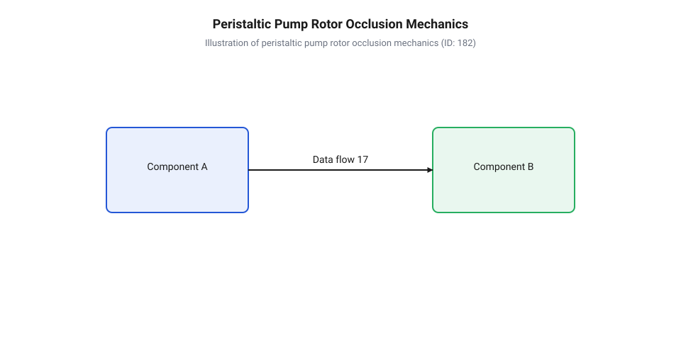
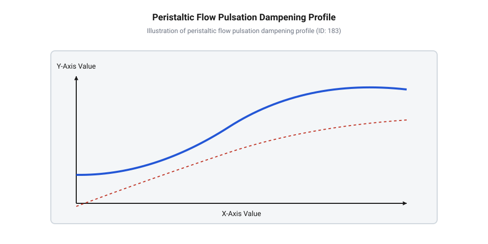
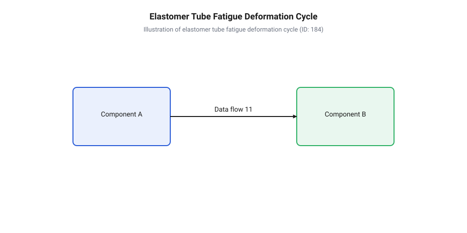

# Перистальтичні насоси

<preknowlist>
- [Відцентрові насоси](root:cat-hw-actuators/centrifugal-pumps) — принципи створення гідравлічного тиску та відмінність безперервного кінетичного витіснення від об'ємного
- [Мембранні мікропомпи](root:cat-hw-actuators/diaphragm-micro-pumps) — принцип об'ємного витіснення, роботу клапанних механізмів та природу пульсації потоку
</preknowlist>

## Ізоляція середовища при перекачуванні агресивних рідин

Під час транспортування рідин у промислових, хімічних та лабораторних системах інженери регулярно стикаються з критичною межею надійності класичних гідравлічних машин. Спроба перекачати концентровану сірчану кислоту, їдкий натр, абразивну мінеральну суспензію з твердими частками або крихку біологічну структуру на кшталт живих клітинних культур, ензимів чи цільної крові швидко викриває фундаментальну вразливість традиційних конструкцій. У динамічних гідравлічних машинах, таких як [відцентрові гідравлічні машини](root:cat-hw-actuators/centrifugal-pumps), а також у більшості роторних та поршневих помп перекачуване середовище безпосередньо омиває внутрішні механічні деталі: обертові вали, лопатеві імпелери, шестерні та сальникові ущільнення (@@en|mechanical seals@@). 

У таких умовах виникає подвійна руйнівна взаємодія між рідиною та механізмом насоса. З одного боку, хімічно агресивні речовини викликають прискорену корозію металевих елементів та розбухання полімерних манжет, а абразивні частки діють як шліфувальний матеріал, залишаючи глибокі подряпини на полірованих поверхнях вала й спричиняючи швидкі витоки. З іншого боку, змащувальні матеріали з підшипникових вузлів та мікрочастинки продуктів зносу ущільнень неминуче проникають у технологічний потік, повністю псуючи стерильність та чистоту речовини. Понад те, наявність складних внутрішніх геометрій і застійних зон (@@en|dead volumes@@) навколо затворів створює осередки накопичення відкладень і біологічного забруднення, які неможливо видалити звичайним промиванням без повного розбирання агрегату.

Радикальним розв'язанням цієї інженерної проблеми є повне фізичне вилучення механічних деталей із зони контакту з рідиною. Саме цей принцип реалізує @@en|peristaltic pump@@ — перистальтичний насос (від грецького @@gr|peristaltikos@@ — той, що охоплює або стискає, від @@gr|peristellein@@ — обгортати), який належить до класу машин, що виконують @@en|positive displacement@@ — об'ємне витіснення (від латинського @@la|volumen@@ — об'єм та @@la|dislocare@@ — зміщувати). У цій конструкції рідка чи газоподібна фаза повністю ізолюється всередині суцільного гнучкого каналу — еластомерного шланга або трубки. Переміщення середовища відбувається за рахунок послідовного зовнішнього механічного стискання шланга, яке створює рухому хвилю перетискання вздовж лінії каналу. Оскільки речовина контактує виключно з хімічно інертною внутрішньою стінкою трубки, насосний вузол позбавлений будь-яких сальників, ущільнювальних кілець чи занурених у рідину деталей, що гарантує абсолютну герметичність і повністю усуває ризик витоків чи забруднення потоку.

На відміну від [клапанних мембранних помп](root:cat-hw-actuators/diaphragm-micro-pumps), де напрямок потоку задається механічними зворотними клапанами — кульковими, пелюстковими чи конусними затворами, — перистальтичний вузол має повністю безклапанну конструкцію (@@en|valveless design@@). Роль герметичного затвора, який запобігає зворотному перетіканню рідини під тиском, виконує сам деформований шланг у точці повного стискання. Відсутність звужень, сідел клапанів та внутрішніх перегороджувальних елементів дає змогу безперешкодно перекачувати високов'язкі рідини, пасти, суспензії з великим вмістом твердих включень, а також зсувочутливі (@@en|shear-sensitive@@) полімери без ризику заклинювання чи деструкції макромолекул. Прямий нерозривний прохідний канал не має застійних зон, що забезпечує ідеальну придатність для безрозбірної циркуляційної промивки (@@en|Clean-In-Place@@, CIP) та високотемпературної стерилізації гострою парою (@@en|Sterilization-In-Place@@, SIP). У разі зміни технологічного середовища чи вимог до стерильності відновлення системи досягається швидкою заміною одноразового відрізка еластомерного шланга, що усуває потребу в тривалій хімічній дезінфекції всього гідравлічного тракту.

Концепція безконтактного перекачування пройшла тривалу інженерну еволюцію, сформовану суворими вимогами медичної та промислової галузей. У 1932 році американський хірург Майкл ДеБейкі (@@en|Michael DeBakey@@) розробив один із перших практичних роликових насосів для системи трансфузії крові, прагнучи запобігти руйнуванню еритроцитів (гемолізу) та забезпечити абсолютну стерильність під час переливання. Раніше, у 1881 році, Юджин Аллен (@@en|Eugene Allen@@) запатентував конструкцію перистальтичного пристрою для системи трансфузії крові. Перемістившись із ранніх апаратів штучного кровообігу та медичного гемодіалізу в металургію, фармацевтику й мікрофлюїдику, перистальтична технологія висунула суворі стандарти до конструкції насосних головок. Вимоги до повної відсутності застійних зон, високої точності порціонування та хімічної стійкості сформували сучасні стандарти притискних треків, швидкознімних механізмів фіксації трубок і спеціалізованих еластомерів, здатних витримувати мільйони циклів деформації.

Завдяки збереженню стабільного геометричного перерізу стиснутої зони перистальтичний насос забезпечує суворо лінійну залежність між кутовим переміщенням приводного вала та об'ємом витісненої рідини. Кожен оберт приводу переміщує фіксовану порцію речовини, перетворюючи пристрій на високоточний порційний дозатор. Проте для практичної реалізації цього принципу необхідно сформувати стабільну зону повного перетискання трубки та забезпечити її послідовне й плавне переміщення вздовж жорсткого ложа. Це ставить перед розробником задачу вибору кінематичної схеми ротора, розрахунку притискного зусилля та оптимізації геометрії деформації еластомерної стінки.

## Механіка ротора та притискного треку

Перетворення обертального руху приводу на послідовне переміщення запертого об'єму рідини відбувається всередині насосної головки, основними конструктивними елементами якої є ротор (від латинського @@la|rotare@@ — обертатися; @@en|rotor@@) та притискний трек (@@en|occlusion track@@). На роторі, змонтованому на центральному валу, радіально розміщуються обертові елементи — ролики (@@en|rollers@@) на кулькопідшипниках або в потужних промислових агрегатах масивні ковзні черевики (@@en|shoes@@). Трубка вкладається в дугоподібний притискний трек, який охоплює ротор по дузі від 180° до 270°. Під час обертання ротора ролики послідовно набігають на шланг, притискаючи його стінку до жорсткої внутрішньої поверхні треку й перекочуючи локальну зону деформації від вхідного патрубка до вихідного.

В об'ємних роликових вузлах ролики здійснюють чисте кочення по зовнішній поверхні шланга, мінімізуючи тертя ковзання й тепловиділення. У високотискових промислових шлангових насосах (із робочим тиском до 16 бар) застосовують ковзні черевики, які мають більшу площу контакту й розподіляють притискне зусилля. Для зменшення тертя й відведення тепла корпус таких промислових насосів заповнюють спеціальною змащувальною та охолоджувальною рідиною (гліцериновим або силіконовим мастилом), яка контактує лише із зовнішньою поверхнею шланга й не потрапляє у перекачуваний потік.

Ключовим технічним параметром, що визначає гідравлічні характеристики, тиск нагнітання та долговічність еластомерного каналу, є @@en|occlusion@@ — оклюзія (від латинського @@la|occlusio@@ — замикання, запирання). Оклюзія характеризує ступінь механічного стискання стінок трубки в точці найменшого радіального зазору між роликом і треком. Для забезпечення повного герметичного витіснення необхідно досягти стану повної оклюзії, за якого внутрішні поверхні стінок трубки щільно зімикаються без утворення поздовжнього просвіту.


*Поперечний розріз роликового перистальтичного вузла та принцип формування запертої порції рідини.*

Налаштування оклюзії потребує ретельного інженерного розрахунку та компромісу між гідравлічною ефективністю й механічним ресурсом еластомеру. Якщо радіальний зазор між роликом і треком перевищує подвійну товщину стінки трубки, виникає неповна оклюзія (@@en|under-occlusion@@). У цьому стані підвищення тиску на нагнітанні викликає зворотне перетікання рідини (@@en|backflow@@) через мікрощілину в зоні контакту. Це знижує об'ємний коефіцієнт корисної дії, зменшує глибину всмоктувального розрядження та робить витрату залежною від протитиску в магістралі. 

Натомість надмірна оклюзія (@@en|over-occlusion@@), за якої зазор менший за подвійну товщину стінки, призводить до значного перетискання матеріалу стінки й витискання еластомеру в бокові сторони. Це спричиняє критичну концентрацію внутрішніх напружень у згинах трубки, прискорює утворення мікротріщин і втомне руйнування, істотно збільшує крутний момент на валу приводу та може спричинити спаляцію (@@en|spallation@@) — відшарування дрібних лусочок еластомеру з внутрішньої поверхні шланга в перекачувану рідину.

Коли два сусідні ролики одночасно стискають трубку на треку, між ними формується заперта порція рідини (@@en|trapped fluid volume@@). Цей замкнений об'єм переміщується вздовж дуги треку зі швидкістю, пропорційною кутовій швидкості обертання ротора. На вхідній стороні насосного вузла відбувається процес всмоктування: ролик залишає зону притискного треку й знімає навантаження зі шланга. Завдяки власному модулю пружності еластомер стрімко відновлює початкову круглу форму поперечного перерізу. Це швидке відновлення об'єму створює всередині каналу всмоктувальне розрядження (@@en|suction vacuum@@) зі значеннями вакуумометричного тиску до -0.9 бар. Саме пружна релаксація стінки надає перистальтичному насосу здатність до самовсмоктування (@@en|self-priming capability@@) «на суху» без попереднього заповнення приймального трубопроводу рідиною.

Теоретична об'ємна продуктивність роликового вузла визначається геометричними параметрами трубки, радіусом ротора та частотою обертання приводного вала. Позначимо основні величини:
- `d` — внутрішній діаметр незтисненої еластомерної трубки (@@en|inner diameter@@);
- `R` — ефективний радіус ротора по центру осьової лінії трубки (@@en|rotor radius@@);
- `N` — кількість роликів, рівномірно змонтованих на роторі (@@en|roller count@@);
- `n` — частота обертання вала ротора в обертах за секунду;
- `A` — площа внутрішнього поперечного перерізу незтисненого каналу;
- `L_p` — довжина дуги притискного треку між двома сусідніми роликами;
- `V_p` — об'єм однієї запертої порції рідини між роликами;
- `Q_th` — теоретична об'ємна витрата рідини.

Розрахунок теоретичної витрати здійснюється шляхом покрокового виведення об'єму запертої порції та сумарної подачі за одиницю часу:

```
V_p = A · L_p
    = (π · d² / 4) · (2 · π · R / N)        [заміна площі перерізу та довжини дуги між роликами]
    = (π² · d² · R) / (2 · N)               [спрощення виразу для порції]

Q_th = N · V_p · n
     = N · ((π² · d² · R) / (2 · N)) · n     [підстановка об'єму запертої порції]
     = 0.5 · π² · d² · R · n                [скорочення кількості роликів]
```

Як видно з виведеного виразу, теоретична об'ємна витрата пропорційна квадрату внутрішнього діаметра трубки, радіусу ротора та частоті обертання вала. У базовій геометричній моделі подача за один повний оберт не залежить від кількості роликів `N`, оскільки зі збільшенням кількості роликів об'єм кожної окремої порції `V_p` зменшується в такій самій пропорції. Для ретельного розрахунку з урахуванням товщини стінки та деформації стиснення корисно вивчити [математичні моделі кінематики](root:cat-hw-actuators/peristaltic-pumps/math-peristaltic-flow-kinematics.md), де наведено розширені рівняння з поправками на оклюзійний сув.

Реальна об'ємна витрата `Q_act` виявляється дещо меншою за теоретично розраховану через вплив об'ємного коефіцієнта корисної дії `η_v` (@@en|volumetric efficiency@@), який для справного насоса перебуває в межах від 0.85 до 0.98:

```
Q_act = Q_th · η_v                          [урахування об'ємного коефіцієнта корисної дії]
```

Зниження `η_v` зумовлене короткочасним зворотним відтоком рідини в момент з'їзду ролика з треку, а також неповним пружним відновленням стінки трубки при високих частотах обертання або при перекачуванні високов'язких середовищ, коли стінка не встигає повністю розправитися до набігання наступного ролика.

Кількість роликів `N` визначає якісний характер вихідного потоку та амплітудно-частотний профіль пульсацій тиску. У момент, коли ролик досягає кінця притискного треку й розмикає контакт зі шлангом, вивільнена стиснута ділянка трубки миттєво розширюється, поглинаючи частину рідини з напірної магістралі. Це викликає короткочасне падіння тиску й витрати — пульсаційний провал (@@en|flow dip@@).


*Профіль пульсацій витрати на виході насоса для різної кількості роликів та процес згладжування тиску демпфером.*

Двороликовий ротор (`N = 2`) дає наибольший об'єм порції `V_p` за оберт і демонструє найменший втомний знос трубки (менше циклів стискання за оберт), однак створює глибокі пульсації тиску з амплітудою падіння до 100% від номінального значення. Застосування трьох або чотирьох роликів (`N = 3` або `N = 4`) значно зменшує амплітуду пульсацій і підвищує їхню частоту, роблячи вихідний потік значно рівномірнішим і сприятливим для дозування. Однак збільшення кількості роликів пропорційно підвищує кількість циклів циклічного вигину стінки за оберт, що прискорює втомне зношування шланга. 

Для ефективного гасіння пульсацій у високоточних або чутливих технологічних лініях використовують зовні встановлений @@en|pulsation dampener@@ — демпфер пульсацій (від німецького @@de|Dämpfer@@ — глушник, від @@de|dämpfen@@ — пригнічувати). Він являє собою герметичну камеру з еластичною мембраною або повітряним ковпаком, яка акумулює надлишок рідини під час піку тиску та віддає його в магістраль під час пульсаційного провалу. Іншим ефективним методом є використання двоканальних насосних головок із роторами, зсунутими по фазі на 45°, де пульсації двох ліній взаємно компенсуються при об'єднанні потоків.

Конструктивні вимоги до вибору зазорів деталізовані в [описі механічного підключення](root:cat-hw-actuators/peristaltic-pumps/api-peristaltic-pump-hardware.md), де регламентовано посадочні розміри й геометрію треків. Практична реалізація таких систем висвітлена у [проєкті прецизійного дозатора](root:cat-hw-actuators/peristaltic-pumps/proj-precision-dosing-pump.md) із кроковим приводом, який забезпечує високу точність позиціонування ротора. Програмні алгоритми генерації імпульсних серій та керування швидкостями дозування деталізовані в [інтерфейсі керування дозуванням](root:cat-hw-actuators/peristaltic-pumps/api-peristaltic-dosing-control.md), де описано профілі розгону приводу.

## Матеріалознавство та деградація еластомерних трубок

Робочий елемент перистальтичного насоса — еластична трубка — перебуває в умовах постійного жорсткого механічного випробування. На відміну від ротора чи корпусу в [відцентрових насосах](root:cat-hw-actuators/centrifugal-pumps), де тиск створюється кінетичним прискоренням без контакту зі стінками камери, перистальтичний шланг приймає на себе прямий контакт з роликами й повністю деформується на кожен оберт приводу. За один день роботи при частоті обертання `100 об/хв` і наявності трьох роликів шланг витримує понад `430 000` циклів повного перетискання. Тільки правильний вибір матеріалу еластомеру та розуміння фізики його деградації дозволяють запобігти передчасному розриву шланга й витіканню агресивного або дорогоцінного флюїду.

@@en|еластомер@@ (грец. *ἐλαστός* — пружний, *μέρος* — частка) трубки має одночасно забезпечувати високу пружність для миттєвого відновлення початкового круглого перерізу після проходження ролика, хімічну інертність до перекачуваного середовища та стійкість до втомного руйнування. На практиці застосовують три основні класи матеріалів:

1. **Силікон (@@en|силікон@@, від лат. *silicium* — кремній).** Кремнійорганічний полімер із кремній-кисневим магістральним ланцюгом (`-Si-O-Si-`). Силіконові трубки мають виняткову гнучкість, широкий температурний діапазон (від `-50 °C` до `+200 °C`) і повну біологічну сумісність. Вони відповідають санітарним стандартам USP Class VI та FDA, що робить їх стандартом для фармації та медицини. Проте силікон має відносно низьку стійкість до циклічного втомного зламу та високу газовіддачу (проникність для кисню й вуглекислого газу). Крім того, він швидко набухає й руйнується в середовищі концентрованих кислот, лугів та неполярних органічних розчинників. 2. **TPV (@@en|термопластичний вулканізат@@ / @@en|thermoplastic vulcanizate@@, наприклад, Pharmed BPT, Santoprene).** Двофазний морфологічний матеріал, у якому дрібнодисперсні зшиті частки EPDM-каучуку рівномірно розподілені у суцільній матриці поліпропілену. Завдяки такій структурі TPV демонструє втомну міцність у `10–30` разів вищу за силікон, а також критично низьку газовіддачу, що важливо для культивування клітин та біореакторів. Матеріал стійкий до кислот, лугів та окисників, але має вищий модуль пружності, що вимагає більшого зусилля притискання роликів. 3. **Фтореластомери (@@en|фтореластомер@@ / FKM, Viton, від лат. *fluor* — течія).** Фторовані вуглеводневі полімери, у яких атоми водню заміщені фтором (`-CF₂-CH₂-`). Вони мають максимальну хімічну стійкість серед усіх еластомерів і витримують вплив концентрованих кислот, ароматичних вуглеводнів, палива та агресивних розчинників. Однак висока жорсткість (високий модуль Юнга `E`) та низька швидкість пружного відновлення суттєво обмежують їхню втомну тривалість. Фтореластомерні трубки швидко розтріскуються при високочастотному згинанні й потребують потужних приводів через великий опір деформації.

Під час стискання роликом у стінці трубки виникає складний напружено-деформований стан: внутрішня поверхня зазнає стискання й зсуву, а зовнішня — значного розтягування. Через віскозиметричну природу полімерів деформація супроводжується внутрішнім тертям молекулярних ланцюгів. Якщо побудувати залежність механічного напруження `σ` від деформації `ε` під час стискання й подальшого розтискання, ми отримаємо @@en|петлю гістерезису@@ (грец. *ὑστέρησις* — відставання).


*Динаміка механічного напруження в стінці еластомерної трубки під час одного циклу стискання роликом (ліворуч) та стадії розвитку внутрішньоструктурних мікротріщин від первинних мікропорів до повного розриву трубки (праворуч).*

Площа всередині петлі гістерезису відповідає механічній енергії, яка не повертається у вигляді пружної віддачі, а дисипується у вигляді тепла. Постійне саморозігрівання стінки трубки прискорює термомеханічне старіння еластомеру й розрив міжмолекулярних зв'язків. На мікрорівні в зонах найбільших локальних напружень утворюються субмікроскопічні пори. Під дією циклічних навантажень ці мікротріщини концентрують напруження на своїх верхівках і поступово проростають крізь товщу стінки. Коли магістральна тріщина досягає зовнішньої поверхні, відбувається аварійний розрив трубки.

Окрім втомного руйнування, у процесі тривалої експлуатації виникає @@en|релаксація напружень@@ (лат. *relaxatio* — послаблення). Це явище полягає в поступовому зниженні пружної сили відновлення стінки при зберіганні фіксованого рівня деформації. Еластомер накопичує остатню деформацію стиску (@@en|compression set@@), через що після проходження ролика шланг відновлює свій внутрішній діаметр лише частково.

Спад пружного відновлення трубки безпосередньо погіршує гідродинаміку насоса. Зменшення швидкості розкриття каналу знижує створене всмоктувальне розрядження, через що рідина повільніше заповнює робочу камеру. Зменшений внутрішній переріз трубки `A_tube` призводить до зниження коефіцієнта об'ємного ККД `η_v` та поступового дрейфу об'ємної витрати в бік зменшення впродовж тривалої роботи.

Для оцінки стійкості трубки до тиску використовують співвідношення товщини стінки `w` до внутрішнього діаметра `d_i`. Товстостінні трубки витримують робочий тиск нагнітання до `4–7 бар`, однак потребують більшого крутного моменту приводу й швидше зношуються від механічного саморозігріву. Тонкостінні трубки легко перетискаються, але обмежені тиском до `1.5 бар`.

Розрахунок прогнозованого ресурсу трубки до механічного розриву `T_life` у годинах виконують за співвідношенням:

```
N_total = n × k × 60 × T_life
T_life = N_limit ÷ (n × k × 60)          [перетворення граничної кількості циклів у час експлуатації]
```

де `N_limit` — експериментальна границя втомної витривалості даного еластомеру (кількість стискань до розриву), `n` — частота обертання ротора (об/хв), `k` — кількість роликів на роторі.

Розрахована тривалість служби трубки та оцінка необхідної сили її повного перетискання стають вихідними даними для [розрахунку об'ємної витрати](root:cat-hw-actuators/peristaltic-pumps/math-peristaltic-flow-kinematics.md) та вибору електроприводу насосного вузла.

## Приводувальні механізми та пульсаційна гідродинаміка

Після вибору еластомерного шланга й визначення зусилля його деформації постає завдання вибору виконавчого приводу та керування гідродинамічними параметрами потоку. Привод перистальтичного насоса має долати опір перетискання трубки, гідростатичний тиск нагнітання та механічне тертя в роликовому вузлі.

Залежно від технологічної задачі використовують два основні типи електроприводів:

1. **Крокові двигуни (@@en|кроковий двигун@@ / @@en|stepper motor@@).** Ротор крокового двигуна повертається на фіксований кутовий крок (найчастіше `1.8°`, тобто `200 кроків` на один повний оберт). Дискретний характер руху робить кроковий привод ідеальним для прецизійного дозування. Оскільки дискретний кут обертання жорстко зв'язаний із витісненим об'ємом рідини, мікроконтролер може видавати точні порції без зворотного зв'язку за датчиком витрати. Проте крутний момент крокового двигуна стрімко падає зі зростанням частоти обертання `n`, а при перевищенні граничного навантаження виникає пропуск кроків. Для усунення механічного резонансу та зменшення пульсацій застосовують силіційні драйвери з мікрокрокуванням (`1/16` або `1/64` кроку). Детальна конструкція такого вузла розглядається в [прецизійному дозувальному модулі](root:cat-hw-actuators/peristaltic-pumps/proj-precision-dosing-pump.md). 2. **Колекторні мотор-редуктори (@@en|колекторний мотор-редуктор@@ / @@en|DC motor@@).** Двигуни постійного струму, агреговані з черв'ячним або планетарним редуктором. Вони мають високий пусковий момент, високий ККД і забезпечують плавне безперервне перекачування великих об'ємів. Їхнім недоліком є залежність частоти обертання від коливань напруги живлення та протитиску в магістралі, що вимагає застосування замкненого контуру керування з квадратурним енкодером для стабілізації витрати.

Розрахунок необхідного крутного моменту приводу `M_total` на валу ротора враховує три складові: момент перетискання трубки `M_occ`, момент протитиску рідини `M_press` та момент тертя `M_fric`:

```
M_total = M_occ + M_press + M_fric
= (F_clamp × R_r × k_occ) + ((ΔP × A_tube × R_r) ÷ η_mech) + (μ_fric × F_clamp × R_r)   [сумування моментів опору]
```

де `F_clamp` — зусилля повного стискання двох стінок трубки (Н), `R_r` — радіус ротора до осі ролика (м), `k_occ` — кількість роликів, що одночасно знаходяться в зоні оклюзії на притискному треку, `ΔP` — робочий перепад тиску (Па), `A_tube` — площа ефективного перерізу запертої камери (м²), `η_mech` — механічний ККД роликового механізму (`0.85–0.92`), `μ_fric` — коефіцієнт тертя між роликом та зовнішньою поверхнею шланга.

Необхідна електрична потужність двигуна `P_motor` становить:

```
P_motor = (M_total × ω) ÷ η_gear
= (M_total × 2 × π × n ÷ 60) ÷ η_gear                   [розрахунок потужності через кутову швидкість]
```

де `ω` — кутова швидкість обертання ротора (рад/с), `n` — частота обертання (об/хв), `η_gear` — ККД редуктора.

Особливою гідродинамічною рисою перистальтичного витіснення є яскраво виражена пульсаційність потоку. На відміну від безперервної подачі [відцентрових насосів](root:cat-hw-actuators/centrifugal-pumps) або клапанного витіснення у [мембранних мікропомпах](root:cat-hw-actuators/diaphragm-micro-pumps), пульсація перистальтичного насоса зумовлена геометричною кінематикою виходу ролика з треку.

У момент, коли ролик досягає кінця притискного треку й відривається від трубки (диз'єкція), затиснута ділянка шланга під дією пружних сил миттєво розпрямляється до початкового круглого перерізу. Цей процес супроводжується різким збільшенням внутрішнього об'єму трубки на виході. Внаслідок цього виникає зворотне всмоктування рідини з напірної магістралі назад у насосний вузол — утворюється @@en|пульсаційний провал@@ тиску та витрати.

Коли наступний ролик входить у зону треку й починає стискати нову заперту порцію рідини, потік стрімко прискорюється. Швидке гальмування та наступне прискорення стовпа рідини у жорсткому трубопроводі спричиняє @@en|гідравлічний удар@@ (англ. *water hammer*). Гідравлічні удари створюють пікові перевантаження на арматуру, сприяють розхитуванню з'єднань і прискорюють розрив еластомерного шланга.

Для гасіння хвильових пульсацій та стабілізації вихідного тиску застосовують кілька інженерних методів:

1. **Пасивна демпферна камера (@@en|пульсаційний демпфер@@ / @@en|pulsation dampener@@).** Герметична вертикальна ємність, встановлена на виході насоса. Повітряна подушка у верхній частині камери працює як пневматична пружина: під час піку тиску повітря стискається, акумулюючи надлишок рідини, а під час пульсаційного провалу розширюється, виштовхуючи рідину в магістраль і згладжуючи витрату. 2. **Багатороторні конфігурації.** Збільшення кількості роликів з `2` до `4` або `6` зменшує об'єм поодинокої запертої порції рідини, що пропорційно знижує амплітуду пульсаційного провалу. Проте це підвищує частоту пульсацій і прискорює втомне зношування шланга. 3. **Двоканальні головки з фазовим зміщенням.** Використання двох паралельних насосних головок на спільному валу, зміщених за кутом на `180°` (або `360° ÷ (2k)`), із об'єднанням виходів через Y-подібний фітинг. Пульсаційний провал одного каналу компенсується максимумом подачі іншого каналу.

Механічне підключення приводу та розміщення демпферних камер описані в [електричному та механічному підключенні](root:cat-hw-actuators/peristaltic-pumps/api-peristaltic-pump-hardware.md). Програмне керування драйвером крокового двигуна та алгоритми плавного розгону реалізуються через [програмний інтерфейс керування](root:cat-hw-actuators/peristaltic-pumps/api-peristaltic-dosing-control.md).

Нижче наведено приклад коду керування кроковим приводом перистальтичного дозатора з підтримкою профілю розгону та точного відрахування кроків дозування:

:::tabs
@tab c|esp-idf
:::code peristaltic-pumps-d/c/peristaltic-dosing-init.c

@tab cpp|arduino
:::code peristaltic-pumps-d/cpp/peristalticdoser.cpp
:::

## Калібрування, регламент та інтеграція дозатора

Навіть найточніше спроєктований перистальтичний вузол із вивіреними геометріями ротора та притискного треку з часом втрачає початкову точність витіснення. Якщо на початку роботи насос стабільно подає заданий об'єм за кожен оберт, то вже після кількох годин безперервного перекачування спостерігається деградація продуктивності. Причина цього явища полягає у фізиці поведінки полімерного каналу. Під дією мільйонів циклів локального стискання матеріалу роликами проявляється релаксація (від латинського @@la|relaxatio@@ — послаблення) напружень в еластомері. Пружна сила відновлення стінок трубки поступово зменшується, через що після проходження ролика еластомер повертається до початкової круглої форми повільніше. Це спричиняє нестачу всмоктувального вакууму й неповне заповнення робочого об'єму рідиною. Одночасно виникає остатня пластична деформація стиску, яка змінює прохідний переріз каналу під оклюзією. У результаті спостерігається дрейф витрати (@@en|flow rate drift@@), коли фактична об'ємна подача зменшується на 3–10% від початкового значення.

На ступінь деградації та стабільність дозування суттєво впливають гідродинамічні характеристики перекачуваного середовища й параметри гідравлічної лінії. При підвищенні в'язкості рідини зростає гідравлічний опір на всмоктуванні. Повільне пружне розпрямлення послабленої трубки у поєднанні з високим в'язкісним тертям призводить до того, що порожнина між роликами просто не встигає повністю наповнитись до приходу наступного ролика. Додатково протитиск у напірній магістралі під час розтискання ролика викликає мікроскопічний зворотний перетік рідини у момент зміни оклюзійного контакту. Для оцінки реальної продуктивності використовують об'ємний коефіцієнт корисної дії (@@en|volumetric efficiency@@):

```
V_real = V_theory × η_v
```

де `V_real` — фактичний витіснений об'єм за один оберт ротора, `V_theory` — теоретичний геометричний об'єм запертої камери, а `η_v` — об'ємний коефіціент корисної дії, який знижується у міру зносу трубки або зростання в'язкості. Для точного обчислення об'єму запертої порції та кутової швидкості ротора варто застосовувати [математичний розрахунок кінематики](root:cat-hw-actuators/peristaltic-pumps/math-peristaltic-flow-kinematics.md), який враховує геометричні параметри треку й товщину стінки трубки.

Для компенсації фізичної нелінійності витіснення та геометричної релаксації полімеру застосовують періодичне вагове калібрування (@@en|gravimetric calibration@@, від латинського @@la|gravis@@ — важкий та грецького @@el|metron@@ — міра). Метод ґрунтується на вимірюванні маси дозованої рідини за допомогою прецизійних електронних ваг із тензометричним датчиком. Насос виконує задану кількість обертів приводу або серію мікрокроків, після чого контролер зчитує фактичну масу витісненої рідини та обраховує її фактичний об'єм із урахуванням густини. Розрахунок нового калібрувального коефіціента здійснюється за кроками:

```
V_measured = m_measured ÷ ρ      [переведення виміряної маси у фактичний об'єм]
K_cal = V_target ÷ V_measured    [обчислення коефіцієнта корекції подачі]
C_new = C_old × K_cal            [оновлення кількості імпульсів приводу на одиницю об'єму]
```

де `m_measured` — маса рідини на вагах, `ρ` — густина середовища при робочій температурі, `V_target` — необхідний об'єм дози, а `C_old` і `C_new` — значення кількості імпульсів крокового двигуна на один мілілітр. Якщо насос працює у широкому діапазоні швидкостей обертання, калібрування проводять по кількох точках, оскільки при високих обертах динамічне недозаповнення трубки створює додаткову нелінійність характеристики.

У відповідальних технологічних процесах фармакології чи хімічного синтезу періодичного ручного калібрування недостатньо. У таких системах будують закритий контур (@@en|closed-loop control@@) автоматичного дозування. Під час роботи вихідна судина встановлюється безпосередньо на вагову платформу, яка неперервно або після кожної порції передає дані на мікроконтролер. Алгоритм порівнює фактично витіснену масу з еталонним значенням і коригує кількість кроків для наступного циклу. Для запобігання автоколиванням систему налаштовують із демпфувальним коефіцієнтом:

```
K_step = K_prior × (1 + α × (m_target - m_actual) ÷ m_target)      [ітеративна корекція закритого контуру]
```

де `K_prior` — попереднє значення кроків на дозу, `m_actual` — маса реально поданої рідини, а `α` — коефіціент згладжування (зазвичай у межах від 0.1 до 0.3). Для програмного налаштування імпульсного дозування та обробки сигналів зворотного зв'язку використовують [програмний інтерфейс контролера](root:cat-hw-actuators/peristaltic-pumps/api-peristaltic-dosing-control.md), що реалізує алгоритми алгоритмічної компенсації дрейфу. Готовий приклад побудови автоматизованого дозатора розкрито у [проєкті прецизійного насоса](root:cat-hw-actuators/peristaltic-pumps/proj-precision-dosing-pump.md), де поєднано кроковий привод NEMA 17 із ваговим сенсором.

Будь-яка еластомерна трубка має обмежений механічний ресурс, визначений кількістю циклів деформації до появи втомних мікротріщин і загрози розриву. Тому регламентна заміна трубки є обов'язковою процедурою обслуговування. Процес заміни виконують за суворим алгоритмом:
1. Скидають тиск у магістралях та проводять промивку або стерилізацію робочого каналу. 2. Відтискають притискний механічний трек і знімають зношений шланг, оглядаючи ролики на предмет відкладень еластомерного пилу. 3. Встановлюють новий відрізок трубки, забезпечуючи рівномірний осьовий натяг без скручування навколо власної осі. 4. Проводять процедуру припрацювання (@@en|run-in period@@) — запуск насоса на 15–30 хвилин із чистою водою під робочим тиском для стабілізації початкового гістерезису матеріалу. 5. Виконують нульове калібрування дозувального вузла.

Надійна та стабільна робота перистальтичної помпи неможлива без грамотно зконструйованої гідравлічної обв'язки. Всмоктувальну лінію необхідно робити максимально короткою та з великим внутрішнім діаметром, щоб мінімізувати гідравлічний опір і запобігти кавітації (від латинського @@la|cavitas@@ — порожнина). Для відсікання сифонного ефекту, коли рідина тече самопливом при зупиненні ротора у положенні з частково відкритою оклюзією, на виході встановлюють запобіжні зворотні клапани протитиску. Згладжування дискретних пульсацій здійснюють за допомогою демпферів пульсацій (@@en|pulsation dampener@@) — компенсаційних камер із повітряною подушкою або гнучкою мембраною. На відміну від кінетичних агрегатів, де витрата сильно залежить від зовнішнього тиску як у [класичних відцентрових насосах](root:cat-hw-actuators/centrifugal-pumps), перистальтичний вузол забезпечує жорстку об'ємну подачу. Хоча для пульсуючих рідинних систем часто застосовують [компактні мембранні мікропомпи](root:cat-hw-actuators/diaphragm-micro-pumps), перистальтична схема виключає ризик заклинювання клапанів при роботі з суспензіями.

Останнім етапом побудови дозувального комплексу є апаратне поєднання насосного головного вузла з промисловою або вбудованою системою автоматизації. Привод перистальтичного насоса підключають через силові драйвери крокових двигунів або транзисторні ключі з Pulse-Width Modulation (PWM) для колекторних мотор-редукторів. У корпус насосної головки обов'язково інтегрують оптичний або кондуктометричний датчик витоку (@@en|leak detector@@), який у разі аварійного розриву трубки миттєво відключає живлення двигуна та закриває вхідний аварійний клапан. Під час монтажу насосного вузла та підключення силових кіл керування необхідно звірятися з [електричною та механічною схемою](root:cat-hw-actuators/peristaltic-pumps/api-peristaltic-pump-hardware.md) для запобігання перегріву двигуна та вибрації корпусу. Такий комплексний підхід до калібрування, гідравлічного проєктування та апаратного захисту дає змогу отримувати прецизійну точність дозування впродовж усього терміну служби еластомерних елементів.