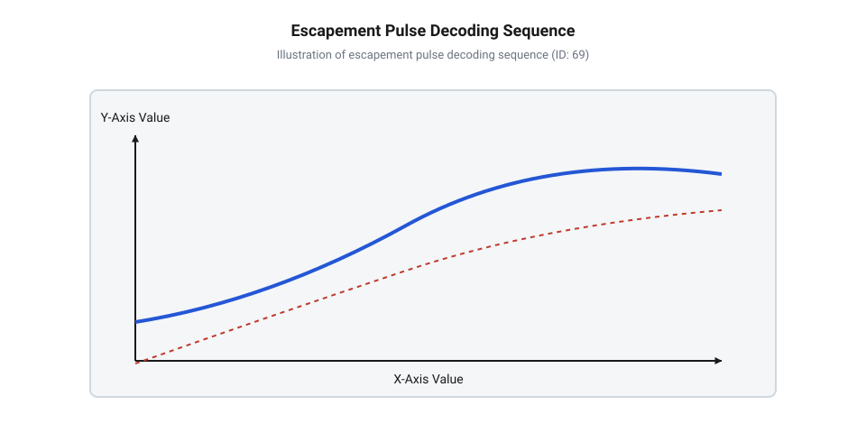
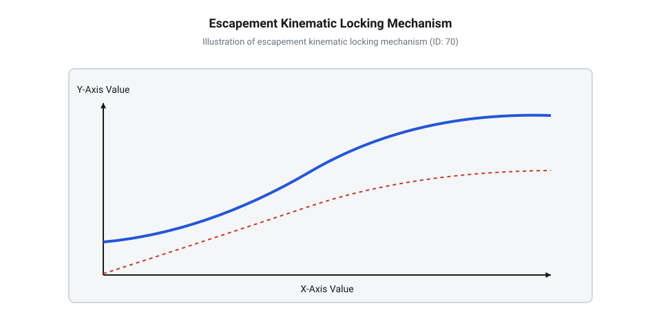
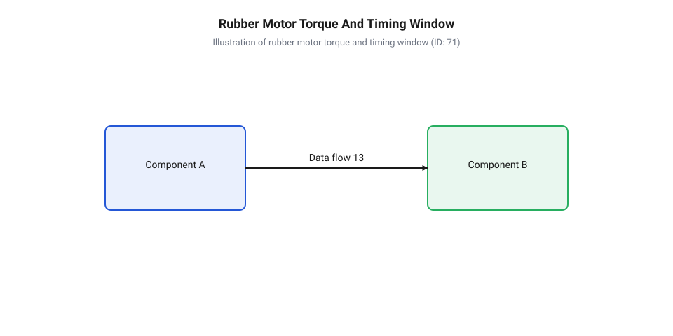
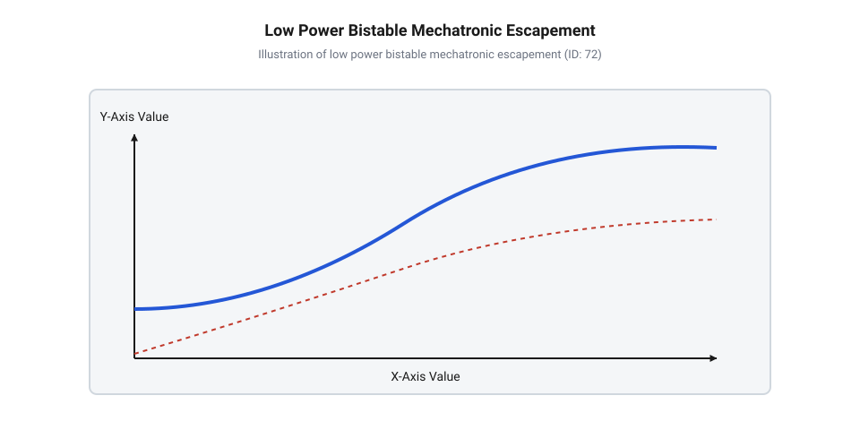
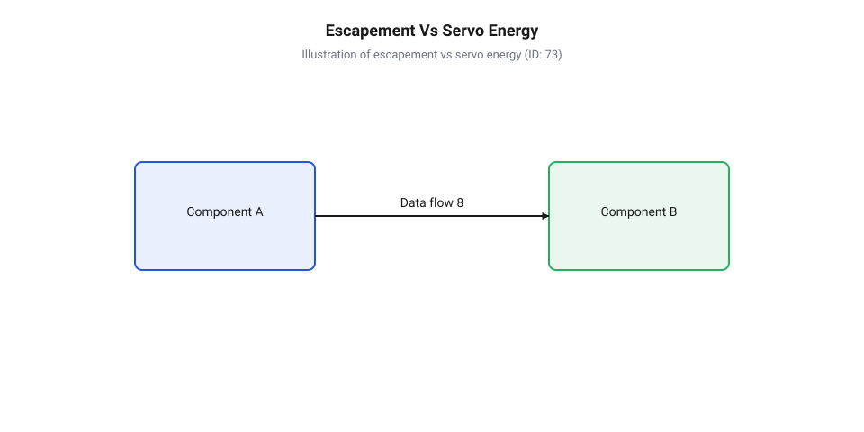

# Дискретні перемикачі (escapements) у перших RC-системах

<preknowlist>
- [Сервоприводи радіокерованих моделей: будова, редуктори та ШІМ-керування](root:cat-hw-actuators/rc-servo-mechanisms-and-control) — Принцип передачі зусилля на кермові поверхні та відмінність пропорційного позиціонування від дискретного
- [Кінематика важільних механізмів та тяг сервоприводів](root:cat-hw-actuators/servo-pushrod-kinematics) — Геометрія перетворення кутового руху вихідного вала в лінійне переміщення рульових площин
</preknowlist>

## Проблема керування рухом одноканальним радіозв'язком

Легкий бортовий планер або макет авіамоделі 1950-х років мав підняти у повітря важке радіоустаткування на електронних лампах, а також громіздкі анодні й розжарювальні батареї. Ваговий ліміт корисного навантаження безпілотного апарата вимірювався десятками грамів, тоді як перші радіоприймачі через технологічні обмеження елементної бази могли забезпечити лише один дискретний канал зв'язку. Цей канал передавав виключно факт наявності або відсутності високочастотної несучої в ефірі: коли оператор натискав кнопку на передавачі, приймач фіксував сигнал, а при відпусканні — сигнал зникав.

На виході одноканального приймача стояло єдине електромеханічне @@en|relay@@ (від франц. *relais* — перепряжка коней, перемикач), яке замикало силовий контакт у момент прийому несучої хвилі й розмикало його у момент її зникнення. Спроба безпосередньо з'єднати якір цього реле або додатковий електромагніт із керуючими поверхнями літака одразу впиралася у фундаментальну інженерну перешкоду. Двопозиційний @@en|actuator@@ (від лат. *actuare* — приводити в дію, виконавець) прямої дії міг працювати лише в бінарному режимі: повністю втягувати тягу при подачі струму й повертати її пружиною у початковий стан при знеструмленні.

Проте для здійснення керованого аеродинамічного польоту модель потребує щонайменше трьох стабільних механічних стан керма напрямку: «Нейтраль» для прямолінійного руху, «Ліворуч» для виконання розвороту та «Праворуч» для маневрування у протилежний бік. Якщо прямо з'єднати кермову тягу з реле, то знеструмлений стан відповідатиме, наприклад, крайньому лівому положенню, а ввімкнений — крайньому правому. У такій системі повністю відсутній стан нейтралі, без якого апарат не здатний здійснювати горизонтальний прямолінійний політ. Якщо ж налаштувати пружину так, щоб при відсутності струму кермо утримувалося в нейтралі, то при ввімкненні реле можна відхилити кермо лише в один бік. Другий напрямок розвороту залишається повністю недоступним.

Пряме підключення тяг до обмотки реле або потужного соленоїда вимагало б постійного проходження значного струму для утримання керма у відхиленому положенні проти набігаючого повітряного потоку. Це миттєво виснажувало б бортові батареї живлення, які й без того мали мізерну питому ємність. Використання ж колекторного електродвигуна з ходовим гвинтом або редуктором вимагало складних схематичних розв'язків для реверсування струму та важких перемикачів кінцевих положень, що категорично перевищувало вантажопідйомність тогочасних моделей. На відміну від того, як працюють сучасні [сервоприводи радіокерованих моделей](root:cat-hw-actuators/rc-servo-mechanisms-and-control), де сервоконтролер постійно відстежує кут за допомогою потенціометричного зв'язку та мостового підсилювача, перші моделісти були позбавлені можливості безперервного пропорційного позиціонування.

Інженерний вихід із цієї безвиході полягав у розщепленні двох функцій виконавчого пристрою: накопичення силової механічної енергії та керування її вивільненням. Якщо силову роботу з відхилення аеродинамічного керма перекласти на автономне механічне джерело — закручену гумову стрічку або заводну пружину, — то радіоканалу залишається лише роль тригера. Бортовому @@en|solenoid@@ (від грецьк. *solen* — труба, *eidos* — вигляд, електромагнітна котушка зі рухомим сердечником) більше не потрібно силою долати опір повітряного потоку й утримувати рульову площину власною магнітною силою. Соленоїд виконує виключно функцію короткочасного розблокування механічного стопора.

Короткий електричний імпульс тривалістю в кілька десятків мілісекунд споживає мізерну кількість електричної енергії від батареї, але дозволяє ротору механізму прокрутитися на фіксований кут під дією накопиченої пружності. Пристрій, що здійснює таке дискретне крокове дозування механічного руху за допомогою зовнішнього фіксатора, дістав назву @@en|escapement@@ (від англ. *escape* — вислизати, втікати, через покрокове вивільнення зубчастого колеса). Механічний декодер перетворює часову послідовність електричних імпульсів від одноканального приймача в послідовне зміщення вихідного важеля. Натискаючи кнопку передавача з різною тривалістю та інтервалом, оператор формує серію спрацьовувань соленоїда, які дискретний перемикач трансформує у відповідні фіксовані положення керма.


*Послідовність електричних імпульсів керування та механічний відгук кермового важеля в трипозиційній часовій схемі.*

Такий підхід дозволив будувати повноцінні літаючі моделі за наявності лише одного дискретного лампового реле. Історична [еволюція дискретних перемикачів](root:cat-hw-actuators/rc-escapement-mechanisms/hist-rc-escapements-evolution.md) пройшла шлях від найпростіших двопозиційних тріщаток до складних самонейтралізованих та компаундних пристроїв. Пізніше для розширення можливостей застосовувалися навіть такі рішення, як [пропорційне керування через puls](root:cat-hw-actuators/single-channel-pulse-proportional-galloping-ghost), де соленоїд безперервно коливався з різною скважністю, та [язичкові резонансні реле](root:cat-hw-drivers/electromechanical-reed-relay-decoders), що розділяли звукові частоти. Проте саме механічний ескапмент із гумомотором став першим масовим та надійним виконавчим приводом у радіомоделізмі, розв'язавши проблему трипозиційного керування в умовах суворих енергетичних та вагових обмежень.

## Принцип енергоакумуляції та кулачкового зачеплення

Основою силового приводу дискретного ескапменту є закручений джгут із високоеластичної гуми (@@en|rubber motor@@, від англ. *rubber* — гума та *motor* — двигун). Гумовий джгут простягається вздовж фюзеляжу моделі й фіксується одним кінцем на нерухомому шпангоуті, а іншим — на ведучому валу ескапменту. При ручному закручуванні в гумі накопичується потенціальна енергія пружної деформації. Цей силовий агрегат детально висвітлюють [пружинні та гумомоторні накопичувачі](root:cat-hw-actuators/clockwork-and-rubber-motor-actuation-mechanisms). Крутний момент від гумомотора прагне безперервно обертати вихідний @@en|rotor@@ (від лат. *rotare* — обертатися, хрестовину або диск із стопорними пальцями). Проте вільне обертання блокується двопозиційним важелем, під'єднаним до підпружиненого якіря соленоїда.


*Кінематика стопорного зачеплення ротора ескапменту з двопозиційним важелем соленоїда.*

Кінематична логіка механічного декодування базується на взаємодії стопорних елементів ротора з кулачково-дисковими або важелями зачеплення. Розглянемо детально кінематику зачеплення класичного трипозиційного самонейтралізованого ескапменту. Його ротор містить дві групи стопорних штифтів або зубців, розміщених у різних площинах обертання або рознесених по радіусу. Двопозиційний @@en|pawl@@ (від нід. *pal* — фіксатор, стопорний важіль соленоїда) має два рознесені виступи: верхній зуб і нижній зуб, що перекривають траєкторію руху штифтів при двох можливих станах електромагніту.

Кінематичний цикл декодування керуючих імпульсів розгортається у чотири послідовні фази:

1. **Стан спокою (Нейтраль, соленоїд знеструмлений):** Поворотно-повертальна пружина утримує важіль соленоїда у верхньому положенні. Верхній зуп важеля перехоплює перший головний стопорний штифт ротора в точці 0°. Ротор заблокований від обертання. Вихідна кермова тяга, під'єднана до кривошипного пальця ротора, перебуває в центральному (нейтральному) положенні, тримаючи кермо напрямку паралельно поздовжній осі моделі. 2. **Перший електричний імпульс (Поворот ЛІВОРУЧ, соленоїд увімкнено):** При подачі струму на обмотку @@en|solenoid@@ електромагнітне поле притягує якір, переборюючи опір пружини. Важіль опускається, виводячи верхній зуп із зачеплення зі штифтом 0°. Під дією накопиченого крутного моменту гумомотора ротор починає стрімке обертання. Проте важіль уже опустився в нижнє положення, і його нижній зуп встає на шляху допоміжного штифта ротора, перехоплюючи його після повороту на кут 45°. Кутовому повороту вала на 45° відповідає максимальне лінійне зміщення кривошипного пальця — кермова тяга зміщує руль ліворуч і утримує його в цьому відхиленому стані доти, доки обмотка соленоїда залишається під напругою. 3. **Зняття імпульсу (Повернення у Нейтраль):** Коли оператор відпускає кнопку передавача, струм в обмотці зникає. Пружина миттєво піднімає важіль соленоїда у верхнє положення. Нижній зуп звільняє допоміжний штифт, і ротор прокручується ще на 45° (підсумковий кут 90° від початкового стану). На позначці 90° наступний головний штифт вдаряється у верхній зуп важеля й замикається в ньому. Кривошипний палець повертається у вихідну координату, а кермова тяга встановлює руль напрямку назад у нейтраль. 4. **Подвійний імпульс (Поворот ПРАВОРУЧ):** Для виконання розвороту в протилежний бік оператор посилає два короткі електричні імпульси поспіль. Перший імпульс зсуває ротор на нижній зуп, але перш ніж ротор встигне остаточно зафіксуватися у верхньому зупі на позначці 90°, другий імпульс знову опускає важіль. В результаті ротор проскокує проміжну фіксацію і здійснює кутовий стрибок на 180° або 270° (залежно від геометричної схеми кулачка), де кріпиться другий кривошипний палець, який тягне кермову тягу в протилежному напрямку.

Лінійний рух від кривошипного пальця ротора передається на кермові поверхні через систему жорстких проволочних тяг (@@en|pushrod@@, від англ. *push* — штовхати та *rod* — стрижень). Механічні плечі та з'єднання підключаються до звичайних [запасних серво-рогів](root:cat-hw-actuators/servo-horns) або важільних качалок, де стандартна [кінематика важільних механізмів](root:cat-hw-actuators/servo-pushrod-kinematics) перетворює кутове зміщення кривошипа у відповідне аеродинамічне відхилення.

Динаміка обертання ротора та надійність спрацьовування фіксатора прямо залежать від співвідношення між корисним моментом гумомотора та механічним тертям у зачепленні. По мірі розгортання гумової стрічки її пружна жорсткість спадає. Оцінимо чистий крутний момент `M_net`, який діє на ротор ескапменту під час повороту.

Позначимо через `M_0` початковий крутний момент повністю закрученого гумомотора, через `N` — кількість виконаних обертів від початку роботи, через `N_max` — гранично припустиму кількість обертів до повного розкручування, а через `M_f` — сумарний момент опору тертя в опорних втулках ротора та в місці зачеплення стопорного штифта з зупом важеля.

```
M_net = M_rubber - M_f    [баланс крутного моменту на валу ротора]
= M_0 × (1 - N / N_max) - M_f    [заміна моменту гумомотора через відносну кількість обертів]
= M_0 × (N_max - N) / N_max - M_f    [зведення до спільного знаменника]
```

З отриманого виразу видно, що чистий момент `M_net` лінійно зменшується зі зростанням кількості виконаних обертів `N`. Коли значення `M_net` стає меншим за момент інерційного та аеродинамічного опору керма, ротор втрачає здатність швидко долати позиціонний перехід за час розмикання соленоїда. Це визначає робочий ресурс заведення гумомотора. Більш детальні [математичні моделі крутного моменту](root:cat-hw-actuators/rc-escapement-mechanisms/math-escapement-kinematics-and-timing.md) враховують нелінійні релаксаційні характеристики еластомерів.


*Динаміка падіння моменту закрученого гумомотора та часове вікно стабільної роботи фіксатора.*

Часовий розсинхрон між електричним імпульсом керування та механічним поворотом ротора є головною причиною збоїв декодування. Якщо тривалість електричного імпульсу `t_pulse` коротша за час підйому якіря соленоїда або перельоту штифта між зупами, ротор або не встигає звільнитися, або проскочить потрібне положення. Проблеми узгодження електричних кіл описує [залізний інтерфейс підключення соленоїда](root:cat-hw-actuators/rc-escapement-mechanisms/api-escapement-solenoid-hardware-interface.md). У сучасних ретро-проектах часові інтервали подачі струму контролює [програмний інтерфейс драйвера](root:cat-hw-actuators/rc-escapement-mechanisms/api-escapement-pulse-driver-protocol.md), а для відтворення пристроїв на новій технологічній базі застосовують [проєктування 3D-друкованого перемикача](root:cat-hw-actuators/rc-escapement-mechanisms/proj-3d-printed-solenoid-escapement.md).

## Механічне декодування часових послідовностей імпульсів

Перетворення двопозиційного електричного сигналу (наявність або відсутність струму в обмотці) у три стабільні механічні положення кермової тяги вимагає наявності механічної пам'яті всередині самого приводу. У перших радіокерованих системах бортова електроніка була гранично спрощеною і не містила тригерів чи електронних регістрів пам'яті. Передавач посилав в ефір лише послідовність прямокутних високочастотних імпульсів, під час яких котушка @@en|solenoid@@ притягувала якір, а при пауз між ними — звільняла його під дією повертальної пружини. Задача розшифровки кількості та тривалості цих імпульсів повністю покладалася на геометрію стопорного механізму. У ретро-мехатроніці такий підхід реалізує @@en|time-division multiplexing@@ (від лат. *multiplex* — багатократний, часове розділення каналів імпульсів), де тривалість струмових імпульсів та технологічних пауз між ними визначає кінцеву кутову координату вихідного важеля.

Кінематична організація стопорного вузла визначає алгоритм, за яким дискретний перемикач реагує на поодинокі, подвійні чи утримувані натискання кнопки передавача. За конструктивним виконанням та кінематичною логікою перемикачі поділяють на дві основні категорії: прості послідовні (однодіючі) та самонейтралізовані ескапменти. Докладніше про принципи побудови механічних центрирів та кінематичних скидачів читайте у статті про [механізми повернення ротора ескапменту в нейтраль](root:cat-hw-actuators/escapement-magnetic-neutral-center-return).

1. **Прості послідовні (однодіючі) ескапменти:** У таких пристроях кожний електричний імпульс прокручує @@en|rotor@@ строго на один кутовий крок у фіксованому напрямку. Послідовність станів утворює замкнене кільце: «Нейтраль» → «Ліворуч» → «Нейтраль» → «Праворуч» → «Нейтраль». Суттєвий недолік цієї кінематики полягає у відсутності прямого адресування станів. Якщо авіамодель перебуває в прямолінійному польоті (стан «Нейтраль»), а пілот бажає виконати розворот праворуч, він змушений подати один короткий імпульс, що миттєво переводить кермо в крайнє ліве положення, зачекати короткого проходу через нейтраль і подати второй імпульс для фіксації правого розвороту. Короткочасне кидання керма в протилежний бік створює небажані аеродинамічні обурення, збиває траєкторію польоту та вимагає від оператора виняткової точності часового відчуття.

2. **Самонейтралізовані ескапменти:** Цей клас механізмів вирішує проблему прямого вибору напрямку завдяки двочастотній або двопослідовній геометрії зачеплення та асиметричним стопорним пальцям. Ротор містить дві групи штифтів, розташованих на різних радіусах або у двох паралельних площинах обертання, а двопозиційний @@en|pawl@@ має два робочі зупи (верхній і нижній). Коли оператор утримує кнопку передавача, струм протікає через обмотку @@en|solenoid@@, утримуючи якір утягнутим, а кермо — відхиленим у відповідний бік («Ліворуч» при першому імпульсі або «Праворуч» при подвійному). Щойно оператор відпускає кнопку, пружина повертає важіль у початковий стан, нижній зуп звільняє допоміжний штифт, і ротор під дією моменту, який створює закручений @@en|rubber motor@@, автоматично прокручується до найближчого головного штифта й замикається у верхньому зупі. Кермо самостійно повертається в нейтраль незалежно від того, з якого маневру виходив апарат.

Для розширення функціональності бортового приводу без додавання другого радіоканалу та важкого другого приймача застосовували компаундні ескапменти. Вони дозволяли крім керування кермом напрямку реалізувати дискретне ступенчате перемикання сектора газу двигуна внутрішнього згоряння. Компаундний ескапмент містить додатковий храповий барабан або @@en|ratchet@@ (від франц. *rochet* — храповий механізм із зубчастою собачкою), кінематично пов'язаний із важільцем дросельної заслінки. Якщо оператор подає серію з 3–4 надзвичайно швидких коротких імпульсів поспіль, основний важіль соленоїда не встигає повністю опуститися у глибокі пази стопорного диска керма, проте додаткова інерційна собачка встигає провернути зубчасте колесо храповика на один зуб. Це дозволяє крок за кроком змінювати оберти двигуна («Малий газ» → «Середній газ» → «Максимальний газ») без відхилення основних аеродинамічних рулів. Також застосовували схеми з тривалим утриманням сигналу (понад 2.5 секунди), де тепловий або механічний сповільнювач розблоковував окремий важіль скидання газу. Докладніше про конструкцію допоміжних вузлів та кінематику обробки серійних і довготривалих імпульсів читайте в матеріалі про [механізми керування сектором газу в дискретних ескапментах](root:cat-hw-actuators/escapement-auxiliary-throttle-mechanism).

Декодування керуючих команд базується на часовій узгодженості двох параметрів електричного імпульсу: тривалості ввімкненого стану `t_on` та тривалості паузи знеструмлення `t_off`. Складемо детальний алгоритм часових інтервалів для трипозиційного самонейтралізованого ескапменту:

- **Стан «Нейтраль» (`t_on = 0`):** Обмотка соленоїда знеструмлена. Повертальна пружина утримує важіль у верхньому положенні. Верхній зуп важеля перехоплює головний стопорний палець ротора в позиції 0°. Вихідна @@en|pushrod@@ утримує кермо напрямку строго в центральному положенні. - **Команда «Ліворуч» (`t_on = t_hold`, `t_off → ∞`):** Оператор натискає та утримує кнопку передавача. Соленоїд втягує якір, опускаючи важіль. Верхній зуп звільняє палець 0°, ротор під дією гумомотора починає обертання, але вже на куті 45° допоміжний палець ротора вдаряється в нижній зуп опущеного важеля. Ротор зупиняється в кутовій позиції 45°. Кривошипний палець вала через тягу відхиляє кермо напрямку ліворуч і утримує його в цьому стані весь час `t_hold`, поки соленоїд залишається під напругою. - **Повернення з «Ліворуч» у «Нейтраль» (`t_on → 0`):** При відпусканні кнопки струм зникає. Пружина піднімає важіль, нижній зуп виходить із зачеплення з допоміжним пальцем 45°. Ротор прокручується ще на 45° (підсумковий кут 90° від початкового), де наступний головний палець замикається у верхньому зупі важеля. Кривошип повертається у вихідну точку, переміщуючи тягу й кермо назад у нейтраль. - **Команда «Праворуч» (`t_on1`, `t_off = t_dead`, `t_on2 = t_hold`):** Для виконання розвороту в протилежний бік оператор посилає два імпульси поспіль. Перший короткий імпульс `t_on1` опускає важіль і вивільняє палець 0°. Ротор починає обертання. У момент, коли ротор долає проміжний кут, струм короткочасно переривається на технологічний інтервал `@@en|dead time@@` (від англ. *dead* — мертвий та *time* — час, технологічна пауза витримки між імпульсами для стабілізації зачеплення, що становить 20–40 мс), а потім негайно подається знов (`t_on2`). Важіль робить підйом і повторне опущення: нижній зуп піднімається саме в той момент, коли палець 45° проходить повз нього, і знову опускається до прибуття другого пальця. Ротор проскокує позицію 45° та 90° і здійснює поворот на кут 225°, де його перехоплює другий нижній упор. Другий кривошипний палець зміщує кермову тягу в протилежний бік, повертаючи кермо праворуч.

У сучасній наднизькоспоживаючій мехатроніці, автономних робототехнічних комплексах та сенсорних вузлах IoT принципи дискретного декодування імпульсів отримують нове технологічне переосмислення.


*Конструктивна організація бістабільного мехатронного ескапменту для автономних пристроїв із наднизьким енергоспоживанням.*

На відміну від того, як функціонує стандартне [мікросерво 9g](root:cat-hw-actuators/sg90-servo) або сучасні [безколекторні інтегральні сервоконтролери](root:cat-hw-actuators/bldc-servo-controller), які постійно витрачають електричну енергію акумулятора на утримання заданого кута вала проти зовнішнього навантаження через аналоговий або цифровий зворотний зв'язок, дискретний ескапментний привід є повністю енергонезалежним у стаціонарних станах. Застосування пристроїв типу @@en|bistable solenoid@@ (від лат. *bis* — двічі та *stabilis* — стійкий, двопозиційний електромагніт із фіксацією постійним магнітом) дозволяє подавати короткий імпульс струму тривалістю 5–15 мс лише для перемикання стопорного важеля. Після закінчення імпульсу механічні фіксатори та постійні магніти утримують виконавчий орган під навантаженням із нульовим споживанням струму від джерела живлення.

Історичний розвиток та різноманітність таких механізмів висвітлює [еволюція дискретних перемикачів](root:cat-hw-actuators/rc-escapement-mechanisms/hist-rc-escapements-evolution.md). Для розробки сучасних мікроконтролерних систем керування подібними приводами застосовують [програмний інтерфейс драйвера](root:cat-hw-actuators/rc-escapement-mechanisms/api-escapement-pulse-driver-protocol.md), який генерує високоточні часові послідовності імпульсів з урахуванням інерції стопорного вузла.

## Динаміка часових інтервалів та деградація гумомотора

Надійність та точність механічного декодування керуючих імпульсів дискретним приводом безпосередньо залежать від динаміки обертального руху його ротора. Якщо електричний стан реле чи вихідного ключа мікроконтролера змінюється майже миттєво (за мікросекунди), то механічний @@en|rotor@@ має суттєву масу та момент інерції, тому потребує скінченного часового інтервалу для розгону та повороту між стопорними штифтами. Кутове прискорення `α`, з яким розганяється ротор під дією закрученої гумової стрічки, описується другим законом Ньютона для обертального руху через чистий крутний момент `M_net` та момент інерції роторного вузла `I_rotor`:

```
α = M_net / I_rotor    [кутове прискорення ротора за другим законом Ньютона для обертального руху]
```

Оцінимо тривалість кутового переходу `Δt_rot`, необхідну для повороту ротора на фіксований кутовий крок `Δθ` (наприклад, `Δθ = π / 4` рад або 45°). Вважаючи, що ротор починає рух із стану спокою відносно стопорного зупа під дією середнього чистого моменту на даній ділянці повороту, запишемо рівняння кінематики рівноприскореного обертання:

```
Δθ = (1 / 2) × α × (Δt_rot)²    [рівноприскорений кутовий розгін ротора з нульовою початковою швидкістю]
(Δt_rot)² = (2 × Δθ) / α       [вираження квадрата часу кутового переходу]
Δt_rot = √( (2 × Δθ) / α )      [добування квадратного кореня для часу повороту]
```

Підставимо у виражений час кутового переходу значення кутового прискорення `α = M_net / I_rotor` та виведений раніше вираз чистого крутного моменту `M_net` з урахуванням лінійного згасання пружності гумомотора в залежності від кількості виконаних обертів `N`:

```
Δt_rot = √( (2 × Δθ × I_rotor) / M_net )    [підстановка кутового прискорення в формулу часу]
= √( (2 × Δθ × I_rotor) / (M_0 × (1 - N / N_max) - M_f) )    [підстановка чистого моменту з урахуванням обертів та тертя]
```

Аналіз отриманого підсумкового виразу показує фундаментальну фізичну залежність: під час роботи приводу кількість використаних обертів `N` постійно зростає, наближаючись до граничного значення `N_max`. В результаті чисельник підкореневого виразу залишається сталим (визначається лише геометрією та масою ротора), тоді як знаменник `M_net` неухильно зменшується. Це викликає нелінійне зростання часу кутового повороту `Δt_rot`. Коли початковий накопичений момент згасає до рівня `M_0 × (1 - N / N_max) ≈ M_f`, чистий момент `M_net` наближається до нуля, а час повороту `Δt_rot` прямує до нескінченності.

Динамічна зміна тривалості кутового повороту `Δt_rot` створює загрозу виходу системи за межі критичного часового вікна стабільної роботи фіксатора. Щоб привід надійно декодував командні імпульси, тривалість подачі струму `t_pulse` та технологічна пауза між імпульсами `t_off` повинні суворо відповідати граничним часовим інтервалам:

```
t_sol_pull + Δt_rot < t_pulse < t_sol_pull + Δt_rot + t_window
```

де `t_sol_pull` — час механічного спрацьовування та втягування якіря електромагніту, а `t_window` — допустимий часовий інтервал перехоплення штифта зупом важеля. Нехтування зміною `Δt_rot` через деградацію гумомотора призводить до двох основних типів механічних відмов:

1. **Проскок штифтів (режим надлишкового моменту при повному заведенні, `N ≈ 0`):** На початку польоту повністю закручений гумомотор генерує максимальний крутний момент `M_0`. Чистий момент `M_net` є наибольшим, а час повороту `Δt_rot` — найкоротшим. Ротор розганяється до високої кутової швидкості `ω` та набуває значної кінетичної енергії `E_k = (1 / 2) × I_rotor × ω²`. В момент удару стопорного штифта об зуп опущеного важеля виникає сильний пружний відскок. Якщо пауза між імпульсами `t_off` була занадто довгою або пружина важеля не має достатнього демпфування, штифт відскакує від зупа, проскокує потрібний кутовий крок і ротор безконтрольно прокручується на 180° або 360°. В результаті система втрачає синхронізацію, а кермо переходить у довільне положення.

2. **Засклинювання та зупинка (режим виснаження моменту, `N → N_max`):** У міру розкручування гумової стрічки чистий момент спадає, а час повороту `Δt_rot` зростає і почне перевищувати тривалість поданого керуючого імпульсу `t_pulse`. Ротор просто не встигає повернутися на потрібні 45° за той час, поки соленоїд утримує важіль внизу. Коли струм в обмотці зникає і важіль під дією повертальної пружини починає підніматися у верхнє положення, стопорний штифт ротора, що запізнився у русі, вдаряється не у площину стопорного зупа, а в його бічний торець. Виникає лобове механічне заклинювання ротора в проміжному стані, що повністю блокує кермову тягу й призводить до втрати керованості модельним апаратом.

На відміну від сучасних електричних приводів, де виникають механічні пошкодження через [зсувні навантаження та абразивний знос](root:cat-hw-actuators/servo-gear-shear-and-wear) зубчастих передач або з'являються автоколивання, зумовлені [зоною нечутливості та дрижанням](root:cat-hw-actuators/servo-deadband-and-jitter) вала, в дискретних ескапментах відсутність електронного зворотного зв'язку компенсується жорстким дотриманням часових інтервалів керування.

Для забезпечення високої надійності в практичній експлуатації застосовують декілька інженерних прийомів:
- **Обмеження робочого діапазону:** Робочий ресурс заведення гумомотора обмежують діапазоном `N_safe ≈ 0.6 × N_max`, при якому чистий момент `M_net` перевищує момент тертя `M_f` щонайменше в 2.5–3 рази, гарантуючи малу варіативність `Δt_rot`. - **Мінімізація інерції ротора:** Виготовлення ротора з легких алюмінієвих сплавів або виштампованих перфорованих пластин зменшує момент інерції `I_rotor`, що істотно скорочує `Δt_rot` та зменшує кінетичну енергію удару `E_k`. - **Спеціальне змащення зачеплення:** Використання приладових мастил знижує коефіціент тертя в місці контакту штифта з зупом, зменшуючи складову `M_f`.

Більш глибокі теоретичні розрахунки нелінійних релаксаційних характеристик гумомоторів наводять [математичні моделі крутного моменту](root:cat-hw-actuators/rc-escapement-mechanisms/math-escapement-kinematics-and-timing.md). Електричні схеми комутації соленоїда та методи гасіння індуктивних викидів струму описує [залізний інтерфейс підключення соленоїда](root:cat-hw-actuators/rc-escapement-mechanisms/api-escapement-solenoid-hardware-interface.md), а практичне проектування та 3D-друк полегшених ескапментних механізмів деталізовано в матеріалі про [проєктування 3D-друкованого перемикача](root:cat-hw-actuators/rc-escapement-mechanisms/proj-3d-printed-solenoid-escapement.md).

## Застосування принципів дискретного крокування в мехатроніці

У багатьох автономних робототехнічних системах, орбітальних наносупутниках та розподілених польових давачах основним обмеженням є доступний запас електричної енергії. Коли виконавчому механізму потрібно змінювати стан лише зрідка — наприклад, відкривати клапан скидання або висувати сонячну панель раз на кілька годин, — використання [класичних сервоприводів](root:cat-hw-actuators/rc-servo-mechanisms-and-control) стає невиправдано марнотратним. Навіть найпростіші 9-грамові модулі [Tower Pro SG90](root:cat-hw-actuators/sg90-servo) в очікуванні команди безперервно споживають струм утилізації електричної схеми та підтримують активну роботу аналогового моста.

Утримання заданого кута під зовнішнім механічним навантаженням вимагає безперервної роботи системи [потенціометричного зворотного зв'язку](root:cat-hw-actuators/servo-feedback-potentiometer) та постійної генерації [сигналу керування ШІМ](root:cat-hw-actuators/servo-pwm-frame-rate). При цьому струм утримання обмоток двигуна призводить до теплових втрат та може викликати спрацьовування внутрішнього [теплового захисту](root:cat-hw-actuators/servo-thermal-protection), а постійна вібрація при оцифруванні сигналу прискорює [абразивний знос шестерень](root:cat-hw-actuators/servo-gear-shear-and-wear).

Альтернативою у таких завданнях є переосмислення принципу ретро-ескапментів (фр. *échappement* від *échapper* — вириватися, тікати) @@en|escapement@@. Основна ідея дискретного крокового керування полягає у суворому розділенні джерела силової енергії та тригера розблокування. Силове зусилля для повороту вихідного вала накопичується у механічному резервуарі — це можуть бути компактні [пружинні та гумомоторні накопичувачі](root:cat-hw-actuators/clockwork-and-rubber-motor-actuation-mechanisms) або спіральні пружини постійного моменту. Фіксація ж робочого положення здійснюється механічним зачепленням фіксуючого зуба — собачки (англ. *pawl* — собачка) @@en|pawl@@ та кулачкового ротора @@en|rotor@@.

Електрична енергія подається лише у вигляді короткого дискретного імпульсу на бістабільний (лат. *bis* — двічі + *stabilis* — стійкий) соленоїд (грец. *σωλήν* — труба + *εἶδος* — форма) @@en|bistable solenoid@@. Такий підхід забезпечує концепцію `Zero-Power Holding`: у стаціонарному стані привід споживає рівно нуль ватів електричної потужності, спираючись на механічний стопор, який витримує високі статичні навантаження.

Порівняємо енергетичні витрати обох підходів за період експлуатації `T` при кількості спрацьовувань `N`:

```
E_servo = ∫₀ᵀ P_servo(t) dt
        = (I_quiescent × V_supply × T) + (I_hold × V_supply × t_hold)   [сума струмів спокою та утримання]
        = V_supply × (I_quiescent × T + I_hold × t_hold)                [винесення напруги за дужки]
```

```
E_escapement = N × E_pulse + E_sleep
             = N × (V_supply × I_pulse × Δt_pulse) + (V_supply × I_sleep × T)   [енергія N імпульсів та струм витоку]
             = V_supply × (N × I_pulse × Δt_pulse + I_sleep × T)                [групування за напругою живлення]
```

Коефіцієнт енергетичного виграшу `K_energy` показує перевагу дискретного принципу при низькій частоті перемикань:

```
K_energy = E_servo / E_escapement
         = (I_quiescent × T + I_hold × t_hold) / (N × I_pulse × Δt_pulse + I_sleep × T)   [відношення енергозатрат]
```

Оскільки струм сну мікроконтролера `I_sleep` вимірюється мікроамперами (`μA`), а тривалість імпульсу розблокування `Δt_pulse` становить десятки мілісекунд (`ms`), підсумкова витрата енергії дискретного приводу виявляється у сотні разів нижчою за класичний сервопривод.


*Діаграма споживання струму: дискретний ескапмент витрачає енергію лише під час коротких імпульсів керування, забезпечуючи нульове споживання в стаціонарних паузах.*

При практичній реалізації сучасного мехатронного ескапменту зручно застосовувати аддитивне виробництво, виготовляючи деталі для [3D-друкованого дискретного перемикача](root:cat-hw-actuators/rc-escapement-mechanisms/proj-3d-printed-solenoid-escapement.md) із високою точністю геометричного профілю зубів. При цьому розрахунок динаміки розгону ротора та тривалості імпульсу струму `Δt_pulse` вибирається згідно з [кінематикою кулачкового зачеплення](root:cat-hw-actuators/rc-escapement-mechanisms/math-escapement-kinematics-and-timing.md), щоб запобігти проскоку зубів або заклинюванню при зниженні моменту пружини.

З електричного боку соленоїд підключають через силовий ключ із захисним діодом @@en|flyback diode@@, використовуючи перевірену схему [залізного інтерфейсу соленоїда](root:cat-hw-actuators/rc-escapement-mechanisms/api-escapement-solenoid-hardware-interface.md). Для керування імпульсами з мікроконтролера застосовують таймерні переривання або апаратні генератори, реалізуючи [програмний інтерфейс драйвера](root:cat-hw-actuators/rc-escapement-mechanisms/api-escapement-pulse-driver-protocol.md). Така побудова продовжує принцип дискретного перемикання, сформований у середині XX століття, як детально висвітлює [еволюція дискретних перемикачів](root:cat-hw-actuators/rc-escapement-mechanisms/hist-rc-escapements-evolution.md).

Нижче наведено приклад реалізації циклу крокового перемикання для мікроконтролерних платформ із переходом у режим глибокого сну @@en|deep sleep@@.

:::tabs
@tab C (ESP-IDF)
:::code rc-escapement-mechanisms-d/c/esp-idf/step-escapement-pulse.c
@tab C++ (Arduino)
:::code rc-escapement-mechanisms-d/cpp/arduino/stepescapementpulse.cpp
:::

Для вибору між традиційним сервоприводом та дискретним кроковим ескапментом доцільно спиратися на порівняльні інженерні критерії:

| Параметр механізму | Класичний ШІМ-сервопривод | Дискретний кроковий ескапмент |
| :--- | :--- | :--- |
| **Характер позиціонування** | Плавне, аналогове / пропорційне | Фіксовані дискретні кутові кроки |
| **Споживання при утриманні** | Постійне (струм спокою + струм утримання) | Нульове (`Zero-Power Holding`) |
| **Джерело силової енергії** | Електродвигун (постійне живлення від АКБ) | Механічний накопичувач (пружина) |
| **Знос механічної частини** | Абразивне стирання шестерень і потенціометра | Знос зуба собачки при високій частоті |
| **Залежність від збоїв живлення** | Втрата моменту утримання при вимкненні | Збереження поточного стану без живлення |

Отже, застосування принципів дискретного крокування є найбільш виправданим у мікропотужних та автономних мехатроних пристроях із низькою частотою спрацьовань, де пріоритетом є мінімізація енергоспоживання та тривалий час автономної роботи.