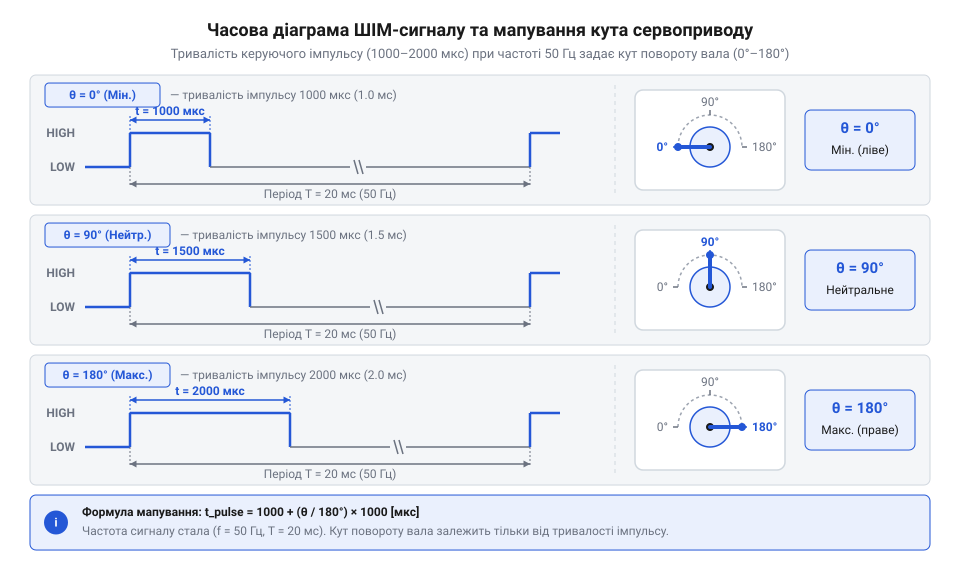
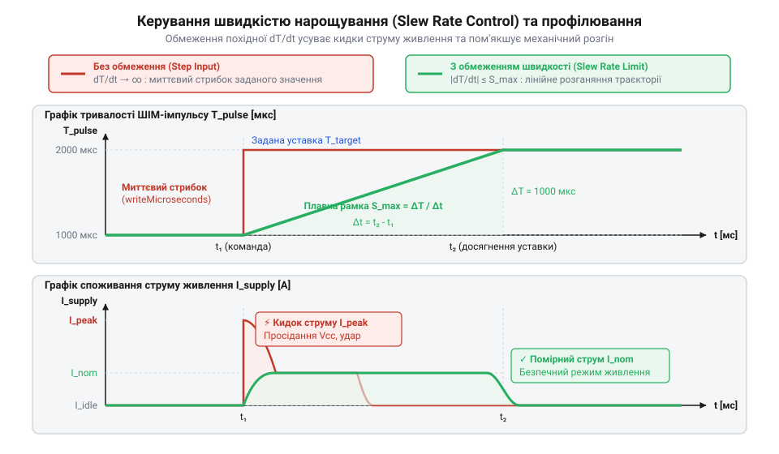

# Програмний інтерфейс (C++/Python) для генерування ШІМ-сигналів сервоприводів

<preknowlist>
- [Лінійка 9-грамових мікросервоприводів Tower Pro (SG90, SG92R, MG90S, MG90D)](root:cat-hw-actuators/sg90-mg90-micro-servos-family) — базові часові параметри керуючого ШІМ-сигналу та кутові діапазони мікросервоприводів.
- [Сервоприводи постійного обертання](root:cat-hw-actuators/continuous-rotation-servo-mod) — принципові відмінності інтерпретації тривалості імпульсу як кутової швидкості замість абсолютного кутового положення.
</preknowlist>

## Неконтрольовані ривки та просідання живлення

Подавання живлення на сервопривод (від @@en|Servo@@, з лат. @@la|servus@@ — слуга) без попередньо сформованого та стабільного керуючого сигналу або спроба змінювати стан виводу мікроконтролера за допомогою простецьких функцій затримки на кшталт `delay()` майже завжди призводить до збоїв усієї системи. Коли керуюча лінія перебуває в невизначеному стані або дістає випадкові поодинокі імпульси, внутрішня схема порівняння сервоконтролера фіксує максимальну неузгодженість між поточним і заданим кутом вала. У відповідь підключений мотор сервоприводу миттєво вмикається на повну потужність, намагаючись подолати інерцію ротора та редуктора.

Така поведінка викликає два серйозні ризики: механічний та електричний. З механічного боку раптовий стрибок створює ударне навантаження на зубчасті передачі. У мікросервоприводах із пластиковими шестернями, як-от [Tower Pro SG90](root:cat-hw-actuators/sg90-servo) або [Power HD HD-1370A](root:cat-hw-actuators/hd-1370a-servo), це нерідко призводить до зрізання зубців редуктора. Навіть моделі з посиленими металевими шестернями, наприклад [MG90S V2](root:cat-hw-actuators/mg90s-servo), зазнають прискореного зносу механізму від постійних ударних зусиль.

З електричного боку миттєвий пуск мотора викликає пусковий струм (@@en|inrush current@@, або струм короткого замикання вала), який у 5–10 разів перевищує номінальний струм й може сягати від 500 мА до 2 А для одного невеликого приводу. Якщо мікроконтролер та сервопривод живляться від спільного джерела чи внутрішнього лінійного стабілізатора плати, такий сплеск споживання спричиняє просідання напруги живлення (@@en|voltage sag@@). При падінні напруги нижче допустимого порогу спрацьовує схема апаратного скидання мікроконтролера при просіданні напруги (@@en|Brown-Out Reset, BOR@@, дивись [Апаратне скидання мікроконтролера при просіданні напруги](root:hw-arch/microcontroller-brownout-reset)). В результаті мікроконтролер циклічно перезавантажується: під час завантаження він намагається увімкнути привод, напруга знову падає, і процесор іде на нове коло перезапуску.

Окрім цього, спроби генерувати імпульси через блокуючі затримки в головному циклі програми повністю паралізують обчислювальне ядро. Мікроконтролер втрачає здатність обробляти дані з датчиків, опитувати мережеві інтерфейси чи реагувати на команди користувача. Для стабільної та безпечної роботи потрібен системний програмний інтерфейс (@@en|API@@), який у фоновому режимі без задіяння процесорних циклів генерує точний ШІМ (@@en|Pulse-Width Modulation, PWM@@, або широтно-імпульсна модуляція) сигнал із фіксованою частотою 50 Гц.

## Частота 50 Гц та мікросекундні імпульси

Класичний аналоговий та цифровий сервопривод керується тривалістю позитивного імпульсу в складі часового кадру фіксованої тривалості. Стандартом для радіокерованих моделей та сервомеханізмів є частота повторення кадрів 50 Гц, що відповідає періоду кадру (від @@en|period@@, з грец. @@el|periodos@@ — обхід, коло) рівно 20 мілісекунд (мс, або @@en|milliseconds@@).

Сам кут повороту вала визначається виключно шириною позитивного імпульсу (@@en|pulse width@@), який подається на початку кожного 20-мікросекундного кадру. Решту часу (понад 18–19 мкс) керуюча лінія утримується в стані логічного нуля. Стандартний робочий діапазон тривалості імпульсів становить від 1000 мкс (1.0 мс) до 2000 мкс (2.0 мс):
- 1000 мкс відповідає крайньому лівому положенню (0°);
- 1500 мкс відповідає нейтральному центральному положенню (90°);
- 2000 мкс відповідає крайньому правому положенню (180°).

Для розширеного діапазону багатьох мікросервоприводів з лінійки [Tower Pro SG90 та MG90S](root:cat-hw-actuators/sg90-mg90-micro-servos-family) межі тривалості імпульсу можуть становити від 500 мкс до 2500 мкс.

Для переведення бажаного кута повороту вала `θ` у тривалість керуючого імпульсу `t_pulse` використовується математична формула лінійної інтерполяції:

t_pulse
= t_min + (θ - θ_min) × (t_max - t_min) / (θ_max - θ_min)      [лінійне мапування кута у тривалість імпульсу]

Де:
- `t_pulse` — шукана тривалість імпульсу в мікросекундах;
- `t_min` та `t_max` — мінімальна та максимальна тривалість імпульсу для даного приводу (наприклад, 1000 мкс і 2000 мкс);
- `θ` — заданий кут повороту вала в градусах;
- `θ_min` та `θ_max` — мінімальний та максимальний кут повороту (наприклад, 0° та 180°).

**Розрахунок тривалості імпульсу для кута 45° при базових параметрах 1000–2000 мкс та діапазоні 0–180°:**
```
t_pulse
= 1000 + (45 - 0) × (2000 - 1000) / (180 - 0)      [підстановка вихідних даних]
= 1000 + 45 × 1000 / 180                           [обчислення різниць]
= 1000 + 250                                       [ділення та множення]
= 1250 мкс                                         [підсумкова ширина імпульсу]
```

Отримана значення 1250 мкс однозначно задає кут 45°. Точність позиціонування вала обмежується дискретністю (@@en|discretization@@) апаратного таймера (від @@en|timer@@, з англ. @@en|time@@ — час). Якщо таймер тактується з дискретністю 1 мкс, то в діапазоні від 1000 до 2000 мкс ми маємо 1000 дискретних кроків. Це забезпечує кутову роздільну здатність `180° / 1000 = 0.18°`, що повністю перекриває механічний люфт редуктора.


*Структура кадру ШІМ-сигналу з частотою 50 Гц та залежність кутового положення вала від тривалості позитивного імпульсу.*

## Високорівневі бібліотеки Servo.h та pigpio

Для усунення необхідності вручну обробляти лічильники таймерів та розраховувати тривалість імпульсів застосовують стандартизовані високорівневі бібліотеки. Вони приховують низькорівневу роботу з перериваннями або апаратними блоками під зручним об'єктно-орієнтованим чи функціональним інтерфейсом.

У середовищі C++ для платформ @@en|Arduino@@ та @@en|ESP32@@ стандартним рішенням є бібліотека `Servo.h`. Основний робочий цикл взаємодії з приводом складається з трьох ключових функцій:
1. `attach(pin, min_us, max_us)` — прив'язує вказаний вивід мікроконтролера до вільного каналу фонового генерування сигналів, конфігурує режим виводу та задає мінімальну й максимальну тривалість імпульсу в мікросекундах. 2. `write(angle)` — приймає кут у градусах (зазвичай від 0 до 180), здійснює автоматичне обмеження та переведення значення в мікросекунди за налаштованими межами й оновлює ширину імпульсу. 3. `writeMicroseconds(us)` — дозволяє напряму встановити точну тривалість імпульсу в мікросекундах, оминаючи округлення до цілих градусів, що важливо для калібрування нейтралі або роботи з маніпуляторами.

Для одноплатних комп'ютерів @@en|Raspberry Pi@@ під мовою Python стандартним інструментом є бібліотека `pigpio`. На відміну від звичайного софтового генератора, `pigpio` використовує демон (@@en|daemon@@) із прямим доступом до блоків апаратного прямого доступу до пам'яті (@@en|Direct Memory Access, DMA@@). Це дає змогу формувати ШІМ-імпульси з субмікросекундною точністю, виключаючи затримки й дрижання (@@en|jitter@@), викликані операційною системою @@en|Linux@@.

Нижче наведено ідіоматичні приклади ініціалізації та керування кутовим положенням вала двома мовами та для двох платформ.

:::tabs
@tab C++ (Arduino / ESP32)
:::code api-rc-servo-control-library/cpp/arduino/setup.cpp

@tab Python (Raspberry Pi pigpio)
:::code api-rc-servo-control-library/py/raspberry-pi/snippet-2.py
:::

## Низькорівневе налаштування апаратних таймерів мікроконтролера

Коли високорівневі бібліотеки викликають конфлікти переривань із програвачами аудіо, бездротовими стеками (як-от @@en|Wi-Fi@@ чи @@en|Bluetooth@@) або не забезпечують потрібної кількості каналів, керування ШІМ переносять на рівень безпосередньої конфігурації апаратних периферійних таймерів.

Апаратний таймер мікроконтролера є автономним цифровим лічильником, який замикається на частоту системного тактування. Щоб отримати ШІМ-сигнал 50 Гц без накладних витрат процесора, використовують три ключові регістри:
1. Прескалер (від @@en|prescaler@@, з англ. @@en|scale@@ — шкала, або дільник частоти `N`) — знижує тактову частоту ядра `f_CPU` до прийнятної частоти лічильника `f_timer`. 2. Регістр періоду (верхня межа лічильника, @@en|TOP@@ або @@en|Auto-Reload Register, ARR@@) — задає кількість тактів лічильника, яка відповідає кадру в 20 мс (50 Гц). 3. Регістр порівняння (@@en|Compare Register, OCR@@ або @@en|Capture/Compare Register, CCR@@) — визначає кількість тактів, протягом яких вихідний сигнал утримується в стані логічної одиниці (ширина імпульсу `t_pulse`).

Формула обчислення значення регістру `TOP` для режиму збігу (Fast PWM):

f_timer = f_CPU / N                                [частота тактування лічильника таймера]
TOP = (f_CPU / (N × f_PWM)) - 1                    [значення межі лічильника для 50 Гц]

**Обчислення регістрів для 16-бітного таймера Timer1 мікроконтролера ATmega328P (16 МГц) при частоті ШІМ 50 Гц та дільнику N = 8:**
```
TOP
= (16000000 / (8 × 50)) - 1                        [підстановка системної частоти 16 МГц та дільника 8]
= (16000000 / 400) - 1                             [обчислення знаменника]
= 40000 - 1                                        [ділення]
= 39999                                            [значення регістру ICR1]
```

Оскільки тривалість одного такту таймера становить `8 / 16000000 = 0.5 мкс`, тривалість імпульсу 1500 мкс (90°) вимагає установки регістру порівняння `OCR1A` рівною `1500 мкс / 0.5 мкс = 3000`.

Нижче наведено низькорівневу реалізацію налаштування апаратного таймера для AVR C та периферійного драйвера ESP32 LEDC на C++.

:::tabs
@tab C (Bare-Metal AVR Timer1)
:::code api-rc-servo-control-library/c/avr/timer1-servo-init.c

@tab C++ (ESP32 LEDC Driver)
:::code api-rc-servo-control-library/cpp/esp32/esp32-servo-init.cpp
:::

## Обмеження діапазонів та плавність розгону

Навіть при використанні точних апаратних таймерів передача сирого неузгодженого керуючого сигналу у формі миттєвого стрибка з 1000 мкс до 2000 мкс небезпечна. Сервопривод намагається розігнатися з максимально можливим прискоренням, що призводить до струмових перевантажень та механічних ударів. Крім того, вихід за фізичні межі ходу вала спричиняє заклинювання редуктора у крайніх упорах, що викликає постійне протікання струму короткого замикання й перегрів мотора.

Захист системи реалізують на двох рівнях:
1. Програмне обмеження (@@en|clamping@@) — жорстке зрізання вихідної уставки в межах безпечного часового коридору `[t_min, t_max]`. 2. Контроль швидкості нарощування (@@en|slew rate control@@) — обмеження максимальної швидкості зміни тривалості імпульсу за один крок фонового циклу.

Алгоритм обмеження тривалості імпульсу задається виразом:

t_clamped = max(t_min, min(t_max, t_target))        [обмеження уставки в безпечному діапазоні]

Для створення плавного профілю руху замість прямої присвійности `t_current = t_target` використовується ітеративний розрахунок кроку:

t_current[k+1]
= t_current[k] + clamp(t_target - t_current[k], -Δt_max, +Δt_max)    [ітеративне нарощування тривалості]

Де `Δt_max` — максимальний крок зміни тривалості імпульсу (в мікросекундах) за один ітераційний інтервал (наприклад, 10 мкс кожні 10 мс).


*Порівняння реакції приводу на миттєву зміну уставки та плавну зміну ширини імпульсу за алгоритмом обмеження швидкості нарощування.*

Нижче наведено приклад реалізації плавної зміни положення сервоприводу без блокування головного циклу.

:::tabs
@tab C++ (Slew Rate Controller Class)
:::code api-rc-servo-control-library/cpp/smoothservocontroller.cpp

@tab Python (Non-blocking Ramp)
:::code api-rc-servo-control-library/py/smoothservo.py
:::

## Безпечне вивільнення ресурсів та detach

Після досягнення валом заданого кута та завершення механічного маневру постійне утримання генерування ШІМ-сигналу потрібне лише у випадках, коли на вал діє зовнішнє механічне навантаження, яке намагається його провернути. У стаціонарному стані без зовнішнього моменту тривала подача імпульсів спричиняє гудіння (@@en|buzzing@@) внутрішнього мотора, прискорений знос колекторних щіток та марне споживання енергії (від 30 до 150 мА в режимі утримання).

Для припинення фонової генерації ШІМ-сигналу та вивільнення переривань або апаратних каналів таймера використовується метод `detach()` (або вимкнення ШІМ-каналу):
- У бібліотеці `Servo.h` виклик `myServo.detach()` відключає вивід мікроконтролера від таймера і зупиняє генерацію позитивного імпульсу. - У `pigpio` передача ширини імпульсу `0` у функцію `set_servo_pulsewidth(pin, 0)` переводить керуючий вивід у стан логічного нуля та зупиняє апаратний DMA-потік.

Слід враховувати відмінність між вимкненим імпульсом та статичним станом утримання. При вимкненні керуючого імпульсу момент утримання (@@en|holding torque@@) зникає, і вал може бути вільно повернутий зовнішньою силою. У спеціальних сервоприводах безперервного обертання ([Сервоприводи постійного обертання](root:cat-hw-actuators/continuous-rotation-servo-mod)) або складних безколекторних системах ([Безколекторні інтегральні сервоконтролери](root:cat-hw-actuators/bldc-servo-controller)) керування вимкненням використовується для вільного вибігу чи аварійного гальмування.

Правильний паттерн безпечного завершення роботи з ресурсами сервоканалу вимагає зупинки генерації імпульсів перед знищенням об'єкта або при виході з контексту програми:

:::tabs
@tab C++ (RAII Guard Wrapper)
:::code api-rc-servo-control-library/cpp/servoguard.cpp

@tab Python (Context Manager)
:::code api-rc-servo-control-library/py/managedservo.py
:::