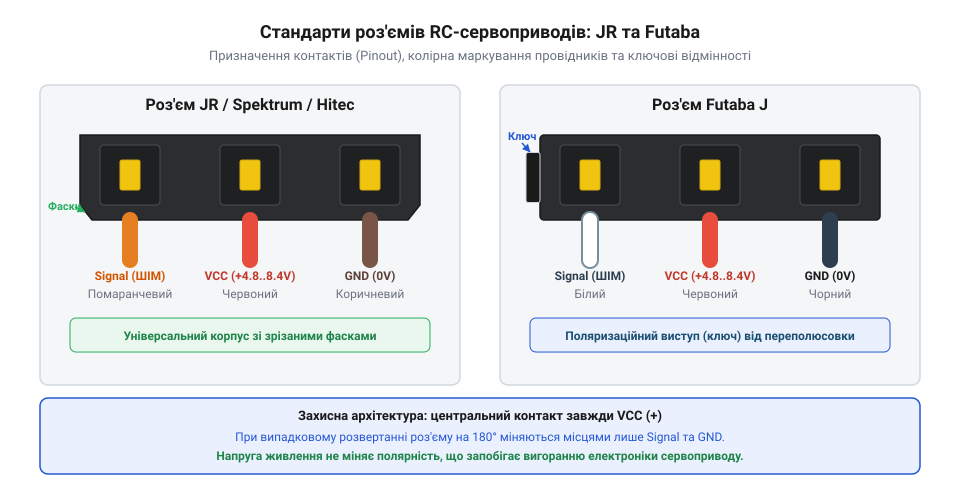
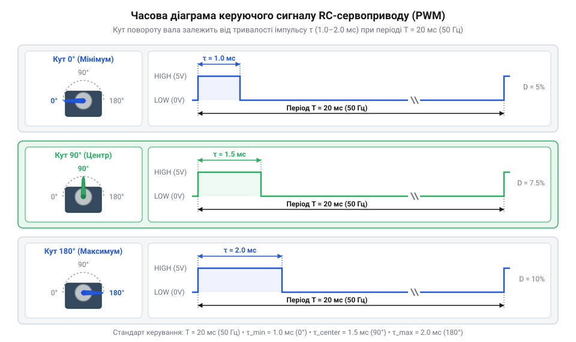
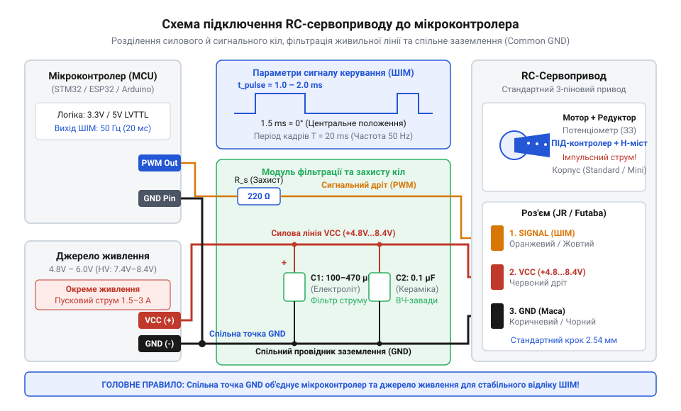

# Специфікація залізного інтерфейсу RC-сервоприводу: розпіновка, електричні рівні та підключення

<preknowlist>
- [Tower Pro SG90 — мікросерво 9g](root:cat-hw-actuators/sg90-servo) — Загальне розуміння механічної будови та призначення аналогового 9g мікросервоприводу.
- [Лінійка 9-грамових мікросервоприводів Tower Pro (SG90, SG92R, MG90S, MG90D)](root:cat-hw-actuators/sg90-mg90-micro-servos-family) — Практичний досвід відмінностей між пластиковими й металевими редукторами та рівнями споживання струму.
</preknowlist>

## Чому виникають апаратні збої сервоприводів

Підключення сервоприводу напряму до виводу `5V` мікроконтролерної плати часто спричиняє обрив зв'язку, хаотичне дрижання вала або постійне перезавантаження системи під навантаженням.

Причина полягає в електромеханічній будові пристрою. Сервопривід @@en|RC Servo@@ (від англ. *Radio Control Servomotor* — радіокерований серводвигун) є актуатором, який об'єднує колекторний двигун постійного струму @@en|DC Motor@@ (від англ. *Direct Current Motor* — двигун постійного струму), редуктор, потенціометр зворотного зв'язку та плату керування.

Під час запуску з місця або блокування вала ротор не обертається. Протирушійна сила (@@en|Back-EMF@@, від англ. *Back Electromotive Force* — протиЕРС) обмоток дорівнює нулю, тому струм обмежується лише їхнім малим омічним опором. Це створює потужний пусковий струм (@@en|Inrush Current@@, від англ. *inrush current* — пусковий струм) та струм блокування (@@en|Stall Current@@, від англ. *stall current* — струм блокування).

При струмі спокою `10–20 мА` піковий @@en|Inrush Current@@ мікросервоприводу досягає `500–800 мА`, а потужних моделей — понад `2–3 А`. Лінійний стабілізатор (@@en|LDO@@, від англ. *Low Drop-Out Regulator* — лінійний стабілізатор із малим падінням напруги) плати чи порт @@en|USB@@ (від англ. *Universal Serial Bus* — універсальна послідовна шина) не здатні видати такий струм, спричиняючи просідання напруги `5V`.

Падіння напруги нижче порогового рівня викликає апаратне скидання мікроконтролера — @@en|Brownout Reset@@ (@@en|BOR@@, від англ. *brownout reset* — скидання через просідання живлення). При перезавантаженні керуючий сигнал вимикається, двигун зупиняється, напруга відновлюється, мікроконтролер знову запускається і повторює команду — виникає циклічне перезавантаження та дрижання вала.

Додатково кидки струму на паразитному опорі дротів викликають зсув потенціалу землі (@@en|Ground Bounce@@, від англ. *ground bounce* — зсув потенціалу землі), що спотворює логічні рівні на сигнальній лінії.

## Фізичний інтерфейс та розпіновка роз'ємів

Для підключення сервоприводу @@en|RC Servo@@ застосовують стандартизований трьохпровідний кабель із триконтактним гніздовим роз'ємом. Крок між контактами становить `2.54 мм` (0.1 дюйма), що забезпечує повну сумісність із штирьовими колодками та роз'ємами @@en|Dupont@@ (від назви розробника роз'ємів Dupont).

Трьохпровідний інтерфейс об'єднує коло живлення та сигнальну лінію. Щоб запобігти вигоранню електроніки при помилковому підключенні, позитивний провідник `VCC` завжди розташований на центральному контакті 2, а `GND` та `Signal` — по краях (контакти 1 і 3). Таке розміщення створює апаратний захист: при випадковому розвороті роз'єму на 180° центральний `VCC` залишається на своєму місці, а `GND` та `Signal` міняються місцями. Оскільки сигнальний вхід має високий опір, таке переполюсування не викликає короткого замикання й не пошкоджує мікросхему.

Маркування кабелів відповідає двом основним колірним стандартам:

1. **Стандарт @@en|JR Standard@@** (від назви компанії Graupner/JR): коричневий (`GND`), червоний (`VCC`), помаранчевий (`Signal`). Корпус має скошені фаски для сумісності з усіма слотами. 2. **Стандарт @@en|Futaba Standard@@** (від назви компанії Futaba Corporation): чорний (`GND`), червоний (`VCC`), білий (`Signal`). Корпус має бічний виступ-ключ для захисту від помилкового вставляння.


*Схема трьохконтактних роз'ємів стандарту JR та Futaba ілюструє порядок розташування контактів VCC, GND і Signal, колірне маркування провідників та механічні ключі захисту від помилкового підключення.*

За габаритами приводи поділяються від субмікро- й мікрокласу ([популярне мікросерво Tower Pro SG90](root:cat-hw-actuators/sg90-servo), [аналог із металевим редуктором](root:cat-hw-actuators/mg90s-servo), [надлегкі сервоприводи Power HD HD-1370A](root:cat-hw-actuators/hd-1370a-servo)) до стандартного класу ([промислову лінійку Power HD](root:cat-hw-actuators/powerhd-family)). Механічний момент із вала передають через [пластикові серво-роги та важелі](root:cat-hw-actuators/servo-horns), а вибір під габарити покриває [лінійку мікросервоприводів Tower Pro](root:cat-hw-actuators/sg90-mg90-micro-servos-family).

## Часові специфікації керуючого сигналу PWM

Керування положенням вала @@en|RC Servo@@ здійснюється за допомогою широтно-імпульсної модуляції (@@en|PWM@@, від англ. *Pulse-Width Modulation*). На відміну від силового PWM, де коефіцієнт заповнення регулює середню напругу, у сервоприводах тривалість імпульсу задає кут повороту вала.

Частота оновлення кадрів становить `f` = 50 Гц (період `T` = 20 мс). Інформаційну вагу має лише тривалість високого рівня імпульсу `t_pulse` на початку кадру; решта часу є паузою.

Часові межі імпульсу визначають кутове положення вала:
- **`t_min` = 1.0 мс**: крайнє ліве положення (0°). - **`t_center` = 1.5 мс**: нейтральне центральне положення (90°). - **`t_max` = 2.0 мс**: крайнє праве положення (180°).

Розширений діапазон 0.5–2.5 мс забезпечує 180° у багатьох моделях, але сигнал поза межами приводу спричиняє упертання вала в обмежувачі, перегрів обмоток і зрізання зубців редуктора.

Коефіцієнт заповнення (@@en|Duty Cycle@@, від англ. *duty cycle*) `D` обчислюємо діленням тривалості імпульсу `t_pulse` на період кадру `T`:

```
D = (t_pulse ÷ T) × 100%
  = (1.5 мс ÷ 20.0 мс) × 100%     [для центрального положення вала 1.5 мс]
  = 7.5%                           [коефіцієнт заповнення сигналу PWM]
```

Для робочого діапазону імпульсів 1.0–2.0 мс значення `D` становить від 5.0% до 10.0%, тобто все керування зосереджене у вузькому часовому інтервалі.


*Підпис: Часова діаграма керуючого сигналу PWM з періодом 20 мс (50 Гц) та залежність кута повороту вала від тривалості імпульсу.*

Мертва зона (@@en|Deadband@@, від англ. *deadband*) — це мінімальна зміна тривалості імпульсу `Δt_pulse`, на яку реагує система зворотного зв'язку. У класичному @@en|Analog Servo@@ вона становить 5–10 мкс, а в @@en|Digital Servo@@ завдяки мікроконтролеру зменшена до 1–2 мкс.

Крім того, @@en|Analog Servo@@ подає напругу на мотор лише раз за кадр 20 мс, тоді як @@en|Digital Servo@@ керує мотором на частоті в кілька кілогерців. Це суттєво підвищує момент утримування (@@en|Stall Torque@@) і точність позиціонування.

## Електричне живлення та логічні рівні

Параметри живлення сервоприводу @@en|RC Servo@@ розглядають окремо для силового кола двигуна та низьковольтної сигнальної лінії.

Стандартні сервоприводи працюють від `4.8–6.0 В`, де вища напруга збільшує швидкість і крутний момент. Високовольтні моделі (@@en|High-Voltage Servo@@ / @@en|HV Servo@@, від англ. *high-voltage servo* — високовольтний сервопривід, від лат. *servus* — слуга) розраховані на `7.4–8.4 В`, що дає змогу живити їх напряму від акумуляторів 2S LiPo.

Струм споживання коливається від струму спокою (@@en|Idle Current@@ — `10–50 мА`) і руху без навантаження (`100–300 мА`) до пікового струму блокування (@@en|Stall Current@@). Для обчислення пікового струму блокування `I_stall` розраховуємо струм через опір обмоток ротора `R_armature` при напрузі живлення `V_supply` та нульовій протиЕРС `V_emf` за законом Ома:

```
I_stall = (V_supply - V_emf) ÷ R_armature
        = (6.0 В - 0 В) ÷ 3.0 Ом      [при зупиненому роторі V_emf дорівнює нулю]
        = 2.0 А                       [піковий струм блокування вала]
```

Значення `I_stall = 2.0 А` визначає граничний струм одного приводу; під час одночасного розгону 6 приводів маніпулятора споживання сягає `10–12 А`.

Сигнальний вхід є високоомним (`R_in > 10 кОм`), тому струм керування мізерний (`I_signal < 0.5 мА`). Вхідний каскад 5V сервоприводів працює за стандартом @@en|TTL@@ (від англ. *Transistor-Transistor Logic* — транзисторно-транзисторна логіка) з порогами `V_IH min = 2.0 В` та `V_IL max = 0.8 В`. Виходи 3.3V мікроконтролерів (ESP32, STM32, RP2040) за стандартом @@en|LVTTL@@ (від англ. *Low-Voltage TTL*) видають `V_OH ≈ 2.4–3.0 В`. Оскільки `V_OH = 3.0 В > V_IH min = 2.0 В`, керування відбувається напряму без перетворювачів рівнів, хоча для довгих ліній застосовують буфери на кшталт 74HCT125.

Для систем безперервного обертання застосовується [модифікація постійного обертання](root:cat-hw-actuators/continuous-rotation-servo-mod) сервоприводів, а в складних комплексах — [промислові безколекторні сервоконтролери](root:cat-hw-actuators/bldc-servo-controller) із цифровими шинними інтерфейсами.

## Схеми підключення та усунення завад

Підключення сервоприводу @@en|RC Servo@@ вимагає розділення кіл живлення та об'єднання заземлення:

1. **Топологія живлення та спільна земля**: Мікроконтролер живиться від стабілізованого джерела 3.3V або 5V (вбудований @@en|LDO@@ або @@en|USB@@), а силова лінія `VCC` сервоприводу — від окремого джерела 5V–6V. Лінії землі `GND` контролера та силового джерела обов'язково з'єднують у єдину точку — @@en|Common Ground@@ (від англ. *common ground* — спільна земля). Без цього керуючий сигнал @@en|PWM@@ втрачає опорний зворотний шлях струму, що спричиняє хаотичне дрижання вала. 2. **Переріз провідників**: Для керування за стандартом @@en|AWG@@ (від англ. *American Wire Gauge* — американський калібр провідників) достатньо дроту 28–30 AWG (0.05–0.08 мм²). Силові лінії `VCC` і `GND` мікросервоприводів потребують 24–26 AWG (0.13–0.20 мм²), а потужних моделей — 18–20 AWG (0.5–0.8 мм²). 3. **Фільтрація завад**: Паралельно шині живлення біля роз'єму сервоприводу ставлять електролітичний @@en|De-coupling Capacitor@@ (від англ. *decoupling capacitor* — розв'язувальний конденсатор) ємністю 470–2200 мкФ із низьким послідовним опором (Low @@en|ESR@@, від англ. *Equivalent Series Resistance* — еквівалентний послідовний опір) для компенсації пускових просідань. Паралельно йому додають керамічний конденсатор 0.1 мкФ для шунтування високочастотних завад колектора. У сигнальну лінію біля виводу @@en|GPIO@@ послідовно вмикають резистор 100–330 Ом для гасіння дзвінків і захисту від електростатики.


*Підпис: Принципова схема з'єднання сервоприводу з мікроконтролером та зовнішнім силовим джерелом живлення зі спільною точкою GND.*

4. **Усунення несправностей**:
   - **Перезавантаження контролера**: сервопривід підключено до шини `5V` контролера; пусковий @@en|Inrush Current@@ викликає @@en|Brownout Reset@@. *Рішення*: винести `VCC` на зовнішнє джерело й додати конденсатор 1000 мкФ. - **Дрижання або гул вала**: відсутня @@en|Common Ground@@ або сигнальна лінія вловлює завади. *Рішення*: з'єднати землі `GND` та додати резистор 220 Ом у сигнальну лінію. - **Упор і нагрів**: тривалість імпульсів @@en|PWM@@ виходить за механічні межі (менше 0.5 мс або більше 2.5 мс). *Рішення*: обмежити тривалість у програмі межами 1.0–2.0 мс.