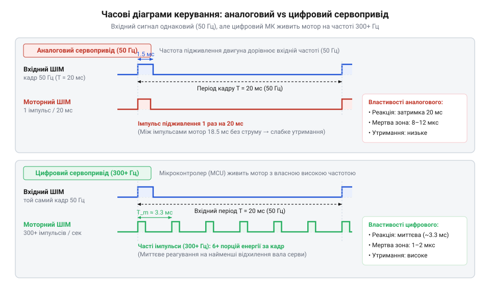
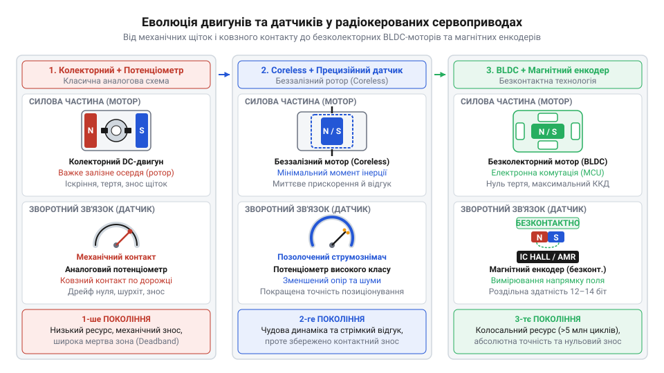

# Еволюція сервоприводів: від дискретних аналогових схем до цифрових і безколекторних моделей

<preknowlist>
- [Tower Pro SG90 — мікросерво 9g](root:cat-hw-actuators/sg90-servo) — базова внутрішня будова та принципи класичного аналогового мікросервоприводу
- [Безколекторні інтегральні сервоконтролери](root:cat-hw-actuators/bldc-servo-controller) — принципи електронної комутації фаз безколекторних моторів та системи зворотного зв'язку
</preknowlist>

## Доелектронне дискретне керування модельними приводами

У 1950-х роках перші лампові радіоприймачі керованих моделей фіксували лише наявність або відсутність сигналу. Перші електродвигуни з важкими батареями виявилися важкими та схильними до витоків, тому основними приводами стали електромеханічні дискові перемикачі — @@en|escapement@@ (від англ. *escapement* — механізм спуску чи крокового перемикання). Для детального вивчення будови та принципів роботи електромеханічних дискових перемикачів 1950-х років перегляньте статтю про [дискретні перемикачі (escapements) у перших RC-системах](root:cat-hw-actuators/rc-escapement-mechanisms).

Джерелом механічної енергії слугував попередньо закручений гумомоторний привід — @@en|rubber band drive@@ (від англ. *rubber band drive* — гумомоторний привід), який прагнув безперервно обертати роторний диск. Шлях диска блокував фіксатор електромагнітного соленоїда — @@en|solenoid@@ (від грец. *солен* — труба та *ейдос* — вид, котушка зі рухомим осердям). Коли імпульс струму з приймача втягував осердя @@en|solenoid@@, диск повертався під дією гумомотора на фіксований кут до наступного упору, переміщуючи руль моделі через жорсткі тяги.

Головним обмеженням @@en|escapement@@ була сувора дискретність: привід не мав плавної зміни кута й почергово перебирав лише фіксовані стани («Нейтраль» -> «Право» -> «Нейтраль» -> «Ліво») за кількістю послідовних імпульсів. Якщо через заваду приймач пропускав імпульс або фіксував хибний, послідовність збивалася: команда розвороту праворуч відхиляла руль у крайнє ліве положення, спричиняючи аварію. Крім того, в міру розкручування @@en|rubber band drive@@ падав утримуючий момент. Ці недоліки змусили інженерів на початку 1960-х років шукати пропорційний електричний привід із зворотним зв'язком.

## Поява аналогових схем та стандарту ШІМ

Перехід до пропорційного керування вимагав передачі сигналу, де кут повороту ручки на передавачі безперервно відображається у кут вала приводу. Оскільки амплітудна модуляція радіосигналу зазнавала викривлень через загасання хвилі в просторі, інженери обрали часову модуляцію — тривалість електричного імпульсу.

Так наприкінці 1960-х років сформувався часовий стандарт широтно-імпульсної модуляції — @@en|PWM@@ (від англ. *Pulse Width Modulation* — широтно-імпульсна модуляція), що спирався на параметри багатоканальної імпульсно-позиційної модуляції — @@en|PPM@@ (від англ. *Pulse Position Modulation* — імпульсно-позиційна модуляція). Кадр тривалістю `T_frame = 20 мс` (частота `50 Гц`) ділили між каналами. Тривалість вхідного імпульсу `T_in` від `1.0 мс` до `2.0 мс` задавала кут вала: `1.0 мс` відповідала крайній лівій позиції (`0°`), `1.5 мс` — центру (`90°`), а `2.0 мс` — крайній правій (`180°`).

Всередині аналогового сервоприводу встановили колекторний мотор постійного струму, редуктор і підсилювач. Спочатку схему збирали на дискретних германієвих та кремнієвих транзисторах у формі мостового каскаду — @@en|H-bridge@@ (від англ. *H-bridge* — мостова схема керування струмом мотора), а в 1970-х роках інтегрували в спеціалізовані аналогові мікросхеми.

Серцем приводу став чекаючий мультивібратор @@en|multivibrator@@ (від лат. *multus* — багато та *vibro* — коливаюсь). Тривалість його опорного імпульсу `T_ref` визначається часом заряджання конденсатора `C_ref` через вимірювальний потенціометр @@en|potentiometer@@ (від лат. *potentia* — сила та грец. *метрон* — міра) з опором `R_pot`, з'єднаний із вихідним валом:

```text
T_ref = R_pot × C_ref
```

Вхідний імпульс `T_in` кожні 20 мс запускає мультивібратор. Аналоговий дискримінатор обчислює різницю тривалостей `ΔT`:

```text
ΔT = T_in - T_ref
```

Якщо `T_in > T_ref` (знак `ΔT` позитивний), каскад @@en|H-bridge@@ обертає мотор в один бік. Якщо `T_in < T_ref`, напрямок струму змінюється. Мотор через редуктор повертає вал із повзунком `R_pot` доти, доки `T_ref` не зрівняється з `T_in`. Коли `ΔT = 0`, живлення мотора вимикається, і вал зупиняється в заданій позиції.

Цей інтерфейс став стандартом на десятиліття і досі працює в бюджетних виробах, як-от [класичне мікросерво Tower Pro SG90](root:cat-hw-actuators/sg90-servo) або [лінійка 9-грамових мікросервоприводів](root:cat-hw-actuators/sg90-mg90-micro-servos-family). Однак суто аналогова обробка мала фундаментальні фізичні обмеження.

## Обмеження аналогових схем і deadband

Попри революційний перехід до плавного керування, аналогові сервоприводи зіткнулися із трьома схемотехнічними обмеженнями точності.

Першою проблемою став температурний дрейф нуля — @@en|drift@@ (від англ. *drift* — зсув). Зміна температури довкілля змінювала ємність `C_ref` та опір `R_pot` аналогового мультивібратора. Через це тривалість опорного імпульсу `T_ref = R_pot × C_ref` плавала, і нейтральне положення вала самочинно зміщувалося на кілька градусів без команд із передавача.

Другою проблемою став конфлікт між чутливістю та стійкістю. Висока чутливість підсилювача до малих розбіжностей `ΔT` змушувала привод реагувати на найменші шуми потенціометра й безперервно тремтіти навколо точки рівноваги — явище автоколивань, або полювання за нулем — @@en|hunting@@ (від англ. *hunting* — полювання). Щоб зупинити тремтіння, інженери штучно розширили зону нечутливості компаратора — мертву зону @@en|deadband@@ (від англ. *deadband* — мертва смуга) до 4–8 мкс. У цій зоні схема не подавала напругу на мотор, що спричиняло люфт.

Третьою й найважчою вадою виявився малий утримуючий момент при малих відхиленнях вала. Ключі мостової схеми @@en|H-bridge@@ вмикаються лише при надходженні вхідного імпульсу ШІМ з частотою кадру 50 Гц (раз на 20 мс).


*На схемі показано часові діаграми вхідного ШІМ-сигналу 50 Гц та внутрішніх імпульсів керування мотором для аналогового (50 Гц) і цифрового (300+ Гц) сервоприводів.*

Коли вал відхилявся на малий кут з похибкою `ΔT > T_deadband`, схема подавала на мотор імпульс тривалістю в кілька мікросекунд лише один раз за 20 мс. Через індуктивність обмоток і тертя редуктора усереднена напруга залишалася мізерною, і мотор не встигав розвинути момент. Спроби підвищити коефіцієнт підсилення спричиняли автоколивання.

Цей фізичний тупик спонукав до цифрової революції наприкінці 1990-х років: переходу на внутрішні мікроконтролери з частотою керування 300+ Гц та застосування [безколекторних інтегральних сервоконтролерів](root:cat-hw-actuators/bldc-servo-controller).

## Мікроконтролери в сервоприводах і цифровий прорив

Аналогові сервоприводи оновлюють силовий імпульс на котушках двигуна лише під час надходження вхідного сигналу від приймача — з частотою кадру 50 Гц (період 20 мс). Якщо зовнішня сила зміщує вал між імпульсами, привід залишається знеструмленим і не чинить опору до наступного кадру. При малих кутових відхиленнях (1–2°) різниця тривалостей імпульсів є занадто короткою для відкриття силових транзисторів: двигун отримує низьку середню напругу і не долає тертя редуктора. Це утворює широку @@en|deadband@@ (зону нечутливості, від англійського *dead band* — мертва смуга) та низький @@en|holding torque@@ (утримуючий момент). Спроби підвищити чутливість підсилювача призводять до автоколивань вала — ефекту @@en|hunting@@ (пошуку нейтралі, від англійського *hunting* — полювання, блукання).

Наприкінці 1990-х років японські розробники радіокерованих систем (зокрема @@en|JR Propo@@ та @@en|Futaba@@) інтегрували всередину корпуса сервоприводу 8-бітний @@en|MCU@@ (Microcontroller Unit, мікроконтролер, від грецького *mikros* — малий та англійського *controller* — управитель). Обчислювальне ядро з аналогово-цифровим перетворювачем замінило аналоговий порівняльник: воно безперервно зчитує напругу @@en|potentiometer@@ (потенціометра, від латинського *potentia* — сила та грецького *metron* — міра), оцифровує кут вала та порівнює його з тривалістю вхідного імпульсу.

Ключове інженерне рішення цифрового приводу — розв'язка вхідної та внутрішньої частот керування. Мікроконтролер приймає від зовнішнього джерела стандартні кадри @@en|PWM@@ (Pulse-Width Modulation) з періодом 20 мс (50 Гц, тривалість імпульсу 1.0–2.0 мс), але керує силовим @@en|H-bridge@@ (Н-мостом) власною високочастотною ШІМ на частоті 300–500 Гц.

За один зовнішній кадр (20 мс) двигун отримує від 6 до 10 коротких високочастотних імпульсів струму. При найменшому відхиленні вала мікроконтролер подає на мостовий каскад серію імпульсів з високою @@en|duty cycle@@ (шпаруватістю), передаючи на вал максимальний крутний момент від першої мілісекунди. Зона нечутливості звужується з 5–8 мкс до 1–2 мкс, а @@en|holding torque@@ при мікрозміщеннях зростає в кілька разів.

Поширене уявлення про те, ніби цифровий сервопривід вимагає від зовнішнього контролера обов'язкового збільшення вхідної частоти ШІМ-лінії до 300 Гц, є помилковим. Привід повністю сумісний зі стандартним 50 Гц кадром: підвищена частота існує виключно всередині корпусу між обчислювальним ядром і силовим мостом. Зовнішній контролер лише задає цільову позицію, тоді як динаміку та жорсткість утримання забезпечує внутрішній алгоритм мікроконтролера.

## Безколекторні мотори й магнітні енкодери

Цифровий прорив в обробці сигналів оголив механічні й сенсорні обмеження сервоприводного вузла: мікроконтролер не здатний усунути знос контактів та інерцію ротора. Еволюція силової частини пройшла три етапи: колекторний двигун, безсердечниковий мотор та безколекторна система.

Класичний колекторний двигун (@@en|brushed motor@@, від англійського *brush* — щітка) має важкий залізний сердечник ротора й механічний колектор. Високий момент інерції якоря уповільнює розгін вала, а щітки зношуються, іскрять і створюють електричні завади.

Для усунення інерції наприкінці 1950-х років розробили безсердечниковий мотор (@@en|coreless motor@@, від англійського *coreless* — без осердя). Його ротор виконаний як порожнистий сітчастий циліндр із мідного дроту без заліза, а магніт розташовано всередині. Відсутність масивного осердя зменшила масу ротора й скоротила розгін до лічених мілісекунд. Докладніше про конструктивні особливості та низьку інерційність роторів такого типу дивіться у матеріалі про [безсердечникові колекторні двигуни](root:cat-hw-actuators/coreless-dc-motors).

У середині 2000-х з'явився безколекторний двигун (@@en|BLDC@@, Brushless Direct Current, від англійського *brushless* — безщітковий). Обмотки статора закріплені на корпусі, а всередині обертається ротор з неодимовими магнітами. Електронна комутація фаз повністю усунула щітки, знявши обмеження за ресурсом і покращивши відведення тепла через металевий корпус.

Паралельно змінювалася технологія зворотного зв'язку. Традиційний потенціометр покладався на механічний контакт струмознімача з вугільним резистивним шаром. Під дією вібрації покриття стиралося, викликаючи шум зворотного зв'язку, втрату точності й тремтіння вала.

Альтернативою став безконтактний @@en|magnetic encoder@@ (магнітний енкодер, від англійського *encoder* — кодувальник). На вихідному валу закріплюють діаметрично намагнічений магніт, а під ним на платі — датчик на основі ефекту Холла (@@en|Hall effect@@) або магніторезистивного ефекту (@@en|AMR@@ / @@en|TMR@@). Сенсор вимірює напрямок магнітного поля з роздільною здатністю до 12–14 біт (менше 0.02°) без механічного контакту. Це забезпечує стійкість до зносу й вібрацій та виключає дрейф нуля протягом усього терміну служби.


*Порівняння трьох поколінь сервоприводів за принципом побудови двигуна та вимірювального елемента зворотного зв'язку.*

## Вибір сервоприводу під конкретні робототехнічні задачі

Підбір сервоприводу базується на балансі механічних характеристик, ресурсу та напруги живлення під вимоги конкретного вузла.

* **Співвідношення швидкості та моменту.** Передаточне число редуктора визначає компроміс: для систем швидкої стабілізації обирають приводи із часом відклику 0.06–0.08 с/60°, а для шарнірів маніпуляторів чи крокуючих роботів пріоритетом є момент утримання до 30–50 кг·см. * **Інтенсивність роботи та тип мотора.** Для епізодичних навантажень виправдані колекторні моделі, як-от [бюджетне мікросерво SG90](root:cat-hw-actuators/sg90-servo) або [серво з металевим редуктором](root:cat-hw-actuators/mg90s-servo). Безперервна робота вимагає приводів із @@en|BLDC@@-моторами та магнітними енкодерами, що не перегріваються і не втрачають точності. * **Точність позиціонування.** У вузлах без люфтів застосовують цифрові сервоприводи, що утримують кут під змінним навантаженням без дрейфу. * **Напруга живлення.** Окрім стандартних 4.8–6.0 В, у потужних комплексах застосовують @@en|HV servo@@ (High Voltage, високовольтні сервоприводи) на 7.4–8.4 В для зменшення робочих струмів у провідниках.

Для колісних платформ кутове керування замінюють на [змодифіковані сервоприводи постійного обертання](root:cat-hw-actuators/continuous-rotation-servo-mod), де ШІМ регулює швидкість, а механічний зв'язок будують через [важелі та серво-роги](root:cat-hw-actuators/servo-horns).

Для проєктів різного масштабу обирають [моделі виробника Power HD](root:cat-hw-actuators/powerhd-family), компактні [надлегкі сервоприводи HD-1370A](root:cat-hw-actuators/hd-1370a-servo) або [безколекторні сервоконтролери](root:cat-hw-actuators/bldc-servo-controller), що поєднують силове поле й обчислювальні алгоритми.