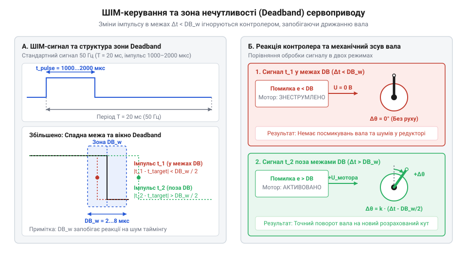
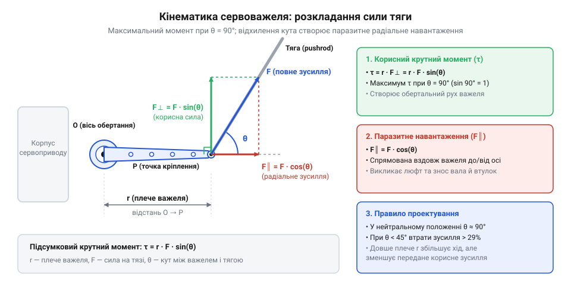
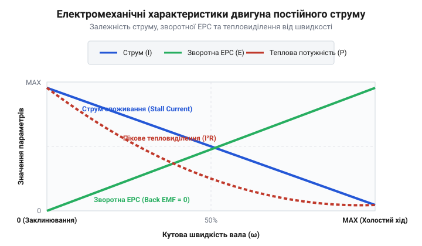

# Математика моменту, редукції та часового таймінгу ШІМ-сигналу сервоприводу

<preknowlist>
- [Tower Pro SG90 — мікросерво 9g](root:cat-hw-actuators/sg90-servo) — базові специфікації імпульсного керування та конструкція мікросервоприводу.
- [MG90S V2 — мікросерво з металевим редуктором](root:cat-hw-actuators/mg90s-servo) — відмінності міцності та ККД металевих шестерень порівняно з пластиковими у редукторі.
- [Серво-роги (запасні)](root:cat-hw-actuators/servo-horns) — типи геометрії важелів та фізичне кріплення тяг на різній відстані від осі.
</preknowlist>

## Неточність позиціонування та таймінг ШІМ

Підключаючи @@la|сервопривод@@ (від латинського *servus* — слуга, раб, пристрій, що виконує команди керування із відстеженням стану) до мікроконтролера, розробник часто стикається з неприємним ефектом: вал дрижить, пропускає дрібні команди повороту або постійно гуде й нагрівається в стані спокою. Така нестабільність виникає через дискретну природу таймінгу керуючого сигналу та математичну невідповідність між роздільною здатністю таймера мікроконтролера і внутрішньою зоною нечутливості електронної схеми позиціонування.

Класичний аналоговий @@la|сервопривод@@ керується періодичними прямокутними імпульсами в межах періоду `T = 20 мс` (частота 50 Гц). Кутове положення вала залежить не від свердловини чи частоти, а виключно від тривалості активного високого рівня імпульсу `t_p`. Стандартний діапазон тривалості становить від `t_min = 1000 мкс` (що відповідає кутові `θ_min = 0°`) до `t_max = 2000 мкс` (що відповідає кутові `θ_max = 180°`). Загальне кутове переміщення `Δθ = 180°` лінійно розгортається на часовому вікні `Δt_p = 1000 мкс`.

Дістаємо кутовий коефіцієнт передачі `K_θ`, який характеризує кутову чутливість приводу до зміни тривалості імпульсу на одну мікросекунду:

```
K_θ = Δθ ÷ Δt_p
= (180 - 0) ÷ (2000 - 1000)      [підстановка межевих значень кута й тривалості]
= 180 ÷ 1000                      [обчислення різниць]
= 0.18 град/мкс                   [кутовий коефіцієнт передачі]
```

Значення `K_θ = 0.18 град/мкс` означає, що кожна зміна ширини керованого імпульсу на `1 мкс` повинна повертати вал на `0.18°`.

Для обчислення необхідної тривалості імпульсу `t_p` під заданий цільовий кут `θ` застосовуємо обернену лінійну залежність:

```
t_p = t_min + θ × (1 ÷ K_θ)
= 1000 + θ × (1000 ÷ 180)        [підстановка параметрів часового вікна]
= 1000 + θ × 5.5556              [перетворення коефіцієнта]
```

Усередині приводу аналогова схема порівнює поточну тривалість імпульсу `t_p` із напругою, яку знімає внутрішній @@en|потенціометр@@ (від латинського *potentia* — сила, та грецького *metron* — міра). @@en|потенціометр@@ перетворює кут повороту вала на еквівалентний часовий інтервал зворотного зв'язку `t_fb`. Якщо електронний компаратор подавав би напругу живлення на мотор при будь-якій найменшій різниці `|t_p - t_fb| > 0`, електричні шуми й механічний люфт редуктора спричиняли б постійну перерегульованість. Двигун нескінченно перелітав би цільову точку в обидва боки, викликаючи механічні коливання та перегрів обмоток.

Щоб запобігти автоколиванням, у схему керування закладають @@en|deadband@@ (англ. *deadband*, від *dead* — нечутливий, та *band* — смуга) — зону нечутливості `t_db`. Зона нечутливості задає порогове значення різниці сигналів, у межах якого мостовий підсилювач не подає струм на обмотки двигуна.

Формується умова подачі живлення на мостову схему двигуна:

```
Якщо |t_p - t_fb| ≤ t_db  ⇒  напруга живлення двигуна U_m = 0 В
Якщо |t_p - t_fb| > t_db  ⇒  напруга живлення двигуна U_m = ±U_supply
```

Зона нечутливості `t_db` безпосередньо обмежує найменшу помітну зміну кута вала. Мінімальна кутова роздільна здатність `Δθ_min` розраховується як добуток зони нечутливості на кутовий коефіцієнт передачі:

```
Δθ_min = t_db × K_θ
= t_db × 0.18                    [множення зони нечутливості на кутовий коефіцієнт]
```

Для бюджетного приводу на зразок [мікросерво Tower Pro SG90](root:cat-hw-actuators/sg90-servo) типове значення зони нечутливості становить `t_db = 5 мкс`. Розрахуємо мінімальний кутовий крок, який здатен відпрацювати такий @@la|сервопривод@@:

```
Δθ_min = 5 × 0.18                [підстановка deadband 5 мкс]
= 0.9 град                       [найменший кутовий крок позиціонування]
```

Отже, пристрій принципово ігноруватиме будь-які команди керування, якщо зміна кута є меншою за `0.9°`. У високоточних [цифрових сервоприводах](root:cat-hw-actuators/servo-pwm-frame-rate) зону нечутливості зменшують до `t_db = 1 мкс`, що дає роздільну здатність `Δθ_min = 0.18°`. Проте надто мала зона нечутливості в поєднанні з зношеним [потенціометром зворотного зв'язку](root:cat-hw-actuators/servo-feedback-potentiometer) призводить до втрати стійкості й самозбудження приводу.


*Співвідношення тривалості керованого імпульсу, зони нечутливості та підсумкового кутового положення вала сервоприводу.*

Для забезпечення точної роботи без дискретних стрибків роздільна здатність таймера мікроконтролера повинна бути не гіршою за ширину зони нечутливості `t_db`. Якщо 8-бітний таймер ділить увесь період `T = 20000 мкс` на 256 відліків, один крок таймера становить `78.125 мкс`. На кероване вікно в `1000 мкс` припадає лише 12.8 кроків, що дає величезний дискретний стрибок кута в `14°`. Для належного керування з дискретністю в `1 мкс` таймер мікроконтролера повинен мати апаратну роздільну здатність не менше 16 біт (щонайменше 20000 відліків на період 20 мс).

:::tabs
@tab Arduino (C++)
:::code math-rc-servo-kinematics-and-torque/cpp/arduino/angletopulseus.cpp
@tab ESP-IDF (C)
:::code math-rc-servo-kinematics-and-torque/c/esp-idf/calculate-pulse-width.c
:::

## Передавальне відношення та трансформація моменту

Електродвигун постійного струму, розміщений всередині корпусу @@la|сервоприводу@@, створює механічне обертання за допомогою взаємодії магнітних полів. Його @@en|ротор@@ (від латинського *rotare* — обертатися, рухома частина електродвигуна) відносно @@en|статор@@ (від латинського *stare* — стояти, нерухома частина) здатний легко розганятися до 10 000 – 20 000 обертів на хвилину. Проте прямий вихід з обмотки здатний видати лише мізерний @@en|крутний момент@@ (англ. *torque*, обертальний момент сили) порядку `0.01 – 0.05 Н·см`. Без додаткових механізмів такий мотор зупиниться від найменшого приторкання пальцем. Для трансформації високої кутової швидкості в значне корисне зусилля між валом двигуна та вихідним валом приводу встановлюють багатоступеневий зубчастий @@en|редуктор@@ (від латинського *reductio* — повернення назад, зменшення).

Кожен ступінь зубчастого @@en|редуктора@@ складається з малої ведучої шестірні з кількістю зубців `Z_in` та більшої веденої шестірні з кількістю зубців `Z_out`. Часткове @@en|передавальне відношення@@ (англ. *gear ratio*, відношення кутових швидкостей входжувального та вихідного валів) одного ступеня `i_k` виражається формулою:

```
i_k = Z_out,k ÷ Z_in,k
```

Коли кілька ступенів з'єднуються послідовно в єдиний кінематичний ланцюг (каскадна редукція), підсумкове @@en|передавальне відношення@@ `i_total` дорівнює добутку передавальних чисел усіх окремих ступенів:

```
i_total = i_1 × i_2 × ... × i_k
= ∏ (Z_out,j ÷ Z_in,j)            [добуток передавальних чисел ступенів]
```

Зміна кінематичних параметрів на вихідному валу підпорядковується фундаментальним законам збереження енергії. @@en|кутова швидкість@@ (англ. *angular velocity*, швидкість зміни кута повороту в часі) вихідного вала `ω_out` зменшується строго пропорційно загальному передавальному відношенню `i_total`:

```
ω_out = ω_rotor ÷ i_total
```

Умовно ідеальний @@en|редуктор@@ передавав би 100% механічної потужності (`P_in = P_out`). На практиці зубчасті зачеплення, тертя в цапфах та опір мастила призводять до неминучих втрат. @@en|механічний ККД@@ (коефіцієнт корисної дії, англ. *mechanical efficiency*) `η` визначає відношення корисної вихідної потужності до вхідної потужності двигуна. Підсумковий ККД багатоступеневого редуктора обчислюється як добуток ККД кожного ступеня:

```
η_total = η_1 × η_2 × ... × η_k
```

У пластикових зубчастих передачах, якими оснащена більшість пристроїв у [лінійці 9-грамових приводів](root:cat-hw-actuators/sg90-mg90-micro-servos-family) Tower Pro, ККД одного ступеня становить `η_k ≈ 0.88 - 0.92`. Для чотирьох ступеней підсумковий ККД сягає `η_total ≈ 0.60 - 0.72`. Якщо ж використовувати вироби з [металевим редуктором MG90S V2](root:cat-hw-actuators/mg90s-servo), механічна міцність зубців зростає в рази, але тертя між металевими поверхнями знижує ККД одного ступеня до `η_k ≈ 0.82 - 0.86`, що дає підсумковий ККД редуктора в межах `η_total ≈ 0.45 - 0.55`.

Підсумковий вихідний @@en|крутний момент@@ `M_out` на валу @@la|сервоприводу@@ обчислюється з урахуванням редукції та механічних втрат:

```
M_out = M_rotor × i_total × η_total
```

де `M_rotor` — @@en|крутний момент@@ на роторі двигуна, `i_total` — загальне @@en|передавальне відношення@@, `η_total` — підсумковий @@en|механічний ККД@@.

**Розрахунок вихідних параметрів сервоприводу з чотириступеневим редуктором**

Припустимо, що всередині приводу встановлено мікроелектродвигун із частотою обертання @@en|ротора@@ `N_rotor = 12000 об/хв` та моментом `M_rotor = 0.015 Н·см`. Редуктор має чотири ступені із зубчастими парами `10/40`, `10/50`, `12/48` та `10/30`. ККД кожного ступеня становить `η_k = 0.90`.

Крок 1. Розрахунок загального передавального відношення `i_total`:

```
i_total = (40 ÷ 10) × (50 ÷ 10) × (48 ÷ 12) × (30 ÷ 10)
= 4 × 5 × 4 × 3                  [обчислення передавальних чисел ступенів]
= 240                            [підсумкове передавальне відношення 240:1]
```

Крок 2. Розрахунок підсумкового механічного ККД `η_total`:

```
η_total = 0.90 × 0.90 × 0.90 × 0.90
= 0.90⁴                          [піднесення ККД ступеня до степеня кількості ступенів]
= 0.6561                         [підсумковий ККД передачі 65.61%]
```

Крок 3. Визначення вихідної кутової швидкості вала `N_out` та часу повороту на 60° (`t_60°`):

```
N_out = N_rotor ÷ i_total
= 12000 ÷ 240                    [ділення швидкості ротора на передавальне число]
= 50 об/хв                       [визначення швидкості вихідного вала]
```

Перетворимо швидкість 50 об/хв у паспортний показник часу повороту на 60°:

```
t_60° = (60 ÷ 360) ÷ (N_out ÷ 60)
= (1 ÷ 6) ÷ (50 ÷ 60)            [переведення кута у частку оберту та хвилин у секунди]
= 0.1667 ÷ 0.8333
= 0.20 с/60°                     [час повороту вала на 60 градусів]
```

Крок 4. Розрахунок вихідного крутного моменту `M_out`:

```
M_out = M_rotor × i_total × η_total
= 0.015 × 240 × 0.6561           [підстановка значення моменту ротора, редукції та ККД]
= 2.362 Н·см                      [підсумковий момент у ньютон-сантиметрах]
```

Для переведення в стандартні технічні одиниці вимірювання (кгс·см) помножимо результат на коефіцієнт `0.10197`:

```
M_out_kg = 2.362 × 0.10197
= 0.241 кгс·см                   [корисний момент у кілограм-силах на сантиметр]
```

Зі зростанням передавального відношення різко підвищується зведена інерція @@en|ротора@@, яка пропорційна квадрату передавального числа (`I_ref = I_rotor × i_total²`). Це зумовлює ефект самогальмування передачі: спроба вручну повернути вихідний вал @@la|сервоприводу@@ вимагає прикладання величезного зовнішнього моменту. Для ультракомпактних пристроїв, таких як [компактну модель Power HD HD-1370A](root:cat-hw-actuators/hd-1370a-servo) з [родині сервоприводів Power HD](root:cat-hw-actuators/powerhd-family), силове прикладне навантаження на вихідний вал без подачі живлення може призвести до зрізання зубців першої найбільш навантаженої шестірні редуктора. Для спеціалізованих задач, де потрібне неперервне обертання без кутових обмежників, використовують спеціальні варіанти [модифікацій постійного обертання](root:cat-hw-actuators/continuous-rotation-servo-mod), у яких потенціометричний зворотний зв'язок замінено на фіксований дільник напруги.

## Геометрія сервоважеля та вектор навантаження

Отримавши розрахований @@en|крутний момент@@ на вихідному валу, розробник стикається з практичним завданням: передати це обертальне зусилля на лінійний механізм — сопло керованого вектора тяги, руль висоти авіамоделі або захват роборуки. Механічний зв'язок здійснюється через @@en|сервоважіль@@ (англ. *servo horn*, від *servo* — сервопривод, та *horn* — ріг, важіль вала) або качалку, до отвору якої кріпиться жорстка @@en|тяга@@ (англ. *pushrod*, від *push* — штовхати, та *rod* — стрижень). Проте крутний момент вала не дорівнює лінійній силі штовхання. Реальне зусилля на кінці важеля суттєво змінюється залежно від відстані до осі обертання та поточного кута нахилу тяги.

Розглянемо найпростіший випадок, коли @@en|тяга@@ розташована строго перпендикулярно до осьової лінії важеля (кут між важелем і тягою `α = 90°`). Модуль @@en|тангенціальна сила@@ (від латинського *tangens* — той, що дотикається) `F_t`, яка діє по дотичній до траєкторії руху отвору, обчислюється як частка від ділення крутного моменту вала `M_out` на радіус плеча `r`:

```
F_t = M_out ÷ r
```

де `M_out` — крутний момент на вихідному валу (у Н·м або кгс·см), `r` — відстань від осі обертання вала до центра кріпильного отвору на качалці (у метрах або сантиметрах), `F_t` — @@en|тангенціальна сила@@ (у ньютонах або кілограм-силах).

Вираз `F_t = M_out ÷ r` демонструє фундаментальний кінематичний компроміс: лінійна сила зворотно пропорційна довжині плеча. Установлюючи @@en|тяга@@ у крайній отвір качалки, розробник збільшує лінійний хід тяги `s = 2 × r × sin(θ_max ÷ 2)`, але пропорційно зменшує доступне штовхальне зусилля. Наприклад, обираючи довгі [запасні серво-роги](root:cat-hw-actuators/servo-horns) для збільшення амплітуди руху керма, можна зменшити корисну силу вдвічі порівняно із внутрішнім отвором того самого важеля.

Під час повороту вала на кут `θ_horn` геометричне відносне положення елементів змінюється: @@en|тяга@@ відхиляється від перпендикуляра, утворюючи з віссю важеля кут `α ≠ 90°`. У цьому разі вектор сили, що передається через тягу, розкладається на дві ортогональні складові: корисну тангенціальну силу `F_t` та паразитне @@en|радіальне навантаження@@ (від латинського *radialis* — променевий) `F_radial`, спрямоване вздовж важеля прямо в вісь вала.

Зв'язок між повним зусиллям вздовж осі тяги `F_pushrod` та моментом вала `M_out` визначається через синус кута зачеплення `α`:

```
F_pushrod = M_out ÷ (r × sin(α))
```

Рівноцінно, якщо привод створює фіксований момент `M_out`, то корисне тангенціальне зусилля `F_t`, що повертає керований важіль, зменшується пропорційно синусу кута `α`:

```
F_t = (M_out ÷ r) × sin(α)
```

Одночасно виникає паразитне @@en|радіальне навантаження@@ `F_radial`, яке намагається вирвати або зігнути вихідний вал:

```
F_radial = (M_out ÷ r) × cos(α)
```

Коли кут `α` зменшується від `90°` до `30°`, значення `sin(30°) = 0.5`, що призводить до втрати 50% корисного обертального моменту. При цьому `cos(30°) = 0.866`, тобто 86.6% від потенційного зусилля перетворюється на радіальний тиск, який зношує втулки та викликає перекіс шестерень редуктора.


*Геометричне розкладання вектора сили на плечі сервоважеля радіусом r при відхиленні тяги на кут α від перпендикуляра.*

**Розрахунок корисного зусилля тяги та радіального навантаження на підшипник**

Обчислимо корисну силу тяги та паразитне радіальне навантаження для випадку, коли [сервопривод MG90S V2](root:cat-hw-actuators/mg90s-servo) розвиває вихідний момент `M_out = 1.8 кгс·см` (`17.65 Н·см`). Тяга закріплена на вильоті плеча `r = 1.2 см`, а поточний кут між важелем та тягою становить `α = 60°`.

Крок 1. Розрахунок номінальної тангенціальної сили при перпендикулярній тязі (`α = 90°`):

```
F_t_ideal = M_out ÷ r
= 17.65 ÷ 1.2                     [ділення крутного моменту на довжину плеча]
= 14.708 Н                        [ідеальна тангенціальна сила]
```

Крок 2. Розрахунок фактичної корисної тангенціальної сили `F_t_actual` при куті `α = 60°`:

```
F_t_actual = F_t_ideal × sin(α)
= 14.708 × sin(60°)               [множення тангенціальної сили на синус 60 градусів]
= 14.708 × 0.8660                 [підстановка значення синуса]
= 12.737 Н                        [фактична корисна сила]
```

Крок 3. Розрахунок паразитного радіального навантаження `F_radial`, що тисне на вал:

```
F_radial = F_t_ideal × cos(α)
= 14.708 × cos(60°)               [множення тангенціальної сили на косинус 60 градусів]
= 14.708 × 0.5000                 [підстановка значення косинуса]
= 7.354 Н                         [радіальне навантаження на підшипник вала]
```

Результат розрахунку показує, що відхилення тяги на `30°` від перпендикуляра знижує корисне зусилля з `14.71 Н` до `12.74 Н` (падіння на 13.4%), створюючи при цьому паразитне навантаження `7.35 Н` на корпус приводу. Щоб мінімізувати такі втрати, у робототехнічних вузлах вибудовують нейтральне положення механізму так, щоб при середньому значенні ШІМ-імпульсу кут `α` становив чітко `90°`. Детальніше про [кінематику важільних механізмів](root:cat-hw-actuators/servo-pushrod-kinematics) розказано в окремому матеріалі. Для бюджетних пристроїв, таких як [мікросерво Tower Pro SG90](root:cat-hw-actuators/sg90-servo), зношування пластикових важелів при радіальних перекосах є основною причиною появи люфту.

## Статичне навантаження, струм та перегрів

Після проектування оптимальної геометрії важеля виникає наступна проблема: утримання важкого вантажу або протидія зовнішній силі в нерухомому стані викликає стрімкий нагрів корпусу @@la|сервоприводу@@. Навіть коли вихідний вал не здійснює механічної роботи (`ω = 0`), привод продовжує споживати значний струм з джерела живлення. Для розуміння цього явища слід розрізняти три режими навантаження: статичне, динамічне та утримувальне.

@@en|динамічний момент@@ (від грецького *dynamikos* — силовий, рухомий) `M_dyn` — це момент, який електродвигун розвиває під час обертання ротора з кутовою швидкістю `ω > 0`. Під час руху в обмотках ротора виникає @@en|зворотна ЕРС@@ (англ. *back-EMF*, від *back* — зворотний, та *electromotive force* — електрорушійна сила, ЕРС) `E_b = K_e × ω`. Вона протидіє зовнішній напрузі живлення `U_supply`, обмежуючи струм споживання на рівні `I = (U_supply - E_b) ÷ R_w`.

@@en|статичний момент@@ (від грецького *statikos* — той, що стоїть) `M_stat` — це момент опору зовнішнього навантаження (маси важеля, висить вантаж, тиск повітряного потоку), який вал повинен утримувати у фіксованій позиції (`ω = 0`).

@@en|момент утримання@@ (англ. *holding torque*, від *hold* — утримувати, та *torque* — момент) `M_hold` — це максимальний зовнішній момент, якому нерухомий привод здатний протистояти без зміщення вала від заданої позиції під дією максимального керуючого сигналу.

Коли вал заклинено або утримується в нерухомому стані під максимальним навантаженням, кутова швидкість дорівнює нулю (`ω = 0`), а @@en|зворотна ЕРС@@ повністю зникає (`E_b = 0`). Напруга живлення `U_supply` прикладається до активного опору обмоток ротора `R_w` без жодного електромагнітного гальмування. У цьому стані споживаний струм досягає свого абсолютного максимуму — виникає @@en|струм заклинювання@@ (англ. *stall current*, від *stall* — зупинка через перевантаження, та *current* — струм) `I_stall`:

```
I_stall = U_supply ÷ R_w
```

де `U_supply` — напруга живлення двигуна (у вольтах), `R_w` — активний електричний опір обмотки ротора (в омах), `I_stall` — піковий @@en|струм заклинювання@@ (в амперах).

Момент заклинювання `M_stall`, який створюється на вихідному валу, прямо пропорційний струму заклинювання через @@en|коефіцієнт моменту@@ (англ. *torque constant*, коефіцієнт пропорційності моменту до струму) `K_t`, загальне передавальне відношення `i_total` та ККД `η_total`:

```
M_stall = K_t × I_stall × i_total × η_total
```

Оскільки швидкість обертання вала дорівнює нулю, корисна механічна потужність дорівнює нулю (`P_mech = M × ω = 0`). Уся споживана від джерела живлення електрична потужність `P_elec = U_supply × I_stall` перетворюється на Джоулеве тепло в мідному дроті обмоток. Теплова потужність втрат `P_heat` обчислюється за законом Джоуля-Ленца:

```
P_heat = I_stall² × R_w
```

Оскільки маса мідного дроту в мікроелектродвигуні вимірюється грамами, критичний перегрів відбувається за кілька секунд. При зростанні температури обмотки понад 120–150 °C плавиться лакова ізоляція дроту, виникає міжвиткове коротке замикання, або відпаюються ламелі колектора. Для малопотужних пристроїв, таких як [субмікросерво Power HD HD-1370A](root:cat-hw-actuators/hd-1370a-servo) із [родини сервоприводів Power HD](root:cat-hw-actuators/powerhd-family), тривалий режим заклинювання призводить до термічного руйнування корпусу та виходу з ладу ключів H-моста контролера.


*Залежність струму споживання, зворотної ЕРС та теплових втрат від кутової швидкості ротора приводу.*

**Розрахунок пікового струму заклинювання та теплового режиму**

Розглянемо приклад розрахунку теплового режиму для приводу з [серії 9-грамових мікросерводвигунів](root:cat-hw-actuators/sg90-mg90-micro-servos-family). Сервопривод живиться напругою `U_supply = 5.0 В`. Активний опір обмотки двигуна `R_w = 3.8 Ом`. Корпус двигуна здатний безперервно розсіювати в довкілля теплову потужність не більше `P_safe = 1.5 Вт` без підвищення температури понад допустиму норму.

Крок 1. Розрахунок пікового струму заклинювання `I_stall`:

```
I_stall = U_supply ÷ R_w
= 5.0 ÷ 3.8                       [ділення напруги живлення на опір обмотки]
= 1.316 А                         [піковий струм заклинювання ротора]
```

Крок 2. Розрахунок виділення теплової потужності `P_heat` у стані повного заклинювання:

```
P_heat = I_stall² × R_w
= (1.316)² × 3.8                  [піднесення струму до квадрата та множення на опір]
= 1.7318 × 3.8                    [обчислення квадрата струму]
= 6.581 Вт                        [виділення теплової потужності в обмотці]
```

Крок 3. Визначення максимально допустимого довготривалого статичного струму `I_stat_max`:

```
I_stat_max = √(P_safe ÷ R_w)
= √(1.5 ÷ 3.8)                    [ділення допустимої потужності на опір обмотки]
= √0.3947                         [обчислення підкореневого виразу]
= 0.628 А                         [максимально допустимий тривалий струм]
```

Крок 4. Обчислення допустимого коефіцієнта тривалого статичного навантаження `k_stat`:

```
k_stat = I_stat_max ÷ I_stall
= 0.628 ÷ 1.316                   [ділення допустимого струму на струм заклинювання]
= 0.477                           [гранична частка від моменту заклинювання]
```

Розрахунок показує, що в режимі повного заклинювання виділяється `6.58 Вт` тепла, що у 4.4 рази перевищує безпечний ліміт розсіювання `1.5 Вт`. Щоб уникнути перегріву при тривалій роботі, тривалий статичний момент не повинен перевищувати 47.7% від паспортного моменту заклинювання `M_stall`.

Для захисту обладнання у відповідальних вузлах застосовують [безколекторні сервоконтролери](root:cat-hw-actuators/bldc-servo-controller) із програмним обмеженням струму або реалізують [активний тепловий захист](root:cat-hw-actuators/servo-thermal-protection). Якщо ж механізму потрібне постійне утримання без споживання струму в нерухомому стані, застосовують черв'ячні передачі або використовують [сервоприводи постійного обертання](root:cat-hw-actuators/continuous-rotation-servo-mod) із зовнішніми механічними фіксаторами.